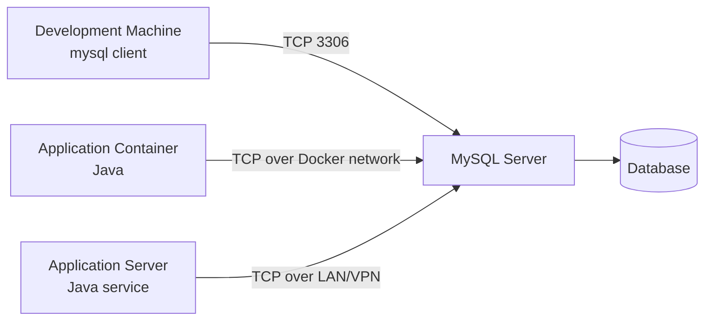

# Connecting from Remote Hosts, Other Containers, and Java Applications

MySQL may run on the same machine as the application, in a separate container, or on an independent network host. To connect successfully, you need the right address as **seen by the client**, the port MySQL is listening on, a network path allowing traffic through, and a MySQL account authorized from the exact connection source.

In the **DATABASE_MYSQL** module, this is an essential practical skill: a valid schema and query are unusable if the application cannot reach the server, the account is not allowed to log in from the current host, or JDBC is misconfigured. This lesson walks through connecting from another machine, between containers, and from Java applications, while building a layered troubleshooting approach.

## 1. MySQL Network Connection Model

MySQL Server typically accepts TCP connections on port 3306. The client can be a command-line program, an application container, a Java application, or another server.



A remote connection must pass through these steps:

1. The client resolves the hostname or determines the target IP address.
2. The client opens a TCP connection to the MySQL address and port.
3. The OS, firewall, router, security group, or container network allows the traffic.
4. MySQL is listening on the appropriate network address and corresponding port.
5. MySQL authenticates the account and verifies whether the account's Host portion matches the connection source.
6. Client and server negotiate the authentication plugin and TLS encryption if configured, before executing SQL statements.

Therefore, "cannot connect to MySQL" could be a DNS, routing, port, firewall, server config, authentication, privilege, or TLS error. Check in sequence rather than changing multiple settings at once.

## 2. Distinguishing Client and Server Addresses

`localhost` or `127.0.0.1` always refers to **the environment running the client itself**.

- If Java runs directly on your development machine and MySQL also runs on that machine, `127.0.0.1:3306` may be the right address.
- If Java runs inside a container, `127.0.0.1` refers to the Java container, not the MySQL container.
- If Java runs on another server, `127.0.0.1` refers to the application server, not the database server.
- If two containers share a Docker network, they typically use the MySQL service name or container name as the hostname.
- If the client runs on the host machine and MySQL is published from a container to the host, the client uses the published host port.

For example: the host machine publishes port 3307 to port 3306 in the MySQL container. In that case, a client on the host connects to `127.0.0.1:3307`; another container on the same Docker network still connects to hostname `db` on port `3306`.

The address must be chosen from the client's perspective, not from where MySQL is installed.

## 3. Allowing MySQL to Accept Network Connections

### 3.1. Checking Server Configuration

Log in to MySQL with an appropriate administrative account and inspect the network variables:

```sql
SHOW VARIABLES
WHERE Variable_name IN (
    'port',
    'bind_address',
    'skip_networking'
);
```

Meaning:

- `port`: the TCP port MySQL uses.
- `bind_address`: the IP address MySQL binds its listening socket to.
- `skip_networking`: if enabled, MySQL does not use TCP/IP to accept network connections.

If MySQL binds only to a loopback address such as `127.0.0.1`, clients on other machines cannot connect directly over the network interface. Configure it to bind to the appropriate network address or wildcard address according to infrastructure policy. Do not bind more broadly than actually needed.

Configuration file names and locations depend on the OS, installation method, or image. Settings in `my.cnf`/`mysqld.cnf` typically go under the `[mysqld]` section. Illustrative example:

```ini
[mysqld]
port = 3306
bind-address = 10.20.0.15
```

Replace `10.20.0.15` with the actual IP address of the MySQL server on the network it needs to serve. Ensure that address is assigned to the machine and do not blindly use an example IP. After changing configuration, restart the service if required by your version and deployment method, then re-verify runtime variables and listening sockets.

On Linux, you can inspect TCP sockets with:

```bash
sudo ss -lntp | grep 3306
```

The output should show the MySQL process listening on the appropriate address. If it only shows `127.0.0.1:3306`, the service still accepts loopback connections only. On Windows, you can check using PowerShell:

```powershell
Get-NetTCPConnection -State Listen -LocalPort 3306
```

Checking sockets verifies the OS listening state; it does not replace testing a connection from the actual client machine.

### 3.2. Opening the Network Path in a Controlled Way

Host firewalls and infrastructure firewalls must permit TCP traffic from the required client sources to the MySQL port. In cloud environments, also check security groups, network ACLs, private subnets, route tables, and VPN/peering if applicable.

Operational principles:

- Permit only the subnets or source addresses that need access.
- Prefer private networks, VPNs, or dedicated connections between application and database.
- Never expose the MySQL port to the Internet just for testing convenience.
- Never open all inbound ports when only TCP 3306 is needed.
- Document source access, destination, port, and justification in infrastructure configuration.

If MySQL uses a port other than 3306, both firewall and client must use the configured port. Opening a firewall cannot fix a server bound to the wrong address or running with `skip_networking` enabled.

## 4. Provisioning a MySQL Account for the Connection Source

MySQL manages accounts by **user and host** pair, in the form `'user'@'host'`. Here, host describes the source from which the account is permitted to connect; it is not the hostname of the destination MySQL server.

Examples:

- `'app_user'@'localhost'`: an account intended for connections from the MySQL server host itself via the appropriate local connection mechanism.
- `'app_user'@'10.20.0.25'`: an account for a source with that IP address.
- If you need to restrict to an IP range, use the host/netmask syntax supported by your deployed MySQL version and check its documentation. Using `%` and `_` wildcards in account host specifications has been deprecated since MySQL 8.0.35.

Do not assume an `'app_user'@'localhost'` account allows applications on other machines to log in. Accounts with the same username but different hosts are separate accounts and can have distinct passwords, authentication plugins, and privileges.

### 4.1. Creating a Narrowly Scoped Application Account

Example creating an account for an application running from a host at `10.20.0.25`:

```sql
CREATE USER 'app_user'@'10.20.0.25'
    IDENTIFIED BY 'REPLACE_WITH_A_STRONG_SECRET';

GRANT SELECT, INSERT, UPDATE, DELETE
    ON appdb.*
    TO 'app_user'@'10.20.0.25';
```

This is an illustrative example. Replace host address, database, and password with appropriate values. Real passwords should never be stored in source code or committed to Git. Use a secret manager or your deployment environment's secrets mechanism.

A runtime application typically only needs the read and write privileges required by business logic. Do not grant `ALL PRIVILEGES`, `CREATE USER`, `GRANT OPTION`, server admin privileges, or DDL privileges to the application runtime account unless clearly required. Separate the migration/schema-owner account from the account serving application requests.

You can inspect accounts and grants with:

```sql
SELECT user, host
FROM mysql.user
WHERE user = 'app_user';

SHOW GRANTS FOR 'app_user'@'10.20.0.25';
```

System tables such as `mysql.user` contain security information; the querying account must have appropriate read privileges. `SHOW GRANTS` is usually the most direct way to inspect privileges granted to a specific account.

### 4.2. Verifying Identity and Matched Host

After connecting successfully, run:

```sql
SELECT
    USER() AS client_identity,
    CURRENT_USER() AS matched_account,
    DATABASE() AS current_database;
```

`USER()` reports the username and host presented by the client upon connecting. `CURRENT_USER()` reports the MySQL account actually selected for privilege checks. These two values can differ due to account-matching rules. If login is denied, check existing accounts with that username, the actual source host, and the server message; once connected, use `CURRENT_USER()` to confirm which account matched.

## 5. Connecting Between Docker Containers

### 5.1. Two Containers on the Same Docker Network

When a Java application and MySQL belong to the same Docker Compose project, Compose typically creates a default network. Services can resolve one another by service name. For example:

```yaml
services:
  db:
    image: mysql:8.4
    environment:
      MYSQL_DATABASE: appdb
      MYSQL_ROOT_PASSWORD: $DB_ROOT_PASSWORD
    volumes:
      - mysql_data:/var/lib/mysql
    networks:
      - backend

  app:
    build: .
    environment:
      DB_HOST: db
      DB_PORT: 3306
      DB_NAME: appdb
      DB_USER: app_user
      DB_PASSWORD: $DB_APP_PASSWORD
    depends_on:
      - db
    networks:
      - backend

networks:
  backend:

volumes:
  mysql_data:
```

This is an illustrative configuration; supply secret variables via the environment or an appropriate secret store. Never put real passwords into a committed Compose file. The example only initializes the database; the application account is created and granted privileges separately following section 4. The official MySQL image offers a `MYSQL_USER` convenience shortcut, but you should not rely on that broadly scoped host account as production policy. In production, add health checks, database-readiness waiting, restart policies, secret management, and proper backup configuration.

In this example:

- `db` is the service name and also the hostname used by the `app` container.
- `3306` is the port inside the container network.
- There is no need to publish the database port to the host if only services on the same network need access.
- `depends_on` controls basic container startup order; it does not guarantee MySQL is ready to accept queries.

The application must implement bounded connection retries or wait for the database health check. Never treat a running MySQL container as proof that the server has finished initializing.

### 5.2. Publishing a Port for Clients on the Host Machine

If you need to use a MySQL client installed on the host machine, publish a port:

```yaml
services:
  db:
    image: mysql:8.4
    ports:
      - "127.0.0.1:3307:3306"
```

With this mapping, the host connects to `127.0.0.1:3307`; containers on the same network still use `db:3306`. Binding the host port to `127.0.0.1` restricts access via the host's loopback interface in Docker environments supporting this syntax. Omitting the host IP can cause Docker to publish on wider interfaces; check network policy before deploying.

### 5.3. Container Connecting to MySQL Running on the Host

In Docker Desktop on Windows or macOS, the `host.docker.internal` hostname is typically provided so containers can reach services on the host. For example:

```text
DB_HOST=host.docker.internal
DB_PORT=3306
```

MySQL on the host must still listen on an interface reachable by the container, and the firewall must permit that traffic. On Linux, `host.docker.internal` may need to be configured explicitly, such as using `host-gateway` in `extra_hosts` if supported by your Docker version.

Do not use `localhost` inside a container to point to the host. Check the Docker documentation for your running platform because host routing behavior can vary.

## 6. Connecting from Another Application Server

When Java runs on a separate VM or bare-metal server, the hostname is typically an internal DNS name or private IP of the MySQL server. For example:

```text
DB_HOST=mysql.internal.example
DB_PORT=3306
DB_NAME=appdb
```

The client must be able to resolve the DNS name, have a route to the destination subnet, and be permitted by firewalls/security groups. You can test DNS and port connectivity directly from the application machine:

```bash
getent hosts mysql.internal.example
nc -vz mysql.internal.example 3306
```

On Windows PowerShell:

```powershell
Resolve-DnsName mysql.internal.example
Test-NetConnection -ComputerName mysql.internal.example -Port 3306
```

`Test-NetConnection` or `nc` tests the TCP path to the host and port. If TCP succeeds, that only proves the network path can open a connection; it does not yet confirm valid MySQL accounts, database privileges, or TLS.

For connections over the Internet, design explicit network protection such as a VPN or private connectivity. Never solve connection errors by allowing every Internet address to access port 3306.

## 7. Connecting from a Java Application Using JDBC

Java typically connects to MySQL via JDBC and MySQL Connector/J. The application needs a driver compatible with both the Java and MySQL versions in use.

### 7.1. Adding MySQL Connector/J

With Maven, declare the dependency in `pom.xml` and choose a Connector/J version tested for compatibility by your project:

```xml
<dependency>
    <groupId>com.mysql</groupId>
    <artifactId>mysql-connector-j</artifactId>
    <version>${mysql.connector.version}</version>
</dependency>
```

`${mysql.connector.version}` is a property managed by the project in `properties` or dependency management. Choose a supported Connector/J version matching your Java runtime, MySQL Server, and project update policy; do not copy outdated version numbers from stale tutorials.

### 7.2. Configuring Connections via Environment Variables

Example configuration for an application running in the same Docker network as the MySQL service:

```text
DB_HOST=db
DB_PORT=3306
DB_NAME=appdb
DB_USER=app_user
DB_PASSWORD=<secret-from-secret-manager>
```

The JDBC URL can be constructed from the configuration components:

```text
jdbc:mysql://db:3306/appdb
```

Java example using `DriverManager`:

```java
import java.sql.Connection;
import java.sql.DriverManager;
import java.sql.PreparedStatement;
import java.sql.ResultSet;
import java.sql.SQLException;

public class MysqlConnectionExample {
    public static void main(String[] args) throws SQLException {
        String host = System.getenv("DB_HOST");
        String port = System.getenv().getOrDefault("DB_PORT", "3306");
        String database = System.getenv("DB_NAME");
        String user = System.getenv("DB_USER");
        String password = System.getenv("DB_PASSWORD");

        if (host == null || database == null || user == null || password == null) {
            throw new IllegalStateException("Missing database connection configuration");
        }

        String url = "jdbc:mysql://" + host + ":" + port + "/" + database;

        try (Connection connection =
                 DriverManager.getConnection(url, user, password);
             PreparedStatement statement =
                 connection.prepareStatement("SELECT VERSION(), DATABASE()");
             ResultSet result = statement.executeQuery()) {

            if (result.next()) {
                System.out.println("MySQL version: " + result.getString(1));
                System.out.println("Database: " + result.getString(2));
            }
        }
    }
}
```

Connector/J auto-registers the JDBC driver when present on the classpath in modern versions; there is no need to call `Class.forName("com.mysql.cj.jdbc.Driver")` in typical applications. The example above uses try-with-resources to properly close `ResultSet`, `PreparedStatement`, and `Connection`. Production applications should use a connection pool rather than opening a new connection per request.

### 7.3. Enabling TLS for Java Connections

When an application connects over a network, configure TLS per your environment's security policy. With MySQL Connector/J, you can use `sslMode=VERIFY_IDENTITY` in the JDBC URL when the server has a certificate issued by a trusted CA and the DNS name used by the client matches the certificate:

```text
jdbc:mysql://mysql.internal.example:3306/appdb?sslMode=VERIFY_IDENTITY
```

The client must trust the appropriate CA; the server certificate must be valid and have a Subject Alternative Name matching the hostname. Enabling encryption without verifying server identity leaves the client unable to detect spoofed endpoints. `VERIFY_IDENTITY` requires proper certificate configuration; if connections fail, inspect the CA, hostname, certificate expiration, and server TLS configuration.

Do not disable TLS as a default workaround. Nor should you enable options that weaken identity verification just to get a connection working in production. Development environments may use an internal CA, yet they should still mirror the verification model used in real deployments.

## 8. Layer-by-Layer Connection Troubleshooting

When an application cannot connect, work from the network layer up to the MySQL layer:

| Step | Question | Tools or Verification Method |
|---|---|---|
| 1. DNS | Does the hostname resolve correctly? | `nslookup`, `Resolve-DnsName`, `getent hosts` |
| 2. TCP | Can the client open the destination port? | `Test-NetConnection`, `nc -vz` |
| 3. Listener | Is MySQL listening on the right IP and port? | `ss -lntp`, `Get-NetTCPConnection` |
| 4. MySQL protocol | Can the client handshake with the server? | `mysql -h HOST -P PORT -u USER -p` |
| 5. Authentication | Do account and host match? | `USER()`, `CURRENT_USER()`, check account |
| 6. Authorization | Does the account have privileges on the database and tables? | `SHOW GRANTS` |
| 7. TLS | Are certificate and hostname verified? | Inspect CA, SAN, expiration, and `sslMode` |
| 8. Application | Are JDBC URL, driver, pool, and secret correct? | Application logs, runtime configuration |

Use the following client syntax to test directly from the application environment itself:

```bash
mysql -h mysql.internal.example -P 3306 -u app_user -p appdb
```

The `-p` option makes the client prompt interactively for the password. Never pass the password directly after `-p` on the command line because shell history or process listings can expose secrets.

### Common Errors

| Symptom | Possible Cause | Resolution Direction |
|---|---|---|
| `Unknown MySQL server host` | Wrong DNS or unresolvable hostname | Check service name, DNS, and network configuration |
| `Connection refused` | No listener on IP/port, MySQL not ready yet, or wrong port mapping | Check bind address, port, service status, and port mapping |
| Timeout | Blocked by firewall, route, security group, or network policy | Inspect the network path from client to server |
| `Access denied for user` | Wrong password, mismatched account host, or incompatible auth plugin | Check user/host, `CURRENT_USER()`, password, and driver |
| `Unknown database` | Database not created yet or wrong schema name | Verify database name and initialization procedure |
| Certificate or SSL handshake error | Mismatched CA, hostname, certificate, or TLS policy | Check certificate chain, SAN, expiration, and TLS config |
| Java reports missing driver | Connector/J missing from runtime classpath | Check dependencies and deployment artifact |

Read the full error message and server-side logs if accessible. Do not widen bind addresses, grant broad privileges, or disable TLS verification before identifying which layer is causing the failure.

## 9. Integrated Practice

Suppose a Java application runs in container `app`, MySQL runs in container `db`, and both join the same Docker Compose network.

The goal is for the application to connect to schema `appdb` using account `app_user` with the required read and write privileges.

Follow this sequence:

1. Start the MySQL service and wait for the health check to confirm the server is ready.
2. Create schema `appdb` and a dedicated account for the application. Restrict the account host to the actual source IP or subnet using syntax supported by your MySQL version; avoid relying on deprecated wildcard hosts.
3. Grant the required privileges on `appdb.*`, without granting administrative privileges.
4. Set `DB_HOST=db`, `DB_PORT=3306`, `DB_NAME=appdb`, `DB_USER=app_user`, and the secret in the runtime environment of container `app`.
5. Verify from inside container `app` that hostname `db` resolves and port 3306 is open.
6. Run the Java application with Connector/J and confirm that `SELECT VERSION(), DATABASE()` returns results.
7. Test a write operation inside a transaction on test data, confirming the application has the right privileges and the transaction finishes as expected.
8. Restart the database container or equivalent staging environment, verifying the application can recover connections once the database is ready.

If you want a client on the host machine to access it for study, publish a separate loopback port such as `127.0.0.1:3307:3306`, and connect to `127.0.0.1:3307`. Do not change the JDBC URL inside the container to `localhost:3307`; the application on the internal network still uses `db:3306`.

## 10. Safe Operational Principles

- Use hostnames that resolve reliably from the exact client environment.
- Keep MySQL on a private network whenever possible and restrict allowed source hosts.
- Use dedicated accounts per application or workload; grant only required privileges.
- Manage passwords via a secret manager or platform secret mechanism, rotate when needed, and avoid logging secrets.
- Enable TLS and verify server identity for network connections per deployment policy.
- Use connection pools, cap connection counts, and configure appropriate timeouts so applications do not open excessive sessions.
- Implement retries with backoff and clear limits for transient errors; avoid tight retry loops that overload the database.
- Monitor connection counts, authentication failures, timeouts, latency, and pool health.
- Separate migration privileges from runtime privileges; never use the root account in applications.
- Re-verify DNS, routing, firewalls, account hosts, and TLS after infrastructure changes.

## 11. Summary

- `localhost` always points to the environment running the client. A Java container cannot use `localhost` to find another MySQL container.
- Containers on the same network typically connect using the service name and internal port, such as `db:3306`.
- Clients running on the host use the published host port; for example, `127.0.0.1:3307` can be mapped to `db:3306`.
- Remote connections require a listener on the right address, a TCP route, and firewall permission.
- MySQL distinguishes accounts by `'user'@'host'`; even a valid username and password will be rejected if the host does not match.
- Java applications use MySQL Connector/J and a JDBC URL matching the application's network perspective.
- Troubleshoot in order across DNS, TCP, listener, authentication, authorization, TLS, and application configuration to pinpoint the real cause.

Once remote connectivity is stable and properly scoped with least privilege, a Java application can use MySQL as an independent data service that deploys cleanly in container environments or across dedicated hosts.
