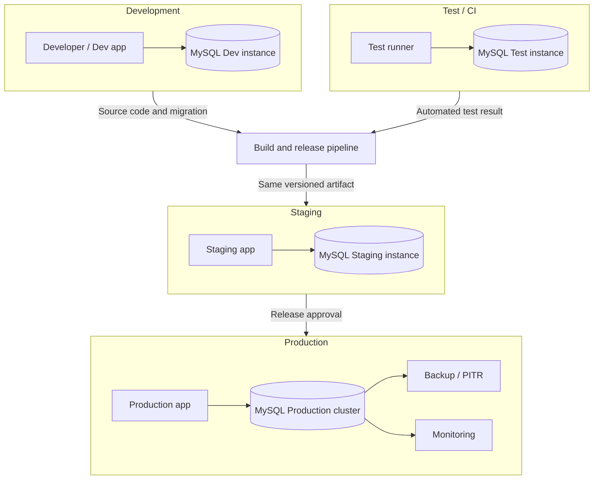
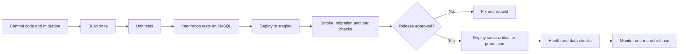

# Separating Development, Testing, and Production Environments

## Lesson Objectives

After this lesson, you will be able to:

- Explain the roles of development, testing (test/QA), pre-production (staging), and production environments.
- Design dedicated boundaries for each MySQL environment: instances, databases, accounts, networks, configuration, and data.
- Manage connection configuration and secrets without placing sensitive information into source code.
- Test schemas, migrations, queries, transactions, and access privileges on MySQL close to the target environment.
- Promote changes from development to production through a repeatable, observable, and recoverable workflow.
- Choose data, backup, restore, and monitoring policies suited to the criticality of each environment.

A MySQL system can run fine on a developer's machine yet fail on deployment: different server versions, incompatible collations, accounts lacking privileges, migrations disrupting the application, or test data unrepresentative of real data. Separating environments helps catch these differences before they impact business data.

## 1. Why Separate Environments?

Each stage of development has a different purpose and risk level. When every application connects to a single database, an experimental operation like `DROP TABLE`, running an incomplete migration, or loading sample data can affect everyone else. Conversely, if the test environment differs too much from production, test results are not reliable enough to predict release behavior.

Each environment should be treated as an independent deployment target with its own endpoint, configuration, accounts, data, and lifecycle. For critical systems, isolating via separate MySQL instances or clusters limits faults and resource contention. On a personal machine, you can use multiple databases within one instance for practice; this is convenient, but it does not provide strong security or resource boundaries like separate instances do.

### Common Environments

| Environment | Purpose | Data and Privileges | Completion Criteria |
|---|---|---|---|
| Development (dev) | Feature development, SQL experimentation, schema and migration debugging | Synthetic/mock data; developers hold schema modification privileges within dev scope | Feature works, queries and migrations are repeatable |
| Test / QA | Running automated, integration, regression, and business-logic tests | Controlled test dataset; test accounts scoped to exact application privileges | Test suite passes, bugs are reproducible |
| Staging / Pre-production | Rehearsing releases on a near-production configuration | Synthetic or anonymized data; privileges and deployment flow mirror production | Migrations, config, performance, and operational procedures are verified |
| Production (prod) | Serving real users and live data | Live business data; least privilege, strict change control | Service meets SLOs, data is safe and recoverable |

Dev, test, and staging do not have to be three large server clusters. A small project might use a personal machine for dev, ephemeral instances in CI for test, and a shared staging cluster. What must be preserved is that each environment has a clearly defined identity, dataset, privilege set, and configuration.

**Test and staging serve different purposes.** Test prioritizes catching bugs through repeatable test cases that can run frequently. Staging prioritizes simulating a real release: application version, configuration, privileges, topology, migrations, and operational steps closely resemble production.

## 2. Designing Boundaries Between Environments

A simple architecture can be represented as follows:



This is a logical diagram: the pipeline promotes versioned application builds and managed migrations forward through environments. Production data does not flow backward into dev or test as an unaltered copy.

### 2.1. Instances and Databases

For production, dedicate a separate instance or cluster with its own resources, endpoint, backups, monitoring, and access policies. Do not place a production database alongside a test database on the same instance and treat the database name as the sole security boundary. A mistaken statement, an overly privileged account, or a heavy test workload can affect the entire instance.

In dev, a single local MySQL instance can host multiple databases to save resources. For example:

- shop_dev: personal experimental data.
- shop_test: schema and fixtures for manual testing.
- shop_ci_12345: ephemeral database for a single CI run.

In CI, prefer an ephemeral instance or uniquely named temporary database per job, tearing it down when the job finishes. If multiple jobs write to a shared database concurrently, tests can interfere with each other, depend on execution order, or overwrite each other's data.

### 2.2. Accounts and Privileges

Each environment needs dedicated accounts. Never share a single administrative account across applications, developers, test runners, and migration tools.

A common model:

- The application runtime account holds only required DML privileges on the application schema.
- The migration account is granted required DDL privileges and is used only during schema deployment steps.
- Reporting read-only accounts hold read privileges only on permitted objects.
- Administrative accounts are restricted to operators and admin tooling, with separate access controls.

Illustrative example of privileges in a production environment:

```sql
-- Host pattern is illustrative only; replace with the actual connection source.
CREATE USER 'shop_runtime'@'10.20.%'
  IDENTIFIED BY '<secret-from-secret-manager>';

GRANT SELECT, INSERT, UPDATE, DELETE
  ON shop_prod.*
  TO 'shop_runtime'@'10.20.%';

CREATE USER 'shop_migrator'@'10.30.%'
  IDENTIFIED BY '<secret-from-secret-manager>';

GRANT ALTER, CREATE, DROP, INDEX, REFERENCES
  ON shop_prod.*
  TO 'shop_migrator'@'10.30.%';

SHOW GRANTS FOR 'shop_runtime'@'10.20.%';
```

This illustrates separation of roles, not a universal privilege list for every application. If an application needs to invoke stored procedures, create temporary tables, or use another feature, grant only the exact additional privileges after confirming the need. Never grant ALL PRIVILEGES just to make a permission error go away. Host patterns must also match the actual network; do not copy the 10.20.% example verbatim into your system.

Dev may grant developers DDL privileges on the dev database for experimentation. Those privileges should not carry over to runtime accounts in test, staging, or production. Test the application using the exact privilege set it will have in operation.

Inspect the account and privileges of the current connection:

```sql
SELECT USER() AS connection_identity,
       CURRENT_USER() AS matched_account;

SHOW GRANTS FOR CURRENT_USER();
```

USER() shows the connection identity sent by the client; CURRENT_USER() shows the MySQL account actually used for privilege checks. When debugging Access denied errors, these two values help determine which account the server matched.

### 2.3. Networking and Endpoints

Place MySQL on a private network and allow only designated application hosts or admin machines to connect. Production typically does not need to expose the MySQL port directly to the Internet. Developers connect via VPN, bastion, or controlled access mechanisms. Test runners are permitted to reach only the test instance; deployment pipelines receive credentials only for the specific environment they are deploying to.

Use clear endpoint names, such as mysql-dev.internal, mysql-test.internal, mysql-staging.internal, and mysql-prod.internal. These illustrative names do not replace DNS, firewall, or TLS certificate configuration. Before running any data-modifying command, operators must verify the exact endpoint, database, and account in use.

## 3. Managing Connection Configuration per Environment

Application code should read connection settings from environment variables or a managed configuration system. Never write production hosts, usernames, passwords, or access keys directly into source code, committed config files, or logs.

A connection configuration set typically includes:

| Property | Example | What to Control |
|---|---|---|
| Host | mysql-dev.internal | Endpoint belonging to the exact environment |
| Port | 3306 | MySQL port or proxy-forwarded port |
| Database | shop_dev | Authorized database name |
| Username | shop_runtime_dev | Account scoped by environment and role |
| Password | Secret injected at runtime | Stored in a secret manager or platform secrets store |
| TLS | Enabled for network connections | Verify certificate and hostname per policy |
| Time zone | UTC or agreed convention | Prevent drift when writing/reading timestamps |
| Charset / collation | utf8mb4 and chosen collation | Keep string comparison behavior consistent |

Example configuration for a dev environment loaded into the process before startup:

```text
APP_ENV=development
DB_HOST=127.0.0.1
DB_PORT=3307
DB_NAME=shop_dev
DB_USER=shop_runtime_dev
DB_PASSWORD=<local-development-secret>
```

This illustrates configuration naming. Files containing passwords are for local use only and must be excluded from Git. In staging and production, retrieve secrets from a secret manager or platform secrets injection; avoid baking secrets into images, command lines, logs, or build artifacts.

The application can construct the JDBC URL from the values above, while passing username and password separately via the connection library's configuration mechanism:

```text
jdbc:mysql://${DB_HOST}:${DB_PORT}/${DB_NAME}
```

Never use a silent default pointing to production when a configuration variable is missing. The application should fail startup with a clear error message if required configuration is absent. This prevents a dev machine from accidentally writing to the live database just because a local config file was not set up.

### 3.1. Keeping MySQL Behavior Compatible

Environments should run a MySQL version compatible with production. If production runs MySQL 8.4 LTS, integration testing should use the same release series or a verified compatible version. Do not use floating container tags like latest in pipelines requiring reproducible results; pin a specific patch tag or approved image digest and update intentionally. The mysql:8.4 tag in the Compose example below illustrates the LTS series; in a pipeline, replace it with a pinned patch tag or digest.

Beyond version, control settings that affect SQL outcomes:

- sql_mode: data validation and syntax rules.
- Character set and collation: how strings are stored, compared, and sorted.
- Time zone: how timestamps are interpreted and displayed.
- Storage engine: e.g., InnoDB for tables requiring transactions.
- autocommit and isolation level: affect transaction boundaries and concurrency behavior.
- Connection limits, timeouts, packet size, and connection pool settings.

Every resource metric in dev does not need to match production. However, differences affecting SQL semantics, transactions, privileges, or migrations must be detected and tested. If staging intentionally differs from production, document the reason and assess the risk.

You can capture a configuration fingerprint from the current connection:

```sql
SELECT VERSION() AS mysql_version,
       @@hostname AS server_host,
       @@port AS server_port,
       @@datadir AS data_directory,
       @@sql_mode AS sql_mode,
       @@time_zone AS session_time_zone,
       @@character_set_server AS server_charset,
       @@collation_server AS server_collation,
       @@autocommit AS autocommit_mode;
```

Comparing outputs across test, staging, and production helps spot configuration drift. Do not expose sensitive infrastructure details in public logs or external reports; retain only fields needed for diagnostics.

## 4. Creating a Reproducible Local Practice Environment

Docker Compose is a convenient way to give each developer an isolated MySQL instance. The example below is for local environments only:

```yaml
services:
  mysql:
    image: mysql:8.4
    command:
      - --character-set-server=utf8mb4
      - --collation-server=utf8mb4_0900_ai_ci
    environment:
      MYSQL_DATABASE: shop_dev
      MYSQL_USER: shop_runtime_dev
      MYSQL_PASSWORD: ${MYSQL_APP_PASSWORD:?set MYSQL_APP_PASSWORD}
      MYSQL_ROOT_PASSWORD: ${MYSQL_ROOT_PASSWORD:?set MYSQL_ROOT_PASSWORD}
    ports:
      - "127.0.0.1:${MYSQL_PORT:-3307}:3306"
    volumes:
      - mysql_dev_data:/var/lib/mysql
    healthcheck:
      test: ["CMD", "mysqladmin", "ping", "-h", "127.0.0.1", "--silent"]
      interval: 5s
      timeout: 3s
      retries: 20

volumes:
  mysql_dev_data:
```

Store local secrets in an uncommitted .env.dev file:

```text
MYSQL_PORT=3307
MYSQL_APP_PASSWORD=<local-app-password>
MYSQL_ROOT_PASSWORD=<local-root-password>
```

Start and inspect status:

```bash
docker compose --project-name shop-dev --env-file .env.dev up -d
docker compose --project-name shop-dev ps
docker compose --project-name shop-dev logs mysql
```

Use a distinct project name for each local environment so Compose creates separate container groups and named volumes. For instance, shop-test can use a different host port and its own configuration file. Never share a data volume across independent MySQL instances.

Key details to remember:

- The MySQL image's MYSQL_DATABASE, MYSQL_USER, and password variables are used only when initializing an empty data directory. Editing .env.dev after the volume has been initialized does not automatically change passwords or recreate databases inside the existing volume.
- If you need to reset local data, verify the exact dev project and volume before deleting. Deleting a volume wipes the data inside it.
- The host port is bound to 127.0.0.1 so only the local machine can reach it directly in this example.
- The configuration above is not a production deployment template. Production requires proper secret management, private networking, backups, monitoring, an HA plan, and operational controls.

Once the instance is ready, connect with a client and verify the target:

```bash
mysql --host=127.0.0.1 --port=3307 --user=shop_runtime_dev --password shop_dev
```

Then run:

```sql
SELECT VERSION(), @@hostname, @@port, DATABASE();
SHOW TABLES;
```

Do not run migrations or data-deletion commands until you have confirmed the endpoint and database.

## 5. Managing Consistent Schemas and Migrations

Database schemas should be managed like source code. Store SQL migrations in the repository, number them sequentially, and never silently edit a migration already applied to a shared environment.

Example structure:

```text
database/
  migrations/
    V001__create_customer.sql
    V002__create_order.sql
    V003__add_order_status_index.sql
  seeds/
    dev/
    test/
```

Filenames illustrate one convention; you can use Flyway, Liquibase, or another migration tool. Every migration should be reviewed, run automatically in CI, and maintain a clear application history. Test and staging should be built from the exact same migrations as production, rather than relying on manually edited schema dumps from a developer.

A basic migration workflow:

1. Create the migration in a development branch and verify it on a clean dev database.
2. CI spins up an ephemeral test instance, runs all migrations from scratch, and runs tests.
3. Staging runs the migration following the planned release procedure and verifies application compatibility.
4. Production applies the migration during an approved window or deployment strategy, with appropriate backups and recovery plans.
5. Record the applied schema version and verify the application post-deployment.

### 5.1. Designing Migrations Compatible with Running Applications

Not every migration can be rolled back trivially. Many DDL statements in MySQL trigger an implicit commit; therefore, you cannot assume a sequence of ALTER TABLE statements will undo atomically via ROLLBACK. Design migrations to move forward safely and minimize breaking changes.

For example, when renaming a column from customer_name to display_name, you can split it into steps:

1. Add the new column display_name while keeping the old column.
2. Deploy application code capable of reading and writing both columns compatibly; backfill data in batches and verify results.
3. Switch all reads to the new column, monitoring for errors and data drift.
4. Drop the old column only in a subsequent release, once certain no running application version depends on it.

This expand/contract approach gives old and new application versions overlap time to coexist. It is especially valuable when deploying multiple application instances or when needing fast application rollbacks. Before major migrations, rehearse on staging with near-production data volume and measure duration, locking, and query impact.

Indexes are schema changes too. Inspect execution plans with EXPLAIN, column selectivity, and write overhead before adding an index. A new index can speed up reads while increasing storage and INSERT, UPDATE, DELETE costs. Never create indexes in production purely on a hunch that more indexes mean faster queries.

## 6. Test Data Must Be Safe and Meaningful

Data determines test quality. A dataset with just a few trivial rows may miss slow queries, pagination bugs, duplicate-key errors, deadlocks, or boundary-data bugs.

Prefer synthetic data whose structure and distribution resemble business reality. The dataset should include:

- Small counts, large counts, and values at numeric, date/time, and string boundaries.
- Records linked via primary keys and foreign keys.
- Duplicates, NULL values, long strings, Unicode characters, and invalid-input edge cases.
- Skewed distributions to test indexes and execution plans.
- Datasets large enough for performance testing in a dedicated environment.

Do not copy raw production data directly into dev or test. If realistic data is required, establish an approval workflow, minimize fields, anonymize or synthesize data, enforce access controls, and set retention limits. Renaming columns or masking a few fields does not automatically anonymize data if records can still be linked back to individuals.

Seed data should be reloadable repeatedly in a predictable manner. Each test should create its own data or use transaction rollbacks where appropriate. Avoid tests that depend on leftover data from a previous run. When testing concurrency, open genuinely separate sessions to observe lock waits, deadlocks, and isolation; sequential runs cannot substitute for concurrency tests.

### 6.1. Testing Against Real MySQL

Mock repositories can be useful for unit tests, but they do not replace integration testing against MySQL. Behaviors such as collation, constraints, locking, transactions, JSON, indexes, and the optimizer depend on the storage engine and server version. Integration tests should boot a compatible MySQL instance, run migrations, and execute real SQL.

A solid test suite typically includes:

| Test Group | Examples |
|---|---|
| Schema and migrations | Build a clean database, upgrade from the previous schema version, verify indexes and constraints |
| CRUD and constraints | Test primary keys, foreign keys, unique constraints, NOT NULL, and data types |
| Transactions | Commit, rollback, mid-transaction errors, and business atomicity |
| Concurrency | Two sessions updating the same record, lock waits, deadlocks, and retries |
| Queries | Accurate results, EXPLAIN output, expected index usage |
| Privileges | Runtime account succeeds on valid operations and is denied on out-of-scope DDL |
| Compatibility | MySQL version, collation, time zone, and sql_mode closely matching production |

Performance and heavy load tests should run in an environment dedicated to that purpose. Never run heavy benchmarks on production or on a test instance shared with other jobs.

## 7. Workflow for Promoting Changes to Production

A pipeline can be structured as follows:



Key principles:

- **Build once, deploy anywhere:** the exact artifact verified in staging is the artifact promoted to production. Do not build a separate binary just for production.
- **Configuration separated from artifacts:** endpoints, credentials, and environment parameters are injected at deploy time.
- **Tracked migration history:** know which schema version is currently active and what the next version will change.
- **Pre- and post-deploy checks:** verify backups, privileges, connectivity, migrations, health checks, and post-deploy metrics.
- **Clear ownership:** identify who executes, who approves, and how to escalate during an incident.
- **Never use dev as a source for production data:** only controlled code, migrations, and artifacts flow through the pipeline.

A production deployment typically covers preparation (verifying versions, backups, disk space, privileges, and rollout plan), applying compatible migrations, deploying the application, running smoke tests, monitoring errors, and recording the release. If issues surface, the application can roll back while the schema remains backward-compatible; for data or DDL changes, many cases require rolling forward with a fix rather than attempting to revert with a single rollback command.

## 8. Backup, Restore, and Data Protection Across Environments

Each environment has different data protection needs:

| Environment | Typical Appropriate Protection |
|---|---|
| Dev | Rebuildable from migrations and seeds; back up only if hard-to-recreate experimental data exists |
| Test / CI | Ephemeral data; created fresh per job and destroyed after execution |
| Staging | Back up before major migration rehearsals; managed and reproducible dataset |
| Production | Scheduled backups, copies in an independent location, encryption, restricted access, and restore drills |

For production, backup policy must rest on two objectives:

- **RPO (Recovery Point Objective):** maximum acceptable data loss measured in time.
- **RTO (Recovery Time Objective):** how quickly the service must be restored.

MySQL can use logical backups, physical backups, and binary logs to support point-in-time recovery (PITR). The choice depends on data size, recovery time targets, topology, and operational tooling. A backup is only meaningful if it can be restored; run periodic restore drills in an isolated environment, measure restore duration, and verify recovered data.

When building staging from production, pass data through an anonymization workflow or generate synthetic data before granting tester access. Backups containing sensitive data must be protected like production data itself: encrypted, access-controlled, audited, and purged per retention policy. Never send database dumps over chat channels or store them on unmanaged personal laptops.

## 9. Monitoring and Troubleshooting by Environment

Each environment requires monitoring proportional to its purpose. Dev needs sufficient logs for debugging; CI needs test logs and results to reproduce failures; staging needs to validate signals used for release go/no-go decisions; production needs alerting and on-call incident procedures.

MySQL signals to observe include:

- Connection health: connection counts, connection errors, threads, and pool status.
- Query performance: slow queries, latency, rows examined, unexpected execution plans.
- Concurrency: lock waits, deadlocks, long-running transactions, and uncommitted transactions.
- Resources: CPU, memory, disk I/O, data/log disk usage, and data growth rate.
- Availability: uptime, server errors, replica status, and replication lag if applicable.
- Backups: last backup timestamp, job outcome, and most recent restore test.

Do not set production alerts using arbitrary thresholds copied across every system. Thresholds should be anchored to baselines, normal load, and SLOs. Alerts should specify environment, instance, symptom, impact severity, and initial triage direction.

When receiving a "cannot connect to database" alert, follow this sequence:

1. Confirm which environment configuration the application is running with.
2. Inspect host, port, database, and account loaded into the process.
3. Check DNS, network policies, firewalls, and TLS.
4. Check whether the MySQL instance is healthy, has disk space, and is accepting connections.
5. Check matched account, privileges, and connection limits.
6. Inspect application logs, the MySQL error log, and whether failure timing coincides with a deploy or migration.

Do not rush to increase `max_connections` when hitting out-of-connections errors. Determine whether the pool is leaking connections, transactions are held open too long, queries slowed down, or traffic genuinely increased. Similarly, when a query is slow only in production, compare data volume, statistics, indexes, versions, configuration, and workload before tweaking server parameters.

## 10. Pre-Release Checklist

- [ ] Application and migrations passed tests on a compatible MySQL version.
- [ ] Staging uses connection settings, charset, collation, time zone, and privileges close to production.
- [ ] Runtime account holds no administrative or unnecessary DDL privileges.
- [ ] No secrets exist in repositories, images, logs, or build artifacts.
- [ ] Staging/test data is synthetic or sanitized per policy.
- [ ] Migrations are ordered, reviewed, and have a failure-handling plan.
- [ ] Recent backups and restore capability appropriate for the change are verified.
- [ ] Deployment plan, owner, smoke tests, and abort criteria are in place.
- [ ] Production dashboards and alerts can detect post-deploy regressions.

## 11. Practice Exercises

### Exercise 1: Create Two Independent Local Environments

Use Docker Compose to spin up two instances: shop-dev and shop-test. Assign separate project names, host ports, databases, and accounts. Confirm the two instances have distinct endpoints and data directories. Create a table in dev and verify it does not appear in test.

### Exercise 2: Verify Privilege Boundaries

Create a runtime account with only SELECT, INSERT, UPDATE, and DELETE privileges on a test database. Confirm required data operations succeed, while CREATE TABLE and DROP TABLE are denied. Create a separate migration account and verify its DDL privileges.

### Exercise 3: Test Migrations from Scratch

Create two migrations: one creating a customer table and one creating an order table with a foreign key. Run the migrations on a clean database, load seed data, run constraint tests, and inspect SHOW CREATE TABLE. Then rebuild the database from scratch to confirm the process is repeatable.

### Exercise 4: Rehearse a Staging Deployment

Design a schema change using the expand/contract pattern. Run the migration, deploy a compatible application version, verify data and queries, and document the steps required to roll back to the previous application version. Identify which step requires rolling forward if the migration has modified data.

### Exercise 5: Document a Recovery Procedure

Pick a test database, create a backup, restore it into another instance, and verify table counts, row counts, and a few business queries. Record backup duration, restore duration, and data verification steps.

## Conclusion

Environment separation is part of MySQL design and operations. Dev needs flexibility, test needs reproducibility, staging needs release simulation, and production needs data protection and recoverability. When endpoints, accounts, configuration, migrations, data, and monitoring are managed separately per environment, engineering teams catch discrepancies early and ship database changes with confidence.
