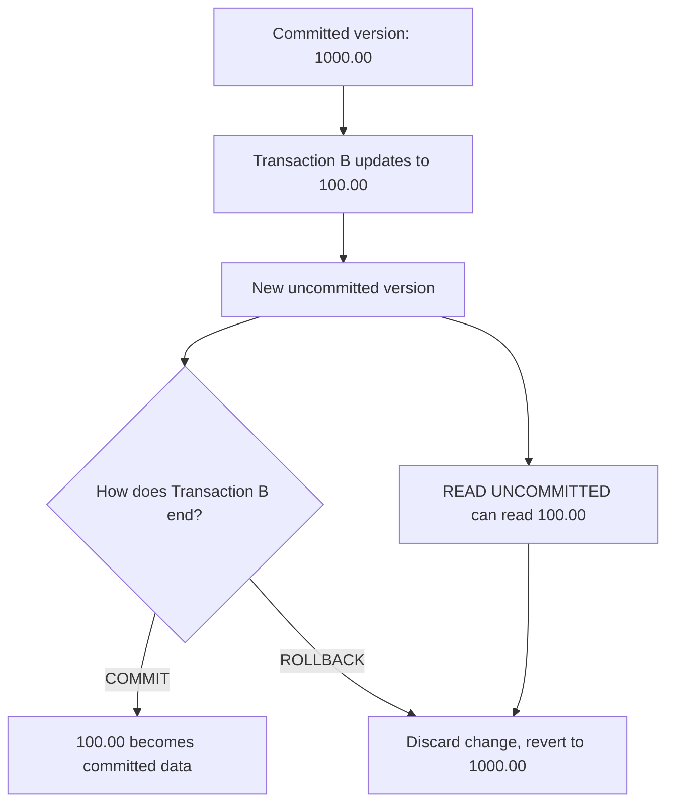

# READ UNCOMMITTED and Uncommitted Data

`READ UNCOMMITTED` is the lowest transaction isolation level in MySQL. With InnoDB, an ordinary read query at this level can see changes that another transaction has written but not yet committed (`COMMIT`). If the writing transaction later executes `ROLLBACK`, the value read by the reading transaction never became confirmed data. Reading an uncommitted change from another transaction is called a **dirty read**.

Dirty reads can cause reports to show temporary balances, inventory quantities, or order statuses that subsequently disappear. When multiple rows are updated within the same transaction, a query can also see part of the changes while the remaining rows have not been updated yet. Therefore, `READ UNCOMMITTED` is only appropriate when the application tolerates temporary and inconsistent data; it is not a default choice for speeding up queries.

This lesson belongs to the **DATABASE_MYSQL** module. The module aims to master MySQL from table design, data types, keys, and SQL queries to indexes, transactions, and concurrency control; while practicing reading execution plans, query tuning, privilege management, backups, and handling relational database operational issues. Within the **MVCC and Isolation Levels** chapter, this lesson focuses on `READ UNCOMMITTED`, how uncommitted data is read, and the risks of using this isolation level with InnoDB.

## 1. What Is a Transaction Isolation Level?

A transaction can run concurrently with other transactions. If two transactions read or write related rows, what each transaction sees depends on the isolation level and the type of statement used.

SQL defines four standard isolation levels:

1. `READ UNCOMMITTED`
2. `READ COMMITTED`
3. `REPEATABLE READ`
4. `SERIALIZABLE`

The isolation level determines which changes from other transactions are allowed to be visible and how reads interact with concurrent writes. It does not replace transactions, constraints, row locks, or business rules.

In MySQL, InnoDB is the storage engine that supports transactions and MVCC. InnoDB's default is `REPEATABLE READ`, unless server or session configuration changes it.

## 2. MVCC and Row Versions in InnoDB

MVCC (Multi-Version Concurrency Control) allows InnoDB to maintain multiple logical versions of a row so read queries can see an appropriate version without having to lock every row being read. Examples in this lesson assume tables use InnoDB; storage engines without transaction support do not provide the same rollback and isolation guarantees.

When a transaction updates an InnoDB row, the engine writes the necessary information to the undo log so older versions can be restored. These versions are linked with transaction information. For consistent reads at snapshot-based isolation levels, InnoDB creates a read view to determine which transactions have committed and which row versions are allowed to be visible.

Example of a row with an initial balance of `1000.00`:



Under `READ UNCOMMITTED`, an ordinary nonlocking `SELECT` can see the latest change even if the writing transaction has not committed. Reads do not rely on a stable consistent snapshot. The `READ COMMITTED` and `REPEATABLE READ` levels apply different snapshot rules to prevent dirty reads.

MVCC does not mean every `SELECT` statement is nonlocking in all situations. Distinguish between:

- **Consistent read:** an ordinary read query, such as `SELECT ... FROM ...`, uses MVCC version visibility rules and typically does not lock read rows.
- **Locking read:** a query with `FOR SHARE` or `FOR UPDATE`, acquires locks to coordinate with writing transactions. This is a current read, with different locking behavior from a consistent read.
- **Write statements:** `UPDATE`, `DELETE`, and `INSERT` still must acquire the required locks. `READ UNCOMMITTED` does not disable write locks.

A transaction always sees changes made by itself, even if uncommitted. That is not a dirty read. A dirty read is when transaction A sees uncommitted changes made by transaction B.

## 3. How Does a Dirty Read Happen?

Suppose transaction B updates a balance from `1000.00` to `100.00` without committing. Transaction A runs a `SELECT` under `READ UNCOMMITTED` and reads `100.00`. Then B rolls back, and the actual balance returns to `1000.00`.

The value `100.00` that A read was unconfirmed data. If A uses this value to decide to reject a payment, send an alert, or write a report, that decision can be wrong even though the database never actually persisted a balance of `100.00`.

### 3.1. Test Data

Run this in a dedicated lab schema. Create the table once and load initial data:

```sql
CREATE TABLE ru_demo_accounts (
    account_id BIGINT NOT NULL,
    account_name VARCHAR(80) NOT NULL,
    balance DECIMAL(12, 2) NOT NULL,
    PRIMARY KEY (account_id)
) ENGINE = InnoDB;

INSERT INTO ru_demo_accounts (account_id, account_name, balance)
VALUES (1, 'Main account', 1000.00);

SELECT * FROM ru_demo_accounts;
```

Initial result:

| account_id | account_name | balance |
|---:|---|---:|
| 1 | Main account | 1000.00 |

Open two independent MySQL connections, called **Session A** and **Session B**. Do not run both flows on the same connection because the goal is to observe concurrent transactions.

### 3.2. Session A: Enable READ UNCOMMITTED

Run in Session A before starting the transaction:

```sql
SET SESSION TRANSACTION ISOLATION LEVEL READ UNCOMMITTED;

SELECT @@SESSION.transaction_isolation;

START TRANSACTION;
```

The returned value should be `READ-UNCOMMITTED`. Transaction A has now started. Pause here and switch to Session B.

### 3.3. Session B: Update Without Committing

Run in Session B:

```sql
START TRANSACTION;

UPDATE ru_demo_accounts
SET balance = 100.00
WHERE account_id = 1;

SELECT balance
FROM ru_demo_accounts
WHERE account_id = 1;
```

Session B sees its own change of `100.00`. Do not run `COMMIT` or `ROLLBACK` yet; transaction B remains open and holds a write lock on the row.

### 3.4. Session A Reads Uncommitted Data

Switch back to Session A and run an ordinary read query:

```sql
SELECT balance
FROM ru_demo_accounts
WHERE account_id = 1;
```

Under `READ UNCOMMITTED`, InnoDB can return `100.00` even though Session B has not committed. Because this ordinary read query is not a locking read, it can read while B still holds the write lock.

This value is a dirty read: transaction A read a change that has not been confirmed by transaction B.

### 3.5. Session B Rolls Back and Session A Reads Again

Run in Session B:

```sql
ROLLBACK;
```

Then return to Session A:

```sql
SELECT balance
FROM ru_demo_accounts
WHERE account_id = 1;
```

The result is now `1000.00`. The change to `100.00` was discarded. Session A can read a value and then see that value vanish within the same transaction.

Finish Session A:

```sql
COMMIT;
```

`COMMIT` in A only ends A's read transaction; it does not restore or confirm B's change. B already rolled back its change earlier.

## 4. Timeline of a Dirty Read

| Time | Session A (`READ UNCOMMITTED`) | Session B |
|---|---|---|
| T1 | `START TRANSACTION` | — |
| T2 | — | `START TRANSACTION` |
| T3 | — | `UPDATE balance = 100.00`, uncommitted |
| T4 | `SELECT balance` reads `100.00` | Transaction still open |
| T5 | — | `ROLLBACK` |
| T6 | `SELECT balance` reads `1000.00` again | Transaction ended |
| T7 | `COMMIT` | — |

**Key point:** A read the version created by B before B committed. When B rolled back, the value A had just read no longer existed in committed data.

## 5. Comparison with READ COMMITTED

`READ COMMITTED` does not allow a transaction to read uncommitted changes from another transaction. Each ordinary consistent read creates a new snapshot at the start of the statement, so two `SELECT` statements in the same transaction can see two different committed states if another transaction commits in between.

Repeat the exercise with Session A:

```sql
SET SESSION TRANSACTION ISOLATION LEVEL READ COMMITTED;
START TRANSACTION;
```

Session B updates the balance to `700.00` without committing:

```sql
START TRANSACTION;

UPDATE ru_demo_accounts
SET balance = 700.00
WHERE account_id = 1;
```

While B still has its transaction open, Session A runs:

```sql
SELECT balance
FROM ru_demo_accounts
WHERE account_id = 1;
```

A reads the latest committed value `1000.00`, not the uncommitted `700.00`. Now B runs:

```sql
COMMIT;
```

Session A runs the `SELECT` again inside its open transaction. Under `READ COMMITTED`, the new statement gets a fresh snapshot and can read `700.00` which has just been committed.

Finish transaction A:

```sql
COMMIT;
```

Thus:

- `READ UNCOMMITTED`: can read `700.00` before B commits.
- `READ COMMITTED`: only reads `700.00` after B commits.
- Two reads under `READ COMMITTED` can differ because each statement uses a fresh snapshot.

## 6. Comparison with REPEATABLE READ

`REPEATABLE READ` is InnoDB's default level. For ordinary consistent reads, the first read in the transaction creates a read view; subsequent consistent reads within the same transaction continue using that snapshot.

Try again in two sessions:

Session A:

```sql
SET SESSION TRANSACTION ISOLATION LEVEL REPEATABLE READ;
START TRANSACTION;

SELECT balance
FROM ru_demo_accounts
WHERE account_id = 1;
```

Suppose A reads `700.00`; this read creates the transaction's snapshot. Session B then updates to `500.00` and commits:

```sql
START TRANSACTION;

UPDATE ru_demo_accounts
SET balance = 500.00
WHERE account_id = 1;

COMMIT;
```

Session A reads again:

```sql
SELECT balance
FROM ru_demo_accounts
WHERE account_id = 1;
```

With a consistent read under `REPEATABLE READ`, A still sees `700.00` in its snapshot, even though B committed `500.00`. Finish A:

```sql
COMMIT;
```

If A starts a new transaction, it will see the latest committed state of `500.00`.

Note: the snapshot rules above describe consistent reads. Locking read statements such as `SELECT ... FOR UPDATE` are current reads and have different locking and current-read rules than consistent reads.

## 7. Comparison Table of the Four Isolation Levels in InnoDB

| Isolation Level | Dirty Read | Non-Repeatable Read | Phantom Read | Nonlocking SELECT Visibility |
|---|---|---|---|---|
| `READ UNCOMMITTED` | Possible | Possible | Possible | Can read uncommitted changes; no stable snapshot. |
| `READ COMMITTED` | No | Possible | Possible | Each consistent read gets a fresh snapshot at statement start. |
| `REPEATABLE READ` | No | No across consistent reads in the same transaction | Consistent read snapshots do not see rows newly committed after the read view; locking reads have separate locking rules | Consistent reads share the transaction's read view. |
| `SERIALIZABLE` | No | No | Prevented through appropriate serialization and locking | With autocommit disabled, plain SELECT is treated as a shared-lock locking read. |

Three concepts to distinguish:

- **Dirty read:** reading another transaction's change when that change is uncommitted and may later roll back.
- **Non-repeatable read:** the same row is read twice, but its committed value changes between the two reads.
- **Phantom read:** the same range query condition returns a different set of rows because another transaction inserted or deleted matching rows.

`READ UNCOMMITTED` can encounter all three. Do not confuse a dirty read with a lost update: a lost update is an issue where two transactions overwrite each other's results; read-modify-write operations, locking, and optimistic concurrency must be analyzed separately.

## 8. Dirty Reads Can Distort Aggregate Totals

Insert a recipient account into the lab table before running the example:

```sql
INSERT INTO ru_demo_accounts (account_id, account_name, balance)
VALUES (2, 'Savings account', 500.00);
```

Suppose a transaction transfers `100.00` from account A to account B. The business rule requires the sum of the two balances to remain constant.

Session A sets the isolation level for the read query:

```sql
SET SESSION TRANSACTION ISOLATION LEVEL READ UNCOMMITTED;
```

Session B starts a transaction and deducts money from the source account:

```sql
START TRANSACTION;

UPDATE ru_demo_accounts
SET balance = balance - 100.00
WHERE account_id = 1;
```

While B keeps its transaction open, Session A runs the following query under `READ UNCOMMITTED`:

```sql
SELECT SUM(balance) AS visible_total
FROM ru_demo_accounts
WHERE account_id IN (1, 2);
```

A can see the total balance drop by `100.00` because the source account has been debited while the recipient account has not yet been credited. Then Session B credits the recipient account and commits:

```sql
UPDATE ru_demo_accounts
SET balance = balance + 100.00
WHERE account_id = 2;

COMMIT;
```

If B rolls back, both changes are discarded. If B commits, both changes become the confirmed state. A dirty-reading report can observe an intermediate state that is not a valid business state.

This example also shows that a query can read multiple rows without seeing an atomic state. The writing transaction ensures its changes commit or roll back together; `READ UNCOMMITTED` lets a reader observe changes before that decision is confirmed.

## 9. Dirty Reads with INSERT and DELETE

Dirty reads do not only occur with `UPDATE`.

### 9.1. Reading an Uncommitted INSERT Row

Session A sets the isolation level before Session B writes:

```sql
SET SESSION TRANSACTION ISOLATION LEVEL READ UNCOMMITTED;
```

Session B:

```sql
START TRANSACTION;

INSERT INTO ru_demo_accounts (account_id, account_name, balance)
VALUES (3, 'Temporary account', 250.00);
```

Before B commits, Session A under `READ UNCOMMITTED` can run:

```sql
SELECT account_id, account_name, balance
FROM ru_demo_accounts
WHERE account_id = 3;
```

A can see the new row. If B rolls back, that row vanishes from committed data.

Session B ends the attempt:

```sql
ROLLBACK;
```

Session A reruns the query. This time no rows are returned:

```sql
SELECT account_id, account_name, balance
FROM ru_demo_accounts
WHERE account_id = 3;
```

### 9.2. Reading an Uncommitted DELETE State

Ensure the row exists by inserting a committed row after the INSERT transaction in the previous step rolled back:

```sql
INSERT INTO ru_demo_accounts (account_id, account_name, balance)
VALUES (3, 'Temporary account', 250.00);
```

Session B:

```sql
START TRANSACTION;

DELETE FROM ru_demo_accounts
WHERE account_id = 3;
```

While B has not committed, Session A runs:

```sql
SELECT account_id, account_name, balance
FROM ru_demo_accounts
WHERE account_id = 3;
```

A can see the row as if it had been deleted. Then B rolls back and A reruns the SELECT; the row reappears. This shows dirty reads can mislead a reader about both the existence and the values of rows.

Session B:

```sql
ROLLBACK;
```

Session A:

```sql
SELECT account_id, account_name, balance
FROM ru_demo_accounts
WHERE account_id = 3;
```

After each test, finish any open transaction with `COMMIT` or `ROLLBACK` in the appropriate session before running the next scenario.

## 10. Does READ UNCOMMITTED Eliminate Locks?

No. The isolation level's name easily misleads people into thinking transactions no longer use locks. In reality:

- InnoDB's ordinary `SELECT` is a nonlocking read; under `READ UNCOMMITTED`, it can read uncommitted data.
- `UPDATE`, `DELETE`, and `INSERT` still acquire the locks needed to protect changes.
- `SELECT ... FOR UPDATE` is still a locking read and acquires appropriate exclusive locks.
- `SELECT ... FOR SHARE` is still a locking read and acquires appropriate shared locks.
- A locking read may have to wait for another transaction to release its locks; `READ UNCOMMITTED` does not turn a locking read into a dirty read.

Example:

```sql
SELECT balance
FROM ru_demo_accounts
WHERE account_id = 1
FOR UPDATE;
```

This is not a dirty-read trick to bypass locks. The statement requests a row lock for a read-modify-write operation. If another transaction holds an incompatible lock, the query may have to wait or fail with a timeout/deadlock error depending on the situation.

`FOR SHARE` is MySQL 8.0 syntax. In older versions, the common equivalent syntax is `LOCK IN SHARE MODE`.

Do not infer that `READ UNCOMMITTED` disables all locks. Locking details still depend on query type, indexes, and operations; DML and locking reads still follow their own locking rules.

## 11. Configuring READ UNCOMMITTED in MySQL

You can view the session isolation level and the server-wide default value:

```sql
SELECT
    @@SESSION.transaction_isolation AS session_isolation,
    @@GLOBAL.transaction_isolation AS global_isolation;
```

### 11.1. Applying Only to the Next Transaction

```sql
SET TRANSACTION ISOLATION LEVEL READ UNCOMMITTED;

START TRANSACTION;

SELECT *
FROM ru_demo_accounts;

COMMIT;
```

`SET TRANSACTION` without `SESSION` or `GLOBAL` sets the characteristic for the current session's next transaction. Run this statement before starting the transaction.

### 11.2. Setting the Default for Subsequent Transactions in the Session

```sql
SET SESSION TRANSACTION ISOLATION LEVEL READ UNCOMMITTED;
```

This setting affects subsequent transactions on the current connection. It does not retroactively change an already running transaction and does not affect other sessions' configurations.

### 11.3. Setting the Server-Wide Default

```sql
SET GLOBAL TRANSACTION ISOLATION LEVEL READ UNCOMMITTED;
```

This operation requires appropriate administrative privileges and affects the default for new connections. Already connected sessions may continue keeping their own session values. Changing the server-wide isolation level just to test a query is risky; prefer configuring only the transaction or session you want to test.

### 11.4. Verifying After Configuration

```sql
SELECT @@SESSION.transaction_isolation;
```

In MySQL 8.0, the variable name is `transaction_isolation`. Some older versions use `tx_isolation`; check the server version before running administrative statements.

Do not change the isolation level after starting a transaction expecting earlier statements to be re-evaluated. Set the isolation level before `START TRANSACTION` or before a statement that implicitly starts a transaction.

## 12. Autocommit and Explicit Transactions

MySQL typically has `autocommit` enabled by default:

```sql
SELECT @@SESSION.autocommit;
```

When `autocommit = 1`, each standalone statement is usually its own separate transaction unless an explicit transaction is opened. To reproduce a dirty read between two sessions, the writing transaction must stay open after the `UPDATE`; hence `START TRANSACTION` without committing yet is required.

```sql
START TRANSACTION;

UPDATE ru_demo_accounts
SET balance = 500.00
WHERE account_id = 1;

-- Keep the transaction open to observe from another session.
-- Choose exactly one ending statement:
COMMIT;
-- or ROLLBACK;
```

Do not leave test transactions open longer than necessary. Long-running open transactions hold locks, retain old versions needed for MVCC, and can increase undo history cleanup costs.

## 13. When Might READ UNCOMMITTED Be Acceptable?

Only consider `READ UNCOMMITTED` when all of the following conditions are acceptable:

- Users understand that results may include uncommitted changes.
- Results are solely for rough estimates or temporary observation, not for consequential business decisions.
- A row may appear and then disappear, or a value may change after a rollback.
- Multi-row aggregations may not reflect a consistent state.
- The application tolerates inaccuracies and does not write data based on dirty-read results.

A possible candidate is an internal tool displaying rough reference metrics, if viewers accept fluctuating numbers and clear labeling. Even then, measure actual benefits before choosing this isolation level.

Do not use `READ UNCOMMITTED` for:

- Account balances, payments, reconciliation, or money transfers.
- Checking inventory before confirming an order.
- Order approval/cancellation decisions, permission grants, or workflow states.
- Calculating limits, quotas, remaining seats, or figures requiring constraint guarantees.
- Financial reports or reports where users expect only confirmed data.

## 14. READ UNCOMMITTED Is Not a Default Speedup Trick

A common misconception is that `READ UNCOMMITTED` prevents read queries from being blocked and is therefore always faster. InnoDB already uses MVCC so ordinary consistent reads at `REPEATABLE READ` or `READ COMMITTED` can read an appropriate version without locking every row being read.

Thus, if an ordinary read query is slow, look for the real cause:

- Missing indexes or indexes poorly suited to filter and join conditions.
- Reading too many rows or returning too much data.
- Write transactions holding locks too long when the query is actually a locking read.
- The query waiting on metadata locks or other resources, rather than consistent-read row locks.
- Long-open transactions increasing the number of versions retained and undo management overhead.
- An execution plan with suboptimal sorts, temporary tables, or join order.

Read `EXPLAIN`, check transaction/lock status, and measure actual timings. Switching to `READ UNCOMMITTED` can mask the issue by accepting dirty data without solving the performance root cause.

## 15. Choosing an Isolation Level by Need

| Need | Option to Consider | Reason |
|---|---|---|
| Never read uncommitted changes | `READ COMMITTED` or higher | Prevents dirty reads. |
| Each statement needs the latest committed data | `READ COMMITTED` | Each consistent read acquires a fresh snapshot. |
| Multiple reads in a transaction need the same snapshot | `REPEATABLE READ` | Consistent reads share the same read view. |
| Read-modify-write on a row needing protection from concurrent updates | `SELECT ... FOR UPDATE` in an appropriate transaction | Proactively locks the row to be updated. |
| Coordinating multiple transactions in strict serial order | Evaluate `SERIALIZABLE` or specific locks/constraints | Increases concurrency protection but may reduce concurrency. |
| Only rough numbers that may be temporarily wrong | Consider `READ UNCOMMITTED` only after risk assessment | Accepts dirty reads and inconsistent results. |

No single isolation level is optimal for every query. Choose based on the data invariants to protect, application behavior, and real workload.

## 16. Common Mistakes When Testing READ UNCOMMITTED

| Mistake | Consequence | How to Handle |
|---|---|---|
| Running both transactions on the same connection | Fails to create concurrency between two independent transactions | Use two separate MySQL connections. |
| Writing session commits before the reading session reads | Reading session no longer has a chance to observe uncommitted data | Keep the writing transaction open until after the reading session's SELECT. |
| Forgetting to set isolation before START TRANSACTION | Running transaction does not use the expected new setting | Run `SET TRANSACTION` or `SET SESSION` before starting. |
| Using `SELECT ... FOR UPDATE` to test dirty reads | This is a locking/current read, not an ordinary consistent read | Use `SELECT` without a locking clause. |
| Thinking READ UNCOMMITTED disables all locks | DML and locking reads can still wait for locks | Distinguish consistent read, current read, and write statements. |
| Thinking read data will persist after ROLLBACK | Dirty-read values can disappear | Do not use such results for business decisions. |
| Confusing dirty reads with non-repeatable reads | Misdiagnosing the cause of an anomaly | Check whether the source transaction has committed or not. |
| Assuming this level is always faster | Can mask index/plan bugs without reducing real cost | Measure performance and inspect execution plans first. |
| Leaving test transactions open too long | Holds locks and undo versions longer than necessary | End with COMMIT/ROLLBACK after each test. |

## 17. Procedure for Investigating a Suspected Dirty Read

1. **Identify the reading and writing connections.** Record the session, transaction, and start time.
2. **Check the storage engine.** Confirm the involved tables use InnoDB if analyzing InnoDB MVCC.
3. **Read the effective isolation level.** Check `@@SESSION.transaction_isolation` on the suspected connection itself.
4. **Determine the read statement type.** Distinguish ordinary `SELECT` from `FOR SHARE`/`FOR UPDATE`.
5. **Cross-check commit timing.** Verify whether the writing transaction had committed or was still open when the reading transaction ran.
6. **Look for rollbacks or write errors.** A transaction rolling back after a reader read it is a classic sign of a dirty read.
7. **Assess business impact.** Determine whether the application sent notifications, computed values, cached, or persisted results based on dirty data.
8. **Choose an appropriate isolation level.** Switch to `READ COMMITTED` or `REPEATABLE READ` if dirty reads must be prevented; use locking reads/constraints when read-modify-write needs protection.
9. **Re-test concurrency.** Rerun the two-session scenario and confirm the reader no longer sees uncommitted data.

## 18. Practice Exercises

### Exercise 1: Reproduce a Dirty Read

Create the `ru_demo_accounts` table, open two sessions, and update the balance in Session B without committing.

**Task:** read in Session A under `READ UNCOMMITTED`, then roll back in B and read again. Record the two values A observes.

### Exercise 2: Compare READ COMMITTED

Repeat the scenario, but switch Session A to `READ COMMITTED`.

**Task:** read while B has not committed, commit B, then read again within the same transaction A. Explain why the two reads can differ.

### Exercise 3: Compare REPEATABLE READ

Session A reads a row first to create a read view. Session B updates and commits. Session A reads again.

**Task:** explain why A's consistent read still sees the version in the old snapshot.

### Exercise 4: Dirty INSERT and DELETE

In Session B, insert or delete a row without committing. Use Session A under `READ UNCOMMITTED` to check the row's existence.

**Task:** roll back in B and describe why the earlier read result is no longer accurate.

### Exercise 5: Reading the Sum of Multiple Accounts

Create a money-transfer transaction consisting of two UPDATE statements. Read the total balance between the two statements using Session A under `READ UNCOMMITTED`.

**Task:** describe the intermediate state and explain why the total balance can temporarily violate a business invariant.

### Exercise 6: Consistent Read vs. Locking Read

While Session B updates a row and keeps its transaction open, try a plain `SELECT` and `SELECT ... FOR UPDATE` in Session A.

**Task:** compare visibility, locking, and waiting between the two statement types.

### Exercise 7: Isolation Configuration

Try `SET TRANSACTION`, `SET SESSION TRANSACTION`, and reading `@@SESSION.transaction_isolation`.

**Task:** explain the scope of each setting and why isolation must be set before the transaction to which it should apply.

### Exercise 8: Business Risk Assessment

Pick a workflow: payments, order placement, inventory management, or revenue reporting.

**Task:** identify which data must never experience dirty reads; recommend an appropriate isolation level or locking read and explain why.

## 19. READ UNCOMMITTED Review Checklist

- [ ] Verified tables use InnoDB and support transactions.
- [ ] Read the isolation level on the exact connection.
- [ ] Distinguished a transaction's own changes from uncommitted changes by another transaction.
- [ ] Understood that dirty reads can be reversed by ROLLBACK.
- [ ] Distinguished dirty read, non-repeatable read, and phantom read.
- [ ] Distinguished consistent reads from locking/current reads.
- [ ] Did not assume READ UNCOMMITTED disables locks for UPDATE/DELETE/locking reads.
- [ ] Did not use dirty-read results for financial or critical business decisions.
- [ ] Ended test transactions with COMMIT or ROLLBACK.
- [ ] Compared READ COMMITTED and REPEATABLE READ when consistent snapshots are needed.
- [ ] Measured performance and checked EXPLAIN before changing isolation for speed reasons.

## 20. Key Takeaways

`READ UNCOMMITTED` allows InnoDB's ordinary nonlocking `SELECT` to see uncommitted changes from other transactions. If the writing transaction rolls back, the value read can vanish. This is a dirty read and can lead to wrong numbers, intermediate states, or business decisions based on data that was never confirmed.

`READ COMMITTED` prevents dirty reads, though each read statement can use a new snapshot; `REPEATABLE READ` keeps a consistent read view for consistent reads within the transaction. `READ UNCOMMITTED` does not disable write locks and does not turn locking reads into dirty reads. Only use this level when the application tolerates uncommitted data, and do not treat it as a default performance trick.
