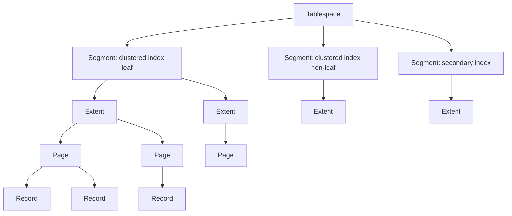

# InnoDB Storage

## Relationship Between Tablespace, Segment, Extent, Page, and Record

InnoDB organizes data across multiple storage layers. At the logical level, tables and indexes reside in tablespaces; each B-tree index is managed using segments; segments allocate space in extents; extents consist of multiple fixed-size pages; and pages hold records or internal InnoDB structures. Understanding this relationship helps explain why a small table can still occupy significant space, why adding indexes increases storage usage, how InnoDB reads a row, and why deleting data does not necessarily shrink files on disk immediately.

General model:



The diagram is a conceptual model. A tablespace can contain multiple segments; a segment can own multiple extents and several individual pages during the initial allocation phase. Not every page contains user records: InnoDB also uses pages for metadata, bitmaps, undo, B-trees, and other internal purposes.

### 1. The Five Storage Layers and Their Relationships

| Layer | Role | Way to visualize it |
| --- | --- | --- |
| Tablespace | Logical storage area of InnoDB, mapped to one or more data files | A data container |
| Segment | Group of pages/extents serving a storage structure, usually tied to the leaf or non-leaf part of a B-tree index | A space group dedicated to part of an index |
| Extent | Allocation unit consisting of multiple logically contiguous pages | A batch of pages allocated together |
| Page | Basic I/O and buffer cache unit of InnoDB | A fixed-size block of data |
| Record | Row entry or index entry located inside a page | A data item inside a page |

The top-down path describes how InnoDB manages space. The bottom-up path describes how a row is placed within the index structure. When a query looks up a row, InnoDB traverses the B-tree pages; when inserting data, InnoDB must find a page with free space or allocate additional pages/extents for the appropriate segment.

### 2. Tablespace: Logical Data Container

A tablespace is InnoDB's high-level data organization unit. It has a space identifier (space ID), metadata about page size, and a mapping to physical files. A tablespace can be stored in a single file or across multiple files, depending on the tablespace type and configuration.

Common types:

| Tablespace type | Contents and characteristics | Common example |
| --- | --- | --- |
| System tablespace | Stores shared InnoDB structures and can hold data/indexes if configuration permits | `ibdata1` |
| File-per-table tablespace | Dedicated tablespace for a single InnoDB table and its indexes | `database/table_name.ibd` |
| General tablespace | Shared tablespace created by an administrator; can hold multiple tables | `.ibd` file declared when creating a general tablespace |
| Undo tablespace | Stores undo logs for rollback and MVCC | Undo tablespace files |
| Temporary tablespace | Stores temporary data created by InnoDB during processing | Server-managed temporary tablespace files |

With the common file-per-table configuration, each InnoDB table has an `.ibd` file. This file contains the table's clustered index and secondary indexes. Dropping a table can release its dedicated tablespace so the operating system reclaims the corresponding file. If multiple tables reside in a system or general tablespace, dropping one table usually only returns space to the tablespace for reuse; the shared file does not automatically shrink by the size of the deleted rows.

File-per-table is generally convenient for space management, moving, or restoring individual tables. A general tablespace can group multiple tables into a shared storage area, but operational considerations and migration limitations must be weighed. The system tablespace is a foundational component of the instance; you should not delete, rename, or manipulate its files directly while MySQL is running.

You can check the file-per-table mode and related variables:

```sql
SHOW VARIABLES LIKE 'innodb_file_per_table';
SHOW VARIABLES LIKE 'innodb_data_file_path';
SHOW VARIABLES LIKE 'innodb_page_size';
```

`innodb_file_per_table` indicates the current default policy for new tables; changing the variable does not automatically move existing tables to another tablespace. Moving tables requires an appropriate DDL operation and planning for duration, temporary space, metadata locks, and operational rollback capability.

### 3. Segment: Space Dedicated to Index Structures

A segment is a group of pages managed for a specific storage structure. In an InnoDB B-tree index, the leaf and non-leaf parts are managed separately by segments. Leaf pages hold entries at the leaf level; non-leaf pages hold branching keys and pointers to child pages to guide searches.

A table has a clustered index and may have multiple secondary indexes. Each index requires space for its B-tree levels; therefore, adding an index can create additional segments and consume pages/extents. Index space is not just the column values declared in the `CREATE INDEX` statement: it also includes page headers, directories, free space for inserts, intermediate levels, and management structures.

Initially, a small segment can obtain individual pages from a fragment extent instead of immediately receiving a full extent. As the segment grows, InnoDB can allocate full extents to reduce management overhead. Therefore, you cannot multiply the number of rows by record size to accurately deduce the size of a segment or `.ibd` file.

For a B-tree index, you can visualize it as:

```text
Index B-tree
  Non-leaf segment
    Root page
    Internal pages
  Leaf segment
    Leaf page 1 -> leaf page 2 -> leaf page 3 ...
```

Root and internal pages guide searches. Leaf pages hold the actual entries in index order. For a clustered index, leaf entries contain the row data. For a secondary index, leaf entries contain the index columns and the primary key to look up the corresponding row in the clustered index.

### 4. Extent: Allocation Unit of Multiple Pages

An extent is a group of logically contiguous pages that InnoDB uses as a large space allocation unit. The size of an InnoDB extent is 1 MiB. The number of pages in an extent depends on `innodb_page_size`:

| `innodb_page_size` | Number of pages in a 1 MiB extent |
| ---: | ---: |
| 4 KiB | 256 |
| 8 KiB | 128 |
| 16 KiB | 64 |
| 32 KiB | 32 |
| 64 KiB | 16 |

MySQL typically uses 16 KiB pages by default, so one extent has 64 pages. `innodb_page_size` is chosen when initializing the data directory and cannot be changed directly on an already initialized instance. If a different page size is needed, a new instance must be created and data migrated using an appropriate procedure.

Extents help InnoDB allocate space more efficiently as indexes grow. Extents can be free, partially used, or owned by a segment. A small segment does not necessarily occupy a full extent immediately; InnoDB has a mechanism to use individual pages in a fragment extent before switching to allocating full extents for the segment.

Example with a 16 KiB page size:

```text
Extent = 1 MiB
       = 64 pages x 16 KiB

Page 0  Page 1  Page 2  ...  Page 63
```

If a table has only a few rows, the tablespace file may still contain several pages and minimal metadata. As the table grows, InnoDB allocates more pages and extents. Because an extent is the allocation unit, the amount of allocated space is usually larger than the record bytes currently in use.

### 5. Page: InnoDB's Unit of Reading, Writing, and Caching

A page is the basic unit that InnoDB reads from data files into the buffer pool and writes from the buffer pool to files. The page size is typically 16 KiB, but can be 4, 8, 16, 32, or 64 KiB depending on how the instance was initialized and supported versions/builds.

A page has a header and trailer for management, validation, and page linking. For B-tree pages, the payload also includes a directory and records. B-tree pages are linked in order to support range scans; upper levels hold separator keys and pointers to lower-level pages.

Some common page types:

- **FIL page:** header/trailer sections and page identification info, previous/next page links in certain structures.
- **INDEX page:** page belonging to a B-tree index, containing records and a page directory.
- **INODE page:** metadata for managing segments.
- **XDES page:** descriptor tracking the state of extents and pages in a tablespace.
- **IBUF_BITMAP page:** bitmap serving the change buffer in relevant configurations/versions.
- **UNDO_LOG page:** page storing undo records.
- **FSP_HDR/FSP page:** metadata for managing tablespace space.

Page names and structural details are internal to InnoDB; ordinary users do not read or modify these bytes directly. What matters when designing is understanding that a query may need multiple page reads if an index is unsuitable or the data is not in the buffer pool.

### 6. General Structure of a B-Tree Page

A B-tree page is not just a contiguous sequence of concatenated records. It is structured so that InnoDB can search, insert, delete, and maintain key order.

```text
+--------------------------------------+
| FIL header                           |
+--------------------------------------+
| Page header                          |
| - page level / sibling pointers      |
| - record count / management info     |
+--------------------------------------+
| Infimum record                       |
| User records (linked in order)       |
| Supremum record                      |
+--------------------------------------+
| Free space / garbage                 |
+--------------------------------------+
| Page directory                       |
+--------------------------------------+
| FIL trailer                          |
+--------------------------------------+
```

This is a simplified diagram and does not show byte proportions or every internal field. `infimum` and `supremum` are two pseudo-records marking the start and end of the record list in the page. Records are linked in key order; the page directory holds slots pointing to groups of records to support faster searches than scanning the entire list sequentially.

When inserting a record, InnoDB finds the position by key and uses free space in the page. When a page lacks sufficient space, the B-tree may have to split the page (page split) and update parent pages. When deleting or updating, data regions can become free/garbage and be reused or reorganized later. Consequently, the file size does not necessarily decrease immediately when the row count drops.

### 7. Record: How a Row Is Represented in a Page

A record is a unit of data at the row or index-entry level. In a clustered index, leaf records contain the table's columns. In a secondary index, leaf records contain the index column values along with the primary key so InnoDB can locate the clustered record.

With the `COMPACT` or `DYNAMIC` row format, a record typically has these general parts:

1. **Record header:** record management information such as length, status, and link to the next record in the page.
2. **NULL bitmap:** bits marking nullable columns that currently have a `NULL` value.
3. **Variable-length field metadata:** length information for variable-length columns when needed.
4. **User column data:** data of the row's columns.
5. **System columns of a clustered record:** `DB_TRX_ID` tracks the most recent transaction that modified the row and `DB_ROLL_PTR` points to undo information; if the table lacks a suitable primary key, InnoDB can generate a hidden row ID as the clustered key.

Byte details and field order vary by row format, column types, NULLs, data lengths, and version. You should not assume every record has a fixed size. Two rows in the same table can occupy different numbers of bytes due to `VARCHAR`, `BLOB`, `TEXT`, NULL values, and off-page stored data.

Common row formats:

| Row format | General characteristics |
| --- | --- |
| `REDUNDANT` | Older format; record headers and metadata representation differ from newer formats |
| `COMPACT` | Reduces record overhead compared to REDUNDANT; stores length and NULL metadata in the header section |
| `DYNAMIC` | Can store most long column data off-page, keeping pointers in the record; typically the default choice on modern MySQL |
| `COMPRESSED` | Uses page compression via the compressed row format mechanism; has its own limitations and CPU/I/O overhead |

With `DYNAMIC`, long columns such as `TEXT` or `BLOB` can be stored in overflow pages when necessary, so that the record in the B-tree page retains an appropriate portion of data. Off-page storage can reduce pressure on leaf pages, but incurs additional page accesses when queries need to read the long content. `COMPACT` also supports off-page storage, though its choice of what remains inside the page differs from `DYNAMIC`.

### 8. How Do Clustered Indexes and Secondary Indexes Relate to Pages and Records?

InnoDB organizes table data using a clustered index. Typically, the primary key is the clustered index. If a table has no primary key, InnoDB selects a suitable unique index with `NOT NULL` columns; if none exists, InnoDB creates a hidden clustered index using an internal row ID.

The leaf pages of the clustered index hold the full row data. Upper-level pages hold keys and pointers leading to leaf pages. Therefore, looking up a row by primary key usually leads directly to the leaf page containing that row.

A secondary index has its own B-tree. Leaf page entries in a secondary index contain the secondary key columns and the row's primary key value. When a query retrieves only columns already present in the secondary index, a covering index scan can be performed without needing to read the clustered record. If other columns are needed, InnoDB uses the primary key in the secondary entry to look up the row in the clustered index.

Example:

```sql
CREATE TABLE customer_order (
    id BIGINT NOT NULL,
    customer_id BIGINT NOT NULL,
    created_at DATETIME NOT NULL,
    total DECIMAL(12, 2) NOT NULL,
    status VARCHAR(20) NOT NULL,
    PRIMARY KEY (id),
    KEY idx_customer_created (customer_id, created_at)
) ENGINE = InnoDB ROW_FORMAT = DYNAMIC;
```

For the table above:

- The clustered index on `id` stores all row columns in leaf pages.
- The secondary index `idx_customer_created` sorts entries by `(customer_id, created_at)` and also stores `id` to locate the clustered record.
- A query selecting only `customer_id`, `created_at`, and `id` can be served from the secondary index if the optimizer chooses that access path.
- A query also selecting `total` or `status` usually needs to access the clustered index to retrieve the remaining columns.

Because the primary key is repeated in secondary indexes, an overly wide primary key increases the size of every secondary index. Choosing a short, stable, and immutable primary key generally helps save pages, reduce I/O, and improve cache density.

### 9. Buffer Pool: Pages in Memory vs. Pages on Disk

The buffer pool is InnoDB's primary memory area used to cache data pages and index pages. When a query needs a page:

1. InnoDB checks whether the page is already in the buffer pool.
2. If it is, it can be read directly from memory.
3. If it is not, InnoDB reads the page from the tablespace into the buffer pool.
4. When a transaction modifies data, the page in memory becomes a dirty page; redo logs are written according to WAL rules so recovery is possible.
5. Background flushing writes dirty pages down to the tablespace according to checkpoint management and buffer pool pressure.

Committing a transaction does not necessarily write all modified data pages to files immediately. Commit durability relies on the redo log; dirty pages can be flushed later. This helps reduce random I/O and batch page writes, though it also means pages on disk can be older than the committed versions in the buffer pool.

Useful variables and status counters when observing:

```sql
SHOW VARIABLES LIKE 'innodb_buffer_pool_size';
SHOW VARIABLES LIKE 'innodb_page_size';
SHOW GLOBAL STATUS LIKE 'Innodb_buffer_pool_read%';
SHOW GLOBAL STATUS LIKE 'Innodb_buffer_pool_pages%';
```

If `Innodb_buffer_pool_reads` increases rapidly relative to the workload, the workload may need to read pages from disk more frequently. This must be analyzed alongside data size, working set, indexes, cache hits, I/O latency, and query load; a single metric alone is insufficient to conclude that the buffer pool must be increased.

### 10. Why Does Adding or Deleting Rows Change Storage Usage?

When inserting, InnoDB must locate the appropriate page in the clustered index and update related secondary indexes. If a page is full, a page split can create additional pages and increase the number of allocated extents. Inserts in key order can exhibit different page distribution characteristics than random inserts.

When deleting, records are marked as deleted and are only physically removed when purge conditions allow, because other transactions may still need older versions under MVCC. After purge, space in the page can be reused for new records. However, reuse does not mean the `.ibd` file shrinks on its own.

When updating an indexed column, InnoDB may have to modify entries in the related B-trees. If updating a key changes its index position, the operation can be equivalent to deleting the old entry and inserting a new entry. Therefore, updating indexed columns can incur I/O and generate extra undo/redo work.

If you need to reclaim physical space from a file-per-table file, a rebuild operation such as `OPTIMIZE TABLE` or an equivalent DDL may be required. This is an operation that can generate heavy I/O, require temporary space, and affect metadata locks and uptime; it must be evaluated on realistic data beforehand. You should not run it solely because many rows were deleted without first measuring fragmentation or reclaimable space.

### 11. Observing Tablespaces, Tables, and Indexes via Metadata

`INFORMATION_SCHEMA` provides views to inspect storage structures. Access privileges and certain columns may vary by MySQL version.

Checking a table and its row format:

```sql
SHOW CREATE TABLE customer_order;
SHOW TABLE STATUS LIKE 'customer_order';

SELECT
    TABLE_SCHEMA,
    TABLE_NAME,
    ENGINE,
    ROW_FORMAT,
    DATA_LENGTH,
    INDEX_LENGTH,
    DATA_FREE
FROM information_schema.tables
WHERE TABLE_SCHEMA = DATABASE()
  AND TABLE_NAME = 'customer_order';
```

`DATA_LENGTH` and `INDEX_LENGTH` are estimated/allocated size figures according to engine metadata, not the exact total of record payload bytes. `DATA_FREE` reflects free space within the scope of the tablespace as reported by MySQL; with a shared tablespace, this entire value cannot be attributed to a single table.

Checking tablespaces and data files on MySQL 8.0:

```sql
SELECT
    SPACE,
    NAME,
    SPACE_TYPE,
    PAGE_SIZE,
    FILE_SIZE,
    ALLOCATED_SIZE
FROM information_schema.innodb_tablespaces
ORDER BY NAME;

SELECT
    SPACE,
    PATH
FROM information_schema.innodb_datafiles
ORDER BY SPACE, PATH;
```

Checking internal InnoDB tables and indexes:

```sql
SELECT
    NAME,
    SPACE,
    ROW_FORMAT,
    ZIP_PAGE_SIZE
FROM information_schema.innodb_tables
WHERE NAME = CONCAT(DATABASE(), '/customer_order');

SELECT
    NAME,
    TYPE,
    N_FIELDS,
    PAGE_NO,
    SPACE
FROM information_schema.innodb_indexes
WHERE TABLE_ID = (
    SELECT TABLE_ID
    FROM information_schema.innodb_tables
    WHERE NAME = CONCAT(DATABASE(), '/customer_order')
);
```

The `INNODB_TABLESPACES`, `INNODB_DATAFILES`, `INNODB_TABLES`, and `INNODB_INDEXES` views are useful internal metadata for diagnostics. Some queries require appropriate privileges; if a version or configuration does not provide the columns or views shown in the examples, check the documentation for your exact version before automating.

You should not directly read or modify `.ibd`, `ibdata`, undo, or redo files while MySQL is running. These files contain binary structures and metadata managed by InnoDB; altering bytes outside the engine can corrupt the tablespace.

### 12. Connecting Storage Structures to Query Performance

Understanding pages and records helps explain query costs:

- **Point lookup by primary key:** traverses from the root through internal pages to the clustered leaf page containing the row.
- **Lookup by secondary index:** traverses the secondary B-tree to obtain the secondary entry, and may then read the clustered page by primary key.
- **Covering index:** if all required columns are present in the secondary index, the query can avoid the extra clustered page read.
- **Range scan:** reads multiple consecutive leaf pages in index order; a suitable index can reduce random I/O.
- **Full table scan:** must read many pages of the clustered index; may be reasonable if the query needs most of the rows or the table is small.
- **Large records / off-page columns:** may require additional overflow pages to fetch `TEXT`/`BLOB` content.

Example comparing two queries:

```sql
-- Can be served by the secondary index.
SELECT id, customer_id, created_at
FROM customer_order
WHERE customer_id = 42
ORDER BY created_at;

-- Needs the total column; may have to access the clustered index.
SELECT id, customer_id, created_at, total
FROM customer_order
WHERE customer_id = 42
ORDER BY created_at;
```

The optimizer decides the actual plan based on statistics and cost estimates. Use `EXPLAIN` to inspect the index and estimated row counts; if execution metrics are needed, use `EXPLAIN ANALYZE` on supported versions and note that the statement is actually executed when using this form.

### 13. Design and Operations Checklist

1. Choose a short, stable primary key so the clustered index and secondary indexes do not bloat unnecessarily.
2. Create secondary indexes based on actual queries; every additional index requires pages, segments, and storage space.
3. Understand whether a table resides in a file-per-table or shared tablespace before estimating space reclamation capability.
4. Check `innodb_page_size` and row format when analyzing page/record sizes.
5. Use metadata in `INFORMATION_SCHEMA` to observe tablespaces, data files, row formats, and indexes; treat size numbers as engine-reported figures.
6. Monitor the buffer pool, page reads, dirty pages, and I/O alongside the actual workload.
7. Do not modify tablespace files directly; use SQL/DDL and MySQL-supported backup/restore tools.
8. Before rebuilding or optimizing large tables, estimate temporary space, duration, metadata locks, and replication impact.

The tablespace is the logical container; segments manage pages for index structures; extents are allocation units of multiple pages; pages are the unit of I/O and caching; and records are row or index entries inside a page. Connecting these five layers with clustered indexes, secondary indexes, and the buffer pool helps clearly explain InnoDB storage usage, query access paths, and the cost of write operations.
