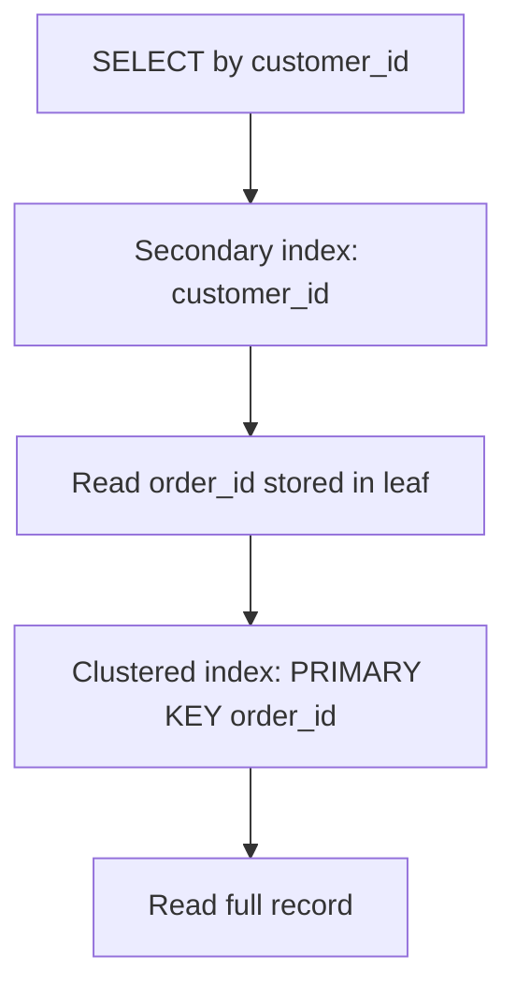
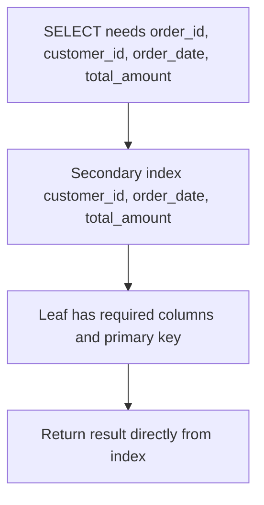

# Covering Indexes and Accessing Data via Secondary Indexes

In InnoDB, a query can locate rows through a secondary index and then use the primary key to read the full record from the clustered index. If the query needs only columns already present in the secondary index, MySQL can normally return results directly from the index without reading the clustered record. This access method is called **covering index access**.

A covering index can reduce B-tree traversals, lower I/O, and make queries reading many rows run more efficiently. However, adding columns to an index makes the index wider, consumes more memory, and increases `INSERT`, `UPDATE`, and `DELETE` costs. Good design means choosing indexes for real queries and measuring with `EXPLAIN`, not adding every column to every index.

This lesson belongs to the **DATABASE_MYSQL** module. The module aims at mastering MySQL from table design, data types, keys, and SQL queries to indexes, transactions, and concurrency control; alongside practicing execution plan reading, query tuning, privileges, backups, and handling operational issues in relational databases. In the **Indexes** chapter, this lesson focuses on covering indexes and how InnoDB accesses data through secondary indexes.

## 1. Clustered indexes and secondary indexes in InnoDB

InnoDB organizes table data around a clustered index. Table rows are stored in the leaf pages of the clustered index B-tree, sorted by that index's key.

Normally, the clustered index is the `PRIMARY KEY`. If a table declares no primary key, InnoDB chooses a suitable unique index with `NOT NULL` columns as the clustered index. If no such unique index exists, InnoDB generates a hidden row ID to organize the clustered index.

Other indexes are **secondary indexes**. Leaf records of a secondary index store the secondary index key columns together with the primary key columns needed to identify the row in the clustered index. Thus, when reading a row through a secondary index, InnoDB can use the stored primary key to locate the corresponding row in the clustered index.

Example:

```sql
CREATE TABLE orders (
    order_id BIGINT NOT NULL,
    customer_id BIGINT NOT NULL,
    order_date DATETIME NOT NULL,
    status VARCHAR(20) NOT NULL,
    total_amount DECIMAL(12, 2) NOT NULL,
    shipping_city VARCHAR(80) NOT NULL,
    PRIMARY KEY (order_id),
    KEY idx_orders_customer (customer_id)
) ENGINE = InnoDB;
```

For this table:

- The clustered index is `PRIMARY KEY (order_id)`.
- The secondary index is `idx_orders_customer (customer_id)`.
- Secondary index leaf records contain `customer_id` and the primary key `order_id`.

When a query searches for a customer's orders, InnoDB searches inside `idx_orders_customer`. If the query needs `status` or `total_amount`, those columns are not in the secondary index, so InnoDB typically must use `order_id` to read the full record in the clustered index.



This is the standard secondary index access path when a query needs columns not present in the index.

## 2. Non-covering secondary index access

Consider the query:

```sql
SELECT order_id, customer_id, status, total_amount
FROM orders
WHERE customer_id = 42;
```

Index `idx_orders_customer` only contains `customer_id` and primary key `order_id`. The query also needs `status` and `total_amount`, so the secondary index does not cover all data to be returned.

Logical access process:

1. Find leaf records with `customer_id = 42` in the secondary index.
2. Extract `order_id` from each leaf record.
3. Use `order_id` to look up the clustered index.
4. Read the missing columns such as `status` and `total_amount`.
5. Return the row to the client.

For N matching rows, this access path can require N additional clustered index lookups. If rows are scattered across the clustered index, those lookups can generate random I/O and increase cost.

Not every query using a secondary index is slow. Secondary indexes often drastically reduce the number of rows examined compared to a full table scan. The key question is how many clustered records MySQL must still read after finding matching entries to retrieve missing columns.

## 3. What is a covering index?

An index is **covering** for a query when all columns required to execute the query and produce the result can be obtained from that index. In InnoDB, the primary key columns stored alongside a secondary index can also be used to cover the query.

Create an additional secondary index to cover an order history query:

```sql
CREATE INDEX idx_orders_customer_date_amount
ON orders (customer_id, order_date, total_amount);
```

Query:

```sql
SELECT order_id, customer_id, order_date, total_amount
FROM orders
WHERE customer_id = 42
  AND order_date >= '2026-01-01'
  AND order_date <  '2026-02-01';
```

Columns needed by the query:

- `customer_id`: first column of the secondary index.
- `order_date`: second column of the secondary index.
- `total_amount`: third column of the secondary index.
- `order_id`: primary key, stored inside the InnoDB secondary index leaf record.

Therefore, in terms of data columns, the index can cover the query. MySQL can locate the range by customer and date, then read `order_id`, `order_date`, and `total_amount` from the secondary index without looking up the clustered record under normal circumstances.



A covering index is not a separate index type or a `CREATE COVERING INDEX` syntax. It is a property of the relationship between a specific index and a specific query. The same index can be covering for query A yet non-covering for query B.

## 4. Primary key stored inside secondary indexes

This detail is critical when designing covering indexes in InnoDB. If a table has:

```sql
PRIMARY KEY (order_id),
KEY idx_orders_customer_date (customer_id, order_date)
```

then the secondary index logically includes `order_id` in its leaf records. The following query can be covered by the secondary index:

```sql
SELECT order_id, customer_id, order_date
FROM orders
WHERE customer_id = 42;
```

You do not necessarily need to declare `order_id` again at the end of the index just to retrieve the primary key in `SELECT`. Doing so typically just repeats primary key information that InnoDB already stores.

However, if the query needs another column such as `status`, that column still must be included in the index to make it covering:

```sql
SELECT order_id, customer_id, order_date, status
FROM orders
WHERE customer_id = 42;
```

With an index containing only `(customer_id, order_date)`, `status` is not available in leaf records. InnoDB must read the clustered record to fetch `status`.

### 4.1. A wide primary key makes every secondary index larger

Because secondary indexes store the primary key to locate rows, a large primary key increases the size of every secondary index. For instance, a composite primary key or a long string will be repeated across secondary indexes.

This affects:

- The number of leaf pages required for storage.
- The number of entries that fit on a single page.
- How effectively indexes stay in the buffer pool.
- Read and write costs for secondary indexes.

Thus, choosing a primary key affects the cost of the entire indexing system, not just the clustered index.

## 5. Distinguishing covering indexes and Index Condition Pushdown

These two concepts are often confused when reading `EXPLAIN`.

- **Covering index access:** all columns needed by the query can be read from the index; `EXPLAIN` typically displays `Using index` in the `Extra` column.
- **Index Condition Pushdown (ICP):** MySQL pushes part of the filter predicate down to the storage engine to evaluate directly on the secondary index before reading the clustered record. If the query still needs columns outside the index, a clustered lookup is still required; `EXPLAIN` typically displays `Using index condition`.

Example creating an index:

```sql
CREATE INDEX idx_orders_customer_date_status
ON orders (customer_id, order_date, status);
```

A query also needing `shipping_city`, which is not in the index:

```sql
SELECT order_id, shipping_city
FROM orders
WHERE customer_id = 42
  AND order_date >= '2026-01-01'
  AND order_date <  '2026-02-01'
  AND status = 'PAID';
```

The storage engine can use the `customer_id`, `order_date`, and `status` columns in the secondary index to evaluate predicates, and then look up clustered records only for entries that still match in order to fetch `shipping_city`. This is where ICP can reduce clustered lookups; the query is still non-covering because it needs `shipping_city`.

Do not conclude that `Using index condition` means the clustered index is not read. Distinguish this marker from `Using index`.

## 6. Reading EXPLAIN to identify covering access

Run `EXPLAIN` on the query:

```sql
EXPLAIN
SELECT order_id, customer_id, order_date, total_amount
FROM orders
WHERE customer_id = 42
  AND order_date >= '2026-01-01'
  AND order_date <  '2026-02-01';
```

Important columns in the output:

| Column | Meaning when evaluating indexes |
|---|---|
| `type` | Access type such as `range`, `ref`, `eq_ref`, `index`, `ALL`. |
| `possible_keys` | Indexes the optimizer considers as candidates. |
| `key` | Index actually selected; `NULL` means no index was chosen. |
| `key_len` | Length of the key portion used, helping verify which columns/prefixes participate in access. |
| `rows` | Estimated number of rows to read. |
| `filtered` | Estimated percentage of rows remaining after filter predicates. |
| `Extra` | Additional info; `Using index` typically indicates covering access. |

If `Extra` contains `Using index`, that signals the query is covered by the chosen index. A covering query can still be inefficient if it must scan a very large portion of the index.

For example, `type = index` can be a full index scan. It can still be covering because all columns reside in the index, yet if it must scan millions of entries when only a few rows are needed, the query remains expensive.

### 6.1. Comparing with a non-covering query

Run:

```sql
EXPLAIN
SELECT order_id, customer_id, order_date, total_amount, status
FROM orders
WHERE customer_id = 42
  AND order_date >= '2026-01-01'
  AND order_date <  '2026-02-01';
```

If the index does not contain `status`, the optimizer may still use the same secondary index to find the range but must retrieve `status` from the clustered record. The plan may no longer show `Using index`.

Do not look at a single `Extra` line to judge overall performance. Examine `key`, `type`, `rows`, filter conditions, and actual row counts.

### 6.2. EXPLAIN ANALYZE

In MySQL 8.0.18 and later, `EXPLAIN ANALYZE` can execute the query and display actual timings, row counts, and loop counts of iterators:

```sql
EXPLAIN ANALYZE
SELECT order_id, customer_id, order_date, total_amount
FROM orders
WHERE customer_id = 42
  AND order_date >= '2026-01-01'
  AND order_date <  '2026-02-01';
```

`EXPLAIN ANALYZE` actually executes the statement. Use it with appropriate read queries on test data or controlled environments; do not run it indiscriminately on write statements or overly heavy read queries in production.

## 7. Column order in composite indexes

A covering index is often a composite index: an index with multiple columns in a defined order. This order affects both search capability and data ordering in the B-tree.

Continuing with index `idx_orders_customer_date_amount` created in section 3:

Prefixes of the index include:

1. `(customer_id)`
2. `(customer_id, order_date)`
3. `(customer_id, order_date, total_amount)`

By the leftmost prefix principle, MySQL can typically use the index to search on the first column or groups of columns starting from the first column. Example:

```sql
-- Uses prefix customer_id
SELECT order_id, customer_id
FROM orders
WHERE customer_id = 42;

-- Uses prefix customer_id + order_date
SELECT order_id, order_date
FROM orders
WHERE customer_id = 42
  AND order_date >= '2026-01-01';
```

A query filtering only on `order_date` without `customer_id` typically cannot use this index as an efficient direct range lookup:

```sql
SELECT order_id, order_date
FROM orders
WHERE order_date >= '2026-01-01';
```

Some MySQL versions may consider index skip scan under specific conditions, though that choice depends on the optimizer and data distribution. Do not design workloads assuming trailing columns are always used efficiently when skipping the leading column.

### 7.1. Equality, range, and covering columns

A commonly useful starting rule:

- Place columns filtered by equality at the beginning of the index.
- Place range or sort-order columns next.
- Put columns needed solely to return results at the end if widening the index remains worthwhile.

Query example:

```sql
SELECT order_id, order_date, total_amount
FROM orders
WHERE customer_id = 42
  AND order_date >= '2026-01-01'
  AND order_date <  '2026-02-01';
```

Index `(customer_id, order_date, total_amount)` makes sense because `customer_id` uses equality, `order_date` uses a range, and `total_amount` helps cover the returned column.

This is a starting guideline, not an absolute formula. If the workload has many different queries, weigh frequency, selectivity, `ORDER BY` ordering, join conditions, and write costs before deciding column order.

### 7.2. Covering indexes and ORDER BY

A composite index can both locate rows and provide sort order:

```sql
SELECT order_id, order_date, total_amount
FROM orders
WHERE customer_id = 42
ORDER BY order_date, order_id;
```

With index `(customer_id, order_date, total_amount)`, the primary key is stored after the explicitly declared key parts. Because `total_amount` precedes the primary key, this index does not guarantee `order_date, order_id` order among rows on the same timestamp. If the query needs that ordering while still covering `total_amount`, place the primary key before the payload column; the concrete DDL is presented in section 10.1.

With equality on `customer_id`, the key parts of this index should follow the order customer, date, order ID, then amount. That arrangement aligns better with `ORDER BY order_date, order_id`; the complete DDL example is in section 10.1. Always verify `ASC`/`DESC` directions and execution plans on your MySQL version.

However, if the query requests:

```sql
ORDER BY total_amount DESC
```

the current index order does not automatically satisfy that requirement. Covering only means columns are available in the index; it does not guarantee the index satisfies every sort order or every filter condition.

## 8. Which columns should go into a covering index?

When designing an index, inspect the entire query rather than only the `SELECT` list. Required columns can appear in multiple clauses:

- `SELECT`: columns returned or used in expressions.
- `WHERE`: columns used for filtering.
- `JOIN`: columns used for joining tables.
- `GROUP BY`: columns used for grouping.
- `ORDER BY`: columns used for sorting.
- `HAVING`: filter expressions applied after grouping.

Example:

```sql
SELECT order_date, SUM(total_amount) AS daily_revenue
FROM orders
WHERE customer_id = 42
  AND order_date >= '2026-01-01'
  AND order_date <  '2026-02-01'
GROUP BY order_date
ORDER BY order_date;
```

Index `(customer_id, order_date, total_amount)` contains the columns needed for filtering, grouping, and summing. It can support reading data from the index without fetching other columns of the row. The optimizer still evaluates the overall plan; covering does not guarantee eliminating sorting or temporary tables across all query shapes.

MySQL does not have a dedicated `INCLUDE` syntax like some other DBMSs. Columns added to an index are declared as key parts. In this example, index `idx_orders_customer_date_amount` was already created in section 3; there is no need to recreate a duplicate index with the same name.

Therefore, adding columns purely to cover also alters key structure and index size. Weigh their ordering against other queries.

## 9. Limitations of prefix indexes and large columns

To reduce index size for long string columns, MySQL allows creating an index on a prefix:

```sql
CREATE INDEX idx_customer_name_prefix
ON customers (last_name(20));
```

This index stores only the first 20 characters of `last_name`, not the full value. If a query needs to return the entire `last_name`, the prefix index cannot supply the missing suffix; the clustered record still must be read.

Example:

```sql
SELECT customer_id, last_name
FROM customers
WHERE last_name LIKE 'Nguyen%';
```

If the index is `(last_name(20))`, the index can support prefix searching but does not fully cover the `last_name` column when the complete value must be returned.

`TEXT`/`BLOB` columns or very long strings must also account for key length limits, charset, and index size. Do not add a large column to an index just to achieve `Using index` if storage and write costs exceed read savings.

## 10. Covering indexes for common query patterns

### 10.1. Customer order history page

Query:

```sql
SELECT order_id, order_date, total_amount
FROM orders
WHERE customer_id = 42
ORDER BY order_date DESC, order_id DESC
LIMIT 20;
```

Candidate index to test when sorting by date and order ID is needed:

```sql
CREATE INDEX idx_orders_customer_date_order_amount
ON orders (customer_id, order_date, order_id, total_amount);
```

`order_id` is explicitly declared before the payload column `total_amount` so the index order aligns with `ORDER BY order_date DESC, order_id DESC` once `customer_id` is fixed. Although the primary key is normally stored automatically, its default trailing position may not match the desired sort order. Depending on sort directions and MySQL version, the optimizer may read the index backward; verify with `EXPLAIN` rather than assuming an index satisfies any combination of `ASC`/`DESC`.

This is a different design from index `idx_orders_customer_date_amount` in section 3. If both serve only the same query, measure and consider replacing the old index with the new one rather than keeping both. Keep both simultaneously only when the workload has distinct queries that genuinely need each key order.

### 10.2. Total spend report per customer

Query:

```sql
SELECT customer_id, SUM(total_amount) AS total_spent
FROM orders
WHERE customer_id BETWEEN 100 AND 200
GROUP BY customer_id;
```

Index `(customer_id, total_amount)` can cover the query's columns and provide ordering by `customer_id`, allowing required values to be read from the secondary index.

```sql
CREATE INDEX idx_orders_customer_total
ON orders (customer_id, total_amount);
```

This is a candidate to measure, not a guarantee the optimizer will always pick it. If most of the table falls within customer range 100–200, a full scan may make more sense.

### 10.3. Query needing a column outside the index

Query:

```sql
SELECT order_id, order_date, shipping_city
FROM orders
WHERE customer_id = 42
  AND order_date >= '2026-01-01';
```

Index `(customer_id, order_date, total_amount)` lacks `shipping_city`. MySQL can use the index to find matching orders, then look up clustered records to retrieve the shipping city. If this query is very frequent and reads a moderate number of rows, you can evaluate index `(customer_id, order_date, shipping_city)` or another suitable design. Only add columns after measuring workload and index size.

## 11. Costs and limits of covering indexes

Covering indexes help read queries, yet they are not free:

1. **Storage:** each added key part makes leaf records wider and increases the number of pages needed.
2. **Buffer pool:** larger indexes consume more memory, potentially evicting other useful pages from cache.
3. **Data writes:** `INSERT`, `DELETE`, and `UPDATE` touching indexed columns must maintain additional B-tree structures.
4. **Page splits and write I/O:** wide indexes can reduce entries per page, increasing page splits and bytes written.
5. **Maintenance overhead:** multiple similar indexes make statistics updates, backups, and operations heavier.
6. **Write latency:** optimizing a single read query can increase latency across the entire write workload.

An index that covers one query can be a poor choice if the table has high write throughput or that query rarely runs. Balance read benefits against total workload cost.

### 11.1. Do not create an index containing every column

A common mistake is putting every column of a table into a composite index so every query becomes covering. This creates a very wide index, wastes memory, and forces every write to update much more data.

Instead:

- Identify a group of queries with sufficiently high frequency and read cost.
- Select only columns genuinely needed for that query group.
- Keep long or rarely used columns out of the index unless there is a measurable benefit.
- Review existing indexes to avoid creating near-duplicate copies.
- Measure impact on both reads and writes after creating the index.

### 11.2. MVCC and clustered lookups in certain cases

InnoDB secondary indexes do not store MVCC metadata such as transaction ID and rollback pointer the way clustered records do. If a consistent read encounters a secondary-index entry and cannot determine visibility solely from that entry, InnoDB may access the clustered record to inspect transaction metadata and decide whether that version is visible to the current read view.

Therefore, a covering index describes the ability to satisfy query columns from the index and usually avoids clustered lookups. It is not a guarantee that the engine will never access the clustered index under every concurrency state or visibility check scenario.

## 12. Common mistakes when designing and reading covering indexes

| Mistake | Why it is wrong | How to fix |
|---|---|---|
| Thinking covering index is a special syntax | Covering is a relationship between an index and a query | Identify columns the query needs and inspect the index. |
| Forgetting the primary key is stored in InnoDB secondary indexes | May redundantly add primary key, widening the index | Verify table structure and leverage the implicitly stored PK. |
| Checking only the `SELECT` list | `WHERE`, `JOIN`, `GROUP BY`, `ORDER BY` also require columns | Evaluate the entire query block. |
| Writing `SELECT *` and trying to cover it | Query fetches all columns, forcing a huge index | Select only columns the application actually needs. |
| Confusing `Using index condition` with `Using index` | ICP may still require clustered lookups | Distinguish in-index filtering from covering access. |
| Thinking `type = index` is always good | It can be a full index scan | Inspect `rows`, filter conditions, and actual row count. |
| Using a composite index while omitting the leading column | Cannot normally leverage the leftmost prefix | Order columns for the workload and inspect the plan. |
| Using a prefix index to return full strings | Index stores only the prefix | Accept clustered lookups or consider alternative storage. |
| Adding many columns solely to get `Using index` | Index can bloat and slow down writes | Measure actual read gains and write costs. |
| Believing `Using index` guarantees a fast query | Scanning an entire large index can still be expensive | Evaluate selectivity, row counts, and actual timing. |

## 13. Process for designing a covering index

1. **Pick the target query.** Use query logs, slow query logs, or application metrics to identify queries with significant cost.
2. **Determine rows to read.** Are filter predicates selective, or must most of the table be scanned?
3. **List all required columns.** Include `SELECT`, predicate, join, grouping, and ordering columns.
4. **Check the clustered key.** Confirm the primary key and remember InnoDB stores it in secondary indexes.
5. **Choose key part ordering.** Consider equality, range, ordering, and leftmost prefix based on workload.
6. **Assess width.** Estimate column lengths, charset, entry counts, and storage cost.
7. **Create a test index.** Use a descriptive name and create indexes only for justified queries.
8. **Read `EXPLAIN`.** Check `key`, `type`, `rows`, `key_len`, and `Extra`.
9. **Measure actual timing.** Use `EXPLAIN ANALYZE` when supported by your version and allowed by the environment.
10. **Compare across the full workload.** Check both related read queries and write latency after adding the index.
11. **Monitor post-deployment.** Confirm the index is actually used and does not create unnecessary maintenance overhead.

## 14. Practice exercises

### Exercise 1: Identify clustered and secondary indexes

Create table `orders` with `PRIMARY KEY (order_id)` and `KEY (customer_id)`.

**Requirement:** describe which columns are stored in an InnoDB secondary index leaf record and explain why `order_id` can be read from the index.

### Exercise 2: Compare non-covering and covering

Run an order history query selecting only `order_id`, `customer_id`, `order_date`, `total_amount`; then add `status` to the `SELECT` list.

**Requirement:** use `EXPLAIN` to compare plans before and after adding the column. Explain when a clustered lookup is needed.

### Exercise 3: Design a composite index

A query filters by `customer_id`, ranges on `order_date`, and returns `total_amount`.

**Requirement:** propose an index, explain column ordering, and explain the role of the stored primary key.

### Exercise 4: Leftmost prefix

With index `(customer_id, order_date, total_amount)`, test queries by `customer_id`, by `customer_id + order_date`, and only by `order_date`.

**Requirement:** compare `possible_keys`, `key`, `type`, and `rows`; explain the leftmost prefix rule.

### Exercise 5: Covering and ICP

Create index `(customer_id, order_date, status)` and run a query that also needs `shipping_city`.

**Requirement:** inspect `Extra`, distinguish `Using index condition` from `Using index`, and explain why clustered record reads may still be required.

### Exercise 6: Prefix index

Create a prefix index on a customer name column, then run a query selecting only customer ID and a query selecting the full name as well.

**Requirement:** explain why a prefix index can help searching yet fail to cover the full string value.

### Exercise 7: Cost of wide indexes

Compare an index with only `(customer_id, order_date)` against an index adding `status`, `total_amount`, and `shipping_city`.

**Requirement:** analyze storage size, covering potential, and write cost. Recommend an index suited to the given workload.

### Exercise 8: Before and after measurement

Select a frequently used read query, record `EXPLAIN` and actual execution time. Create a candidate covering index and measure again.

**Requirement:** report changes in `key`, `Extra`, row counts, and timing; also assess the impact on `INSERT`/`UPDATE`.

## 15. Review checklist

- [ ] Verified the table uses InnoDB and identified its clustered index.
- [ ] Understood that secondary indexes store the primary key inside leaf records.
- [ ] Identified all columns needed by the query in `SELECT`, `WHERE`, `JOIN`, `GROUP BY`, and `ORDER BY`.
- [ ] Distinguished secondary index access with clustered lookups from covering access.
- [ ] Reviewed leftmost prefix and column order in composite indexes.
- [ ] Distinguished `Using index` from `Using index condition`.
- [ ] Checked `key`, `type`, `rows`, `key_len`, and `Extra` in `EXPLAIN`.
- [ ] Evaluated whether a prefix index stores enough of the value to return.
- [ ] Considered index size, buffer pool impact, and write costs.
- [ ] Measured actual plans and timings rather than inferring solely from DDL.
- [ ] Assessed impact on both read and write workloads before keeping the index.

## 16. Key takeaways

In InnoDB, secondary indexes store declared key parts along with the primary key needed to locate rows in the clustered index. If a query needs columns absent from the secondary index, the engine typically must look up the clustered index to fetch the full record. If all required columns are already in the index, the query can use covering index access and avoid clustered lookups under normal conditions.

`Using index` typically indicates the query is covered by the index; `Using index condition` indicates predicates are pushed down for evaluation inside the index, yet the query may still need the clustered record. Design composite indexes around filtering conditions, ordering, grouping, and returned columns; leverage the stored primary key; and balance read gains against index size and write overhead. Always verify with `EXPLAIN` and real measurements.
