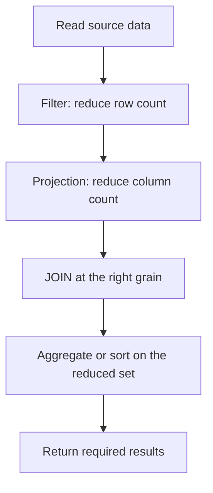

# Reducing Rows, Columns, and Intermediate Data Processed

A SQL query generally incurs cost proportional to the amount of data it must read, the number of rows passing through processing steps, the width of each row, and the volume of intermediate data produced during joins, sorts, groups, or materialization. Query tuning is therefore not just about adding indexes. An effective approach is to filter out unnecessary rows early, select only the columns actually needed, control row multiplication after JOINs, and avoid creating intermediate datasets larger than required.

For example, a monthly revenue report for a customer does not need to read every order, every column of the order, and every line item across many years. The query should bound the exact time range, filter for the specific customer, read only the columns needed for calculation, and aggregate data at the proper grain before joining with other tables.

This lesson belongs to the **DATABASE_MYSQL** module. The module aims to build mastery of MySQL from table design, data types, keys, and SQL queries to indexes, transactions, and concurrency control; alongside practicing execution plan analysis, query tuning, privilege management, backups, and handling relational database operational issues. Within the **SQL Tuning** chapter, this lesson focuses on reducing the number of rows, columns, and intermediate data processed.

## 1. Three Cost Sources to Reduce

When reading a query, ask three questions:

1. **How many rows must be read and processed?** Are the filter predicates selective? Does the query scan the entire table even though only a small subset is needed?
2. **How much data does each row carry?** Does the query use `SELECT *`, `TEXT`/`BLOB` columns, or unused columns?
3. **How many rows do intermediate steps generate?** Does a JOIN multiply rows? Do GROUP BY, DISTINCT, ORDER BY, or derived tables build a larger set than needed?

A query can read few rows and still be expensive if each row is very wide. Conversely, narrow rows with a large join fan-out can also produce millions of intermediate results. You must consider row count, row width, and row counts after each step together.



This diagram illustrates the mental model when designing queries. The optimizer may change the physical execution order to reduce cost, but the query itself should clearly express the required conditions and datasets.

## 2. Reduce Row Count with Selective Filter Predicates

The `WHERE` clause determines which rows continue to subsequent steps. If a query only needs orders for one customer in one month, express both bounds directly in the query:

```sql
SELECT
    order_id,
    order_date,
    total_amount
FROM orders
WHERE customer_id = 42
  AND order_date >= '2026-01-01'
  AND order_date <  '2026-02-01';
```

This query only requests rows for customer 42 within January 2026. If you omit the date predicate, MySQL may have to read and process that customer's entire order history.

### 2.1. Use Half-Open Intervals for Time Ranges

For `DATETIME` or `TIMESTAMP`, use a range from the start of the period up to (but excluding) the start of the next period:

```sql
WHERE created_at >= '2026-01-01 00:00:00'
  AND created_at <  '2026-02-01 00:00:00'
```

This includes every point in time during January, including fractional seconds, without guessing an end-of-day value like `23:59:59.999999`. It also keeps the date column bare in the predicate, favoring range access on an index.

### 2.2. Avoid Wrapping Indexed Columns in Functions When Rewritable

Suppose there is an index on `created_at`. The query:

```sql
SELECT order_id, created_at
FROM orders
WHERE DATE(created_at) = '2026-01-15';
```

applies the `DATE()` function to the column. This style generally prevents the predicate from using direct range access on the `created_at` index.

Rewrite as a range:

```sql
SELECT order_id, created_at
FROM orders
WHERE created_at >= '2026-01-15 00:00:00'
  AND created_at <  '2026-01-16 00:00:00';
```

Similarly, if there is an index on `YEAR(created_at)` as a functional index or suitable generated column, the optimizer can use it in corresponding cases; however, with a standard index on `created_at`, a direct range predicate is usually the clear choice.

### 2.3. Sargable Predicates

A predicate is called **sargable** when it can be translated into a search condition suitable for an index. Some patterns commonly hinder index usage:

| Hard-to-optimize pattern | Pattern to try instead |
|---|---|
| `DATE(created_at) = '2026-01-15'` | Range `created_at >= ... AND created_at < ...` |
| `YEAR(order_date) = 2025` on a regular index on `order_date` | Date range from start of 2025 to before start of 2026 |
| `CAST(customer_id AS CHAR) = '42'` | Compare `customer_id = 42` with the matching data type |
| `price * quantity > 1000` | If business logic allows, transform into an equivalent condition on one side; check types and arithmetic |
| `name LIKE '%son'` | No simple B-tree range for a leading wildcard; consider full-text or another search model |

Not every function in a predicate always disables index usage. MySQL can optimize certain expressions or use functional indexes. Inspect `EXPLAIN` rather than concluding purely from the SQL syntax.

### 2.4. Data Types on Both Sides of a Comparison Must Be Compatible

If `customer_id` is `BIGINT` but the application passes a non-standard string, MySQL may have to perform type conversion, and index usage may be affected depending on the expression. Pass parameters with the right data type:

```sql
-- Pass an integer parameter for customer_id.
SELECT order_id
FROM orders
WHERE customer_id = 42;
```

Avoid casting the column in the predicate just to match the input value. Normalize the data type in the application layer or cast on the constant side when needed.

## 3. Reduce Column Count with Projection

Projection means selecting only the required columns. The query:

```sql
SELECT *
FROM orders
WHERE customer_id = 42;
```

may read and transfer many columns the application never uses. If the table contains JSON, shipping addresses, long notes, or large payloads, the data volume moving across buffers, network, and client can grow dramatically.

Write out the column list explicitly:

```sql
SELECT
    order_id,
    order_date,
    total_amount
FROM orders
WHERE customer_id = 42;
```

Benefits:

- Reduces bytes read or passed through iterators.
- Enables covering index usage if the needed columns are already in the index.
- Reduces network traffic and client memory allocation.
- Clarifies the query's data contract, avoiding unintended dependencies on newly added table columns.

### 3.1. Do Not Fetch Large Columns Unless Needed

For example, suppose a `documents` table has:

```sql
CREATE TABLE documents (
    document_id BIGINT NOT NULL PRIMARY KEY,
    owner_id BIGINT NOT NULL,
    title VARCHAR(200) NOT NULL,
    created_at DATETIME NOT NULL,
    body LONGTEXT NOT NULL,
    attachment LONGBLOB NULL,
    KEY idx_documents_owner_created (owner_id, created_at)
) ENGINE = InnoDB;
```

The list screen only needs title and creation date:

```sql
SELECT document_id, title, created_at
FROM documents
WHERE owner_id = 42
ORDER BY created_at DESC
LIMIT 50;
```

Do not fetch `body` and `attachment` for the list view if users only load content when opening a specific document. Splitting the list query from the detail query reduces payload and can allow the list to be served from an appropriate index.

### 3.2. Projection in JOINs

Avoid selecting all columns from both tables:

```sql
SELECT *
FROM orders AS o
JOIN customers AS c
    ON c.customer_id = o.customer_id
WHERE o.order_date >= '2026-01-01';
```

Select only the columns actually needed:

```sql
SELECT
    o.order_id,
    o.order_date,
    o.total_amount,
    c.customer_name
FROM orders AS o
JOIN customers AS c
    ON c.customer_id = o.customer_id
WHERE o.order_date >= '2026-01-01';
```

This also avoids duplicate column names and prevents query output from shifting unexpectedly when columns are added to the schema.

## 4. Reduce Intermediate Data in JOINs

A JOIN produces row combinations matching the join condition. If one row on the left matches many rows on the right, the result row count grows along the one-to-many relationship. This is standard JOIN behavior, yet it can cause severe fan-out if the query only needs an existence check or aggregation at a different grain.

Suppose:

- A customer has many orders.
- An order has many line items.
- A customer has many addresses.

If you simultaneously join orders, line items, and addresses on `customer_id`, the intermediate row count can be the product of the customer's orders, line items, and addresses.

### 4.1. Only Need to Know If Matching Rows Exist: Use EXISTS

Requirement: find customers with at least one paid order.

A style prone to row multiplication is:

```sql
SELECT
    c.customer_id,
    c.customer_name
FROM customers AS c
JOIN orders AS o
    ON o.customer_id = c.customer_id
WHERE o.status = 'PAID';
```

If a customer has five PAID orders, that customer appears five times. When you only need to check existence, use `EXISTS`:

```sql
SELECT
    c.customer_id,
    c.customer_name
FROM customers AS c
WHERE EXISTS (
    SELECT 1
    FROM orders AS o
    WHERE o.customer_id = c.customer_id
      AND o.status = 'PAID'
);
```

`EXISTS` expresses a semi-join: return each customer row once if at least one matching order row exists. The MySQL optimizer can transform the query into an appropriate semi-join strategy.

### 4.2. Do Not Use DISTINCT to Mask Unclear Fan-Out

One might write:

```sql
SELECT DISTINCT
    c.customer_id,
    c.customer_name
FROM customers AS c
JOIN orders AS o
    ON o.customer_id = c.customer_id
WHERE o.status = 'PAID';
```

The query returns each customer once, but the JOIN can still generate many rows before deduplication. `DISTINCT` may require a sort or temporary table. If the goal is merely checking whether an order exists, `EXISTS` states the intent more directly and usually avoids unnecessary fan-out.

`DISTINCT` remains appropriate when business logic truly requires deduplicating result rows; do not replace it with `EXISTS` if you need columns from each row on the right side.

## 5. Aggregate Before JOIN to Reduce Fan-Out

Suppose a report needs total revenue per customer and the number of addresses per customer. Directly joining `orders` with `customer_addresses` can multiply each order by the number of addresses:

```sql
SELECT
    c.customer_id,
    SUM(o.total_amount) AS revenue,
    COUNT(a.address_id) AS address_count
FROM customers AS c
LEFT JOIN orders AS o
    ON o.customer_id = c.customer_id
LEFT JOIN customer_addresses AS a
    ON a.customer_id = c.customer_id
GROUP BY c.customer_id;
```

If a customer has 5 orders and 3 addresses, the intermediate JOIN result can have 15 rows. `SUM(o.total_amount)` is then multiplied threefold. `COUNT(a.address_id)` is also multiplied by the number of orders.

The solution is to aggregate each child table to the target grain before joining:

```sql
WITH order_totals AS (
    SELECT
        customer_id,
        SUM(total_amount) AS revenue,
        COUNT(*) AS order_count
    FROM orders
    GROUP BY customer_id
),
address_totals AS (
    SELECT
        customer_id,
        COUNT(*) AS address_count
    FROM customer_addresses
    GROUP BY customer_id
)
SELECT
    c.customer_id,
    c.customer_name,
    COALESCE(o.revenue, 0) AS revenue,
    COALESCE(o.order_count, 0) AS order_count,
    COALESCE(a.address_count, 0) AS address_count
FROM customers AS c
LEFT JOIN order_totals AS o
    ON o.customer_id = c.customer_id
LEFT JOIN address_totals AS a
    ON a.customer_id = c.customer_id;
```

`order_totals` has at most one row per customer; `address_totals` does as well. Joining the two pre-aggregated sets with `customers` eliminates fan-out between individual orders and addresses. This is **pre-aggregation**.

### 5.1. Determine the Grain Before Aggregating

Before writing an aggregate, answer:

- What does one row in the source table represent?
- Does the output need one row per customer, per order, per day, or per product?
- Which one-to-many child tables will increase row count when joined?
- Can each branch be aggregated to the same grain before combining?

If you aggregate at the wrong grain, the query might run fast yet produce wrong numbers. Correctness comes first; reducing intermediate data must preserve business semantics.

### 5.2. Filter Before Aggregating

If only paid orders within a date window are needed, narrow the input set before grouping:

```sql
SELECT
    customer_id,
    SUM(total_amount) AS paid_revenue
FROM orders
WHERE status = 'PAID'
  AND order_date >= '2026-01-01'
  AND order_date <  '2026-02-01'
GROUP BY customer_id;
```

There is no need to aggregate all historical data and filter by date afterward if the business only wants a specific period. The optimizer can push some predicates down, but placing conditions in the appropriate query block keeps logic clear and creates optimization opportunities.

## 6. Reduce Returned Rows Properly with LIMIT

If the UI only displays the first 20 records, there is no need to return hundreds of thousands of rows to the application:

```sql
SELECT order_id, order_date, total_amount
FROM orders
WHERE customer_id = 42
ORDER BY order_date DESC, order_id DESC
LIMIT 20;
```

`LIMIT` caps the number of rows returned. If an index supports both the predicate and the sort order, MySQL can stop reading early once enough rows are found.

However, `LIMIT` does not automatically make a query cheap if MySQL still has to scan, join, or sort a massive set before picking the final 20 rows. Inspect the execution plan.

### 6.1. Pagination with OFFSET

```sql
SELECT order_id, order_date, total_amount
FROM orders
WHERE customer_id = 42
ORDER BY order_date DESC, order_id DESC
LIMIT 20 OFFSET 100000;
```

With a large OFFSET, MySQL must still locate and discard many rows before returning the next 20 rows. Cost grows with page depth.

### 6.2. Keyset Pagination

If the pagination order is `(order_date DESC, order_id DESC)`, the next page can start after the last key of the previous page:

```sql
SELECT order_id, order_date, total_amount
FROM orders
WHERE customer_id = 42
  AND (
      order_date < '2026-01-15'
      OR (
          order_date = '2026-01-15'
          AND order_id < 900100
      )
  )
ORDER BY order_date DESC, order_id DESC
LIMIT 20;
```

The date and order ID values here form the cursor from the end of the previous page. This avoids skipping vast numbers of entries as with large OFFSETs and is generally more stable when new rows are inserted at the top of the list.

To support the query, you can evaluate a composite index:

```sql
CREATE INDEX idx_orders_customer_date_id
ON orders (customer_id, order_date, order_id);
```

Keyset pagination requires a deterministic sort order. If you only use `ORDER BY order_date` and multiple orders share the same date, pages can duplicate or skip rows. Add a unique key as a tie-breaker.

### 6.3. Do Not Push LIMIT Before JOIN If It Alters Results

Suppose you need the 20 most recent orders along with customer names. Limiting orders first and then joining customers is valid if the customer relationship is one-to-one on the join key:

```sql
SELECT
    recent.order_id,
    recent.order_date,
    recent.total_amount,
    c.customer_name
FROM (
    SELECT order_id, customer_id, order_date, total_amount
    FROM orders
    ORDER BY order_date DESC, order_id DESC
    LIMIT 20
) AS recent
JOIN customers AS c
    ON c.customer_id = recent.customer_id
ORDER BY recent.order_date DESC, recent.order_id DESC;
```

However, never arbitrarily limit one table before a JOIN if doing so changes the candidate row set, such as when filtering depends on the joined table or when one left row maps to multiple right rows and the business wants 20 post-JOIN combinations.

## 7. Derived Tables and CTEs: Reduce Data While Understanding Optimizer Behavior

Derived tables and CTEs break queries into steps. They can also restrict columns, filter, or aggregate before joining:

```sql
SELECT
    c.customer_id,
    c.customer_name,
    o.paid_revenue
FROM customers AS c
JOIN (
    SELECT customer_id, SUM(total_amount) AS paid_revenue
    FROM orders
    WHERE status = 'PAID'
      AND order_date >= '2026-01-01'
      AND order_date <  '2026-02-01'
    GROUP BY customer_id
) AS o
    ON o.customer_id = c.customer_id;
```

The derived table only outputs `customer_id` and `paid_revenue`; there is no need to carry all `orders` columns into the outer step.

### 7.1. CTEs Do Not Always Materialize

MySQL may merge a CTE/derived table into the outer query block or materialize its intermediate result, depending on the query structure and optimizer decisions. Therefore:

- Do not assume a CTE always creates a temporary table.
- Do not assume a CTE is always evaluated exactly once.
- Do not assume a CTE is faster than a derived table.
- Do not treat a CTE as a cache across multiple statements.

If a CTE contains `GROUP BY`, `DISTINCT`, `LIMIT`, window functions, or certain other constructs, the optimizer may be unable to merge it in some cases and must materialize it. In such cases, minimizing rows and columns inside the CTE becomes even more important.

### 7.2. Materialize Only the Dataset Needed

Anti-pattern example:

```sql
WITH all_order_details AS (
    SELECT *
    FROM orders
)
SELECT customer_id, COUNT(*)
FROM all_order_details
WHERE status = 'PAID'
GROUP BY customer_id;
```

Write directly and project only what is needed:

```sql
WITH paid_order_counts AS (
    SELECT customer_id, COUNT(*) AS order_count
    FROM orders
    WHERE status = 'PAID'
    GROUP BY customer_id
)
SELECT customer_id, order_count
FROM paid_order_counts;
```

The second CTE carries only the grouping key and count instead of every order column. It also makes the filter predicate and aggregation step explicit.

## 8. UNION ALL vs UNION

`UNION` removes duplicate rows across branches. To deduplicate, MySQL may need extra processing and intermediate storage. If business logic permits keeping all rows from each branch, use `UNION ALL`:

```sql
SELECT order_id, order_date
FROM current_orders
WHERE order_date >= '2026-01-01'

UNION ALL

SELECT order_id, order_date
FROM archived_orders
WHERE order_date < '2026-01-01';
```

If a unique result set is genuinely required, `UNION` is the right choice:

```sql
SELECT email FROM customer_emails
UNION
SELECT email FROM supplier_emails;
```

Do not switch `UNION` to `UNION ALL` purely for speed if the application requires deduplication. Optimization must preserve semantics.

## 9. Reduce Data via GROUP BY and DISTINCT

`GROUP BY` and `DISTINCT` typically introduce an aggregation or deduplication step. To reduce cost:

- Filter rows before grouping if predicates do not depend on aggregate results.
- Group only by the required columns.
- Avoid putting unnecessary descriptive columns into `GROUP BY`, as it can increase the number of groups.
- Check for fan-out before aggregating after a JOIN.
- Do not use `DISTINCT` to hide a broken JOIN condition.

Example:

```sql
SELECT
    customer_id,
    SUM(total_amount) AS revenue
FROM orders
WHERE status = 'PAID'
  AND order_date >= '2026-01-01'
  AND order_date <  '2027-01-01'
GROUP BY customer_id;
```

This aggregates at a grain of one row per customer. Adding `order_id` to `GROUP BY` turns each order into its own group, so the result is no longer a per-customer total.

## 10. Keep Only Intermediate Data Needed for the Next Step

In a multi-step query pipeline, each step should forward only the columns required by the next step. For example:

```sql
WITH
filtered_orders AS (
    SELECT order_id, customer_id, total_amount
    FROM orders
    WHERE status = 'PAID'
      AND order_date >= '2026-01-01'
      AND order_date <  '2026-02-01'
),
customer_totals AS (
    SELECT
        customer_id,
        SUM(total_amount) AS revenue
    FROM filtered_orders
    GROUP BY customer_id
)
SELECT customer_id, revenue
FROM customer_totals
WHERE revenue >= 1000000;
```

`filtered_orders` omits unused columns; `customer_totals` collapses many orders into one row per customer. The final query reads only two columns.

If the source query still carries `order_id` even though the aggregation step never uses it, consider dropping `order_id` from the source CTE to reduce the intermediate payload. There is no reason to carry a column just because it exists on the table.

## 11. Use Indexes to Reduce Rows Read

Indexes help MySQL locate a subset of data instead of scanning the entire table. However, an index must align with the query's predicates and access order.

Example query:

```sql
SELECT order_id, order_date, total_amount
FROM orders
WHERE customer_id = 42
  AND status = 'PAID'
  AND order_date >= '2026-01-01'
  AND order_date <  '2026-02-01';
```

A candidate composite index to test:

```sql
CREATE INDEX idx_orders_customer_status_date
ON orders (customer_id, status, order_date);
```

The index places two equality predicates first, followed by the date range column. This order can help narrow down to a smaller range. Verify with `EXPLAIN`, since effectiveness also depends on selectivity, data distribution, and other queries sharing the index.

### 11.1. Indexes Do Not Replace Filter Predicates

If a query has no range-limiting predicate, an index cannot guess that the application only wants a subset of data. For example:

```sql
SELECT order_id, order_date, total_amount
FROM orders
ORDER BY order_date DESC;
```

This query asks for all orders sorted by date. An index may provide the ordering, yet it may still have to read a vast number of entries. If the UI only needs one page, use `LIMIT` and an appropriate cursor.

### 11.2. Covering Indexes Further Reduce Extra Row Lookups

If an index contains every column the query needs, MySQL can read results directly from the index without looking up the clustered record in typical cases. This eliminates extra data access hops.

For example, `(customer_id, status, order_date, total_amount)` can cover the query at the start of this section because `order_id` is the InnoDB primary key stored inside secondary indexes. However, adding columns widens the index and increases write cost. Create covering indexes only when the workload justifies the trade-off.

### 11.3. Do Not Create an Index for Every Condition Combination

While indexes reduce data read, they also carry costs:

- Every relevant `INSERT`, `DELETE`, and `UPDATE` must maintain the index.
- Wide indexes consume buffer pool memory and disk space.
- Many nearly identical indexes increase write overhead and maintenance burden.

Design indexes around actual query groups rather than creating a separate index for every `WHERE` variation.

## 12. WHERE vs HAVING: Filter at the Right Stage

`WHERE` filters source rows before grouping. `HAVING` filters groups after aggregation. If a condition does not depend on an aggregate, put it in `WHERE` to shrink the input row count:

```sql
-- Only group PAID orders in 2025.
SELECT
    customer_id,
    SUM(total_amount) AS revenue
FROM orders
WHERE status = 'PAID'
  AND order_date >= '2025-01-01'
  AND order_date <  '2026-01-01'
GROUP BY customer_id
HAVING SUM(total_amount) >= 1000000;
```

Here:

- `status` and `order_date` are row-level predicates, so they belong in `WHERE`.
- `SUM(total_amount) >= 1000000` is a condition on the aggregated result, so it belongs in `HAVING`.

Do not put all conditions into `HAVING` out of habit. The following example is also invalid under `ONLY_FULL_GROUP_BY` if `status` is not functionally dependent on the grouping key:

```sql
SELECT customer_id, SUM(total_amount) AS revenue
FROM orders
GROUP BY customer_id
HAVING status = 'PAID';
```

Filter status in `WHERE` before aggregating.

## 13. Control Sorts, Temporary Tables, and Intermediate Data

Some operations may require storing or sorting intermediate data:

- `ORDER BY` not satisfied by an appropriate index order.
- `GROUP BY` needing to gather rows into groups.
- `DISTINCT` needing deduplication.
- Derived tables or CTEs requiring materialization.
- Certain joins or window functions requiring sorting/temporary structures.

Seeing `Using temporary` or `Using filesort` does not automatically mean a query is slow. Inspect actual row counts, data size, execution time, and execution frequency.

### 13.1. Reduce Data Before Sorting

If you only need the 20 most recent orders for one customer, filter by customer before sorting:

```sql
SELECT order_id, order_date, total_amount
FROM orders
WHERE customer_id = 42
ORDER BY order_date DESC, order_id DESC
LIMIT 20;
```

An index `(customer_id, order_date, order_id)` can both narrow to the customer and supply the sort order. Without a suitable index, MySQL may have to sort many rows for that customer before taking 20 rows.

### 13.2. Sort Only Required Columns

Avoid carrying large payloads into a query solely to sort a list. You can select the keys of the 20 rows first and fetch details afterward:

```sql
WITH page_orders AS (
    SELECT order_id
    FROM orders
    WHERE customer_id = 42
    ORDER BY order_date DESC, order_id DESC
    LIMIT 20
)
SELECT
    o.order_id,
    o.order_date,
    o.total_amount,
    o.shipping_address,
    o.note
FROM page_orders AS p
JOIN orders AS o
    ON o.order_id = p.order_id
ORDER BY o.order_date DESC, o.order_id DESC;
```

The idea is to identify a small set of keys first, then retrieve detailed columns for the current page. This can help when detail columns are large; still measure the execution plan because the optimizer may merge or handle the CTE differently.

## 14. Avoid Transformations That Multiply Rows

Certain design mistakes inflate intermediate data:

### 14.1. JOIN Missing a Condition

```sql
-- Dangerous: no join condition, can produce a Cartesian product.
SELECT *
FROM orders AS o
JOIN order_items AS i;
```

If table A has 10,000 rows and table B has 5,000 rows, a theoretical Cartesian product can produce 50 million row pairs.

Write the full join condition:

```sql
SELECT
    o.order_id,
    i.product_id,
    i.quantity
FROM orders AS o
JOIN order_items AS i
    ON i.order_id = o.order_id;
```

### 14.2. Joining at the Wrong Grain

If `orders` has one row per order and `order_items` has multiple rows per order, the joined result has one row per line item. Do not sum `orders.total_amount` after joining without adjustment, as the order total will be repeated by the number of items.

If you need both the order total and item count, pre-aggregate items or keep each metric at its proper grain:

```sql
WITH item_totals AS (
    SELECT
        order_id,
        COUNT(*) AS item_count,
        SUM(quantity * unit_price) AS calculated_total
    FROM order_items
    GROUP BY order_id
)
SELECT
    o.order_id,
    o.total_amount,
    COALESCE(i.item_count, 0) AS item_count,
    COALESCE(i.calculated_total, 0) AS calculated_total
FROM orders AS o
LEFT JOIN item_totals AS i
    ON i.order_id = o.order_id;
```

### 14.3. Using a Scalar Subquery When a Value Can Be Pre-Aggregated

A correlated subquery can be appropriate when only one value is needed per outer row:

```sql
SELECT
    c.customer_id,
    c.customer_name,
    (
        SELECT MAX(o.order_date)
        FROM orders AS o
        WHERE o.customer_id = c.customer_id
    ) AS last_order_date
FROM customers AS c;
```

For a large number of customers, check the number of evaluations and the correlation index. An alternative is aggregating once per customer and then joining:

```sql
WITH last_orders AS (
    SELECT customer_id, MAX(order_date) AS last_order_date
    FROM orders
    GROUP BY customer_id
)
SELECT
    c.customer_id,
    c.customer_name,
    l.last_order_date
FROM customers AS c
LEFT JOIN last_orders AS l
    ON l.customer_id = c.customer_id;
```

Neither approach is universally better. The optimizer can decorrelate some subqueries; pre-aggregation might materialize a large set if only a few customers are needed. Compare the plans and actual row counts.

## 15. Read EXPLAIN to See Where Data Shrinks

You cannot judge a query as good just because the SQL is short or uses a CTE. Inspect the execution plan:

```sql
EXPLAIN
SELECT
    order_id,
    order_date,
    total_amount
FROM orders
WHERE customer_id = 42
  AND status = 'PAID'
  AND order_date >= '2026-01-01'
  AND order_date <  '2026-02-01';
```

Columns to watch:

| EXPLAIN Column | Question to answer |
|---|---|
| `type` | Which access method does MySQL use: `range`, `ref`, `eq_ref`, `index`, `ALL`? |
| `possible_keys` | Which indexes could support the condition? |
| `key` | Which index was actually chosen? |
| `key_len` | How much of the key is used? |
| `rows` | How many rows does MySQL estimate reading at this step? |
| `filtered` | What percentage of rows are estimated to remain after filtering? |
| `Extra` | Are there `Using where`, `Using index`, `Using temporary`, `Using filesort`, or other notes? |

`rows` and `filtered` are estimates, not exact row counts. In multi-table joins, intermediate row counts and join order can make total cost vastly different from what a single row looks like in isolation.

### 15.1. EXPLAIN FORMAT=JSON

JSON provides additional detail on predicates, row estimates, and join structure:

```sql
EXPLAIN FORMAT=JSON
SELECT
    c.customer_id,
    c.customer_name
FROM customers AS c
WHERE EXISTS (
    SELECT 1
    FROM orders AS o
    WHERE o.customer_id = c.customer_id
      AND o.status = 'PAID'
);
```

Inspect fields such as access type, chosen key, attached condition, estimated rows, and semi-join structure if applied by the optimizer. JSON field names and structures may vary by version.

### 15.2. EXPLAIN ANALYZE

On MySQL 8.0.18 and later:

```sql
EXPLAIN ANALYZE
SELECT
    customer_id,
    SUM(total_amount) AS revenue
FROM orders
WHERE status = 'PAID'
  AND order_date >= '2026-01-01'
  AND order_date <  '2026-02-01'
GROUP BY customer_id;
```

`EXPLAIN ANALYZE` executes the query and reports actual row counts, timings, and iterator loop counts. Use it on suitable read queries in controlled environments; it actually runs the SQL rather than merely estimating.

### 15.3. Compare Estimates vs Actuals

If estimated `rows` is very low while `EXPLAIN ANALYZE` shows large actual row counts, the optimizer may pick a suboptimal join order or access path. Causes can include stale statistics, skewed data distribution, or correlation between columns.

Do not rush to add an index as soon as you see high row counts. Check:

- Do the predicates filter according to business logic?
- Are compared columns of matching data types?
- Are there functions or type casts on columns?
- Does the index start with the right leading columns?
- Are table/index statistics fresh enough?
- Is a join suffering from fan-out due to the wrong grain?

## 16. Single-Query Optimization Workflow

Follow a sequence so each change can be measured:

1. **Record the original query.** Save SQL, parameters, returned row count, and measured latency.
2. **Define the required output.** Clarify grain, required columns, and business conditions.
3. **Reduce input rows.** Add selective predicates, use half-open date ranges, and avoid reading full history unnecessarily.
4. **Reduce columns.** Remove `SELECT *`, large payloads, and columns unused in subsequent steps.
5. **Check for fan-out.** Verify cardinality of every JOIN; use `EXISTS` when only existence checks are needed.
6. **Aggregate before JOIN.** Collapse each branch to the target grain when it avoids row multiplication.
7. **Reduce sorts and materialization.** Sort/aggregate only the filtered dataset; consider `LIMIT` and keyset pagination.
8. **Design indexes with evidence.** Base them on equality, range, join, order, and covering needs.
9. **Read EXPLAIN.** Check access path, index chosen, estimated rows, and extra steps.
10. **Measure with EXPLAIN ANALYZE.** Compare actual rows/timings on representative data.
11. **Compare results.** Verify the new query returns the exact same business output.
12. **Measure across the workload.** Check related queries and write overhead after adding indexes or structural changes.

## 17. End-to-End Example: Tuning a Revenue Report

Requirement: display the top 20 customers by revenue from paid orders in January 2026, including customer name.

### 17.1. Unoptimized Query

```sql
SELECT DISTINCT
    c.customer_id,
    c.customer_name,
    o.order_id,
    o.order_date,
    o.total_amount
FROM customers AS c
JOIN orders AS o
    ON o.customer_id = c.customer_id
JOIN order_items AS i
    ON i.order_id = o.order_id
WHERE YEAR(o.order_date) = 2026
  AND MONTH(o.order_date) = 1
  AND o.status = 'PAID'
ORDER BY o.total_amount DESC;
```

Problems:

- The query fetches every order and every line item even though the report needs revenue per customer.
- Joining `order_items` multiplies orders by line item count.
- `DISTINCT` may have to deduplicate many rows after the JOIN.
- `YEAR()` and `MONTH()` wrap the date column, hindering direct range access on a standard `order_date` index.
- There is no aggregation per customer, so the output is not at the requested grain.

### 17.2. Query at the Right Grain with Reduced Data

```sql
WITH customer_revenue AS (
    SELECT
        customer_id,
        SUM(total_amount) AS revenue
    FROM orders
    WHERE status = 'PAID'
      AND order_date >= '2026-01-01'
      AND order_date <  '2026-02-01'
    GROUP BY customer_id
)
SELECT
    c.customer_id,
    c.customer_name,
    r.revenue
FROM customer_revenue AS r
JOIN customers AS c
    ON c.customer_id = r.customer_id
ORDER BY r.revenue DESC, c.customer_id
LIMIT 20;
```

Improvements:

- Filters orders by status and date range directly at the source.
- Omits joining `order_items` since the report uses `orders.total_amount`.
- Aggregates to one row per customer before joining customer names.
- Keeps only `customer_id` and `revenue` in the intermediate set.
- Sorts on the reduced per-customer set instead of individual line items.
- Returns only 20 customers.

Candidate index to test:

```sql
CREATE INDEX idx_orders_status_date_customer_amount
ON orders (status, order_date, customer_id, total_amount);
```

This is only a candidate based on predicates and required columns. If `status` has low selectivity or the workload mostly queries by customer first, a different index may fit better. Measure with `EXPLAIN`/`EXPLAIN ANALYZE` and weigh write costs.

### 17.3. Verify Correctness

If the business defines revenue as the sum of line items rather than `orders.total_amount`, you must aggregate `order_items` per order or per customer before joining. Never drop the items table just to read fewer rows if doing so changes the definition of revenue.

Query tuning must preserve:

- Criteria for which orders are included.
- Time range and boundary rules.
- Result grain.
- Definition of revenue and handling of cancelled/refunded orders.
- Handling of customers without matching orders.

## 18. Common Mistakes

| Mistake | Consequence | How to fix |
|---|---|---|
| Using `SELECT *` in list queries | Reads and transfers unneeded columns, possibly large payloads | Explicitly select required columns. |
| Filtering dates with `YEAR()`/`MONTH()` on a regular indexed column | Can prevent direct range access | Use half-open date ranges. |
| Joining a one-to-many table and SUMming the one-side metric | Amounts get multiplied by child row count | Pre-aggregate or compute metrics at the proper grain. |
| Using JOIN when only existence check is needed | Multiplies rows and forces DISTINCT | Use `EXISTS`. |
| Using DISTINCT to fix a broken JOIN | Wastes work deduplicating and hides grain bugs | Fix the JOIN condition or use a semi-join. |
| Using very large OFFSET | Must locate and discard many rows | Consider keyset pagination. |
| Pushing LIMIT before JOIN improperly | Alters candidate rows and business results | Push down early only when proven equivalent. |
| Putting row-level conditions in HAVING | Filters late, may be invalid with GROUP BY | Use WHERE for source row predicates. |
| Creating a CTE with all columns when only a few are used | Inflates intermediate data if materialized | Apply projection inside the CTE. |
| Creating overly wide indexes to cover every query | Increases storage and write overhead | Choose indexes by workload and measure. |
| Assuming CTEs always materialize or always merge | Misjudges evaluation count and cost | Inspect EXPLAIN. |
| Comparing runtime without comparing results | May make the query fast yet wrong | Verify output rows and metrics before/after. |

## 19. Practice Exercises

### Exercise 1: Filtering by Date Range

Write a query fetching orders in March 2026. Compare `DATE(order_date) = ...` with a half-open range.

**Requirement:** run `EXPLAIN`, compare access type and chosen index.

### Exercise 2: Projection

Given a table with long description columns or large payloads, write a list query using `SELECT *`, then rewrite it selecting only display columns.

**Requirement:** describe how the column count and returned data volume change.

### Exercise 3: EXISTS vs JOIN

Find customers with at least one PAID order using JOIN and using EXISTS.

**Requirement:** create a customer with multiple PAID orders, compare row counts, and explain fan-out.

### Exercise 4: Pre-Aggregation

Build a report showing order count and address count per customer. Compare directly joining two one-to-many tables against two pre-aggregated CTEs.

**Requirement:** demonstrate how the direct JOIN can multiply totals incorrectly; verify results after pre-aggregation.

### Exercise 5: Pagination

Write queries for page 1 and a deep page using `LIMIT ... OFFSET`. Then switch to keyset pagination with date and ID keys.

**Requirement:** explain how the cursor avoids skipping large numbers of rows.

### Exercise 6: WHERE vs HAVING

Write a total revenue per customer report counting only PAID orders and returning only groups above a revenue threshold.

**Requirement:** put the status filter in WHERE, the total amount filter in HAVING, and explain the filtering order.

### Exercise 7: CTEs and Intermediate Data

Create a CTE reading all columns of `orders`, then rewrite it to select only `customer_id` and `total_amount`.

**Requirement:** compare the CTE definition, plan, and intermediate rows/columns if the optimizer materializes it.

### Exercise 8: UNION vs UNION ALL

Combine rows from a current table and an archive table. Test both UNION and UNION ALL.

**Requirement:** determine whether business logic requires deduplication; use EXPLAIN to observe plan differences if any.

### Exercise 9: Before-and-After Measurement

Pick a query with many source rows or JOINs. Save the initial SQL and EXPLAIN, then reduce rows, reduce columns, or pre-aggregate.

**Requirement:** compare actual rows, timing, results, and write cost if an index is added.

## 20. Query Review Checklist

- [ ] Defined result grain and required output columns.
- [ ] Avoided `SELECT *` when only a subset of columns is needed.
- [ ] Filtered source rows with selective and sargable predicates.
- [ ] Used half-open ranges for date/time conditions where appropriate.
- [ ] Matched data types on both sides of comparisons.
- [ ] Used JOIN only when data from the right table is actually needed.
- [ ] Used EXISTS when only an existence check is needed.
- [ ] Checked cardinality and fan-out of every JOIN.
- [ ] Pre-aggregated one-to-many branches when needed to preserve grain.
- [ ] Used WHERE for row predicates; used HAVING for aggregate conditions.
- [ ] Ensured LIMIT and pagination do not alter business results.
- [ ] Kept only necessary columns and rows in CTEs/derived tables.
- [ ] Checked sorts, temporary tables, and materialization.
- [ ] Read EXPLAIN and, when appropriate, EXPLAIN ANALYZE.
- [ ] Compared before/after query results for equivalence.
- [ ] Evaluated index impact on both reads and writes.

## 21. Key Takeaways

To reduce SQL cost, reduce the number of rows read using selective, index-friendly predicates; reduce the number of columns via projection instead of `SELECT *`; and control intermediate rows produced by JOIN, GROUP BY, DISTINCT, sorting, or materialization.

When only an existence check is needed, use `EXISTS`; when joining multiple one-to-many branches, identify the grain and consider pre-aggregation; for deep pagination, consider keyset pagination; for filtering source rows, use WHERE before aggregation and let HAVING filter groups. Finally, use EXPLAIN/EXPLAIN ANALYZE to measure actual rows and timing while confirming business results remain unchanged.
