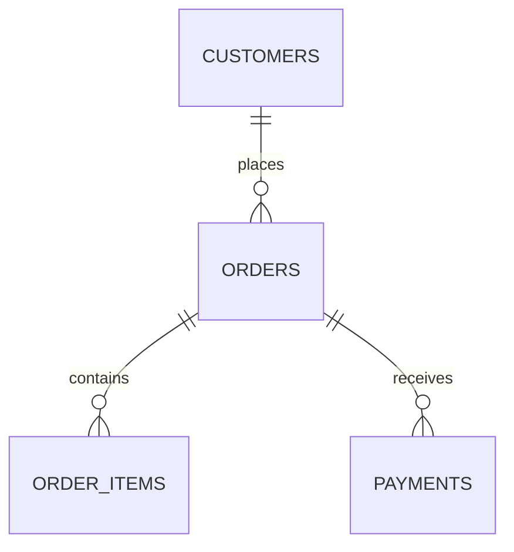

# Reducing Row Multiplication in JOINs and Fixing Double-Counted Aggregates

A common reporting bug appears when joining multiple one-to-many tables and only afterward computing `SUM()`, `COUNT()`, or `AVG()`. Each parent row can be repeated by the number of child rows; if another one-to-many branch is joined, rows can multiply crosswise. As a result, total revenue, quantities, payment amounts, or order counts are inflated even though none of the source tables contain duplicate data.

The fix starts from the **grain** (level of detail) of each dataset: does one row represent a customer, an order, an order line item, or a payment? Aggregate each branch to the required JOIN grain before combining branches. When you only need to check whether child rows exist, use `EXISTS` to avoid row multiplication. `DISTINCT` is not a universal patch for fan-out because it can drop valid equal values or leave wrong sums unchanged.

In the `DATABASE_MYSQL` module, this skill is essential for revenue reporting, payment reconciliation, order analytics, and dashboards. This lesson uses MySQL 8.0 or later, InnoDB, and the `DECIMAL` numeric type for currency.

## Objectives

After this lesson, you will be able to:

- Identify the grain of each table before writing a JOIN.
- Explain fan-out when joining a parent table with multiple one-to-many branches.
- Calculate the number of rows produced by a JOIN from each branch's cardinality.
- Spot `SUM`, `COUNT`, and `AVG` distorted by duplicated rows.
- Aggregate each child table down to one row per JOIN key before combining.
- Use `EXISTS`/`NOT EXISTS` when only checking for the presence or absence of related rows.
- Use `COUNT(child_pk)` and `COALESCE` properly with `LEFT JOIN`.
- Distinguish valid `COUNT(DISTINCT key)` from dangerous `SUM(DISTINCT value)`.
- Place filters on the right side and at the right stage to preserve outer join semantics.
- Use `EXPLAIN ANALYZE` and reconciliation queries to verify row counts and aggregates.
- Choose indexes supporting JOINs without mistaking an index for a logic fix.

## 1. Grain: What Does One Row Represent?

Before joining tables, explicitly write down the grain of each table. Example sales system:

| Table | Grain of one row | Identifying key |
|---|---|---|
| `customers` | One customer | `customer_id` |
| `orders` | One order | `order_id` |
| `order_items` | One product line within an order | `order_item_id` |
| `payments` | One recorded payment | `payment_id` |

An order can have multiple line items and multiple payments. `orders.order_total` has order grain; `order_items.quantity * unit_price` has line-item grain; `payments.amount` has payment grain. These measures are not at the same grain.

If you directly join all three parent/child tables and sum every measure, values at a coarser grain get repeated by the row counts of the other branches. Accurate aggregation requires bringing datasets to compatible grains before summing them.

### 1.1. One-to-Many Relationships



For one `order_id`, there may be `m` rows in `order_items` and `n` payments in `payments`. Joining both branches directly through `orders` yields `m × n` rows for that order when both branches have rows.

For instance, an order with 3 line items and 2 payments produces 6 rows after the JOIN. `order_total` appears 6 times; each line item appears 2 times; each payment appears 3 times.

### 1.2. Fan-Out Formula

For one parent row `p`, with two child branches having `m` and `n` matching rows respectively:

\[
\text{rows after join} = m \times n
\]

When using `LEFT JOIN`, if a branch has no matching rows, it still produces one NULL-extended row for the parent side. With two independent branches, the row count per parent row is typically:

\[
\max(1,m) \times \max(1,n)
\]

This is cardinality multiplication, not necessarily duplicate data in the source tables. The JOIN is expressing every valid combination across child rows.

## 2. Lab Schema and Data

Create four InnoDB tables. Primary keys and indexes on `order_id` speed up JOINs; they do not alter the number of rows a JOIN produces.

```sql
CREATE TABLE customers (
    customer_id BIGINT UNSIGNED NOT NULL,
    customer_name VARCHAR(120) NOT NULL,
    PRIMARY KEY (customer_id)
) ENGINE=InnoDB
  DEFAULT CHARSET=utf8mb4;

CREATE TABLE orders (
    order_id BIGINT UNSIGNED NOT NULL,
    customer_id BIGINT UNSIGNED NOT NULL,
    ordered_at DATETIME(6) NOT NULL,
    order_status VARCHAR(20) NOT NULL,
    order_total DECIMAL(12, 2) NOT NULL,
    PRIMARY KEY (order_id),
    KEY idx_orders_customer_date (customer_id, ordered_at)
) ENGINE=InnoDB;

CREATE TABLE order_items (
    order_item_id BIGINT UNSIGNED NOT NULL,
    order_id BIGINT UNSIGNED NOT NULL,
    product_id BIGINT UNSIGNED NOT NULL,
    quantity INT UNSIGNED NOT NULL,
    unit_price DECIMAL(12, 2) NOT NULL,
    PRIMARY KEY (order_item_id),
    KEY idx_order_items_order (order_id)
) ENGINE=InnoDB;

CREATE TABLE payments (
    payment_id BIGINT UNSIGNED NOT NULL,
    order_id BIGINT UNSIGNED NOT NULL,
    paid_at DATETIME(6) NOT NULL,
    payment_status VARCHAR(20) NOT NULL,
    amount DECIMAL(12, 2) NOT NULL,
    PRIMARY KEY (payment_id),
    KEY idx_payments_order_status (order_id, payment_status, paid_at)
) ENGINE=InnoDB;
```

Load data:

```sql
INSERT INTO customers (customer_id, customer_name)
VALUES
    (1, 'An'),
    (2, 'Binh'),
    (3, 'Chi');

INSERT INTO orders
    (order_id, customer_id, ordered_at, order_status, order_total)
VALUES
    (101, 1, '2026-03-01 09:00:00', 'COMPLETED', 120.00),
    (102, 1, '2026-03-02 10:00:00', 'COMPLETED',  60.00),
    (201, 2, '2026-03-03 11:00:00', 'COMPLETED', 120.00);

INSERT INTO order_items
    (order_item_id, order_id, product_id, quantity, unit_price)
VALUES
    (1, 101, 501, 1, 40.00),
    (2, 101, 502, 1, 80.00),
    (3, 102, 503, 2, 30.00),
    (4, 201, 504, 1, 70.00),
    (5, 201, 505, 1, 50.00);

INSERT INTO payments
    (payment_id, order_id, paid_at, payment_status, amount)
VALUES
    (1001, 101, '2026-03-01 09:10:00', 'SETTLED', 50.00),
    (1002, 101, '2026-03-01 09:20:00', 'SETTLED', 70.00),
    (1003, 102, '2026-03-02 10:15:00', 'SETTLED', 60.00);
```

Meaning of the data:

- Order `101` has 2 line items and 2 payments.
- Order `102` has 1 line item and 1 payment.
- Order `201` has 2 line items and no payments yet.
- Customer `3` has no orders yet.

The true totals for customer `1` are 180.00 order total, 180.00 item total, and 180.00 paid total. Customer `2` has 120.00 order total, 120.00 item total, and 0.00 paid total. Customer `3` has 0 orders.

## 3. Direct JOINs Create Fan-Out

The following query joins orders with line items and payments:

```sql
SELECT
    o.order_id,
    o.order_total,
    oi.order_item_id,
    oi.quantity * oi.unit_price AS line_total,
    p.payment_id,
    p.amount AS payment_amount
FROM orders AS o
LEFT JOIN order_items AS oi
    ON oi.order_id = o.order_id
LEFT JOIN payments AS p
    ON p.order_id = o.order_id
WHERE o.order_id = 101
ORDER BY oi.order_item_id, p.payment_id;
```

Order `101` has 2 line items × 2 payments = 4 result rows:

| order_id | order_item_id | line_total | payment_id | payment_amount | order_total |
|---:|---:|---:|---:|---:|---:|
| 101 | 1 | 40.00 | 1001 | 50.00 | 120.00 |
| 101 | 1 | 40.00 | 1002 | 70.00 | 120.00 |
| 101 | 2 | 80.00 | 1001 | 50.00 | 120.00 |
| 101 | 2 | 80.00 | 1002 | 70.00 | 120.00 |

No row in any source table is duplicated. The four rows are the four combinations of two line items and two payments.

### 3.1. Aggregating After JOIN Produces Wrong Results

```sql
SELECT
    o.order_id,
    COUNT(o.order_id) AS joined_row_count,
    COUNT(DISTINCT o.order_id) AS distinct_order_count,
    SUM(o.order_total) AS wrong_order_total,
    SUM(oi.quantity * oi.unit_price) AS wrong_item_total,
    SUM(p.amount) AS wrong_paid_total
FROM orders AS o
LEFT JOIN order_items AS oi
    ON oi.order_id = o.order_id
LEFT JOIN payments AS p
    ON p.order_id = o.order_id
WHERE o.order_id = 101
GROUP BY o.order_id;
```

Wrong results for order `101`:

| Metric | JOIN result | True result |
|---|---:|---:|
| `joined_row_count` | 4 | Not the order line count |
| `distinct_order_count` | 1 | 1 order |
| `wrong_order_total` | 480.00 | 120.00 |
| `wrong_item_total` | 240.00 | 120.00 |
| `wrong_paid_total` | 240.00 | 120.00 |

`COUNT(DISTINCT o.order_id)` is right for distinct order count, yet it cannot fix the inflated `SUM`s. One accurate aggregate column does not automatically make other measures accurate.

### 3.2. Multi-Branch JOINs Also Skew AVG

`AVG(o.order_total)` after fan-out can be skewed because each order is repeated a different number of times depending on its item count and payment count. Orders with more payments receive heavier weight than orders with fewer payments, even though business logic treats each order equally.

For example, if order A has 1 item and 1 payment while order B has 5 items and 3 payments, joining both branches yields 1 and 15 rows respectively. `AVG(order_total)` over the joined output is no longer the per-order average.

## 4. GROUP BY at the End Does Not Eliminate Fan-Out

A common pattern is joining all tables and then running `GROUP BY customer_id`:

```sql
SELECT
    o.customer_id,
    COUNT(DISTINCT o.order_id) AS order_count,
    SUM(o.order_total) AS order_total,
    SUM(oi.quantity * oi.unit_price) AS item_total,
    SUM(p.amount) AS paid_total
FROM orders AS o
LEFT JOIN order_items AS oi
    ON oi.order_id = o.order_id
LEFT JOIN payments AS p
    ON p.order_id = o.order_id
GROUP BY o.customer_id;
```

`GROUP BY` merely buckets already-joined rows. It has no awareness that `order_total` belongs to order grain or `payment.amount` belongs to payment grain, so repeated values are still summed multiple times.

You cannot fix this by adding all columns to `GROUP BY`; doing so usually splits results into finer buckets without restoring the original grain. You must resolve cardinality before aggregating measures of different grains.

## 5. The Standard Fix: Aggregate Each Branch Before JOIN

Reduce each child table to one row per `order_id` before joining with `orders`:

```sql
WITH item_totals AS (
    SELECT
        order_id,
        COUNT(*) AS item_line_count,
        SUM(quantity * unit_price) AS item_total
    FROM order_items
    GROUP BY order_id
),
payment_totals AS (
    SELECT
        order_id,
        COUNT(*) AS payment_count,
        SUM(amount) AS paid_total
    FROM payments
    WHERE payment_status = 'SETTLED'
    GROUP BY order_id
)
SELECT
    o.order_id,
    o.customer_id,
    o.order_total,
    COALESCE(i.item_line_count, 0) AS item_line_count,
    COALESCE(i.item_total, 0.00) AS item_total,
    COALESCE(p.payment_count, 0) AS payment_count,
    COALESCE(p.paid_total, 0.00) AS paid_total
FROM orders AS o
LEFT JOIN item_totals AS i
    ON i.order_id = o.order_id
LEFT JOIN payment_totals AS p
    ON p.order_id = o.order_id
ORDER BY o.order_id;
```

`item_totals` has at most one row per `order_id`; `payment_totals` does too. Because each branch has been collapsed to one row per JOIN key, joining with an order no longer triggers `item_count × payment_count` multiplication.

Per-order results:

| order_id | order_total | item_line_count | item_total | payment_count | paid_total |
|---:|---:|---:|---:|---:|---:|
| 101 | 120.00 | 2 | 120.00 | 2 | 120.00 |
| 102 | 60.00 | 1 | 60.00 | 1 | 60.00 |
| 201 | 120.00 | 2 | 120.00 | 0 | 0.00 |

Order `201` still appears because of `LEFT JOIN`; having no payments is represented by count 0 and sum 0.00 via `COALESCE`.

### 5.1. From Order Grain Up to Customer Grain

Once you have one row per order, you can aggregate up to customers:

```sql
WITH item_totals AS (
    SELECT
        order_id,
        COUNT(*) AS item_line_count,
        SUM(quantity * unit_price) AS item_total
    FROM order_items
    GROUP BY order_id
),
payment_totals AS (
    SELECT
        order_id,
        COUNT(*) AS payment_count,
        SUM(amount) AS paid_total
    FROM payments
    WHERE payment_status = 'SETTLED'
    GROUP BY order_id
),
per_order AS (
    SELECT
        o.order_id,
        o.customer_id,
        o.order_total,
        COALESCE(i.item_line_count, 0) AS item_line_count,
        COALESCE(i.item_total, 0.00) AS item_total,
        COALESCE(p.payment_count, 0) AS payment_count,
        COALESCE(p.paid_total, 0.00) AS paid_total
    FROM orders AS o
    LEFT JOIN item_totals AS i
        ON i.order_id = o.order_id
    LEFT JOIN payment_totals AS p
        ON p.order_id = o.order_id
),
per_customer AS (
    SELECT
        customer_id,
        COUNT(*) AS order_count,
        SUM(order_total) AS order_total,
        SUM(item_total) AS item_total,
        SUM(paid_total) AS paid_total,
        SUM(item_line_count) AS item_line_count,
        SUM(payment_count) AS payment_count
    FROM per_order
    GROUP BY customer_id
)
SELECT
    c.customer_id,
    c.customer_name,
    COALESCE(pc.order_count, 0) AS order_count,
    COALESCE(pc.order_total, 0.00) AS order_total,
    COALESCE(pc.item_total, 0.00) AS item_total,
    COALESCE(pc.paid_total, 0.00) AS paid_total,
    COALESCE(pc.item_line_count, 0) AS item_line_count,
    COALESCE(pc.payment_count, 0) AS payment_count
FROM customers AS c
LEFT JOIN per_customer AS pc
    ON pc.customer_id = c.customer_id
ORDER BY c.customer_id;
```

Result:

| customer_id | customer_name | order_count | order_total | item_total | paid_total |
|---:|---|---:|---:|---:|---:|
| 1 | An | 2 | 180.00 | 180.00 | 180.00 |
| 2 | Binh | 1 | 120.00 | 120.00 | 0.00 |
| 3 | Chi | 0 | 0.00 | 0.00 | 0.00 |

This is a multi-stage aggregation pipeline: `payments` and `order_items` are reduced to order grain, then order-grain measures are rolled up to customer grain. Customers without orders are retained via `LEFT JOIN` against `per_customer`.

### 5.2. Derived Tables Follow the Same Principle

If you prefer not to use CTEs, you can use derived tables:

```sql
SELECT
    o.order_id,
    o.order_total,
    COALESCE(i.item_total, 0.00) AS item_total,
    COALESCE(p.paid_total, 0.00) AS paid_total
FROM orders AS o
LEFT JOIN (
    SELECT order_id, SUM(quantity * unit_price) AS item_total
    FROM order_items
    GROUP BY order_id
) AS i
    ON i.order_id = o.order_id
LEFT JOIN (
    SELECT order_id, SUM(amount) AS paid_total
    FROM payments
    WHERE payment_status = 'SETTLED'
    GROUP BY order_id
) AS p
    ON p.order_id = o.order_id;
```

Both CTEs and derived tables express the pre-aggregated grain clearly. Pick whichever is cleaner to read and verify; inspect `EXPLAIN` to see how MySQL handles or materializes each part.

## 6. When You Only Need to Check Existence: Use EXISTS

If the goal is simply fetching customers with at least one completed order, joining and applying `DISTINCT` is unnecessary:

```sql
SELECT
    c.customer_id,
    c.customer_name
FROM customers AS c
WHERE EXISTS (
    SELECT 1
    FROM orders AS o
    WHERE o.customer_id = c.customer_id
      AND o.order_status = 'COMPLETED'
);
```

`EXISTS` answers whether at least one matching row exists. A customer with 100 orders still appears once in the outer query output.

### 6.1. NOT EXISTS to Find Customers Without Orders

```sql
SELECT c.customer_id, c.customer_name
FROM customers AS c
WHERE NOT EXISTS (
    SELECT 1
    FROM orders AS o
    WHERE o.customer_id = c.customer_id
);
```

The query returns customers without orders, such as `Chi`. The optimizer may convert `EXISTS`/`NOT EXISTS` into a semi-join/anti-join depending on query and version. Regardless of physical plan, semantics never multiply parent rows by child row count.

### 6.2. EXISTS Across Multiple Child Tables

To find customers with an order containing a specific product:

```sql
SELECT c.customer_id, c.customer_name
FROM customers AS c
WHERE EXISTS (
    SELECT 1
    FROM orders AS o
    JOIN order_items AS oi
      ON oi.order_id = o.order_id
    WHERE o.customer_id = c.customer_id
      AND oi.product_id = 501
);
```

Even if an order has multiple matching line items, the customer still appears only once because the outer query tests existence.

## 7. COUNT, COUNT(DISTINCT), and SUM(DISTINCT)

### 7.1. COUNT(*) After LEFT JOIN

With `LEFT JOIN`, a parent row with no child rows still emits one result row whose child columns are `NULL`. Therefore:

```sql
SELECT
    c.customer_id,
    COUNT(*) AS joined_rows,
    COUNT(o.order_id) AS order_count
FROM customers AS c
LEFT JOIN orders AS o
    ON o.customer_id = c.customer_id
GROUP BY c.customer_id;
```

For customer `3`, `COUNT(*)` returns 1 because of the NULL-extended row, whereas `COUNT(o.order_id)` returns 0 because there is no non-`NULL` order key.

### 7.2. COUNT(DISTINCT key) Can Be Accurate for One Specific Metric

If you want to count unique orders after a fan-out JOIN, `COUNT(DISTINCT o.order_id)` can yield the exact order count:

```sql
SELECT
    o.customer_id,
    COUNT(DISTINCT o.order_id) AS distinct_order_count
FROM orders AS o
LEFT JOIN order_items AS oi
    ON oi.order_id = o.order_id
LEFT JOIN payments AS p
    ON p.order_id = o.order_id
GROUP BY o.customer_id;
```

This count is accurate if the goal is truly the number of distinct `order_id`s. However, the query still generates fan-out and can consume extra resources. Other `SUM()` calls in the same query would still be wrong. Generally, eliminate fan-out at the source or use `EXISTS` when appropriate.

### 7.3. SUM(DISTINCT amount) Does Not Fix Multiplied Sums

Never replace `SUM(o.order_total)` with `SUM(DISTINCT o.order_total)` as a deduplication trick:

```sql
SELECT
    customer_id,
    SUM(DISTINCT order_total) AS not_a_safe_fix
FROM orders
GROUP BY customer_id;
```

Two distinct orders can legitimately share the same `order_total = 120.00`. `SUM(DISTINCT order_total)` adds 120 only once, whereas the true total for the two orders is 240. `DISTINCT` inspects expression values, not source row identities.

Likewise, `SUM(DISTINCT quantity * unit_price)` can drop two distinct line items that happen to have the same line total. To fix fan-out, aggregate by the measure's identifying key before joining; never deduplicate by monetary values.

## 8. LEFT JOIN, Filters, and Parents Without Children

Where a filter predicate sits can alter outer join results.

### 8.1. Keep Customers Without PAID Orders

```sql
SELECT
    c.customer_id,
    COUNT(o.order_id) AS paid_order_count
FROM customers AS c
LEFT JOIN orders AS o
    ON o.customer_id = c.customer_id
   AND o.order_status = 'PAID'
GROUP BY c.customer_id;
```

The `order_status = 'PAID'` condition is in `ON`, so customers without PAID orders are retained with count 0.

### 8.2. WHERE on the Right Table Can Discard NULL-Extended Rows

```sql
SELECT
    c.customer_id,
    COUNT(o.order_id) AS paid_order_count
FROM customers AS c
LEFT JOIN orders AS o
    ON o.customer_id = c.customer_id
WHERE o.order_status = 'PAID'
GROUP BY c.customer_id;
```

`WHERE` drops rows where `o.order_status IS NULL` because the expression is not true. The query no longer retains customers without orders; semantically, the filter turns the outer join into an inner join for those rows.

### 8.3. Pre-Aggregate Child Then LEFT JOIN

When you need total paid amount while retaining all orders:

```sql
WITH paid_by_order AS (
    SELECT order_id, SUM(amount) AS paid_total
    FROM payments
    WHERE payment_status = 'SETTLED'
    GROUP BY order_id
)
SELECT
    o.order_id,
    o.order_total,
    COALESCE(p.paid_total, 0.00) AS paid_total
FROM orders AS o
LEFT JOIN paid_by_order AS p
    ON p.order_id = o.order_id;
```

The status filter is applied before aggregating payments. Orders without `SETTLED` payments still appear with `paid_total = 0.00`.

## 9. Separate Measures at Their Proper Grain

A report may combine several kinds of measures:

| Measure | Source grain | Safe aggregation method |
|---|---|---|
| Order count | Order | `COUNT(*)` on a one-row-per-order set or `COUNT(DISTINCT order_id)` in context |
| Order value | Order | `SUM(order_total)` before joining multi-line/payment branches |
| Line-item revenue | Order item | `SUM(quantity * unit_price)` on `order_items` per order or customer |
| Collected payment | Payment | Filter status properly then `SUM(amount)` per order/customer |
| Payment count | Payment | `COUNT(*)` over the filtered payment set |
| Distinct product count | Order item | `COUNT(DISTINCT product_id)` if the goal is unique products |

Not every measure must be rolled up to the same grain from the start. Keep raw grain when granular analysis is needed; aggregate only when the target grain and retained dimensions are clear.

### 9.1. Distinguish Order Revenue from Line-Item Revenue

`orders.order_total` may include shipping fees, taxes, discounts, or adjustments. Summing `quantity * unit_price` from `order_items` does not necessarily equal `order_total`. Do not assume these two measures must match if the business model includes other components.

When reconciling, verify the canonical revenue formula: pre- or post-discount, inclusive or exclusive of tax/shipping, whether returns are negative rows or in a separate refund table. Fixing fan-out ensures rows are not multiplied; it does not by itself define the right accounting formula.

### 9.2. Filter Dates on the Right Event Timestamp

Order creation date (`orders.ordered_at`) and payment date (`payments.paid_at`) represent two distinct events. A report of orders placed in a month should filter orders by `ordered_at`; a report of cash collected in a month should filter payments by `paid_at` before aggregating:

```sql
WITH payment_by_order AS (
    SELECT order_id, SUM(amount) AS paid_in_period
    FROM payments
    WHERE payment_status = 'SETTLED'
      AND paid_at >= '2026-03-01 00:00:00'
      AND paid_at <  '2026-04-01 00:00:00'
    GROUP BY order_id
)
SELECT
    o.order_id,
    o.ordered_at,
    COALESCE(p.paid_in_period, 0.00) AS paid_in_period
FROM orders AS o
LEFT JOIN payment_by_order AS p
    ON p.order_id = o.order_id;
```

Do not filter `orders.ordered_at` and interpret the result as payments collected in that period when payments can arrive in another month.

## 10. When a Branch Has True Source Duplicates

Fan-out from one-to-many relationships is valid JOIN behavior. Distinguish it from actual duplicates inside a source table, such as a payment event imported twice.

If the source has an external transaction ID `provider_txn_id`, add a suitable unique key to enforce idempotency:

```sql
ALTER TABLE payments
ADD COLUMN provider_code VARCHAR(30) NULL,
ADD COLUMN provider_txn_id VARCHAR(100) NULL,
ADD UNIQUE KEY uq_payment_provider_txn (provider_code, provider_txn_id);
```

This example assumes transaction IDs are unique only within a provider; if `provider_txn_id` is globally unique across the table, a single-column unique key works. Because both columns are declared nullable, multiple rows containing `NULL` components can still coexist under MySQL unique semantics; if every payment must have an external ID, switch to `NOT NULL` after cleaning legacy data.

Detect suspected duplicates by business key:

```sql
SELECT provider_code, provider_txn_id, COUNT(*) AS duplicate_count
FROM payments
WHERE provider_code IS NOT NULL
  AND provider_txn_id IS NOT NULL
GROUP BY provider_code, provider_txn_id
HAVING COUNT(*) > 1;
```

If the schema cannot be changed immediately, identify the canonical record using the business key and retry resolution rules. Never use `SUM(DISTINCT amount)` to mask a payment recorded twice: two legitimate payments can also share the exact same amount.

### 10.1. Pick the Latest Record in Staging Data

If ETL receives multiple versions of the same event and the rule is keeping the latest version, use `ROW_NUMBER()` to pick one row per business key:

```sql
CREATE TABLE payment_import_stage (
    payment_id BIGINT UNSIGNED NOT NULL,
    provider_code VARCHAR(30) NOT NULL,
    provider_txn_id VARCHAR(100) NOT NULL,
    amount DECIMAL(12, 2) NOT NULL,
    payment_status VARCHAR(20) NOT NULL,
    received_at DATETIME(6) NOT NULL,
    PRIMARY KEY (payment_id),
    KEY idx_payment_stage_provider_txn
        (provider_code, provider_txn_id, received_at)
) ENGINE=InnoDB;

WITH ranked_payment AS (
    SELECT
        p.*,
        ROW_NUMBER() OVER (
            PARTITION BY provider_code, provider_txn_id
            ORDER BY received_at DESC, payment_id DESC
        ) AS rn
    FROM payment_import_stage AS p
)
SELECT
    payment_id,
    provider_code,
    provider_txn_id,
    amount,
    payment_status
FROM ranked_payment
WHERE rn = 1;
```

This is valid only when the business rule truly calls for selecting the latest version. If rows represent multiple legitimate captures or partial payments, never discard them with `ROW_NUMBER()`.

## 11. Check Cardinality Before Writing Aggregates

Queries checking row counts per parent key help spot branches that can multiply rows:

```sql
SELECT order_id, COUNT(*) AS item_rows
FROM order_items
GROUP BY order_id
ORDER BY item_rows DESC;

SELECT order_id, COUNT(*) AS payment_rows
FROM payments
GROUP BY order_id
ORDER BY payment_rows DESC;
```

If the same order has multiple rows in both tables, a direct JOIN creates a product. You can inspect expected row counts by computing the cardinality product per order in the lab:

```sql
WITH item_count AS (
    SELECT order_id, COUNT(*) AS n_items
    FROM order_items
    GROUP BY order_id
),
payment_count AS (
    SELECT order_id, COUNT(*) AS n_payments
    FROM payments
    GROUP BY order_id
)
SELECT
    o.order_id,
    COALESCE(i.n_items, 0) AS n_items,
    COALESCE(p.n_payments, 0) AS n_payments,
    GREATEST(1, COALESCE(i.n_items, 0))
      * GREATEST(1, COALESCE(p.n_payments, 0)) AS expected_left_join_rows
FROM orders AS o
LEFT JOIN item_count AS i
    ON i.order_id = o.order_id
LEFT JOIN payment_count AS p
    ON p.order_id = o.order_id
ORDER BY o.order_id;
```

`expected_left_join_rows` illustrates the cardinality of two independent `LEFT JOIN` branches. Adding a third child table multiplies row count further by that branch's row count.

## 12. Read EXPLAIN ANALYZE to Spot Fan-Out

Run in the lab:

```sql
EXPLAIN ANALYZE
SELECT
    o.order_id,
    SUM(o.order_total) AS order_total,
    SUM(oi.quantity * oi.unit_price) AS item_total,
    SUM(p.amount) AS paid_total
FROM orders AS o
LEFT JOIN order_items AS oi
    ON oi.order_id = o.order_id
LEFT JOIN payments AS p
    ON p.order_id = o.order_id
GROUP BY o.order_id;
```

In the TREE plan, inspect actual row counts at JOIN iterators. If an order has two line items and two payments, the output of joining both branches jumps to four rows for that order. Compare:

- Rows in `orders` before JOIN.
- Rows after joining `order_items`.
- Rows after also joining `payments`.
- Loop count of nested-loop iterators.
- Rows entering the aggregate compared to unique order count.

`EXPLAIN ANALYZE` executes the query. Run it only on lab data or safely scoped queries; never run a heavy report carelessly on production.

### 12.1. Indexes Speed Up Access But Do Not Fix Wrong Results

Indexes in the lab schema:

- `orders(customer_id, ordered_at)` supports filtering orders by customer and time.
- `order_items(order_id)` supports looking up line items by order.
- `payments(order_id, payment_status, paid_at)` supports looking up payments by order/status/time.

Indexes reduce child-table access cost. However, if the query still joins two one-to-many branches at raw grain, indexes merely make the wrong query run faster. Fix cardinality and logic first; optimize access paths afterward.

## 13. Correct Query Patterns by Scenario

### 13.1. Customer-Level Summary Report

Use the CTE pattern from section 5.1: aggregate `order_items` and `payments` by `order_id`, join to `orders`, then aggregate by `customer_id`. Each measure appears only once per order before rolling up to the customer level.

### 13.2. Count Orders Having at Least One Payment

If you need the count of orders with payments, first build a distinct set of paid orders:

```sql
WITH orders_with_payment AS (
    SELECT DISTINCT order_id
    FROM payments
)
SELECT COUNT(*) AS order_count
FROM orders AS o
JOIN orders_with_payment AS p
    ON p.order_id = o.order_id;
```

Or use `EXISTS`:

```sql
SELECT COUNT(*) AS order_count
FROM orders AS o
WHERE EXISTS (
    SELECT 1
    FROM payments AS p
    WHERE p.order_id = o.order_id
);
```

There is no need to join every payment row if the goal is merely checking whether an order has at least one payment.

### 13.3. Separate Line-Item Count and Payment Totals

```sql
WITH item_by_customer AS (
    SELECT
        o.customer_id,
        COUNT(*) AS item_line_count,
        SUM(oi.quantity * oi.unit_price) AS item_total
    FROM orders AS o
    JOIN order_items AS oi
        ON oi.order_id = o.order_id
    GROUP BY o.customer_id
),
payment_by_customer AS (
    SELECT
        o.customer_id,
        COUNT(*) AS payment_count,
        SUM(p.amount) AS paid_total
    FROM orders AS o
    JOIN payments AS p
        ON p.order_id = o.order_id
    WHERE p.payment_status = 'SETTLED'
    GROUP BY o.customer_id
)
SELECT
    c.customer_id,
    c.customer_name,
    COALESCE(i.item_line_count, 0) AS item_line_count,
    COALESCE(i.item_total, 0.00) AS item_total,
    COALESCE(p.payment_count, 0) AS payment_count,
    COALESCE(p.paid_total, 0.00) AS paid_total
FROM customers AS c
LEFT JOIN item_by_customer AS i
    ON i.customer_id = c.customer_id
LEFT JOIN payment_by_customer AS p
    ON p.customer_id = c.customer_id;
```

Both CTEs are aggregated independently by `customer_id`. Each produces at most one row per customer, so joining the two results causes zero fan-out. Note that this query counts line items and payments, not orders; if you need order counts, create a separate CTE from `orders` grouped by customer.

### 13.4. Order Count and Order Total Alongside Payment Count

```sql
WITH order_by_customer AS (
    SELECT
        customer_id,
        COUNT(*) AS order_count,
        SUM(order_total) AS order_total
    FROM orders
    GROUP BY customer_id
),
payment_by_customer AS (
    SELECT
        o.customer_id,
        COUNT(*) AS payment_count,
        SUM(p.amount) AS paid_total
    FROM orders AS o
    JOIN payments AS p
        ON p.order_id = o.order_id
    WHERE p.payment_status = 'SETTLED'
    GROUP BY o.customer_id
)
SELECT
    c.customer_id,
    COALESCE(o.order_count, 0) AS order_count,
    COALESCE(o.order_total, 0.00) AS order_total,
    COALESCE(p.payment_count, 0) AS payment_count,
    COALESCE(p.paid_total, 0.00) AS paid_total
FROM customers AS c
LEFT JOIN order_by_customer AS o
    ON o.customer_id = c.customer_id
LEFT JOIN payment_by_customer AS p
    ON p.customer_id = c.customer_id;
```

Each CTE is already at customer grain before combining. Never join `orders` and `payments` at raw grain and sum `order_total`.

## 14. Checklist Before Accepting a JOIN Report

Before trusting the numbers, answer:

1. Which entity/event does one row of each table represent?
2. Which key uniquely identifies one row in each source?
3. Is each JOIN edge one-to-one, one-to-many, or many-to-many?
4. Are multiple one-to-many branches joined to the same parent?
5. What is the expected row count after each JOIN?
6. Which grain does each summed measure belong to: order, line item, or payment?
7. Has each branch been aggregated to the JOIN key before combining?
8. Can `EXISTS` replace a JOIN if only existence checks are needed?
9. With LEFT JOIN, is `COUNT(*)` inadvertently counting NULL-extended rows?
10. Is a right-table filter in `WHERE` dropping parents without children?
11. Is `SUM(DISTINCT ...)` discarding valid equal monetary values?
12. Do date filters target the right event timestamp (order date vs payment date)?
13. Are there true source duplicates from imports/retries?
14. Does `EXPLAIN ANALYZE` show row counts/loops at JOIN nodes matching expectations?
15. Do aggregated totals reconcile with standalone queries against each source table?

## 15. Practice Exercises

Work with the schema and data from section 2:

1. Join `orders`, `order_items`, and `payments` for `order_id = 101`; count the rows and explain why four combinations appear.
2. Compute `SUM(order_total)`, line amount total, and payment total over the raw JOIN; record the inflated values.
3. Add `COUNT(DISTINCT order_id)` and explain why only the order count metric is corrected.
4. Create an order with two payments of the exact same amount; compare `SUM(amount)` vs `SUM(DISTINCT amount)` to observe the risk of losing valid values.
5. Aggregate `order_items` by `order_id`, then join with `orders`; verify the item total is correct.
6. Aggregate `payments` by `order_id`, then join with `orders`; verify the paid total is correct.
7. Combine both aggregated CTEs into `per_order`, then roll up to `customer_id`.
8. Retain customers without orders using `LEFT JOIN`; compare `COUNT(*)` and `COUNT(order_id)`.
9. Move the status predicate from `ON` to `WHERE`; identify which customers are dropped.
10. Write an `EXISTS` query to find customers with an order containing product `501`; compare with JOIN + DISTINCT.
11. Write a `NOT EXISTS` query to find customers with no orders.
12. Filter payments by `paid_at` inside a CTE; compare against filtering orders by `ordered_at` and explain the business difference.
13. Use `EXPLAIN ANALYZE` to observe row counts before/after each JOIN and loop counts.
14. Introduce a duplicate import into a staging table, detect it by business key, and propose a unique constraint/idempotency strategy.
15. Build a per-customer report with order count, order total, item total, and paid total; reconcile every measure with standalone queries.

You complete this lesson when you can identify the grain of each measure, accurately calculate the row multiplication factor, and rewrite queries so every measure is aggregated strictly from a dataset at the right grain.

## 16. Principles to Remember

- Always determine the grain of every table and measure before writing a JOIN.
- A parent row joined to `m` rows in branch A and `n` rows in branch B can yield `m × n` rows.
- Joining multiple one-to-many branches multiplies rows even when source data has zero duplicates.
- `GROUP BY` after a JOIN does not restore the original grain; `SUM` and `AVG` can still be wrong.
- Aggregate each child branch to the JOIN key before combining measures of differing grains.
- Use `EXISTS`/`NOT EXISTS` when only testing whether related rows exist.
- `COUNT(DISTINCT key)` can be accurate for unique entity counts but does not fix other SUMs.
- `SUM(DISTINCT amount)` can drop legitimate payments of equal value; never use it to mask fan-out.
- With `LEFT JOIN`, use `COUNT(child_primary_key)` to count child rows; `COUNT(*)` counts NULL-extended rows too.
- Place right-table predicates in `ON` or inside an aggregated CTE when parents without children must be kept.
- Distinguish order date, payment date, and event date; filter on the exact business timestamp.
- True source duplicates from retries/imports must be handled with business keys and idempotency, distinct from JOIN fan-out.
- Indexes speed up access but do not fix broken cardinality or aggregation logic.
- Use `EXPLAIN ANALYZE` to verify row counts and loops; reconcile totals with standalone source queries.
