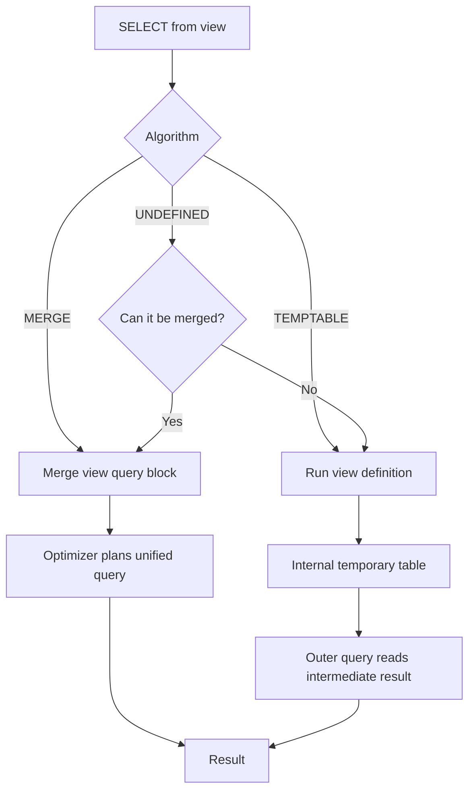

# ALGORITHM MERGE/TEMPTABLE/UNDEFINED and Conditions for Applying Them

A MySQL view is a schema object that stores a query definition, not an independent copy of data. When a statement reads a view, MySQL must process the view definition together with the outer query. The `ALGORITHM` attribute determines how MySQL handles this boundary: merging the view definition into the calling query, creating an intermediate result in an internal temporary table, or letting the optimizer choose automatically.

The three values to understand are `MERGE`, `TEMPTABLE`, and `UNDEFINED`. Choosing the right algorithm affects predicate optimization capabilities, the number of rows that must be materialized, memory/temporary storage costs, and view updatability. However, `MERGE` is not always better, `TEMPTABLE` is not synonymous with an application's `CREATE TEMPORARY TABLE` statement, and `UNDEFINED` does not mean the view has no algorithm.

This lesson belongs to the **DATABASE_MYSQL** module. The module aims to master MySQL from table design, data types, keys, and SQL queries to indexes, transactions, and concurrency control; while also practicing reading execution plans, query optimization, authorization, backup, and handling relational database operational issues. In the **Views and Temporary Tables** chapter, this lesson focuses on `ALGORITHM MERGE/TEMPTABLE/UNDEFINED` and the conditions for applying them. `SPECIAL_NOTE` is provided as empty, so this lesson does not apply additional specific constraints.

## 1. How Is a View Processed?

A view stores a defined `SELECT` statement:

```sql
CREATE VIEW v_active_customers AS
SELECT customer_id, customer_name, city
FROM customers
WHERE is_active = 1;
```

Applications can query the view like a table:

```sql
SELECT customer_id, customer_name
FROM v_active_customers
WHERE city = 'Da Nang';
```

During execution, MySQL needs to combine the condition of the outer query (`city = 'Da Nang'`) with the view definition (`is_active = 1`). There are two fundamental processing approaches:

- **Merge:** merges the view's query block into the outer query block so the optimizer optimizes a single unified query.
- **Materialize:** executes the view's defining query to create an intermediate result in an internal temporary table, then uses that result for the rest of the statement.

`ALGORITHM` is an attribute of the view definition, not a hint written arbitrarily in each `SELECT` calling the view. A view created with a specific algorithm carries that attribute whenever statements use the view.

## 2. The Three ALGORITHM Values

| Value | How It Is Processed | Practical Meaning |
|---|---|---|
| `MERGE` | Merges the view definition into the referencing query | The optimizer can optimize conditions, joins, and access paths on underlying tables as a single unified query block. |
| `TEMPTABLE` | Materializes the view result into an internal temporary table | Creates a physical boundary between the view-defining query and the outer query; may require memory or temporary storage. |
| `UNDEFINED` | Lets MySQL choose the processing method | The optimizer prefers merging when the view structure allows; if it cannot be merged, materialization is used. |

If `ALGORITHM` is not declared when creating a view, the default is `UNDEFINED`. With `UNDEFINED`, do not assume MySQL always merges or always materializes; you need to inspect the view structure and execution plan.

### 2.1. Overview Diagram



The diagram illustrates the choice at a conceptual level. The optimizer may also apply other transformations such as condition pushdown or creating an index for the intermediate table when appropriate; therefore, inspect the actual plan rather than inferring the entire execution plan solely from the algorithm name.

## 3. MERGE: Merging the View Definition into the Calling Query

`MERGE` allows MySQL to combine the outer query with the view definition. The view does not need to create a separate intermediate result set before processing the remainder of the query.

Simple view example:

```sql
CREATE ALGORITHM = MERGE
VIEW v_active_employees AS
SELECT
    employee_id,
    department_id,
    full_name,
    salary
FROM employees
WHERE is_active = 1;
```

Outer query:

```sql
SELECT employee_id, full_name, salary
FROM v_active_employees
WHERE department_id = 10
  AND salary >= 30000000;
```

Logically, MySQL can optimize this equivalently to a query on the underlying table:

```sql
SELECT employee_id, full_name, salary
FROM employees
WHERE is_active = 1
  AND department_id = 10
  AND salary >= 30000000;
```

This query illustrates logical merging; it does not claim that the internal SQL generated by the optimizer must match the exact text above. The key point is that the optimizer can evaluate the predicates together and choose an index on the underlying table.

### 3.1. Benefits of MERGE

- Provides an opportunity to push conditions from the outer query down to underlying tables when the transformation preserves semantics.
- The optimizer can choose an index based on both predicates inside the view and outer predicates.
- Underlying tables can be joined and have their access order arranged within the same plan.
- Avoids creating an intermediate result set when materialization is unnecessary.
- Simple views can retain updatability if they meet updatable view conditions.

For example, if the `employees` table has a composite index matching `(is_active, department_id, salary)`, the query has an opportunity to leverage that index. Which index is chosen still depends on statistics, selectivity, and the overall workload.

### 3.2. MERGE Does Not Guarantee a Query Is Always Fast

`MERGE` only opens up the opportunity for unified optimization. It does not create indexes by itself, does not make unselective predicates selective, and does not eliminate necessary join or sort costs.

A mergeable view where the outer query fetches too many rows can still be expensive. Select only needed columns, filter data properly, and read `EXPLAIN` to see how MySQL actually accesses underlying tables.

## 4. TEMPTABLE: Materializing View Results

`TEMPTABLE` instructs MySQL to process the view by creating an intermediate result in an internal temporary table. The outer query reads the materialized result rather than directly merging the view's query block.

Example view aggregating payroll by department:

```sql
CREATE ALGORITHM = TEMPTABLE
VIEW v_department_payroll AS
SELECT
    department_id,
    COUNT(*) AS employee_count,
    SUM(salary) AS total_payroll
FROM employees
WHERE is_active = 1
GROUP BY department_id;
```

Query using the view:

```sql
SELECT department_id, employee_count, total_payroll
FROM v_department_payroll
WHERE total_payroll >= 500000000;
```

The view aggregates data to one row per department. The condition on `total_payroll` is a condition on an aggregate result; it can only be applied after the corresponding aggregated value is determined. The optimizer may push other conditions down before the materialization step if semantically safe, but it cannot arbitrarily turn a condition on a sum into an equivalent source-row filter predicate.

### 4.1. Costs and Benefits of TEMPTABLE

**Potential costs:**

- MySQL must execute the view-defining query and build an intermediate result set.
- The intermediate set can consume memory; depending on size and configuration, the temporary table may use temporary disk storage.
- The outer statement may have to read, filter, join, or sort over the materialized set.
- If a query references the view multiple times or the view returns many rows, materialization costs can be significant.

**Reasons one might choose TEMPTABLE:**

- Wanting to keep a materialization boundary instead of merging the view into the outer query block.
- The view cannot be merged anyway due to aggregates or non-mergeable constructs.
- Needing to use the aggregated/intermediate result as an input dataset for the outer step.
- In some situations, materialization can allow read locks on underlying tables to be released earlier after the temporary result is built, rather than holding them until the end of the statement.

Do not choose `TEMPTABLE` merely thinking that temporary tables are always faster. You must measure the cost of creating, writing/reading, and processing the intermediate result.

## 5. UNDEFINED: Letting MySQL Choose

`UNDEFINED` is the default choice if no algorithm is specified when creating a view. MySQL tries to use `MERGE` if the view definition permits; if the view is not mergeable, it uses materialization-based processing.

Example:

```sql
CREATE ALGORITHM = UNDEFINED
VIEW v_employee_directory AS
SELECT
    employee_id,
    department_id,
    full_name,
    email
FROM employees
WHERE is_active = 1;
```

This definition is simple and mergeable. For another view with `GROUP BY` or `DISTINCT`, MySQL may need to materialize even if the algorithm is `UNDEFINED`.

### 5.1. When Should You Leave It as UNDEFINED?

- When there is no clear measured reason to force `TEMPTABLE`.
- When you want the optimizer to use `MERGE` if possible.
- When the view definition may evolve over time and you do not want to hardcode a strategy that becomes unsuitable.
- When you prefer MySQL's default behavior and will verify the execution plan under real workloads.

`UNDEFINED` does not mean a random algorithm. The decision depends on the view structure, mergeability, and the optimizer rules of the running MySQL version.

## 6. Conditions for a View to Be Mergeable

A view is usually mergeable when its definition is a standard projection/filter/join query over underlying tables. Example:

```sql
CREATE ALGORITHM = MERGE
VIEW v_orders_recent_columns AS
SELECT
    order_id,
    customer_id,
    order_date,
    total_amount
FROM orders
WHERE order_date >= '2026-01-01';
```

Common constructs that prevent a view from being merged include:

| Construct in View | Why It Cannot Be Processed as a Simple Merge |
|---|---|
| Aggregates like `SUM()`, `COUNT()`, `AVG()` | Results depend on aggregating multiple rows into groups. |
| `GROUP BY` | Creates a new grain for the view result. |
| `HAVING` | Filters on groups after aggregation. |
| `DISTINCT` | Must deduplicate rows in the view result. |
| `LIMIT` | Limits the row set of the inner query block; cannot be arbitrarily commuted with the outer query. |
| `UNION` or `UNION ALL` | Combines multiple query blocks into the view result. |
| Window functions | Produce values depending on row windows and ordering within the query block. |
| Certain subqueries in the select list or constructs not merged by the optimizer | Cannot be safely replaced by a single unified query block. |
| Certain expressions assigning user variables | Have side effects/evaluation order constraints making merging unsuitable. |

This list covers common cases, not an exhaustive catalog across all versions and query structures. Merge rules also depend on specific syntax and optimizer transformation capabilities.

### 6.1. Example of a Non-Mergeable View Due to GROUP BY

```sql
CREATE ALGORITHM = UNDEFINED
VIEW v_order_totals_by_customer AS
SELECT
    customer_id,
    COUNT(*) AS order_count,
    SUM(total_amount) AS total_amount
FROM orders
GROUP BY customer_id;
```

This view returns one row per customer, no longer one row per order. The optimizer cannot simply replace the view with the `orders` table and skip the aggregation step. When the view is used, MySQL needs to materialize the result or apply permitted equivalent optimizations that still preserve semantics.

### 6.2. ORDER BY Does Not Always Block MERGE

You should not infer that having `ORDER BY` in a view always makes the view non-mergeable. The ordering inside the view may become irrelevant if the outer query applies its own ordering; the optimizer has rules for handling `ORDER BY` inside views. If result ordering is an application requirement, place `ORDER BY` in the outermost query and inspect the actual plan.

## 7. Algorithm and View Updatability

Updatability is a separate property of the view definition and MySQL rules. The algorithm has an important impact, though it is not the sole condition.

- Views using `TEMPTABLE` are not updatable.
- Views using `MERGE` can be updatable if the view structure satisfies updatable view conditions.
- Views using `UNDEFINED` can be updatable if MySQL processes them via `MERGE` and the view definition still meets update conditions.

Example of a single-table filtering view:

```sql
CREATE ALGORITHM = MERGE
VIEW v_active_employee_names AS
SELECT employee_id, full_name, department_id
FROM employees
WHERE is_active = 1;
```

This view has a simple structure and may allow updating suitable columns. However, whether a view is updatable also depends on factors such as:

- Whether the view is based on one underlying table or multiple tables.
- Whether the column being updated maps directly to an underlying table column or is a computed expression.
- Whether there are aggregates, `DISTINCT`, `GROUP BY`, `HAVING`, `UNION`, window functions, or constructs that break updatability.
- Whether required columns of the underlying table are supplied valid values.

Inspect the property:

```sql
SELECT
    TABLE_NAME,
    ALGORITHM,
    IS_UPDATABLE
FROM INFORMATION_SCHEMA.VIEWS
WHERE TABLE_SCHEMA = DATABASE()
  AND TABLE_NAME = 'v_active_employee_names';
```

`IS_UPDATABLE` indicates whether MySQL considers the view updatable. Do not infer updatability merely because the view was created successfully.

### 7.1. CHECK OPTION Does Not Replace Algorithm

`WITH CHECK OPTION` checks whether rows written through the view still satisfy the view's `WHERE` condition. It does not determine merging or materialization.

Example:

```sql
CREATE ALGORITHM = MERGE
VIEW v_active_employees_checked AS
SELECT employee_id, full_name, is_active
FROM employees
WHERE is_active = 1
WITH CASCADED CHECK OPTION;
```

`CHECK OPTION` protects the view's condition during writes through the view if the view is updatable. It does not make an aggregate or `TEMPTABLE` view updatable.

## 8. Declaring and Changing ALGORITHM

### 8.1. CREATE VIEW

Specify the algorithm directly in the view creation statement:

```sql
CREATE
    ALGORITHM = MERGE
    SQL SECURITY INVOKER
VIEW v_customer_contacts AS
SELECT customer_id, customer_name, email
FROM customers
WHERE is_active = 1;
```

Or:

```sql
CREATE
    ALGORITHM = TEMPTABLE
    SQL SECURITY INVOKER
VIEW v_customer_order_summary AS
SELECT customer_id, COUNT(*) AS order_count
FROM orders
GROUP BY customer_id;
```

The order of attributes in `CREATE VIEW` syntax must follow MySQL grammar; the examples above use the order `ALGORITHM`, `DEFINER` (if present), `SQL SECURITY`, and then `VIEW`.

### 8.2. ALTER VIEW

You can change the algorithm when altering a view definition:

```sql
ALTER
    ALGORITHM = UNDEFINED
    SQL SECURITY INVOKER
VIEW v_customer_contacts AS
SELECT customer_id, customer_name, email
FROM customers
WHERE is_active = 1;
```

`ALTER VIEW` replaces an existing view definition. Before changing an algorithm in production, verify dependent queries, access privileges, updatability, and the execution plan after the change.

### 8.3. CREATE OR REPLACE VIEW

In deployment scenarios where replacing the definition is needed:

```sql
CREATE OR REPLACE
    ALGORITHM = MERGE
    SQL SECURITY INVOKER
VIEW v_customer_contacts AS
SELECT customer_id, customer_name, email
FROM customers
WHERE is_active = 1;
```

`CREATE OR REPLACE VIEW` can be convenient for migrations, but it should not be treated as a harmless operation: changing the column list, returned data types, or security context can affect applications using the view.

## 9. Checking Which Algorithm MySQL Actually Stores

Do not only look at the `CREATE VIEW` statement you submitted. Inspect the metadata after creating or altering the view.

### 9.1. SHOW CREATE VIEW

```sql
SHOW CREATE VIEW v_active_employees;
```

The output shows the view definition, algorithm, definer, and security context. If you specify `ALGORITHM = MERGE` for a view that cannot be merged, MySQL creates the view with `UNDEFINED` and emits a warning. Therefore, read warnings and the stored definition instead of assuming the original request was preserved.

You can check warnings immediately after DDL:

```sql
SHOW WARNINGS;
```

### 9.2. INFORMATION_SCHEMA.VIEWS

```sql
SELECT
    TABLE_SCHEMA,
    TABLE_NAME,
    ALGORITHM,
    IS_UPDATABLE,
    SECURITY_TYPE,
    DEFINER
FROM INFORMATION_SCHEMA.VIEWS
WHERE TABLE_SCHEMA = DATABASE()
ORDER BY TABLE_NAME;
```

Useful columns:

- `ALGORITHM`: the algorithm stored for the view.
- `IS_UPDATABLE`: whether MySQL evaluates the view as updatable.
- `SECURITY_TYPE` and `DEFINER`: privilege context information for the view.

This metadata helps confirm the deployed definition, but it does not replace checking the execution plan of specific queries.

## 10. Using EXPLAIN to Distinguish MERGE and Materialization

Run `EXPLAIN` on a query calling the view:

```sql
EXPLAIN
SELECT employee_id, full_name
FROM v_active_employees
WHERE department_id = 10;
```

With a merged view, the execution plan usually shows underlying tables like `employees` directly instead of a separate derived table step for the view. Conditions from both the view and outer query can appear together in the underlying table's access plan.

With a materialized view, the plan may display a separate query block/derived result, such as `<derivedN>` in traditional output or a materialization node in `FORMAT=TREE`/`FORMAT=JSON`. The exact presentation depends on the version and query type.

### 10.1. EXPLAIN FORMAT=JSON

```sql
EXPLAIN FORMAT=JSON
SELECT department_id, employee_count, total_payroll
FROM v_department_payroll
WHERE total_payroll >= 500000000;
```

Inspect the query block structure, derived/materialized nodes, source tables, access types, indexes, and row estimates. Do not just look for a single keyword; read the relationships between nodes.

### 10.2. EXPLAIN ANALYZE

On MySQL 8.0.18 and later, you can use `EXPLAIN ANALYZE` to execute the query and observe actual row counts, timing, and iterator loop counts:

```sql
EXPLAIN ANALYZE
SELECT department_id, employee_count, total_payroll
FROM v_department_payroll
WHERE total_payroll >= 500000000;
```

This command actually executes the query. Use it on appropriate read queries in a controlled environment, especially when the view may read large tables or perform heavy aggregations.

## 11. Distinguishing Internal Temporary Tables from CREATE TEMPORARY TABLE

Both concepts share the word "temporary", yet they are different:

| Criterion | Internal Temporary Table of TEMPTABLE | Application-Created Table |
|---|---|---|
| Creation method | Created automatically by MySQL when processing a view/query | Application runs `CREATE TEMPORARY TABLE` |
| Table name | Internal, not an object referenced directly by the application | Has a user-defined name |
| Lifecycle | Tied to statement/query block execution | Typically exists in the session until dropped or session ends |
| Purpose | Stores intermediate results to continue query processing | Stores a temporary dataset actively managed by the application |
| Reusability | Not a view result cache across statements | Can be used across multiple statements in the same session |
| Management | Decided by optimizer/engine | Application actively creates, reads, modifies, and drops it |

`ALGORITHM=TEMPTABLE` does not create a permanently named temporary table for the application to use in the next statement. Each query referencing the view may have to re-materialize according to the execution plan; nor does the view become a table storing persistent results.

Explicit temporary table example:

```sql
CREATE TEMPORARY TABLE tmp_active_employee_ids (
    employee_id BIGINT PRIMARY KEY
);

INSERT INTO tmp_active_employee_ids (employee_id)
SELECT employee_id
FROM employees
WHERE is_active = 1;

SELECT employee_id
FROM tmp_active_employee_ids;

DROP TEMPORARY TABLE tmp_active_employee_ids;
```

This is a session-created and managed temporary object, not the view `TEMPTABLE` mechanism.

## 12. Choosing an Algorithm by Use Case

| Situation | Initial Direction | Reason |
|---|---|---|
| View only projects/filters columns from one table | `MERGE` or `UNDEFINED` | Gives the optimizer the opportunity to combine predicates with the underlying table. |
| View joins tables, no merge-blocking constructs | `MERGE` or `UNDEFINED` | The optimizer can optimize joins alongside the outer query. |
| View has aggregates/`GROUP BY`/`DISTINCT`/`UNION` | `UNDEFINED` or `TEMPTABLE` | Structure is usually non-mergeable; requires materialization or equivalent processing. |
| Need to force a materialization boundary proven beneficial by measurement | `TEMPTABLE` | Locks in intermediate result creation. |
| No metrics yet or view may change | `UNDEFINED` | Lets MySQL pick a valid processing method, then verify the plan. |
| View needs to be updated via DML | Avoid `TEMPTABLE`; consider `MERGE` | TEMPTABLE views are not updatable; MERGE still requires satisfying other updatability conditions. |

This is a starting guideline, not a rule replacing benchmarks. An aggregate view may force materialization even when declared `UNDEFINED`; a simple view may merge yet remain slow due to missing indexes or returning too many rows.

## 13. Algorithm Is Not SQL SECURITY

`ALGORITHM` and `SQL SECURITY` solve two different problems:

- `ALGORITHM = MERGE/TEMPTABLE/UNDEFINED` governs how the view's query block is processed.
- `SQL SECURITY = DEFINER/INVOKER` governs the privilege context used when accessing the view.

Example:

```sql
CREATE
    ALGORITHM = MERGE
    SQL SECURITY INVOKER
VIEW v_public_employee_directory AS
SELECT employee_id, full_name, department_id
FROM employees
WHERE is_active = 1;
```

`MERGE` does not automatically grant permissions to users, and `TEMPTABLE` is not a data-hiding mechanism. View read privileges, underlying table read privileges, definer/invoker, and data policies must be designed separately.

## 14. Nested Views and Cascading Effects

A view can reference another view:

```sql
CREATE ALGORITHM = MERGE
VIEW v_active_employee_base AS
SELECT employee_id, department_id, full_name
FROM employees
WHERE is_active = 1;

CREATE ALGORITHM = UNDEFINED
VIEW v_department_employee_names AS
SELECT employee_id, department_id, full_name
FROM v_active_employee_base
WHERE department_id IS NOT NULL;
```

When querying the outer view, MySQL can continue merging nested views if definitions allow. If a layer contains a non-mergeable construct, materialization may appear at that layer. Therefore, inspecting each view individually is insufficient; you must check the execution plan of the actual query traversing the entire view chain.

Changing an underlying view can also affect many dependent views. Before a migration, identify consumers and verify related metadata/definitions using the schema management tools permitted by your team's workflow.

## 15. Factors Affecting Performance Beyond ALGORITHM

Performance should not be judged solely by the words `MERGE` or `TEMPTABLE`. The following factors can matter more:

- **Input row count:** does the view filter data early, and are predicates selective?
- **Indexes on underlying tables:** does the post-merge query have suitable indexes for filtering, joining, and sorting?
- **Row width:** does the view carry unnecessary large columns like `TEXT`, `BLOB`, or JSON?
- **Cardinality and join fan-out:** do underlying tables have one-to-many relationships that sharply inflate row counts?
- **Materialized result size:** does a `TEMPTABLE` view produce an excessively large intermediate set?
- **Aggregation and sorting:** do `GROUP BY`, `DISTINCT`, `ORDER BY` have to process many rows?
- **Call frequency:** an expensive view invoked repeatedly across many statements can accumulate high total cost.
- **Concurrent load:** CPU, I/O, buffer pool, temporary storage, and lock contention all affect execution time.

### 15.1. Predicate Pushdown and Aggregate Boundaries

With a simple mergeable view, predicates from the outer query have an opportunity to be optimized together with view conditions. With a materialized view, the optimizer may still push some conditions down into the inner query block when the transformation is safe.

However, distinguish between:

- Conditions on source columns, such as `department_id = 10`, which can be applied before aggregation if it does not alter results.
- Conditions on aggregate values, such as `SUM(salary) > 500000000`, which must be evaluated at the group level after computing the corresponding aggregate.

Do not assume `TEMPTABLE` always blocks all condition pushdowns or `MERGE` always pushes down every condition. Inspect the specific plan.

### 15.2. Temporary Tables Can Use Memory or Disk

Internal temporary tables may be stored in memory or spill to disk-based storage depending on size, data types, MySQL version, and configuration. When materialization generates large amounts of data, I/O cost and operations on temporary storage can become a bottleneck.

Do not apply a fixed configuration threshold across all versions. When investigating, examine the internal temporary table configuration of the running version, data sizes, and related runtime metrics.

## 16. Lab: Comparing MERGE, TEMPTABLE, and UNDEFINED

The following lab creates sample data to compare the three processing methods. Run it in a test schema; do not run DDL in production.

### 16.1. Creating Sample Tables and Data

```sql
CREATE TABLE departments (
    department_id INT NOT NULL PRIMARY KEY,
    department_name VARCHAR(100) NOT NULL
) ENGINE = InnoDB;

CREATE TABLE employees (
    employee_id BIGINT NOT NULL PRIMARY KEY,
    department_id INT NOT NULL,
    full_name VARCHAR(120) NOT NULL,
    salary DECIMAL(14, 2) NOT NULL,
    is_active TINYINT NOT NULL,
    KEY idx_employee_active_department (is_active, department_id),
    KEY idx_employee_department_salary (department_id, salary)
) ENGINE = InnoDB;

INSERT INTO departments (department_id, department_name)
VALUES
    (10, 'Engineering'),
    (20, 'Finance'),
    (30, 'Operations');

INSERT INTO employees
    (employee_id, department_id, full_name, salary, is_active)
VALUES
    (1001, 10, 'An Nguyen', 35000000, 1),
    (1002, 10, 'Binh Tran', 42000000, 1),
    (1003, 10, 'Chi Le', 28000000, 0),
    (2001, 20, 'Dung Pham', 32000000, 1),
    (2002, 20, 'Giang Vo', 51000000, 1),
    (3001, 30, 'Hanh Do', 26000000, 1);
```

### 16.2. Creating a Mergeable View

```sql
CREATE ALGORITHM = MERGE
VIEW v_active_employee_lab AS
SELECT employee_id, department_id, full_name, salary
FROM employees
WHERE is_active = 1;

EXPLAIN
SELECT employee_id, full_name, salary
FROM v_active_employee_lab
WHERE department_id = 10
  AND salary >= 30000000;
```

Observe how the plan accesses `employees` directly, which indexes are considered/chosen, and what the row estimates look like.

You can also test a multi-table join view that still has a mergeable structure:

```sql
CREATE ALGORITHM = MERGE
VIEW v_employee_department_lab AS
SELECT
    e.employee_id,
    e.full_name,
    e.salary,
    d.department_name
FROM employees AS e
JOIN departments AS d
    ON d.department_id = e.department_id
WHERE e.is_active = 1;

EXPLAIN
SELECT employee_id, full_name, salary
FROM v_employee_department_lab
WHERE department_name = 'Engineering'
  AND salary >= 30000000;
```

Join views are not automatically prohibited from merging just because they involve multiple tables. What matters is that the query block does not contain constructs preventing merging; verify with the execution plan.

### 16.3. Creating a View That Must Materialize Due to Aggregates

```sql
CREATE ALGORITHM = UNDEFINED
VIEW v_department_payroll_lab AS
SELECT
    department_id,
    COUNT(*) AS employee_count,
    SUM(salary) AS total_payroll
FROM employees
WHERE is_active = 1
GROUP BY department_id;

EXPLAIN
SELECT department_id, employee_count, total_payroll
FROM v_department_payroll_lab
WHERE total_payroll >= 70000000;
```

Because the view has `GROUP BY`, it does not merge in the standard way. Observe the query block or materialization node in the plan.

### 16.4. Forcing TEMPTABLE on a Simple View for Comparison

```sql
CREATE ALGORITHM = TEMPTABLE
VIEW v_active_employee_temp_lab AS
SELECT employee_id, department_id, full_name, salary
FROM employees
WHERE is_active = 1;

EXPLAIN
SELECT employee_id, full_name, salary
FROM v_active_employee_temp_lab
WHERE department_id = 10
  AND salary >= 30000000;
```

Compare the plan with `v_active_employee_lab`. Both views produce the same logical result, but their processing boundaries differ. The intermediate set and number of rows needing materialization can make the plan more expensive; verify in practice instead of just looking at the SQL line count.

### 16.5. Checking Metadata and Updatability

```sql
SELECT
    TABLE_NAME,
    ALGORITHM,
    IS_UPDATABLE
FROM INFORMATION_SCHEMA.VIEWS
WHERE TABLE_SCHEMA = DATABASE()
  AND TABLE_NAME IN (
      'v_active_employee_lab',
      'v_department_payroll_lab',
      'v_active_employee_temp_lab'
  )
ORDER BY TABLE_NAME;

SHOW CREATE VIEW v_active_employee_lab;
SHOW CREATE VIEW v_department_payroll_lab;
SHOW CREATE VIEW v_active_employee_temp_lab;
```

Conceptually expected results:

- The simple filter view has algorithm `MERGE` and can be updatable if other conditions are met.
- The aggregate view with `UNDEFINED` requires materialization because it is non-mergeable and non-updatable.
- The view forced to `TEMPTABLE` is not updatable even though the definition only filters a single table.

Exact metadata values must be confirmed on the MySQL version in use.

## 17. Common Mistakes and Misconceptions

| Misconception / Mistake | Consequence | How to Handle |
|---|---|---|
| Thinking `MERGE` is always faster | Ignores cardinality, indexes, and join costs | Measure plan and runtime with representative data. |
| Thinking `TEMPTABLE` is a session temporary table | Expects to access results again in subsequent statements | Distinguish internal temporary tables from `CREATE TEMPORARY TABLE`. |
| Forcing `MERGE` on a view with `GROUP BY` | Structure does not meet merge conditions | Use `UNDEFINED`/`TEMPTABLE` appropriately and inspect warnings/metadata. |
| Thinking `UNDEFINED` always materializes | Misunderstands default behavior | MySQL prefers merge when possible; verify the plan. |
| Thinking `MERGE` implies the view is updatable | DML may be rejected due to other restrictions | Check `IS_UPDATABLE` and updatable view rules. |
| Thinking `CHECK OPTION` controls algorithm | Confuses data validation with execution strategy | `CHECK OPTION` checks view conditions on writes, not merge/materialize selection. |
| Only checking `SHOW CREATE VIEW` | Does not reveal the plan of queries calling the view | Combine metadata with `EXPLAIN`/`EXPLAIN ANALYZE`. |
| Fetching too many columns in a view | Increases payload and processing cost | Include only columns consumers need. |
| Unnecessarily materializing a large result set | Increases memory/temp I/O | Filter and project early when semantics are preserved. |
| Confusing ALGORITHM with SQL SECURITY | Misjudges access permissions | Design algorithm and privileges independently. |

## 18. Decision and Deployment Workflow

1. **Identify the view's purpose.** Is the view a named query layer, a security boundary, or an aggregation layer?
2. **Read the SELECT definition.** Look for aggregates, GROUP BY, DISTINCT, LIMIT, UNION, window functions, and non-mergeable constructs.
3. **Choose a sensible default.** Prefer UNDEFINED if there is no evidence requiring a forced algorithm.
4. **Consider MERGE.** Use for simple views when you want the optimizer to unify conditions and access underlying tables.
5. **Consider TEMPTABLE.** Only force when there is a clear reason or a materialization boundary is needed; remember the view will not be updatable.
6. **Verify DDL.** Read warnings and use SHOW CREATE VIEW/INFORMATION_SCHEMA.VIEWS to confirm the stored algorithm.
7. **Measure representative queries.** Use EXPLAIN, EXPLAIN FORMAT=JSON/TREE, and when appropriate, EXPLAIN ANALYZE.
8. **Compare row counts and costs.** Inspect access paths, indexes, materialization, temporary storage, sorts, and joins.
9. **Check semantics.** Compare results, ordering if required, NULLs, aggregates, and updatability.
10. **Verify permissions.** Check SQL SECURITY, DEFINER/INVOKER, and privileges on views/underlying tables.
11. **Deploy with control.** Check dependent applications, migrations, and rollback readiness.
12. **Monitor post-deployment.** Measure latency, throughput, resources, and DML errors through the view.

## 19. Hands-on Exercises

### Exercise 1: MERGE for a Simple View

Create a view filtering only active employees, then query the view by department and salary range.

**Requirement:** use EXPLAIN to identify the underlying table, access path, and chosen index.

### Exercise 2: TEMPTABLE for Aggregates

Create a view for total employee count and total salary by department.

**Requirement:** explain why GROUP BY prevents the view from being mergeable in the standard way; observe materialization in the plan.

### Exercise 3: UNDEFINED

Create two views, one simple view and one view with DISTINCT or GROUP BY, both using UNDEFINED.

**Requirement:** compare the algorithm metadata and execution plans.

### Exercise 4: MERGE and Updatability

Create a single-table filtering view with MERGE and try updating a directly mapped column.

**Requirement:** check IS_UPDATABLE; try updating a row so it no longer satisfies the view condition and explain the role of CHECK OPTION.

### Exercise 5: TEMPTABLE and Updatability

Create a simple view with the same definition but using TEMPTABLE.

**Requirement:** check IS_UPDATABLE and attempt DML through the view; explain the difference compared to MERGE.

### Exercise 6: Comparing Execution Plans

Create two views with the same logical result, one using MERGE and one using TEMPTABLE.

**Requirement:** run EXPLAIN and EXPLAIN ANALYZE on the same query calling the views; compare row counts, timings, and materialization nodes.

### Exercise 7: Nested Views

Create a second view referencing the first view, then query the outer view.

**Requirement:** observe whether layers are merged or whether a materialization step occurs.

### Exercise 8: Separating Algorithm from Security

Create two views with the same algorithm but different SQL SECURITY.

**Requirement:** explain that the algorithm does not replace SELECT privileges on underlying tables and test permissions using two lab accounts.

## 20. View Algorithm Review Checklist

- [ ] Understood that a view stores a query definition, not pre-stored results like a physical table.
- [ ] Distinguished MERGE, TEMPTABLE, and UNDEFINED.
- [ ] Determined whether the view structure is mergeable.
- [ ] Understood that aggregates, GROUP BY, HAVING, DISTINCT, LIMIT, and UNION can block merging.
- [ ] Do not assume ORDER BY in a view is always preserved in the outer query.
- [ ] Considered TEMPTABLE's impact on materialization and temporary storage.
- [ ] Remembered that TEMPTABLE views are not updatable.
- [ ] Checked IS_UPDATABLE rather than inferring from DDL.
- [ ] Distinguished CHECK OPTION from ALGORITHM.
- [ ] Confirmed the algorithm via SHOW CREATE VIEW or INFORMATION_SCHEMA.VIEWS.
- [ ] Read EXPLAIN/EXPLAIN ANALYZE of actual queries calling the view.
- [ ] Distinguished internal temporary tables from CREATE TEMPORARY TABLE.
- [ ] Checked SQL SECURITY privileges and dependent views.
- [ ] Compared results and performance before/after changes.

## 21. Key Takeaways

`MERGE` merges the view definition into the referencing query, giving the optimizer the chance to optimize predicates and underlying tables in the same plan. `TEMPTABLE` materializes view results into an internal temporary table, creating a processing boundary and potentially incurring memory/temporary storage costs; views using this algorithm are not updatable. `UNDEFINED` is the default letting MySQL choose, usually preferring merging when the definition allows.

Constructs such as aggregates, `GROUP BY`, `HAVING`, `DISTINCT`, `LIMIT`, and `UNION` typically prevent a view from being merged. Algorithm does not dictate access permissions and does not guarantee performance on its own. Confirm the stored definition, inspect execution plans, measure on representative data, and verify updatability before changing views in production.
