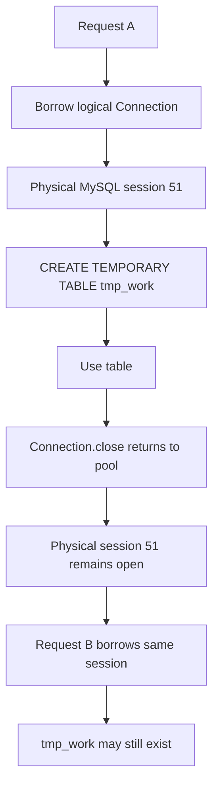

# Temporary Table Lifecycle When Reusing Connections via a Pool

In MySQL, `CREATE TEMPORARY TABLE` creates a table that exists only within the **server session** that created it. The temporary table is automatically dropped when the physical session ends; `COMMIT` and `ROLLBACK` do not automatically drop the table. This is a common source of bugs when applications use a connection pool: `Connection.close()` usually only returns the logical connection to the pool, while the physical MySQL connection stays open and may be handed out to the next request.

If Request A creates `tmp_work`, finishes using it, and forgets to run `DROP TEMPORARY TABLE`, Request B may receive that exact same server session and see the leftover table and data. Request B can fail with a "table already exists" error, accidentally read Request A's data, or overwrite data unintentionally. Conversely, if a request creates a temporary table and returns the connection to the pool before finishing its work, the next `getConnection()` call may receive a different session and fail with "table doesn't exist".

In the `DATABASE_MYSQL` module, temporary tables must be treated as **session-bound state**, not resources bound to a request or transaction. This lesson focuses on managing that lifecycle when using JDBC and connection pools.

## Objectives

After this lesson, you will be able to:

- Distinguish the lifecycles of a server session, a logical connection, and an application request.
- Explain why temporary tables persist across `COMMIT`, `ROLLBACK`, and returning a logical connection to a pool.
- Recognize temporary table leakage between two requests reusing the same physical connection.
- Keep the same connection throughout the entire flow of creating, loading, querying, and dropping a temporary table.
- Clean up tables using `DROP TEMPORARY TABLE IF EXISTS` across all execution paths.
- Understand the limitations of transaction resets and session resets.
- Evaluate whether a pool/driver performs server state resets.
- Choose among temporary tables, CTEs, derived tables, and regular staging tables.
- Design tests proving no session state leaks between borrowers.

## 1. Three Distinct Lifecycles

When using a connection pool, at least three concepts must be distinguished:

| Concept | Meaning | When It Ends |
|---|---|---|
| Request | A single business processing execution in the application | When the request-handling code completes |
| Logical JDBC connection | The `Connection` object a borrower receives from the pool | When the application calls `close()`; usually returns to the pool |
| Physical MySQL connection/session | The actual TCP connection and server session | When the pool closes the connection, the server disconnects, or the connection is reset/replaced by the corresponding mechanism |

A temporary table belongs to the physical MySQL session. It does not belong to the request, nor does it automatically disappear when the logical JDBC connection is closed.



The pool may hand out the exact physical session just returned, or hand out a different session. An application must never assume the next borrower always gets the same session or always gets a clean session unless a verified reset mechanism is in place.

## 2. Temporary Tables Are Bound to the Session

Create a temporary table:

```sql
CREATE TEMPORARY TABLE tmp_request_orders (
    order_id BIGINT UNSIGNED NOT NULL,
    total_amount DECIMAL(12, 2) NOT NULL,
    PRIMARY KEY (order_id)
) ENGINE=InnoDB;
```

Key characteristics:

- Only the session that created the table can see and use it.
- Another session can create a temporary table with the same name; the two tables are independent.
- The table is automatically dropped when the physical session terminates.
- `COMMIT` and `ROLLBACK` do not drop the temporary table definition.
- DML on temporary tables using InnoDB still obeys InnoDB transactions.
- `CREATE TEMPORARY TABLE` does not trigger an implicit commit like a regular `CREATE TABLE`, yet creating the temporary table itself is not rolled back to make the table vanish.

### 2.1. Two Sessions Can Have the Same Temporary Table Name

Session A:

```sql
CREATE TEMPORARY TABLE tmp_work (
    id INT NOT NULL PRIMARY KEY,
    note VARCHAR(40) NOT NULL
) ENGINE=InnoDB;

INSERT INTO tmp_work VALUES (1, 'session A');
SELECT CONNECTION_ID();
SELECT * FROM tmp_work;
```

Session B:

```sql
CREATE TEMPORARY TABLE tmp_work (
    id INT NOT NULL PRIMARY KEY,
    note VARCHAR(40) NOT NULL
) ENGINE=InnoDB;

INSERT INTO tmp_work VALUES (1, 'session B');
SELECT CONNECTION_ID();
SELECT * FROM tmp_work;
```

Both sessions can use the same name `tmp_work`, yet each session sees its own data. Session B cannot read Session A's rows simply by querying that name.

### 2.2. A Temporary Table Can Shadow a Regular Table of the Same Name

If a session creates a temporary table with the same name as a regular table in the schema, statements referencing that name in the session access the temporary table shadowing the regular table. This can cause queries in that session to return different results from queries in other sessions.

Use a clear prefix such as `tmp_` or `tmp_req_...` to avoid colliding with business table names. When cleaning up, use:

```sql
DROP TEMPORARY TABLE IF EXISTS tmp_request_orders;
```

The `TEMPORARY` keyword scopes the operation to temporary tables; do not use a plain `DROP TABLE` in cleanup routines if a regular table with the same name could exist.

## 3. COMMIT, ROLLBACK, and DROP Have Different Meanings

Transactions manage transactional data changes. They do not manage the session lifecycle of temporary tables.

```sql
CREATE TEMPORARY TABLE tmp_txn_demo (
    id INT NOT NULL PRIMARY KEY,
    value_text VARCHAR(40) NOT NULL
) ENGINE=InnoDB;

START TRANSACTION;
INSERT INTO tmp_txn_demo VALUES (1, 'before rollback');
ROLLBACK;

SELECT COUNT(*) AS row_count
FROM tmp_txn_demo;
```

After `ROLLBACK`, the `tmp_txn_demo` table still exists, but the row inserted within the InnoDB transaction has been undone. Distinguish between:

- **Table lifecycle:** the temporary table exists until `DROP TEMPORARY TABLE` is run or the physical session ends.
- **Row lifecycle:** data modifications inside the temporary table depend on the storage engine and transactions.

If a temporary table uses a non-transactional engine such as `MEMORY`, DML lacks the rollback capability of InnoDB. If temporary data changes must participate in the same transaction as InnoDB data, declare `ENGINE=InnoDB` explicitly.

### 3.1. DROP TEMPORARY TABLE Is Not ROLLBACK

```sql
DROP TEMPORARY TABLE IF EXISTS tmp_txn_demo;
```

This statement removes the temporary table from the session. Do not expect a subsequent `ROLLBACK` to restore the table. `DROP TEMPORARY TABLE` does not trigger an implicit commit like a regular `DROP TABLE`, yet dropping a temporary table is not a change that can be undone by rollback.

### 3.2. Ending a Transaction Does Not Mean the Session Is Clean

A session may have committed its transaction and still hold:

- Temporary tables.
- User variables such as `@current_tenant`.
- Session system variables modified via `SET SESSION`.
- Locks acquired with `GET_LOCK()`.
- Prepared statements or other session states depending on the API/driver.

Therefore, running `ROLLBACK` when returning a connection to a pool is insufficient to clean all session state. The pool must have an appropriate reset policy, and the application should still actively clean up resources it creates.

## 4. Failure Scenarios When Reusing Connections

Suppose the pool holds a physical connection with ID 51.

### Request A: Creates a Table Without Cleaning Up

```sql
CREATE TEMPORARY TABLE tmp_request_orders (
    order_id BIGINT UNSIGNED NOT NULL PRIMARY KEY,
    total_amount DECIMAL(12, 2) NOT NULL
) ENGINE=InnoDB;

INSERT INTO tmp_request_orders VALUES (101, 120.00);
```

The application calls `connection.close()`. With a pool, this call typically only returns the logical connection to the pool; physical session 51 still retains the table and rows.

### Request B: Receives Session 51

If Request B receives the same physical session 51 and runs:

```sql
CREATE TEMPORARY TABLE tmp_request_orders (
    order_id BIGINT UNSIGNED NOT NULL PRIMARY KEY,
    total_amount DECIMAL(12, 2) NOT NULL
) ENGINE=InnoDB;
```

MySQL raises an error because a temporary table with that name already exists in the session. If code uses `CREATE TEMPORARY TABLE IF NOT EXISTS`, the error may be hidden while the old table is reused; leftover schema or data may not match Request B.

### 4.1. Risk of Data Leakage Between Borrowers

If Request B skips table creation and simply runs:

```sql
SELECT * FROM tmp_request_orders;
```

it can read data left behind by Request A. This is an application-layer data isolation bug. The fact that temporary tables are invisible to other sessions does not prevent leakage when the same session is handed sequentially to multiple requests.

### 4.2. The Opposite Bug: Creating and Using on Two Different Connections

```java
try (Connection first = dataSource.getConnection()) {
    createTemporaryTable(first);
}

try (Connection second = dataSource.getConnection()) {
    queryTemporaryTable(second);
}
```

This code is unsafe. `second` may be a different physical session and therefore cannot see the table created by `first`. If the pool happens to hand out the same physical session, the code might appear to work, yet it remains dependent on pool allocation behavior and risks reading stale data.

Keep a single logical `Connection` across the entire process of creating, loading, querying, and cleaning up the temporary table.

## 5. Safe SQL Pattern: Create, Use, and Drop in the Same Session

For a simple operation, you can run a sequence of statements on the same connection:

Create the orders table used in the lab example:

```sql
CREATE TABLE orders (
    order_id BIGINT UNSIGNED NOT NULL,
    customer_id BIGINT UNSIGNED NOT NULL,
    total_amount DECIMAL(12, 2) NOT NULL,
    PRIMARY KEY (order_id),
    KEY idx_orders_customer (customer_id)
) ENGINE=InnoDB;

INSERT INTO orders (order_id, customer_id, total_amount)
VALUES
    (101, 100, 120.00),
    (102, 100,  60.00),
    (201, 200,  80.00);
```

```sql
DROP TEMPORARY TABLE IF EXISTS tmp_request_orders;

CREATE TEMPORARY TABLE tmp_request_orders (
    order_id BIGINT UNSIGNED NOT NULL,
    total_amount DECIMAL(12, 2) NOT NULL,
    PRIMARY KEY (order_id)
) ENGINE=InnoDB;

INSERT INTO tmp_request_orders (order_id, total_amount)
SELECT order_id, total_amount
FROM orders
WHERE customer_id = 100;

SELECT order_id, total_amount
FROM tmp_request_orders
ORDER BY order_id;

DROP TEMPORARY TABLE IF EXISTS tmp_request_orders;
```

The leading `DROP` acts as a defensive guard in case the session still holds a table from previous use. The trailing `DROP` releases state immediately upon completion. The entire sequence must execute on the same physical session.

Do not use `CREATE TEMPORARY TABLE IF NOT EXISTS` as a reset mechanism. If the table already exists from a prior borrower, `IF NOT EXISTS` neither refreshes the schema nor clears stale data.

### 5.1. Temporary Table Names Should Be Fixed in Code; Data Must Be Cleared

Temporary table names are SQL identifiers and cannot be bound with `?` placeholders like values. Use a fixed name controlled by code or a name generated from safe rules; never concatenate table names directly from user input.

If using a fixed name like `tmp_request_orders`, each checkout must ensure no old table with that name remains before creation. If using dynamic names, cleanup is still required; dynamic naming does not replace lifecycle management.

## 6. JDBC Pattern with try/finally

In JDBC, `Connection.close()` on a pooled connection normally returns the logical connection to the pool. Therefore, cleanup must occur before the connection is returned.

Illustrative example using the same connection:

This snippet uses Java text blocks (Java 15 and later); for Java 8/11, replace text blocks with equivalent SQL strings.

```java
try (Connection connection = dataSource.getConnection()) {
    Throwable primaryFailure = null;
    try {
        try (Statement statement = connection.createStatement()) {
            statement.execute(
                "DROP TEMPORARY TABLE IF EXISTS tmp_request_orders"
            );
            statement.execute("""
                CREATE TEMPORARY TABLE tmp_request_orders (
                    order_id BIGINT UNSIGNED NOT NULL,
                    total_amount DECIMAL(12, 2) NOT NULL,
                    PRIMARY KEY (order_id)
                ) ENGINE=InnoDB
                """);
        }

        try (PreparedStatement insert = connection.prepareStatement("""
            INSERT INTO tmp_request_orders (order_id, total_amount)
            SELECT order_id, total_amount
            FROM orders
            WHERE customer_id = ?
            """)) {
            insert.setLong(1, customerId);
            insert.executeUpdate();
        }

        try (PreparedStatement query = connection.prepareStatement("""
            SELECT order_id, total_amount
            FROM tmp_request_orders
            ORDER BY order_id
            """)) {
            try (ResultSet rows = query.executeQuery()) {
                while (rows.next()) {
                    // Map data within the same connection/session.
                }
            }
        }
    } catch (SQLException failure) {
        primaryFailure = failure;
        throw failure;
    } catch (RuntimeException | Error failure) {
        primaryFailure = failure;
        throw failure;
    } finally {
        try (Statement cleanup = connection.createStatement()) {
            cleanup.execute(
                "DROP TEMPORARY TABLE IF EXISTS tmp_request_orders"
            );
        } catch (SQLException cleanupFailure) {
            // Call the pool's evict/discard API before returning the connection.
            if (primaryFailure != null) {
                primaryFailure.addSuppressed(cleanupFailure);
            } else {
                throw cleanupFailure;
            }
        }
    }
}
```

This sample illustrates a flow without an explicit transaction. With business transactions, handle `commit`/`rollback` explicitly and return the connection to the pool only after the transaction has ended. The snippet preserves the primary exception and attaches cleanup errors via `addSuppressed`; calling the evict/discard API is pool-specific and must be implemented according to the pool in use. If cleanup fails without discarding the physical connection, the next borrower may receive a dirty session.

### 6.1. When a Transaction Is Involved

General sequence:

```text
borrow connection
  -> verify clean session/transaction state
  -> START transaction or setAutoCommit(false)
  -> DROP TEMPORARY TABLE IF EXISTS
  -> CREATE TEMPORARY TABLE ... ENGINE=InnoDB
  -> load and query temporary data
  -> COMMIT if business logic succeeds
     or ROLLBACK if it fails
  -> DROP TEMPORARY TABLE IF EXISTS in finally
  -> restore session settings if modified by the application
  -> return connection to pool
```

If rollback fails, cleanup cannot run, or connection state is indeterminate, do not reuse that connection. Use the pool's dedicated eviction/discard API. Do not unconditionally set `autoCommit=true` before being certain the transaction has finished; toggling auto-commit can commit an open transaction.

### 6.2. Cleanup Must Run on the Same Connection

Do not open a new connection just to run `DROP TEMPORARY TABLE`. Session A's temporary table does not exist in Session B, even if B uses the same username/database. Cleanup must use the exact connection that created the table.

## 7. Driver and Pool Session Reset

MySQL supports a connection reset protocol command (`COM_RESET_CONNECTION`) to return a server session to its initial state without closing the TCP connection. Resetting server state can drop temporary tables and other session states.

However, applications must not assume every connection pool or JDBC driver invokes this reset on every `Connection.close()` or every checkout. Some pools only restore a subset of JDBC states they track, such as auto-commit, read-only, isolation level, or catalog; temporary tables are SQL/session state that a pool might not recognize unless it resets server state.

Check documentation for the exact version of your driver and pool:

- Is reset invoked on connection return, on connection borrow, or not at all?
- Does reset actually clear temporary tables, user variables, and session variables?
- Does reset roll back open transactions?
- If reset fails, is the physical connection evicted from the pool?
- Does the reset configuration apply to all return paths, including timeouts and exceptions?

### 7.1. Reset Does Not Replace Application Cleanup

Session reset is an additional safeguard. Applications should still run `DROP TEMPORARY TABLE` in `finally` to:

- Release resources early, without waiting for the next checkout.
- Make temporary table ownership explicit in code.
- Reduce reliance on pool-specific configuration.
- Detect cleanup failures and evict the connection if needed.

### 7.2. Connection Initialization SQL Is Not Per-Checkout Cleanup

Some pools support configuring SQL to execute when a new physical connection is created. This initialization statement generally does not mean re-running every time a connection is returned and re-borrowed. Do not rely on `connectionInitSql` to clean up temporary tables after every borrower unless the pool's documentation explicitly states it runs on every checkout.

## 8. Keeping the Same Connection Throughout the Workflow

A temporary table exists only in the session that created it. If a workflow spans multiple repository/service methods, pass the same transaction-bound connection or use a transaction management mechanism that guarantees the same connection.

Incorrect pattern:

```java
void prepareStage() throws SQLException {
    try (Connection c = dataSource.getConnection()) {
        createTemporaryTable(c);
    }
}

void processStage() throws SQLException {
    try (Connection c = dataSource.getConnection()) {
        readTemporaryTable(c);
    }
}
```

Correct pattern in principle:

```java
void processRequest() throws SQLException {
    try (Connection c = dataSource.getConnection()) {
        try {
            createTemporaryTable(c);
            loadTemporaryTable(c);
            processTemporaryTable(c);
        } finally {
            dropTemporaryTable(c);
        }
    }
}
```

Do not keep one shared `Connection` application-wide or share the same connection concurrently across multiple threads. One connection/session should be used by only one unit of work at a time.

## 9. Choosing Temporary Table vs. CTE/Derived Table

Not all intermediate data needs a temporary table.

| Need | Typically Suitable Choice | Reason |
|---|---|---|
| Use intermediate results within a single statement | CTE (`WITH`) or derived table | Creates no state persisting across statements |
| Use the same dataset across multiple statements in a workflow | Temporary table | Allows indexing and reuse within the same session |
| Exchange data across multiple sessions/workers | Regular staging table keyed by batch/request | Temporary tables are not shared across sessions |
| Persist results long-term or for auditing | Regular table | Has clear lifecycle and access privileges |
| Small dataset used only once | CTE/derived table | Avoids cleanup and pool state concerns |

Example of a CTE that creates no session state:

```sql
WITH customer_orders AS (
    SELECT order_id, total_amount
    FROM orders
    WHERE customer_id = 100
)
SELECT order_id, total_amount
FROM customer_orders
ORDER BY order_id;
```

A CTE is scoped to a single statement. If results must be reused across multiple statements and recomputing them is expensive, a temporary table may be reasonable, provided session handling and cleanup are tightly managed.

## 10. Using Regular Staging Tables When Cross-Session Sharing Is Needed

If intermediate data must be read by another worker, a temporary table is unsuitable. You can use a regular staging table keyed by `batch_id` or `request_id`:

```sql
CREATE TABLE job_stage (
    batch_id BINARY(16) NOT NULL,
    row_no BIGINT UNSIGNED NOT NULL,
    payload JSON NOT NULL,
    created_at DATETIME(6) NOT NULL,
    PRIMARY KEY (batch_id, row_no),
    KEY idx_job_stage_created (created_at)
) ENGINE=InnoDB;
```

Every query must filter by `batch_id` and access privileges must be controlled. Regular tables require retention/TTL cleanup procedures, retry handling, and safeguards against another batch reading the wrong data. In return, they allow multiple sessions to access the same dataset intentionally.

## 11. Inspecting and Diagnosing Session State

### 11.1. Recording the Physical Connection ID

On the same connection:

```sql
SELECT CONNECTION_ID() AS mysql_connection_id;
```

Record the ID before creating the table, after executing steps, and when reusing connections. If the same ID is issued again, it is the same server session; any temporary table that was not dropped/reset may still exist.

### 11.2. Verifying the Table Within the Same Session

```sql
SHOW CREATE TABLE tmp_request_orders;
SELECT COUNT(*) FROM tmp_request_orders;
```

Run from the exact connection that created the table. Another monitoring session cannot run these commands to inspect an application session's private temporary table.

### 11.3. Monitoring the Pool

Track metrics:

- Active, idle, and pending borrower counts.
- Number of physical connections created, closed, or reset.
- Checkout/return counts and connection hold times.
- `table already exists`, `table doesn't exist`, or cleanup failure errors.
- Connections evicted/discarded and their causes.
- Transactions still open when returned to the pool.

Log `CONNECTION_ID()` alongside request IDs in controlled test environments to correlate a request with a physical session. Do not log sensitive data contained in temporary tables.

## 12. Common Mistakes

| Symptom | Cause | How to Handle |
|---|---|---|
| `Table already exists` on CREATE TEMPORARY TABLE | Reused session still holds table from prior borrower | Drop at start and end of workflow; verify pool reset |
| New request reads previous request's data | Temporary table still holds rows in physical session | Clean up in `finally`, test same-connection reuse, and evict on cleanup error |
| `Table doesn't exist` during processing step | Created and used on two different physical connections | Keep the same logical Connection across the whole workflow |
| `ROLLBACK` leaves the table behind | Rollback handles transactional DML, not dropping table definitions | Call `DROP TEMPORARY TABLE` |
| `Connection.close()` leaves the table behind | Logical close returns connection to pool without ending server session | Clean up before closing or verify session reset |
| `CREATE ... IF NOT EXISTS` succeeds but data is wrong | Old table is retained instead of newly created | Drop then create; do not use IF NOT EXISTS as reset |
| Cleanup fails yet connection is still reused | Pool is unaware session holds temporary state | Evict/discard physical connection via pool API |
| Two concurrent requests collide on the same temporary table | Connection/session shared improperly or name/flow mismanaged | Never share a Connection across threads; each borrower uses its own session |
| Temporary table shadows a regular table | Duplicate name in the same session | Use a distinct `tmp_` prefix and always use `DROP TEMPORARY TABLE` |
| Temporary data fails to roll back | Table uses a non-transactional engine | Use `ENGINE=InnoDB` when DML rollback is needed |

## 13. Safe Workflow for Connection Pools

Apply this workflow to any logic using temporary tables:

1. Borrow a logical connection from the pool.
2. Ensure clean transaction and session state per the pool contract; never use a connection known to be dirty.
3. Run `DROP TEMPORARY TABLE IF EXISTS` for workflow-owned names.
4. Create the temporary table with explicit schema, indexes, and engine.
5. Load and query data on that same connection.
6. Commit or roll back the transaction according to business outcomes.
7. In `finally`, run `DROP TEMPORARY TABLE IF EXISTS` on the same connection.
8. If cleanup or reset fails, evict/discard the physical connection using the pool's API.
9. Restore any session settings modified by the workflow if the pool does not reset server state.
10. Return the connection to the pool only after state is clean.
11. Monitor errors and pool metrics to detect state leakage.

Two layers of defense should work together: explicit cleanup in the application and pool-level session reset/eviction. Never use one layer as an excuse to skip the other.

## 14. Hands-on Practice

Run with MySQL 8.0 and a pool sized to at least one physical connection for easy reuse:

1. Open Session A, create `tmp_work`, insert one row, and inspect `CONNECTION_ID()`.
2. Run `COMMIT`, then query `tmp_work` again; confirm the table still exists.
3. Run `ROLLBACK`; confirm the table definition remains while uncommitted InnoDB DML is undone.
4. Open Session B, create a `tmp_work` with the same name and insert different data; confirm each session sees its own data.
5. Create a regular table of the same name in the lab schema, then create a temporary table of the same name in Session A; observe the temporary table shadowing the regular table in that session.
6. Run `DROP TEMPORARY TABLE IF EXISTS` and confirm only the temporary table is dropped.
7. Write a JDBC program that creates a temporary table and closes the logical connection without dropping it; borrow the next connection and observe the error/state if the pool returns the same physical session.
8. Fix the program to create, load, read, and drop the table on the same `Connection` using `try/finally`.
9. Intentionally throw an exception mid-workflow; confirm cleanup still runs.
10. Intentionally make cleanup fail in the lab; verify how the pool flags and evicts the broken connection.
11. Compare a pool with server state reset against a pool without reset; verify actual behavior rather than guessing from configuration.
12. Create a temporary table inside a transaction and then roll back; distinguish table lifecycle from DML rollback.
13. Test `ENGINE=InnoDB` and `ENGINE=MEMORY`; compare DML rollback behavior.
14. Replace a single-statement workflow with a CTE; evaluate whether a temporary table is still needed.
15. Write an integration test running two consecutive requests on the same physical connection and prove the second request cannot see the first request's data.

You have completed this lesson when you can demonstrate that temporary tables are cleaned up before returning connections to the pool, workflows use the same session from start to finish, and subsequent requests cannot see data from prior borrowers.

## 15. Key Principles to Remember

- Temporary tables belong to the physical MySQL session, not to requests or transactions.
- Temporary tables vanish automatically when the physical session ends; logical `Connection.close()` in a pool usually only returns the connection to the pool.
- `COMMIT` and `ROLLBACK` do not automatically drop temporary tables.
- With InnoDB, rollback can undo DML on a temporary table without dropping the table definition.
- Create, load, read, and drop temporary tables on the same connection.
- Use `DROP TEMPORARY TABLE IF EXISTS` at the start/end of workflows; avoid using `CREATE ... IF NOT EXISTS` as a reset mechanism.
- If cleanup fails, evict/discard the physical connection via the pool API.
- Do not assume the pool/driver automatically calls `COM_RESET_CONNECTION`; verify documentation and test the exact version.
- Session reset is an extra safeguard, not a replacement for active cleanup.
- Never share one JDBC Connection across multiple threads or concurrent requests.
- Use a CTE/derived table if intermediate data is needed only within a single statement.
- Use a regular staging table if data must be shared across multiple sessions.
- Use `ENGINE=InnoDB` when transactional rollback is required for temporary table DML.
- Verify using `CONNECTION_ID()` and integration tests with reused connections.
- Never return a connection to the pool while a transaction or indeterminate session state remains open.
