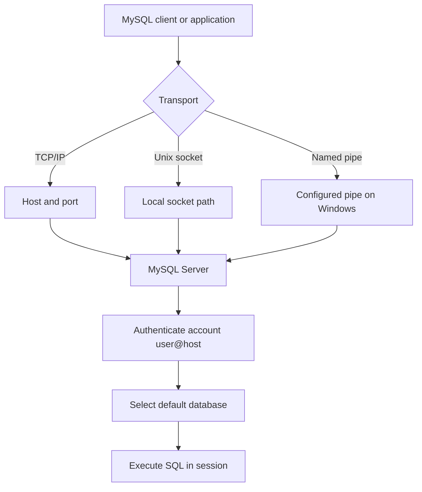

# Host, Port, Socket, Default Database, and Connection Strings

For an application or administration tool to work with MySQL, it must specify the right server, port or socket, transport method, and default database. These details are typically entered in MySQL Workbench, DBeaver, the `mysql` command line, or the application's connection configuration. If even one component is wrong, the client may fail to find the server, connect to the wrong instance, or log in successfully while running queries against the wrong database.

This lesson belongs to the `DATABASE_MYSQL` module, Tools and Connections chapter. The connection environment is the starting point for designing tables, data types, keys, SQL queries, indexes, transactions, and concurrency control. Once properly connected, learners can proceed to reading execution plans, query tuning, privilege verification, backups, and operational tasks on the right instance. Examples prioritize MySQL 8.x; socket paths, service names, and configuration details may vary by operating system or installation method.

## Objectives

After this lesson, you will be able to:

- Distinguish host, port, Unix socket, and default database.
- Choose the appropriate protocol for local or remote connections.
- Read and construct connection strings for the MySQL client and JDBC Connector/J.
- Check which instance a connection session is reaching and which database it is using.
- Isolate DNS, network, port, socket, authentication, TLS, and nonexistent-database errors.

## 1. What Makes Up a MySQL Connection?

A typical connection consists of the following components:

| Component | Meaning | Example |
|---|---|---|
| Host | Machine or network address running MySQL Server | `localhost`, `127.0.0.1`, `db.example.internal` |
| Port | TCP port MySQL Server listens on | `3306` |
| Protocol/transport | How the client transfers data to the server | TCP/IP, Unix socket, named pipe |
| User and credential | MySQL account and authentication credentials | `app_user` and a securely managed password |
| Default database | Database selected as the session's initial context | `sales` |
| TLS options | How the network connection is encrypted and verified | `sslMode=VERIFY_IDENTITY` in Connector/J |

Host and port describe the network destination when using TCP/IP. With a Unix socket, the client connects to a local socket file and does not require a host or port for that transport. After establishing the transport, MySQL authenticates the account, creates a session, and may select a default database.



Do not conflate these concepts into a single value. For example, `localhost` is a host, `3306` is a port, and `sales` is a database; they address different parts of the connection process.

## 2. Host: Identifying the MySQL Server

Host specifies where MySQL Server resides. This value can be a hostname, a fully qualified DNS name, or an IP address.

| Host | Common Meaning |
|---|---|
| `localhost` | The current machine; on many Unix clients, this value can trigger a Unix socket instead of TCP |
| `127.0.0.1` | IPv4 loopback address of the machine running the client; commonly used to force a local TCP connection |
| `::1` | IPv6 loopback address |
| `192.0.2.25` | An IPv4 address; the `192.0.2.0/24` range is reserved for documentation and examples |
| `db.example.internal` | DNS name of a server on an internal network |

### 2.1. Distinguishing `localhost` and `127.0.0.1`

On Unix-like systems, many MySQL clients default to a Unix socket when the host is `localhost`. In that case, the client does not go through TCP port `3306`. Conversely, `127.0.0.1` typically requests a TCP connection to loopback. Exact behavior depends on the client, operating system, and protocol options; therefore, when testing TCP, specify `--protocol=TCP` explicitly.

Two connections may reach the same server while using different transports. This explains why `mysql -h localhost` can succeed while `mysql -h 127.0.0.1 -P 3306` fails: the server may only accept local sockets, the TCP listener may be disabled, or a port/firewall rule may block the connection.

Example forcing the client to use TCP on the current machine:

```bash
mysql --protocol=TCP \
  --host=127.0.0.1 \
  --port=3306 \
  --user=app_user \
  --password \
  --database=sales
```

Example connecting using the server's DNS name:

```bash
mysql --protocol=TCP \
  --host=db.example.internal \
  --port=3306 \
  --user=app_user \
  --password \
  --database=sales
```

The client will prompt for the password interactively. This avoids placing passwords directly on the command line, where they can be saved in shell history or exposed via process listings.

### 2.2. Client-Side Host vs. Server Listening Address

The host entered by the client is the destination address. On the server side, there is also the `bind_address` setting (the `bind_address` system variable, typically set with `bind-address` in configuration files) that determines which network address MySQL listens on.

- `127.0.0.1`: listens only on IPv4 loopback, typically allowing only local clients to connect via TCP.
- `0.0.0.0`: listens on all IPv4 interfaces; must be paired with firewalls and proper access controls.
- A specific IP address: restricts the listener to that interface.

If `skip_networking` is enabled, MySQL does not accept TCP/IP connections. Local socket connections may still work. Inspect server configuration and network infrastructure before concluding that the MySQL account has an issue.

Another concept is the host part of a MySQL account, such as `'app_user'@'10.20.30.15'`. It specifies the client origin permitted to use that account. The target host in a connection string and the host in an account name are two opposite sides: one points to the server to reach, while the other participates in authentication and privilege matching.

## 3. Port: MySQL Server's TCP Port

MySQL Server normally listens for TCP on port `3306`. The client must use the exact port configured for the instance; if an administrator changed the port or multiple instances run on the same machine, this default value may no longer apply.

Check the port from an active MySQL session:

```sql
SHOW VARIABLES LIKE 'port';
SELECT @@port;
```

In the server configuration file, the port is usually declared under the `[mysqld]` section:

```ini
[mysqld]
port=3306
bind-address=127.0.0.1
```

After changing configuration, restart the service according to server operating procedures and confirm the service is listening on the right address and port. Do not edit the port in client configuration expecting to change the server's port; the client simply needs to point to the port the server actually uses.

MySQL X Protocol may use port `33060` when the X Protocol plugin is enabled. This is a separate protocol, not a classic TCP port to swap arbitrarily for `3306` in a standard MySQL client or traditional JDBC URL. Clarify whether the application uses the classic MySQL protocol or X Protocol.

### 3.1. Testing a Port from the Client Machine

In PowerShell:

```powershell
Test-NetConnection db.example.internal -Port 3306
```

On Linux, you can use `nc` if installed:

```bash
nc -vz db.example.internal 3306
```

A successful TCP check only proves a connection can be opened to the port. It does not prove MySQL will authenticate the account, that the database exists, or that the user has privileges to run queries.

## 4. Socket: Local Connection via Unix Socket File

A Unix domain socket is a local communication endpoint provided by the operating system. MySQL Server creates the socket at a configured path; clients on the same machine can connect through this file without going over TCP/IP. A socket is not a TCP port and cannot be used directly to connect to a remote server.

Common paths depending on distribution include `/var/run/mysqld/mysqld.sock`, `/run/mysqld/mysqld.sock`, or `/tmp/mysql.sock`. These are examples, not fixed paths for every installation.

Check the socket from a server session:

```sql
SHOW VARIABLES LIKE 'socket';
SELECT @@socket;
```

Connect using the socket once the path is known:

```bash
mysql --protocol=SOCKET \
  --socket=/var/run/mysqld/mysqld.sock \
  --user=app_user \
  --password \
  --database=sales
```

Replace the example path with the server's actual value. Client and server must agree on the socket path; if the client looks for the wrong file, it may report `Can't connect to local MySQL server through socket` even while the service is running.

Sockets also carry OS-level access permissions. Users need appropriate OS permissions to open the socket, and still must pass MySQL account authentication. Read/write permissions on the socket file do not replace SQL privileges.

### 4.1. Named Pipes on Windows

On Windows, MySQL can be configured to use named pipes. The pipe name is configured by the server, commonly `MySQL` when using default settings in many setups. A Windows client can specify the PIPE protocol and pipe name, for example:

```powershell
mysql --protocol=PIPE --socket=MySQL --user=app_user --password --database=sales
```

Use this example only when named pipes are enabled and the pipe name matches server configuration. If the server only listens on TCP, use `--protocol=TCP` with host and port. Windows also has other local protocol options depending on configuration, though you should not assume every machine enables them.

## 5. Default Database of a Session

In MySQL, `database` and `schema` are generally used interchangeably for a namespace containing tables, views, routines, and related objects. The default database is the schema initially selected for the session. It makes SQL statements shorter when accessing tables within that schema.

For example, when the default database is `sales`, the statement:

```sql
SELECT order_id, total_amount
FROM orders;
```

looks up the `orders` table in the `sales` database. If no default database is selected, you must qualify the full name:

```sql
SELECT order_id, total_amount
FROM sales.orders;
```

Select the database when launching the client using `--database` or `-D`:

```bash
mysql --host=127.0.0.1 --port=3306 \
  --user=app_user --password \
  --database=sales
```

Or select it within the current session:

```sql
USE sales;
SELECT DATABASE();
```

`DATABASE()` returns the current default database; the result is `NULL` if the session has not selected any database. Switching databases with `USE` only changes the context of the current session, not the default database of other connections.

Selecting a database does not automatically grant privileges. The account still needs appropriate privileges on the database or accessed objects. If the client reports `Unknown database 'sales'`, verify the database name and target instance before creating a new one; you may be connected to the wrong server.

## 6. Connection Strings and Configuration Fields

A connection string (or connection URL) bundles the details a client needs to open a MySQL session. Syntax depends on the tool or library; there is no single format shared across all clients.

With the command-line MySQL client, fields are typically passed as flags:

```bash
mysql --protocol=TCP \
  --host=db.example.internal \
  --port=3306 \
  --user=app_user \
  --password \
  --database=sales
```

In MySQL Workbench or DBeaver, the corresponding fields usually take this form:

| Field in Tool | Example Value | Notes |
|---|---|---|
| Connection method | Standard TCP/IP | Choose the appropriate transport |
| Hostname | `db.example.internal` | Server DNS name or IP |
| Port | `3306` | Instance TCP port |
| Username | `app_user` | MySQL account |
| Password | Entered via the tool's credential store | Avoid saving passwords in shared files |
| Default schema | `sales` | Can be left blank if no initial schema is needed |
| SSL/TLS | Verify CA/identity per environment | Enable certificate verification for network connections |

### 6.1. JDBC URL with MySQL Connector/J

In Java applications, MySQL Connector/J uses URLs with the general form:

```text
jdbc:mysql://[host][:port]/[database][?propertyName=value&propertyName2=value2]
```

Example connecting to the `sales` database on an internal server:

```text
jdbc:mysql://db.example.internal:3306/sales?sslMode=VERIFY_IDENTITY
```

Parts of the URL:

- `jdbc:mysql://` identifies the JDBC driver and classic MySQL protocol.
- `db.example.internal` is the host.
- `3306` is the port.
- `sales` is the default database.
- `sslMode=VERIFY_IDENTITY` requires TLS and verifies the server certificate, including hostname identity. The client machine must trust the issuing CA and the hostname in the URL must match the certificate.

Do not place real usernames or passwords into URLs committed to Git, written to logs, or shared in tickets. Pass credentials separately via environment variables, a secret manager, or the platform's secure credential mechanism:

```java
String url = "jdbc:mysql://db.example.internal:3306/sales?sslMode=VERIFY_IDENTITY";

Properties properties = new Properties();
properties.setProperty("user", System.getenv("DB_USER"));
properties.setProperty("password", System.getenv("DB_PASSWORD"));

try (Connection connection = DriverManager.getConnection(url, properties)) {
    System.out.println("Connected to MySQL");
}
```

This snippet illustrates passing credentials; a real application needs the Connector/J dependency, appropriate JDBC imports, and structured exception handling. Never print `DB_PASSWORD` to logs.

If the server uses an internal CA, configure a trust store or appropriate Connector/J properties so the driver can verify the certificate. Do not lower `sslMode` to skip verification just to mask certificate errors. During local development, a lab-specific TLS setup may be used, but document differences clearly before deployment.

Property names and driver behavior may differ across Connector/J versions. Consult the documentation for the exact driver version in use when adding options such as timeouts, timezones, connection attributes, or pool settings.

### 6.2. Values Containing Special Characters

When a URL component contains reserved characters such as spaces, `@`, `:`, `/`, `?`, `&`, or `#`, apply URL encoding (percent-encoding) according to that component's rules. Do not construct URLs via arbitrary string concatenation, because characters in database names or property values can be misinterpreted as delimiters.

For JDBC, use the `Properties` API or datasource configuration to pass username, password, and separate properties; this also reduces escaping bugs and secret exposure. If a library provides a URL builder, prefer a tested builder.

## 7. Connecting in Different Deployment Environments

### 7.1. Application and MySQL on the Same Host

When an application runs on the same host as MySQL, it can use a Unix socket or TCP loopback. Sockets skip some network steps and are often suitable for local clients; TCP loopback is useful when you want to test the exact TCP path the application will use.

Do not assume `localhost` and `127.0.0.1` configurations are equivalent. Specify the protocol explicitly when test results must be consistent across machines.

### 7.2. Application and MySQL on Different Hosts

When the client is on another machine, TCP/IP is typically used with the server's hostname or IP and open port. Verify in order:

1. DNS resolves the hostname to the correct address.
2. MySQL is listening on the appropriate network interface.
3. Host firewalls, network firewalls, and security groups allow the client source to reach the MySQL port.
4. The connection uses TLS and the client verifies the server certificate.
5. The MySQL account permits connections from the corresponding source and has least-privilege access to the required database.

Do not expose the MySQL port directly to the Internet without appropriate security architecture. Prefer private networks, VPNs, bastions, or managed tunnels; restrict allowed sources and account privileges.

### 7.3. MySQL Running in Docker

In Docker, `localhost` always refers to the network namespace of whichever container or host runs the command or application. If the application runs on the host machine and the MySQL container publishes its port with `-p 3307:3306`, the host application typically connects to `127.0.0.1:3307`. The left port is the host port; the right port is the port inside the container.

If the application and MySQL run in two containers on the same Docker network, the application typically connects using the service/container name and the container's internal port, such as `mysql-db:3306`. Using `localhost:3306` from the application container points back to the application container itself, not the MySQL container.

Port mapping example:

```bash
docker run --name mysql-db \
  -e MYSQL_ROOT_PASSWORD='UseASecretFromYourEnvironment' \
  -p 3307:3306 \
  -d mysql:8.4
```

This is a lab example of port mapping; in real environments, use secret management and persistent volumes for data. Do not use this illustrative password in real deployments.

## 8. Verifying the Session After Logging In

Once logged in, run the following SQL to confirm which server the current session is talking to:

```sql
SELECT
  @@hostname AS server_host,
  @@port AS server_port,
  @@socket AS server_socket,
  DATABASE() AS default_database,
  USER() AS presented_identity,
  CURRENT_USER() AS privilege_account,
  CONNECTION_ID() AS connection_id,
  VERSION() AS server_version;
```

Meaning of each value:

- `@@hostname`: hostname that MySQL Server identifies itself as.
- `@@port`: TCP port configured for the server; this value does not prove the current session used TCP.
- `@@socket`: socket path configured by the server; useful when checking local connections.
- `DATABASE()`: default database of the session, possibly `NULL`.
- `USER()`: client identity presented on connection, including the host as seen by the server.
- `CURRENT_USER()`: MySQL account the server uses for privilege checks in the session.
- `CONNECTION_ID()`: identifier of the current connection on the server.
- `VERSION()`: MySQL Server version.

In the MySQL client, the `status` command also displays session details, including server, user, database, and connection info:

```text
mysql> status
```

When verifying connectivity from an application, record the configured endpoint and compare it against the verification query output. This is especially valuable when multiple development, test, staging, and production environments share identical database names.

## 9. Handling Common Connection Errors

| Message or Symptom | Possible Cause | Diagnostic Direction |
|---|---|---|
| `Unknown MySQL server host` | Wrong DNS, nonexistent hostname, or client cannot resolve the name | Check hostname, DNS, and internal network; try a verified IP to isolate DNS. |
| `Connection refused` | No listener on that address/port, service stopped, or wrong port mapping | Check service, `bind_address`, `port`, `skip_networking`, and published ports if using containers. |
| Connection times out | Firewall, routing, security group, or ACL dropping packets | Check network path and rules permitting the client source to reach the right port. |
| `Can't connect ... through socket` | Wrong socket path, socket not created, service stopped, or insufficient OS permissions | Check service, `@@socket`, client config, directory permissions, and socket file. |
| `Access denied for user` | Wrong credentials, account host mismatch, incompatible auth plugin, or TLS policy mismatch | Verify user/host, credentials, plugin, and the account matched by the server; do not widen host to `%` just to bypass errors. |
| `Unknown database` | Database does not exist on target instance or name is misspelled | Check `@@hostname`, `@@port`, `DATABASE()`, and database list using an appropriately privileged account. |
| Certificate/hostname verification error | Untrusted CA, expired certificate, or URL hostname does not match SAN | Check CA chain, expiration, and certificate hostname; use the exact DNS name issued in the certificate. |
| Application connects to wrong instance | Environment config, port mapping, DNS, or secrets differ from expected | Compare `@@hostname`, `@@port`, `VERSION()`, and a system-managed environment marker. |

An effective isolation workflow works from the outside in: resolve the host, test TCP port reachability, confirm the server is listening, attempt login, select the database, and run a simple query. Each step verifies a separate layer, narrowing down the root cause faster.

## 10. Hands-On Exercise

Perform this exercise on a lab instance or authorized environment:

1. Open the MySQL client using a local socket if your OS supports it. Record the socket path from `SHOW VARIABLES LIKE 'socket'`.
2. Reconnect over TCP loopback using `--protocol=TCP`, host `127.0.0.1`, and the server's active port. Compare the result with the socket connection.
3. Connect using the server's hostname within an allowed network. Verify DNS and port reachability from the client.
4. Select the `sales` database on startup with `--database=sales`, then verify `DATABASE()`.
5. Build a JDBC URL pointing to the lab host, port, and database. Supply credentials via secret configuration or environment variables, and enable TLS matching the environment's certificates.
6. Run the verification query in Section 8 and save hostname, port, database, version, and `CURRENT_USER()`; do not save the password.
7. Test an invalid host, an invalid port, and an invalid database one by one in the lab environment. Document how to tell apart DNS errors, transport errors, and database errors.

You complete this exercise when you can explain each component of a connection configuration, deliberately select the right transport, verify the target instance, and classify errors by layer.

## 11. Operational Principles

- Specify host, port, protocol, and database explicitly per environment; do not rely on defaults when multiple instances exist.
- Use sockets for local connections when appropriate; use TCP/IP for network connections and enforce TLS verification.
- Distinguish the classic MySQL Protocol port from the MySQL X Protocol port.
- Select a default database to clarify SQL context, while always granting privileges per account and target objects.
- Never embed passwords in source code, committed JDBC URLs, logs, or shell commands; pull secrets from a credential manager.
- When errors occur, verify the endpoint and target instance before altering account privileges or configurations.
