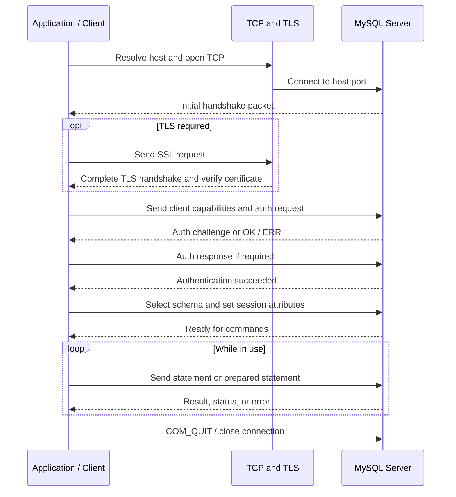

# Connection Lifecycle: Authentication, Session Initialization, Execution, and Closing

A MySQL connection is more than entering a server address and password. When an application opens a connection, client and server must establish a network channel, negotiate protocol and encryption, authenticate the account, create a session, agree on session attributes, exchange statements and results, and release resources properly. Understanding this lifecycle helps you tell network errors apart from authentication errors, prevent connection leaks, manage transactions accurately, and configure connection pools safely.

In the `DATABASE_MYSQL` module, understanding connections is foundational for practicing table design, data types, keys, and SQL queries; only then can you evaluate indexes, transactions, concurrency control, privilege management, backups, and operations. This lesson focuses on the lifecycle of a connection from when the client initiates it until the session closes, including how to observe and diagnose each stage.

## 1. Distinguishing Physical Connection, Session, and Logical Connection

These three concepts are often lumped together as a “connection,” but they mean different things:

- **Physical connection:** the actual communication channel between the client and MySQL Server, typically over TCP/IP. It has a network lifecycle and consumes resources on both client and server.
- **Session:** the server-side state attached to an authenticated connection. A session holds the default database, session variables, active transaction, prepared statements, temporary tables, locks, and related state.
- **Logical connection:** the object used by application code. When a connection pool is present, the application borrows a logical connection; calling `close()` typically returns the physical connection to the pool for reuse rather than closing the underlying socket immediately.

If you use JDBC `DriverManager` directly, a `Connection` typically represents a physical connection. If you use a pool, the `Connection` object is usually a wrapper (proxy) representing a single checkout/borrow. This difference directly affects how `close()`, transactions, and session state behave.

## 2. Overview of Connection Stages

A typical connection passes through the following sequence of steps:



The diagram outlines the high-level flow. Exact packet details and authentication exchanges depend on the MySQL version, client capabilities, and authentication plugin. When TLS is required, the client and server negotiate the TLS channel before sending the authentication response containing credentials.

## 3. Stage 1 — Address Resolution and TCP Setup

An application usually configures a hostname, port, account, and schema. Before MySQL can authenticate, the client must resolve the server address and establish a network connection.

What happens in this stage:

1. The client resolves the hostname via DNS or the OS name-resolution mechanism.
2. The client opens a connection to MySQL's IP address and port, usually `3306` unless configured otherwise.
3. The server must be listening on that address; firewalls, security groups, routing, and network policies must permit the connection.
4. Only after TCP is established can the client exchange MySQL protocol packets.

Example connecting with the command-line client:

```bash
mysql --protocol=TCP \
  --host=db.example.internal \
  --port=3306 \
  --user=shop_app \
  --password \
  --database=learning_shop
```

Depending on the OS and configuration, connecting to `localhost` may use a Unix socket or named pipe instead of TCP. Adding `--protocol=TCP` forces the client to use TCP when you want to test the actual network path. Passing `--password` without a value makes the client prompt interactively; never put passwords directly on the command line where they can be saved in terminal history or exposed in process listings.

If you cannot connect, check in order: does the hostname resolve properly, are the address and port reachable, is the server running and listening, is a firewall blocking traffic—and only then inspect MySQL configuration. Failures at the TCP stage usually have nothing to do with database user privileges.

## 4. Stage 2 — Protocol Handshake and TLS

Once TCP is established, MySQL Server sends an initial handshake packet. This packet contains protocol information, server capabilities, and data for authentication. The client responds with its capabilities, username, and data needed to proceed with authentication.

If the connection requires TLS, the protocol flow performs TLS negotiation before the authentication response. The client sends an SSL request, both sides complete the TLS handshake, and only then does the client send login credentials over the encrypted channel. TLS protects data in transit, but does not replace user authentication, privilege checks, or encryption at rest.

When connecting over a network, verify both the certificate chain and the hostname to prevent connecting to an imposter server. Example with the MySQL CLI:

```bash
mysql --protocol=TCP \
  --host=db.example.internal \
  --port=3306 \
  --user=shop_app \
  --password \
  --database=learning_shop \
  --ssl-mode=VERIFY_IDENTITY \
  --ssl-ca=/path/to/ca.pem
```

`VERIFY_IDENTITY` requires verifying the certificate against a trusted CA and checking the server's identity against the connected hostname. The CA path in the example must point to the CA matching the server certificate. Actual TLS configuration must align across client, server, and certificate infrastructure; do not lower verification levels merely to hide hostname or certificate errors.

After connecting, you can check the session's TLS status:

```sql
SHOW SESSION STATUS LIKE 'Ssl_version';
SHOW SESSION STATUS LIKE 'Ssl_cipher';
```

Empty values in these variables normally indicate the current session is not using TLS. When checking, run the query on the exact connection you want to verify.

## 5. Stage 3 — Account Authentication and Privilege Checks

Authentication answers the question “is the client allowed to log in as this account?”. Authorization (privilege checking) answers “after logging in, what is this account allowed to do?”. The two steps are related, not synonymous.

### A MySQL Account Consists of User and Host

MySQL identifies accounts by a `user` and `host` pair, such as:

```sql
CREATE USER 'shop_app'@'10.20.30.%'
    IDENTIFIED BY 'replace_with_a_secret';

GRANT SELECT, INSERT, UPDATE, DELETE
    ON learning_shop.*
    TO 'shop_app'@'10.20.30.%';
```

The host in an account acts as a condition defining which client sources are allowed to match that account. `'shop_app'@'localhost'` and `'shop_app'@'10.20.30.%'` are two different accounts, and may have different authentication plugins and privileges. Design the host part around actual addresses or network ranges; do not broaden the host unnecessarily without reason.

### Authentication Plugins

MySQL supports authentication plugins. A plugin defines how server and client exchange data to prove identity. Modern MySQL versions commonly use `caching_sha2_password` as the default plugin for new accounts, whereas older systems may use `mysql_native_password` or other configurations. Driver compatibility must be verified when upgrading the server or Connector/J.

Do not change an authentication plugin arbitrarily to bypass a connection error before understanding the cause. Identify the matched account, its assigned plugin, the driver version, and the exact error message. If changing a plugin is necessary, weigh client compatibility and environment security policies.

### Checking Which Account Was Matched

After logging in, run:

```sql
SELECT
    USER() AS presented_identity,
    CURRENT_USER() AS matched_account,
    DATABASE() AS default_schema,
    CONNECTION_ID() AS connection_id;
```

`USER()` shows the username submitted by the client along with the connection's source host; `CURRENT_USER()` shows the MySQL account actually matched for authentication and privilege enforcement. These two values can differ, making `CURRENT_USER()` very useful when investigating cases where login succeeds but privileges are not what you expected.

Then inspect privileges:

```sql
SHOW GRANTS FOR CURRENT_USER();
```

A connection can authenticate successfully and still receive `Access denied` when performing a specific operation due to missing privileges. For example, an account with `SELECT` but not `UPDATE` can read rows but cannot modify them.

## 6. Stage 4 — Session Initialization After Authentication

Once authentication succeeds, the server initializes session state to process subsequent commands. The client may specify a default schema during the handshake or select one immediately afterward. Applications also need to set session attributes their business logic relies on.

Attributes commonly requiring attention:

| Attribute | Meaning | What to Align On |
|---|---|---|
| Default database | Default schema for table names without an explicit schema prefix | Select the exact database for the current environment. |
| Character set and collation | How strings are encoded, compared, and sorted | Use an appropriate Unicode configuration, typically `utf8mb4`. |
| Time zone | How the server interprets and returns time-zone-sensitive temporal values | Clearly standardize how timestamps are stored and displayed; applications often standardize on UTC. |
| `sql_mode` | Rules governing SQL and data handling | Do not assume different environments share the same mode without checking. |
| `autocommit` | Whether each statement commits automatically | Understand the behavior clearly before performing multiple related writes. |
| Transaction isolation | Isolation level of transactions | Choose according to the application's consistency and concurrency requirements. |

Inspect session state:

```sql
SELECT
    DATABASE() AS current_schema,
    @@session.time_zone AS session_time_zone,
    @@session.sql_mode AS session_sql_mode,
    @@session.autocommit AS autocommit,
    @@session.transaction_isolation AS transaction_isolation,
    @@character_set_client AS client_charset,
    @@character_set_connection AS connection_charset,
    @@character_set_results AS results_charset;
```

These variables reflect the current session. `transaction_isolation` is the variable name used in MySQL 8.0; in some MySQL 5.7 versions, the corresponding variable is `tx_isolation`. A global configuration change does not necessarily update already-open sessions immediately; therefore, inspect the exact connection used by the application.

Session attributes can be set with SQL when needed:

```sql
SET SESSION time_zone = '+00:00';
SET NAMES utf8mb4;
```

In applications, prefer the driver's configuration properties and set them consistently when creating or borrowing connections. `SET NAMES` changes the character set used for string exchange on the session; do not use it as a fix for data already stored with the wrong encoding.

If the client requests a default schema that does not exist or that the account lacks access to, database selection can fail even when credentials are valid. Distinguish authentication failures from database-selection failures.

## 7. Stage 5 — Statement Execution and Result Exchange

Once the session is ready, the client sends statements over the MySQL protocol. The server receives the command, parses syntax, checks object names and privileges, optimizes the execution plan, and accesses the storage engine to read or modify data. Results are returned over the protocol as an OK packet, error packet, or result set depending on the command type.

For read queries, the client must consume the entire result set before reusing the connection for the next command. Some drivers buffer the entire result in memory; streaming modes keep the connection busy while the application reads rows one by one. If an application abandons reading or fails to close `ResultSet` and statement objects properly, the connection may remain unavailable for other commands or hold resources for too long.

### Using Prepared Statements

Prepared statements separate SQL structure from input values. Example:

```sql
SELECT id, email, full_name
FROM customers
WHERE id = ?;
```

The application binds parameter values using the driver API. Never concatenate user input directly into SQL strings. Placeholders normally represent values; dynamic table names, column names, or sort keywords must be chosen from an application-controlled allowlist.

### Executing Multiple Statements and Transactions

By default, MySQL normally enables `autocommit` for a session. Each standalone statement is committed automatically upon success unless the application opens a transaction or disables autocommit. When a business operation consists of multiple steps that must succeed together, use an explicit transaction:

```sql
START TRANSACTION;

UPDATE inventory
SET available = available - 1
WHERE product_id = 42
  AND available > 0;

-- Application checks ROW_COUNT() immediately after UPDATE.
-- If affected rows does not equal 1: ROLLBACK.
-- If equal to 1: insert the order item and continue.
SELECT ROW_COUNT() AS affected_rows;

INSERT INTO order_items (order_id, product_id, quantity, unit_price)
VALUES (9001, 42, 1, 199000.00);

COMMIT;
```

This illustrates the control flow: the application must check the affected row count right after `UPDATE` on the same connection. If exactly one row was not decremented, roll back and do not insert the order item. If all operations succeed, commit to persist the changes. On any error, the application must roll back before returning the connection to the pool.

A connection holds only one transaction state at a time. Never arbitrarily share the same connection across multiple independent business threads, because statements would interfere within the same session, transaction, and result state.

### A JDBC Example with MySQL Connector/J

The example below demonstrates connecting, binding parameters, reading results, and closing resources with `try-with-resources`. MySQL Connector/J must be on the classpath; `sslMode` and `connectionTimeZone` are configuration properties in modern Connector/J versions.

```java
import java.sql.Connection;
import java.sql.DriverManager;
import java.sql.PreparedStatement;
import java.sql.ResultSet;
import java.sql.SQLException;
import java.util.Properties;

public class CustomerLookup {
    public static void main(String[] args) throws SQLException {
        String url = "jdbc:mysql://db.example.internal:3306/learning_shop"
                + "?sslMode=VERIFY_IDENTITY&connectionTimeZone=UTC";

        Properties properties = new Properties();
        String dbUser = System.getenv("DB_USER");
        String dbPassword = System.getenv("DB_PASSWORD");
        if (dbUser == null || dbPassword == null) {
            throw new IllegalStateException("DB_USER and DB_PASSWORD must be configured");
        }
        properties.setProperty("user", dbUser);
        properties.setProperty("password", dbPassword);

        long customerId = 42L;
        String sql = "SELECT id, email, full_name "
                + "FROM customers WHERE id = ?";

        try (Connection connection = DriverManager.getConnection(url, properties);
             PreparedStatement statement = connection.prepareStatement(sql)) {

            statement.setLong(1, customerId);

            try (ResultSet resultSet = statement.executeQuery()) {
                while (resultSet.next()) {
                    System.out.println(resultSet.getLong("id"));
                    System.out.println(resultSet.getString("email"));
                    System.out.println(resultSet.getString("full_name"));
                }
            }
        }
    }
}
```

`DriverManager.getConnection()` opens the connection and completes the handshake, authentication, and session initialization according to driver configuration. `executeQuery()` sends the query and receives the result set. Upon exiting the `try` blocks, `ResultSet`, `PreparedStatement`, and `Connection` are closed in reverse order. The example uses environment variables for credentials to avoid hard-coding secrets in source code; in production systems, use an appropriate secret management mechanism.

## 8. Stage 6 — Closing the Connection and Releasing State

Closing a connection is part of the processing flow, not an optional cleanup step. The client should close result sets, statements, and connections once work finishes. For a physical connection, the driver sends a protocol session-termination command (typically `COM_QUIT`) and closes the network channel. The server frees resources tied to the session.

If a connection closes while a transaction is uncommitted, InnoDB rolls back the incomplete transaction. Even so, the application should explicitly commit or roll back according to business outcomes before closing; do not rely on connection drops as a normal rollback mechanism.

If the network drops abruptly, the server may not know immediately that the client disappeared and will detect it via socket errors or timeouts. Therefore, closing connections explicitly frees resources faster and more predictably than letting connections drop due to network failures.

### Distinguishing `close()` with a Connection Pool

| Case | Meaning of `close()` |
|---|---|
| Direct JDBC via `DriverManager` | Closes the physical connection and ends the server session. |
| Connection borrowed from a pool | Typically returns the logical connection to the pool for reuse; the physical socket may remain open. |

The pool must validate connection health, discard dead connections, and reset session state before handing the connection to the next request. Depending on the library, the pool or driver may roll back open transactions and restore autocommit, isolation level, read-only state, schema, session variables, and other state. Do not assume every pool automatically resets every arbitrary change made by the application.

If the application runs `SET SESSION time_zone`, creates temporary tables, changes isolation, or sets user variables, verify the pool's reset policy. If session state leaks between requests, a subsequent request may execute under an unexpected schema, time zone, transaction, or configuration.

## 9. Managing Connection Lifecycle in Applications

Opening a new connection for every SQL statement adds DNS, TCP, TLS, and authentication overhead. Server applications typically use a connection pool to keep a set of physical connections open and lend them to requests as needed.

A pool must be tuned based on MySQL capacity and application load:

- **Maximum pool size:** caps the number of physical connections the pool may open. Total connections across all application instances must fit within server limits while leaving room for administrative tasks.
- **Minimum idle:** number of idle connections kept ready, if supported by the library.
- **Connection timeout:** maximum time a request waits to borrow a connection before failing.
- **Idle timeout:** time a connection sits idle before the pool considers closing it.
- **Max lifetime:** maximum lifespan of a connection for periodic replacement; must align with network and server timeouts.
- **Validation / keepalive:** mechanism to detect dead connections or keep connections alive across intermediary network devices.

Do not set pool size excessively high just to reduce wait times. When running multiple application instances, calculate the maximum total connections that could be opened. Too many connections increase memory consumption, context-switching overhead, and server resource contention. Measure pool wait times, active connections, idle connections, and database load, then tune accordingly.

### Timeouts Across Different Layers

Not all timeouts mean the same thing:

| Timeout | Layer / Meaning |
|---|---|
| DNS timeout | Time to resolve the hostname. |
| Connect timeout | Time the client waits to establish TCP and complete initial connection setup. |
| TLS handshake timeout | Time to negotiate the encrypted channel; configuration depends on client and runtime. |
| Socket / read timeout | Time the client waits for the next response/data from the server. |
| Pool acquisition timeout | Time a request waits to borrow a connection from the pool. |
| `wait_timeout` | Time the server waits for activity on a non-interactive connection before closing it; verify client type and version configuration. |
| `net_read_timeout` / `net_write_timeout` | Time the server waits to read data from the client or write data to the client in corresponding scenarios. |

A connection can be closed by the pool, client, server, proxy, firewall, or load balancer. When configuring timeouts, coordinate across layers so the pool does not hold onto a socket already dropped by network infrastructure.

## 10. Observing Active Connections

MySQL provides several ways to inspect connection state. With appropriate privileges, you can view active sessions:

```sql
SHOW FULL PROCESSLIST;
```

Useful columns typically include `Id` (connection ID), `User`, `Host`, `db`, `Command`, `Time`, `State`, and `Info`. `Sleep` normally indicates a session waiting for a command; it does not automatically mean a leak. Cross-check against pool policy and application load. Viewing other users' session details may require the `PROCESS` privilege depending on scope and version.

Global status variables can help reveal connection load:

```sql
SHOW GLOBAL STATUS LIKE 'Threads_connected';
SHOW GLOBAL STATUS LIKE 'Threads_running';
SHOW GLOBAL STATUS LIKE 'Connections';
SHOW GLOBAL STATUS LIKE 'Aborted_connects';
SHOW GLOBAL VARIABLES LIKE 'max_connections';
```

`Threads_connected` reflects current open connections; `Threads_running` reflects threads actively executing commands rather than sleeping; `Connections` counts connection attempts to the server since startup; `Aborted_connects` counts connections that failed to complete successfully per the server's status definition. Observe trends over time rather than drawing conclusions from a single sample.

On the application side, monitor borrowed connections, idle connections, pool wait times, new-connection creation times, authentication errors, timeouts, and socket errors. You can log `CONNECTION_ID()` in diagnostic logs where appropriate to correlate a request with a MySQL session. Never write passwords, tokens, or connection strings containing secrets to logs.

## 11. Diagnosing Errors by Stage

When a connection fails, identify the first step that did not complete. The table below helps narrow it down:

| Symptom | Likely Stage Involved | Diagnostic Direction |
|---|---|---|
| Host cannot be resolved | DNS | Check hostname, DNS, and network configuration of the application runtime environment. |
| Connection refused / timeout | TCP | Check server, port, bind address, firewall, routing, and security groups. |
| TLS certificate verify failed | TLS | Check CA, certificate expiration, SAN/hostname, and SSL mode configuration. |
| `Access denied for user` | Authentication or account matching | Check user, matched host, password/secret, authentication plugin, and driver version. |
| `Unknown database` | Selecting default schema | Check schema name, access privileges, and database configuration in the URL. |
| `Too many connections` | Session acceptance | Check pool sizes across all instances, connection leaks, and `max_connections`. |
| Command reports missing privilege | Authorization | Use `CURRENT_USER()` and `SHOW GRANTS` to inspect the matched account. |
| Connection reset during query execution | Network channel or timeout | Compare client timeout, server timeout, proxy/firewall, and logs at the time of failure. |
| Error appears only when reusing connections | Session state / pool reset | Check uncommitted transactions, session variables, schema, autocommit, and validation. |

### Connection Errors During Data Writes

One case requires special care: the client loses connection after sending a write command but before receiving a response. In that situation, the application may not know whether the server committed the transaction. Never assume “the client did not receive OK” guarantees the transaction did not commit.

For operations that may be retried, design for idempotency—such as using a unique request ID backed by a `UNIQUE` constraint, storing processing state, and checking outcomes before retrying. Retries should only follow a bounded policy with awareness of transaction state. Avoid blind automatic retries on order creation, balance deductions, or inventory updates.

## 12. Hands-On Workflow to Test the Full Lifecycle

You can use a test schema and a low-privilege account to practice the following steps:

1. **Connect:** open the MySQL CLI over TCP to a specified hostname and port; verify connection to the right server.
2. **Verify TLS:** connect with `VERIFY_IDENTITY`, then inspect `Ssl_version` and `Ssl_cipher` in the session.
3. **Authenticate:** run `USER()` and `CURRENT_USER()` to see which account matched; check `SHOW GRANTS`.
4. **Initialize session:** verify schema, charset, time zone, `sql_mode`, `autocommit`, and transaction isolation.
5. **Execute:** run a parameterized query or prepared statement from an application; read all results and close the result set.
6. **Transaction:** test one committed transaction and one rolled-back transaction; verify final data.
7. **Close:** close statement and connection; inspect the process list to confirm the physical session ended when not using a pool.
8. **Reuse:** run the application through a pool; borrow, use, and return connections repeatedly; confirm session state does not leak across checkouts.
9. **Error handling:** test a wrong hostname, wrong password in a test environment, missing privilege, and timeout; record which stage each error belongs to.

Checklist when reviewing a connection configuration:

- [ ] Host, port, schema, and connection protocol are explicitly defined per environment.
- [ ] TLS verifies server identity when connecting over untrusted networks.
- [ ] Account is restricted by host and follows least-privilege permissions.
- [ ] Driver is compatible with the authentication plugin and MySQL version.
- [ ] Charset, time zone, `sql_mode`, autocommit, and isolation are well understood.
- [ ] Prepared statements are used for input data.
- [ ] Result sets, statements, and connections are closed properly.
- [ ] Pool has sensible bounds and a clear session-reset policy.
- [ ] Timeouts and retries match the operation type and network infrastructure.
- [ ] Logs and metrics are sufficient to pinpoint errors by stage without exposing secrets.

Once you understand the connection lifecycle, you can interpret errors at the right layer, configure clients and servers deliberately, use connection pools safely, and ensure every transaction ends in a deterministic state. This is the foundation for executing SQL operations, tuning queries, and operating MySQL reliably in real applications.
