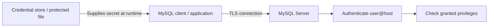

# Managing Passwords with Protected Configuration or Credential Storage

Applications and administration tools require authentication credentials to connect to MySQL. If passwords are written directly into source code, terminal commands, committed configuration files, or connection URLs, secrets can leak through Git, logs, shell history, screenshots, or monitoring systems. Once exposed, someone else can use the database account within the scope of its granted privileges.

Credentials can be managed using permission-restricted configuration files, MySQL's login path utility, or an operating system / deployment platform credential store or secret manager. The right choice depends on where the client runs, automation needs, and required protection level. Regardless of the approach, accounts should follow least privilege, transmit credentials over TLS connections, and have clear rotation and revocation procedures.

## 1. Distinguishing MySQL Passwords from Where Credentials Are Stored

A MySQL connection typically needs the following information:

| Component | Example | Role |
| --- | --- | --- |
| Host | `db.internal.example` | MySQL Server address |
| Port | `3306` | MySQL service port |
| Database | `appdb` | Application schema to access |
| User | `app_reader` | MySQL account used for authentication |
| Password | Secret value | Proves account identity |
| TLS settings | CA certificate, verify mode | Protects and verifies the network connection |

MySQL authenticates an account by its declared username and host part, such as `'app_reader'@'10.0.0.%'`. What privileges that account holds is governed by server-side configuration. Client-side config files or credential stores only supply credentials; they do not create accounts, grant privileges, or change passwords on MySQL Server.

Distinguish three responsibilities:

1. **Server-side account management:** creating users, setting or changing passwords, granting and revoking privileges.
2. **Client-side secret storage:** holding the password so a tool or application can connect without prompting every time.
3. **Transport protection:** using TLS and server certificate verification to protect credentials in transit over a network.



## 2. Common Ways to Store Passwords

| Storage Method | Best Suited For | Key Considerations |
| --- | --- | --- |
| Password prompt via `-p` | Manual, occasional connections | Inconvenient for automation, but avoids putting passwords in commands |
| Option files such as `~/.my.cnf` | Personal machines, admin hosts, or jobs with protected files | Password in the file is plaintext; must restrict read permissions |
| MySQL login path (`.mylogin.cnf`) | MySQL CLI on personal or admin machines | Contents are obfuscated, not a secret vault resistant to someone with OS user access |
| OS credential store | Desktop apps or integrated tools | Secrets managed by Keychain, Credential Manager, or Secret Service; app must support the API |
| Platform secret manager | Backends, CI/CD, containers, and production systems | Requires workload identity, secret read permissions, auditing, and rotation workflows |
| Environment variables | Simple runtimes or platform integrations | Can leak via process inspection, dumps, logs, or diagnostic tools; not a secret manager |

No single storage method fits every scenario. Personal workstations may use login paths or an OS credential store; server applications should fetch secrets from a secret manager or the deployment platform's secrets mechanism. For automated jobs, choose a secret-delivery method that never writes passwords into command lines or repositories.

## 3. Interactive Password Prompting in the MySQL CLI

For manual connections, the simplest approach is letting the MySQL client prompt for the password:

```bash
mysql -h db.internal.example -P 3306 -u app_reader -p appdb
```

After running the command, the client prompts for the password. Never append the password immediately after `-p`. The following example is unsafe:

```bash
# Do not use: password may appear in process lists or shell history
mysql -h db.internal.example -u app_reader -pMySecretPassword appdb
```

Do not place passwords in `--password=...` flags, connection URLs, or shell scripts. Command-line arguments can be saved in terminal history, visible in process listings, or collected by monitoring tools. Passing `-p` alone tells the MySQL client to request the secret interactively.

Network connections require appropriate TLS configuration. Example when the server's CA certificate is available:

```bash
mysql \
  --host=db.internal.example \
  --port=3306 \
  --user=app_reader \
  --password \
  --ssl-mode=VERIFY_IDENTITY \
  --ssl-ca=/secure/certs/mysql-ca.pem \
  appdb
```

The client will prompt for the password. `VERIFY_IDENTITY` validates the certificate chain and the server's hostname identity; the host used to connect must match the certificate. Replace the example CA path with the environment's trusted CA file. Do not downgrade certificate verification modes just to bypass TLS errors in production.

## 4. Storing Credentials with MySQL Login Paths

MySQL provides the `mysql_config_editor` utility to store connection options in `.mylogin.cnf`. This file is obfuscated to avoid displaying values directly like a standard option file, but it is not a secret vault capable of resisting someone who has compromised the OS account or obtained file read access. Protect both the OS account and the login path file as secrets.

### 4.1. Creating a Login Path

Run the following command in a terminal:

```bash
mysql_config_editor set \
  --login-path=dev \
  --host=127.0.0.1 \
  --user=app_reader \
  --port=3306 \
  --password
```

The utility prompts for the password interactively. Enter the password when prompted; do not append it to the command. The `dev` login path stores the connection parameters for client reuse.

### 4.2. Connecting with a Login Path

```bash
mysql --login-path=dev appdb
```

You can inspect saved login paths:

```bash
mysql_config_editor print --all
```

This displays login path names and options; passwords are masked when printed. Avoid sending full diagnostic outputs or the `.mylogin.cnf` file to others. Remove a login path that is no longer needed:

```bash
mysql_config_editor remove --login-path=dev
```

### 4.3. Understanding Protection Limits

- `.mylogin.cnf` usually resides in the user's home/profile directory; the exact location depends on the OS.
- The utility's mechanism only obfuscates data and should not be treated as strong encryption or production-grade secret storage.
- Anyone with access to the same OS account can use the client to connect via the login path.
- Never place this file into Git, shared public folders, container images, or unprotected backups.
- If a laptop is lost, an OS account is compromised, or personnel lose access rights, revoke/rotate the corresponding database passwords.

Login paths are convenient for administrators on trusted machines. For production secrets, prefer a secret manager with identity control, access policies, and auditing.

## 5. Using a Protected Option File

The MySQL client can read options from a configuration file. Example `mysql-client.cnf` file:

```ini
[client]
host=db.internal.example
port=3306
user=app_reader
password=REPLACE_WITH_SECRET
ssl-mode=VERIFY_IDENTITY
ssl-ca=/secure/certs/mysql-ca.pem
```

The `[client]` group applies shared options to supporting MySQL client programs. Replace `REPLACE_WITH_SECRET` with the secret provisioned for the environment. Because this file holds a plaintext password, store it outside repositories and grant read permissions only to the OS account running the client.

On Linux or macOS, restrict file permissions:

```bash
chmod 600 /secure/path/mysql-client.cnf
```

Then specify the file when connecting:

```bash
mysql --defaults-extra-file=/secure/path/mysql-client.cnf appdb
```

`--defaults-extra-file` must be the first option after the program name. If using the default `~/.my.cnf` file, apply the same permission restrictions. On Windows, configure file ACLs so only the required service account or user has read access; do not leave broad read permissions for `Users` or `Everyone`.

Key points to verify:

- Never store config files containing passwords inside source code directories or publicly synced folders.
- Never attach this file to tickets, logs, or screenshots.
- Ensure workstation backups do not expose the configuration file.
- Verify option-file and command-line precedence when the same option appears in multiple places.
- If a file containing secrets is copied or its read permissions are exposed, treat the password as compromised and rotate it.

Option files provide better protection when filesystem permissions are properly configured, yet the password itself remains plaintext inside the file. Weigh this limitation before using them on production hosts.

## 6. Using the OS or Tool Credential Store

Operating systems can provide credential storage protected by the user account:

- **Windows Credential Manager:** applications can store and retrieve credentials via Windows Credential APIs.
- **macOS Keychain:** authorized applications can store and read secrets from Keychain.
- **Linux Secret Service:** desktop applications can use the Secret Service API, typically backed by the desktop environment's keyring.

Some GUI database management tools offer an option to store passwords in an OS vault or secure store. When using one, check where the tool stores secrets, whether unlocking the vault is required, and how to delete credentials when no longer needed. Do not assume all applications share a single vault or automatically encrypt exported connection files.

If a tool offers storing passwords in the OS vault/keychain, prefer that option on trusted personal workstations. Avoid saving passwords in project config files or exporting connection profiles with embedded secrets. When switching machines, recreate credentials in the new vault rather than sending password files over chat or email.

## 7. Delivering Passwords to Applications and Containers

Backend applications must connect to databases without requiring an operator to type a password each time. Secrets should be supplied at runtime from a secret manager or platform secrets mechanism, and exist only within the required process scope and permissions.

### 7.1. Reading Secrets at Runtime in a Java Application

The example below reads connection details from the runtime environment. Real values are configured in the deployment environment, never written in source code:

```java
import java.sql.Connection;
import java.sql.DriverManager;
import java.util.Properties;

public class DatabaseConnection {
    public static Connection open() throws Exception {
        String url = "jdbc:mysql://db.internal.example:3306/appdb"
                + "?sslMode=VERIFY_IDENTITY";

        String user = System.getenv("DB_USER");
        String password = System.getenv("DB_PASSWORD");

        if (user == null || password == null) {
            throw new IllegalStateException("Missing database credentials");
        }

        Properties properties = new Properties();
        properties.setProperty("user", user);
        properties.setProperty("password", password);

        return DriverManager.getConnection(url, properties);
    }
}
```

This snippet demonstrates separating secrets from source code; it does not itself create a secret manager. Environment variables can still be read by processes or sufficiently privileged administrators, and can show up in dumps or diagnostics. In production, prefer the platform's secret injection mechanism or reading directly from a secret manager using workload identity. Never print `DB_PASSWORD` to logs.

### 7.2. Using Docker Compose Secrets

With Docker Compose, you can mount a secret file into a container instead of putting the password directly into `compose.yaml`:

```yaml
services:
  app:
    image: my-java-app:latest
    environment:
      DB_HOST: db
      DB_NAME: appdb
      DB_USER: appuser
      DB_PASSWORD_FILE: /run/secrets/db_password
    secrets:
      - db_password

secrets:
  db_password:
    file: ./secrets/db_password.txt
```

The application reads the contents of `/run/secrets/db_password` at startup and uses it to configure its connection pool. Do not commit `./secrets/db_password.txt`; restrict file permissions on the host and never bake the file into the image. This example illustrates Compose's file-mounting mechanism; your application must implement reading `DB_PASSWORD_FILE` itself.

With the official MySQL image, several initialization variables support a `_FILE` suffix, such as `MYSQL_ROOT_PASSWORD_FILE` and `MYSQL_PASSWORD_FILE`. When using them, verify documentation for the exact image/tag deployed. The `_FILE` mechanism only supplies values during initial container initialization; it does not automatically update passwords of accounts that already exist in the datadir.

Docker Compose secrets backed by local files are suitable for labs or controlled development machines. They do not turn the source file on the host into an encrypted secret vault. For production, use a secret manager or your orchestrator's secrets facility, restrict which services may mount each secret, and enable auditing if supported.

## 8. Principles for Protecting Database Accounts

Storing passwords well is not enough if the account holds overly broad privileges. Combine secret management with least-privilege grants:

```sql
CREATE USER 'app_reader'@'10.0.0.%'
    IDENTIFIED BY 'REPLACE_WITH_A_STRONG_SECRET';

GRANT SELECT
    ON appdb.*
    TO 'app_reader'@'10.0.0.%';
```

This is an illustrative example of a read-only user. In practice, replace the placeholder with a securely generated and provisioned password; never commit statements with real passwords or keep them in migrations or public logs. Host scope must match actual client source addresses and be tightly constrained to the network architecture. Never use `root` for normal applications.

Additional principles:

- Each application or workload should have its own account so it can be revoked independently.
- Grant only necessary privileges such as `SELECT`, `INSERT`, `UPDATE`, or `DELETE` on the corresponding schema/tables.
- Separate runtime application accounts from migration accounts and administrative accounts.
- Use TLS with server identity verification when connecting over networks that are not fully trusted.
- Never share the same password across development, staging, and production environments.
- Monitor failed logins and anomalous activity, while never logging passwords or tokens.

## 9. Rotation, Revocation, and Handling Exposed Passwords

Passwords must have a lifecycle. When team members leave, an admin machine is lost, a secret appears in logs, or unauthorized access is suspected, revoke access and rotate affected secrets.

Typical rotation workflow:

1. Identify the MySQL user, host pattern, applications, and workloads using the credential.
2. Generate a new password with a password generator or secret manager; never pick predictable passwords manually.
3. Update the password on MySQL Server via a controlled administrative process.
4. Update the secret in the credential store or secret manager and roll workloads so processes pick up the new value.
5. Verify new connections, authentication error logs, and dependent jobs.
6. Revoke old credentials or remove obsolete login paths/credential store entries.

Example MySQL password-change syntax:

```sql
ALTER USER 'app_reader'@'10.0.0.%'
    IDENTIFIED BY 'REPLACE_WITH_A_NEW_SECRET';
```

Do not run the example with the placeholder literally. Supply the new password through your administration environment's secure workflow and avoid saving real values in shell history, unprotected SQL files, or CI logs. On MySQL versions supporting dual passwords, consider `RETAIN CURRENT PASSWORD` to transition workloads gradually, followed by `DISCARD OLD PASSWORD` once all clients are confirmed on the new password. Test this workflow against your actual MySQL version and authentication policy before applying it.

If password exposure is suspected:

- Revoke or change the password as soon as possible; prioritize high-privilege accounts first.
- Inspect authentication, connection, and query logs across the exposure window.
- Delete the secret from unnecessary locations and update secrets across all affected workloads.
- If a secret was committed to Git, deleting it in a new commit is not enough; rotate the password because Git history or clones may still retain the old value.
- Document the root cause and update processes to prevent recurrence.

## 10. Practices to Avoid

| Practice | Risk | Alternative |
| --- | --- | --- |
| Putting `password=...` in a config file inside the repository | Secret is committed and replicated with source code | Use a secret manager or an out-of-repo config file with tight permissions |
| Using `-pMyPassword` or `--password=...` | Exposed via history, process lists, or telemetry | Use `-p` for interactive entry or a credential store |
| Embedding secrets in JDBC URLs | URLs are easily written into logs or diagnostics | Pass credentials separately via connection APIs and secret injection |
| Using `MYSQL_PWD` as a long-term storage solution | Environment variable can leak; MySQL advises against it | Use login paths, protected option files, or an appropriate secret manager |
| Using the `root` account in applications | If leaked, blast radius is severe | Create dedicated accounts with least privilege |
| Sharing `.mylogin.cnf` or option files containing passwords | Recipients gain access to the credential | Create separate login paths/secrets per person or workload |
| Assuming `.mylogin.cnf` is tamper-proof encryption | Overestimates the protection level of the file | Protect the OS account and use a secret manager when stronger protection is needed |

## 11. Connection Setup Checklist

- [ ] Dedicated MySQL account for the application or operator.
- [ ] User privileges scoped to required schemas, tables, and operations.
- [ ] Password does not appear in source code, URLs, shell history, or logs.
- [ ] Secret storage matches the environment: login path, protected option file, OS vault, or secret manager.
- [ ] Files containing passwords are uncommitted and have minimal read permissions.
- [ ] Remote connections use TLS and verify the server certificate.
- [ ] Rotation, revocation, and credential-exposure response procedures exist.
- [ ] Development, staging, and production environments use separate credentials.

## 12. Key Takeaways

MySQL password management combines protecting secrets on the client side, controlling accounts and privileges on the server, and securing transport with TLS. Prompting with `-p` suits manual work; `mysql_config_editor` creates convenient login paths, though `.mylogin.cnf` is only obfuscated rather than a secret vault. Option files store passwords in plaintext, so they must stay out of repositories with strict read permissions. Server applications should retrieve secrets at runtime from an OS credential store or a platform secret manager/secrets mechanism.

Never place passwords in command lines, source code, URLs, or logs; never use the `root` account for applications. Enforce least privilege, rotate and revoke credentials in a controlled manner, and verify TLS whenever connecting to MySQL over a network.
