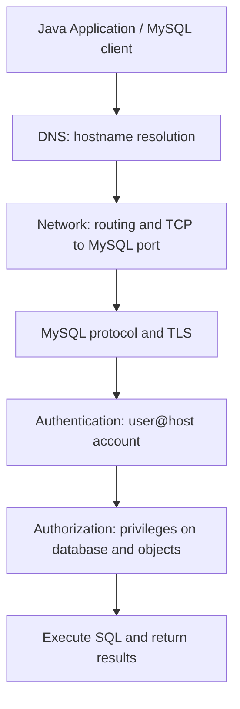

# Layered Connection Diagnostics: DNS, Network, Protocol, Authentication, and Privileges

When an application cannot connect to MySQL, the error message usually reveals only part of the problem. A hostname-resolution failure is completely different from a blocked TCP port; both differ from a wrong password or lacking table read privileges. Layer-by-layer diagnostics pinpoint how far a request actually got and tell you which tool to use next.

In the **DATABASE_MYSQL** module, connection verification is a foundational operational skill alongside table design, SQL, indexes, and transactions. This lesson uses the MySQL client, Windows/Linux network commands, MySQL Workbench, and JDBC to check DNS, network, MySQL protocol, authentication, and privileges one by one.

## 1. Viewing a Connection as a Stack of Layers

Suppose a Java application connects to server `db.example.internal`, port `3306`, database `mysql_lab`. A successful connection must pass through these layers in general order:



| Layer | Question to Answer | Tool or Test |
|---|---|---|
| DNS | Does the hostname resolve to the expected IP address? | `Resolve-DnsName`, `nslookup`, `getent hosts` |
| Network/TCP | Can the client open a TCP connection to the right IP and port? | `Test-NetConnection`, `nc`, checking listener and firewall |
| Protocol/TLS | Can both ends negotiate the MySQL protocol and agree on TLS settings? | MySQL client, `mysqladmin`, client/driver SSL options |
| Authentication | Does the server accept the account and authentication method? | MySQL client, `USER()`, `CURRENT_USER()`, inspecting accounts with an admin account |
| Privileges | Does the authenticated account have privileges to run the SQL on the database/table? | `SHOW GRANTS`, testing an appropriate SQL operation |

Run tests from the actual environment where the application executes. If Java runs inside a container or on another host, testing from a developer's laptop does not prove the container or application server shares the same DNS, routing, and network access.

## 2. Preparing Connection Details

Before testing, record the exact values the application uses:

| Detail | Illustrative Example | Meaning |
|---|---|---|
| Hostname | `db.example.internal` | DNS name or address of the MySQL server |
| Expected IP | `10.20.0.15` | Address DNS or network config should resolve to |
| Port | `3306` | TCP port MySQL listens on; may have been changed in config |
| Database | `mysql_lab` | Schema the application wants to use |
| Username | `mysql_lab_user` | Username; MySQL also evaluates the account's host part |
| TLS | Required or optional per environment | Encryption and server certificate verification requirement |

Do not assume every MySQL server uses port `3306`. If you were given a different port, test that exact port. Never include passwords in diagnostic notes, screenshots, or command history.

## 3. Layer 1 — Checking DNS

DNS translates a hostname into an IP address. If the hostname is misspelled, the record does not exist, or the client uses the wrong DNS resolver, the connection fails before it can ever speak to MySQL.

In Windows PowerShell:

```powershell
Resolve-DnsName db.example.internal
```

Or use the common cross-OS command:

```bash
nslookup db.example.internal
```

On Linux, you can inspect resolution via the system name service:

```bash
getent hosts db.example.internal
```

Compare the returned address against your environment documentation. A hostname may return multiple A/AAAA records or vary across internal networks, VPNs, and split-horizon DNS. If the client receives an unexpected IP, check DNS suffixes, VPN status, resolvers, and DNS records with the network administrator.

You can test connecting by IP to isolate a DNS issue, though that is strictly a diagnostic check. If the server uses TLS with identity verification, connecting by IP may fail to match the name in the certificate. In normal operations, use the hostname matching the certificate and approved DNS configuration.

**Common symptom:** `Unknown MySQL server host` or hostname-resolution errors typically point to DNS, hostname, or resolver issues. This error says nothing about passwords or SQL privileges.

## 4. Layer 2 — Checking Network and TCP Port

Once you know the IP, test whether the client can establish a TCP connection to the MySQL port.

In Windows PowerShell:

```powershell
Test-NetConnection db.example.internal -Port 3306
```

Read the `TcpTestSucceeded` field:

- `True`: the TCP handshake to host and port succeeded. This confirms the TCP path is open at the moment of the test, though it does not prove MySQL authentication or SQL privileges work.
- `False`: the server may not be listening on that port, a firewall is blocking traffic, routing/VPN is misconfigured, the destination address is wrong, or the service is down.

On Linux or macOS, if netcat is installed:

```bash
nc -vz -w 5 db.example.internal 3306
```

`succeeded` typically means TCP opened; `timed out` suggests packets are being dropped or receiving no reply; `connection refused` indicates the target host is reachable, but no process is accepting connections on that port or a network device is actively rejecting traffic.

Do not rely on `ping` as sole evidence. Ping tests ICMP, whereas MySQL uses TCP. Many networks block ICMP while allowing TCP 3306; conversely, a successful ping does not mean the MySQL port is open.

### Server-Side Checks

If you have access on the MySQL server, verify the listening port and bind address. In an administrative SQL session:

```sql
SHOW VARIABLES LIKE 'port';
SHOW VARIABLES LIKE 'bind_address';
```

On Linux, inspect listening sockets:

```bash
ss -lntp | grep 3306
```

In Windows PowerShell:

```powershell
Get-NetTCPConnection -State Listen -LocalPort 3306
```

Compare these outputs against the actual port. If MySQL binds only to `127.0.0.1`, remote hosts cannot connect over that network interface. Changing `bind_address` must follow deployment configuration and network policy; never open the service to all interfaces merely as a test.

Check host firewalls, network firewalls, security groups, and VPN rules. Rules must allow the application's actual source to reach the MySQL IP/port. If using Docker, verify service names, Docker networks, and port mappings; `localhost` inside an application container refers to that container itself.

## 5. Layer 3 — Checking MySQL Protocol and TLS

Once TCP is open, client and server begin exchanging MySQL protocol packets. The server sends an initial handshake packet containing version info and the authentication plugin. The client replies with its protocol capabilities and authentication data. If TLS is enabled, both sides negotiate and establish the TLS channel per client/server capabilities before continuing credential exchange.

An open TCP port does not guarantee MySQL Server is behind it. Another service could be using the port by mistake; a proxy or incompatible TLS configuration can also cause the handshake to fail.

### Testing with the MySQL Client

Use the MySQL command-line client to verify a real connection. Substitute hostname, port, username, and database per your configuration:

```bash
mysql --protocol=TCP \
  --host=db.example.internal \
  --port=3306 \
  --connect-timeout=5 \
  --user=mysql_lab_user \
  --password \
  --database=mysql_lab
```

The client prompts for the password interactively. `--protocol=TCP` forces TCP, which helps rule out the client picking a socket or named pipe for local connections. `--connect-timeout` limits how long the client waits to establish the connection; it is not an SQL execution timeout.

If TLS and certificate verification are required, use the CA provided by your organization:

```bash
mysql --protocol=TCP \
  --host=db.example.internal \
  --port=3306 \
  --user=mysql_lab_user \
  --password \
  --ssl-mode=VERIFY_IDENTITY \
  --ssl-ca=/path/to/trusted-ca.pem \
  --database=mysql_lab
```

`VERIFY_IDENTITY` enforces encryption and verifies server identity against the certificate, including ensuring the hostname matches an identity in the certificate. The CA path is illustrative; use the CA and hostname valid for your environment. Using `REQUIRED` alone enforces TLS but does not perform the same identity verification as `VERIFY_IDENTITY`.

After connecting, check the session's TLS status:

```sql
SHOW SESSION STATUS LIKE 'Ssl_cipher';
```

A non-empty `Ssl_cipher` indicates the session is using a TLS cipher. If your organization requires certificate verification, verify client/driver verification settings; seeing a cipher alone does not prove the hostname was verified.

**Common symptom:** `Lost connection` during handshake, SSL/certificate errors, protocol mismatches, or outdated clients typically point to protocol, TLS, proxy, or client/server version mismatches. Inspect the root error and server logs; do not disable TLS verification as a default fix.

## 6. Layer 4 — Checking Account Authentication

Authentication answers: does the server accept the login identity? In MySQL, an account is identified by a `user` and `host` pair, such as:

```sql
CREATE USER 'mysql_lab_user'@'localhost'
    IDENTIFIED BY 'replace-with-a-unique-password';

CREATE USER 'mysql_lab_user'@'10.20.0.25'
    IDENTIFIED BY 'replace-with-another-unique-password';
```

Those two accounts are separate identities. An application connecting remotely cannot match `'mysql_lab_user'@'localhost'`, even if the username and password look right. The host part must match the connection origin as seen by MySQL.

If MySQL returns `Access denied for user`, check in order:

1. Are the username and password actually sent by the application correct? Inspect loaded environment variables and secret/config files.
2. Does an account exist with a matching host part? Do not assume `'user'@'localhost'` is equivalent to `'user'@'%'` or `'user'@'10.20.0.25'`.
3. Is the account locked or is its password expired under policy?
4. Does the client/driver support the authentication plugin required by the server? MySQL 8 commonly uses `caching_sha2_password` as the default plugin for new accounts; older drivers may be incompatible. Upgrade Connector/J or the MySQL client first before considering authentication policy changes.
5. If the account requires secure connections, is the client using properly configured TLS?

After logging in successfully, run:

```sql
SELECT USER(), CURRENT_USER(), DATABASE();
```

- `USER()` reports the username and host supplied by the client for the connection.
- `CURRENT_USER()` reports the actual MySQL account used for privilege checks.
- `DATABASE()` reports the current default database; the value may be `NULL` if no database has been selected.

With administrative privileges, inspect the account definition and status using appropriate commands:

```sql
SHOW CREATE USER 'mysql_lab_user'@'10.20.0.25';
SHOW GRANTS FOR 'mysql_lab_user'@'10.20.0.25';
```

Replace the user/host pair with the account under inspection. Never share outputs containing sensitive info in public channels. Never modify authentication plugins or reset passwords arbitrarily before identifying the root cause.

## 7. Layer 5 — Checking Database and Object Privileges

Authorization is evaluated only after the account authenticates successfully. A connection may log in and still be denied permission to select a database, read a table, or run an update statement.

Once logged in with the application account, inspect active privileges:

```sql
SHOW GRANTS;
SELECT CURRENT_USER(), DATABASE();
```

With administrative privileges, you can inspect grants for a specific account:

```sql
SHOW GRANTS FOR 'mysql_lab_user'@'10.20.0.25';
```

Read the privilege scope carefully:

| Grant Scope | Example | Scope of Effect |
|---|---|---|
| Global | `ON *.*` | Entire server, depending on privilege type |
| Database | `ON mysql_lab.*` | Objects inside `mysql_lab` |
| Table | `ON mysql_lab.customers` | One specific table |
| Column | `ON mysql_lab.customers (email)` | Specified columns, for privileges supporting column-level grants |

Test a simple read statement in the granted database:

```sql
USE mysql_lab;
SELECT 1;
```

`SELECT 1` confirms the session can evaluate a simple expression; it does not prove the account has privileges to read any table. To test data-read access, query a table the application actually needs:

```sql
SELECT id, email
FROM customers
LIMIT 1;
```

If you receive a database or table privilege error, the administrator should review grants at the appropriate level and assign the minimum required privileges, for example:

```sql
GRANT SELECT
ON mysql_lab.customers
TO 'mysql_lab_user'@'10.20.0.25';
```

Never grant `ALL PRIVILEGES` or global privileges just to make an error disappear. Identify exactly which privilege and object the SQL statement needs before adjusting grants.

**Easily distinguishable error codes:**

- `1045 Access denied for user`: typically an authentication error or account/host mismatch.
- `1044 Access denied for database`: reached the database-access check, but the account lacks appropriate privileges.
- `1142 ... command denied`: the account lacks permission to run the command on the specific object.

Read messages and error codes in context. If the failure occurs before a session is established, inspect DNS, TCP, protocol, and authentication layers before checking grants.

## 8. Using the Right Tools

No single tool verifies every layer. Pick the tool matching the question you need to answer:

| Tool | Best For | Limitations to Keep in Mind |
|---|---|---|
| MySQL command-line client (`mysql`) | Testing handshake, TLS, login, running SQL, and seeing raw errors | Requires client installation; results reflect only the host running the command |
| MySQL Workbench | Managing connection profiles, interactive connections, viewing schemas, and running SQL | Profiles may store sensitive info; a successful connection does not prove the app shares the same config |
| `Resolve-DnsName`, `nslookup`, `getent` | Checking DNS and resolved IP addresses | Does not test TCP ports or MySQL authentication |
| `Test-NetConnection`, `nc` | Testing TCP reachability to host/port | Does not verify MySQL protocol, accounts, or SQL privileges |
| JDBC with Connector/J | Testing the exact driver and configuration used by a Java app | Must run from the app's actual runtime/configuration for meaningful results |
| MySQL Server logs | Correlating server-side errors such as auth, TLS, or connections | Requires log access and accurate timestamps |

In MySQL Workbench, create or open a connection profile and enter the hostname, port, username, and authentication method. Use **Test Connection** to verify. To test TLS, open the SSL configuration tab and select the CA and verification mode required by the server. Avoid saving passwords on shared machines; store them only in a vault or mechanism compliant with organizational policy.

## 9. Testing with the Java Application Itself

A MySQL client succeeding while a Java application fails can happen because the two use different settings: hostname, port, username, environment variables, TLS, Connector/J version, or execution location.

The snippet below illustrates a minimal JDBC check. The project must include MySQL Connector/J and import the corresponding JDBC types:

```java
String url = "jdbc:mysql://db.example.internal:3306/mysql_lab";
String username = "mysql_lab_user";
String password = System.getenv("MYSQL_LAB_PASSWORD");

if (password == null || password.isBlank()) {
    throw new IllegalStateException("MYSQL_LAB_PASSWORD is not configured");
}

try (Connection connection =
         DriverManager.getConnection(url, username, password);
     Statement statement = connection.createStatement();
     ResultSet resultSet = statement.executeQuery("SELECT 1")) {

    if (resultSet.next()) {
        System.out.println("MySQL connection is ready");
    }
} catch (SQLException exception) {
    System.err.println("SQLState: " + exception.getSQLState());
    System.err.println("Vendor code: " + exception.getErrorCode());
    throw exception;
}
```

This example only verifies opening a connection and running a trivial SQL query. To verify business privileges, run a query or operation against the exact tables the feature uses. Never log passwords, connection strings containing secrets, or sensitive data.

If the application uses a connection pool, inspect the root cause inside the exception chain and check pool settings such as acquisition timeout, connection timeout, and validation queries. A pool may keep throwing stale connection errors even after the network or server recovers; check logs and error timestamps before concluding the cause.

With Connector/J, if the environment requires TLS verification, configure the SSL mode and CA matching your driver version. For example, `sslMode=VERIFY_IDENTITY` enforces server identity verification; the hostname in the JDBC URL must match the certificate. Never switch to a verification-skipping mode to hide certificate errors.

## 10. Symptom-Based Isolation Workflow

| Symptom | Layer to Check First | Next Step |
|---|---|---|
| `Unknown MySQL server host` | DNS | Check hostname, resolver, VPN, and A/AAAA records |
| `Connection timed out` | Network/TCP | Check routing, VPN, firewall, IP, and port from the exact client host |
| `Connection refused` | Listener/TCP | Check MySQL service, listening port, bind address, or port mapping |
| TCP opens but handshake fails | Protocol/TLS | Confirm the right service is on that port; check TLS, proxies, client/server versions, and server logs |
| `SSL connection error` or certificate error | TLS | Check CA, certificate expiration, hostname/SAN, and SSL mode |
| `Access denied for user` / `1045` | Authentication | Check password, `user@host`, account lock status, and auth plugin |
| `Access denied for database` / `1044` | Database privileges | Check target database and schema-level grants |
| `command denied` / `1142` | Object privileges | Check table/column grants and privileges required by the SQL statement |
| CLI succeeds but Java fails | Application config | Compare URL, runtime host, driver, secrets, TLS, and connection pool settings |

A concise workflow you can apply to any incident:

1. Record the timestamp, hostname, port, database, runtime environment, and full error message; mask all secrets.
2. Resolve the hostname from the exact machine or container running the application.
3. Test TCP to the right IP/port; if it fails, fix network, listener, or firewall issues first.
4. Use the MySQL client over TCP to confirm handshake and TLS.
5. Log in with the application's actual account; verify `USER()` and `CURRENT_USER()`.
6. Run a minimal SQL query, then check grants on the exact database/table the feature needs.
7. Repeat the check from the Java application to verify the real runtime configuration.

Change one factor at a time and record before/after results. This pinpoints the exact failing layer and avoids widening privileges or relaxing network rules unnecessarily.

## 11. Practice Exercise

Suppose you are given hostname `db.example.internal`, port `3306`, database `mysql_lab`, and account `mysql_lab_user` in a test environment.

1. Use `Resolve-DnsName` or `nslookup` to record the IP address received by the client.
2. Use `Test-NetConnection` on Windows or `nc` on Linux/macOS to test TCP port `3306`.
3. Use the MySQL client with `--protocol=TCP` to log in and run `SELECT VERSION(), @@port;`.
4. Run `SHOW SESSION STATUS LIKE 'Ssl_cipher';` to check whether the session uses TLS.
5. Run `SELECT USER(), CURRENT_USER(), DATABASE();` to identify the account used by MySQL.
6. Run `SHOW GRANTS;` and explain which privileges apply to which database or table.
7. Try reading a granted table, then try an operation the account lacks privileges for and record the error code.
8. Run the Java application from the actual deployment environment and compare results with the MySQL client.

You complete this exercise when you can point out which layers a request passed, which layer failed, which tool provided the evidence, and what remediation applies. Separating DNS, TCP, protocol, authentication, and privileges keeps MySQL troubleshooting systematic while preserving least-privilege network and database configurations.
