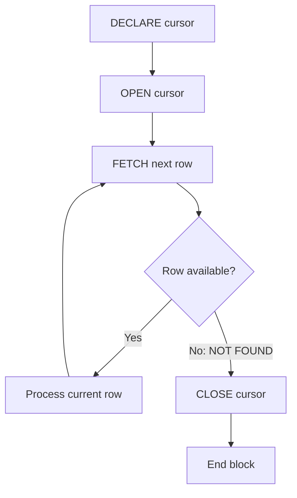

# Read-Only, Forward-Only Cursors and Result Set Characteristics

Cursors in MySQL allow a stored program to iterate row by row over a result set produced by a `SELECT` statement. Cursors are useful when each row needs to be processed sequentially using procedural logic. However, MySQL cursors have three important characteristics: **asensitive**, **read-only**, and **non-scrollable**. A cursor is not a pointer that can be freely moved around or used to directly update the current row.

This lesson belongs to the **DATABASE_MYSQL** module. The module aims to master MySQL from table design, data types, keys, and SQL queries to indexes, transactions, and concurrency control; while also practicing reading execution plans, query tuning, privilege management, backups, and handling operational issues in relational databases. Within the **Cursors and Error Handling** chapter, this lesson focuses on read-only, forward-only cursors and result set characteristics. `SPECIAL_NOTE` is provided empty, so there are no extra specific constraints for this lesson.

## 1. What Is a Cursor?

A cursor is an object inside a stored program bound to a `SELECT` query. When the cursor is opened, MySQL initializes the result set; each `FETCH` statement retrieves the next row into declared variables. When no rows remain, MySQL raises a `NOT FOUND` condition so the routine can terminate the loop.

Basic lifecycle:

1. **DECLARE**: declare the cursor and the `SELECT` statement that produces the result set.
2. **OPEN**: open the cursor and initialize the result set.
3. **FETCH**: retrieve each row sequentially in the forward direction.
4. **CLOSE**: close the cursor and release associated resources.

Diagram:



Cursors are commonly used in procedures when iterating over query results. Statements processing each row may perform calculations, conditional checks, calls to other routines, or separate DML operations keyed by the row's key.

## 2. Three Characteristics of MySQL Cursors

Cursors in MySQL stored programs have three main characteristics:

| Characteristic | Meaning | Implication |
|---|---|---|
| **Asensitive** | The server may or may not make a copy of the result set; the routine must not assume a fixed copy model. | Do not rely on assuming the cursor is always an independent snapshot or always reflects the latest changes. |
| **Read-only** | The current row cannot be updated through the cursor. | There is no update-current-row operation via a cursor; modifying data requires executing separate DML. |
| **Non-scrollable** | Traverses only in the forward direction to the next row. | Cannot move backward, jump to an arbitrary row, or re-read a previous row using the cursor. |

These are intentional limitations of MySQL cursors. When designing a routine, treat a cursor as a sequential iterator over query results, not as a locked record or an updatable position.

## 3. Asensitive: Do Not Assume How the Server Retains the Result Set

`Asensitive` means the server may or may not create a copy of the result table. This definition does not guarantee that the cursor always reads from a fixed physical copy, nor does it guarantee that the cursor will see every change made to the underlying table after opening.

What to do:

- Define the cursor's `SELECT` statement and filter conditions accurately.
- If processing order matters, specify `ORDER BY`.
- If correctness depends on concurrent data changes, design the transaction and isolation level explicitly.
- Do not use a cursor to infer that fetched rows are automatically locked to prevent other sessions from modifying them.
- Do not rely on whether updating the underlying table inside the loop will or will not change the remaining rows in the cursor set.

For example, a cursor reading open orders:

```sql
DECLARE cur_open_orders CURSOR FOR
    SELECT order_id, customer_id, total_amount
    FROM orders
    WHERE status = 'OPEN'
    ORDER BY order_date, order_id;
```

`ORDER BY order_date, order_id` defines a repeatable order when `order_id` is a unique key. If you only sort by date and multiple orders share the same date, the order among those orders is not fully deterministic.

## 4. Read-Only: Cursors Do Not Update the Current Row

MySQL cursors are read-only. There is no syntax equivalent to `UPDATE ... WHERE CURRENT OF cursor_name` to directly modify the row to which the cursor currently points.

If you need to update the row that was read, retrieve its primary key from the cursor and run a separate DML statement:

```sql
UPDATE orders
SET review_status = 'CHECKED'
WHERE order_id = v_order_id;
```

Here `v_order_id` is the variable populated by `FETCH` from the cursor. The DML executes on the table as an independent statement; correctness when multiple sessions concurrently modify data must be protected using update conditions, transactions, and appropriate locking rules.

Read-only describes the inability to update **through the cursor**. It does not mean the entire procedure can only read data: the routine can still execute separate `INSERT`, `UPDATE`, or `DELETE` statements if it has privileges and satisfies stored program rules.

## 5. Non-Scrollable: Forward-Only FETCH

MySQL cursors do not support arbitrary scrolling. The `FETCH` statement retrieves the next row; directions such as `PRIOR`, `FIRST`, `LAST`, `ABSOLUTE`, or `RELATIVE` do not exist.

| Requirement | MySQL Cursor |
|---|---|
| Fetch next row | Supported via `FETCH` |
| Go back to previous row | Not supported |
| Jump to the Nth row | Not supported |
| Read the last row then return to start | Not supported |
| Traverse again from the beginning | Close and reopen the cursor to initialize a new traversal |

If you need pagination, positional lookup, or returning to an earlier row, design the query with sort keys and pagination conditions (keyset pagination), or re-query by key. You should not hold a cursor open just to simulate a scrollable result set.

## 6. Declaring a Cursor with DECLARE

Syntax:

```sql
DECLARE cursor_name CURSOR FOR select_statement;
```

`select_statement` is the `SELECT` query providing the columns to be retrieved via `FETCH`. The cursor query does not use an `INTO` clause to receive results; destination variables are specified in the `FETCH` statement.

Example:

```sql
DECLARE cur_customers CURSOR FOR
    SELECT customer_id, customer_name
    FROM customers
    WHERE is_active = 1
    ORDER BY customer_id;
```

You can use procedure parameters or local variables declared before the cursor in the query's filter conditions:

```sql
DECLARE cur_customer_orders CURSOR FOR
    SELECT order_id, total_amount
    FROM orders
    WHERE customer_id = p_customer_id
    ORDER BY order_date, order_id;
```

In the second example, `p_customer_id` is a parameter of the enclosing routine. A cursor is not a dynamic prepared statement; the cursor query is fixed at declaration time.

## 7. Declaration Order Inside BEGIN ... END

Within a stored program block, declaration order matters:

1. Local variables and conditions.
2. Cursors.
3. Handlers.
4. Executable statements.

Declaration skeleton example:

```sql
BEGIN
    DECLARE v_done BOOLEAN DEFAULT FALSE;
    DECLARE v_order_id BIGINT;
    DECLARE v_total DECIMAL(14, 2);

    DECLARE cur_orders CURSOR FOR
        SELECT order_id, total_amount
        FROM orders
        ORDER BY order_id;

    DECLARE CONTINUE HANDLER FOR NOT FOUND
        SET v_done = TRUE;

    -- OPEN, FETCH, CLOSE statements go after the declaration section.
END
```

Do not place `DECLARE` after `SET`, `OPEN`, or the first executable SQL statement in the same block. If a routine has nested blocks, each block has its own declaration section and variable/handler scope.

## 8. OPEN, FETCH, and CLOSE

### 8.1. OPEN

`OPEN cursor_name` opens the cursor and initializes the result set from the declared `SELECT` statement:

```sql
OPEN cur_orders;
```

Do not reopen a cursor while it is still open. If you need a new traversal, close the cursor first and then reopen it.

### 8.2. FETCH

Syntax:

```sql
FETCH cursor_name INTO var_name [, var_name] ...;
```

The number of target variables must match the number of columns in the cursor's `SELECT` list. The order of variables must also correspond to the column order:

```sql
DECLARE cur_orders CURSOR FOR
    SELECT order_id, customer_id, total_amount
    FROM orders;

-- After OPEN:
FETCH cur_orders
INTO v_order_id, v_customer_id, v_total_amount;
```

Choose target variable data types compatible with the column types to avoid unintended conversions, loss of precision, or warnings.

### 8.3. CLOSE

`CLOSE cursor_name` closes an opened cursor:

```sql
CLOSE cur_orders;
```

Close the cursor after finishing traversal, even when the result set is empty. Closing a cursor does not commit or roll back a transaction; those are two separate mechanisms.

## 9. NOT FOUND and How to Terminate the Loop

When `FETCH` has no more rows to read, MySQL raises the `NOT FOUND` condition (SQLSTATE class `02`). Without a matching handler, this condition can terminate the routine. The standard pattern is to declare a `CONTINUE HANDLER` to set a termination flag:

```sql
DECLARE v_done BOOLEAN DEFAULT FALSE;

DECLARE CONTINUE HANDLER FOR NOT FOUND
    SET v_done = TRUE;
```

The loop must check the flag immediately after `FETCH` and before processing the target variables:

```sql
read_loop: LOOP
    FETCH cur_orders INTO v_order_id, v_total;

    IF v_done THEN
        LEAVE read_loop;
    END IF;

    -- Process the successfully fetched row.
END LOOP;
```

Do not process target variables after a failed `FETCH`: their remaining values may still hold data from the previous row. The `v_done` flag distinguishes a valid row from a fetch that reached the end of the result set.

### 9.1. Why Use CONTINUE HANDLER?

`CONTINUE HANDLER` handles the condition and then resumes execution at the statement following the one that raised the condition. Therefore, after `FETCH`, the program can check `v_done` and explicitly `LEAVE` the loop.

Conversely, `EXIT HANDLER` terminates the block where the handler is declared after running the handler body. Using EXIT for the end-of-rows condition can cause the routine to exit the block enclosing the loop before running the intended cursor-closing cleanup. For standard fetch loops, a CONTINUE HANDLER combined with a done flag is an easy-to-control pattern.

### 9.2. Empty Result Sets

If the cursor's `SELECT` statement returns no rows:

1. `OPEN` still opens the cursor.
2. The first `FETCH` raises `NOT FOUND`.
3. The handler sets the done flag to TRUE.
4. The loop exits without processing target variables.
5. The routine still executes `CLOSE` to close the cursor.

You do not need to check the row count with a separate query before opening the cursor; let the first `FETCH` handle the empty case.

## 10. Complete Example: Iterating Over Customer Orders

The following procedure counts orders and sums total amounts using a cursor. The example uses `orders` with columns `order_id`, `customer_id`, `order_date`, and `total_amount`.

```sql
DELIMITER $$

CREATE PROCEDURE summarize_customer_orders_cursor(
    IN p_customer_id BIGINT,
    OUT p_order_count INT,
    OUT p_total_amount DECIMAL(14, 2)
)
BEGIN
    DECLARE v_done BOOLEAN DEFAULT FALSE;
    DECLARE v_order_id BIGINT;
    DECLARE v_order_date DATE;
    DECLARE v_amount DECIMAL(14, 2);

    DECLARE cur_orders CURSOR FOR
        SELECT order_id, order_date, total_amount
        FROM orders
        WHERE customer_id = p_customer_id
        ORDER BY order_date, order_id;

    DECLARE CONTINUE HANDLER FOR NOT FOUND
        SET v_done = TRUE;

    SET p_order_count = 0;
    SET p_total_amount = 0;

    OPEN cur_orders;

    read_loop: LOOP
        FETCH cur_orders
        INTO v_order_id, v_order_date, v_amount;

        IF v_done THEN
            LEAVE read_loop;
        END IF;

        SET p_order_count = p_order_count + 1;
        SET p_total_amount = p_total_amount + v_amount;
    END LOOP;

    CLOSE cur_orders;
END$$

DELIMITER ;
```

Calling the procedure:

```sql
CALL summarize_customer_orders_cursor(
    1001,
    @order_count,
    @total_amount
);

SELECT
    @order_count AS order_count,
    @total_amount AS total_amount;
```

The result is the row count and sum of `total_amount` for the supplied customer. Because the example assumes `total_amount` is non-NULL, direct addition is appropriate. If the column allows NULL, specify how NULL should be handled, such as converting to 0 during FETCH or addition.

This example illustrates the cursor lifecycle. For simple counting and summing, a set-based query is usually shorter and more efficient:

```sql
SELECT
    COUNT(*),
    COALESCE(SUM(total_amount), 0)
INTO
    p_order_count,
    p_total_amount
FROM orders
WHERE customer_id = p_customer_id;
```

In real-world applications, prefer set-based operations whenever business logic can be expressed with one or a few SQL statements.

## 11. NOT FOUND Can Come from Another Statement

`NOT FOUND` is not raised solely when a cursor runs out of rows. A `SELECT ... INTO` statement that finds no rows also raises a class `02` condition. If the same `NOT FOUND` handler is setting the cursor's `v_done` flag, a secondary lookup finding no data can cause the loop to exit prematurely.

There are two design options:

- Guarantee that the secondary query always returns exactly one row, such as looking up by a properly constrained foreign key.
- Place the secondary query in a nested block with its own handler so its NOT FOUND condition does not alter the cursor termination flag.

Nested block example:

Declare `v_customer_missing` at the top of the outer block, before the cursor and handler. Inside the loop, reset the flag and use a dedicated handler in the inner block:

```sql
SET v_customer_missing = FALSE;

BEGIN
    DECLARE CONTINUE HANDLER FOR NOT FOUND
        SET v_customer_missing = TRUE;

    SELECT customer_name
    INTO v_customer_name
    FROM customers
    WHERE customer_id = v_customer_id;
END;

IF v_customer_missing THEN
    -- Handle the case where the customer is not found.
END IF;
```

The inner block's handler only handles conditions within that block's scope. The outer block's NOT FOUND handler remains dedicated to cursor FETCH operations. When using nested blocks, the inner block's variable and handler declarations must appear before the inner block's first executable statement.

## 12. Closing the Cursor When an SQL Error Occurs

If an error occurs after `OPEN` but before `CLOSE`, the routine may exit the intended execution flow. An `EXIT HANDLER FOR SQLEXCEPTION` enables cleanup and then re-raises the error so the caller knows the operation failed.

Cursor state management pattern:

```sql
DELIMITER $$

CREATE PROCEDURE process_orders_safely(
    IN p_customer_id BIGINT
)
BEGIN
    DECLARE v_done BOOLEAN DEFAULT FALSE;
    DECLARE v_cursor_open BOOLEAN DEFAULT FALSE;
    DECLARE v_order_id BIGINT;
    DECLARE v_amount DECIMAL(14, 2);

    DECLARE cur_orders CURSOR FOR
        SELECT order_id, total_amount
        FROM orders
        WHERE customer_id = p_customer_id
        ORDER BY order_id;

    DECLARE CONTINUE HANDLER FOR NOT FOUND
        SET v_done = TRUE;

    DECLARE EXIT HANDLER FOR SQLEXCEPTION
    BEGIN
        IF v_cursor_open THEN
            CLOSE cur_orders;
            SET v_cursor_open = FALSE;
        END IF;
        RESIGNAL;
    END;

    OPEN cur_orders;
    SET v_cursor_open = TRUE;

    read_loop: LOOP
        FETCH cur_orders INTO v_order_id, v_amount;

        IF v_done THEN
            LEAVE read_loop;
        END IF;

        -- Place per-row processing logic here.
    END LOOP;

    CLOSE cur_orders;
    SET v_cursor_open = FALSE;
END$$

DELIMITER ;
```

The `v_cursor_open` variable is set to TRUE only after `OPEN` succeeds and set to FALSE after closing. The handler checks the flag before calling `CLOSE` to avoid closing an unopened or already-closed cursor. `RESIGNAL` propagates the original error back to the caller rather than hiding the error by simply exiting the procedure.

This is a cleanup pattern. If the routine also manages transactions, closing the cursor does not replace rollback; transactions must be handled according to a separate contract. Do not automatically add `ROLLBACK` to every handler if the procedure is called within a transaction owned by the caller.

## 13. Cursors and Transactions

Cursors and transactions solve two different problems:

- A cursor determines how a routine iterates over rows of a result set.
- A transaction determines atomic boundaries, data visibility, and how changes across multiple sessions are coordinated.

Several principles:

1. Opening a cursor does not mean all rows in the result set are locked to prevent other sessions from updating them.
2. An asensitive cursor does not promise a fixed independent copy; do not rely on assumptions about concurrent modifications.
3. If a routine both reads and updates data, explicitly determine the isolation level, DML conditions, and required locks.
4. Avoid holding a cursor open for too long while waiting on external operations or user input.
5. When processing large data volumes, consider batching and committing at appropriate business boundaries.

Example of a cursor reading a list of keys and updating status by key:

```sql
UPDATE orders
SET review_status = 'CHECKED'
WHERE order_id = v_order_id
  AND review_status = 'PENDING';

IF ROW_COUNT() = 0 THEN
    -- The row may have already been processed by another session or its status changed.
END IF;
```

The status condition in `WHERE` prevents overwriting a change that is no longer applicable. You must decide how to handle a zero-row update count according to business rules.

## 14. Row Ordering and Result Stability

Relations in SQL have no default ordering. If a routine needs to process rows in a specific sequence, the cursor's query must include `ORDER BY`.

Do not sort only by a column that can contain duplicates:

```sql
-- Order among rows with the same order_date is not fully deterministic.
SELECT order_id, order_date
FROM orders
ORDER BY order_date;
```

Add a unique key as a secondary sort criterion:

```sql
SELECT order_id, order_date
FROM orders
ORDER BY order_date, order_id;
```

Deterministic ordering keeps lab results repeatable, makes logs easy to reconcile, and makes sequential processing logic easy to verify. `ORDER BY` can also trigger a sort; check indexes and execution plans if the result set is large.

## 15. Overhead and Operational Limits

Because cursors process row by row, they usually carry higher overhead than an equivalent set-based statement. When iterating over many rows, each loop iteration can involve fetch operations, value conversions, conditional branches, and multiple extra SQL statements.

| Risk | Why it happens | Mitigation |
|---|---|---|
| Many loop iterations | Each row is processed sequentially | Use aggregates, JOINs, or set-based UPDATE/INSERT when possible. |
| N+1 queries | Each row triggers a secondary query | JOIN needed data into the cursor SELECT or batch queries. |
| Long-lived open cursor | Routine performs extensive work while holding the cursor | Limit the result set, process quickly, close early. |
| Large result set | Increases resource usage and traversal time | Filter early, select only needed columns, batch. |
| Non-deterministic ordering | SELECT lacks ORDER BY or ORDER BY is non-unique | Add a unique tie-breaker sort criterion. |
| Mid-loop errors | Cursor is not closed in normal flow | Include a cleanup handler and re-raise the error. |
| Update contention | Another session modifies a row after the cursor reads it | Use DML conditions, transactions, and explicit conflict handling. |

Do not use a cursor just to perform a sum, count, filter, or bulk update that SQL can execute directly.

## 16. When Should You Use a Cursor?

A cursor may be appropriate when:

- Each row requires a sequential processing workflow with distinct logic branches.
- The outcome of one step determines the parameters for the next step.
- The routine needs to call another routine for each row and cannot reasonably be expressed using set operations.
- The dataset is bounded and sequential overhead has been measured/evaluated.

Prefer set-based SQL when:

- Computing sums, averages, counts, min/max.
- Updating multiple rows under the same condition.
- Combining data from multiple tables.
- Classifying or filtering data using SQL expressions.
- The entire business operation can be handled in one or a few set-based statements.

For example, counting and summing with a cursor:

```sql
FETCH cur_orders INTO v_amount;
SET v_count = v_count + 1;
SET v_total = v_total + v_amount;
```

Can usually be replaced by:

```sql
SELECT
    COUNT(*),
    COALESCE(SUM(total_amount), 0)
INTO v_count, v_total
FROM orders
WHERE customer_id = p_customer_id;
```

Set-based computation lets the optimizer process the entire row set and typically incurs much less overhead.

## 17. Limitations of the Cursor SELECT Statement

The query bound to a cursor has several limitations to keep in mind:

- It must be a `SELECT` statement used to define the result set.
- Do not place `INTO variable_list` in the cursor's `SELECT` declaration; destination variables belong in the `FETCH` statement.
- You cannot substitute the query with a dynamic prepared statement when opening the cursor.
- Routine variables and parameters can be referenced in query conditions to filter the result set.
- The column list in `SELECT` must match the exact count and order of variables in `FETCH`.

Valid example with procedure parameters:

```sql
DECLARE cur_orders CURSOR FOR
    SELECT order_id, total_amount
    FROM orders
    WHERE customer_id = p_customer_id
      AND status = p_status
    ORDER BY order_date, order_id;
```

To vary filter criteria, pass different values into procedure parameters before opening the cursor. You cannot take an arbitrary SQL string and `PREPARE` it as a cursor query in the style of dynamic SQL.

## 18. Managing Multiple Cursors and Scope

A block can declare multiple cursors. Each cursor needs a distinct name within its declaration scope and has its own open/close lifecycle:

```sql
DECLARE cur_customers CURSOR FOR
    SELECT customer_id
    FROM customers
    ORDER BY customer_id;

DECLARE cur_orders CURSOR FOR
    SELECT order_id
    FROM orders
    WHERE customer_id = v_customer_id
    ORDER BY order_id;
```

If using nested cursors, manage a separate done flag for each loop and place handlers in the appropriate blocks. Do not share a single done flag between two cursors if the two cursors can finish independently.

Nested block structure example:

```sql
outer_loop: LOOP
    FETCH cur_customers INTO v_customer_id;

    IF v_customers_done THEN
        LEAVE outer_loop;
    END IF;

    BEGIN
        DECLARE v_orders_done BOOLEAN DEFAULT FALSE;

        DECLARE cur_orders CURSOR FOR
            SELECT order_id
            FROM orders
            WHERE customer_id = v_customer_id
            ORDER BY order_id;

        DECLARE CONTINUE HANDLER FOR NOT FOUND
            SET v_orders_done = TRUE;

        OPEN cur_orders;

        inner_loop: LOOP
            FETCH cur_orders INTO v_order_id;

            IF v_orders_done THEN
                LEAVE inner_loop;
            END IF;

            -- Process order_id.
        END LOOP;

        CLOSE cur_orders;
    END;
END LOOP;
```

This example only illustrates handler scope and done flags. In a complete procedure, the outer cursor needs a NOT FOUND handler in the outer block; the handler in the inner block must not alter the outer cursor's flag. Carefully evaluate the cost of nested queries since each customer may open and traverse a separate cursor for orders.

## 19. Common Mistakes

| Mistake | Cause | Fix |
|---|---|---|
| FETCH before OPEN | Cursor has not been initialized | Call OPEN before the first FETCH. |
| OPEN a cursor twice | Cursor is still open | CLOSE the cursor before reopening it. |
| CLOSE an unopened cursor | Control flow entered cleanup in the wrong state | Track open state or structure flow to CLOSE exactly once. |
| Forgetting CLOSE | Cursor remains open while the routine continues | Close after the loop and include an error cleanup handler. |
| Processing variables after FETCH exhaustion | Done flag not checked after FETCH | Check NOT FOUND before using target variables. |
| Sharing one done flag for nested cursors | The two result sets can exhaust at different times | Separate flags and handlers per block/cursor. |
| Secondary SELECT ... INTO stops cursor early | Cursor's NOT FOUND handler also catches no-row error from secondary query | Use a separate handler in an inner block or guarantee one-row return. |
| FETCH variable count mismatches column count | Target list does not match SELECT list | Verify column/variable count and order. |
| Using FETCH PRIOR or LAST | MySQL cursors are non-scrollable | Re-query by key or use pagination. |
| Attempting UPDATE via cursor | Cursors are read-only | Run separate DML using the fetched key. |
| Missing ORDER BY | Row order is not guaranteed | Add ORDER BY with a unique secondary key. |
| Cursor processing millions of rows | Sequential overhead and resource consumption are too high | Filter early, batch, or switch to set-based SQL. |

## 20. Hands-On Lab

The lab uses two test tables, `customers` and `orders`. Run in a fresh lab schema; if the tables already exist, check their structure and data before re-running. Do not run sample DDL in production.

### 20.1. Prepare the Data

```sql
CREATE TABLE customers (
    customer_id BIGINT NOT NULL PRIMARY KEY,
    customer_name VARCHAR(150) NOT NULL,
    is_active TINYINT NOT NULL
) ENGINE = InnoDB;

CREATE TABLE orders (
    order_id BIGINT NOT NULL PRIMARY KEY,
    customer_id BIGINT NOT NULL,
    order_date DATE NOT NULL,
    total_amount DECIMAL(14, 2) NOT NULL,
    status VARCHAR(20) NOT NULL,
    KEY idx_orders_customer_date (customer_id, order_date, order_id)
) ENGINE = InnoDB;

INSERT INTO customers (customer_id, customer_name, is_active)
VALUES
    (1001, 'An Nguyen', 1),
    (1002, 'Binh Tran', 1),
    (1003, 'Chi Le', 0);

INSERT INTO orders
    (order_id, customer_id, order_date, total_amount, status)
VALUES
    (5001, 1001, '2026-11-01', 1200000, 'PAID'),
    (5002, 1001, '2026-11-05', 800000, 'OPEN'),
    (5003, 1002, '2026-11-06', 2500000, 'PAID');
```

### 20.2. Create a Procedure to Iterate Over Active Customers

```sql
DELIMITER $$

CREATE PROCEDURE list_active_customers_cursor()
BEGIN
    DECLARE v_done BOOLEAN DEFAULT FALSE;
    DECLARE v_customer_id BIGINT;
    DECLARE v_customer_name VARCHAR(150);

    DECLARE cur_customers CURSOR FOR
        SELECT customer_id, customer_name
        FROM customers
        WHERE is_active = 1
        ORDER BY customer_id;

    DECLARE CONTINUE HANDLER FOR NOT FOUND
        SET v_done = TRUE;

    OPEN cur_customers;

    read_loop: LOOP
        FETCH cur_customers
        INTO v_customer_id, v_customer_name;

        IF v_done THEN
            LEAVE read_loop;
        END IF;

        SELECT
            v_customer_id AS customer_id,
            v_customer_name AS customer_name;
    END LOOP;

    CLOSE cur_customers;
END$$

DELIMITER ;

CALL list_active_customers_cursor();
```

The procedure returns one result set per row iteration. This is helpful for observing the loop in the lab, but in applications avoid emitting many small result sets when a single result set can be returned with SELECT.

### 20.3. Test an Empty Result Set

Invoke the procedure with a condition matching no rows by creating a variant filtering for a nonexistent customer, or change the cursor SELECT in the lab to return 0 rows. Confirm that the first FETCH triggers the handler and the cursor is still CLOSEd.

### 20.4. Compare with a Set-Based Query

```sql
SELECT
    customer_id,
    COUNT(*) AS order_count,
    COALESCE(SUM(total_amount), 0) AS total_amount
FROM orders
GROUP BY customer_id
ORDER BY customer_id;
```

Compare the cursor approach with the aggregate query: code length, number of fetches, number of SQL statements executed, and the optimizer's ability to process the set as a whole.

### 20.5. Inspect the Execution Plan

```sql
EXPLAIN
SELECT order_id, order_date, total_amount
FROM orders
WHERE customer_id = 1001
ORDER BY order_date, order_id;
```

Observe the access type, selected index, estimated rows, and sort step. A cursor does not automatically make the underlying SELECT query faster; performance still depends on the query, indexes, cardinality, and result set size.

## 21. Practice Exercises

### Exercise 1: Iterate Results in Deterministic Order

Create a procedure using a cursor to read a customer's orders by date.

**Requirement:** use `ORDER BY order_date, order_id`; explain why a secondary key is needed in the ordering.

### Exercise 2: Handle an Empty Result Set

Modify the cursor condition so that no rows match.

**Requirement:** demonstrate that the `NOT FOUND` handler is invoked on the first `FETCH` and target variables are not processed.

### Exercise 3: Isolate the Handler for a Secondary Query

Inside a cursor loop, look up the customer name using `SELECT ... INTO`.

**Requirement:** create a child block with its own NOT FOUND handler; confirm that the secondary query does not set the outer cursor's termination flag.

### Exercise 4: Cleanup on Error

Add a statement inside the loop that can raise an error.

**Requirement:** use `EXIT HANDLER FOR SQLEXCEPTION`, check the cursor state before closing, and use `RESIGNAL` to return the error to the caller.

### Exercise 5: Compare Cursor vs. Set-Based SQL

Compute the order count and total amount per customer using a cursor, then rewrite it using `GROUP BY`.

**Requirement:** compare statement count, complexity, optimization potential, and performance on large datasets.

### Exercise 6: Update by Fetched Key

Read orders with status PENDING using a cursor and update each row by primary key.

**Requirement:** include the status condition in `WHERE`, check `ROW_COUNT()`, and explain how to handle cases where another session modified the row.

## 22. Pre-Cursor Checklist

- [ ] Confirmed the problem requires sequential processing and cannot be reasonably expressed in set-based SQL.
- [ ] Cursor query selects only the columns actually needed.
- [ ] Variables/conditions declared before cursors, and cursors declared before handlers.
- [ ] Used `ORDER BY` with a unique secondary criterion when ordering matters.
- [ ] Number of SELECT columns matches number of variables in FETCH.
- [ ] OPEN called before FETCH, and CLOSE called after iteration.
- [ ] NOT FOUND handler sets the done flag, and the loop checks the flag immediately after FETCH.
- [ ] Target variables are not processed after a FETCH with no row.
- [ ] Secondary SELECT ... INTO queries do not accidentally trigger the cursor termination handler.
- [ ] Nested cursors use separate flags and handlers.
- [ ] Cleanup is present if SQLEXCEPTION occurs after OPEN.
- [ ] Understood that cursors are asensitive, read-only, and non-scrollable.
- [ ] Not assuming the cursor automatically locks rows or provides a fixed snapshot.
- [ ] If DML is needed, uses fetched keys and proper update conditions.
- [ ] Transactions and isolation levels are designed separately from cursor lifecycle.
- [ ] Result set is bounded and cursor open duration is controlled.
- [ ] Cost has been measured/evaluated against set-based queries.

## 23. Key Takeaways

MySQL cursors in stored programs have three characteristics: **asensitive** (the server may or may not make a copy of the result set), **read-only** (the current row cannot be updated through the cursor), and **non-scrollable** (FETCH moves forward only).

The cursor lifecycle consists of `DECLARE`, `OPEN`, `FETCH`, and `CLOSE`. When rows run out, `FETCH` raises `NOT FOUND`; the standard pattern is a `CONTINUE HANDLER` setting a done flag, with the loop checking the flag and exiting via `LEAVE`. Be mindful that a NOT FOUND handler can also catch a `SELECT ... INTO` finding no rows in the same scope.

A cursor does not replace transactions, does not automatically guarantee row locks, and does not make the underlying query faster. Bound the result set, specify ordering with ORDER BY, close the cursor in both success and error paths, and prefer set-based SQL whenever business logic can be expressed as set operations.
