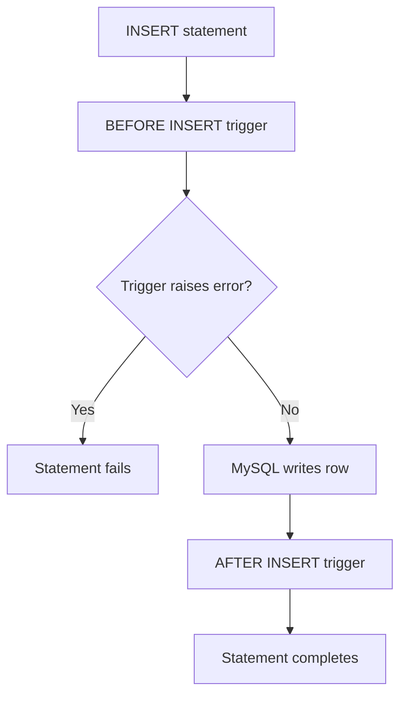

# NEW, OLD, and Modifying Values in BEFORE Triggers

In MySQL, `NEW` and `OLD` reference the column values of the row currently being processed by a trigger. Only `BEFORE INSERT` and `BEFORE UPDATE` allow reassigning `NEW.column`; `OLD` is always read-only.

## 1. What Are NEW and OLD?

`NEW` and `OLD` are pseudo-rows provided by MySQL to a trigger:

- `NEW.column_name` references the value of the newly inserted row or the proposed new value during an update.
- `OLD.column_name` references the existing value before an update or before a delete.

These two names only have meaning inside a trigger context. They are not table names, not aliases in a SELECT statement, and cannot be used arbitrarily in ordinary procedures or functions.

## 2. Which Events Have NEW and OLD?

MySQL supports triggers for three DML events: `INSERT`, `UPDATE`, and `DELETE`. The event determines which pseudo-rows are available:

| Event | Timing | NEW | OLD |
|---|---|---|---|
| INSERT | BEFORE INSERT | Yes | No |
| INSERT | AFTER INSERT | Yes | No |
| UPDATE | BEFORE UPDATE | Yes | Yes |
| UPDATE | AFTER UPDATE | Yes | Yes |
| DELETE | BEFORE DELETE | No | Yes |
| DELETE | AFTER DELETE | No | Yes |

Remember:

- INSERT creates a new row, so there is no OLD value.
- DELETE removes an old row, so there is no NEW value.
- UPDATE replaces an old state with a new state, so both are available.

## 3. When Can NEW Be Modified?

| Trigger Type | Read NEW | Assign NEW.column | Read OLD | Assign OLD.column |
|---|---:|---:|---:|---:|
| BEFORE INSERT | Yes | Yes | Not available | No |
| AFTER INSERT | Yes | No | Not available | No |
| BEFORE UPDATE | Yes | Yes | Yes | No |
| AFTER UPDATE | Yes | No | Yes | No |
| BEFORE DELETE | Not available | No | Yes | No |
| AFTER DELETE | Not available | No | Yes | No |

Only in `BEFORE INSERT` and `BEFORE UPDATE` can you assign values to a `NEW` column. Syntax:

```sql
SET NEW.column_name = expression;
```

You cannot assign directly to `OLD`. You cannot modify `NEW` in an AFTER trigger because the row write operation has already occurred at that point. If you need to normalize or compute values before writing, use a BEFORE trigger.

## 4. How Do BEFORE and AFTER Differ?

A **BEFORE trigger** runs before MySQL completes the row write operation:

- Can validate input data.
- Can reassign permitted `NEW` columns in BEFORE INSERT/UPDATE.
- Can reject the operation by raising an error, such as `SIGNAL SQLSTATE '45000'`.

An **AFTER trigger** runs after the row operation has been performed:

- Can read post-operation row values via `NEW` or pre-operation values via `OLD`, depending on the event.
- Suitable for actions that depend on the written row, such as inserting an audit record into another table.
- Cannot reassign `NEW` to change the row that was just written.

INSERT flow diagram:



For UPDATE, the flow is similar, except BEFORE UPDATE has both `OLD` and `NEW`. For DELETE, the trigger can read `OLD` but does not have `NEW`.

## 5. NEW in BEFORE INSERT

In BEFORE INSERT, `NEW.column` represents the row value about to be inserted. The trigger can normalize or recompute values before the row is written.

Example normalizing SKU and product name:

```sql
DELIMITER $$

CREATE TRIGGER bi_products_normalize
BEFORE INSERT ON products
FOR EACH ROW
BEGIN
    SET NEW.sku = UPPER(TRIM(NEW.sku));
    SET NEW.product_name = TRIM(NEW.product_name);
END$$

DELIMITER ;
```

When the application runs:

```sql
INSERT INTO products (sku, product_name, price, stock)
VALUES (' ab-100 ', '  Wireless Mouse  ', 250000, 20);
```

The row is stored with whitespace stripped and SKU converted to uppercase, and the product name trimmed at both ends. The application does not need to repeat the same rule in every write path.

Do not turn triggers into a place that silently alters too much data. Only normalize stable rules that have a clear contract and are tested across all write paths.

## 6. NEW and OLD in BEFORE UPDATE

In BEFORE UPDATE:

- `OLD.column` is the value before the UPDATE.
- `NEW.column` is the proposed value from the UPDATE.
- `NEW.column` can be reassigned to change the final written value.

Example normalizing email and updating the modification timestamp:

```sql
DELIMITER $$

CREATE TRIGGER bu_customers_normalize
BEFORE UPDATE ON customers
FOR EACH ROW
BEGIN
    SET NEW.email = LOWER(TRIM(NEW.email));

    IF NOT (NEW.email <=> OLD.email)
       OR NOT (NEW.full_name <=> OLD.full_name) THEN
        SET NEW.updated_at = CURRENT_TIMESTAMP;
    END IF;
END$$

DELIMITER ;
```

The `<=>` operator is the NULL-safe equality comparison. It returns TRUE when both sides are NULL, whereas `=` may return UNKNOWN if one side is NULL. Use `NOT (a <=> b)` to check whether two values actually differ, including NULL cases.

Example:

```sql
UPDATE customers
SET email = '  USER@EXAMPLE.COM  '
WHERE customer_id = 1001;
```

The trigger normalizes the email value before saving. If the normalized email differs from the old email, the trigger updates `updated_at`.

## 7. Read-Only OLD: Comparing Before and After State

`OLD` is very useful when determining whether data changed or recording the state before an operation.

Example writing an audit only when product price actually changes:

```sql
DELIMITER $$

CREATE TRIGGER au_products_price_audit
AFTER UPDATE ON products
FOR EACH ROW
BEGIN
    IF NOT (NEW.price <=> OLD.price) THEN
        INSERT INTO product_price_audit (
            product_id,
            old_price,
            new_price,
            changed_at
        )
        VALUES (
            OLD.product_id,
            OLD.price,
            NEW.price,
            CURRENT_TIMESTAMP
        );
    END IF;
END$$

DELIMITER ;
```

In AFTER UPDATE, the trigger only reads `OLD.price` and `NEW.price` and inserts a row into another audit table. It does not assign `NEW.price`.

If the audit table uses InnoDB and the UPDATE runs inside an InnoDB transaction, the audit change participates in the same transaction; if the transaction rolls back, the audit record rolls back as well.

## 8. Using BEFORE Triggers to Validate and Reject Data

Not every rule should auto-correct input. When data is invalid, a BEFORE trigger can raise an error to abort the operation:

```sql
DELIMITER $$

CREATE TRIGGER bi_orders_validate
BEFORE INSERT ON orders
FOR EACH ROW
BEGIN
    IF NEW.quantity IS NULL OR NEW.quantity <= 0 THEN
        SIGNAL SQLSTATE '45000'
            SET MESSAGE_TEXT = 'quantity must be greater than zero';
    END IF;

    IF NEW.unit_price IS NULL OR NEW.unit_price < 0 THEN
        SIGNAL SQLSTATE '45000'
            SET MESSAGE_TEXT = 'unit_price must not be negative';
    END IF;

    SET NEW.line_total = ROUND(
        NEW.quantity * NEW.unit_price,
        2
    );
END$$

DELIMITER ;
```

In this example, the first two checks reject rows with invalid data; if valid, the trigger computes `line_total` and assigns it to `NEW.line_total` before writing. The `orders` table in this example must have `quantity`, `unit_price`, and `line_total` columns with appropriate data types.

`SIGNAL SQLSTATE '45000'` is the standard way to raise an application-defined error. The client receives the error and the DML statement fails. With transactional tables like InnoDB, statement changes roll back according to statement/transaction semantics.

If the goal is merely restricting values, consider a `CHECK constraint` or appropriate data types/NOT NULL before using a trigger. Constraints usually express row-level rules more clearly and are enforced directly by the server.

## 9. Computing Values in a BEFORE Trigger

A typical use case is computing a derived value from input columns:

```sql
DELIMITER $$

CREATE TRIGGER bi_order_items_total
BEFORE INSERT ON order_items
FOR EACH ROW
BEGIN
    SET NEW.line_total = ROUND(
        NEW.quantity * NEW.unit_price,
        2
    );
END$$

CREATE TRIGGER bu_order_items_total
BEFORE UPDATE ON order_items
FOR EACH ROW
BEGIN
    SET NEW.line_total = ROUND(
        NEW.quantity * NEW.unit_price,
        2
    );
END$$

DELIMITER ;
```

These two triggers ensure `line_total` is recalculated before writing on both INSERT and UPDATE. If the expression is a deterministic calculation based solely on columns in the same row, consider a **generated column** instead of triggers. Generated columns make the data relationship explicit in the table definition and avoid maintaining two synchronized triggers.

Triggers are more suitable when a rule requires procedural logic, complex conditional checks, or coordination with other tables that constraints or generated columns cannot express.

## 10. NEW and AUTO_INCREMENT Columns

In BEFORE INSERT, if a column is AUTO_INCREMENT and the application does not specify a value, `NEW.auto_increment_column` is 0 because the final auto-generated value has not yet been assigned when the BEFORE trigger runs.

Do not write BEFORE INSERT logic that depends on reading the final auto-generated ID. If you need to write an audit tied to the newly assigned ID, use AFTER INSERT and read `NEW.id` there.

Example:

```sql
CREATE TRIGGER ai_products_audit
AFTER INSERT ON products
FOR EACH ROW
INSERT INTO product_audit (
    product_id,
    action_name,
    action_time
)
VALUES (
    NEW.product_id,
    'INSERT',
    CURRENT_TIMESTAMP
);
```

A single-statement trigger definition does not require `BEGIN ... END`. When the body has multiple statements, use a compound statement and an appropriate client delimiter.

## 11. Distinguishing NEW Assignment from Updating the Target Table

In BEFORE INSERT/UPDATE, the statement:

```sql
SET NEW.status = 'READY';
```

modifies the value of the row currently being operated on. This is the mechanism directly supported by MySQL for BEFORE triggers.

Do not replace it by running an UPDATE against the very table that fired the trigger:

```sql
UPDATE products
SET status = 'READY'
WHERE product_id = NEW.product_id;
```

MySQL does not allow a trigger or stored function to modify a table already in use by the statement that invoked the trigger. Attempting this can trigger error 1442. This rule prevents recursive triggers or conflicts with the executing DML operation.

Use `SET NEW.column = ...` to adjust the current row inside a BEFORE trigger. If you need to write additional data to another table, you can perform DML on an appropriate secondary table, such as an audit table, provided it follows the other trigger restrictions.

## 12. Important Limitations Inside Triggers

Triggers execute in the context of the statement that fired them, so MySQL restricts certain operations:

- Triggers cannot return a result set directly to the client.
- You cannot use transaction control statements such as `START TRANSACTION`, `COMMIT`, or `ROLLBACK` inside a trigger.
- You cannot use dynamic SQL prepared statements with `PREPARE`/`EXECUTE`.
- You cannot call procedures that may return a result set to the client or use dynamic SQL prohibited in stored programs.
- You cannot modify a table already used by the statement that invoked the trigger; to change the current row's values in a BEFORE trigger, assign `NEW.column`.
- You cannot use `RETURN` to exit a trigger; you can use labels and `LEAVE` inside a compound statement when needed.
- You cannot assign values to a generated column; let MySQL compute generated columns from their declared expressions.

Triggers do not have custom parameters passed by the application. They receive context through the DML event and `NEW`/`OLD` values.

## 13. Triggers Execute Row by Row

MySQL triggers are row-level triggers and their definitions include the `FOR EACH ROW` clause. If an UPDATE statement affects 500 rows, the corresponding trigger is invoked for each affected row.

Example:

```sql
UPDATE products
SET price = price * 1.05
WHERE category_id = 10;
```

If the statement modifies 500 rows, the BEFORE UPDATE and AFTER UPDATE triggers (if present) run correspondingly on each row. Therefore:

- Avoid expensive subqueries repeated for every row.
- Create appropriate indexes for queries executed inside triggers.
- Do not place heavy aggregation tasks or external API calls inside triggers.
- Measure total DML duration, as trigger overhead is added to the invoking statement.

There is no statement-level trigger that runs once for an entire UPDATE statement in MySQL.

## 14. Trigger Ordering and INSERT ... ON DUPLICATE KEY UPDATE

MySQL allows multiple triggers for the same event and timing on versions that support this feature (since MySQL 5.7.2). By default, triggers execute in creation order; you can declare `FOLLOWS` or `PRECEDES` to specify ordering relative to another trigger with the same timing/event.

Example:

```sql
DELIMITER $$

CREATE TRIGGER bi_products_audit_context
BEFORE INSERT ON products
FOR EACH ROW
PRECEDES bi_products_normalize
BEGIN
    SET NEW.source_system = COALESCE(
        NEW.source_system,
        'UNKNOWN'
    );
END$$

DELIMITER ;
```

The trigger name referenced in `PRECEDES` must be an existing trigger on the same table, event, and timing. Verify the server version and actual execution order before relying on ordering across multiple triggers.

With `INSERT ... ON DUPLICATE KEY UPDATE`, MySQL may fire both INSERT and UPDATE trigger paths:

1. BEFORE INSERT runs first.
2. If there is no duplicate key, the row is inserted and AFTER INSERT runs.
3. If there is a duplicate key, MySQL switches to the UPDATE branch; BEFORE UPDATE and AFTER UPDATE run for that update operation.

Therefore, do not assume an upsert only executes INSERT triggers. If triggers normalize or audit data, test both branches.

## 15. OLD in BEFORE DELETE and AFTER DELETE

DELETE has no NEW row. The trigger can only read the row about to be deleted via `OLD`:

```sql
DELIMITER $$

CREATE TRIGGER bd_customers_protect
BEFORE DELETE ON customers
FOR EACH ROW
BEGIN
    IF OLD.is_vip = 1 THEN
        SIGNAL SQLSTATE '45000'
            SET MESSAGE_TEXT = 'VIP customer cannot be deleted';
    END IF;
END$$

DELIMITER ;
```

This example rejects deletion of VIP customers. If you need to log deleted rows, use AFTER DELETE to write `OLD` values into an audit table:

```sql
DELIMITER $$

CREATE TRIGGER ad_customers_audit
AFTER DELETE ON customers
FOR EACH ROW
BEGIN
    INSERT INTO customer_delete_audit (
        customer_id,
        customer_name,
        deleted_at
    )
    VALUES (
        OLD.customer_id,
        OLD.customer_name,
        CURRENT_TIMESTAMP
    );
END$$

DELIMITER ;
```

AFTER DELETE cannot reference `NEW` because the row has been deleted and has no new row state.

## 16. Triggers, Errors, and Transactions

A trigger runs within the same statement that fired it. With transactional tables like InnoDB:

- If a BEFORE trigger raises an error, the row write operation does not proceed.
- If an AFTER trigger raises an error, the DML statement invoking the trigger fails.
- If the statement is inside a transaction and the transaction rolls back, transactional changes made by the trigger on InnoDB tables also roll back.

Do not assume the same rollback behavior for tables using storage engines that do not support transactions. When a trigger updates multiple tables, use a consistent transactional engine if business logic requires atomicity.

A trigger cannot COMMIT or ROLLBACK on its own. The transaction belongs to the statement/caller; errors in the trigger are returned to the caller so the application can handle the transaction according to its contract.

## 17. Creating, Inspecting, and Managing Triggers

### 17.1. Trigger Creation Syntax

```sql
CREATE TRIGGER trigger_name
trigger_time trigger_event
ON table_name
FOR EACH ROW
trigger_body;
```

Where:

- `trigger_time` is `BEFORE` or `AFTER`.
- `trigger_event` is `INSERT`, `UPDATE`, or `DELETE`.
- `FOR EACH ROW` indicates the trigger runs per row.
- `trigger_body` can be a single statement or a `BEGIN ... END` block.

### 17.2. Viewing Trigger Definitions and Lists

```sql
SHOW TRIGGERS FROM shop_db;

SHOW CREATE TRIGGER shop_db.bi_products_normalize;
```

You can query metadata:

```sql
SELECT
    TRIGGER_SCHEMA,
    TRIGGER_NAME,
    EVENT_MANIPULATION,
    EVENT_OBJECT_TABLE,
    ACTION_TIMING,
    ACTION_ORDER,
    ACTION_STATEMENT,
    DEFINER
FROM INFORMATION_SCHEMA.TRIGGERS
WHERE TRIGGER_SCHEMA = 'shop_db'
ORDER BY EVENT_OBJECT_TABLE, EVENT_MANIPULATION, ACTION_TIMING, ACTION_ORDER;
```

`ACTION_TIMING` indicates BEFORE/AFTER; `EVENT_MANIPULATION` indicates INSERT/UPDATE/DELETE; `ACTION_ORDER` helps verify the order of multiple triggers with the same event/timing.

### 17.3. Dropping a Trigger

```sql
DROP TRIGGER IF EXISTS shop_db.bi_products_normalize;
```

Modifying a trigger is usually deployed by dropping and recreating it. Before making changes, identify affected DML statements, trigger order, definer privileges, and application impact.

### 17.4. Privileges

The deployment account needs the `TRIGGER` privilege on the relevant table to create or drop triggers. The trigger body may require additional privileges on tables it reads or writes; the trigger's security context is tied to its definer. The application account writing data must also have the appropriate DML privileges for its operations.

Do not grant trigger-creation privileges to runtime application accounts if the application only needs INSERT/UPDATE/DELETE. Separate migration privileges from runtime privileges and verify that the definer exists with the minimum required privileges.

## 18. Lab: Normalizing and Auditing Product Prices

This lab creates two standalone tables to test BEFORE INSERT, BEFORE UPDATE, and AFTER UPDATE. Run in a test schema; if the tables already exist, check their structure before re-running. Do not run this DDL on production.

### 18.1. Creating the Tables

```sql
CREATE TABLE trigger_lab_products (
    product_id BIGINT NOT NULL AUTO_INCREMENT PRIMARY KEY,
    sku VARCHAR(40) NOT NULL,
    product_name VARCHAR(120) NOT NULL,
    price DECIMAL(12, 2) NOT NULL,
    stock INT NOT NULL,
    updated_at DATETIME NOT NULL DEFAULT CURRENT_TIMESTAMP
) ENGINE = InnoDB;

CREATE TABLE trigger_lab_price_audit (
    audit_id BIGINT NOT NULL AUTO_INCREMENT PRIMARY KEY,
    product_id BIGINT NOT NULL,
    old_price DECIMAL(12, 2) NOT NULL,
    new_price DECIMAL(12, 2) NOT NULL,
    changed_at DATETIME NOT NULL
) ENGINE = InnoDB;
```

### 18.2. BEFORE INSERT: Normalizing and Validating NEW

```sql
DELIMITER $$

CREATE TRIGGER bi_trigger_lab_products
BEFORE INSERT ON trigger_lab_products
FOR EACH ROW
BEGIN
    SET NEW.sku = UPPER(TRIM(NEW.sku));
    SET NEW.product_name = TRIM(NEW.product_name);

    IF NEW.price IS NULL OR NEW.price < 0 THEN
        SIGNAL SQLSTATE '45000'
            SET MESSAGE_TEXT = 'price must not be negative';
    END IF;

    IF NEW.stock IS NULL OR NEW.stock < 0 THEN
        SIGNAL SQLSTATE '45000'
            SET MESSAGE_TEXT = 'stock must not be negative';
    END IF;

    SET NEW.updated_at = CURRENT_TIMESTAMP;
END$$

DELIMITER ;
```

Test inserting:

```sql
INSERT INTO trigger_lab_products
    (sku, product_name, price, stock)
VALUES
    (' kb-200 ', '  Mechanical Keyboard  ', 1250000, 15);

SELECT *
FROM trigger_lab_products;
```

The result should show SKU as `KB-200` and the product name trimmed.

### 18.3. BEFORE UPDATE: Normalizing NEW and Reading OLD

```sql
DELIMITER $$

CREATE TRIGGER bu_trigger_lab_products
BEFORE UPDATE ON trigger_lab_products
FOR EACH ROW
BEGIN
    SET NEW.sku = UPPER(TRIM(NEW.sku));
    SET NEW.product_name = TRIM(NEW.product_name);

    IF NEW.price IS NULL OR NEW.price < 0
       OR NEW.stock IS NULL OR NEW.stock < 0 THEN
        SIGNAL SQLSTATE '45000'
            SET MESSAGE_TEXT = 'price and stock must not be negative';
    END IF;

    IF NOT (NEW.price <=> OLD.price)
       OR NOT (NEW.stock <=> OLD.stock)
       OR NOT (NEW.product_name <=> OLD.product_name) THEN
        SET NEW.updated_at = CURRENT_TIMESTAMP;
    END IF;
END$$

DELIMITER ;
```

Test updating:

```sql
UPDATE trigger_lab_products
SET product_name = '  Mechanical Keyboard Pro  ',
    price = 1390000
WHERE sku = 'KB-200';

SELECT *
FROM trigger_lab_products;
```

BEFORE UPDATE reads `OLD` for comparison, normalizes `NEW`, and sets the update timestamp before the row is written.

### 18.4. AFTER UPDATE: Auditing When Price Changes

```sql
DELIMITER $$

CREATE TRIGGER au_trigger_lab_products_price
AFTER UPDATE ON trigger_lab_products
FOR EACH ROW
BEGIN
    IF NOT (NEW.price <=> OLD.price) THEN
        INSERT INTO trigger_lab_price_audit (
            product_id,
            old_price,
            new_price,
            changed_at
        )
        VALUES (
            OLD.product_id,
            OLD.price,
            NEW.price,
            CURRENT_TIMESTAMP
        );
    END IF;
END$$

DELIMITER ;
```

View history:

```sql
SELECT *
FROM trigger_lab_price_audit
ORDER BY audit_id;
```

An audit record is only written when the price changes. If only the product name or stock changes, the trigger does not add a price record.

### 18.5. Testing Invalid Data

Run the following statement and observe the SQLSTATE `45000` error:

```sql
INSERT INTO trigger_lab_products
    (sku, product_name, price, stock)
VALUES
    ('BAD-01', 'Invalid Product', -10, 5);
```

After the error, query the products table to confirm the invalid row was not inserted.

## 19. Common Errors

| Error | Cause | How to Handle |
|---|---|---|
| Using OLD in INSERT | INSERT has no old row | Use NEW. |
| Using NEW in DELETE | DELETE has no new row | Use OLD. |
| Assigning NEW in AFTER trigger | Row has already been written | Move assignment to BEFORE INSERT/UPDATE. |
| Assigning OLD.column | OLD is read-only | Use NEW in BEFORE if changing new row values. |
| Updating the same table that fired the trigger | Table is already in use by outer statement | Assign NEW.column in BEFORE trigger. |
| Using AUTO_INCREMENT ID in BEFORE INSERT | Final ID has not been allocated yet | Use AFTER INSERT if generated ID is needed. |
| Updating a generated column in trigger | Value is computed by MySQL from expression | Do not assign generated columns. |
| Trigger runs too many queries | Trigger is row-level and runs per row | Optimize body and use set-based queries where appropriate. |
| Duplicate audit entries | Not comparing OLD and NEW | Write audit only when values actually change. |
| Trigger fails due to definer/privileges | Definer missing or lacks privileges on secondary table | Check security context and required privileges. |
| Upsert behaves unexpectedly | Duplicate branch fires UPDATE path | Test both INSERT and UPDATE triggers. |
| Trigger missing from metadata | Lack of privilege or inspecting wrong schema | Check schema, SHOW TRIGGERS, and TRIGGER privilege. |

## 20. Choosing BEFORE, AFTER, Constraints, or Generated Columns

Not every data rule requires a trigger:

| Requirement | Mechanism to Consider | Reason |
|---|---|---|
| Normalize row values before writing | BEFORE INSERT/UPDATE assigning NEW | Can adjust the row being written directly. |
| Reject values violating single-row conditions | NOT NULL, CHECK, UNIQUE, FK | Constraints are declarative and checked directly by the server. |
| Compute derived column from same-row columns | Generated column | Computation lives directly in the table definition. |
| Record change history after row write | AFTER INSERT/UPDATE/DELETE | Can read NEW/OLD and write audit to another table. |
| Reject operation on business rule needing procedural logic | BEFORE trigger with SIGNAL | Can evaluate conditions and raise error with message. |
| Update the current row being written | BEFORE trigger with SET NEW.column | Avoids updating the table already in use by the statement. |

Prefer constraints and generated columns for simple rules expressible at the schema level. Use triggers when event-driven logic, conditional normalization, procedural validation, or auditing is required.

## 21. Scope and Correctness Notes

- NEW/OLD only represent the row of the table attached to the trigger; reading data from other tables requires querying them with SQL.
- Triggers run per row, so a multi-row DML statement can invoke a trigger many times.
- Triggers do not replace foreign keys, unique constraints, or transactions.
- Cross-row validation via SELECT followed by a write decision can suffer race conditions under concurrent sessions. Use constraints, locks, and appropriate transactions instead of relying solely on triggers.
- Cascade actions executed by foreign keys do not fire triggers.
- TRUNCATE TABLE is not equivalent to row-by-row DELETE and does not run DELETE triggers.
- Triggers cannot safely call external services directly within a transaction; write an outbox/audit record to a transactional table and process externally via a separate mechanism.

When comparing OLD and NEW, prefer null-safe comparison if columns can be NULL. When modifying NEW, only assign columns the trigger is permitted to modify and ensure final values still satisfy table constraints.

## 22. Practice Exercises

### Exercise 1: Normalizing on INSERT

Create a BEFORE INSERT trigger that normalizes SKU codes using TRIM and UPPER.

**Requirement:** insert an SKU with spaces and lowercase letters; verify the stored value.

### Exercise 2: Comparing OLD and NEW

Create a BEFORE UPDATE trigger that updates updated_at when customer email or name changes.

**Requirement:** use null-safe comparison to handle NULL cases as well.

### Exercise 3: Blocking Invalid Data

Create a BEFORE INSERT trigger rejecting quantities less than or equal to 0 using SIGNAL SQLSTATE '45000'.

**Requirement:** observe the error on the client and confirm the invalid row is not written.

### Exercise 4: Auditing After UPDATE

Create an AFTER UPDATE trigger recording old_price and new_price when product price changes.

**Requirement:** update the name without changing the price, then update the price; compare audit row counts.

### Exercise 5: DELETE Only Has OLD

Create an AFTER DELETE trigger recording the deleted row's ID and name in an audit table.

**Requirement:** explain why NEW cannot be referenced in a DELETE trigger.

### Exercise 6: AUTO_INCREMENT

Create BEFORE INSERT and AFTER INSERT triggers to observe the difference in NEW.id.

**Requirement:** explain why the auto-generated ID is not ready in BEFORE INSERT and is available in AFTER INSERT.

### Exercise 7: Triggers and Upsert

Create triggers for INSERT and UPDATE, then run INSERT ... ON DUPLICATE KEY UPDATE with an existing key.

**Requirement:** log execution to determine which triggers run in the new-insert branch versus the duplicate branch.

### Exercise 8: Trigger or Generated Column?

Given a table with quantity, unit_price, and line_total.

**Requirement:** implement line_total as a generated column, then compare with the BEFORE INSERT/UPDATE trigger approach; state pros and cons.

## 23. Trigger Review Checklist

- [ ] Selected the right event: INSERT, UPDATE, or DELETE.
- [ ] Selected BEFORE or AFTER according to when processing is needed.
- [ ] Confirmed NEW/OLD availability for the event.
- [ ] Only assigned NEW.column in BEFORE INSERT/UPDATE.
- [ ] Did not assign OLD or NEW in AFTER triggers.
- [ ] Handled NULLs explicitly, using null-safe comparisons where needed.
- [ ] Did not rely on AUTO_INCREMENT in BEFORE INSERT.
- [ ] Did not assign generated columns.
- [ ] Did not UPDATE the same table used by the statement firing the trigger.
- [ ] Evaluated row-level impact when DML affects many rows.
- [ ] Considered constraints/generated columns before using a trigger.
- [ ] Audit trigger only writes when OLD and NEW actually differ.
- [ ] Verified TRIGGER privilege, secondary table privileges, and definer.
- [ ] Inspected trigger definition and ordering in metadata.
- [ ] Verified transaction/rollback behavior and storage engines of involved tables.
- [ ] Tested both INSERT and UPDATE branches of upserts.
- [ ] Measured trigger overhead on realistic DML statements.

## 24. Key Takeaways

NEW is the newly inserted row value or proposed UPDATE value; OLD is the row value before UPDATE or before DELETE. INSERT only has NEW, DELETE only has OLD, and UPDATE has both.

Only BEFORE INSERT and BEFORE UPDATE allow assigning NEW.column to adjust a row before writing. OLD is always read-only; AFTER triggers also only read NEW/OLD because the row operation has already occurred. Use BEFORE to normalize, compute values, or reject data with SIGNAL; use AFTER when actions depend on the written row, such as auditing to another table.

Triggers are row-level, execute in the context of the DML statement, and cannot manage transactions on their own. Never UPDATE the same table that fired the trigger; assign NEW in BEFORE instead. Prefer constraints or generated columns for simple rules, and always verify privileges, definer, concurrency impacts, performance, and upsert branches before deploying.
