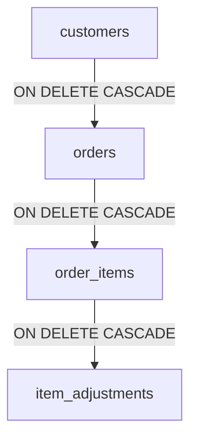

# Triggers, Foreign Key Constraints, and CASCADE Behavior

Triggers and foreign keys both react to data changes, but they serve different roles. Foreign keys protect relationships between parent and child tables; referential actions such as ON DELETE CASCADE or ON UPDATE CASCADE automatically update child rows when the referenced key in the parent table changes. Triggers execute a set of SQL statements when a row in a table is INSERTed, UPDATEd, or DELETEd.

A common design pitfall is assuming that every row deleted or updated by CASCADE will also fire triggers on the child table. In MySQL, cascaded foreign key actions do not fire triggers by default. MySQL 9.7 introduces a limited opt-in mechanism for InnoDB when handling foreign keys at the SQL layer; this mechanism must be understood accurately by version and configuration. If triggers are used for auditing, synchronization, or generating side effects, overlooking this distinction can cause missing audit records or inconsistent results.

This lesson explains how foreign keys and triggers interact, referential actions, BEFORE/AFTER ordering, trigger limitations on cascades, MySQL version differences, the effect of foreign_key_checks, replication, transactions, and how to test safely.

## 1. Parent Tables, Child Tables, and Foreign Keys

A foreign key expresses a referential relationship between two tables:

- The parent table contains the referenced key.
- The child table contains a column or group of columns referencing the key in the parent table.
- The constraint is declared on the child table.

Example where one customer has many orders:

```sql
CREATE TABLE customers (
    id BIGINT UNSIGNED NOT NULL,
    full_name VARCHAR(150) NOT NULL,
    PRIMARY KEY (id)
) ENGINE=InnoDB;

CREATE TABLE orders (
    id BIGINT UNSIGNED NOT NULL,
    customer_id BIGINT UNSIGNED NOT NULL,
    order_total DECIMAL(12,2) NOT NULL,
    created_at DATETIME NOT NULL,
    PRIMARY KEY (id),
    KEY idx_orders_customer_id (customer_id),
    CONSTRAINT fk_orders_customer
        FOREIGN KEY (customer_id)
        REFERENCES customers(id)
        ON UPDATE CASCADE
        ON DELETE CASCADE
) ENGINE=InnoDB;
```

In this example:

- customers is the parent.
- orders is the child.
- orders.customer_id references customers.id.
- ON UPDATE CASCADE allows changing customers.id and updates corresponding values in orders.
- ON DELETE CASCADE automatically deletes orders when the customer is deleted.

Foreign keys help MySQL reject orphaned data. For example, you cannot INSERT an order with a non-existent customer_id when foreign key checks are enabled.

### 1.1. Basic Foreign Key Requirements

For InnoDB:

- Both parent and child tables must use a storage engine that supports foreign keys; InnoDB is the standard choice.
- Corresponding columns must have compatible types. For integer types, size and signed/unsigned attributes must match; for nonbinary string types, character set and collation must be compatible.
- The referenced columns in the parent table must have a suitable index. You should reference a PRIMARY KEY or a standard UNIQUE KEY.
- The child table needs an index with the foreign key columns as leading columns in the exact order. InnoDB creates an index automatically if none exists, but declaring it explicitly lets you control the name and column order.
- Do not use prefix indexes on foreign key columns.
- A foreign key can be composite; the number and order of columns on both sides must match.

InnoDB previously allowed referencing certain non-unique indexes in non-standard cases. That capability was deprecated in MySQL 9.7 and depends on the restrict_fk_on_non_standard_key setting. New designs should use true PRIMARY or UNIQUE keys so relationships have clear semantics and smooth upgrades.

### 1.2. Inspecting Existing Foreign Keys

Read table definitions:

```sql
SHOW CREATE TABLE customers;
SHOW CREATE TABLE orders;
```

List relationships in the current schema:

```sql
SELECT
    TABLE_NAME AS child_table,
    CONSTRAINT_NAME,
    COLUMN_NAME AS child_column,
    REFERENCED_TABLE_NAME AS parent_table,
    REFERENCED_COLUMN_NAME AS parent_column
FROM information_schema.KEY_COLUMN_USAGE
WHERE CONSTRAINT_SCHEMA = DATABASE()
  AND REFERENCED_TABLE_NAME IS NOT NULL
ORDER BY TABLE_NAME, CONSTRAINT_NAME, ORDINAL_POSITION;
```

This query shows which table references which. Before modifying ON DELETE or ON UPDATE, examine every child table in the relationship chain.

## 2. Referential Actions: ON DELETE and ON UPDATE

A foreign key can declare what action occurs when a referenced key in the parent is DELETEd or UPDATEd.

| Referential action | When parent DELETE/UPDATE occurs | Effect on child |
|---|---|---|
| RESTRICT | Rejects the operation if referencing child rows exist | Child rows remain unchanged |
| NO ACTION | Equivalent to RESTRICT in InnoDB and checked immediately | Child rows remain unchanged |
| CASCADE | Allows the operation on parent | Deletes or updates corresponding child rows |
| SET NULL | Allows the operation on parent | Sets the child foreign key column(s) to NULL |
| SET DEFAULT | Recognized by parser but rejected by InnoDB and NDB in foreign key definitions | Cannot be used with these engines |

If neither ON DELETE nor ON UPDATE is specified, the default behavior is RESTRICT/NO ACTION depending on the engine.

### 2.1. RESTRICT

RESTRICT prevents deleting or changing a parent key if referencing child rows exist:

```sql
CONSTRAINT fk_orders_customer
    FOREIGN KEY (customer_id)
    REFERENCES customers(id)
    ON DELETE RESTRICT
```

For example, if customers.id = 10 has orders, the following DELETE is rejected:

```sql
DELETE FROM customers
WHERE id = 10;
```

Use RESTRICT when child data must be preserved or handled through an explicit business workflow before deleting the parent.

### 2.2. NO ACTION

NO ACTION is an SQL standard keyword. In InnoDB, NO ACTION is equivalent to RESTRICT: the check is performed immediately and the parent operation is rejected if referencing child rows exist. InnoDB does not defer foreign key checks until COMMIT.

NDB has different semantics: NO ACTION may defer checks until commit. Do not infer NDB behavior from InnoDB.

### 2.3. CASCADE

CASCADE automatically propagates the operation from parent to child:

- ON DELETE CASCADE: deletes referencing child rows when the parent row is deleted.
- ON UPDATE CASCADE: updates the foreign key value in child rows when the parent key value changes.

Example:

```sql
CONSTRAINT fk_orders_customer
    FOREIGN KEY (customer_id)
    REFERENCES customers(id)
    ON DELETE CASCADE
    ON UPDATE CASCADE
```

When deleting a customer:

```sql
DELETE FROM customers
WHERE id = 10;
```

MySQL automatically deletes the orders rows with customer_id = 10. No separate DELETE statement is needed for the orders.

CASCADE fits cases where child data lifecycle depends entirely on the parent—for example, order_items depending on order in a model where deleting an order means deleting its line items. Do not use CASCADE merely to save a few SQL statements if child data must be retained for audits, reporting, or retention compliance.

### 2.4. SET NULL

SET NULL keeps child rows while removing the link by setting the foreign key column to NULL:

```sql
CREATE TABLE employees (
    id BIGINT UNSIGNED NOT NULL,
    department_id BIGINT UNSIGNED NULL,
    full_name VARCHAR(150) NOT NULL,
    PRIMARY KEY (id),
    KEY idx_employees_department (department_id),
    CONSTRAINT fk_employees_department
        FOREIGN KEY (department_id)
        REFERENCES departments(id)
        ON DELETE SET NULL
) ENGINE=InnoDB;
```

When a department is deleted, the employee remains, and department_id becomes NULL.

The foreign key columns must allow NULL. Declaring NOT NULL alongside ON DELETE SET NULL or ON UPDATE SET NULL makes the design invalid or prevents the operation from completing as intended.

For composite foreign keys, SET NULL sets the related foreign key columns to NULL.

### 2.5. SET DEFAULT

MySQL parses the SET DEFAULT syntax, but InnoDB and NDB reject foreign key definitions that use ON DELETE SET DEFAULT or ON UPDATE SET DEFAULT. Do not use SET DEFAULT as a substitute for SET NULL in InnoDB designs.

If child rows must be reassigned to a default value, design an explicit update workflow in the application or stored program, and verify that the default parent exists and is valid before deleting the parent.

### 2.6. Avoid Using MATCH in MySQL Foreign Key Definitions

MySQL parses MATCH FULL, MATCH PARTIAL, and MATCH SIMPLE syntax, but InnoDB and NDB do not enforce standard MATCH semantics. Adding MATCH to a foreign key definition can also cause MySQL to ignore the ON DELETE and ON UPDATE clauses in the same constraint. Therefore, do not add a MATCH clause to a foreign key if you rely on CASCADE, RESTRICT, or SET NULL.

## 3. Multi-Level CASCADE and Self-Referencing Foreign Keys

Relationships can form multi-level chains:



When deleting a customer, the operation can propagate across orders, order_items, and item_adjustments if each relationship is declared with CASCADE.

In InnoDB, cascade operations execute in depth-first traversal order over the index corresponding to the foreign key. MySQL limits cascade depth to a maximum of 15 levels; exceeding the limit causes the statement to fail.

Self-referencing foreign keys can also trigger cascades within the same table, such as a category tree where parent_id references id of the same categories table. Carefully evaluate the risk of deleting a large subtree and the number of affected rows.

In MySQL 9.7, when cascade-trigger execution is enabled for SQL-layer foreign key handling, cascade trigger chains have additional limits: a maximum of 30 tables participating in total across the cascade chains of a single statement. Repeated relationship cycles are detected to prevent infinite traversal; a trigger attempting to re-enter an active cascade path can cause the statement to fail.

## 4. Triggers in MySQL Operate Row by Row

A trigger is a database object attached to a table. Triggers fire when an INSERT, UPDATE, or DELETE SQL statement modifies rows in that table.

MySQL supports two timings:

- BEFORE: runs before the row operation is performed.
- AFTER: runs after the row operation completes.

And three events:

- INSERT
- UPDATE
- DELETE

All MySQL triggers are row-level triggers with FOR EACH ROW. MySQL does not support statement-level triggers that run once for an entire statement.

For example, an UPDATE statement changing 100 rows will fire the corresponding trigger for each modified row—up to 100 times for that trigger.

### 4.1. OLD and NEW

Triggers access row data via OLD and NEW:

| Event | OLD | NEW |
|---|---|---|
| INSERT | Not available | Row values about to be inserted |
| UPDATE | Values before update | Values after update |
| DELETE | Row values about to be deleted | Not available |

In BEFORE INSERT and BEFORE UPDATE, a trigger can assign values to NEW columns. OLD is read-only; NEW in an AFTER trigger cannot be modified to alter the already-written row.

Example normalizing name before insert:

```sql
DELIMITER //

CREATE TRIGGER bi_customers_normalize_name
BEFORE INSERT ON customers
FOR EACH ROW
BEGIN
    SET NEW.full_name = TRIM(NEW.full_name);
END//

DELIMITER ;
```

Example blocking key value changes:

```sql
DELIMITER //

CREATE TRIGGER bu_customers_validate_id
BEFORE UPDATE ON customers
FOR EACH ROW
BEGIN
    IF NEW.id <> OLD.id THEN
        SIGNAL SQLSTATE '45000'
            SET MESSAGE_TEXT = 'Customer ID cannot be changed';
    END IF;
END//

DELIMITER ;
```

In this example, the trigger raises an error before the row is updated if the application attempts to change id.

### 4.2. Triggers Are Not a Replacement for Constraints

Triggers can validate or write secondary data, but foreign keys remain the right tool for protecting referential integrity. Using a trigger to manually check the parent instead of a foreign key can suffer race conditions when two transactions concurrently insert a child and delete the parent.

Foreign keys are checked by the engine and lock the necessary records/indexes during execution. A hand-written trigger using a plain SELECT does not automatically carry the same concurrency semantics.

### 4.3. Triggers Can Write to Other Tables

A trigger is often used to write audits:

```sql
CREATE TABLE customer_audit (
    audit_id BIGINT UNSIGNED NOT NULL AUTO_INCREMENT,
    customer_id BIGINT UNSIGNED NOT NULL,
    action_name VARCHAR(20) NOT NULL,
    changed_at DATETIME NOT NULL,
    PRIMARY KEY (audit_id)
) ENGINE=InnoDB;
```

```sql
DELIMITER //

CREATE TRIGGER ad_customers_audit
AFTER DELETE ON customers
FOR EACH ROW
BEGIN
    INSERT INTO customer_audit(
        customer_id,
        action_name,
        changed_at
    )
    VALUES (
        OLD.id,
        'DELETE',
        CURRENT_TIMESTAMP
    );
END//

DELIMITER ;
```

When a direct DELETE removes a customers row, the trigger writes an audit record. If the trigger errors, the DELETE statement fails. With InnoDB tables, changes within the same statement/transaction roll back according to transaction semantics.

A trigger cannot modify a table already used for reading or writing by the statement that fired the trigger. For example, do not write a trigger on customers to manually DELETE orders while the parent DELETE statement is already using orders via a foreign key cascade; let the foreign key perform the cascade or handle it through an explicit application workflow.

## 5. BEFORE/AFTER Ordering and Multiple Triggers

For a direct row operation:

1. BEFORE triggers run before the row is modified.
2. MySQL performs the row operation and checks relevant constraints.
3. AFTER triggers run after the row operation completes.

BEFORE triggers are typically used to normalize or reject data; AFTER triggers are typically used to write audits or update secondary data.

MySQL allows multiple triggers with the same timing and event on a table in supported versions. By default, they execute in creation order. You can specify FOLLOWS or PRECEDES after FOR EACH ROW to define relative ordering against another trigger with the same timing/event.

```sql
CREATE TRIGGER bi_customers_set_name
BEFORE INSERT ON customers
FOR EACH ROW
SET NEW.full_name = TRIM(NEW.full_name);
```

```sql
CREATE TRIGGER bi_customers_validate_name
BEFORE INSERT ON customers
FOR EACH ROW FOLLOWS bi_customers_set_name
BEGIN
    IF NEW.full_name = '' THEN
        SIGNAL SQLSTATE '45000'
            SET MESSAGE_TEXT = 'Customer name is required';
    END IF;
END;
```

Trigger ordering only applies within the same event and timing. Do not use FOLLOWS/PRECEDES to order a BEFORE trigger relative to an AFTER trigger or INSERT relative to UPDATE.

## 6. Key Rule: CASCADE Does Not Fire Child Triggers by Default

This is the essential rule to remember when combining foreign keys with triggers:

**By default, cascaded foreign key actions do not fire triggers on the modified child rows.**

Suppose:

- customers is the parent.
- orders is the child.
- orders has ON DELETE CASCADE.
- orders has an AFTER DELETE trigger to write order_delete_audit.

When running:

```sql
DELETE FROM customers
WHERE id = 10;
```

MySQL deletes customer 10 and automatically deletes the orders referencing that customer. However, under default behavior, the AFTER DELETE trigger on orders does not run for rows deleted by the foreign key cascade. Consequently, order_delete_audit does not automatically receive records for those cascaded order deletions.

### 6.1. Triggers on Parent vs. Triggers on Child

Distinguish the two cases:

| Operation | Trigger on parent | Trigger on child |
|---|---|---|
| Direct DELETE of a parent row | Fires per the DELETE statement | Does not fire automatically just because child is CASCADEd by default |
| Direct DELETE of a child row | No | Fires per the DELETE statement |
| Direct UPDATE of parent key with ON UPDATE CASCADE | UPDATE trigger on parent fires | UPDATE trigger on child does not fire by default |
| Parent action using SET NULL | Trigger on parent fires per direct operation | UPDATE trigger on child does not fire by default |

Triggers attached to the parent still run because the parent is the object directly modified by the SQL statement. Automatic engine/server modifications to the child via a referential action do not fire child triggers by default.

### 6.2. Why Does MySQL Have This Rule?

A foreign key cascade is an action executed by the referential integrity mechanism. A trigger is a mechanism driven by SQL statements acting directly on a table. Traditionally, MySQL does not invoke triggers for child changes generated internally by foreign key actions.

Therefore, you cannot rely on child triggers to guarantee auditing, notifications, synchronization, or secondary calculations for every cascade under default configuration.

## 7. Differences Across MySQL Versions

Trigger behavior during foreign key cascades must be verified by version:

| Version | Child triggers during CASCADE/SET NULL | Notes |
|---|---|---|
| MySQL 5.7 | Not fired by foreign key actions | No equivalent opt-in option |
| MySQL 8.0 | Not fired by foreign key actions | Do not assume child triggers run when parent cascades |
| MySQL 9.7 | Still not fired by default | Limited opt-in available for InnoDB when foreign key handling is at SQL layer |

### 7.1. The enable_cascade_triggers Option in MySQL 9.7

MySQL 9.7 adds the ability to fire triggers on child rows modified by CASCADE and SET NULL when InnoDB uses SQL-layer foreign key handling.

For this mechanism to take effect, both conditions must be met:

1. InnoDB uses SQL-layer foreign key handling, i.e., innodb_native_foreign_keys=OFF.
2. The session executing the operation sets enable_cascade_triggers=ON.

Example checking configuration:

```sql
SHOW VARIABLES LIKE 'innodb_native_foreign_keys';
SELECT @@SESSION.enable_cascade_triggers;
```

Enable for the current session:

```sql
SET SESSION enable_cascade_triggers = ON;
```

Notes:

- enable_cascade_triggers is a session-level option; enabling it on one connection does not mean every connection in a connection pool has it enabled.
- This option only applies to InnoDB when foreign key handling occurs at the SQL layer.
- If innodb_native_foreign_keys=ON, enable_cascade_triggers has no effect.
- Do not treat this option as a general way to enable cascade triggers for InnoDB native foreign key handling or NDB.
- MySQL 5.7 and 8.0 lack this opt-in capability; do not use 9.7 configuration syntax on older servers.

Do not enable this option in production solely to make audit triggers run without testing impacts on trigger order, performance, replication, and rollback. Verify the exact configuration of every session performing DML.

### 7.2. Which Triggers Run When Cascade Triggers Are Enabled?

When cascade-trigger execution is enabled in the proper MySQL 9.7 configuration:

| Referential action on child | Child triggers fired |
|---|---|
| ON DELETE CASCADE | BEFORE DELETE, then AFTER DELETE |
| ON UPDATE CASCADE | BEFORE UPDATE, then AFTER UPDATE |
| ON DELETE SET NULL | BEFORE UPDATE, then AFTER UPDATE |
| ON UPDATE SET NULL | BEFORE UPDATE, then AFTER UPDATE |
| RESTRICT / NO ACTION | No child rows modified, so no child triggers from cascade |

Triggers are called once per affected child row. For multi-level cascades, BEFORE triggers run top-down from parent toward descendants; AFTER triggers run in the reverse direction, from the deepest child back up to the parent.

For cascaded DELETE, OLD contains the deleted child row. For cascaded UPDATE or SET NULL, OLD contains values before the cascade and NEW contains values after the cascade, including columns set to NULL.

If a trigger fired by a cascade raises an error, the statement that initiated the cascade fails and changes across the entire cascade chain executed by that statement are rolled back.

### 7.3. Behavior Example in MySQL 9.7

Suppose orders has an AFTER DELETE trigger writing audits. With InnoDB SQL-layer foreign key handling and enable_cascade_triggers=ON in the session:

```sql
SET SESSION enable_cascade_triggers = ON;

DELETE FROM customers
WHERE id = 10;
```

Triggers on the child orders table can run for each order deleted by ON DELETE CASCADE. If using native InnoDB foreign key handling (innodb_native_foreign_keys=ON), the enable_cascade_triggers setting does not cause child triggers to run; default behavior still applies.

Do not assume that merely running SET SESSION enable_cascade_triggers=ON is sufficient. Verify innodb_native_foreign_keys and the exact server version.

## 8. How Does foreign_key_checks Affect CASCADE and Triggers?

The foreign_key_checks variable allows temporarily disabling foreign key checks in a session or at a supported configuration scope:

```sql
SET SESSION foreign_key_checks = 0;
```

When foreign_key_checks is disabled:

- DML does not check parent existence for foreign keys.
- RESTRICT checks are not performed.
- Referential actions such as CASCADE and SET NULL are not performed.
- No child triggers are fired via bypassed foreign key actions.

Re-enabling:

```sql
SET SESSION foreign_key_checks = 1;
```

does not cause MySQL to scan and revalidate all data written while checks were disabled. Orphaned rows can still exist. Therefore, disabling foreign_key_checks during data import requires a separate verification and reconciliation step before considering the data valid.

Do not use foreign_key_checks=0 as a permanent workaround for CASCADE errors or data-loading order errors.

## 9. Triggers, Errors, and Transactions During Cascades

With InnoDB, triggers run in the context of the statement/transaction that fired them. Triggers do not open an independent transaction.

Key rules:

- Triggers must not use START TRANSACTION, COMMIT, or ROLLBACK to control transactions themselves.
- If a BEFORE trigger errors, the corresponding row operation is not executed.
- If an AFTER trigger errors, the statement that caused the trigger fails.
- With transactional tables like InnoDB, an error in a trigger rolls back statement changes according to transaction semantics.
- When cascade-trigger execution is enabled and a child trigger raises an error, the statement that initiated the cascade and its cascaded changes are rolled back.
- If a trigger writes to a nontransactional table, changes in that table do not roll back like InnoDB. Avoid mixing engines when atomic auditing is required.

Example testing inside a transaction:

```sql
START TRANSACTION;

DELETE FROM customers
WHERE id = 10;

SELECT *
FROM orders
WHERE customer_id = 10;

SELECT *
FROM order_delete_audit
WHERE customer_id = 10;

ROLLBACK;
```

In a test environment, use InnoDB tables so deletions and audit records can be rolled back. Interpret the SELECT results according to the server's actual cascade-trigger configuration.

## 10. Triggers and Replication

Triggers affect replication according to the binary logging format:

| Binlog format | Trigger behavior on replica |
|---|---|
| STATEMENT | Statement re-executes on the replica; corresponding triggers on the replica also run |
| ROW | Row changes produced by triggers are logged as row events; triggers on the replica do not re-run for those changes |
| MIXED | Depends on whether the statement is logged in statement or row format |

With row-based replication, triggers on the source already produced the changes; the replica receives the resulting row changes. If triggers ran a second time on the replica, effects could be duplicated, so triggers are not re-fired that way.

Cascade-induced child triggers follow the corresponding replication rules. With SQL-layer foreign key handling and cascade triggers in MySQL 9.7, the statement-based applier uses the source's enable_cascade_triggers value. Consequently, configuration and binlog format must be tested consistently across source and replica.

Before deploying triggers with side effects such as writing audits, updating balances, or creating notifications:

- Verify the actual binlog_format.
- Determine whether triggers run on source or replica.
- Avoid external side effects outside the database without an idempotency mechanism.
- Test failover and replication lag.
- Check session configuration if relying on enable_cascade_triggers.

## 11. Designing Audits When a Parent CASCADEs Child Deletions

Suppose the business requirement is to record every deleted order, even when a customer is deleted and orders are CASCADEd.

### 11.1. Creating a Child Audit Trigger to Observe Behavior

Create the audit table and trigger on orders:

```sql
CREATE TABLE order_delete_audit (
    audit_id BIGINT UNSIGNED NOT NULL AUTO_INCREMENT,
    order_id BIGINT UNSIGNED NOT NULL,
    customer_id BIGINT UNSIGNED NOT NULL,
    deleted_at DATETIME NOT NULL,
    PRIMARY KEY (audit_id),
    KEY idx_order_delete_audit_customer (customer_id, deleted_at)
) ENGINE=InnoDB;
```

```sql
DELIMITER //

CREATE TRIGGER ad_orders_audit
AFTER DELETE ON orders
FOR EACH ROW
BEGIN
    INSERT INTO order_delete_audit(
        order_id,
        customer_id,
        deleted_at
    )
    VALUES (
        OLD.id,
        OLD.customer_id,
        CURRENT_TIMESTAMP
    );
END//

DELIMITER ;
```

This trigger writes an audit when directly deleting an orders row. If orders are deleted via ON DELETE CASCADE under default configuration, the trigger does not run and the audit table does not receive corresponding records.

### 11.2. Do Not Rely on Child Triggers by Default

An AFTER DELETE trigger on orders does not automatically audit rows deleted by CASCADE under default configuration. If the system only tests direct DELETEs on orders, this design flaw can go unnoticed.

Test both paths:

```sql
-- Path 1: directly deleting child
DELETE FROM orders
WHERE id = 1001;

-- Path 2: deleting parent, child is CASCADEd
DELETE FROM customers
WHERE id = 10;
```

Audit for Path 1 may be written by the child trigger. Audit for Path 2 is not written by the child trigger by default.

### 11.3. Design Options

| Approach | When Suitable | What to Control |
|---|---|---|
| Audit in application before deleting parent | Application owns the delete use case | Must write audit and delete parent in the same transaction; all other delete paths must comply |
| Stored procedure deleting in explicit order | Want to centralize deletion workflow in the database | Procedure deletes/audits children first, then deletes parent; restrict app privileges so it cannot bypass |
| Retain data via soft delete | Need history or recovery | Define states, retention period, and archival workflow |
| MySQL 9.7 SQL-layer cascade triggers | Want child triggers to run under exact technical conditions | Only works with innodb_native_foreign_keys=OFF and session enable_cascade_triggers=ON; must test replication |
| Parent-level audit | Only need to record that the parent was deleted | Does not provide details of each cascaded child |

Do not remove foreign keys to force a trigger to delete child rows manually. That strips away referential integrity protection and can introduce race conditions between transactions.

### 11.4. Example Explicit Deletion Workflow

If business requirements demand auditing each order, you can implement a procedure owning the workflow:

```sql
DELIMITER //

CREATE PROCEDURE delete_customer_with_order_audit(
    IN p_customer_id BIGINT UNSIGNED
)
BEGIN
    DECLARE EXIT HANDLER FOR SQLEXCEPTION
    BEGIN
        ROLLBACK;
        RESIGNAL;
    END;

    START TRANSACTION;

    DELETE FROM orders
    WHERE customer_id = p_customer_id;

    DELETE FROM customers
    WHERE id = p_customer_id;

    COMMIT;
END//

DELIMITER ;
```

In this example, the direct DELETE on orders fires ad_orders_audit for each row; afterward, deleting the customer has no remaining order rows to cascade delete. The EXIT handler rolls back and re-raises the error if any step fails. This is a transaction-owning procedure: only call it when the caller has no active transaction, because START TRANSACTION can implicitly commit/end an existing session transaction. In production, check row counts and handle the case where the customer does not exist. If the caller owns the transaction, omit START TRANSACTION/COMMIT/ROLLBACK from the procedure and let the caller manage transactions and errors.

With an explicit workflow, consider locking the parent before reading/deleting children to prevent concurrent transactions from inserting new orders during deletion. Keep the foreign key intact to protect integrity.

## 12. Performance and Locking Impact

CASCADE can affect many rows and multiple tables in a single statement. The cost is more than deleting or updating the parent row:

- MySQL must locate child rows via the foreign key index.
- Each affected child row may require index deletes/updates and undo/redo log writes.
- Multi-level cascades increase the number of rows and index entries to process.
- If cascade triggers are enabled in MySQL 9.7, triggers run for each affected child row, further increasing CPU, I/O, and operation counts.
- Concurrent transactions may contend for locks on parent/child index records and cause deadlocks.

Recommendations:

- Always maintain proper indexes on child foreign key columns.
- Avoid cascading over very large datasets without measuring runtime and locks.
- For large deletions, consider batching by stable keys or an archival workflow.
- Keep table access order consistent across transactions to reduce deadlocks.
- Monitor statement duration, lock waits, deadlocks, and replication lag.
- If using audit triggers, index the audit table by lookup key and timestamp.

Do not assume CASCADE is always faster than manual DELETE commands. CASCADE ensures correct and atomic referential actions, but it still has to process every related row.

## 13. Important Trigger Limitations in Foreign Key Scenarios

| Limitation | Consequence |
|---|---|
| Triggers are only FOR EACH ROW | A multi-row statement can fire triggers many times |
| Triggers are not fired by FK actions by default | Do not use child triggers for cascade auditing without proper configuration |
| Triggers cannot modify a table used by the firing statement | Do not delete children inside a parent trigger to replace FK cascade |
| Triggers cannot COMMIT/ROLLBACK transactions | Transactions must be owned by caller or stored procedure |
| Triggers cannot return result sets like procedures | Do not use triggers as a data-returning API |
| Triggers do not use RETURN to exit | Use LEAVE on a labeled block if early exit is needed |
| Triggers cannot attach to views or TEMPORARY tables | Triggers must attach to permanent base tables |
| Trigger errors can fail the statement | Control privileges, data, and errors of all dependent tables |
| Nontransactional tables do not roll back with InnoDB | Audits may remain even if InnoDB statement fails when writing to another engine |

## 14. Diagnosing and Observing Triggers/Foreign Keys

### 14.1. Listing Triggers

```sql
SHOW TRIGGERS;
```

Or query metadata:

```sql
SELECT
    TRIGGER_NAME,
    EVENT_MANIPULATION,
    EVENT_OBJECT_TABLE,
    ACTION_TIMING,
    ACTION_STATEMENT,
    DEFINER
FROM information_schema.TRIGGERS
WHERE TRIGGER_SCHEMA = DATABASE()
ORDER BY EVENT_OBJECT_TABLE, ACTION_TIMING, EVENT_MANIPULATION;
```

### 14.2. Reading Trigger Definitions

```sql
SHOW CREATE TRIGGER ad_customers_audit;
```

Inspect the trigger body, DEFINER, and SQL mode saved when the trigger was created. A trigger uses the SQL mode stored at creation time, not necessarily the current SQL mode of the session executing DML.

### 14.3. Checking Foreign Keys and Indexes

```sql
SHOW CREATE TABLE orders;

SHOW INDEX FROM orders;
```

Cross-check foreign key columns, parent keys, ON DELETE/ON UPDATE actions, and indexes. If a foreign key is composite, verify the column order in the index.

### 14.4. Checking Cascade Trigger Configuration in MySQL 9.7

```sql
SHOW VARIABLES LIKE 'innodb_native_foreign_keys';
SELECT @@SESSION.enable_cascade_triggers;
SELECT @@SESSION.foreign_key_checks;
```

Only evaluate enable_cascade_triggers when the server is MySQL 9.7 and InnoDB uses SQL-layer foreign key handling. If native foreign key handling is active, the cascade trigger setting has no effect.

## 15. Common Errors and Remediation

| Symptom | Common Cause | Remediation |
|---|---|---|
| Parent DELETE rejected | Child rows exist and action is RESTRICT/NO ACTION | Delete/move children per business rules or choose appropriate action |
| Parent DELETE deletes more data than expected | ON DELETE CASCADE propagates across multiple levels | Inspect all relationships before deleting; test inside a transaction |
| SET NULL invalid | Child column declared NOT NULL | Allow NULL or choose another action |
| Child trigger does not audit when parent deleted | FK cascade does not fire child triggers by default | Use explicit audit workflow or valid opt-in feature in MySQL 9.7 |
| Enabled enable_cascade_triggers yet child trigger still does not run | innodb_native_foreign_keys=ON, unsupported engine/version, or different session | Verify version, engine, native FK variable, and DML session |
| Foreign key creation fails | Incompatible column types, missing index, or unsuitable parent key | Read DDL error, SHOW CREATE TABLE, and fix key structure |
| Orphaned data after import | foreign_key_checks was disabled | Run orphan reconciliation queries; do not expect re-enabling to fix data |
| Trigger runs twice in replica setup | Misunderstanding statement-based vs. row-based replication | Check binlog_format and design idempotent side effects |
| Slow cascade or deadlocks | Many child rows, missing index, or transactions accessing in different orders | Optimize indexes, batch, and unify access order |
| Trigger causes statement failure | SIGNAL, constraint error, or secondary table write error | Read diagnostics, verify privileges and input data |

## 16. Common Misconceptions

| Misconception | Reality |
|---|---|
| ON DELETE CASCADE is identical to direct SQL DELETE on child | Cascade is a referential action; child triggers do not run by default |
| AFTER DELETE trigger always audits every deleted row | Triggers only run for direct SQL changes and specific MySQL 9.7 cascade opt-in cases |
| Enabling enable_cascade_triggers is enough | Requires MySQL 9.7, SQL-layer InnoDB FK handling, and session setting ON |
| InnoDB native FK handling also supports enable_cascade_triggers | The option has no effect when innodb_native_foreign_keys=ON |
| NO ACTION is always deferred until COMMIT | In InnoDB, NO ACTION equals RESTRICT and checks immediately |
| SET NULL can be used with NOT NULL columns | Foreign key columns must allow NULL |
| SET DEFAULT is a valid option for InnoDB | InnoDB and NDB reject this definition |
| Disabling foreign_key_checks only skips checks while still cascading | When disabled, both checks and referential actions are skipped |
| Re-enabling foreign_key_checks automatically validates old data | There is no automatic scan and repair of orphans |
| Triggers can COMMIT after writing an audit | Triggers cannot control transactions with COMMIT/ROLLBACK |
| You can manually DELETE children in a parent trigger instead of CASCADE | Can violate the restriction on modifying tables used by the firing statement and cause race conditions |

## 17. Trigger and Foreign Key Design Checklist

- Have parent and child tables been identified accurately?
- Is the parent key a standard PRIMARY KEY or UNIQUE KEY?
- Does the child have an appropriate index matching the exact order of foreign key columns?
- Are data types, signedness, character sets, and collations compatible?
- Do ON DELETE and ON UPDATE actions match the data lifecycle?
- How many rows can CASCADE delete and how many levels can it propagate across?
- For SET NULL, do the child columns allow NULL?
- Are you using SET DEFAULT or MATCH clauses without proper semantics support?
- Does the trigger have the right timing (BEFORE/AFTER) and event (INSERT/UPDATE/DELETE)?
- Does the trigger use OLD/NEW correctly for the event and timing?
- Is there any false assumption that cascade fires child triggers by default?
- If relying on MySQL 9.7 enable_cascade_triggers, have SQL-layer FK handling and session settings been verified?
- Have direct child DELETE and parent DELETE causing cascade been tested separately?
- Do the audit trigger table and business tables share the same transactional engine?
- Have foreign_key_checks and post-import data reconciliation been verified?
- Have replication format and trigger side effects been tested?
- Have locks, deadlocks, cascade duration, and replication lag been measured on representative data?

## 18. Practice Exercises

### Exercise 1 — Comparing RESTRICT and CASCADE

Create customers and orders tables. Declare a foreign key with ON DELETE RESTRICT, try deleting a parent that still has children, and record the result. Then switch to ON DELETE CASCADE and confirm the child rows are deleted.

### Exercise 2 — SET NULL

Create departments and employees with nullable department_id. Declare ON DELETE SET NULL. Delete a department and confirm employees remain while department_id becomes NULL.

### Exercise 3 — Child Audit Trigger

Create an AFTER DELETE trigger on orders to write to order_delete_audit. Test directly deleting an order and then deleting a customer causing CASCADE. Compare audit record counts under default configuration.

### Exercise 4 — Testing MySQL 9.7 Differences

In a MySQL 9.7 test environment, verify innodb_native_foreign_keys and enable_cascade_triggers. Compare behavior when SQL-layer handling and session cascade triggers are enabled versus default behavior. Do not apply this configuration to production before verifying replication and transactions.

### Exercise 5 — Designing an Audit Workflow

Propose how to ensure every deleted order is audited when a customer is deleted. Compare application-owned transactions, explicit-delete stored procedures, soft deletes, and opt-in cascade triggers.

## 19. Official References

- [MySQL 9.7 — FOREIGN KEY Constraints](https://dev.mysql.com/doc/refman/9.7/en/create-table-foreign-keys.html)
- [MySQL 9.7 — CREATE TRIGGER Statement](https://dev.mysql.com/doc/refman/9.7/en/create-trigger.html)
- [MySQL 9.7 — Trigger Syntax and Examples](https://dev.mysql.com/doc/refman/9.7/en/trigger-syntax.html)
- [MySQL 9.7 — Using Triggers](https://dev.mysql.com/doc/refman/9.7/en/triggers.html)
- [MySQL 9.7 — Restrictions on Stored Programs](https://dev.mysql.com/doc/refman/9.7/en/stored-program-restrictions.html)
- [MySQL 9.7 — Replication and Triggers](https://dev.mysql.com/doc/refman/9.7/en/replication-features-triggers.html)
- [MySQL 9.7 — Server System Variables](https://dev.mysql.com/doc/refman/9.7/en/server-system-variables.html)
- [MySQL 8.0 — FOREIGN KEY Constraints](https://dev.mysql.com/doc/refman/8.0/en/create-table-foreign-keys.html)
- [MySQL 8.0 — Trigger Syntax and Examples](https://dev.mysql.com/doc/refman/8.0/en/trigger-syntax.html)
- [MySQL 5.7 — FOREIGN KEY Constraints](https://dev.mysql.com/doc/refman/5.7/en/create-table-foreign-keys.html)

## Conclusion

Foreign keys protect parent/child relationships and determine what happens when a parent key is deleted or updated. RESTRICT/NO ACTION blocks the operation when child rows remain; CASCADE propagates the operation down to children; SET NULL keeps child rows while clearing the link. Triggers are a row-level mechanism executed on direct INSERT, UPDATE, or DELETE operations on a table, with BEFORE/AFTER timing and OLD/NEW data. The most important point is that foreign key cascades do not fire child triggers by default. MySQL 9.7 provides an opt-in option for InnoDB SQL-layer foreign key handling when innodb_native_foreign_keys=OFF and enable_cascade_triggers=ON in the session; this configuration has no effect under native InnoDB foreign key handling. Therefore, if every cascaded row must be audited, design the workflow and test specifically for the target version, engine, session, transaction, and replication format rather than assuming triggers always run.
