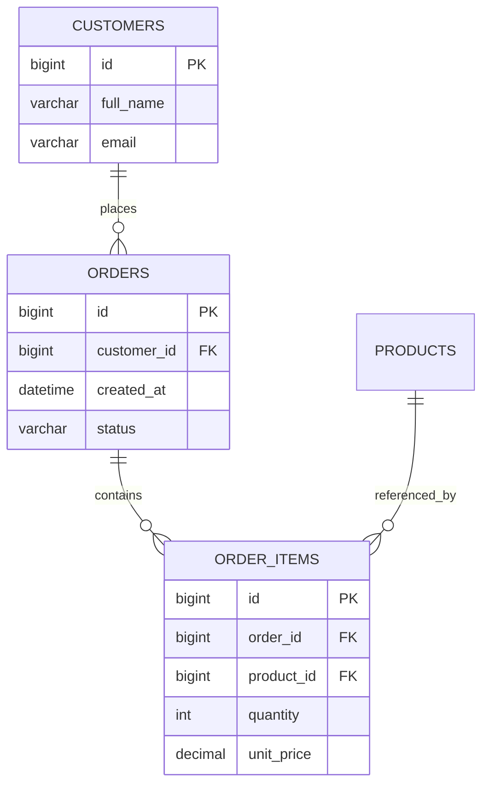
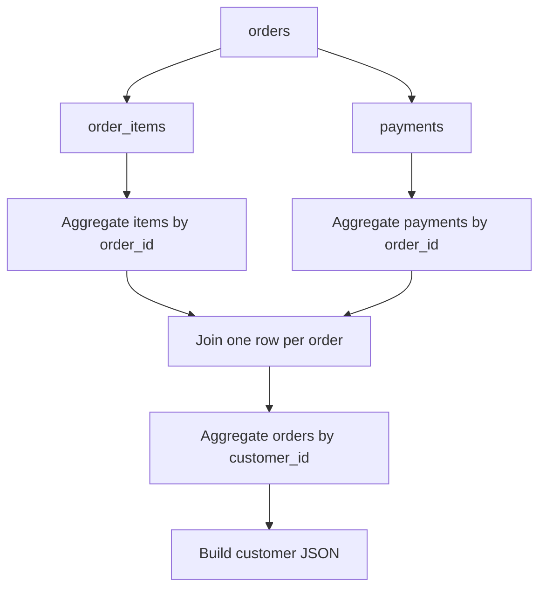

# JSON_OBJECT, JSON_ARRAY, and Building Documents from Relational Data

Applications often store data in a relational model while needing to exchange JSON with APIs, integration services, or frontends. MySQL provides `JSON_OBJECT()` and `JSON_ARRAY()` to assemble SQL values into objects and arrays, and `JSON_OBJECTAGG()` and `JSON_ARRAYAGG()` to aggregate multiple rows into a single JSON structure. By combining these functions across relational hierarchy levels, a single query can produce a document containing parent info, child lists, and nested objects.

Designing JSON documents from relational tables requires clear decisions on output structure, NULL handling, missing child rows, duplicate keys, element ordering, and data volume. If you JOIN multiple one-to-many relationships and aggregate simultaneously, results can be multiplied. If you use `JSON_ARRAYAGG()` assuming element order is always stable, APIs may return inconsistent data.

This lesson focuses on the four JSON-constructing functions, nesting objects/arrays, building parent-child documents, handling empty and NULL cases, avoiding row multiplication, choosing output data types, and controlling performance.

## 1. From Relational Model to JSON Document

In a relational model, an entity is typically stored across multiple tables:

- `customers`: customer details.
- `orders`: orders belonging to customers.
- `order_items`: product line items within an order.

Relationships:



An API might require a document for a customer:

```json
{
  "id": 120,
  "name": "Nguyen An",
  "email": "an@example.test",
  "orders": [
    {
      "id": 9001,
      "status": "PAID",
      "items": [
        {
          "productId": 501,
          "quantity": 2,
          "unitPrice": 125000.00
        }
      ]
    }
  ]
}
```

JSON components corresponding to relational data:

| JSON Component | Data Source | Common Function |
|---|---|---|
| Customer object | Single `customers` row | `JSON_OBJECT()` |
| Orders array | Multiple `orders` rows for the same customer | `JSON_ARRAYAGG()` |
| Single order object | Single `orders` row | `JSON_OBJECT()` |
| Line-items array | Multiple `order_items` rows for the same order | `JSON_ARRAYAGG()` |
| Dynamic attributes object | Multiple key/value pairs | `JSON_OBJECTAGG()` |

A useful design rule: a parent row typically becomes a JSON object; a one-to-many relationship typically becomes a JSON array; a set of key/value pairs with unique keys typically becomes a JSON object.

## 2. JSON_OBJECT(): Creating an Object from Key/Value Pairs

`JSON_OBJECT()` takes a list of key and value pairs and returns a JSON object.

```sql
SELECT JSON_OBJECT(
    'id', 120,
    'name', 'Nguyen An',
    'active', TRUE,
    'score', 9.5
) AS customer_document;
```

Result:

```json
{
  "id": 120,
  "name": "Nguyen An",
  "active": true,
  "score": 9.5
}
```

### 2.1. Syntax and Rules

```sql
JSON_OBJECT([key, value[, key, value] ...])
```

- The number of arguments must be even because every key requires a value.
- Key names cannot be SQL `NULL`; if a key is NULL, MySQL raises an error.
- Values can be SQL `NULL`; such values are represented as JSON `null`.
- Passing zero arguments is also valid and returns an empty object `{}`.
- Keys in a JSON object are strings. MySQL converts keys to an appropriate string form when constructing the object.

Example:

```sql
SELECT
    JSON_OBJECT() AS empty_object,
    JSON_OBJECT('nickname', NULL) AS explicit_null,
    JSON_OBJECT('id', 7, 'name', 'Lan') AS normal_object;
```

The respective results are `{}`, `{"nickname": null}`, and an object with two properties `id` and `name`.

Error cases:

```sql
-- Error: odd number of arguments
SELECT JSON_OBJECT('id', 7, 'name');

-- Error: key is SQL NULL
SELECT JSON_OBJECT(NULL, 'value');
```

### 2.2. Creating an Object Directly from a Row

```sql
SELECT JSON_OBJECT(
    'id', c.id,
    'name', c.full_name,
    'email', c.email,
    'createdAt', c.created_at
) AS customer_json
FROM customers AS c
WHERE c.id = 120;
```

Each result row of SELECT produces one JSON object. If the query returns multiple rows, the SQL result set has multiple `customer_json` values, each row being a separate document.

If the API needs an array of all customers, wrap the object in `JSON_ARRAYAGG()`:

```sql
SELECT JSON_ARRAYAGG(
    JSON_OBJECT(
        'id', c.id,
        'name', c.full_name,
        'email', c.email
    )
) AS customers_json
FROM customers AS c
WHERE c.active = 1;
```

If no rows match, `JSON_ARRAYAGG()` returns SQL `NULL`; handle empty results with `COALESCE()` when the API contract requires `[]`.

### 2.3. Duplicate Keys in JSON_OBJECT()

MySQL normalizes JSON objects and removes duplicate keys. Since MySQL 8.0.3, when a key appears multiple times in the same object, the last value is kept; versions prior to 8.0.3 kept the first occurrence:

```sql
SELECT JSON_OBJECT(
    'status', 'PENDING',
    'id', 120,
    'status', 'PAID'
) AS result;
```

On MySQL 8.0.3 and later, the resulting object has only one `status` property with value `PAID`. On versions older than 8.0.3, the first-occurring value `PENDING` is kept. Do not design objects with duplicate keys to rely on overwrite order; ensure each key appears exactly once.

MySQL may sort keys in the internal/output representation of a JSON object to support lookup. Key display order is not a data contract and may vary across versions. If order matters, use a JSON array instead of relying on object key order.

## 3. JSON_ARRAY(): Creating an Array from a List of Values

`JSON_ARRAY()` takes a list of values and returns a JSON array in the exact order of arguments:

```sql
SELECT JSON_ARRAY(
    120,
    'Nguyen An',
    TRUE,
    NULL,
    9.5
) AS values_json;
```

Result:

```json
[120, "Nguyen An", true, null, 9.5]
```

### 3.1. Syntax and Rules

```sql
JSON_ARRAY([value[, value] ...])
```

- Zero or more arguments can be passed.
- Zero arguments returns an empty array `[]`.
- SQL `NULL` becomes JSON `null`.
- Date/time values are represented as JSON strings.
- A JSON value returned by another JSON constructor function can be nested as a JSON value.

Example of nested array:

```sql
SELECT JSON_ARRAY(
    1,
    JSON_OBJECT('code', 'A01', 'enabled', TRUE),
    JSON_ARRAY('red', 'green', 'blue')
) AS nested_json;
```

The result contains a number, an object, and a child array:

```json
[
  1,
  {"code": "A01", "enabled": true},
  ["red", "green", "blue"]
]
```

### 3.2. Distinguishing JSON null, the String "null", and SQL NULL

The following three values differ:

| Produced Value | Meaning |
|---|---|
| `JSON_ARRAY(NULL)` | Array containing JSON null: `[null]` |
| `JSON_ARRAY('null')` | Array containing a character string: `["null"]` |
| `SELECT NULL` | SQL NULL, not a JSON document |

Example:

```sql
SELECT
    JSON_ARRAY(NULL) AS json_null,
    JSON_ARRAY('null') AS string_null,
    NULL AS sql_null;
```

Do not use the string `'null'` to stand in for JSON null. When building documents, pass SQL NULL directly if you want a JSON null value.

## 4. Nesting JSON_OBJECT() and JSON_ARRAY()

The two basic structure constructors can be nested arbitrarily to build multi-level documents.

Example of a product with a tag list:

```sql
SELECT JSON_OBJECT(
    'id', p.id,
    'name', p.name,
    'tags', JSON_ARRAY('sale', 'featured'),
    'dimensions', JSON_OBJECT(
        'width', p.width,
        'height', p.height,
        'unit', 'cm'
    )
) AS product_document
FROM products AS p
WHERE p.id = 501;
```

A JSON object/array returned from JSON functions stays a JSON value when nested inside another JSON constructor function. Conversely, a text string that looks like JSON remains a JSON string unless parsed/cast:

```sql
SELECT
    JSON_OBJECT('payload', '{"a": 1}') AS as_string,
    JSON_OBJECT('payload', CAST('{"a": 1}' AS JSON)) AS as_document;
```

The `payload` field in the first result is a string containing JSON text; in the second result, it is a nested JSON object. When input data is already valid JSON text and must be nested as a document, use `CAST(... AS JSON)` or a function returning JSON.

Do not manually concatenate strings with `CONCAT()` to build JSON if JSON functions can be used. `JSON_OBJECT()` and `JSON_ARRAY()` automatically handle escaping quotes, backslashes, and special characters in string values.

## 5. JSON_ARRAYAGG(): Aggregating Multiple Rows into an Array

`JSON_ARRAYAGG(expr)` takes one value from each row and aggregates them into a JSON array:

```sql
SELECT
    o.customer_id,
    JSON_ARRAYAGG(o.id) AS order_ids
FROM orders AS o
GROUP BY o.customer_id;
```

Example result:

```json
[9001, 9002, 9003]
```

In practice, you often aggregate objects rather than a single column:

```sql
SELECT
    o.customer_id,
    JSON_ARRAYAGG(
        JSON_OBJECT(
            'id', o.id,
            'status', o.status,
            'createdAt', o.created_at,
            'total', o.total_amount
        )
    ) AS orders
FROM orders AS o
GROUP BY o.customer_id;
```

Each array element is an object representing an `orders` row.

### 5.1. Behavior with NULL and Empty Result Sets

- If a row's input expression is SQL NULL, the corresponding element is JSON `null`.
- If the result set has zero rows, the function returns SQL NULL.
- The function may return NULL if an error occurs.
- Element order inside the array produced by `JSON_ARRAYAGG()` is not guaranteed.

Example:

```sql
SELECT
    JSON_ARRAYAGG(v) AS values_json
FROM (
    SELECT NULL AS v
) AS source_rows;
```

The result is `[null]`, not SQL NULL and not `[]`.

### 5.2. Handling Empty Arrays with COALESCE

When there are no child rows, `JSON_ARRAYAGG()` returns SQL NULL. If the API convention specifies that an empty one-to-many relationship must return an empty array, use:

```sql
COALESCE(
    (
        SELECT JSON_ARRAYAGG(
            JSON_OBJECT('id', o.id, 'status', o.status)
        )
        FROM orders AS o
        WHERE o.customer_id = c.id
    ),
    JSON_ARRAY()
)
```

The result when there are no orders is `[]`. This differs from `[null]`, which means an array containing one null element.

### 5.3. Do Not Rely on JSON_ARRAYAGG Ordering

MySQL defines the element order of `JSON_ARRAYAGG()` as undefined. `ORDER BY` on the outer SELECT only sorts result rows; it does not establish an ordering contract for elements inside the aggregated array.

If order is part of the API contract—such as line items having to follow `line_number`—do not assume the array aggregate preserves order automatically. Safe options:

- Return relational rows with an explicit `ORDER BY` and let the application build the array.
- Use a controlled JSON-building procedure tested on your exact MySQL version; do not rely on an incidental execution plan order.
- If order has no business meaning, document that the array is an unordered collection of elements.

In particular, do not treat physical clustered index order or the order observed in a single run as a long-term guarantee.

## 6. JSON_OBJECTAGG(): Aggregating Key/Value Pairs into an Object

`JSON_OBJECTAGG(key, value)` takes two expressions from each row and aggregates them into a JSON object:

```sql
SELECT
    customer_id,
    JSON_OBJECTAGG(setting_name, setting_value) AS preferences
FROM customer_settings
GROUP BY customer_id;
```

Example for a customer with setting pairs:

```json
{
  "language": "vi",
  "theme": "dark",
  "newsletter": true
}
```

This function is useful when table columns represent dynamic attributes and each key within a group must represent a single value.

### 6.1. Key and Value Rules

- The function takes exactly two arguments: key and value.
- Key cannot be SQL NULL; if a key is NULL, MySQL raises an error.
- Value can be SQL NULL and is represented as JSON null.
- If there are no input rows, the function returns SQL NULL.
- Keys are converted to strings to serve as JSON property names.

Example:

```sql
SELECT JSON_OBJECTAGG(attribute_name, attribute_value)
FROM product_attributes
WHERE product_id = 501;
```

Before aggregating, check whether `attribute_name` can be NULL and whether it can repeat within the same product.

### 6.2. Duplicate Keys: Last Duplicate Key Wins

A JSON object cannot keep multiple properties with the same name under MySQL's JSON semantics. Since MySQL 8.0.3, when `JSON_OBJECTAGG()` encounters duplicate keys, only the last value is retained after normalization; prior to 8.0.3, the first occurrence was retained.

With standard grouped aggregation, input row order is not guaranteed. Therefore, if duplicate keys exist, the retained value can be nondeterministic and vary with execution plan or data, regardless of whether the version picks the first or last occurrence.

Do not use duplicate keys as a way to pick the latest version. Resolve duplicates before aggregating.

Example selecting the newest setting record per key:

```sql
WITH ranked_settings AS (
    SELECT
        customer_id,
        setting_name,
        setting_value,
        ROW_NUMBER() OVER (
            PARTITION BY customer_id, setting_name
            ORDER BY updated_at DESC, id DESC
        ) AS rn
    FROM customer_settings
)
SELECT
    customer_id,
    JSON_OBJECTAGG(setting_name, setting_value) AS preferences
FROM ranked_settings
WHERE rn = 1
GROUP BY customer_id;
```

`ROW_NUMBER()` selects exactly one row per customer/key pair. `updated_at DESC, id DESC` establishes priority order with a tie-breaker; afterward `JSON_OBJECTAGG()` has no duplicate keys.

MySQL also supports `JSON_ARRAYAGG()` and `JSON_OBJECTAGG()` as window functions since 8.0.14. With windowed `JSON_OBJECTAGG()`, the window frame's `ORDER BY` can determine the winning row on duplicate keys if the ordering has a complete tie-breaker. The MySQL documentation still specifies that `JSON_ARRAYAGG()` element order is not guaranteed. Even so, when the goal is an object map with a single value per key, filtering duplicate records before aggregating is usually easier to understand and maintain.

## 7. Distinguishing the Four Constructor and Aggregate Functions

| Function | Input | Result | Purpose |
|---|---|---|---|
| `JSON_OBJECT()` | Key/value pairs of one expression/row | An object | Build fixed properties |
| `JSON_ARRAY()` | List of values | An array | Build an array with a known element count |
| `JSON_OBJECTAGG()` | Multiple rows with key and value | An object | Build a map from a row set |
| `JSON_ARRAYAGG()` | Multiple rows with one expression | An array | Build a list from a row set |

Example:

```sql
-- Fixed object from one row
SELECT JSON_OBJECT('id', id, 'name', full_name)
FROM customers;

-- Fixed array from expressions
SELECT JSON_ARRAY('draft', 'published', 'archived');

-- Dynamic object from multiple rows
SELECT JSON_OBJECTAGG(setting_name, setting_value)
FROM customer_settings
WHERE customer_id = 120;

-- Array from multiple rows
SELECT JSON_ARRAYAGG(id)
FROM orders
WHERE customer_id = 120;
```

Do not confuse `JSON_OBJECT()` with `JSON_OBJECTAGG()`: one takes predetermined argument pairs, while the other reads multiple rows and aggregates them into an object.

### 7.1. Version Compatibility Notes

The two aggregate functions `JSON_ARRAYAGG()` and `JSON_OBJECTAGG()` have existed since MySQL 5.7.22. Starting in MySQL 8.0.14, both can also be used as window functions with an `OVER` clause. Starting in MySQL 8.0.3, JSON normalization applies the last-duplicate-key-wins rule; before 8.0.3, the first occurrence was kept. Windowing capability does not change the key rule of `JSON_ARRAYAGG()`: the MySQL documentation still defines array element order as not guaranteed. With windowed `JSON_OBJECTAGG()`, the window frame's `ORDER BY` can determine the winning row on duplicate keys if the ordering has a complete tie-breaker. Examples using CTEs and `ROW_NUMBER()` require MySQL 8.0; on MySQL 5.7.22, replace the CTE with a derived table and use an anti-join/`NOT EXISTS` to exclude older key records.

Example picking the newest record on MySQL 5.7.22 without window functions:

```sql
SELECT
    s.customer_id,
    JSON_OBJECTAGG(s.setting_name, s.setting_value) AS preferences
FROM customer_settings AS s
WHERE NOT EXISTS (
    SELECT 1
    FROM customer_settings AS newer
    WHERE newer.customer_id = s.customer_id
      AND newer.setting_name = s.setting_name
      AND (
          newer.updated_at > s.updated_at
          OR (
              newer.updated_at = s.updated_at
              AND newer.id > s.id
          )
      )
)
GROUP BY s.customer_id;
```

This example assumes `updated_at` is non-NULL and `id` is a unique key used as a tie-breaker. If the timestamp column can be NULL, explicitly define NULL ordering in the comparison condition.

## 8. Building a Single-Level Document from Parent and Child

Suppose you need to return a customer along with their list of orders. You can use a correlated subquery to build the child array for each parent:

```sql
SELECT JSON_OBJECT(
    'id', c.id,
    'name', c.full_name,
    'email', c.email,
    'orders',
    COALESCE(
        (
            SELECT JSON_ARRAYAGG(
                JSON_OBJECT(
                    'id', o.id,
                    'status', o.status,
                    'createdAt', o.created_at,
                    'total', o.total_amount
                )
            )
            FROM orders AS o
            WHERE o.customer_id = c.id
        ),
        JSON_ARRAY()
    )
) AS customer_document
FROM customers AS c
WHERE c.id = 120;
```

The query builds one object for the customer. The subquery finds orders by `customer_id`, builds an object for each order, and aggregates them into an array. If there are no orders, `COALESCE()` returns `[]`.

### 8.1. When Is a Correlated Subquery Appropriate?

Appropriate when:

- Fetching one or a few parents by key.
- Each parent has a moderate number of children.
- You want a clear representation of nested JSON structure.
- There is an index on the foreign key column in the child table, e.g., `orders(customer_id)`.

When fetching thousands of parents, a correlated subquery may execute repeatedly and become costly. In that case, consider aggregating children by parent in a CTE/derived table and then JOINing to the parent set.

## 9. Building Multi-Level Documents with CTEs and Level-by-Level Aggregation

When you need customer -> orders -> order_items, build JSON at each relational level:

1. Aggregate `order_items` into an array per order.
2. Attach the `items` array to the order object and aggregate orders by customer.
3. Attach the `orders` array to the customer object.

Example:

```sql
WITH item_documents AS (
    SELECT
        oi.order_id,
        JSON_ARRAYAGG(
            JSON_OBJECT(
                'productId', oi.product_id,
                'quantity', oi.quantity,
                'unitPrice', oi.unit_price,
                'lineTotal', oi.quantity * oi.unit_price
            )
        ) AS items
    FROM order_items AS oi
    GROUP BY oi.order_id
),
order_documents AS (
    SELECT
        o.customer_id,
        JSON_ARRAYAGG(
            JSON_OBJECT(
                'id', o.id,
                'status', o.status,
                'createdAt', o.created_at,
                'total', o.total_amount,
                'items', COALESCE(i.items, JSON_ARRAY())
            )
        ) AS orders
    FROM orders AS o
    LEFT JOIN item_documents AS i
        ON i.order_id = o.id
    GROUP BY o.customer_id
)
SELECT JSON_OBJECT(
    'id', c.id,
    'name', c.full_name,
    'email', c.email,
    'orders', COALESCE(od.orders, JSON_ARRAY())
) AS customer_document
FROM customers AS c
LEFT JOIN order_documents AS od
    ON od.customer_id = c.id
WHERE c.id = 120;
```

The `item_documents` CTE produces at most one row per `order_id`. The `order_documents` CTE produces at most one row per `customer_id`. The final query only JOINs already-aggregated sets, so neither orders nor items are multiplied.

### 9.1. Why Aggregate Level by Level?

Suppose an order has 3 line items and another table has 2 payments. If you JOIN `order_items` and `payments` simultaneously before aggregating, a single order can produce 3 * 2 = 6 intermediate rows. `JSON_ARRAYAGG()` could then duplicate each item twice and each payment three times.

Diagram:



Aggregating each one-to-many branch before JOINing branches ensures each branch has at most one row per parent key. This is how to avoid the common row-multiplication bug when building JSON from multiple child tables.

### 9.2. Direct LEFT JOIN and Synthetic Null Elements

Another mistake is JOINing parent with child and aggregating directly:

```sql
SELECT
    c.id,
    JSON_ARRAYAGG(
        JSON_OBJECT(
            'orderId', o.id,
            'status', o.status
        )
    ) AS orders
FROM customers AS c
LEFT JOIN orders AS o
    ON o.customer_id = c.id
GROUP BY c.id;
```

If a customer has no orders, `LEFT JOIN` still produces one row with all `o.*` columns as NULL. `JSON_OBJECT()` creates an object with `orderId: null` and `status: null`; `JSON_ARRAYAGG()` aggregates that object into an array with one synthetic element instead of `[]`.

A better approach is to aggregate children in a separate CTE/derived table and then LEFT JOIN the aggregated result, as in the earlier example. When a child group does not exist, the CTE has no matching row; the aggregate column on the JOIN side is SQL NULL, and `COALESCE(..., JSON_ARRAY())` returns an empty array.

Do not use `JSON_ARRAYAGG(CASE WHEN o.id IS NOT NULL THEN JSON_OBJECT(...) END)` expecting NULL rows to be skipped: the CASE expression returns SQL NULL, and JSON_ARRAYAGG represents it as a JSON null element.

## 10. Building Dynamic Objects with JSON_OBJECTAGG

Some models store attributes as key/value rows:

| product_id | attribute_name | attribute_value |
|---:|---|---|
| 501 | color | black |
| 501 | material | leather |
| 501 | waterproof | true |

They can be transformed into an object:

```sql
SELECT
    product_id,
    JSON_OBJECTAGG(attribute_name, attribute_value) AS attributes
FROM product_attributes
GROUP BY product_id;
```

Result:

```json
{
  "color": "black",
  "material": "leather",
  "waterproof": "true"
}
```

If you need to nest `attributes` inside a product document:

```sql
WITH attribute_documents AS (
    SELECT
        product_id,
        JSON_OBJECTAGG(attribute_name, attribute_value) AS attributes
    FROM product_attributes
    GROUP BY product_id
)
SELECT JSON_OBJECT(
    'id', p.id,
    'name', p.name,
    'attributes', COALESCE(a.attributes, JSON_OBJECT())
) AS product_document
FROM products AS p
LEFT JOIN attribute_documents AS a
    ON a.product_id = p.id;
```

Here `COALESCE(..., JSON_OBJECT())` uses an empty object `{}` when a product has no attributes yet. Only use `JSON_OBJECTAGG()` when keys are meaningfully unique within a product; if attributes can repeat, use an array or define a rule to pick one value.

## 11. NULL, Missing Keys, and Empty Collections

JSON distinguishes:

- Key does not exist.
- Key exists with value JSON null.
- Key exists with an empty array.
- Key exists with an empty object.

These cases carry different API meanings:

| Representation | Common Meaning |
|---|---|
| `middleName` absent | Property not provided / not applicable |
| `"middleName": null` | Property known, currently has no value |
| `"orders": []` | Relationship queried and no orders exist |
| `"attributes": {}` | No dynamic attributes |

`JSON_OBJECT()` always creates the keys you pass, even when the value is SQL NULL:

```sql
SELECT JSON_OBJECT(
    'id', 120,
    'middleName', NULL,
    'orders', JSON_ARRAY()
);
```

The result has both `middleName: null` and `orders: []`.

If you need to omit a key completely when it has no value, you can build the object and then apply `JSON_REMOVE()`:

```sql
SELECT JSON_REMOVE(
    JSON_OBJECT(
        'id', c.id,
        'middleName', c.middle_name
    ),
    IF(c.middle_name IS NULL, '$.middleName', '$.not_present')
) AS customer_document
FROM customers AS c;
```

When `middle_name` is NULL, path `$.middleName` is removed; if it has a value, the non-existent path `$.not_present` leaves the object unchanged. Use this technique only when the JSON contract requires omitting the key rather than JSON null. For many optional properties, consider constructing conditional object fragments and combining them with an appropriate merge function.

For collections, agree on a convention: should zero child rows be `[]` or `null`? APIs are usually easier to consume when collections are always arrays and return `[]` when empty.

## 12. SQL Data Types When Converted to JSON

JSON functions convert SQL values into corresponding JSON types, but you must consider how clients decode them:

| SQL Type | Common JSON Representation | Things to Watch |
|---|---|---|
| `INT`, `BIGINT` | Number | JavaScript clients have an exact integer limit |
| `DECIMAL` | Number | Clients using floating point may round monetary amounts |
| `VARCHAR`, `TEXT` | String | MySQL escapes special characters |
| `DATE`, `TIME`, `DATETIME`, `TIMESTAMP` | String | Standardize format and timezone |
| SQL `NULL` | JSON `null` | Differs from a missing key |
| `TRUE`, `FALSE` | JSON boolean | In MySQL SQL expressions TRUE/FALSE evaluate to 1/0, whereas JSON functions represent booleans |

### 12.1. BIGINT and JavaScript

JavaScript `Number` accurately represents all integers only up to `2^53 - 1`. If BIGINT IDs can exceed that limit, JavaScript clients risk rounding when parsing JSON.

If the API contract requires exact preservation of large IDs, you can output IDs as strings:

```sql
SELECT JSON_OBJECT(
    'id', CAST(c.id AS CHAR),
    'name', c.full_name
)
FROM customers AS c;
```

The choice between number and string must be consistent across endpoints and clients; do not switch types per query.

### 12.2. DECIMAL and Monetary Data

If a client handles money using binary floating point, decimal values may not be preserved accurately. For systems requiring financial precision, consider serializing monetary amounts as decimal strings or using a decimal library on the client:

```sql
SELECT JSON_OBJECT(
    'amount', CAST(o.total_amount AS CHAR),
    'currency', o.currency_code
)
FROM orders AS o;
```

If the API specifies `amount` as a JSON number, ensure all clients use appropriate parsing and test boundary values.

### 12.3. Dates, Times, and Timezones

JSON has no dedicated DATE/TIMESTAMP type; date/time values are serialized as strings. `TIMESTAMP` is affected by session timezone on read, while `DATETIME` stores date/time values without carrying timezone metadata.

If multiple services exchange the same document, standardize on UTC or an ISO 8601 convention with an offset. Do not mix local time and UTC values without distinguishing metadata.

## 13. JSON Document and JSON Text

The output of `JSON_OBJECT()`, `JSON_ARRAY()`, `JSON_ARRAYAGG()`, and `JSON_OBJECTAGG()` is a JSON value. A string whose text looks like JSON does not automatically become a JSON object:

```sql
SELECT
    JSON_OBJECT('meta', '{"source":"api"}') AS text_value,
    JSON_OBJECT(
        'meta',
        CAST('{"source":"api"}' AS JSON)
    ) AS json_value;
```

In the first result, `meta` is a string. In the second result, `meta` is a nested object. Distinguish the two cases before sending to an API or saving into a JSON column.

MySQL normalizes JSON values when creating or storing them: unnecessary whitespace may be stripped and duplicate keys are handled according to version rules (last duplicate key wins from 8.0.3; earlier versions kept the first occurrence). Do not compare JSON by expecting displayed strings to preserve initial key order or whitespace.

## 14. Storing JSON Documents in a JSON Column

A result produced by JSON functions can be stored in a JSON column when business logic requires a snapshot or payload:

```sql
CREATE TABLE customer_snapshots (
    snapshot_id BIGINT UNSIGNED NOT NULL AUTO_INCREMENT,
    customer_id BIGINT UNSIGNED NOT NULL,
    document JSON NOT NULL,
    created_at DATETIME NOT NULL,
    PRIMARY KEY (snapshot_id),
    KEY idx_customer_snapshots_customer (customer_id, created_at)
) ENGINE=InnoDB;
```

Creating a snapshot:

```sql
INSERT INTO customer_snapshots(
    customer_id,
    document,
    created_at
)
SELECT
    c.id,
    JSON_OBJECT(
        'id', c.id,
        'name', c.full_name,
        'email', c.email
    ),
    CURRENT_TIMESTAMP
FROM customers AS c
WHERE c.id = 120;
```

The JSON column validates content against JSON syntax. Storing a snapshot means the document data reflects the point in time it was created; it does not update automatically when relational tables change.

Do not store every JSON response in a table just because you can. If the data is relational business data requiring frequent updates, constraints, or queries, keep the source of truth in relational tables. Use JSON snapshots for caches, integration payloads, audit snapshots, or intentionally flexible structures.

## 15. Performance When Building JSON from Relational Data

Generating JSON in SQL reduces round-trips and can reduce mapping logic in the application. However, the server must read rows, join, aggregate, allocate memory, and serialize the document.

Key points to control:

- Filter parents early using indexed conditions, instead of building JSON for the entire table and filtering afterward.
- Ensure indexes exist on child foreign keys, e.g., `orders(customer_id)` and `order_items(order_id)`.
- Aggregate each one-to-many relationship before JOINing other branches.
- Limit the number of parents per request via pagination or key lookups.
- Avoid creating a massive JSON document holding many years of history.
- Project only required properties; do not serialize sensitive columns or unnecessary large data.
- Check packet sizes, `max_allowed_packet`, memory, and query latency.
- Use `EXPLAIN` to inspect access paths of subqueries and CTEs/derived tables.

### 15.1. N+1 Queries vs. Building JSON in the Database

A common application pattern is:

1. Query a list of 100 customers.
2. For each customer, query orders.
3. For each order, query order_items.

This can generate hundreds of queries. A nested JSON query or a few batched queries can reduce round-trips.

However, one large JSON query is not always better. Compare:

- Total number of round-trips.
- Number of rows read and intermediate rows.
- Document size.
- CPU and memory on MySQL.
- Caching, pagination, and error handling in the application.

For paginated APIs, it is usually best to paginate parents first and then build JSON for that page of parents.

### 15.2. Inspecting the Execution Plan

Example:

```sql
EXPLAIN
SELECT JSON_OBJECT(
    'id', c.id,
    'orders',
    COALESCE(
        (
            SELECT JSON_ARRAYAGG(JSON_OBJECT('id', o.id))
            FROM orders AS o
            WHERE o.customer_id = c.id
        ),
        JSON_ARRAY()
    )
)
FROM customers AS c
WHERE c.id BETWEEN 100 AND 200;
```

Check:

- Does `customers` use range/ref access via an appropriate index?
- Does the `orders` subquery use the index on `customer_id`?
- Are estimated rows reasonable compared to real data?
- Does it scan too many rows or materialize large intermediate tables?

`EXPLAIN ANALYZE` can help measure real execution on supported versions, though it executes the statement. Use it only with read queries in appropriate environments; never test DML statements with side effects just to inspect a plan.

## 16. Security and API Contracts

JSON documents are often sent outside the database. Therefore, the generated key list must be an allowlist:

- Do not use `JSON_OBJECT('row', t.*)`; MySQL has no such syntax, and explicitly listing columns keeps schema control tight.
- Do not include password hashes, tokens, secrets, payment details, or internal columns unless required by the API.
- Use stable aliases/keys per the API contract; avoid letting physical column names dictate JSON field names automatically.
- Specify clearly which fields may be null, which may be missing, and how empty collections are represented.
- For dynamic keys from data, validate key names and resolve duplicate keys before `JSON_OBJECTAGG()`.
- Never concatenate user input directly into SQL; use prepared statements for filter values.

Example exporting only public fields:

```sql
SELECT JSON_OBJECT(
    'id', c.id,
    'displayName', c.full_name,
    'email', c.email
) AS public_customer
FROM customers AS c
WHERE c.id = ?;
```

Here the key list is controlled explicitly; other internal columns are not accidentally exposed.

## 17. Common Mistakes and Fixes

| Symptom | Cause | Fix |
|---|---|---|
| JSON_OBJECT errors on argument count | Odd number of arguments | Pass complete key/value pairs |
| JSON_OBJECT or JSON_OBJECTAGG errors on NULL key | Key name is SQL NULL | Filter or normalize keys before creating the object |
| Nested JSON value gets quoted as a string | Input is a JSON text string | Use a JSON-returning function or `CAST(... AS JSON)` |
| No children yet result is SQL NULL | JSON_ARRAYAGG has no input rows | Use `COALESCE(..., JSON_ARRAY())` |
| No children yet result is `[null]` or a null object | LEFT JOIN produces a synthetic null child row | Aggregate children separately, then LEFT JOIN the result |
| Array elements are duplicated | JOINing multiple one-to-many relations multiplies rows | Aggregate each branch before JOINing |
| Element order changes | JSON_ARRAYAGG does not guarantee order | Do not rely on implicit order; build arrays in a controlled ordered process |
| JSON_OBJECTAGG value changes on duplicate keys | First/last key rule depends on version and nondeterministic row order | Deduplicate first using an explicit priority rule |
| Client misreads large IDs | BIGINT exceeds JavaScript Number exact integer range | Serialize IDs as strings per API contract |
| Monetary amounts lose precision on client | Client parses JSON number as binary floating point | Use a decimal type or serialize decimals as strings |
| Document too large or query slow | Aggregating too many rows/relations | Paginate, limit scope, index, and inspect execution plan |
| JSON key order differs across versions | No guarantee of object key order | Do not use key order as semantics |

## 18. Workflow for Designing a JSON Document

Before writing SQL, decide:

1. Is the root document an object or an array?
2. Which keys are required, and which may be missing?
3. Should SQL NULL become JSON null or omit the key?
4. Which one-to-many relationships become arrays?
5. Which key/value relationships belong as objects?
6. Should empty collections be `[]`, `{}`, or `null`?
7. Can keys duplicate? If so, what is the rule to pick a value?
8. Does the array require ordering?
9. Which JSON types do IDs, money, and timestamps need for clients?
10. What are the maximum document size and parent count per request?

Then implement in order:

- Build single-row objects with `JSON_OBJECT()`.
- Build fixed arrays with `JSON_ARRAY()`.
- Aggregate each one-to-many relationship with `JSON_ARRAYAGG()`.
- Aggregate key/values after deduplication with `JSON_OBJECTAGG()`.
- Nest JSON values according to the document structure.
- Use `COALESCE()` for empty collections per the contract.
- Test edge cases, execution plans, and payload sizes.

## 19. Practice Exercises

### Exercise 1 — Build an Object from a Customer Row

Write a SELECT creating a JSON object with `id`, `fullName`, `email`, and `createdAt` from a `customers` row. Check the result when `email` is NULL.

### Exercise 2 — Build an Array of Statuses

Use `JSON_ARRAY()` to create an array of order statuses. Try passing SQL NULL and the string `'null'`, and explain the difference.

### Exercise 3 — Aggregate Orders per Customer

Use `JSON_ARRAYAGG(JSON_OBJECT(...))` to build an order list for each customer. Ensure customers without orders return `[]`.

### Exercise 4 — Build a Dynamic Attributes Object

Use `JSON_OBJECTAGG(attribute_name, attribute_value)` to build a product attributes object. Test a NULL key and duplicate keys; then use `ROW_NUMBER()` to pick the latest record before aggregating.

### Exercise 5 — Build a Three-Level Document

Build a customer -> orders -> items document using two CTEs aggregating level by level. Compare the result with a query JOINing all three tables before aggregating and explain why duplication can occur.

### Exercise 6 — Design an API Contract

Choose how to represent `middleName` when missing: omitted key vs. JSON null. Choose how to represent empty orders: empty array vs. null. Document the rationale and test on the client.

## 20. Checklist Before Moving JSON Queries to Production

- Does the root object/array match the API contract?
- Does `JSON_OBJECT()` have complete key/value pairs and no NULL keys?
- Does `JSON_ARRAY()` have arguments in the right order?
- Is `JSON_ARRAYAGG()` wrapped in `COALESCE()` when an empty collection is required?
- Have you remembered that `JSON_ARRAYAGG()` element order is not guaranteed?
- Has `JSON_OBJECTAGG()` filtered out NULL keys and duplicates?
- Are one-to-many branches aggregated separately before JOINing?
- Does LEFT JOIN create a synthetic null object/array element when children do not exist?
- Are nested JSON values true JSON documents rather than JSON text strings?
- Are SQL NULL, JSON null, missing keys, and empty collections clearly specified?
- Are BIGINT, DECIMAL, and date/time formats compatible with client parsing?
- Does the document contain only publicly allowed fields?
- Are parents filtered/paginated before generating large documents?
- Have foreign key indexes and execution plans been verified?
- Have payload size, latency, memory, and aggregated row counts been measured?
- Have cases with no parent, no child, NULL children, duplicate keys, and large data been tested?

## 21. Official References

- [MySQL 9.7 — Functions That Create JSON Values](https://dev.mysql.com/doc/refman/9.7/en/json-creation-functions.html)
- [MySQL 9.7 — Aggregate Function Descriptions: JSON_ARRAYAGG and JSON_OBJECTAGG](https://dev.mysql.com/doc/refman/9.7/en/aggregate-functions.html)
- [MySQL 9.7 — The JSON Data Type](https://dev.mysql.com/doc/refman/9.7/en/json.html)
- [MySQL 9.7 — JSON Function Reference](https://dev.mysql.com/doc/refman/9.7/en/json-function-reference.html)
- [MySQL 9.7 — JSON Table Functions](https://dev.mysql.com/doc/refman/9.7/en/json-table-functions.html)
- [MySQL 8.0 — Functions That Create JSON Values](https://dev.mysql.com/doc/refman/8.0/en/json-creation-functions.html)
- [MySQL 8.0 — Aggregate Function Descriptions](https://dev.mysql.com/doc/refman/8.0/en/aggregate-functions.html)
- [MySQL 8.0 — The JSON Data Type](https://dev.mysql.com/doc/refman/8.0/en/json.html)
- [MySQL 5.7.22 Release Notes — JSON aggregation functions](https://dev.mysql.com/doc/relnotes/mysql/5.7/en/news-5-7-22.html)

## Conclusion

`JSON_OBJECT()` and `JSON_ARRAY()` build structures from known values; `JSON_OBJECTAGG()` and `JSON_ARRAYAGG()` aggregate multiple rows into an object or array. To construct documents from a relational model, convert a parent row into an object, one-to-many relationships into arrays, and aggregate level by level before JOINing branches to avoid row multiplication. Clearly handle SQL NULL, duplicate keys, empty collections, array ordering, and numeric/date-time types according to the API contract. When documents are large, filter and paginate parents early, ensure indexes on child relationships, and inspect execution plans to balance cost between the database and the application.
