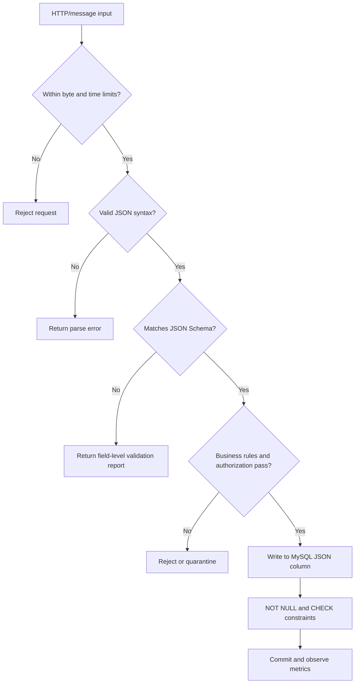

# JSON Schema Validation, Size Limits, and Input Data Validation

MySQL's `JSON` type guarantees that stored values are syntactically valid JSON, but that alone does not prove the data conforms to the business structure. A payload can parse cleanly while still missing `eventId`, containing a negative `quantity`, having an overly long array, or carrying extra fields the system rejects. Therefore, a JSON ingestion workflow needs multiple validation layers: request limits before parsing, syntax validation, schema validation, business-rule checks, and database constraints.

In MySQL 8.0, `JSON_VALID()`, `JSON_TYPE()`, `JSON_LENGTH()`, and `JSON_STORAGE_SIZE()` help inspect document shape and size. Starting in MySQL 8.0.17, `JSON_SCHEMA_VALID()` and `JSON_SCHEMA_VALIDATION_REPORT()` enable validation against JSON Schema Draft 4. Schema validation can be combined with `CHECK` constraints on InnoDB tables so invalid data is rejected even if another write path bypasses the application tier.

Within the `DATABASE_MYSQL` module, the goal is to design clear JSON contracts, control sizes using the right units, surface explainable input errors, and uphold critical invariants where data is stored. Schema validation does not replace authorization checks, cross-table consistency, or business validation that requires querying current state.

## Objectives

After this lesson, you will be able to:

- Distinguish syntactically valid JSON from JSON valid under schema and business rules.
- Inspect root types with `JSON_TYPE()` and element counts with `JSON_LENGTH()`.
- Measure binary representation size with `JSON_STORAGE_SIZE()` and understand the limits of that measurement.
- Use `JSON_SCHEMA_VALID()` to validate documents against JSON Schema Draft 4.
- Use `JSON_SCHEMA_VALIDATION_REPORT()` to explain the failing location and keyword.
- Design schemas featuring `type`, `required`, `properties`, `additionalProperties`, `items`, and count/length bounds.
- Combine JSON schema with `NOT NULL` and `CHECK` constraints.
- Distinguish request limits, `max_allowed_packet`, internal JSON size, and business limits.
- Validate data in the API/application before sending it to MySQL.
- Safely handle malformed, oversized, overly deep, or wrong-tenant payloads.
- Track error rates, sizes, and schema evolution across versions.

## 1. Four Layers of JSON Validation

A payload may pass one layer and fail at the next:

| Layer | Question | Example Failure |
|---|---|---|
| Transport limits | Is the request within byte/time limits? | 20 MB body when API accepts only 1 MB |
| JSON syntax | Is the string valid JSON? | Missing double quotes, misplaced comma |
| Schema | Are types, required fields, structure, and cardinality right? | `quantity` is a string, missing `eventId`, array has 10,000 items |
| Business rules | Are values valid in system context? | Customer does not belong to tenant, disallowed status, referenced code missing |

Do not lump everything into a single "invalid JSON" error. Each layer has its own handling and error message. For example, an oversized request can be rejected at the gateway before consuming parser memory; invalid JSON syntax can return a format error; schema failure can pinpoint the field; and business violations require domain/service checks.



The application layer can return user-friendly errors and verify permissions per request context. The database still needs to uphold invariant constraints that every writer must obey.

## 2. JSON Columns Validate Syntax, Not Schema Automatically

MySQL has a `JSON` data type. When inserting a string into a JSON column, MySQL parses and rejects text that is not valid JSON. Values are stored as binary JSON for more efficient component access; original whitespace and formatting are not preserved like a raw text copy.

Example:

```sql
CREATE TABLE inbound_event (
    event_id BIGINT UNSIGNED NOT NULL AUTO_INCREMENT,
    payload JSON NOT NULL,
    received_at DATETIME(6) NOT NULL DEFAULT CURRENT_TIMESTAMP(6),
    PRIMARY KEY (event_id)
) ENGINE=InnoDB;

INSERT INTO inbound_event (payload)
VALUES ('{"eventType":"order.created","orderId":"ORD-1001"}');
```

The following value is syntactically invalid JSON and cannot be written into a `JSON` column:

```sql
-- Invalid: string keys/values in JSON must use double quotes.
INSERT INTO inbound_event (payload)
VALUES ('{eventType:"order.created"}');
```

Conversely, the following JSON is syntactically valid yet may violate the event's schema:

```json
{
  "eventType": 42,
  "orderId": [],
  "unexpected": true
}
```

The `JSON` column does not automatically know that `eventType` must be a string, `orderId` must be an order code, or whether `unexpected` is prohibited. Those rules must be defined via schemas or business logic.

## 3. Validating JSON Syntax and Types

### 3.1. JSON_VALID()

`JSON_VALID(value)` returns `1` if the argument is valid JSON, `0` if invalid, and `NULL` if the argument is `NULL`.

```sql
SELECT
    JSON_VALID('{"eventId":"evt-1"}') AS valid_document,
    JSON_VALID('{eventId:"evt-1"}') AS invalid_document,
    JSON_VALID(NULL) AS null_document;
```

The results are `1`, `0`, and `NULL` respectively. Once a value resides in a `JSON` column, MySQL has already validated syntax on write; `JSON_VALID()` is more useful when inspecting raw text or legacy data in `TEXT` columns.

### 3.2. JSON_TYPE()

`JSON_TYPE()` indicates the JSON type at the current level. Common results include `OBJECT`, `ARRAY`, `STRING`, `INTEGER`, `DOUBLE`, `DECIMAL`, `BOOLEAN`, and `NULL`.

```sql
SELECT
    JSON_TYPE('{"a":1}') AS object_type,
    JSON_TYPE('[1,2]') AS array_type,
    JSON_TYPE('"hello"') AS string_type,
    JSON_TYPE('true') AS boolean_type,
    JSON_TYPE('null') AS json_null_type;
```

Distinguish SQL `NULL` from the JSON literal `null`: SQL `NULL` represents the absence of an SQL value, whereas JSON `null` is a valid JSON value. On a nullable JSON column, both SQL `NULL` and JSON `null` can exist; use `IS NULL` and `JSON_TYPE()` to distinguish them.

Example requiring `payload` to be an object:

```sql
SELECT event_id
FROM inbound_event
WHERE JSON_TYPE(payload) = 'OBJECT';
```

Do not force every payload to be an object if the contract permits arrays or scalars. Root types should be specified directly in the API/schema.

### 3.3. JSON_LENGTH()

`JSON_LENGTH()` returns the element count of an array, member count of an object, or `1` for a scalar. You can pass a JSON path to count a specific branch.

```sql
SELECT
    JSON_LENGTH('[10,20,30]') AS array_items,
    JSON_LENGTH('{"a":1,"b":2}') AS object_members,
    JSON_LENGTH('"one"') AS scalar_length,
    JSON_LENGTH('{"items":[1,2,3]}', '$.items') AS nested_items;
```

The results are `3`, `2`, `1`, and `3` respectively. This function does not measure bytes. An array of 10 very long strings has the same `JSON_LENGTH()` as an array of 10 integers, yet vastly different storage sizes.

### 3.4. JSON_DEPTH()

`JSON_DEPTH()` returns the nesting depth of a document. It is useful when checking whether data nests too deeply relative to application conventions. MySQL also enforces a JSON depth limit during parsing; checking early helps return clear errors and avoid unnecessary deep structure processing.

```sql
SELECT JSON_DEPTH('{"a":{"b":{"c":1}}}') AS document_depth;
```

Depth does not replace schema validation. A shallow document can still have thousands of elements or mistyped fields.

## 4. Measuring JSON Size

There is no single "JSON size" number. You must distinguish bytes received from the client, JSON text size, binary JSON representation, and actual storage-engine footprint.

### 4.1. JSON_STORAGE_SIZE()

`JSON_STORAGE_SIZE(json_doc)` returns the number of bytes used for the binary representation of a JSON document. This is a useful metric for observing JSON size after MySQL parses it.

```sql
SELECT
    JSON_STORAGE_SIZE('{"id":100,"status":"paid"}') AS binary_json_bytes,
    OCTET_LENGTH('{"id":100,"status":"paid"}') AS text_json_bytes;
```

The two values can differ because binary JSON uses its own representation. For values inside a JSON column, `JSON_STORAGE_SIZE()` reports the binary representation footprint prior to subsequent partial updates on the document. Therefore, use this function for storage observation; do not treat it as an exact measurement of current logical size after arbitrary partial updates. Nor is it the HTTP request size, total InnoDB row size, or inclusive of all page/index/redo/undo overhead.

On a stored JSON column:

```sql
SELECT
    event_id,
    JSON_STORAGE_SIZE(payload) AS payload_storage_bytes,
    JSON_LENGTH(payload) AS top_level_members
FROM inbound_event
ORDER BY event_id DESC
LIMIT 20;
```

### 4.2. JSON_STORAGE_FREE()

InnoDB can perform certain in-place partial updates on JSON documents. `JSON_STORAGE_FREE()` reports the space freed inside binary JSON storage after supported partial updates. This value is not row space freely allocatable to anything else, nor is it a measure of total disk space saved.

```sql
SELECT
    event_id,
    JSON_STORAGE_SIZE(payload) AS storage_bytes,
    JSON_STORAGE_FREE(payload) AS reusable_free_bytes
FROM inbound_event;
```

Do not use `JSON_STORAGE_FREE()` as an input payload limit. To bound current logical size, measure `OCTET_LENGTH(CAST(json_doc AS CHAR CHARACTER SET utf8mb4))` for serialized JSON text or control raw bytes at the gateway/application as required. Use `JSON_STORAGE_SIZE()` to observe binary storage, keeping partial-update caveats in mind.

### 4.3. Measuring Raw Text and Request Bytes

If an API receives JSON over HTTP, request body bytes are known at the gateway/application before parsing. SQL `OCTET_LENGTH(CAST(payload AS CHAR))` only measures text serialized from the current JSON value; it cannot recover original whitespace or raw request byte encoding.

Example measuring a UTF-8 string:

```sql
SET @raw_json = '{"message":"Xin chào"}';

SELECT
    CHAR_LENGTH(@raw_json) AS character_count,
    OCTET_LENGTH(@raw_json) AS utf8_byte_count;
```

`CHAR_LENGTH()` counts characters under the string's character set; `OCTET_LENGTH()` counts bytes. With Vietnamese text and emoji, byte count is usually larger than character count. If the API limit is 64 KiB, compare bytes rather than character counts.

### 4.4. Do Not Confuse Size Limits with max_allowed_packet

`max_allowed_packet` limits the packet/message size accepted by client and server, and also affects certain large strings/intermediate results. Configured values on both client and server can matter.

```sql
SHOW VARIABLES LIKE 'max_allowed_packet';
```

This is a technical limit of MySQL communication, not a business policy for individual JSON documents. If you increase `max_allowed_packet` to allow larger payloads, you still need separate request limits to prevent a single client from sending huge documents that exhaust memory, CPU, or parsing time.

A policy might include:

- API gateway: maximum 256 KiB per request body.
- Application: maximum 200 KiB for parsed JSON, maximum 100 `items` elements.
- Database: a `CHECK` constraint can bound the size of serialized JSON text; this is not the original raw HTTP request byte count.
- MySQL connection: `max_allowed_packet` large enough for valid protocol/statements with overhead headroom.

These numbers are design examples. Choose limits based on real workload, latency, row sizes, and server capacity.

## 5. JSON Schema in MySQL

JSON Schema describes document structure and shape rules. MySQL 8.0.17+ provides `JSON_SCHEMA_VALID()` to return valid/invalid status and `JSON_SCHEMA_VALIDATION_REPORT()` to produce an error report.

MySQL implements JSON Schema Draft 4 with a supported subset of keywords. Do not assume every keyword from newer JSON Schema drafts is supported. Before relying on a keyword, check documentation for your exact MySQL version; examples in this lesson use common keywords such as `type`, `required`, `properties`, `additionalProperties`, `items`, `minimum`, `maxLength`, and `maxItems`.

### 5.1. Example Schema for an Order Event

The schema below requires the document to be an object, allows only declared fields, requires `eventId`, `orderId`, `amount`, and `items`, and bounds string lengths and element counts.

```sql
SET @order_schema = '{
  "$schema": "http://json-schema.org/draft-04/schema#",
  "type": "object",
  "additionalProperties": false,
  "required": ["eventId", "orderId", "amount", "items"],
  "properties": {
    "eventId": {
      "type": "string",
      "minLength": 1,
      "maxLength": 64
    },
    "orderId": {
      "type": "string",
      "minLength": 1,
      "maxLength": 40
    },
    "amount": {
      "type": "number",
      "minimum": 0
    },
    "items": {
      "type": "array",
      "minItems": 1,
      "maxItems": 100,
      "items": {
        "type": "object",
        "additionalProperties": false,
        "required": ["sku", "quantity"],
        "properties": {
          "sku": {
            "type": "string",
            "minLength": 1,
            "maxLength": 50
          },
          "quantity": {
            "type": "integer",
            "minimum": 1,
            "maximum": 9999
          }
        }
      }
    }
  }
}';
```

This schema checks types and structural bounds. It does not verify whether `orderId` exists, whether `eventId` duplicates within a tenant, whether `amount` equals the sum of line items, or whether the sender is authorized to create orders. Those rules require unique keys, foreign keys, transactions, or appropriate application/domain logic.

### 5.2. Validating a Document

```sql
SET @order_doc = '{
  "eventId": "evt-1001",
  "orderId": "ORD-1001",
  "amount": 180.50,
  "items": [
    {"sku": "SKU-RED-01", "quantity": 2},
    {"sku": "SKU-BLU-02", "quantity": 1}
  ]
}';

SELECT
    JSON_VALID(@order_doc) AS syntax_ok,
    JSON_SCHEMA_VALID(@order_schema, @order_doc) AS schema_ok;
```

The expected result is `1` for both columns. `JSON_VALID()` only answers whether the string is valid JSON; `JSON_SCHEMA_VALID()` checks whether the document matches the schema.

### 5.3. Schema-Invalid Document

Example payload missing `eventId`, with `amount` as a string and `items` empty:

```sql
SET @bad_order_doc = '{
  "orderId": "ORD-1002",
  "amount": "180.50",
  "items": []
}';

SELECT
    JSON_VALID(@bad_order_doc) AS syntax_ok,
    JSON_SCHEMA_VALID(@order_schema, @bad_order_doc) AS schema_ok;
```

The JSON is still syntactically valid so `syntax_ok = 1`, yet `schema_ok = 0`. This is why parse validation must be separated from schema validation.

### 5.4. JSON_SCHEMA_VALIDATION_REPORT()

When schema validation fails, the report helps pinpoint the failing keyword and location:

```sql
SELECT JSON_PRETTY(
    JSON_SCHEMA_VALIDATION_REPORT(@order_schema, @bad_order_doc)
) AS validation_report;
```

The report can contain `valid`, `reason`, `schema-location`, `document-location`, and `schema-failed-keyword`. Use the report to map to structured API errors, e.g., `items` failing `minItems` or `amount` having wrong `type`. Never return raw internal reports or sensitive payloads verbatim in public responses/logs.

### 5.5. Schema Is Not a Data Query Language

A schema validates a single document in isolation. It does not replace:

- Unique constraints to prevent duplicate `eventId`.
- Foreign keys or queries to verify `orderId` belongs to the tenant.
- Transactions to update multiple tables consistently.
- Sender authorization checks and state-transition rules.
- Idempotency checks when the same event is resent.

Do not embed all business rules into JSON Schema. Keep schemas focused on structure, types, required fields, and local bounds.

## 6. Field, Array, and Depth Limits

### 6.1. Limiting Element Counts

Use `minItems`/`maxItems` to bound arrays. Use `minProperties`/`maxProperties` for object member counts if your version supports those keywords.

Example schema capping line items at 100:

```json
{
  "type": "array",
  "minItems": 1,
  "maxItems": 100,
  "items": {"type": "object"}
}
```

Cardinality limits prevent payloads with few fields from packing millions of tiny elements that burn CPU during validation or application iteration.

### 6.2. Limiting String Lengths

Use `minLength`, `maxLength`, and `pattern` for string fields. Note that JSON Schema counts length in Unicode characters, whereas network/storage limits typically count bytes. If the requirement is at most 128 UTF-8 bytes, check byte count in the application or with a suitable byte measurement; `maxLength: 128` does not guarantee at most 128 bytes.

```json
{
  "type": "string",
  "minLength": 1,
  "maxLength": 80,
  "pattern": "^[A-Z0-9-]+$"
}
```

Patterns should be short, easy to review, and avoid regular expressions with expensive backtracking in the application tier. Never use regex as a way to parse JSON.

### 6.3. Numeric Limits

Use `minimum`, `maximum`, and `multipleOf` if supported for numeric fields. For monetary values, however, consider exact representation and scale: JSON numbers may be parsed as decimal/double numbers depending on JSON implementation semantics. When monetary precision and accounting calculations are required, consider storing values in `DECIMAL` relational columns after validation.

Example:

```json
{
  "type": "number",
  "minimum": 0,
  "maximum": 1000000000
}
```

A schema does not replace the precision/scale of a `DECIMAL(12,2)` column or verify that a total equals the sum of line items.

### 6.4. Depth Limits

Deeply nested JSON can make parsers, validators, and recursive code consume excessive stack/CPU. MySQL enforces a JSON depth limit during parsing; applications should set a lower threshold matching the data contract rather than relying on the server's maximum limit. Use `JSON_DEPTH()` to inspect parsed documents; gateways/parsers may need limits enforced before building an object graph.

## 7. Storing Schemas and Version Management

There are three common ways to manage schemas:

1. Keep schemas in source code/application and validate before sending to the database.
2. Use `CHECK` constraints with a stable schema literal so the database enforces structure.
3. Store versioned schemas in a metadata table and have the application pick the schema matching the payload's type/version.

Do not assume MySQL has a central JSON Schema registry automatically bound to every JSON column. When schemas evolve, manage versioning, backward compatibility, and rollouts through a migration process.

Example versioned payload:

```json
{
  "schemaVersion": 2,
  "eventType": "order.created",
  "eventId": "evt-1001"
}
```

Rollout rules:

- Never silently change the meaning of existing fields.
- Prefer adding optional fields first, then requiring mandatory fields only after all producers upgrade.
- Define the support window for multiple concurrent schema versions.
- Maintain test fixtures for valid documents, invalid documents, and legacy payloads.
- When changing a schema literal inside a `CHECK` constraint, plan migrations carefully because `ALTER TABLE` may need to validate existing rows.
- Never allow clients to supply arbitrary schemas for the database to trust as authoritative; schemas are system-controlled policies.

## 8. Enforcing Schemas and Limits at the Database

Since MySQL 8.0.16, `CHECK` constraints are enforced. MySQL 8.0.17+ offers `JSON_SCHEMA_VALID()` to incorporate schema checks inside constraints. On older versions, do not assume `CHECK` is enforced or JSON Schema functions exist; check the version and keep validation in the application until upgraded.

### 8.1. Table with CHECK Constraints

```sql
CREATE TABLE order_event (
    event_id BIGINT UNSIGNED NOT NULL AUTO_INCREMENT,
    payload JSON NOT NULL,
    received_at DATETIME(6) NOT NULL DEFAULT CURRENT_TIMESTAMP(6),
    PRIMARY KEY (event_id),
    CONSTRAINT chk_order_event_object
        CHECK (JSON_TYPE(payload) = 'OBJECT'),
    CONSTRAINT chk_order_event_size
        CHECK (OCTET_LENGTH(CAST(payload AS CHAR CHARACTER SET utf8mb4)) <= 65536),
    CONSTRAINT chk_order_event_schema
        CHECK (
            JSON_SCHEMA_VALID(
                '{"type":"object","required":["eventId","eventType"],"additionalProperties":false,"properties":{"eventId":{"type":"string","minLength":1,"maxLength":64},"eventType":{"type":"string","enum":["order.created","order.cancelled"]}}}',
                payload
            )
        )
) ENGINE=InnoDB;
```

These constraints ensure `payload` is not SQL `NULL`, must be a JSON object, has serialized JSON text under 64 KiB, and contains the two required fields with valid types/values. This is the normalized serialized text size produced by MySQL, not raw HTTP bytes. Keeping schemas inside constraints intentionally small and stable is wise; complex schemas often fit better in application validation paired with core database constraints.

### 8.2. Testing Valid and Invalid Inserts

```sql
INSERT INTO order_event (payload)
VALUES ('{"eventId":"evt-2001","eventType":"order.created"}');

-- Missing eventId: rejected by chk_order_event_schema.
INSERT INTO order_event (payload)
VALUES ('{"eventType":"order.created"}');

-- eventType not in enum: rejected.
INSERT INTO order_event (payload)
VALUES ('{"eventId":"evt-2002","eventType":"order.shipped"}');
```

Constraints do not produce detailed business messages like an API validator. Applications must catch constraint errors and map them to appropriate error responses while avoiding leaking SQL details or sensitive payloads to callers.

### 8.3. CHECK and NULL Semantics

In SQL, a `CHECK` constraint fails when the expression evaluates to `FALSE`; an `UNKNOWN` result (typically from `NULL`) is not considered a violation. Therefore, if a field is required, combine `NOT NULL` with `CHECK`.

```sql
CREATE TABLE webhook_message (
    message_id BIGINT UNSIGNED NOT NULL AUTO_INCREMENT,
    payload JSON NOT NULL,
    PRIMARY KEY (message_id),
    CONSTRAINT chk_webhook_payload_type
        CHECK (JSON_TYPE(payload) = 'OBJECT')
) ENGINE=InnoDB;
```

`NOT NULL` blocks SQL NULL. The JSON literal `null` is still a valid JSON value, yet `JSON_TYPE(payload)` returns the string `"NULL"` (JSON type), distinct from SQL NULL; the object constraint will reject it.

### 8.4. Do Not Use CHECK to Query Other Tables

MySQL `CHECK` constraints are not a place for subqueries or querying other tables. If you need to verify `customerId` exists and belongs to a tenant, use a foreign key if the relational model fits, or check inside a transaction/application. JSON Schema validates only the local document.

## 9. Application Validation Before Writing

The application is the right place to enforce pre-parse request limits, select schemas by event type/version, return field-level errors, and verify sender permissions.

A practical pipeline:

1. Read content length/stream and abort when exceeding the byte limit; do not buffer unboundedly.
2. Check content type and encoding per the API contract.
3. Parse JSON using a parser with depth/size limits if supported by the library.
4. Validate top-level type and versioned JSON Schema.
5. Check business rules, tenant ownership, authorization, and idempotency.
6. Normalize values needed for frequent filtering/joins into strongly typed relational columns.
7. Write JSON and relational columns inside the same transaction.
8. Handle `CHECK`, unique key, and foreign key errors from the database as the final defense layer.
9. Emit metrics for size, schema version, and error categories; avoid logging sensitive raw payloads.

### 9.1. Do Not Validate Only on the Client

Frontend validation helps users correct input early, but is not a trust boundary. Clients can be tampered with, requests can be sent directly, or other producers may write to the same database. Critical validation must run in the server-side application, and invariants needing protection must be enforced in the database.

### 9.2. Do Not Validate Only in the Database

Database constraints do not know how many bytes the original HTTP request body had before parsing, do not know the authenticated user unless the application passes a trusted security context, and should not be responsible for crafting all API error messages. Network/parser limits and authorization must be handled before DML.

## 10. Using JSON Functions to Audit Stored Payloads

### 10.1. Checking Types and Required Fields

```sql
SELECT event_id
FROM order_event
WHERE JSON_TYPE(payload) <> 'OBJECT'
   OR JSON_EXTRACT(payload, '$.eventId') IS NULL
   OR JSON_EXTRACT(payload, '$.eventType') IS NULL;
```

Note that `JSON_EXTRACT()` returns SQL `NULL` when a path is not found, whereas the JSON literal `null` is a JSON value of type `NULL`. To distinguish missing from JSON null, use `JSON_CONTAINS_PATH()` and `JSON_TYPE()`.

```sql
SELECT
    event_id,
    JSON_CONTAINS_PATH(payload, 'one', '$.eventId') AS has_event_id,
    JSON_TYPE(JSON_EXTRACT(payload, '$.eventId')) AS event_id_type
FROM order_event;
```

### 10.2. Checking Schema Versions

```sql
SELECT
    JSON_UNQUOTE(JSON_EXTRACT(payload, '$.schemaVersion')) AS schema_version,
    COUNT(*) AS event_count
FROM order_event
GROUP BY JSON_UNQUOTE(JSON_EXTRACT(payload, '$.schemaVersion'));
```

Version counts help determine whether legacy producers are still sending old payloads before deprecating older schemas.

### 10.3. Finding Large Documents

```sql
SELECT
    event_id,
    JSON_STORAGE_SIZE(payload) AS storage_bytes,
    JSON_LENGTH(payload) AS top_level_members
FROM order_event
WHERE JSON_STORAGE_SIZE(payload) > 32768
ORDER BY storage_bytes DESC;
```

If this audit runs frequently on a large table, you can maintain a metadata column such as `payload_bytes` computed in the application and reconciled periodically; do not create an index on a JSON expression solely for a rarely run diagnostic query.

## 11. Sensitive Data and Error Messages

JSON often carries emails, addresses, tokens, payment info, or personal data. When validation fails:

- Do not log the entire payload by default.
- Do not expose tokens, secrets, or sensitive values from `JSON_SCHEMA_VALIDATION_REPORT` to clients.
- Log event/request ID, schema version, keyword, and necessary JSON path.
- Bound error message length and the number of errors returned.
- Never reflect raw input verbatim into HTML/logs without encoding.
- Verify data access permissions after schema validation; a schema-valid document can still carry another tenant's ID.

Schema validation is a shape check, not authentication or authorization.

## 12. Common Mistakes and Fixes

| Symptom | Cause | Fix |
|---|---|---|
| `JSON_VALID()` returns 1 yet insert is rejected | Syntax is valid, but CHECK/schema/business rules fail | Inspect validation report and failing constraint |
| `JSON_SCHEMA_VALID()` does not exist | Server older than MySQL 8.0.17 or another compatible engine | Check version; validate in app or upgrade |
| CHECK does not block data | MySQL older than 8.0.16 or constraint not enforced as expected | Check version and `SHOW CREATE TABLE` |
| `JSON_LENGTH()` is small yet payload is huge | Counts elements, not bytes | Enforce byte limits in app or `OCTET_LENGTH(CAST(payload AS CHAR CHARACTER SET utf8mb4))` on serialized text |
| `JSON_STORAGE_SIZE()` differs from HTTP body size | Binary JSON is parsed/normalized, not keeping original whitespace/encoding | Measure raw bytes at gateway/application |
| Vietnamese characters exceed length limit | Character count differs from UTF-8 byte count | Use `OCTET_LENGTH()` or byte count in the application |
| `CHECK` misses SQL NULL | SQL CHECK permits UNKNOWN expressions | Combine `NOT NULL` with CHECK |
| JSON `null` confused with SQL NULL | Two distinct NULL kinds | Combine `IS NULL`, `JSON_TYPE()`, and `JSON_CONTAINS_PATH()` |
| Schema-valid document has wrong tenant | Schema does not check authorization | Verify permissions/tenant inside business transaction |
| Validation report is too detailed | Logs/responses leak data or internal structure | Return filtered field-level errors only, never raw payloads |
| Payload nested too deeply or array too long | Missing depth/cardinality limits | Enforce limits in parser and schema |
| New schema breaks legacy producers | Breaking change deployed without rollout | Version schemas and roll out compatibly in stages |

## 13. Operations and Monitoring Workflow

Track the following metrics by event type/producer/schema version:

- Requests rejected for exceeding byte limits.
- JSON parse errors.
- Schema errors by `schema-failed-keyword` and document path.
- `JSON_STORAGE_SIZE()` percentile distribution, especially p95/p99.
- Maximum array element count and document depth.
- Database CHECK/unique/foreign key errors.
- Payload share by schema version.
- Parse/validation latency and database write latency.

Do not look only at averages: a small percentage of oversized payloads can cause memory or latency spikes. Sample large documents for analysis after redacting sensitive data.

When changing schemas:

1. Add test fixtures and run validation against representative data.
2. Measure the percentage of existing payloads that would fail under the new schema.
3. Roll out compatible producers first if needed.
4. Deploy application validators and database constraints per rollout plan.
5. Monitor errors by producer/version.
6. Remove old schemas only after no valid writer uses them anymore.

## 14. Practice Exercises

Perform on MySQL 8.0.17+ in a lab schema:

1. Create a table with a `JSON NOT NULL` column; try inserting a valid JSON object and a syntactically invalid string.
2. Run `JSON_VALID()` with an object, array, string, boolean, JSON `null`, and SQL `NULL`.
3. Use `JSON_TYPE()` to distinguish `OBJECT`, `ARRAY`, `STRING`, `INTEGER`, `BOOLEAN`, and JSON `NULL`.
4. Use `JSON_LENGTH()` on an object, array, scalar, and nested path; explain why it does not measure bytes.
5. Compare `CHAR_LENGTH()` and `OCTET_LENGTH()` on strings with Vietnamese diacritics and emoji.
6. Compare `JSON_STORAGE_SIZE()` with `OCTET_LENGTH()` of raw text for the same document.
7. Create a Draft 4 schema for an order event with required fields, types, enums, min/max, and `additionalProperties:false`.
8. Validate a valid payload using `JSON_SCHEMA_VALID()`.
9. Create payloads with wrong types, missing fields, and empty arrays; verify schema validation returns 0.
10. Use `JSON_SCHEMA_VALIDATION_REPORT()` to extract the failing keyword and document path.
11. Create a table with CHECK requiring `payload` to be an OBJECT and limiting `OCTET_LENGTH(CAST(payload AS CHAR CHARACTER SET utf8mb4))`; test inserting an oversized payload.
12. Add a CHECK using `JSON_SCHEMA_VALID()`; verify a payload missing a field is rejected.
13. Test SQL NULL and JSON literal `null`; explain the roles of `NOT NULL` and `JSON_TYPE()`.
14. Check `max_allowed_packet` and simulate a request limit smaller than the packet limit at the application layer.
15. Design schema versions 1 and 2; create a rollout plan that avoids abruptly breaking legacy producers.
16. Build a metrics report of failed payloads by keyword, p95/p99 size, and schema version without logging raw payloads.

You have completed this lesson when you can pinpoint which layer a payload failed at, which limits measure bytes vs. element counts, and which invariants must be upheld in the database.

## 15. Principles to Remember

- `JSON` columns check JSON syntax; they do not enforce business contracts automatically.
- Separate request limits, parsing, schema validation, and business validation.
- `JSON_VALID()` checks syntax; `JSON_TYPE()` checks root type; `JSON_LENGTH()` counts members/elements.
- `JSON_STORAGE_SIZE()` measures binary JSON representation prior to partial updates; it is not raw HTTP body size or an exact measurement of current serialized text size after partial updates.
- `CHAR_LENGTH()` counts characters; `OCTET_LENGTH()` counts bytes.
- `max_allowed_packet` is a MySQL protocol limit, not a business payload limit.
- MySQL 8.0.17+ provides `JSON_SCHEMA_VALID()` and `JSON_SCHEMA_VALIDATION_REPORT()` supporting JSON Schema Draft 4.
- Verify schema keywords against documentation for your exact version; do not assume newer Draft features exist.
- Use `required`, `type`, `properties`, `additionalProperties`, `items`, `minItems`, `maxItems`, `minLength`, `maxLength`, `minimum`, and `maximum` to control structure.
- Combine `NOT NULL` and `CHECK`; CHECK does not treat UNKNOWN/NULL as a violation.
- JSON Schema does not verify tenant, authorization, foreign keys, idempotency, or business state.
- Validate in the server-side application and uphold critical invariants in the database.
- Version schemas, roll out compatibly, and monitor errors by producer/version.
- Never log sensitive raw payloads or return internal validation reports directly to clients.
