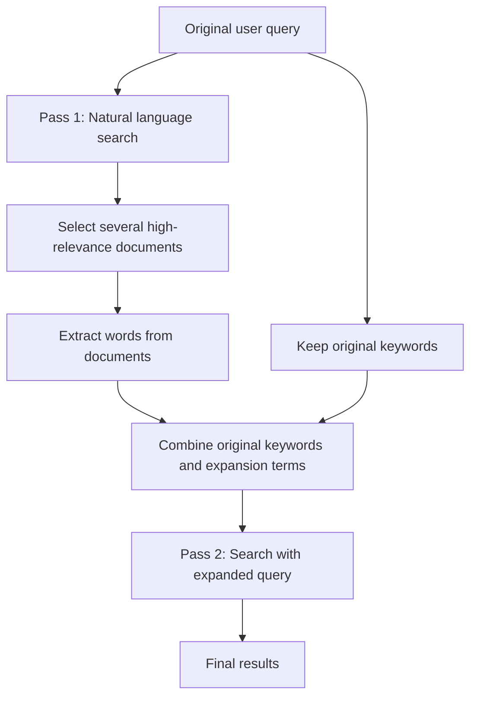

# Query Expansion and Relevance Trade-Offs

When users enter a short query such as `database`, they may be looking for documents about MySQL, Oracle, DB2, RDBMS, or related concepts. MySQL provides a **query expansion** mechanism to expand a query based on the most relevant documents from an initial search pass.

Query expansion can help find documents that do not contain the original keyword but have related content. In return, results are usually broader and more likely to include documents that are not truly relevant. This is a trade-off between **recall** (the ability to retrieve enough relevant documents) and **precision** (the proportion of returned documents that are actually useful).

This lesson explains how MySQL performs query expansion, how to use `WITH QUERY EXPANSION`, how to interpret relevance scores, and how to decide whether to enable this mode. The focus is on understanding the limits of automatic expansion and evaluating it with real search data.

## 1. What Problem Does Query Expansion Solve?

A search query can be too short or lack context. The user enters one keyword but expects the system to understand terms that frequently appear alongside that topic.

Examples:

- The query `database` may imply MySQL, Oracle, DB2, relational database, or RDBMS.
- A query like `Maigret` might be mistyped as `Megre`, yet the remaining words in the query still lead to a relevant document.
- The query `replication` may lead to documents discussing binary logs, replicas, failover, or read scaling.

Full-text search by itself is not a semantic understanding engine. It indexes words extracted by the parser and computes relevance based on document content. Query expansion adds an automatic feedback layer: taking several high-scoring documents from the first pass, using words from those documents to expand the query, and searching again.

MySQL's query expansion is also called **blind query expansion** or **automatic relevance feedback**. The word "blind" emphasizes that the system automatically derives expansion terms from the initial results without waiting for the user to mark which documents are useful.

## 2. Requirements for Using It

Query expansion is a variant of natural language full-text search. An appropriate `FULLTEXT` index is required, and the columns in `MATCH()` must belong to the same table.

Example articles table:

```sql
CREATE TABLE articles (
    id BIGINT UNSIGNED NOT NULL AUTO_INCREMENT,
    tenant_id BIGINT UNSIGNED NOT NULL,
    title VARCHAR(200) NOT NULL,
    body TEXT NOT NULL,
    published_at DATETIME NOT NULL,
    PRIMARY KEY (id),
    KEY ix_articles_tenant_published (tenant_id, published_at),
    FULLTEXT KEY ft_articles_title_body (title, body)
) ENGINE=InnoDB
  DEFAULT CHARACTER SET utf8mb4;
```

Only InnoDB and MyISAM support `FULLTEXT` indexes. Indexed columns must belong to the `CHAR`, `VARCHAR`, or `TEXT` family. This example uses InnoDB to leverage transactions and the engine's storage characteristics.

A `MATCH(title, body)` query must match the column list of a corresponding `FULLTEXT` index. If you want to search only in `title`, you need a separate `FULLTEXT` index for `title`; do not assume a composite `(title, body)` index can substitute for every other `MATCH()` combination.

Query expansion is not a separate index type. It changes how the query is interpreted over an existing full-text index.

## 3. MySQL's Two-Pass Mechanism

When query expansion is enabled, MySQL executes the search in two passes:

1. **First pass:** runs natural language search with the string entered by the user.
2. **Select feedback documents:** takes several high-relevance documents from the first-pass results.
3. **Expand query:** extracts words appearing in those selected documents and appends them to the original query.
4. **Second pass:** runs the search again using the expanded string.
5. **Return results:** returns rows from the second search pass.

Diagram:



Key point: the final results come from the second pass. Because the second-pass query includes additional terms, a document that does not contain the original keyword can still be returned if it matches the added terms.

Illustrative example:

- The user searches for `database`.
- The top matching documents in the first pass often mention `MySQL`, `RDBMS`, and `relational database`.
- Those terms are used to expand the query.
- The second pass can retrieve additional documents containing `MySQL` or `RDBMS` even if those documents do not contain the exact word `database`.

This is inference based on word co-occurrence in documents. It is not a synonym dictionary, semantic search, or embedding model.

## 4. WITH QUERY EXPANSION Syntax

General full-text search syntax:

```sql
MATCH (col1, col2, ...)
AGAINST (expr [search_modifier])
```

Query expansion is enabled with one of two forms:

```sql
AGAINST ('database' WITH QUERY EXPANSION)

AGAINST (
    'database'
    IN NATURAL LANGUAGE MODE WITH QUERY EXPANSION
)
```

Both forms perform natural language search with query expansion. The second form states the search mode explicitly, making it easier to read alongside other natural language queries.

Do not use `WITH QUERY EXPANSION` with `IN BOOLEAN MODE`. Query expansion is a variant of natural language search, not a modifier to combine arbitrarily with boolean search.

## 5. Comparing Standard Search and Expanded Search

First, run a standard natural language query:

```sql
SELECT
    id,
    title,
    MATCH(title, body)
        AGAINST (? IN NATURAL LANGUAGE MODE) AS relevance
FROM articles
WHERE MATCH(title, body)
    AGAINST (? IN NATURAL LANGUAGE MODE)
ORDER BY relevance DESC, id ASC
LIMIT 20;
```

Then run the query with query expansion:

```sql
SELECT
    id,
    title,
    MATCH(title, body)
        AGAINST (
            ? IN NATURAL LANGUAGE MODE WITH QUERY EXPANSION
        ) AS relevance
FROM articles
WHERE MATCH(title, body)
    AGAINST (
        ? IN NATURAL LANGUAGE MODE WITH QUERY EXPANSION
    )
ORDER BY relevance DESC, id ASC
LIMIT 20;
```

The application binds the same search string to both placeholders in each query. Use prepared statements to pass user input, avoiding direct string concatenation into SQL.

| Characteristic | Standard Natural Language | Query Expansion |
|---|---|---|
| First-pass query | Yes | Yes |
| Extract words from high-relevance docs | No | Yes |
| Run second search pass | No | Yes |
| Can return docs lacking original terms | Less likely | Yes |
| Result scope | Usually narrower | Usually broader |
| Noise risk | Relatively lower | Higher |
| Processing cost | Usually lower | Extra search pass and processing |

In the example, `ORDER BY relevance DESC, id ASC` sorts by relevance score and uses `id` as a tie-breaker so ordering is more deterministic when multiple rows share the same score. If `ORDER BY` is omitted, MySQL may automatically sort by relevance under certain natural language full-text index scan conditions, but you should not rely on that implicit behavior as an API contract.

## 6. Understanding Relevance Scores

`MATCH(...) AGAINST(...)` returns a numeric value representing the similarity between the query and the indexed text. The score is neither the probability that a document is correct nor a relevance percentage.

For natural language search, MySQL calculates relevance based on factors such as:

- Number of words in the document.
- Number of unique words in the document.
- Total number of words in the indexed collection.
- Number of documents containing a specific word.

Scores are typically non-negative; a value of 0 indicates no similarity. Relevance depends on the collection and index word statistics, so results can change when data is inserted, updated, or deleted.

When query expansion is enabled, the second-pass query includes words taken from first-pass documents. Therefore, the second-pass relevance score reflects the expanded query. Do not compare scores from two different queries directly as if they shared an absolute scale.

### 6.1. Do Not Treat Relevance as Probability

Example:

| Document | Illustrative Score | Interpretation |
|---|---:|---|
| A | 2.8 | Matches the search term set relatively well |
| B | 1.4 | Weaker match than A within the same query |
| C | 0.7 | Has some matching signal |

The numbers only illustrate ranking order within a single search. A score of `2.8` does not mean the document is 280% correct or 2.8 times as likely to be relevant. Evaluate by document quality in the top K, rather than setting an arbitrary score threshold and interpreting it as a probability.

### 6.2. Conditions for Automatic Relevance Sorting

When `MATCH()` is used in `WHERE`, MySQL can automatically return results sorted by descending relevance if certain conditions are met, including:

- No explicit `ORDER BY`.
- The query uses a full-text index scan rather than a table scan.
- If there is a JOIN, the full-text index scan must be the first non-constant table in the JOIN order.

When the application needs deterministic ordering, write `ORDER BY relevance DESC` and add a unique key as a tie-breaker. If there are tenant, status, or publication date filters, check the execution plan and returned order instead of assuming the engine will always sort automatically.

## 7. Benefit: Increasing Recall for Short Queries

Query expansion is useful when the initial query is too short to express the full intent.

Example query `database`:

| Document | Content | Contains `database`? |
|---|---|---|
| A | MySQL Tutorial: DBMS and relational systems | Maybe not |
| B | Database design fundamentals | Yes |
| C | MySQL performance tuning | Maybe not |
| D | Oracle database administration | Yes |

If documents B and D stand out in the first pass, terms such as `MySQL`, `Oracle`, or `DBMS` may be brought into the expanded query. The second pass gets a chance to find document A or C, even though they do not contain the word `database`.

Key benefits:

- Finds related documents that use different terminology.
- Partially compensates for context the user did not enter.
- Reduces dependence on the user knowing the exact technical term.
- Can help with short queries, incomplete keywords, or minor typos when remaining words point to relevant documents.

Query expansion does not guarantee finding true synonyms. It only expands using words present in several high-ranking documents from the first pass.

## 8. Precision and Recall Trade-Offs

In search systems, two concepts must be distinguished:

- **Precision@K:** out of the top K results, how many are genuinely useful?
- **Recall:** out of all truly relevant documents, how many did the system find?

Example, with 10 relevant documents in the collection:

| Search Approach | Results Returned | Relevant Documents | Precision | Recall |
|---|---:|---:|---:|---:|
| Natural language | 5 | 4 | 80% | 40% |
| Query expansion | 12 | 7 | 58.3% | 70% |

These are hypothetical numbers for illustration. Query expansion finds more relevant documents, but the result set also picks up additional unhelpful documents.

Depending on the product, this trade-off can be beneficial or harmful:

- Knowledge discovery tools may accept broader results so users discover related topics.
- Product search pages requiring high accuracy may prioritize precision, because off-topic items reduce purchase conversion.
- Operations or incident lookup tools may need high recall, but must keep critical filters so results are not diluted.
- Legal, medical, or compliance data search requires strict quality and scope control; do not enable expansion by default simply because a query is short.

There is no single optimal configuration for all content types. Choose based on the cost of missing relevant items versus the cost of returning noisy documents.

## 9. Query Drift and Noise Risks

Query expansion can cause the query to drift away from the original intent (**query drift**). This problem occurs when top-scoring documents in the first pass contain common words that do not accurately reflect the user's need.

For example, a user searches for `lock` to find transaction locks. A popular document might talk extensively about door locks, physical security, or lock screens. If that document lands in the feedback group, expansion terms can pull the second pass into a completely different topic.

Common sources of noise:

1. **Overly generic documents:** contain many common words and unrelated topics.
2. **Overly long documents:** contain many incidental words, increasing the chance of adding unintended terms.
3. **SEO or spam content:** repeats popular words to rank highly in the first pass.
4. **Outdated documents:** terms that used to be common but no longer match current questions.
5. **Duplicate content:** multiple copies can cause one group of terms to dominate.
6. **Ambiguous original queries:** a word with multiple meanings causes the first pass to pick the wrong topic.
7. **Multi-domain corpus:** documents from disparate domains sharing the same collection.

Once noisy terms are added, the second pass can return many documents that do not contain the original keyword. That is intentional behavior of the expansion mechanism, though it can surprise users if the UI presents results as if all of them matched strictly.

## 10. When Should Query Expansion Be Enabled?

| Scenario | Recommendation | Reason |
|---|---|---|
| Single short, broad keyword | Worth testing | Users may rely on implicit context |
| Query has only a few common words | Test under control | Opportunity to add co-occurring terms |
| Users want topic exploration | Can fit well | Broad recall is often valuable |
| Long query with many specific terms | Usually unnecessary | The query already carries enough context |
| Identifiers, order numbers, emails | Do not use | Needs exact lookup, not word expansion |
| Exact phrases or quoted text | Do not use by default | Added words can skew the target |
| Queries with mandatory conditions | Do not use instead of boolean mode | Query expansion does not apply to boolean search |
| Results must be highly precise | Enable only after evaluation | Noise can have high consequences |

A viable UI strategy can be:

- Use natural language search as the default.
- Provide "Expand results" only as a secondary option when the query is short.
- Display a label indicating that results were expanded.
- Keep business and access-control filters in the query/application layer.
- Allow users to return to the original result list.

Do not automatically enable query expansion for every query solely to increase result counts.

## 11. Practical Example: Searching Technical Documentation

Suppose the `articles` table contains MySQL, Oracle, and database concept guides. Create the index:

```sql
CREATE FULLTEXT INDEX ft_articles_title_body
ON articles(title, body);
```

Natural language search:

```sql
SELECT
    id,
    title,
    MATCH(title, body)
        AGAINST ('database' IN NATURAL LANGUAGE MODE) AS score
FROM articles
WHERE MATCH(title, body)
    AGAINST ('database' IN NATURAL LANGUAGE MODE)
ORDER BY score DESC, id ASC
LIMIT 10;
```

Expanded search:

```sql
SELECT
    id,
    title,
    MATCH(title, body)
        AGAINST (
            'database'
            IN NATURAL LANGUAGE MODE WITH QUERY EXPANSION
        ) AS score
FROM articles
WHERE MATCH(title, body)
    AGAINST (
        'database'
        IN NATURAL LANGUAGE MODE WITH QUERY EXPANSION
    )
ORDER BY score DESC, id ASC
LIMIT 10;
```

Compare the two result sets:

- Rows appearing in both sets usually have matching signals from the original query and/or expansion terms.
- Rows appearing only in the expanded set may match words drawn from high-relevance documents in the first pass.
- Rows disappearing from the top 10 may have been pushed down by ranking changes in the second pass.

Do not assume every newly appearing row is a valid synonym match. Open the document content and evaluate against the actual search intent.

## 12. Using Query Expansion with Business Filters

Query expansion does not replace data filters. If the application only allows users to view published articles for the current tenant, that condition must still be enforced:

```sql
SELECT
    id,
    title,
    MATCH(title, body)
        AGAINST (
            ? IN NATURAL LANGUAGE MODE WITH QUERY EXPANSION
        ) AS score
FROM articles
WHERE tenant_id = ?
  AND published_at <= CURRENT_TIMESTAMP
  AND MATCH(title, body)
        AGAINST (
            ? IN NATURAL LANGUAGE MODE WITH QUERY EXPANSION
        )
ORDER BY score DESC, id ASC
LIMIT 20;
```

Bind the search string to the first and third placeholders; bind the tenant ID to the second placeholder. Access-control filters must be validated on the backend and applied to every query.

For multi-tenant systems or sensitive content, specifically test collection scope and how documents in the feedback pass can influence expanded results. Do not use query expansion as an authorization or data-isolation mechanism.

If expansion semantics must be strictly isolated per tenant or permission group, evaluate an appropriate corpus/index architecture rather than assuming a trailing SQL filter solves every isolation requirement.

## 13. Tokenizers, Stopwords, and Word Length

Query expansion can only expand using words recognized by the full-text parser and stored in the index. Therefore, its quality depends on how MySQL splits words and on full-text configuration.

Factors to review:

- **Parser:** determines token boundaries in text.
- **Stopwords:** words excluded from the full-text index or ignored during search.
- **Token length:** words too short or too long per configuration may not be indexed.
- **Character set/collation:** affects character handling and word comparisons.
- **Content language:** not all languages separate words with spaces.

For InnoDB, token length variables include `innodb_ft_min_token_size` and `innodb_ft_max_token_size`. For MyISAM, they are `ft_min_word_len` and `ft_max_word_len`. Stopword configuration also differs between engines.

A word omitted from the index cannot serve as a reliable expansion signal. When changing token size or stopword settings, check version-specific documentation and rebuild `FULLTEXT` indexes when required. Many configuration variables must be set at server startup.

### 13.1. Languages Without Space-Separated Word Boundaries

For Chinese, Japanese, and certain logographic languages, the default parser cannot always determine word boundaries by spaces. MySQL includes the ngram full-text parser for languages such as Chinese, Japanese, and Korean; MeCab is a parser plugin for Japanese.

If the corpus spans multiple languages, test the parser on real data. Query expansion cannot fix parser tokenization errors; it only uses tokens that have already been recognized.

### 13.2. Short Keywords or Stopwords

An overly short query may contain no valid tokens to search. If the keyword is a stopword or shorter than the index threshold, the first pass itself may fail to produce a useful feedback document set. When the first pass yields no matching documents, query expansion has no reliable context to expand from.

Check stopwords and token limits before concluding that query expansion is not working.

## 14. Performance Cost

Query expansion runs two search passes and must process feedback documents to build the second query. Consequently, it generally consumes more resources than standard natural language search.

Influencing factors:

- Number of documents in the collection.
- Size and length of indexed text.
- Frequency of the original keyword.
- Number of documents matched in the first pass.
- Quality and configuration of the FULLTEXT index.
- Call frequency of query expansion and concurrency level.

`LIMIT 20` caps the number of rows returned to the application; do not treat it as a guarantee that MySQL processes only 20 documents during internal query expansion steps.

Measure p50/p95 latency, CPU, and returned row counts separately for both modes. An expanded query that returns more documents but is noticeably slower may violate the UI's latency budget.

## 15. Reading Execution Plans and Benchmarking

Use `EXPLAIN` to see how the query uses the full-text index and other filters:

```sql
EXPLAIN
SELECT
    id,
    title,
    MATCH(title, body)
        AGAINST (
            'database'
            IN NATURAL LANGUAGE MODE WITH QUERY EXPANSION
        ) AS score
FROM articles
WHERE MATCH(title, body)
    AGAINST (
        'database'
        IN NATURAL LANGUAGE MODE WITH QUERY EXPANSION
    )
ORDER BY score DESC, id ASC
LIMIT 20;
```

Check:

- Is the `FULLTEXT` access path used as expected?
- Do `tenant_id` or `published_at` filters change the execution plan?
- Is there an extra sort step caused by `ORDER BY`?
- Is there a large discrepancy between estimated rows and actual rows?
- Does query expansion push latency beyond budget?

`EXPLAIN ANALYZE` executes the statement to measure actual runtime on supported versions. Use it only with read queries in an appropriate environment; never run DML with side effects just to view a plan.

## 16. Evaluating Quality with a Benchmark Query Set

Do not evaluate query expansion using a few memorable queries. Build a query set representative of how users actually search.

An evaluation set should include:

- Short, broad queries.
- Long queries with multiple specific terms.
- Queries with minor spelling mistakes.
- Queries with co-occurring words across different topics.
- Queries with domain terminology.
- Queries containing stopwords or short tokens.
- Queries segmented by tenant, language, or content category.

For each query, reviewers label document relevance on a consistent scale, for example:

| Label | Meaning |
|---:|---|
| 0 | Not relevant |
| 1 | Slightly relevant, useful only as secondary reference |
| 2 | Clearly relevant, partially answers the intent |
| 3 | Highly relevant, directly addresses the need |

Compare natural language and query expansion on the same query set, same data snapshot, and same top-K limit.

### 16.1. Metrics to Track

| Metric | Meaning | When Useful |
|---|---|---|
| Precision@K | Fraction of relevant results in the top K positions | Measuring cleanliness of top results |
| Recall@K | Fraction of all relevant documents found in top K | Measuring completeness |
| MRR | Position of the first relevant result | When users typically click the first result |
| nDCG@K | Ranking quality accounting for graded relevance | When multi-level relevance labels exist |
| p50/p95 latency | Response time | Evaluating user experience and load |
| Empty-result rate | Percentage of queries returning zero results | Detecting token/stopword issues |

Do not optimize a single metric in isolation. For instance, higher recall with sharply lower precision may force users to wade through noise. Set acceptance thresholds aligned with product goals.

### 16.2. Controlled A/B Testing

A proper experiment:

1. Select a representative query set and define relevance labels.
2. Run baseline natural language search.
3. Run the same queries with query expansion.
4. Compare top K, precision, recall, nDCG, and latency.
5. Analyze separately by query type, language, and content group.
6. If rolled out to users, split traffic under control and monitor follow-up searches, clicks, and time to useful result.

Do not use relevance scores from the two modes as the sole comparison metric, because each mode may evaluate against a different term set.

## 17. Alternatives When Higher Control Is Needed

Query expansion works when automatic term inference by the system is acceptable. If strict control is required, consider:

| Approach | Control | Characteristics |
|---|---|---|
| Application-managed synonyms | High | Curated and reviewed synonym groups |
| Taxonomy-based query expansion | High | Uses business categories, aliases, and canonical codes |
| Boolean full-text search | High for word conditions | Allows requiring, excluding, or boosting words |
| Metadata-combined search | High for filters | Combines full-text with category, status, tenant, time |
| Dedicated search engine | Platform-dependent | Can provide synonyms, analyzers, fuzzy match, and custom ranking |

MySQL Boolean full-text search has its own syntax and behavior. Example:

```sql
SELECT
    id,
    title,
    MATCH(title, body) AGAINST (
        '+mysql +replication -deprecated'
        IN BOOLEAN MODE
    ) AS score
FROM articles
WHERE MATCH(title, body) AGAINST (
    '+mysql +replication -deprecated'
    IN BOOLEAN MODE
);
```

In boolean mode, `+` requires the word to appear, `-` excludes the word, and words without operators generally carry OR semantics. Boolean mode fits when users or applications need explicit conditions. It cannot be combined directly with `WITH QUERY EXPANSION`.

## 18. Common Errors

| Symptom | Possible Cause | How to Handle |
|---|---|---|
| Query expansion adds no results | First pass lacked sufficiently relevant documents | Check keywords, parser, stopwords, and token size |
| Results are too broad | Original query too generic or feedback docs noisy | Enable only for suitable short queries; evaluate top K |
| Results drift off topic | Query drift from co-occurring terms | Clean corpus, test with representative query set |
| Relevant documents do not appear | Tokens excluded or unsuitable parser used | Check FULLTEXT index and tokenizer configuration |
| Error when MATCHing multiple columns | MATCH columns do not match FULLTEXT index | Create index on exact column set or fix MATCH |
| Cannot use on current engine | Engine does not support FULLTEXT | Use InnoDB/MyISAM or another search system |
| Query slower than baseline | Extra search pass and expansion processing | Measure latency, narrow scope, enable conditionally |
| Unstable ordering on tied scores | Missing tie-breaker | Add a unique key to ORDER BY |
| Cannot combine with boolean mode | Query expansion applies only to natural language | Pick the single mode suited to search goals |

## 19. Practice Exercises

### Exercise 1 — Observe the Two Search Passes

Create an `articles` table with `FULLTEXT(title, body)`. Run the query `database` using natural language mode and query expansion. Record the IDs that appear only in the second pass.

### Exercise 2 — Analyze Feedback Documents

Open the top-scoring documents from the first pass. List related keywords appearing in them. Evaluate which terms genuinely expand the topic properly and which risk introducing noise.

### Exercise 3 — Measure precision@10

Select 20 short queries and manually label the top 10 results for each mode. Calculate precision@10 and compare the outcomes.

### Exercise 4 — Spot Query Drift

Pick an ambiguous query like `lock` or `index`. Populate data containing documents across multiple domains. Observe whether query expansion drifts into unintended domains.

### Exercise 5 — Check Stopwords and Token Size

Test queries with a short word and a stopword. Inspect full-text configuration for your engine, then explain why the first pass might fail to produce feedback documents.

### Exercise 6 — Compare by Query Group

Categorize queries into short, long, identifier-based, and exact-phrase groups. Recommend which groups should enable query expansion and which should remain on natural language search.

### Exercise 7 — Design a Fallback

Design application logic: run natural language first, and only show an expansion button when the query is short or the user requests it. Specify how to log the search mode and measure latency.

## 20. Pre-Production Checklist

- Does the FULLTEXT index use the right engine and right column combination?
- Do the columns in `MATCH()` match the index?
- Is the query genuinely a natural language search?
- Is the original keyword short enough for query expansion to help?
- Do stopwords or token size prevent the first pass from returning results?
- Is the parser suitable for the corpus language?
- Are tenant, access control, status, and date filters still enforced?
- Have top results been evaluated with real relevance labels?
- Do Precision@K and Recall@K meet targets?
- Have query drift and noisy documents been checked?
- Are p50/p95 latency and server load within budget?
- Is there a tie-breaker for deterministic ordering when scores tie?
- Is there a fallback to natural language search when query expansion is unhelpful?
- Does the UI inform users that results have been expanded?
- Is there a plan to monitor quality as the corpus and content evolve?

## 21. Official References

- [MySQL 9.7 — Full-Text Searches with Query Expansion](https://dev.mysql.com/doc/refman/9.7/en/fulltext-query-expansion.html)
- [MySQL 9.7 — Full-Text Search Functions](https://dev.mysql.com/doc/refman/9.7/en/fulltext-search.html)
- [MySQL 9.7 — Natural Language Full-Text Searches](https://dev.mysql.com/doc/refman/9.7/en/fulltext-natural-language.html)
- [MySQL 9.7 — Full-Text Restrictions](https://dev.mysql.com/doc/refman/9.7/en/fulltext-restrictions.html)
- [MySQL 8.4 — Full-Text Searches with Query Expansion](https://dev.mysql.com/doc/refman/8.4/en/fulltext-query-expansion.html)
- [MySQL 8.4 — Fine-Tuning MySQL Full-Text Search](https://dev.mysql.com/doc/refman/8.4/en/fulltext-fine-tuning.html)
- [MySQL 8.4 — Full-Text Indexes](https://dev.mysql.com/doc/refman/8.4/en/column-indexes.html)
- [MySQL 8.4 — Boolean Full-Text Searches](https://dev.mysql.com/doc/refman/8.4/en/fulltext-boolean.html)

## Conclusion

`WITH QUERY EXPANSION` lets MySQL expand a natural language search using words drawn from several high-relevance documents in the first pass, then run a second pass. This mechanism can boost recall for short, context-poor queries, but it also increases noise, lowers precision, and risks query drift. Use it selectively, verify parser/stopwords/FULLTEXT index setup, preserve access-control filters, measure performance, and evaluate with relevance-labeled query sets. When tight control over terminology or mandatory conditions is needed, use application-managed synonyms/taxonomies, boolean search, or a search system with more suitable ranking capabilities.
