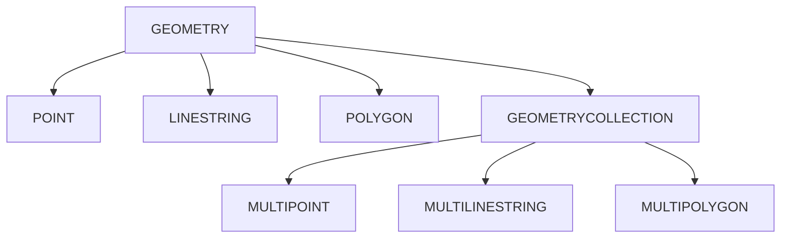

# Geometry, Point, LineString, Polygon, and Collection Types

MySQL supports spatial data types for storing and querying geometries such as coordinate points, paths, geographic regions, and geometry collections. These values are more than just `x, y` number pairs: they carry a geometry type, a spatial reference system identifier (SRID), axis-order rules, and spatial operations.

The generic `GEOMETRY` type can hold multiple kinds of geometries. Specific types include `POINT`, `LINESTRING`, `POLYGON`, and the collection types `MULTIPOINT`, `MULTILINESTRING`, `MULTIPOLYGON`, and `GEOMETRYCOLLECTION`. Choosing the right type allows the schema to clearly express expected data and enables MySQL to enforce the subtype on writes.

Spatial data is well suited for store locations, pickup/dropoff points, routes, area boundaries, service zones, or map features. For the data to be meaningful, you must establish the SRID and coordinate order from the outset. The same pair of numbers can represent different locations if longitude/latitude are confused or the wrong coordinate system is used.

## 1. How Spatial Data Differs from Regular Numeric Data

A `DECIMAL` column can store longitude and latitude separately, but the database does not inherently know that those two values form a geographic point. The `POINT` type represents a structured geometric object; spatial functions can test intersections, containment within an area, and distances, or export the data to WKT/GeoJSON.

Example:

```sql
CREATE TABLE delivery_locations (
    location_id BIGINT UNSIGNED NOT NULL AUTO_INCREMENT,
    label VARCHAR(150) NOT NULL,
    position POINT NOT NULL SRID 4326,
    PRIMARY KEY (location_id)
) ENGINE=InnoDB;
```

`position` is a `POINT` geometry belonging to SRID 4326. MySQL can verify that values assigned to the column match the declared geometry type and SRID.

If you only need to store two numbers for simple business calculations, two numeric columns may suffice. If you need spatial predicates, spatial indexes, coordinate transformations, or GIS data exchange, geometry types provide more appropriate semantics.

## 2. Geometry Type Hierarchy

MySQL organizes spatial types in a hierarchy:



`GEOMETRY` is the generic base type. Single types describe one geometry; `MULTI...` types hold multiple components of the same kind; `GEOMETRYCOLLECTION` can hold geometries of different types.

| Type | Description | Example Use Case |
| --- | --- | --- |
| `GEOMETRY` | Any supported geometry | Shared column for multiple object types |
| `POINT` | A single location | Stores, stations, delivery points |
| `LINESTRING` | A path made of ordered points | Roads, pipelines, routes |
| `POLYGON` | A region with an outer boundary and optional holes | Service zones, land parcels, geographic regions |
| `MULTIPOINT` | A collection of points | Measurement sites or point clusters |
| `MULTILINESTRING` | A collection of paths | Road segments or route branches |
| `MULTIPOLYGON` | A collection of regions | Archipelagos, multiple disjoint areas |
| `GEOMETRYCOLLECTION` | A collection that can mix types | Analysis results containing points, lines, and regions |

## 3. POINT: Representing a Single Location

`POINT` represents a single location with two coordinates in two-dimensional space. In a Cartesian system, the two coordinates are typically called X and Y. In a geographic system such as EPSG:4326, you must pay attention to the axis order defined by the SRS and any axis-order options when reading or writing.

WKT for a point:

```text
POINT(10 20)
```

Create a table and insert a Cartesian SRID 0 point:

```sql
CREATE TABLE map_points (
    point_id BIGINT UNSIGNED NOT NULL AUTO_INCREMENT,
    name VARCHAR(120) NOT NULL,
    position POINT NOT NULL,
    PRIMARY KEY (point_id)
) ENGINE=InnoDB;

INSERT INTO map_points (name, position)
VALUES ('origin', ST_GeomFromText('POINT(10 20)', 0));
```

Read it back:

```sql
SELECT
    point_id,
    name,
    ST_AsText(position) AS position_wkt,
    ST_SRID(position) AS srid,
    ST_X(position) AS x_value,
    ST_Y(position) AS y_value
FROM map_points;
```

With SRID 0, `ST_X()` and `ST_Y()` return Cartesian X/Y coordinates. Do not interpret these two values as longitude/latitude without confirming the SRID and axis order.

## 4. LINESTRING: A Path of Ordered Points

`LINESTRING` contains a sequence of coordinates connected in order. A non-empty LineString requires at least two points; the point order determines the shape and direction of the path.

Example WKT:

```text
LINESTRING(0 0, 10 10, 20 5)
```

Create a table to store routes:

```sql
CREATE TABLE routes (
    route_id BIGINT UNSIGNED NOT NULL AUTO_INCREMENT,
    route_name VARCHAR(150) NOT NULL,
    path LINESTRING NOT NULL,
    PRIMARY KEY (route_id)
) ENGINE=InnoDB;

INSERT INTO routes (route_name, path)
VALUES (
    'sample-route',
    ST_GeomFromText('LINESTRING(0 0, 10 10, 20 5)', 0)
);
```

A LineString can contain many intermediate points to approximate a curve using straight segments. It does not inherently carry attributes like "one-way street", "speed", or "travel time"; such business properties belong in separate columns.

A path may self-intersect or pass through the same coordinate multiple times. That does not necessarily make the LineString structurally invalid, though it can affect application semantics and subsequent operations.

## 5. POLYGON: A Region with Boundaries and Interior Holes

`POLYGON` describes a planar region. The first component is the exterior ring (outer boundary); any subsequent rings are interior rings (holes inside the region).

A ring is a closed LineString: the first and last coordinates must match. A ring requires at least four coordinates, including the repeated closing point. Geometric validity rules also require rings not to self-intersect under the OGC model and require holes to lie properly inside the bounding area.

Simple polygon WKT:

```text
POLYGON((0 0, 10 0, 10 10, 0 10, 0 0))
```

Polygon with one hole:

```text
POLYGON(
  (0 0, 20 0, 20 20, 0 20, 0 0),
  (5 5, 5 10, 10 10, 10 5, 5 5)
)
```

The first ring is the exterior boundary; the second ring describes the empty area inside. The coordinate order in WKT must remain consistent with the geometry's SRID and axis order.

## 6. MULTIPOINT: Multiple Points in One Geometry

`MULTIPOINT` holds a collection of `POINT` values. Example representing three measurement stations:

```text
MULTIPOINT((10 40), (40 30), (20 20))
```

Create and query:

```sql
CREATE TABLE survey_clusters (
    cluster_id BIGINT UNSIGNED NOT NULL AUTO_INCREMENT,
    cluster_name VARCHAR(120) NOT NULL,
    stations MULTIPOINT NOT NULL,
    PRIMARY KEY (cluster_id)
) ENGINE=InnoDB;

INSERT INTO survey_clusters (cluster_name, stations)
VALUES (
    'north-sites',
    ST_GeomFromText('MULTIPOINT((10 40), (40 30), (20 20))', 0)
);
```

`MULTIPOINT` is useful when multiple points are treated as a single logical object. If each point needs its own ID, status, timestamp, or independent relationships, storing each point as a separate `POINT` row is usually more flexible.

## 7. MULTILINESTRING: Multiple Path Segments

`MULTILINESTRING` holds multiple `LINESTRING` values. The components may be disjoint or geometrically connected; the data type itself does not enforce that they form a continuous road network.

```text
MULTILINESTRING(
  (0 0, 10 10, 20 5),
  (30 10, 40 20)
)
```

Applications can use this type to represent route branches or multiple segments belonging to a single linear entity. If individual segments need separate attributes such as street name, speed limit, or construction status, consider storing each segment in its own table linked by a foreign key.

## 8. MULTIPOLYGON: Multiple Disjoint Regions

`MULTIPOLYGON` holds multiple `POLYGON` values. It fits a geographic entity composed of multiple non-contiguous regions, such as an administrative division spanning several islands.

```text
MULTIPOLYGON(
  ((0 0, 10 0, 10 10, 0 10, 0 0)),
  ((20 20, 30 20, 30 30, 20 30, 20 20))
)
```

Each component is a polygon with an exterior ring and optional interior rings. If an area has only one polygon, use `POLYGON`; if multiple polygons belong to the same entity, `MULTIPOLYGON` describes the structure more accurately.

## 9. GEOMETRYCOLLECTION: Heterogeneous Geometry Collection

`GEOMETRYCOLLECTION` can contain different geometry types within the same value:

```text
GEOMETRYCOLLECTION(
  POINT(10 20),
  LINESTRING(0 0, 10 10),
  POLYGON((20 20, 30 20, 30 30, 20 30, 20 20))
)
```

This type is useful for aggregated results or multi-component GIS data. However, it forces consumers to check each component's type before processing. If each business row should only contain one specific geometry kind, use a subtype column such as `POINT` or `POLYGON` to enforce stricter data constraints.

## 10. GEOMETRY: The Generic Type

A `GEOMETRY` column can hold any supported spatial subtype. This is flexible, but it does not indicate whether a row must be a point, line, or polygon.

Example:

```sql
CREATE TABLE map_features (
    feature_id BIGINT UNSIGNED NOT NULL AUTO_INCREMENT,
    feature_name VARCHAR(150) NOT NULL,
    shape GEOMETRY NOT NULL,
    PRIMARY KEY (feature_id)
) ENGINE=InnoDB;
```

You can store `POINT`, `LINESTRING`, or `POLYGON` in `shape`. When reading, use `ST_GeometryType(shape)` to inspect the subtype. If the application needs separate indexes or logic per type, you can split tables by subtype or use a discriminator column with constraints.

## 11. Choosing a Specific Type vs. the Generic Type

| Requirement | Type to Consider | Reason |
| --- | --- | --- |
| Every row is always a single location | `POINT` | Clear subtype constraint |
| Every row is a continuous path | `LINESTRING` | Represents an ordered coordinate sequence |
| Every row is a region | `POLYGON` | Supports exterior ring and holes |
| One entity consists of multiple points | `MULTIPOINT` | Groups points into a single value |
| One entity consists of multiple paths | `MULTILINESTRING` | Groups line strings |
| One entity consists of multiple regions | `MULTIPOLYGON` | Groups polygons |
| One feature has multiple subtypes | `GEOMETRYCOLLECTION` | Allows mixed component types |
| Table must store varying subtypes | `GEOMETRY` | Flexible; requires type checks on read |

Prefer a specific type when the domain contract is clear. Use the generic type only when geometry polymorphism is a real requirement, not simply because the schema has not been finalized yet.

## 12. WKT: Textual Geometry Representation

Well-Known Text (WKT) is a human-readable text format for describing geometries, convenient for examples, import/export, and debugging.

Examples:

```text
POINT(10 20)
LINESTRING(0 0, 10 10, 20 5)
POLYGON((0 0, 10 0, 10 10, 0 10, 0 0))
MULTIPOINT((10 40), (40 30))
```

MySQL provides constructors like `ST_GeomFromText()` and subtype-specific functions to parse WKT into a geometry:

```sql
SELECT ST_GeomFromText('POINT(10 20)', 0);
```

Export a geometry to WKT:

```sql
SELECT ST_AsText(position)
FROM map_points;
```

WKT does not by itself ensure the application interprets the SRID correctly. When exchanging coordinates, store/send the SRID separately or use an API with an explicit SRID field. For geographic SRSs, specify the axis order when parsing and serializing.

## 13. WKB: Binary Geometry Representation

Well-Known Binary (WKB) is the binary representation of a geometry. WKB is suited for data exchange between systems or spatial drivers without having to parse WKT strings.

MySQL provides:

```sql
SELECT ST_AsWKB(position)
FROM map_points;
```

and the constructor:

```sql
SELECT ST_GeomFromWKB(?, 0);
```

Where `?` is a binary value bound by the driver. Standard WKB does not embed an SRID; therefore, pass the SRID separately when constructing the geometry or use an exchange format that carries SRID metadata.

MySQL's internal geometry representation should not be confused with pure WKB. MySQL stores extra SRID information in its internal format; applications should use `ST_AsWKB()` / `ST_GeomFromWKB()` rather than slicing bytes manually based on internal layout.

## 14. GeoJSON: Exchanging Data with Mapping Applications

GeoJSON is a widely used JSON format for geographic data. A GeoJSON Point:

```json
{
  "type": "Point",
  "coordinates": [106.7009, 10.7769]
}
```

A Feature with properties and geometry:

```json
{
  "type": "Feature",
  "properties": {"name": "Central station"},
  "geometry": {
    "type": "Point",
    "coordinates": [106.7009, 10.7769]
  }
}
```

MySQL provides `ST_AsGeoJSON()` to export geometries to GeoJSON and `ST_GeomFromGeoJSON()` to import GeoJSON in supported versions. By standard convention, GeoJSON places longitude before latitude for geographic coordinates.

When exchanging data with mapping systems, verify the SRID and axis order on both ends. Do not assume GeoJSON coordinate order matches the default axis order of every geographic SRS in MySQL.

## 15. Creating Geometries with Constructor Functions

Common constructors:

| Function | Purpose |
| --- | --- |
| `ST_GeomFromText()` | Parse WKT into a geometry |
| `ST_PointFromText()` | Parse WKT Point |
| `ST_GeomFromWKB()` | Parse WKB into a geometry |
| `ST_PointFromWKB()` | Parse WKB Point |
| `ST_GeomFromGeoJSON()` | Parse GeoJSON into a geometry |
| `ST_SRID()` | Read or assign SRID via supported overloads |
| `ST_Transform()` | Transform coordinates to a target SRS on supported versions |

Examples creating a Cartesian point and polygon:

```sql
SELECT ST_GeomFromText('POINT(5 8)', 0) AS point_value;

SELECT ST_GeomFromText(
    'POLYGON((0 0, 10 0, 10 10, 0 10, 0 0))',
    0
) AS polygon_value;
```

Constructors have version-dependent overloads and options. Before using them in migrations, verify the syntax against the target MySQL version and ensure the input SRID matches the column.

## 16. SRID: Spatial Reference System Identifier

The SRID (Spatial Reference System Identifier) defines the coordinate system and how geometry coordinates are interpreted. The same pair of numbers can mean very different things depending on the SRID. Column syntax `... SRID n` is available starting in MySQL 8.0.3.

Two common cases:

- **SRID 0:** the default Cartesian system; coordinates are planar units and do not inherently represent longitude/latitude.
- **SRID 4326:** the WGS 84 geographic system commonly used with longitude/latitude and GPS. EPSG:4326 officially defines its axis order as latitude followed by longitude; by default, MySQL follows the SRS axis order when parsing/serializing unless another option is specified.

Check the SRID:

```sql
SELECT ST_SRID(position)
FROM delivery_locations;
```

A geometry without the proper SRID can produce wrong calculations or errors when combined with geometries from a different SRS. Do not assign SRID 4326 merely because two numbers look like longitude/latitude; verify the data source and axis order first.

## 17. Axis Order: Longitude and Latitude

This is a frequent pitfall when using EPSG:4326. Many map APIs and GeoJSON payloads send coordinates in longitude, latitude order. However, EPSG:4326 defines the axis order as latitude, longitude. MySQL 8.0 supports the `axis-order` option for applicable WKT/GeoJSON read and write functions. `ST_Longitude()` and `ST_Latitude()` were added in MySQL 8.0.12.

Example creating a point in Ho Chi Minh City, with input ordered as longitude then latitude:

```sql
SELECT
    ST_SRID(g.point_value) AS srid,
    ST_Longitude(g.point_value) AS longitude,
    ST_Latitude(g.point_value) AS latitude
FROM (
    SELECT ST_GeomFromText(
        'POINT(106.7009 10.7769)',
        4326,
        'axis-order=long-lat'
    ) AS point_value
) AS g;
```

`ST_Longitude()` and `ST_Latitude()` extract the respective geographic components accurately. Do not assume longitude always equals `ST_X()` and latitude always equals `ST_Y()` when an SRS uses an axis order different from standard X/Y.

When running a MySQL version that does not support axis-order options, consult the documentation for that exact version and normalize coordinates in the application layer using a single convention. Never mix lat-long and long-lat data in the same column.

## 18. Assigning an SRID vs. Transforming Coordinates

Assigning an SRID only changes the metadata describing the coordinate system; it does not transform coordinate values. The `ST_SRID(geometry, srid)` overload sets the SRID on a geometry without reprojecting its coordinates. Changing coordinate systems requires an actual coordinate transformation.

Meaning by example:

- Tagging a point with coordinates `(106.7, 10.77)` as SRID 4326 does not mean MySQL corrected its axis order or verified the coordinate source.
- Converting a point from a geographic SRS to a projected SRS requires a coordinate transformation such as `ST_Transform()` on supported versions.

Example:

```sql
SELECT ST_Transform(position, 3857)
FROM delivery_locations;
```

EPSG:3857 is a projected system widely used in web mapping. `ST_Transform()` is supported starting in MySQL 8.0.13. Use it only when MySQL has the required SRS definitions and transformation support; verify the output, units, and area of use. Do not substitute a metadata-only SRID assignment when the actual goal is coordinate transformation.

## 19. Inspecting Geometry Subtypes and Components

Several introspection functions help inspect structure:

```sql
SELECT
    ST_GeometryType(position) AS geometry_type,
    ST_SRID(position) AS srid,
    ST_IsEmpty(position) AS is_empty,
    ST_IsValid(position) AS is_valid
FROM delivery_locations;
```

For collection geometries, functions like `ST_NumGeometries()` and `ST_GeometryN()` count and retrieve components. For LineStrings, `ST_NumPoints()` and `ST_PointN()` inspect point count and positions. For Polygons, functions like `ST_ExteriorRing()`, `ST_NumInteriorRings()`, and `ST_InteriorRingN()` read rings.

Support for specific functions can vary by MySQL version and geometry type. Use `ST_GeometryType()` to confirm the subtype before calling functions restricted to a particular type.

## 20. Valid vs. Invalid Geometries

A geometry with valid WKT syntax is not guaranteed to be topologically valid under OGC rules. For example, a polygon with a self-intersecting ring or an unclosed ring may be invalid.

Check validity:

```sql
SELECT ST_IsValid(
    ST_GeomFromText(
        'POLYGON((0 0, 10 10, 10 0, 0 10, 0 0))',
        0
    )
) AS is_valid;
```

`ST_IsValid()` reports whether the geometry is valid according to supported checks. Do not treat successful parsing by a constructor as proof that a polygon has valid topology.

A GIS ingestion pipeline should validate:

- Whether the geometry type matches the data contract.
- Whether the SRID matches the data source.
- Whether polygon rings are closed.
- Whether LineStrings have enough points.
- Whether polygons self-intersect or contain holes outside the exterior ring.
- Whether coordinates fall within the valid range of the coordinate system.

## 21. Fundamental Geometric Operations

MySQL provides function groups to test relationships and measure geometries:

| Category | Example Functions | Question |
| --- | --- | --- |
| Topological relationships | `ST_Contains`, `ST_Within`, `ST_Intersects`, `ST_Touches`, `ST_Crosses`, `ST_Overlaps`, `ST_Disjoint` | How do two geometries relate? |
| Distance | `ST_Distance`, `ST_Distance_Sphere` | How far apart are two geometries? |
| Bounding box | `ST_Envelope` | What is the minimum bounding rectangle around the geometry? |
| Properties | `ST_Area`, `ST_Length`, `ST_Perimeter` | What are the area, length, and perimeter? |
| Validation | `ST_IsEmpty`, `ST_IsValid`, `ST_GeometryType` | Is the geometry empty, valid, and of what type? |

Example testing whether a point lies inside a region:

```sql
SELECT ST_Contains(
    ST_GeomFromText(
        'POLYGON((0 0, 10 0, 10 10, 0 10, 0 0))',
        0
    ),
    ST_GeomFromText('POINT(5 5)', 0)
) AS point_inside;
```

`ST_Contains(polygon, point)` checks the exact geometric relationship as defined by the function. A point lying exactly on the boundary has different semantics from an interior point; choose the predicate that matches your business rules.

## 22. Distance and Measurement Units

Result units depend on the coordinate system and function used. With Cartesian SRID 0, distances are in planar coordinate units. If two coordinates are actually longitude/latitude but stored with SRID 0, Euclidean distance is not a reliable geographic distance.

`ST_Distance()` returns distance in the units defined by the SRS and overload used; `ST_Distance_Sphere()` estimates spherical distance and returns meters. Example:

```sql
SELECT ST_Distance_Sphere(
    ST_GeomFromText('POINT(106.7009 10.7769)', 4326,
                   'axis-order=long-lat'),
    ST_GeomFromText('POINT(106.6810 10.7626)', 4326,
                   'axis-order=long-lat')
) AS distance_meters;
```

`ST_Distance_Sphere()` is a spherical approximation and does not replace exact geodetic measurements in every scenario. For projected coordinate systems, confirm the SRS unit (meters, feet, or another unit) before displaying results.

## 23. Spatial Indexes: Storing and Querying by Region

MySQL's spatial index uses an R-tree structure to support queries by minimum bounding rectangle (MBR). In InnoDB, a spatial index is created with `SPATIAL INDEX`, and the geometry column must be `NOT NULL`.

Example:

```sql
CREATE TABLE places (
    place_id BIGINT UNSIGNED NOT NULL AUTO_INCREMENT,
    place_name VARCHAR(150) NOT NULL,
    location POINT NOT NULL SRID 4326,
    PRIMARY KEY (place_id),
    SPATIAL INDEX spx_places_location (location)
) ENGINE=InnoDB;
```

Starting in MySQL 8.0.13, the optimizer can use a spatial index on an SRID-restricted column. Specific support and requirements depend on the version; verify on the target server with `EXPLAIN`.

A spatial index primarily filters candidates by MBR. For complex shapes, the MBR may include empty space not part of the actual geometry. Therefore, an exact filtering step using `ST_Contains()` or `ST_Intersects()` is often needed after MBR filtering.

## 24. MBR Predicates and Exact Checks

The MBR (Minimum Bounding Rectangle) is the smallest axis-aligned rectangle enclosing a geometry. Functions such as `MBRContains()`, `MBRWithin()`, and `MBRIntersects()` compare bounding rectangles rather than full geometry topology.

Example finding points within a search region's MBR, then confirming exact containment:

```sql
SELECT p.place_id, p.place_name
FROM places AS p
JOIN (
    SELECT ST_GeomFromText(
        'POLYGON((106.68 10.76, 106.73 10.76, 106.73 10.80,
                 106.68 10.80, 106.68 10.76))',
        4326,
        'axis-order=long-lat'
    ) AS search_area
) AS q
  ON MBRContains(q.search_area, p.location)
 AND ST_Contains(q.search_area, p.location);
```

`MBRContains()` narrows down candidates and can leverage the spatial index. `ST_Contains()` confirms the exact relationship against the true polygon. For simple rectangular regions, the MBR and polygon may coincide; for concave polygons or polygons with holes, the exact predicate step is essential.

Not every spatial predicate is accelerated by a spatial index in the same way by the optimizer. Always check `EXPLAIN` on your exact server version and real dataset.

## 25. Notes on SRID and Spatial Indexes

- Geometries participating in an operation must have compatible SRIDs; differing SRSs can cause errors or meaningless results.
- An SRID-restricted column lets the database guarantee a consistent coordinate system and is a key requirement for the optimizer to use spatial indexes in MySQL 8.0.
- A spatial index requires a `NOT NULL` geometry column in InnoDB.
- MBR predicates generate the candidate set; exact predicates verify the actual geometry.
- A spatial index does not replace B-tree indexes on ID, tenant, status, or timestamp columns.
- If queries filter by both tenant and region, you need a separate relational index for tenant and a spatial index for geometry; the optimizer chooses the plan based on cost.

## 26. Working with Geometries from Java/JDBC

A Java application can pass WKT via parameter binding and let MySQL construct the geometry:

```java
String sql = "INSERT INTO places (place_name, location) "
        + "VALUES (?, ST_GeomFromText(?, 4326, 'axis-order=long-lat'))";

try (PreparedStatement statement = connection.prepareStatement(sql)) {
    statement.setString(1, "Central station");
    statement.setString(2, "POINT(106.7009 10.7769)");
    statement.executeUpdate();
}
```

Reading a geometry as WKT/GeoJSON:

```java
String sql = "SELECT ST_AsText(location, 'axis-order=long-lat') AS wkt, "
        + "ST_AsGeoJSON(location) AS geojson "
        + "FROM places WHERE place_id = ?";

try (PreparedStatement statement = connection.prepareStatement(sql)) {
    statement.setLong(1, placeId);
    try (ResultSet rs = statement.executeQuery()) {
        if (rs.next()) {
            String wkt = rs.getString("wkt");
            String geoJson = rs.getString("geojson");
        }
    }
}
```

Bind values instead of concatenating WKT directly into SQL. Validate coordinate numbers and SRID in the application layer; the database should still enforce subtype/SRID checks to protect data integrity. When using WKB, use JDBC's binary API (`setBytes`/`getBytes`) with the appropriate WKB constructors and exporters.

## 27. Common Mistakes and Misconceptions

| Misconception / Error | Reality | How to Handle |
| --- | --- | --- |
| POINT is always longitude, latitude | Order depends on SRID/axis order | Specify SRID explicitly and use axis-order options |
| SRID 0 is GPS | SRID 0 is the default Cartesian system | Use a proper geographic SRS like 4326 for geographic coordinates |
| Assigning SRID transforms coordinates | Assigning SRID only changes metadata | Use `ST_Transform()` to reproject coordinates |
| Valid WKT means valid polygon | Successful syntax parsing does not ensure valid topology | Check with `ST_IsValid()` |
| POLYGON has only one ring | It has an exterior ring and optional interior hole rings | Understand exterior/interior ring structure |
| MULTI types are always better than multiple rows | Components inside a MULTI type cannot have individual keys/attributes | Choose based on lifecycle and query patterns |
| GEOMETRYCOLLECTION is single-subtype | It can hold mixed geometry types | Check each component with `ST_GeometryType()` |
| WKB always carries SRID | Standard WKB does not contain SRID | Pass SRID separately or use a format with metadata |
| Spatial index checks exact topology | R-tree filters by MBR | Combine MBR candidate filtering with exact predicates |
| ST_Distance on SRID 0 always returns meters | Results are in Cartesian units | Use the right SRS and distance function |
| Every geometry column can use a spatial index | Depends on NOT NULL, SRID restriction, and version | Verify DDL and `EXPLAIN` |

## 28. Spatial Column Design Checklist

1. Determine whether the entity is a point, path, region, or collection.
2. Choose a specific subtype if the domain structure is stable.
3. Identify the source coordinate system and exact SRID.
4. Standardize the axis-order convention across Java, GeoJSON, and MySQL.
5. Create an SRID-restricted geometry column if all data shares one SRS.
6. Use `NOT NULL` if geometry is required; add a spatial index when the workload needs it.
7. Validate subtype, topology, coordinates, and missing data.
8. Pick WKT/WKB/GeoJSON based on exchange needs; manage SRID separately if the format omits it.
9. Use spatial predicates with the right semantics; distinguish MBR checks from exact geometry checks.
10. Verify measurement units and coordinate transformations.
11. Use `EXPLAIN` to confirm spatial index selection.
12. Test edge cases: boundary points, polygons with holes, empty geometries, and mismatched SRIDs.

## 29. Hands-On Exercises

1. Create a table storing `POINT` with SRID 0; insert rows and read them back with `ST_AsText`, `ST_X`, and `ST_Y`.
2. Create a `LINESTRING` with at least three points; inspect it with `ST_NumPoints()` and `ST_PointN()`.
3. Create a `POLYGON` with an exterior ring and one interior ring; validate it with `ST_IsValid()`.
4. Create one geometry for each of `MULTIPOINT`, `MULTILINESTRING`, `MULTIPOLYGON`, and `GEOMETRYCOLLECTION`.
5. Use `ST_GeometryType()` and `ST_SRID()` to inspect subtype and SRID.
6. Convert geometries to WKT, WKB, and GeoJSON; compare formats and SRID metadata.
7. Create an EPSG:4326 point using `axis-order=long-lat`; verify with `ST_Longitude()` and `ST_Latitude()`.
8. Parse the same geographic WKT with different axis orders and observe the difference.
9. Compare assigning an SRID with `ST_Transform()` on a supported environment; record the coordinate changes.
10. Create a `places` table with a `POINT` SRID 4326 column and a `SPATIAL INDEX`.
11. Use `MBRContains()` to filter candidates and `ST_Contains()` to confirm exact containment.
12. Measure distance between two geographic points using `ST_Distance_Sphere()`; note that the result is in approximate meters.
13. Use `EXPLAIN` to verify whether an MBR query uses the spatial index.
14. Write Java/JDBC code to insert a point using WKT parameter binding and read back GeoJSON.

## 30. Summary

MySQL spatial data uses a geometry type system consisting of `GEOMETRY`, `POINT`, `LINESTRING`, `POLYGON`, `MULTIPOINT`, `MULTILINESTRING`, `MULTIPOLYGON`, and `GEOMETRYCOLLECTION`. `POINT` represents a location; `LINESTRING` is an ordered sequence of points; `POLYGON` is a region with an exterior ring and optional interior hole rings; `MULTI` types group shapes of the same kind; `GEOMETRYCOLLECTION` allows mixed types. Choose a specific subtype whenever the domain structure is stable.

WKT is human-readable, WKB is binary, and GeoJSON is convenient for mapping systems. Every geometry must be paired with the proper SRID; SRID 0 is Cartesian, while SRID 4326 is WGS 84 geographic. Pay close attention to EPSG:4326 axis order and GeoJSON's longitude/latitude convention. Assigning an SRID does not transform coordinates; use `ST_Transform()` when converting coordinate systems. Verify topology with `ST_IsValid()`, distinguish MBR predicates from exact predicates, and confirm spatial index usage with `EXPLAIN`. Solid design starts with clear geometry types, SRIDs, axis order, and query semantics.
