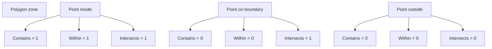

# ST_Contains, ST_Within, ST_Intersects, and Spatial Relationship Conditions

A mapping or delivery system often needs to answer questions like: is a delivery point inside a service zone, do two regions overlap, or does a route intersect a restricted area? These are questions about **spatial relationships** between two geometries.

MySQL provides spatial relationship functions such as `ST_Contains()`, `ST_Within()`, and `ST_Intersects()`. All three evaluate topological relationships between two geometries, but their semantics and argument orders differ. Swapping argument order can invert query results or miss points lying on boundaries.

This lesson explains the true/false conditions of each function, how they relate to one another, how to handle boundaries, SRIDs, and coordinate systems, how to write point-in-polygon and polygon-polygon queries, and how to combine exact predicates with spatial indexes.

## 1. Geometries and Spatial Relationships

MySQL represents spatial data using the `GEOMETRY` type and its subtypes:

| Type | Meaning | Example |
|---|---|---|
| `POINT` | A single location | Store location |
| `LINESTRING` | A path made of connected points | Delivery route |
| `POLYGON` | A region with a closed boundary | Service zone |
| `MULTIPOINT` | Multiple points | Pickup stations |
| `MULTILINESTRING` | Multiple paths | Route network |
| `MULTIPOLYGON` | Multiple regions | Disjoint administrative regions |
| `GEOMETRYCOLLECTION` | Collection of possibly mixed geometry types | Aggregated results |

Relationship functions accept geometries as arguments. They determine whether one geometry lies inside, contains, or intersects another under topological rules; they do not directly return distance or travel time.

Examples:

- `ST_Contains(zone, point)`: whether the zone contains the point.
- `ST_Within(point, zone)`: whether the point lies within the zone.
- `ST_Intersects(route, restricted_area)`: whether the route intersects the restricted area.

## 2. Creating Geometries for Testing

You can construct geometries from Well-Known Text (WKT) using `ST_GeomFromText()`:

```sql
SET @zone = ST_GeomFromText(
    'POLYGON((
        0 0,
        10 0,
        10 10,
        0 10,
        0 0
    ))'
);

SET @inside_point = ST_GeomFromText('POINT(5 5)');
SET @edge_point = ST_GeomFromText('POINT(0 5)');
SET @outside_point = ST_GeomFromText('POINT(12 5)');
```

The geometries in this example use the default SRID 0, suited for illustrating planar Cartesian coordinates. A polygon must have a closed exterior ring: the last point must match the first.

Inspect the representations:

```sql
SELECT
    ST_AsText(@zone) AS zone_wkt,
    ST_AsText(@inside_point) AS inside_wkt,
    ST_SRID(@zone) AS zone_srid,
    ST_SRID(@inside_point) AS point_srid;
```

In production applications, store geometries with the appropriate SRID and use matching SRIDs across comparisons.

## 3. ST_Contains(): The First Geometry Contains the Second

Syntax:

```sql
ST_Contains(g1, g2)
```

The function returns `1` when `g1` contains `g2` under topological containment rules, and `0` otherwise. If any argument is SQL `NULL` or an empty geometry, the result is `NULL`; error conditions involving SRIDs and validity are covered in Section 13.

Example:

```sql
SELECT ST_Contains(@zone, @inside_point) AS contains_inside;
```

Result:

```text
1
```

`ST_Contains(A, B)` means `A` is the containing geometry and `B` is the candidate geometry being tested. Argument order is critical:

```sql
-- Zone contains point
SELECT ST_Contains(@zone, @inside_point);

-- Swapping arguments asks a different question
SELECT ST_Contains(@inside_point, @zone);
```

Do not reverse arguments merely because the function name reads like "contains". Follow the pattern: `ST_Contains(container, candidate)`.

### 3.1. Topological Conditions for Contains

Under OGC/DE-9IM topological definitions, `ST_Contains(A, B)` is true when:

- No point of `B` lies in the exterior of `A`.
- The interior of `B` has at least one point lying in the interior of `A`.

The second condition explains why a point lying solely on a polygon's boundary is not considered contained by the polygon. All points of `B` must lie in `A` or on `A`'s boundary, and their interiors must also intersect.

### 3.2. Point-in-Polygon Example

```sql
SELECT
    ST_Contains(@zone, @inside_point) AS inside_result,
    ST_Contains(@zone, @edge_point) AS edge_result,
    ST_Contains(@zone, @outside_point) AS outside_result;
```

For the square polygon in the example:

| Point | Position | `ST_Contains(zone, point)` |
|---|---|---:|
| `(5, 5)` | Interior | 1 |
| `(0, 5)` | On boundary | 0 |
| `(12, 5)` | Exterior | 0 |

If business rules require points on the boundary to count as inside the zone, `ST_Contains()` does not express that rule. Choose an appropriate predicate or define a dedicated boundary policy.

## 4. ST_Within(): The First Geometry Lies Within the Second

Syntax:

```sql
ST_Within(g1, g2)
```

`ST_Within(A, B)` checks whether `A` lies inside `B`. It is the inverse relationship of `ST_Contains()`:

```sql
ST_Within(A, B) = ST_Contains(B, A)
```

Example:

```sql
SELECT
    ST_Within(@inside_point, @zone) AS point_within_zone,
    ST_Contains(@zone, @inside_point) AS zone_contains_point;
```

Both expressions must return the same result because they express the same relationship with swapped arguments.

Follow the pattern: `ST_Within(candidate, container)`. To test whether a point is inside a zone, put the point first and the zone second.

### 4.1. Boundaries with Within

A point lying strictly on a polygon's boundary is likewise not considered within the polygon by `ST_Within()`:

```sql
SELECT
    ST_Within(@inside_point, @zone) AS inside_result,
    ST_Within(@edge_point, @zone) AS edge_result,
    ST_Within(@outside_point, @zone) AS outside_result;
```

The results are `1, 0, 0` respectively. This rule mirrors `ST_Contains()` with reversed arguments.

## 5. ST_Intersects(): Two Geometries Share at Least One Point

Syntax:

```sql
ST_Intersects(g1, g2)
```

`ST_Intersects(A, B)` returns `1` if `A` and `B` share at least one point, and `0` otherwise. This relationship is symmetric:

```sql
ST_Intersects(A, B) = ST_Intersects(B, A)
```

Example:

```sql
SELECT
    ST_Intersects(@zone, @inside_point) AS inside_result,
    ST_Intersects(@zone, @edge_point) AS edge_result,
    ST_Intersects(@zone, @outside_point) AS outside_result;
```

Result:

| Point | Relationship to Polygon | `ST_Intersects(zone, point)` |
|---|---|---:|
| `(5, 5)` | Interior | 1 |
| `(0, 5)` | On boundary | 1 |
| `(12, 5)` | Exterior, not touching boundary | 0 |

Unlike `ST_Contains()` and `ST_Within()`, `ST_Intersects()` includes touching along the boundary. Therefore, it is well suited when you need to find every object that touches or overlaps a search region.

## 6. Comparing the Three Functions

| Function | Question | Argument Order | Characteristics |
|---|---|---|---|
| `ST_Contains(A, B)` | Does A contain B? | Container first, candidate second | Interiors of both geometries must intersect |
| `ST_Within(A, B)` | Is A within B? | Candidate first, container second | Inverse of Contains |
| `ST_Intersects(A, B)` | Do A and B share any point? | Symmetric | Requires at least one shared point |

For a polygon and three test points:

| Point Position | Contains(polygon, point) | Within(point, polygon) | Intersects(polygon, point) |
|---|---:|---:|---:|
| Interior | 1 | 1 | 1 |
| On boundary | 0 | 0 | 1 |
| Exterior | 0 | 0 | 0 |

Key points to remember:

- `Contains` and `Within` express containment from opposite directions.
- `Intersects` is broader: being inside, touching a boundary, or crossing all count as intersecting.
- Never replace `Contains` with `Intersects` if business logic requires the object to lie completely inside the region.

## 7. Understanding Boundary Conditions Accurately

Boundaries are a frequent source of bugs in spatial queries. For a polygon, the boundary consists of its exterior ring and any interior rings (holes).

### 7.1. Points Inside, On the Boundary, and Outside



Example testing a boundary point:

```sql
SELECT
    ST_Contains(@zone, @edge_point) AS is_contained,
    ST_Within(@edge_point, @zone) AS is_within,
    ST_Intersects(@zone, @edge_point) AS intersects;
```

The output is `0, 0, 1`. This is not a calculation bug; it is the definitional difference between containment and intersection.

### 7.2. Objects Lying Entirely on the Boundary

A `LINESTRING` running strictly along a polygon's boundary intersects the polygon, yet fails the contains condition because the line's interior does not intersect the polygon's interior. If business rules treat boundary lines as accepted, express that rule explicitly instead of assuming `ST_Contains()` covers it.

### 7.3. Polygons with Holes

A point inside a polygon's hole does not belong to the polygon, even though it lies inside the polygon's bounding rectangle. For the actual geometry:

- A point inside the filled interior of the polygon can satisfy Contains/Within.
- A point on the outer boundary or a hole's boundary does not satisfy Contains/Within under the interior condition.
- A point inside a hole is outside the polygon.

This also demonstrates why bounding-rectangle checks alone are insufficient to confirm exact topological relationships.

## 8. Combining Relationship Predicates in Queries

Suppose we have the following tables:

- `service_zones`: polygons describing service areas.
- `stores`: points describing store locations.
- `roads`: linestrings describing road routes.

Find stores inside a zone:

```sql
SELECT
    s.id,
    s.name
FROM stores AS s
JOIN service_zones AS z
    ON z.id = 10
WHERE ST_Contains(z.area, s.location);
```

To express it from the store's perspective:

```sql
SELECT
    s.id,
    s.name
FROM stores AS s
JOIN service_zones AS z
    ON z.id = 10
WHERE ST_Within(s.location, z.area);
```

Both queries evaluate the same spatial relationship. Pick the form that makes container/candidate roles clearest to minimize confusion.

Find routes intersecting a restricted area:

```sql
SELECT
    r.id,
    r.route_name
FROM roads AS r
JOIN restricted_areas AS a
    ON a.id = 5
WHERE ST_Intersects(r.path, a.area);
```

A route merely grazing the restricted area's boundary is also returned. If business logic only flags routes entering the interior as violations, model that rule more explicitly.

## 9. Data Modeling and SRID

Every geometry has an SRID (Spatial Reference System Identifier) defining its coordinate system and coordinate meaning. Never compare geometries merely because they have similar-looking numbers.

Examples:

- SRID 0 is typically used for planar Cartesian coordinates unbound to a geographic coordinate system.
- SRID 4326 typically represents WGS 84 geographic coordinates.

Spatial relationship functions are SRID-restricted: both geometries must share the same SRID. Comparing geometries with different SRIDs raises an error rather than transforming automatically. Object-shape functions such as `ST_Contains()`, `ST_Within()`, and `ST_Intersects()` support both Cartesian and geographic SRSs; computations follow the respective SRS.

Check SRIDs:

```sql
SELECT
    ST_SRID(location) AS srid,
    COUNT(*) AS row_count
FROM stores
GROUP BY ST_SRID(location);
```

Never call `ST_SRID(geom, target_srid)` assuming it converts coordinates. Assigning an SRID only updates the geometry's coordinate-system metadata; converting coordinates between two SRSs requires `ST_Transform()` when both source and target are supported.

### 9.1. SRID 4326 Axis Order

A common mistake is swapping longitude/latitude order. Under EPSG's definition of SRID 4326, axes are defined as latitude followed by longitude; many mapping applications instead pass longitude followed by latitude.

MySQL supports an axis-order option when parsing WKT. If input data uses longitude-latitude order, state it explicitly:

```sql
SET @new_york_point = ST_GeomFromText(
    'POINT(-73.9857 40.7484)',
    4326,
    'axis-order=long-lat'
);
```

The `axis-order=long-lat` option explicitly indicates that WKT coordinates are supplied as longitude first, latitude second. When exporting WKT or reading from external sources, keep a consistent axis-order convention and verify with `ST_AsText()`.

Never mix SRID 0 and SRID 4326 geometries in the same relationship check. Nor should you compare geographic degree coordinates as if they were meters.

### 9.2. Creating Tables with Explicit SRIDs

Example:

```sql
CREATE TABLE stores (
    id BIGINT UNSIGNED NOT NULL,
    name VARCHAR(150) NOT NULL,
    location POINT NOT NULL SRID 4326,
    PRIMARY KEY (id),
    SPATIAL INDEX sx_stores_location (location)
) ENGINE=InnoDB;

CREATE TABLE service_zones (
    id BIGINT UNSIGNED NOT NULL,
    zone_name VARCHAR(150) NOT NULL,
    area POLYGON NOT NULL SRID 4326,
    PRIMARY KEY (id),
    SPATIAL INDEX sx_service_zones_area (area)
) ENGINE=InnoDB;
```

MySQL spatial indexes require the indexed geometry column to be `NOT NULL`. In modern versions, declaring a fixed SRID on the column enforces uniform data and is a key requirement for the optimizer to use the spatial index.

## 10. Distinguishing Exact Relationships from MBR

MySQL's spatial index is an R-tree index over each geometry's **minimum bounding rectangle (MBR)**. The MBR is the smallest axis-aligned rectangle enclosing the geometry.

This yields two groups of functions:

| Group | Examples | Meaning |
|---|---|---|
| Exact topological relationships | `ST_Contains`, `ST_Within`, `ST_Intersects` | Evaluates the actual geometry |
| Bounding-rectangle relationships | `MBRContains`, `MBRWithin`, `MBRIntersects` | Evaluates the enclosing rectangles |

MBR checks quickly filter candidates, but do not confirm that the true shapes satisfy the relationship. For concave polygons or polygons with holes, intersecting bounding rectangles do not mean the polygons themselves intersect.

### 10.1. MBR False-Positive Example

An L-shaped polygon has a large rectangular MBR. A point sitting in the empty cutout of that rectangle yet outside the true polygon satisfies `MBRContains()` while `ST_Contains()` returns `0`.

Therefore:

- `MBRContains()` does not replace `ST_Contains()`.
- `MBRIntersects()` does not replace `ST_Intersects()`.
- MBR predicates serve to generate a candidate set; exact predicates confirm the final result.

### 10.2. Combining MBR Filtering and Exact Predicates

Example finding points likely inside a search polygon:

```sql
SET @search_area = ST_GeomFromText(
    'POLYGON((106.60 10.70, 106.70 10.70, 106.70 10.80, 106.60 10.80, 106.60 10.70))',
    4326,
    'axis-order=long-lat'
);

SELECT
    s.id,
    s.name
FROM stores AS s
WHERE MBRContains(@search_area, s.location)
  AND ST_Contains(@search_area, s.location);
```

The MBR condition narrows candidates via the spatial index if supported by the query structure and optimizer version. The `ST_Contains()` condition verifies exact topological containment and eliminates false positives.

For intersection searches:

```sql
SELECT
    r.id,
    r.route_name
FROM roads AS r
WHERE MBRIntersects(@search_area, r.path)
  AND ST_Intersects(@search_area, r.path);
```

Do not assume every query using MBR predicates automatically uses an index. Verify with `EXPLAIN`, column types, SRID, `NOT NULL`, and expression shape. If the optimizer skips the spatial index, inspect the query and data distribution.

This example uses a small region around a geographic area to illustrate axis order. For large regions, polar areas, or regions crossing the 180° meridian, geographic bounding boxes can have subtler semantics; verify results against your actual SRS and server version.

## 11. Spatial Indexes and Usage Conditions

Create a spatial index:

```sql
ALTER TABLE stores
ADD SPATIAL INDEX sx_stores_location (location);
```

Key requirements to remember:

- Storage engine and column type must support spatial indexes.
- The indexed geometry column must be `NOT NULL`.
- The geometry column must be declared with a fixed SRID (SRID-restricted); columns without an explicit SRID cannot be used by the optimizer for spatial access paths.
- MBR-based comparisons match spatial index access; exact predicates still require topological verification.
- A spatial index stores MBRs, not precomputed topological relationships.
- Exact predicates may need to evaluate actual geometries after candidate filtering.

Inspect indexes:

```sql
SHOW INDEX FROM stores;

SELECT
    INDEX_NAME,
    COLUMN_NAME,
    INDEX_TYPE
FROM information_schema.STATISTICS
WHERE TABLE_SCHEMA = DATABASE()
  AND TABLE_NAME = 'stores';
```

Inspect execution plan:

```sql
EXPLAIN
SELECT id, name
FROM stores
WHERE MBRContains(@search_area, location)
  AND ST_Contains(@search_area, location);
```

Spatial indexes are especially effective when a query searches a selective region over a large geometry dataset. If most rows fall inside the region, the optimizer may prefer a different access plan.

### 11.1. Optimizer Differences Between MySQL 9.7 and Older Versions

The MySQL 9.7 optimizer checks the SRID of the indexed column and performs bounding-box comparisons appropriate for that SRS. Prior to MySQL 9.7, the optimizer performed spatial index comparisons using Cartesian semantics; behavior was undefined if the column held a geographic SRID. Therefore, when upgrading from older versions, audit geometry columns, actual SRIDs, and spatial indexes before relying on MBR filtering results for geographic SRSs.

## 12. Combining Spatial and Standard Relational Conditions

In production applications, queries typically combine spatial and business conditions:

- The store must lie within the service zone.
- The store must be active.
- The store must belong to the current tenant.
- The store type must match the request.

Example:

```sql
SELECT
    s.id,
    s.name
FROM stores AS s
WHERE s.tenant_id = ?
  AND s.status = 'ACTIVE'
  AND MBRContains(@search_area, s.location)
  AND ST_Contains(@search_area, s.location)
ORDER BY s.id
LIMIT 100;
```

Tenant and status predicates must never be omitted just because a spatial predicate is present. In multi-tenant systems, enforce tenant authorization on the backend and retain tenant filters in every query.

You can combine radius conditions as well, but distinguish topological relationships from distance:

- `ST_Contains()` answers whether a point lies inside a region.
- `ST_Intersects()` answers whether two geometries intersect.
- `ST_Distance()` or an appropriate distance function answers how far apart two locations are under the corresponding SRS and semantics.

Never substitute `ST_Intersects()` for "within 500 meters of each other".

## 13. NULL, Empty Geometries, and Invalid Data

Before applying predicates, verify geometry state:

- Can the column be SQL `NULL` or is it constrained `NOT NULL`?
- Is the geometry empty?
- Is the polygon valid?
- Is the SRID correct?
- Do coordinates lie within the valid domain of the SRS?

MySQL object-shape relationship functions return `NULL` if any argument is SQL `NULL` or an empty geometry. In a `WHERE` clause, `NULL` does not evaluate to TRUE, so those rows are excluded.

Distinguish other error cases:

- Syntactically malformed geometries can raise `ER_GIS_INVALID_DATA`.
- Undefined SRIDs can raise `ER_SRS_NOT_FOUND`.
- Two geometries with different SRSs raise `ER_GIS_DIFFERENT_SRIDS`; MySQL does not auto-convert.
- Syntactically valid yet geometrically invalid shapes can produce undefined TRUE/FALSE results or raise errors. Never rely on predicate output as a substitute for data validation.

Use validation functions appropriately:

```sql
SELECT
    id,
    ST_SRID(area) AS srid,
    ST_IsValid(area) AS is_valid
FROM service_zones;
```

`ST_IsValid()` detects geometries violating geometric validity rules. For data supplied by users or external systems, validate before persisting and handle constructor/validation failures at the ingestion layer.

Never attempt to fix an invalid geometry merely by reassigning its SRID. If a polygon self-intersects, has an unclosed ring, or uses swapped axes, fix the source data or run a controlled geometry-cleaning workflow.

## 14. Other Topological Relationships for Context

The three functions in this lesson are foundational, but MySQL also provides other predicates:

| Function | General Meaning |
|---|---|
| `ST_Disjoint(A, B)` | Share no points |
| `ST_Touches(A, B)` | Share boundary points, but interiors do not intersect |
| `ST_Crosses(A, B)` | Geometries cross under type-specific topological rules |
| `ST_Overlaps(A, B)` | Intersect, with neither completely containing the other under topological rules |
| `ST_Equals(A, B)` | Both geometries represent the same point set |

Do not infer these predicates solely by swapping arguments. For example, `ST_Intersects()` is symmetric, whereas `ST_Contains()` and `ST_Within()` are directional.

If business logic requires "strictly inside without touching the boundary", verify the exact topological condition rather than relying on function names alone.

## 15. Predicate Selection Guide

| Business Question | Predicate to Evaluate First |
|---|---|
| Is the point inside the region, excluding the boundary? | `ST_Within(point, polygon)` or `ST_Contains(polygon, point)` |
| Does geometry A contain geometry B? | `ST_Contains(A, B)` |
| Do two regions share any point, including touching boundaries? | `ST_Intersects(A, B)` |
| Does a route touch or enter a restricted zone? | `ST_Intersects(route, restricted_area)` |
| Should boundary points count as inside the region? | `ST_Intersects()` detects boundary contact; define an explicit boundary policy |
| How far apart are two locations? | An appropriate distance function, not these three predicates |

Before implementing, write out the question in plain language and assign roles to each argument:

1. Which geometry is the region/container?
2. Which geometry is the object being tested?
3. Does the boundary count as valid?
4. Is any intersection enough, or must the object lie completely inside?
5. Do both geometries share the same SRID?

## 16. End-to-End Example: Checking Delivery Points in a Service Zone

Create an illustrative planar zone:

```sql
CREATE TABLE demo_zones (
    id INT NOT NULL PRIMARY KEY,
    zone_name VARCHAR(100) NOT NULL,
    area POLYGON NOT NULL
) ENGINE=InnoDB;

INSERT INTO demo_zones(id, zone_name, area)
VALUES (
    1,
    'Central',
    ST_GeomFromText(
        'POLYGON((0 0, 10 0, 10 10, 0 10, 0 0))'
    )
);
```

Create test points:

```sql
CREATE TABLE demo_deliveries (
    id INT NOT NULL PRIMARY KEY,
    delivery_code VARCHAR(30) NOT NULL,
    location POINT NOT NULL
) ENGINE=InnoDB;

INSERT INTO demo_deliveries(id, delivery_code, location)
VALUES
    (1, 'IN-001', ST_GeomFromText('POINT(5 5)')),
    (2, 'EDGE-001', ST_GeomFromText('POINT(0 5)')),
    (3, 'OUT-001', ST_GeomFromText('POINT(12 5)'));
```

Find points strictly inside the zone, excluding the boundary:

```sql
SELECT
    d.id,
    d.delivery_code
FROM demo_deliveries AS d
JOIN demo_zones AS z
    ON z.id = 1
WHERE ST_Within(d.location, z.area);
```

Only `IN-001` is returned.

Find all points intersecting the zone, including boundary points:

```sql
SELECT
    d.id,
    d.delivery_code
FROM demo_deliveries AS d
JOIN demo_zones AS z
    ON z.id = 1
WHERE ST_Intersects(d.location, z.area);
```

Both `IN-001` and `EDGE-001` are returned. `OUT-001` lies outside and does not touch the zone.

Both demo tables use SRID 0 solely to verify topological logic. This example is not intended to benchmark spatial indexes; production spatial indexing requires `NOT NULL` columns with a fixed SRID as shown in the `stores` and `service_zones` example in Section 9.2.

## 17. Performance and Reading Execution Plans

Spatial predicates can be CPU-intensive because MySQL must evaluate geometric shapes. For large datasets:

- Use accurate, consistent SRIDs.
- Add spatial indexes on `NOT NULL` geometry columns where appropriate.
- Use MBR predicates as a candidate prefilter when the optimizer can leverage the index.
- Use exact predicates to confirm final results.
- Combine selective tenant/status filters.
- Avoid wrapping indexed geometry columns in expressions that prevent index usage.
- Inspect `EXPLAIN` on data distributions representative of production.

Example searching for points inside a region:

```sql
EXPLAIN
SELECT id, name
FROM stores
WHERE MBRContains(@search_area, location)
  AND ST_Contains(@search_area, location)
  AND status = 'ACTIVE';
```

Reading the plan:

- Is `key` the expected spatial index?
- Are `type` and estimated `rows` reasonable?
- Is the `status` filter applied effectively?
- Are too many MBR candidates discarded by the exact predicate?
- If the spatial index is not used, does the query match most of the table or lack SRID/`NOT NULL` prerequisites?

A spatial index does not guarantee every query will be fast. When a search region covers nearly all rows, a table scan may be cheaper.

## 18. Common Errors and Remedies

| Symptom | Cause | How to Handle |
|---|---|---|
| `ST_Contains()` returns `0` for a boundary point | Contains requires intersecting interiors; boundary points do not qualify | Choose a predicate matching your boundary policy |
| `ST_Within()` returns `0` even though point is on boundary | Within is the inverse of Contains | Use `ST_Intersects()` if boundary contact suffices |
| `ST_Intersects()` returns `1` for a boundary-touching point | This is the expected behavior of intersects | Keep the result if boundary contact counts as intersecting |
| Wrong results after swapping arguments | Contains/Within are directional | Place container and candidate in the right order |
| SRID mismatch error | Geometries use different coordinate systems | Check SRIDs and deliberately transform coordinates |
| Points wildly shifted under SRID 4326 | Swapped longitude/latitude or wrong axis order | Specify axis order and inspect WKT |
| MBR returns more rows than exact predicate | MBR is only the bounding rectangle | Add an exact predicate for confirmation |
| Spatial index not chosen | Column is nullable, lacks SRID restriction, or query shape incompatible | Check DDL, SRID, and `EXPLAIN` |
| Invalid polygon | Self-intersecting ring or malformed input data | Validate and clean geometry sources |
| Radius search returns wrong results | Topological predicate used instead of distance | Use a distance function appropriate for the SRS |

## 19. Hands-On Exercises

### Exercise 1 — Distinguish the Three Predicates

Create a square polygon and three points: inside, on the boundary, and outside. Run `ST_Contains()`, `ST_Within()`, and `ST_Intersects()`. Record the outputs and explain why the boundary point produces different values.

### Exercise 2 — Check Argument Order

Run `ST_Contains(polygon, point)` and `ST_Contains(point, polygon)`. Then run the equivalent forms `ST_Within(point, polygon)` and `ST_Within(polygon, point)`.

### Exercise 3 — Route Intersecting a Restricted Zone

Create a `LINESTRING` crossing a polygon, a line merely touching the boundary, and a line completely outside. Use `ST_Intersects()` to identify which cases share points.

### Exercise 4 — Polygon with a Hole

Create a polygon with an interior ring. Test a point inside the filled area, a point inside the hole, and a point on the hole's boundary. Compare exact predicates against MBR predicates.

### Exercise 5 — SRID and Axis Order

Create two points in SRID 4326, one using `axis-order=long-lat`. Inspect `ST_AsText()` and `ST_SRID()`. Create a geometry with a different SRID and observe the error when comparing them.

### Exercise 6 — Spatial Index

Create a points table with a `NOT NULL SRID 4326` column and a spatial index. Run an MBR filter combined with an exact predicate; use `EXPLAIN` to inspect the access path.

## 20. Pre-Production Checklist for Spatial Predicates

- Are the geometry types and container/candidate roles properly identified?
- Is the argument order correct for `ST_Contains()` or `ST_Within()`?
- Has the business rule for boundary points been decided?
- Is `ST_Intersects()` used only when any shared point suffices?
- Do both geometries share the same SRID?
- Do axis order and coordinate units match the data source?
- Are geometries valid and free of unintended empty values?
- Is the spatially indexed column `NOT NULL` with an appropriate fixed SRID?
- Have exact predicates been distinguished from MBR predicates?
- When using MBR for candidate filtering, is an exact predicate included for confirmation?
- Has `EXPLAIN` been checked on representative data?
- Are tenant, status, and authorization filters still enforced?
- For radius/distance requirements, is a distance function used instead of topological predicates?
- Have boundary points, polygons with holes, empty geometries, `NULL`s, and mismatched SRIDs been tested?

## 21. Official Documentation References

- [MySQL 9.7 — Spatial Relation Functions That Use Object Shapes](https://dev.mysql.com/doc/refman/9.7/en/spatial-relation-functions-object-shapes.html)
- [MySQL 9.7 — Relation Functions That Use Minimum Bounding Rectangles](https://dev.mysql.com/doc/refman/9.7/en/spatial-relation-functions-mbr.html)
- [MySQL 9.7 — Spatial Data Types](https://dev.mysql.com/doc/refman/9.7/en/spatial-type-overview.html)
- [MySQL 9.7 — Spatial Reference System Support](https://dev.mysql.com/doc/refman/9.7/en/spatial-reference-systems.html)
- [MySQL 9.7 — Creating Spatial Indexes](https://dev.mysql.com/doc/refman/9.7/en/creating-spatial-indexes.html)
- [MySQL 9.7 — SPATIAL Index Optimization](https://dev.mysql.com/doc/refman/9.7/en/spatial-index-optimization.html)
- [MySQL 9.7 — WKT Format](https://dev.mysql.com/doc/refman/9.7/en/gis-wkt-functions.html)
- [MySQL 8.4 — Spatial Relation Functions That Use Object Shapes](https://dev.mysql.com/doc/refman/8.4/en/spatial-relation-functions-object-shapes.html)
- [MySQL 8.4 — Optimizing Spatial Analysis](https://dev.mysql.com/doc/refman/8.4/en/optimizing-spatial-analysis.html)

## Conclusion

`ST_Contains(A, B)` tests whether `A` contains `B`; `ST_Within(A, B)` tests whether `A` lies inside `B` and is the inverse of Contains; `ST_Intersects(A, B)` only requires two geometries to share at least one point and therefore includes boundary contact. Clarify boundary semantics, argument order, and SRIDs before writing queries. MySQL spatial indexes rely on MBRs to filter candidates, while exact predicates confirm true topological relationships. Combining the right predicate, coordinate system, index, and business filters makes spatial queries easier to verify and align with application requirements.
