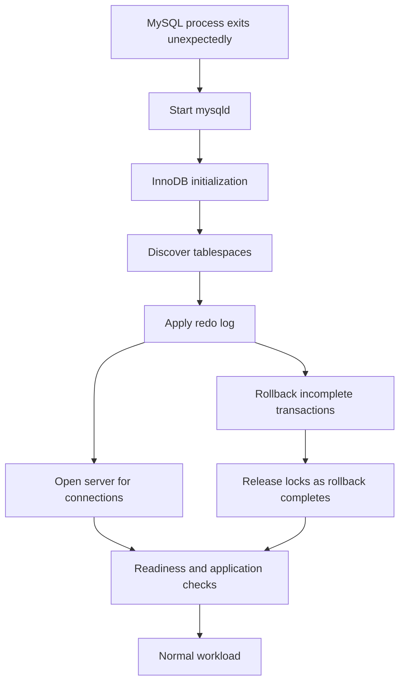

# Startup, Graceful Server Shutdown, and Verifying Crash Recovery

MySQL is a server process managing connections, transactions, the buffer pool, redo logs, undo logs, and tablespaces. Starting or stopping `mysqld` is therefore not merely starting or stopping an operating system service. Operators must know which instance is running, which data directory is used, how to request a controlled shutdown, and how to verify that InnoDB has recovered after an abnormal termination.

A proper shutdown allows MySQL to close connections, handle open transactions, flush data, and shut down storage engines. If the process is killed, the host loses power, or the operating system crashes, InnoDB automatically performs crash recovery upon restart. Crash recovery generally handles process crashes automatically, but it does not replace backups when data files or storage devices are damaged.

This lesson focuses on the lifecycle of MySQL Server: identifying the right instance, starting via a service manager, shutting down safely, understanding `innodb_fast_shutdown` modes, monitoring logs, and verifying crash recovery. The final sections cover how to handle startup failures and the limits of `innodb_force_recovery`.

## 1. The MySQL Server Lifecycle

The `mysqld` process reads configuration, opens the data directory, initializes storage engines, recovers necessary state, and only then accepts connections. On shutdown, the server stops accepting new connections, finishes current activity, closes tables and storage engines, and then exits.

| Phase | What MySQL Performs | What the Operator Must Verify |
|---|---|---|
| Startup preparation | Reads option files, command-line arguments, and environment | Correct binary, configuration, service, and data directory |
| Server initialization | Creates internal threads, opens logs, initializes plugins/engines | Error log has no configuration or permission errors |
| InnoDB initialization | Reads system tablespace, redo/undo, and metadata | No missing files or I/O errors |
| Crash recovery if needed | Discovers tablespaces, applies redo, rolls back uncommitted transactions | Monitor recovery progress in the error log |
| Ready | Opens listeners and accepts connections | Verify correct host, port, server UUID, and queries |
| Shutdown | Stops accepting connections, terminates threads, closes tables and engines | Wait for the process to exit and confirm shutdown completion |

MySQL may be managed by systemd, Windows Service Control Manager, a container runtime, or another process supervisor. Use one consistent management mechanism per instance. Never manually launch a second `mysqld` against the same data directory while an existing service is managing that instance.

## 2. Identifying the Exact Instance Before Acting

On a host with multiple instances, service names, ports, and data directories can differ. Before restarting or shutting down, identify the exact target instance.

Connect using an appropriate administrative account:

```sql
SELECT
    VERSION() AS mysql_version,
    @@hostname AS server_host,
    @@port AS server_port,
    @@server_uuid AS server_uuid,
    @@datadir AS data_directory,
    @@socket AS socket_path;

SHOW VARIABLES LIKE 'log_error';
SHOW VARIABLES LIKE 'pid_file';
SHOW GLOBAL STATUS LIKE 'Uptime';
```

Values to record:

- `@@server_uuid`: instance identifier in replication environments.
- `@@port` and `@@socket`: endpoints clients connect to.
- `@@datadir`: data directory of the instance.
- `log_error`: error log destination; may be a file or forwarded to the system log depending on configuration.
- `Uptime`: seconds since the most recent startup, useful for confirming that the instance just restarted.

Do not infer the instance solely from a hostname or service name. Connecting to the wrong port can cause a shutdown command to stop a different instance than the one under inspection.

### 2.1. Checking from the Operating System

On Linux with systemd:

```bash
systemctl list-unit-files | grep -E 'mysql|mysqld'
systemctl status mysqld
ps -ef | grep '[m]ysqld'
```

The service name may be `mysqld` or `mysql`, depending on the distribution and installation method. Cross-check the service with the configuration and PID file before taking action.

On Windows PowerShell:

```powershell
Get-Service -Name '*mysql*'
Get-CimInstance Win32_Service |
    Where-Object { $_.Name -like '*mysql*' } |
    Select-Object Name, State, StartName, PathName
```

`PathName` helps identify the binary and the service's startup arguments; if there is an option specifying an option file, you can also see it here. For example, a service is often named `MySQL80`, though the actual name must be taken from the target host.

## 3. Starting MySQL with a Service Manager

For Linux installations using systemd:

```bash
sudo systemctl start mysqld
sudo systemctl status mysqld
sudo journalctl -u mysqld -n 200 --no-pager
```

Replace `mysqld` with the actual unit name if the system uses `mysql`. Linux MySQL packages typically integrate with systemd; in that case, use the service manager rather than manually launching a second process with `mysqld_safe`.

On Windows, use the exact service name identified:

```powershell
Start-Service -Name 'MySQL80'
Get-Service -Name 'MySQL80'
```

Replace `MySQL80` with the service name on the machine. If the service fails to start, open the error log configured by the service and check Windows Event Viewer if needed.

### 3.1. Manual Startup in Appropriate Environments

On some Unix installations without systemd, MySQL may be started with `mysqld_safe`:

```bash
bin/mysqld_safe --user=mysql &
```

Or run the server directly in the foreground to observe logs in a test environment:

```bash
bin/mysqld --user=mysql --console
```

Do not run `mysqld` as root. The server should run under a dedicated OS account, typically `mysql`, to restrict file access permissions. Do not use these manual commands to compete for control with a service manager.

### 3.2. What to Check When Startup Fails

If the server exits immediately after starting, read the error log from the latest startup attempt. Common causes:

- An option file has an invalid variable or wrong value type.
- The service uses a different `datadir` than the one containing the expected data.
- The OS account lacks read/write permissions on the data directory or log directory.
- The port is already in use by another process.
- A tablespace file, redo log, or undo tablespace is missing.
- Disk is full, filesystem is read-only, or the storage device reports I/O errors.
- The data directory was created by an incompatible MySQL version.
- InnoDB cannot complete initialization or crash recovery.

Do not delete files inside the data directory just to "try restarting." Before changing configuration or files, preserve the current state, save the logs, and determine the root cause.

## 4. Verifying Server Readiness

A service in `active` state is not enough to prove MySQL is ready to serve workloads. You must check connectivity, queries, and instance identity.

Check using `mysqladmin`:

```bash
mysqladmin -h 127.0.0.1 -P 3306 -u healthcheck -p ping
mysqladmin -h 127.0.0.1 -P 3306 -u healthcheck -p version
```

`ping` checks whether the server responds; `version` returns server information and uptime. Use a least-privilege check account and enter the password at the prompt rather than placing passwords directly on the command line.

Then run verification queries:

```sql
SELECT
    1 AS connectivity_check,
    VERSION() AS version,
    @@server_uuid AS server_uuid,
    @@datadir AS data_directory,
    @@GLOBAL.innodb_force_recovery AS force_recovery;

SHOW GLOBAL STATUS LIKE 'Uptime';
SHOW ENGINE INNODB STATUS;
```

Verify:

- Connected to the right host and port.
- `server_uuid`, `datadir`, and version match the expected instance.
- `innodb_force_recovery` equals 0 during normal operation.
- No new InnoDB errors in the error log.
- The application can execute required readiness queries.
- If it is a replica, replication threads and lag meet operational requirements.

`mysqladmin ping` only proves the server responds at the connection level. It does not replace verifying application queries, schema permissions, replication, or write capability.

## 5. Preparing a Planned Shutdown

A safe shutdown starts with stopping new workload generation. You should not simply issue a service stop command while the application is continuously opening connections or sending new transactions.

Preparation procedure:

1. Confirm instance, host, port, service, and data directory.
2. Announce or enable maintenance mode per the application's procedure.
3. Drain the instance from the load balancer or stop incoming traffic if supported by the architecture.
4. Pause workers, schedulers, and jobs that could open new transactions.
5. Inspect running transactions and long-running queries.
6. For replicas or clusters, coordinate with replication/failover mechanisms and the topology runbook.
7. Confirm the latest backup and restart plan when making a risky change.

Check open transactions:

```sql
SELECT
    trx_id,
    trx_state,
    trx_started,
    trx_mysql_thread_id,
    trx_query
FROM information_schema.innodb_trx
ORDER BY trx_started;
```

View active connections and statements:

```sql
SHOW FULL PROCESSLIST;
```

These queries help detect long-running transactions, imports, DDL, or remaining workloads. Do not assume that zero connections is a mandatory condition; what matters is stopping new workload and understanding how remaining transactions will be handled.

## 6. Ways to Request a Shutdown

### 6.1. Using mysqladmin

`mysqladmin shutdown` requests MySQL to stop via the administrative protocol:

```bash
mysqladmin -h 127.0.0.1 -P 3306 -u shutdown_admin -p shutdown
```

The account requires the `SHUTDOWN` privilege. The command prompts for a password. Do not store plaintext passwords in shell history, scripts, or process arguments.

### 6.2. Using the SQL SHUTDOWN Statement

An account with the `SHUTDOWN` privilege can also request the server to stop from SQL:

```sql
SHUTDOWN;
```

Once the statement is accepted, the client connection closes because the server is shutting down. This is a server-level administrative command, not a statement that can be rolled back like DML.

### 6.3. Using a Service Manager

With systemd:

```bash
sudo systemctl stop mysqld
sudo systemctl status mysqld
```

With Windows PowerShell:

```powershell
Stop-Service -Name 'MySQL80'
Get-Service -Name 'MySQL80'
```

The service manager sends a stop request to the service process. Replace the service name with the actual value verified in Section 2.

### 6.4. Using Operating System Signals

On Unix, `mysqld` can handle `SIGTERM` as a shutdown request. The service manager is usually the appropriate mechanism to send this signal because it also tracks service status and timeouts.

Do not use `kill -9`, `taskkill /F`, power-off, or deleting the PID file in place of a normal shutdown. Such actions can cause the server to exit abnormally and force InnoDB to run crash recovery at the next startup.

## 7. How Shutdown Proceeds

Once shutdown is initiated, MySQL executes the main steps:

1. Creates a shutdown thread if needed.
2. Stops accepting new connections over TCP/IP, socket, named pipe, or shared memory.
3. Marks and terminates existing client threads.
4. Rolls back open transactions belonging to terminated connections.
5. Closes the table cache and open tables.
6. Requests each storage engine to perform necessary pre-close work.
7. Terminates the `mysqld` process.

For InnoDB, a normal shutdown flushes required data, writes the LSN state to tablespaces, and stops internal threads. MyISAM flushes pending index changes. Non-transactional tables lack InnoDB-like rollback guarantees; a multi-row statement may leave partial updates if interrupted mid-execution.

Therefore, applications should complete or stop workloads gracefully before shutdown. Do not rely on the server automatically rolling back every operation across every storage engine.

## 8. innodb_fast_shutdown and the Three Shutdown Modes

`innodb_fast_shutdown` controls some of the work InnoDB performs during shutdown. The default value is `1`.

| Value | Mode | Behavior |
|---:|---|---|
| `0` | Slow shutdown | Performs a full purge and change buffer merge before closing; can take considerable time |
| `1` | Fast shutdown (default) | Skips full purge and change buffer merge at shutdown; still a controlled shutdown |
| `2` | Cold shutdown | Flushes logs and closes in a manner similar to a post-crash state; the next startup requires crash recovery |

Check the value:

```sql
SHOW GLOBAL VARIABLES LIKE 'innodb_fast_shutdown';
```

### 8.1. Value 1 — The Normal Choice

Value `1` is the appropriate default for most routine shutdowns. InnoDB does not perform a full purge and change buffer merge before closing, yet MySQL still goes through a controlled shutdown sequence.

This is not a crash shutdown. After a clean exit, the next startup normally does not need to run crash recovery as it would after an abrupt kill.

### 8.2. Value 0 — Before a Major Version Upgrade

Value `0` instructs InnoDB to perform a slow shutdown, including a full purge and change buffer merge. This work can take many minutes or hours if there is a large backlog of buffered data.

MySQL recommends a slow shutdown before upgrading or downgrading between major releases so data files are fully prepared for operations that may alter file formats.

You can set the value for an upcoming shutdown:

```sql
SET GLOBAL innodb_fast_shutdown = 0;
SHOW GLOBAL VARIABLES LIKE 'innodb_fast_shutdown';
```

Then request a controlled shutdown. `SET GLOBAL` changes the runtime of the current instance; if persisted config or option files are used, check so you do not accidentally leave slow shutdown enabled for future stops.

### 8.3. Value 2 — Cold Shutdown

Value `2` flushes InnoDB logs and closes in a state similar to a crash. MySQL documentation states that committed transactions are not lost solely due to this mode, but the subsequent startup will require crash recovery and may take longer.

This mode is intended for emergencies or special troubleshooting, not as a routine option to speed up shutdowns. Do not confuse value `2` with `kill -9`: one is still a shutdown mode managed by InnoDB, whereas the other forces the process to exit immediately.

## 9. Confirming Shutdown Completion

After issuing a shutdown request:

- Wait for the service manager to report the service has stopped.
- Confirm the `mysqld` process for that exact instance has exited.
- Check the error log or system journal for shutdown completion messages.
- Verify the instance's port/socket no longer accepts connections.
- Do not delete, move, or modify data files while the process is still running.

On Linux:

```bash
sudo systemctl is-active mysqld
sudo systemctl status mysqld
sudo journalctl -u mysqld -n 200 --no-pager
pgrep -a mysqld
```

On Windows:

```powershell
Get-Service -Name 'MySQL80'
Get-Process -Name 'mysqld' -ErrorAction SilentlyContinue
```

If `mysqld` is still running, do not rush to kill the process. Read the logs, check what the service manager is waiting on, and inspect long-running transactions or engine activity.

## 10. What Is Crash Recovery?

InnoDB uses the redo log to record changes needed for crash recovery and the undo log to roll back uncommitted transactions or serve MVCC. Committed data may still reside in the buffer pool and not yet be fully flushed to tablespace data pages when the server exits unexpectedly.

After an unclean server exit, InnoDB inspects logs automatically and performs crash recovery:

- **Roll-forward:** applies necessary redo logs to tablespaces to bring pages to a consistent state.
- **Rollback:** undoes transactions that were uncommitted at the time of the crash. Transactions in the `XA PREPARED` state must be coordinated with the transaction coordinator per XA procedures and should not be treated as regular transactions that are automatically rolled back.

Crash recovery is normally automatic upon server restart. DBAs do not need to manually execute SQL commands to replay redo logs.

### 10.1. Why Is the Redo Log Needed?

A transaction can update a page in the buffer pool before that page is flushed to a data file. The redo log records enough change information for InnoDB to reapply those changes after a crash.

Example:

1. A transaction updates an account balance.
2. InnoDB writes redo log entries according to the configured durability rules.
3. The transaction commits.
4. The data page might not yet be written immediately to the tablespace.
5. The server loses power.
6. On restart, InnoDB uses the redo log to restore the necessary changes.

The redo log is not a full copy of the database and does not replace backups.

### 10.2. Why Is the Undo Log Needed?

The undo log retains information to undo changes of uncommitted transactions and support consistent reads. If the server crashes while a transaction is still open, InnoDB restores page state using redo and then rolls back incomplete transactions using undo.

Example:

```sql
START TRANSACTION;

UPDATE accounts
SET balance = balance - 100
WHERE account_id = 10;

-- Suppose the server stops abnormally before COMMIT.
```

After crash recovery completes, the uncommitted change is not treated as a successful transaction. InnoDB rolls back that transaction.

## 11. Steps of InnoDB Crash Recovery

The recovery process can include the following steps:

1. **Tablespace discovery:** locating the tablespaces needed to apply the redo log.
2. **Redo log application:** reading the redo log and applying necessary changes during initialization, before the server accepts connections.
3. **Rollback of incomplete transactions:** rolling back transactions that were active when the server crashed.
4. **Change buffer merge and purge:** these background tasks continue under normal operating mechanics; not all must finish before accepting connections.

Once redo log application completes, InnoDB tries to allow the server to accept connections promptly. Rollback of uncommitted transactions may continue in the background alongside new workloads. Consequently, for a period of time, new connections may encounter lock conflicts with transactions still being rolled back.

If redo log files are missing at startup, InnoDB may skip the redo log application step. This is why you must never delete or move redo logs to "clean up" recovery; missing redo logs must be treated as an incident requiring investigation and comparison against backups.

Conceptual diagram:



This is a conceptual diagram. Specific timing and ordering of background work depend on the data, logs, storage engine, and MySQL version.

## 12. Crash Recovery Is Not Restoring from Backup

Distinguish three scenarios:

| Scenario | Appropriate Mechanism |
|---|---|
| `mysqld` was killed or host rebooted abruptly, data files intact | Restart the server and let InnoDB run crash recovery automatically |
| A few pages or tables are corrupted | Investigate corruption; readable portions may be dumped, though a clean backup is usually needed |
| Disk or data directory is lost/damaged | Restore backup; if needed, replay binary logs for point-in-time recovery |

Crash recovery handles consistency after an abnormal exit. It cannot recreate missing tablespace files or repair physical hardware failures.

For corruption or disk failure, the standard procedure is to restore from an uncorrupted backup and then apply binary logs to bring data to the desired point in time if binary logging was enabled and sufficient logs exist.

Do not treat a successful server startup as proof that all data is intact. Check the error log, data integrity, and application after recovery.

## 13. Reading the Error Log to Confirm Recovery

The error log is the primary source to see whether the server detected crash recovery, is applying redo, rolling back transactions, or encountering errors.

Retrieve the log location:

```sql
SHOW VARIABLES LIKE 'log_error';
```

On Linux using systemd, logs may be sent to the journal:

```bash
sudo journalctl -u mysqld --since '30 minutes ago' --no-pager
```

If `log_error` points to a file, read that file with OS log tools. On Windows, inspect the error log file configured by MySQL and Event Viewer if the service fails to start.

When reviewing logs, look for these categories of information:

- Startup timestamp and server version.
- InnoDB initialization and messages indicating recovery state detection.
- Redo log scan/application and LSNs if logged.
- Which tablespaces were opened or missing.
- Transaction rollbacks or lock conflicts during the post-recovery phase.
- I/O, checksum, permission, disk-full, or corruption errors.
- Notification that the server is ready for connections.

Do not rely on a single fixed log string across all versions. Log structure and wording can vary; read messages chronologically and cross-reference error codes, files, tablespaces, and recorded actions.

## 14. Post-Crash-Recovery Verification

After the server accepts connections, execute the checklist against the exact instance:

```sql
SELECT
    VERSION() AS version,
    @@server_uuid AS server_uuid,
    @@datadir AS datadir,
    @@GLOBAL.innodb_force_recovery AS force_recovery;

SHOW GLOBAL STATUS LIKE 'Uptime';
SHOW ENGINE INNODB STATUS;
SHOW GLOBAL STATUS LIKE 'Innodb_buffer_pool_pages_dirty';
```

Next:

1. Confirm `innodb_force_recovery = 0`.
2. Read the entire error log from startup onward, not just the last line.
3. Check critical schemas and tables with controlled application queries.
4. Check running transactions, lock waits, and active rollbacks.
5. Check replication if the instance is a source or replica.
6. Confirm backups and binary logs are available for recovery if corruption is detected.
7. Monitor latency, disk I/O, connection count, and error rate before reopening full traffic.

`SHOW ENGINE INNODB STATUS` provides a snapshot of internal state at query time. It is useful for checking transactions, semaphores, I/O, and InnoDB status, though it does not replace reading the error log or verifying business data.

### 14.1. Checking Replication if It Is a Replica

For MySQL 8.0.22 and later:

```sql
SHOW REPLICA STATUS\G
```

Check I/O thread status, SQL/applier thread status, latest replication error, and lag. Older versions use `SHOW SLAVE STATUS`; use the syntax matching your running version.

Do not return a replica to read serving or failover solely because the service is `active`. Confirm that replication has caught up and the topology remains accurate.

## 15. innodb_force_recovery: Emergency Use Only

`innodb_force_recovery` allows attempting to start InnoDB in certain severe corruption situations so readable data can be dumped. It is not a data file repair tool and must never be enabled during normal startup.

It is a startup option, not a runtime variable changed via `SET GLOBAL`. To enable or disable it, modify the option file/command line and restart the instance.

The default value is `0`. When forced to use it:

- Ensure a physical copy of the data directory exists before attempting.
- Start with value `1`.
- Increase one level at a time only if the previous level fails to start or dump data.
- The objective is to read and export intact data to rebuild the instance.
- After dumping, restore from a clean backup or rebuild the instance; remove the recovery setting before normal operation.

### 15.1. Meaning of the Levels

| Level | Primary Behavior | Risk |
|---:|---|---|
| `0` | Normal startup | Not forced recovery |
| `1` | Ignores certain pages/index records marked corrupt to attempt reading data | May skip corrupted records |
| `2` | Does not run the master thread and purge thread | Background operations are disabled |
| `3` | Does not roll back transactions after crash recovery | Incomplete transaction state is not handled normally |
| `4` | Does not run insert buffer merge and does not compute table statistics | Can permanently corrupt data files; InnoDB is read-only |
| `5` | Does not scan undo logs at startup | May treat incomplete transactions as committed; risk of data corruption |
| `6` | Does not apply redo logs | Pages may be in an outdated state; severe corruption risk |

When `innodb_force_recovery` is greater than 0, InnoDB blocks `INSERT`, `UPDATE`, and `DELETE`. From level 4 upward, InnoDB enters read-only mode. Levels 4, 5, and 6 can cause permanent corruption; level 6 is particularly dangerous because it skips redo roll-forward.

### 15.2. Temporary Configuration to Dump Data

Only after obtaining a physical copy and following a corruption-handling runbook, temporarily add to the option file the instance actually reads:

```ini
[mysqld]
innodb_force_recovery=1
```

Restart via the proper service manager, monitor the error log, and then perform only necessary read/export operations:

```sql
SELECT COUNT(*) FROM critical_table;
```

Or use `mysqldump`/an appropriate backup tool to export readable data. Do not continue application workloads and do not use a forced-recovery instance as a primary serving transactions.

After completing:

1. Store dumps and logs in a safe location.
2. Stop the instance using the chosen procedure.
3. Remove `innodb_force_recovery` from the option file or command line.
4. Restore from a clean backup or rebuild the instance.
5. Verify the new instance in normal mode with `innodb_force_recovery=0`.

Never leave `innodb_force_recovery` in configuration long-term. When the server manages to start in forced recovery, it only means readable data can be exported; it does not prove the database is repaired.

## 16. Actions Never to Use to "Clean Up" Recovery

While InnoDB is recovering or the server fails to start:

- Do not delete redo logs to force startup.
- Do not delete undo tablespaces, system tablespaces, or `.ibd` files by guesswork.
- Do not rename data directory files to bypass missing-tablespace errors.
- Do not copy data files while `mysqld` is still running.
- Do not start multiple `mysqld` processes sharing one data directory.
- Do not upgrade/downgrade binaries before verifying data file compatibility and shutdown state.
- Do not repeatedly restart in a loop if logs show recovery is still progressing.

Redo logs contain information needed to bring pages to a consistent state. Deleting redo logs is not a safe way to speed up recovery. Only consider redo log operations under procedures permitted by MySQL documentation, after a clean shutdown and with a clear technical justification.

## 17. Prolonged or Hung Shutdown

A shutdown can take a long time due to long transactions, active statements, purge backlogs, change buffer merges, or slow I/O. In particular, `innodb_fast_shutdown=0` can take considerable time because it requires a full purge and merge.

If shutdown has not completed:

1. Check the service manager and the PID of the exact instance.
2. Read the error log or journal to see which stage the server is in.
3. If the server still accepts queries, inspect `SHOW FULL PROCESSLIST` and `information_schema.innodb_trx`.
4. Check disk I/O, disk space, and device errors.
5. Determine whether a slow shutdown is occurring due to `innodb_fast_shutdown=0`.
6. Wait for work to finish if logs and I/O show forward progress.
7. Intervene on the process only according to an approved incident runbook.

Do not send repeated stop commands, delete the PID file, or use force-kill as the default approach. If a process must be stopped abnormally, prepare to monitor crash recovery on the next startup.

## 18. Prolonged Startup or Crash Recovery Appearing Stuck

Recovery can take a long time when redo logs are large, many tablespaces must be processed, or a large transaction must be rolled back. Do not conclude the server is hung merely because startup takes longer than usual.

Check in order:

- Does the error log continue writing progress or new messages?
- Are `mysqld` CPU and disk I/O active?
- Does the disk have free space and is the filesystem writable?
- Do referenced tablespace files exist and have proper permissions?
- Are there checksum, I/O, redo log, or undo log errors?
- Is `datadir`, `innodb_directories`, or a tablespace path misconfigured?
- Was there a binary version or option file change before the restart?

If logs repeat the same error or recovery halts due to missing/corrupt files, save the logs and a snapshot of the current state before trying any changes. For disk failure or severe corruption, switch to backup restore and point-in-time recovery instead of deleting files to force startup.

## 19. Durability, Log Flushing, and Limits of Crash Recovery

Crash recovery helps InnoDB return data structures to a consistent state, yet the protection level of committed transactions also depends on flush settings and storage stack reliability.

Variables commonly reviewed together:

| Variable | Role | Common Value When Prioritizing Durability |
|---|---|---|
| `innodb_flush_log_at_trx_commit` | Controls how redo log is flushed at commit | `1` |
| `sync_binlog` | Controls binary log synchronization | `1` when binary logging is enabled and high durability is required |
| `innodb_doublewrite` | Reduces risk of page corruption from partial page writes | Keep `ON` on most systems |

Check the configuration:

```sql
SHOW GLOBAL VARIABLES
WHERE Variable_name IN (
    'innodb_flush_log_at_trx_commit',
    'sync_binlog',
    'innodb_doublewrite'
);
```

For InnoDB transactions and binary logging, MySQL recommends `innodb_flush_log_at_trx_commit=1` and `sync_binlog=1` for high durability/consistency. However, hardware or the OS may report flush completion before data is physically durable on the device. Good configuration does not eliminate the need for backups and restore testing.

## 20. Runbook Procedure: Planned Restart

Example runbook for a standalone MySQL instance on Linux/systemd:

### Before Restart

```sql
SELECT
    @@hostname,
    @@port,
    @@server_uuid,
    @@datadir;

SHOW GLOBAL STATUS LIKE 'Uptime';
SHOW GLOBAL VARIABLES LIKE 'innodb_fast_shutdown';

SELECT
    trx_id,
    trx_state,
    trx_started,
    trx_mysql_thread_id
FROM information_schema.innodb_trx;
```

Record the output, enable application maintenance mode, stop new jobs, and confirm the backup/rollback plan.

### Executing Shutdown

```bash
sudo systemctl stop mysqld
sudo systemctl status mysqld
sudo journalctl -u mysqld -n 200 --no-pager
```

Proceed only once the service has stopped and logs confirm shutdown completion. If shutdown hangs, refer back to the prolonged shutdown runbook in Section 17.

### Starting Back Up

```bash
sudo systemctl start mysqld
sudo systemctl status mysqld
sudo journalctl -u mysqld -n 200 --no-pager
```

### Verification

```bash
mysqladmin -h 127.0.0.1 -P 3306 -u healthcheck -p ping
mysqladmin -h 127.0.0.1 -P 3306 -u healthcheck -p version
```

Then run verification queries for instance identity, `innodb_force_recovery`, error logs, critical tables, and replication if applicable. Reopen traffic only when all application readiness criteria pass.

## 21. Runbook: Handling an Abnormal Server Exit

When MySQL is killed, a host loses power, or a container is forcibly stopped:

1. Determine the cause of process exit from system logs, container events, or crash reports.
2. Confirm no other `mysqld` process is using the data directory.
3. Check disk, filesystem, permissions, and tablespace paths.
4. Restart using the instance's proper service manager.
5. Monitor the error log throughout InnoDB initialization and crash recovery.
6. Do not delete redo logs or modify data files to force the server up.
7. Once the server accepts connections, verify UUID, datadir, version, `innodb_force_recovery=0`, and InnoDB status.
8. Check transaction rollbacks, lock waits, business tables, and replication.
9. If corruption or disk failure is detected, stop new writes per runbook and switch to backup restore/PITR.
10. Record downtime duration, root cause, relevant logs, and remediation actions.

## 22. Differences by Deployment Environment

| Environment | Lifecycle Management | Key Considerations |
|---|---|---|
| Linux with systemd | `systemctl start/stop/status` | Unit name, journal, timeout, and restart policy |
| Windows Service | `Start-Service` / `Stop-Service` | Exact service name, service account, and error log |
| Container | Container runtime sends stop signal | Grace period long enough for clean MySQL shutdown |
| Kubernetes | Orchestrator sends termination signal | `terminationGracePeriodSeconds`, readiness, and persistent volume |
| HA/replication | Cluster manager or replication runbook | Avoid unplanned failover and verify topology after restart |

With Docker, `docker stop` sends a stop signal and waits for a grace period before potentially sending a kill signal. Configure a wait timeout long enough for MySQL to finish shutting down:

```bash
docker stop --time 120 mysql-db
```

Adjust container name and timeout according to workload. `docker kill` can terminate the container abruptly; do not use it as a normal stopping method.

In Kubernetes, the readiness probe should remove the pod from traffic before termination. The grace period must match actual shutdown duration; if too short, the runtime may forcibly kill the container before MySQL finishes.

## 23. Common Errors and Investigation Paths

| Symptom | Possible Cause | Investigation / Resolution |
|---|---|---|
| Service reports active yet application cannot connect | Wrong port, socket, host, or server not ready | Check ping, endpoint, and error log |
| `mysqld` exits right after startup | Configuration, permissions, port, or data directory | Read the error log from the latest start attempt |
| Long startup after power loss | InnoDB running redo/undo recovery | Monitor logs and I/O; do not restart repeatedly |
| New connections hit lock waits after recovery | Old transaction rollback still running | Monitor InnoDB status and wait for rollback |
| Prolonged shutdown | Long transactions, purge/merge, or slow shutdown | Check processlist, `innodb_trx`, and `innodb_fast_shutdown` |
| Missing tablespace error | Tablespace file or path no longer valid | Verify datadir, `innodb_directories`, and backups |
| Version mismatch error | Binary incompatible with data dictionary/file format | Identify prior version and upgrade/downgrade procedure |
| Server only starts with forced recovery | Corruption or severe recovery issue | Dump data, restore/rebuild; do not continue workload |
| Replica starts up but does not catch up | I/O/applier thread error or relay log needs recovery | Check replica status and relay-log recovery |
| Shutdown killed by service manager | Short timeout or server performing long work | Adjust grace period per runbook and investigate shutdown duration |

## 24. Hands-On Exercises

### Exercise 1 — Identifying the Instance

Run queries for `VERSION()`, `@@server_uuid`, `@@port`, `@@datadir`, `log_error`, and `Uptime`. Write a checklist to verify the exact instance before restarting.

### Exercise 2 — Observing a Planned Shutdown

In a test environment, monitor the error log before and after `mysqladmin shutdown`. Identify when the server stops accepting connections, closes engines, and exits.

### Exercise 3 — Comparing innodb_fast_shutdown

Read the documentation on values 0, 1, and 2. Create a table comparing shutdown time, InnoDB work, and impact on the next startup. Do not test value 2 on production data.

### Exercise 4 — Simulating Crash Recovery

On a lab instance with a backup, generate an InnoDB workload and simulate an abnormal stop in a controlled test environment. Monitor the error log on the next start and identify signs of redo application/transaction rollback.

### Exercise 5 — Readiness Verification

Write a script checking service state, `mysqladmin ping`, UUID, datadir, `innodb_force_recovery`, application query, and replication status. Explain why checking only whether the process is alive is insufficient.

### Exercise 6 — Reviewing Corruption Scenarios

Review a simulated error log containing tablespace or redo errors. Classify which errors fit a normal restart, which require restoring from backup, and when `innodb_force_recovery` should only be used to dump data.

### Exercise 7 — Designing a Runbook

Write a restart runbook for a MySQL instance managed by systemd or Windows Service. Include pre-checks, maintenance mode, shutdown, verifying process exit, startup, log checks, and readiness.

## 25. Pre- and Post-Restart Checklist

### Before Shutdown

- Have you verified the exact host, port, server UUID, service name, and data directory?
- Do you know which service manager controls the instance?
- Have you enabled maintenance mode or drained incoming traffic?
- Have you stopped jobs and schedulers that create new transactions?
- Have you checked long-running transactions and active DDL?
- Have you confirmed the backup/rollback plan?
- Is `innodb_fast_shutdown=0` required before a major upgrade?
- Is there a specific runbook for replicas or clusters?

### After Shutdown

- Does the service manager report the service as stopped?
- Has the process for the exact instance exited?
- Does the error log confirm shutdown completion?
- Are there no other processes using the same data directory?

### After Startup

- Are the service and process ready?
- Did `mysqladmin ping` and readiness queries succeed?
- Do UUID, version, port, and datadir match?
- Is the error log free of InnoDB, tablespace, redo, or I/O errors?
- Does `innodb_force_recovery` equal 0?
- Are transaction rollbacks or lock waits impacting the workload?
- Is replication or cluster state stable?
- Can the application read/write critical tables?
- Was traffic reopened only after readiness checks passed?

## 26. Official References

- [MySQL 9.7 — InnoDB Recovery](https://dev.mysql.com/doc/refman/9.7/en/innodb-recovery.html)
- [MySQL 9.7 — Forcing InnoDB Recovery](https://dev.mysql.com/doc/refman/9.7/en/forcing-innodb-recovery.html)
- [MySQL 9.7 — InnoDB Startup Options and System Variables](https://dev.mysql.com/doc/refman/9.7/en/innodb-parameters.html)
- [MySQL 8.4 — The Server Shutdown Process](https://dev.mysql.com/doc/refman/8.4/en/server-shutdown.html)
- [MySQL 8.4 — Starting the Server](https://dev.mysql.com/doc/refman/8.4/en/starting-server.html)
- [MySQL 8.4 — Managing MySQL Server with systemd](https://dev.mysql.com/doc/refman/8.4/en/using-systemd.html)
- [MySQL 8.4 — SHUTDOWN Statement](https://dev.mysql.com/doc/refman/8.4/en/shutdown.html)
- [MySQL 9.7 — What to Do If MySQL Keeps Crashing](https://dev.mysql.com/doc/refman/9.7/en/crashing.html)

## Conclusion

Starting and stopping MySQL safely requires coordinating the service manager, applications, and storage engine. For normal shutdowns, stop new workloads, use `mysqladmin shutdown` or the service manager, and wait for a clean process exit. If the server stops abnormally, let InnoDB run crash recovery automatically: discovering tablespaces, applying redo, and rolling back uncommitted transactions. Verify status using the error log, `innodb_force_recovery`, readiness queries, and replication before reopening traffic. Use `innodb_force_recovery` only in severe corruption situations to export data; it does not repair the database and does not replace backups/PITR.
