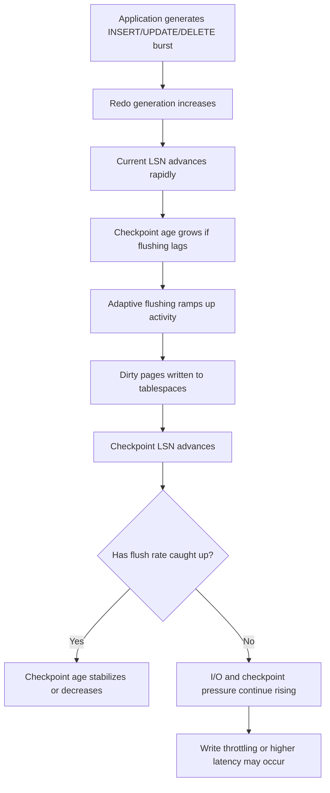

# System Performance

## Redo Capacity, Checkpoint Age, and Bursty Write Loads

When an application writes data faster than InnoDB can flush dirty pages to tablespaces, the amount of uncheckpointed redo grows. A write burst can cause checkpoint age to rise rapidly, trigger more aggressive adaptive flushing, and eventually create I/O pressure or force transactions to wait. `innodb_redo_log_capacity` provides buffer room for redo during short bursts, but it does not make storage write faster and does not solve sustained high write loads.

To diagnose accurately, distinguish three rates: the redo generation rate, the dirty page flush rate advancing the checkpoint, and the redo synchronization rate for commits. They are related, but they are not the same operation. Increasing redo capacity, changing `innodb_io_capacity`, or adjusting durability only makes sense when metrics point to the actual bottleneck.

### 1. Redo Log, LSN, and Checkpoint

InnoDB uses the redo log following write-ahead logging (WAL) principles. When a transaction modifies a page, InnoDB creates redo records describing the changes needed so they can be reapplied after a crash. Modified pages in the buffer pool become dirty pages. A commit can complete once the necessary redo is durably written per configured policy, even if the corresponding data pages have not yet been written to tablespaces.

Key concepts:

| Concept | Meaning |
| --- | --- |
| LSN (Log Sequence Number) | Monotonically increasing logical position in the redo log stream; can be viewed as a byte offset for comparing progress |
| Current LSN | Most recent redo position generated |
| Flushed LSN | Redo position flushed as reported by InnoDB status |
| Checkpoint LSN | Redo position prior to which InnoDB has ensured changes are written to data files per checkpoint rules |
| Dirty page | Page in the buffer pool that has been modified but not yet fully flushed to tablespaces |
| Checkpoint age | Distance between the current LSN and the checkpoint LSN |
| Redo capacity | Amount of redo InnoDB manages to hold required redo history before log space can be reused |

Checkpointing is the process of advancing a safe boundary so InnoDB can reuse older redo space. InnoDB uses fuzzy checkpointing: it does not need to pause the entire workload to flush every page at once. Background flushing and adaptive flushing write dirty pages progressively, allowing the checkpoint to advance gradually.

### 2. How Is Checkpoint Age Calculated?

Checkpoint age is the amount of redo generated after the current checkpoint:

\[
\text{checkpoint age} = \text{current LSN} - \text{last checkpoint LSN}
\]

LSNs are expressed in bytes, so the difference is also in bytes. For example, if the current LSN is 9,800,000,000 and the checkpoint LSN is 7,300,000,000, the checkpoint age is approximately 2.5 GB.

Checkpoint age is neither the byte count of dirty pages nor the exact percentage of redo files currently being written. It represents the span of redo that InnoDB still needs to retain because the corresponding changes have not been safely checkpointed. A single page can be modified many times and generate many redo records before being flushed; therefore, checkpoint age cannot be derived by summing dirty page sizes.

When checkpoint age is low and stable, InnoDB has ample space to accept new redo. When age rises continuously, the redo generation rate exceeds the checkpoint advancement rate over the observation window. If age approaches the operational limits of redo capacity, InnoDB must flush more aggressively and may throttle write rates to avoid running out of reusable redo space.

Do not interpret `checkpoint age / innodb_redo_log_capacity` as an exact percentage of log used. InnoDB maintains safety margins and internal thresholds; the effective checkpoint limit is lower or throttled relative to the configured capacity.

### 3. Redo Capacity Across MySQL Versions

In MySQL 8.0.30 and later, `innodb_redo_log_capacity` controls total redo log capacity. It is a dynamic variable that can be changed while the server is running. When set, it replaces the older configuration based on the product of `innodb_log_file_size` and `innodb_log_files_in_group`.

Prior to MySQL 8.0.30, traditional redo capacity was determined by:

\[
\text{redo capacity} \approx \text{innodb\_log\_file\_size} \times \text{innodb\_log\_files\_in\_group}
\]

These legacy variables are deprecated as of MySQL 8.0.30. When operating older versions, follow the redo log resizing procedure appropriate for that version; never delete or rename redo files directly while `mysqld` is running.

Check your version and current configuration:

```sql
SELECT VERSION();

SHOW GLOBAL VARIABLES LIKE 'innodb_redo_log_capacity';
SHOW GLOBAL VARIABLES LIKE 'innodb_log_file_size';
SHOW GLOBAL VARIABLES LIKE 'innodb_log_files_in_group';
```

Some legacy variables may no longer appear or may no longer take effect on newer versions. Base changes on your actual version and the variables supported by the server.

Example setting 4 GiB on MySQL 8.0.30 or later:

```sql
SET GLOBAL innodb_redo_log_capacity = 4294967296;
```

To persist the setting across restarts on versions supporting `SET PERSIST` and with appropriate privileges:

```sql
SET PERSIST innodb_redo_log_capacity = 4294967296;
```

Or configure it in the option file:

```ini
[mysqld]
innodb_redo_log_capacity = 4G
```

Changing capacity can cause InnoDB to resize redo files in the background and perform extra I/O. Avoid changing it repeatedly for small load fluctuations; measure trends and apply a stable value with sufficient headroom.

### 4. Redo Capacity Is Not the Same as the Redo Log Buffer

`innodb_log_buffer_size` and `innodb_redo_log_capacity` control two different areas:

| Variable | Scope | Primary Impact |
| --- | --- | --- |
| `innodb_log_buffer_size` | Memory in RAM | Buffer for redo before writing to redo log files; too small a buffer can force large transactions to flush the log buffer more frequently |
| `innodb_redo_log_capacity` | Redo log capacity managed on storage, from MySQL 8.0.30 | Redo span that can be retained before checkpointing must advance enough to reuse log space |

Increasing the log buffer can help very large transactions that generate a lot of redo in a short time. It does not increase redo capacity and does not solve a continuously rising checkpoint age. Conversely, increasing redo capacity does not necessarily help a transaction forced to flush the log buffer because the in-memory buffer is too small.

Check both:

```sql
SHOW GLOBAL VARIABLES LIKE 'innodb_log_buffer_size';
SHOW GLOBAL VARIABLES LIKE 'innodb_redo_log_capacity';
```

### 5. Three Rates to Distinguish When Write Load Rises

To understand redo pressure, separate three activities:

1. **Redo generation:** the rate at which transactions create new redo; current LSN increases with write activity.
2. **Checkpoint advancement:** the rate at which the checkpoint LSN moves forward as dirty pages are flushed enough to reuse old redo.
3. **Redo flush for commit:** the rate at which the redo log is written/synchronized to satisfy commit and durability requirements.

Flushing redo for a commit is not the same as checkpointing. A transaction can be acknowledged as committed once redo is flushed, while data pages remain dirty and the checkpoint has not yet passed that redo. Therefore, `innodb_flush_log_at_trx_commit=1` does not mean every data page is written to tablespaces on every commit.

`sync_binlog` controls binary log synchronization, which is a separate log from InnoDB redo. Both `innodb_flush_log_at_trx_commit` and `sync_binlog` relate to commit durability when using InnoDB and binary logging; they are not knobs to control checkpoint speed.

### 6. How Bursty Write Loads Affect Checkpoint Age

Under normal load, redo generation and checkpoint advancement may be nearly balanced. During a write burst, the current LSN rises faster than the checkpoint LSN. The accumulating gap causes checkpoint age to grow.



A short burst can be absorbed by unused redo capacity. Once the burst ends, if storage has enough capacity, checkpoint advancement will outpace redo generation for a while and age will gradually decrease. If high write load persists, age will keep accumulating regardless of large capacity; near thresholds, InnoDB must flush more aggressively or slow down writers.

### 7. Recognizing Signs of Checkpoint Pressure

Do not rely on a single symptom. Combine:

- High checkpoint age that continues rising across multiple samples.
- Rapid widening of the gap between current LSN and checkpoint LSN.
- Dirty pages increasing or failing to decline even after write load drops.
- Increasing pending writes or storage write latency.
- Heavy flush activity affecting transaction latency.
- Write transactions starting to slow down as InnoDB protects remaining redo space.
- Checkpoint failing to advance fast enough while redo generation remains high.

A high checkpoint age that is declining may mean the system is recovering from a burst. A low age that is rising very fast still requires monitoring if redo generation spikes suddenly. Trends and rates of change are usually more informative than an isolated snapshot.

### 8. Reading LOG in `SHOW ENGINE INNODB STATUS`

This command provides a snapshot of many internal metrics:

```sql
SHOW ENGINE INNODB STATUS\G
```

In the `LOG` section, look for fields similar to:

```text
Log sequence number          9800000000
Log flushed up to             9795000000
Pages flushed up to            7400000000
Last checkpoint at             7300000000
0 pending log flushes, 0 pending chkp writes
```

The numbers above are illustrative examples only. Field names and formatting may vary by version. `Log sequence number` shows the current LSN; `Last checkpoint at` is the checkpoint position used to compute age. `Log flushed up to` reflects redo flush progress, while page flush/checkpoint fields help clarify data page write progress.

In the example above:

\[
9.8\text{ GB} - 7.3\text{ GB} = 2.5\text{ GB checkpoint age}
\]

Do not confuse `Log flushed up to` with `Last checkpoint at`: redo flushed for durability can stay ahead of the checkpoint because the corresponding dirty pages have not finished writing to tablespaces.

### 9. Tracking LSNs with `INNODB_METRICS`

MySQL exposes InnoDB counters via `INFORMATION_SCHEMA.INNODB_METRICS`. Common LSN metrics include `log_lsn_current`, `log_lsn_flushed`, and `log_lsn_last_checkpoint`. First verify they are available and enabled:

```sql
SELECT NAME, COUNT, STATUS, COMMENT
FROM information_schema.innodb_metrics
WHERE NAME IN (
    'log_lsn_current',
    'log_lsn_flushed',
    'log_lsn_last_checkpoint',
    'log_waits',
    'log_write_requests',
    'log_writes'
)
ORDER BY NAME;
```

If needed metrics are disabled, you can enable the log module to observe:

```sql
SET GLOBAL innodb_monitor_enable = 'module_log';
```

After finishing the measurement period, you can disable the metric group if operational policy requires:

```sql
SET GLOBAL innodb_monitor_disable = 'module_log';
```

Not every build or version provides the exact same set of metrics; check query output before putting metric names into automated dashboards. Enabling metrics also requires appropriate administrative privileges.

You can calculate checkpoint age from the two LSNs:

```sql
SELECT
    MAX(CASE WHEN NAME = 'log_lsn_current' THEN COUNT END)
      AS current_lsn,
    MAX(CASE WHEN NAME = 'log_lsn_last_checkpoint' THEN COUNT END)
      AS checkpoint_lsn,
    MAX(CASE WHEN NAME = 'log_lsn_current' THEN COUNT END)
      - MAX(CASE WHEN NAME = 'log_lsn_last_checkpoint' THEN COUNT END)
      AS checkpoint_age_bytes
FROM information_schema.innodb_metrics
WHERE NAME IN ('log_lsn_current', 'log_lsn_last_checkpoint');
```

Cross-check results with `SHOW ENGINE INNODB STATUS`. If a metric is disabled or missing values, use the status output or enable the supported metric before collecting.

### 10. Measuring Redo Generation Rate and Checkpoint Rate

A single sample shows state at capture time; two timestamped samples reveal rates. Capture current LSN and checkpoint LSN at two points separated by a defined interval:

\[
\text{redo generation rate} = \frac{LSN_{current,2} - LSN_{current,1}}{\Delta t}
\]

\[
\text{checkpoint advancement rate} = \frac{LSN_{checkpoint,2} - LSN_{checkpoint,1}}{\Delta t}
\]

\[
\text{age growth rate} = \text{redo generation rate} - \text{checkpoint advancement rate}
\]

If the age growth rate is positive, checkpoint age increased during the measurement window. If negative, the checkpoint is catching up and age is shrinking. These are average rates over the sampling interval, not instantaneous rates.

Example with two snapshots 60 seconds apart:

| Metric | Snapshot 1 | Snapshot 2 | Difference |
| --- | ---: | ---: | ---: |
| Current LSN | 10.0 GB | 16.0 GB | +6.0 GB |
| Checkpoint LSN | 8.0 GB | 9.8 GB | +1.8 GB |
| Checkpoint age | 2.0 GB | 6.2 GB | +4.2 GB |

During that minute, redo generation averaged 100 MB/s and checkpoint advancement averaged 30 MB/s, so age grew at roughly 70 MB/s. Once the burst ends and the checkpoint advances faster than the current LSN, age will decline.

To make dashboards useful, store LSN values with timestamps and compute deltas between scrapes. If MySQL restarts or metrics reset, LSNs can change across the instance lifecycle; detect restarts or uptime changes before computing rates to avoid negative numbers or false spikes.

### 11. Monitoring Dirty Pages and Flush Capacity

Checkpoints advance by flushing dirty pages. Monitor dirty pages alongside checkpoint age to distinguish heavy write load from background write capacity falling behind.

```sql
SHOW GLOBAL STATUS LIKE 'Innodb_buffer_pool_pages_dirty';
SHOW GLOBAL STATUS LIKE 'Innodb_buffer_pool_pages_total';
SHOW GLOBAL STATUS LIKE 'Innodb_buffer_pool_pages_flushed';
SHOW GLOBAL STATUS LIKE 'Innodb_data_pending_writes';

SHOW GLOBAL VARIABLES LIKE 'innodb_io_capacity';
SHOW GLOBAL VARIABLES LIKE 'innodb_io_capacity_max';
SHOW GLOBAL VARIABLES LIKE 'innodb_adaptive_flushing';
```

Dirty page ratio can be estimated as:

\[
\text{dirty page ratio} = \frac{\text{pages dirty}}{\text{pages total}} \times 100\%
\]

A rising dirty page count is not automatically an incident. Under normal write workloads, InnoDB intentionally keeps dirty pages in the buffer pool to coalesce I/O. What warrants attention is dirty pages and checkpoint age rising together, high pending writes/latency, and the checkpoint failing to advance fast enough.

`innodb_io_capacity` and `innodb_io_capacity_max` influence background I/O targets and maximum flush rates InnoDB uses in certain mechanisms. They are not hard device IOPS caps. Setting them too low can let dirty pages accumulate; setting them too high can cause flushing to compete with queries and application workloads. Base them on actual storage capability.

### 12. Choosing Redo Capacity for Your Workload

There is no single optimal redo capacity for every server. Choose based on:

1. Normal and burst redo generation rates.
2. Typical burst duration and the largest burst that must be absorbed.
3. Checkpoint advancement rate under the same load conditions.
4. Current checkpoint age headroom.
5. Sustained storage write capacity after the burst ends.
6. Crash recovery time objectives and disk space available for redo.

A rough estimate for additional age accumulated during a burst:

\[
\text{additional accumulated redo} \approx
\max(0, \text{generation rate} - \text{checkpoint rate})
\times \text{burst duration}
\]

Illustrative example: during a 180-second burst, redo generation is 120 MB/s and checkpoint advancement is 80 MB/s. Age grows by roughly:

\[
(120 - 80) \times 180 = 7{,}200\text{ MB} \approx 7.2\text{ GB}
\]

If checkpoint age before the burst was already 2 GB, this load spike could push age up to roughly 9.2 GB before accounting for flush rate variations and safety thresholds. This is not a direct configuration formula; use multiple measurement cycles, headroom, and recovery limits to select capacity.

Larger capacity can absorb bursts longer before checkpoint pressure becomes severe. However, if redo generation exceeds flush capacity over a long period, age will still approach thresholds. Increasing capacity only delays when the pressure hits.

### 13. Why Should Redo Capacity Not Be Set Too Large?

Too little redo capacity can cause checkpoint pressure to appear early during bursts. Conversely, overly large capacity also carries costs:

- Increases storage space reserved for redo logs.
- Allows larger checkpoint age to accumulate before forcing aggressive flushing; upon a crash, the amount of redo to process may be larger and recovery may take longer.
- Masks long-term storage write shortfalls.
- Leads operators to mistakenly think they can raise capacity instead of addressing workload or I/O issues.

Redo capacity does not mean InnoDB must always replay the entire capacity after a crash. Recovery depends on the actual checkpoint, redo needing processing, page states, and storage performance. Still, a large capacity permits a wider gap between the current LSN and the checkpoint, so recovery objectives must be factored in.

Pick a level just sufficient to absorb measured bursts, preserve safe headroom, and meet recovery objectives; then validate with load testing and production monitoring.

### 14. Adaptive Flushing and Related I/O Variables

InnoDB uses adaptive flushing to adjust dirty page flush rates based on redo pressure and buffer pool state. When checkpoint age rises or approaches internal thresholds, InnoDB can accelerate flushing to prevent the redo log from running out of reusable space.

Variables commonly reviewed together:

| Variable | Role | Approach |
| --- | --- | --- |
| `innodb_adaptive_flushing` | Enables/disables adaptive flushing | Usually keep default unless clear evidence and a test plan exist |
| `innodb_io_capacity` | Background I/O baseline InnoDB references for some flush/maintenance tasks | Base on sustained storage capability, not short burst IOPS |
| `innodb_io_capacity_max` | Higher ceiling for certain background I/O tasks when acceleration is needed | Evaluate to avoid flushing competing excessively with workloads |
| `innodb_max_dirty_pages_pct` | Target dirty page percentage threshold in some flush mechanisms | Do not use as a substitute for monitoring checkpoint age |
| `innodb_max_dirty_pages_pct_lwm` | Low-water mark to start/adjust flushing earlier based on dirty pages | Tune only after understanding its interaction with adaptive flushing |

Do not disable adaptive flushing to reduce I/O while checkpoint age is rising. That can make InnoDB less proactive at advancing the checkpoint. Nor should you raise `innodb_io_capacity_max` very high without measuring device latency; aggressive flushing can force application reads/writes to contend for the same storage.

### 15. Distinguishing Checkpoint Pressure from Redo Durability Pressure

A system can slow down on commits due to flushing the redo log even when checkpoint age is low. Conversely, checkpoint age can be high due to unwritten dirty pages even when redo has already been flushed for committed transactions.

| Symptom | Area to Inspect |
| --- | --- |
| Rising commit latency, rising pending log flushes | Redo log flushing, fsync latency, `innodb_flush_log_at_trx_commit`, storage log path |
| Rising checkpoint age and rising dirty pages | Data page flushing, adaptive flushing, I/O capacity, and tablespace storage |
| High checkpoint age yet redo flushing keeps up | Distinguish durable redo from uncheckpointed data pages |
| Rising `log_waits` | Check log buffer and redo-related waits; correlate large transactions and log buffer size |
| Slow binary log sync | `sync_binlog`, binlog filesystem and I/O; this is a separate log path from redo |

`innodb_flush_log_at_trx_commit=1` requires flushing redo on every commit (group commit may coalesce I/O operations). A value of `2` writes redo on each commit but flushes to storage periodically; `0` defers both writing and flushing periodically. These settings alter crash durability guarantees and are not a safe way to treat rising checkpoint age.

### 16. Bursty Write Loads: Investigating Redo Sources

When checkpoint age rises, locate the statements and workloads generating redo. Common sources:

- Bulk inserts or large data imports.
- Mass `UPDATE` on indexed columns, modifying both clustered records and secondary indexes.
- Mass `DELETE`, generating undo/redo and purge work.
- Writing to many tables inside one large transaction.
- Wide secondary indexes or many indexes increasing write amplification.
- Many workers writing at high concurrency.
- DDL/rebuilds or maintenance tasks generating heavy I/O.

Use Performance Schema statement digests to find write statements with high total time or execution counts. Combine slow query logs, application metrics, batch/job logs, and affected row counts. The goal is to distinguish an unusually large job from steady organic growth in normal workload.

### 17. Runbook When Checkpoint Age Rises Rapidly

When the system experiences a write burst and checkpoint age climbs, follow these steps in order:

1. **Confirm instance and timing:** check version, uptime, primary/replica role, batch schedules, and recent deployments.
2. **Capture baseline:** capture `SHOW ENGINE INNODB STATUS\G`, current LSN, checkpoint LSN, dirty pages, pending writes, and storage latency.
3. **Measure trend:** take at least two timestamped samples; compute redo generation rate, checkpoint advancement rate, and age growth rate.
4. **Find write sources:** inspect statement digests, slow logs, transaction counts, batch imports, updates/deletes, and DDL activity.
5. **Assess storage:** inspect write throughput, latency, queue depth, IOPS, filesystem space, and other workloads sharing the device.
6. **Throttle the burst safely:** limit concurrency, reduce batch sizes, pause non-urgent jobs, or rate-limit producers.
7. **Let the checkpoint recover:** monitor age and dirty pages after reducing load; verify storage has sufficient flush capacity.
8. **Review capacity:** increase redo capacity only if measured bursts need extra headroom, storage can catch up after bursts, and recovery objectives remain acceptable.
9. **Tune I/O carefully:** evaluate `innodb_io_capacity` and `innodb_io_capacity_max` alongside storage latency; avoid blind increases.
10. **Confirm after remediation:** age declines, pending writes normalize, latency stabilizes, and replica lag stops growing.

Do not delete redo files, mass-kill transactions, or weaken durability during an incident without understanding the data impact. If disk space is nearly full or checkpoint pressure causes severe disruption, prioritize your organization's incident runbook and coordinate with DBA/infrastructure teams.

### 18. Example Queries for Observing Config and Metrics

Record relevant variables:

```sql
SHOW GLOBAL VARIABLES
WHERE Variable_name IN (
    'innodb_redo_log_capacity',
    'innodb_log_buffer_size',
    'innodb_adaptive_flushing',
    'innodb_io_capacity',
    'innodb_io_capacity_max',
    'innodb_max_dirty_pages_pct',
    'innodb_max_dirty_pages_pct_lwm',
    'innodb_flush_log_at_trx_commit',
    'sync_binlog'
);
```

Retrieve LSN and log metrics:

```sql
SELECT NAME, COUNT, STATUS
FROM information_schema.innodb_metrics
WHERE NAME LIKE 'log\_%'
ORDER BY NAME;
```

Retrieve buffer pool and I/O status:

```sql
SHOW GLOBAL STATUS
WHERE Variable_name IN (
    'Innodb_buffer_pool_pages_dirty',
    'Innodb_buffer_pool_pages_total',
    'Innodb_buffer_pool_pages_flushed',
    'Innodb_data_pending_reads',
    'Innodb_data_pending_writes',
    'Innodb_log_waits'
);
```

Status variable names may differ across versions; if a variable is missing, inspect `SHOW GLOBAL STATUS LIKE 'Innodb%';` and use the equivalent supported metric. Save timestamped snapshots and compute deltas rather than storing only final values.

### 19. Designing Monitoring and Alerting

A redo/checkpoint dashboard should include time-series charts for:

- Current LSN and checkpoint LSN.
- Checkpoint age in bytes and as a reference ratio against capacity.
- Redo generation rate and checkpoint advancement rate.
- Dirty page count/ratio and pages flushed rate.
- Pending data writes, write latency, throughput, and storage queue depth.
- Commit latency, transaction throughput, and redo log waits.
- Batch/job throughput, rows modified, and replica lag.

Design alerts around trends and sustained duration—for example, age rising continuously alongside high write latency, or age exceeding a validated operational threshold. Do not set alerts based solely on a single generic percentage across all workloads. Thresholds should be calibrated using load tests, actual capacity, and recovery objectives.

Each alert should suggest concrete actions: capture InnoDB Status, check LSN deltas, locate write sources, inspect pending writes, and check storage. Avoid noisy repeated alerts while the system is recovering on its own; use sustained duration, hysteresis, and severity tiers.

### 20. Common Mistakes

| Mistake | Why It Is Wrong | Better Approach |
| --- | --- | --- |
| Increasing redo capacity whenever age looks high | May only postpone pressure if storage cannot keep up | Measure generation and checkpoint rates first |
| Assuming larger capacity always increases throughput | Capacity is a buffer, not faster hardware writes | Address write amplification, concurrency, or I/O bottlenecks |
| Equating redo flush with checkpoint | Commit durability and data page flushing are separate milestones | Track flushed LSN and checkpoint LSN separately |
| Lowering `innodb_flush_log_at_trx_commit` to reduce checkpoint age | Changes commit durability without directly solving dirty page flushing | Maintain durability per RPO; optimize write sources and checkpointing |
| Setting `innodb_io_capacity_max` very high | Can cause background I/O to contend with workloads | Measure storage and adjust incrementally |
| Looking only at dirty page ratio | High dirty pages can be a normal operating state | Pair with age trends, pending writes, and latency |
| Treating checkpoint age/capacity as exact log percentage used | Internal safety thresholds and throttling apply | Use as a relative indicator alongside engine status |
| Ignoring crash recovery time | Larger capacity permits larger age and potentially more redo to recover | Balance burst tolerance with recovery objectives |

### 21. Checklist for Capacity Design and Burst Handling

1. Identify the MySQL version and supported redo configuration method.
2. Record `innodb_redo_log_capacity` or legacy redo capacity variables on older versions.
3. Measure current LSN, checkpoint LSN, and checkpoint age over time.
4. Calculate redo generation rate, checkpoint advancement rate, and age growth rate.
5. Monitor dirty pages, pending writes, storage latency, and throughput.
6. Find burst write sources via statement digests, slow logs, and job metrics.
7. Estimate additional redo accumulated during bursts and required headroom.
8. Account for disk space and crash recovery time before raising capacity.
9. Tune adaptive flushing/`io_capacity` only after determining storage capability.
10. Keep durability settings aligned with data requirements; do not use them as checkpoint tuning knobs.
11. Validate with a representative workload and monitor after changes.
12. Document runbooks, alert thresholds, and configuration rollback procedures.

Redo capacity provides buffer room for InnoDB to absorb short write bursts; checkpoint age indicates how much redo has not yet been safely checkpointed. Tracking redo generation rate, checkpoint advancement rate, dirty pages, and storage capacity together separates temporary bursts from sustained overload beyond hardware capacity. From there, you can pick sensible capacity, throttle workloads, and protect both performance and recovery time.
