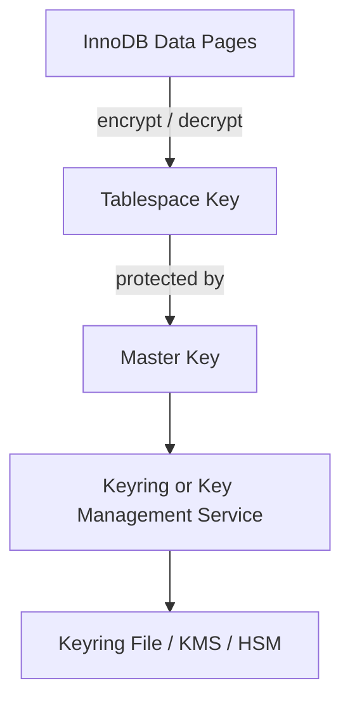

# Tablespace Encryption, Keyring, Key Backups, and Usage Requirements

Tablespace encryption protects InnoDB data when database files on disk, storage devices, or physical copies are accessed without authorization. For this mechanism to work, MySQL requires a reliable key store (keyring), a key lifecycle management process, and backups that can be restored in sync with the encrypted data.

In the `DATABASE_MYSQL` module, this topic connects security with the operational tasks already covered: table and tablespace design, data querying, transaction control, backup, and recovery. Encryption only has value while keys remain usable and recovery procedures have been verified.

After this lesson, you will be able to:

- Explain the relationship between tablespace keys, master keys, and the keyring.
- Identify suitable tablespace types and MySQL versions for enabling encryption.
- Create or convert InnoDB tables to encrypted tablespaces.
- Inspect encryption status and perform master key rotation.
- Design data backups alongside keyring backups, then test recovery safely.
- Recognize common errors when MySQL cannot find keys or the keyring is unavailable.

## 1. What Does Tablespace Encryption Protect?

Encryption at rest transforms data contents on storage media so they cannot be read directly without the key. With InnoDB, MySQL performs encryption and decryption as data pages are written and read. Applications continue querying tables with normal SQL; applications do not manually decrypt each row.

Tablespace encryption is useful for reducing risk from:

- Someone obtaining copies of `.ibd` files or storage volumes without having the keys.
- Misplaced or stolen physical backups, snapshots, or storage drives.
- Decommissioning disks or moving storage media between environments.

Encryption at rest does not replace other protection layers. While MySQL is running and a user holds appropriate SQL privileges, data is still returned in plaintext. This mechanism also does not automatically encrypt network connections, in-memory data, application logs, SQL exports, or all types of MySQL logs. Use TLS for connections, SQL privilege controls for users, host hardening, and separate encryption for logs or temporary files if security requirements cover them.

## 2. Key Architecture: Tablespace Keys and Keyring

InnoDB uses two primary key layers:

1. **Tablespace key** encrypts the contents of a tablespace.
2. **Master encryption key** encrypts and protects tablespace keys. The master key is managed through the keyring.

You can visualize the protection chain as follows:



When creating an encrypted tablespace, InnoDB generates a tablespace key and stores it protected by the master key. When reading data, MySQL retrieves the master key from the keyring, unwraps the tablespace key, and decrypts data pages. The keyring is therefore an essential part of data accessibility, not an optional auxiliary config file that can be discarded at will.

**Keyring** is the interface and key store used by MySQL. Depending on version and deployment, the keyring can be provided by a component, a plugin, or integration with an external key management system. Common options include:

| Key Storage Approach | Characteristics | Operational Considerations |
|---|---|---|
| Local file keyring | Easy to set up for learning or testing environments | Must restrict file read permissions, protect the directory, and back up separately; anyone who can read the file can obtain key material |
| Keyring component | Component mechanism in supported MySQL releases | Configuration and component loading depend on the release; must ensure the component is ready at startup |
| External KMS or HSM | Separates key management from the database server; can support centralized access control and auditing | Must verify connectivity, service identity, availability, API rate limits, and recovery procedures during KMS outages |

For production systems, choose a key management solution meeting organizational policy, with access control, auditing, backups, and independent recovery procedures. A local keyring file may suit a lab, yet putting keys in a file alone does not create a highly available key management system.

## 3. Prerequisites and Scope of Application

Before enabling encryption, verify the following conditions:

- **Right storage engine:** examples in this lesson use InnoDB. InnoDB's tablespace encryption options do not automatically apply to tables using other engines.
- **Right tablespace type:** tables using *file-per-table* tablespaces can be encrypted via the table/tablespace attribute. General tablespaces hold the encryption attribute at the tablespace level; tables placed inside share that attribute.
- **Right version:** syntax, keyring components/plugins, supported tablespace types, and configuration variables vary across MySQL versions. In particular, support for encrypting the system tablespace, undo tablespaces, redo logs, temporary tablespaces, and binary logs differs by release.
- **Keyring availability:** MySQL must load and access the keyring before InnoDB needs to open encrypted tablespaces. Component/plugin names and configuration must match the exact running release.
- **Proper OS permissions:** the MySQL service account needs necessary permissions to read/write the key store; unrelated users and processes must not be able to read or replace it.
- **Key backup procedure in place:** protected, recoverable key backups must exist. A data backup without the corresponding key material may be unusable.

Do not infer that enabling table encryption encrypts every piece of data on the instance. Tablespace, redo/undo log, binary log, relay log, and temporary file encryption are separate scopes. List the data requiring protection and cross-check supported features in your exact MySQL version.

## 4. Configuring the Keyring Before Creating Encrypted Data

At a high level, the configuration workflow consists of:

1. Identify the exact MySQL version and choose a supported keyring component or plugin for that version. On newer releases, prefer the component mechanism recommended in MySQL documentation; do not copy legacy plugin configs onto newer releases without checking support status.
2. Choose key storage. If using a file, place it in a directory protected by OS permissions, consider placing it outside the MySQL data directory, and ensure only the service account and administrative procedures have access.
3. Configure MySQL to load the keyring at the right startup stage. The keyring must be available before InnoDB initializes or opens tablespaces needing keys. Component and plugin loading differs across release series, so follow instructions for your exact version rather than applying one generic setup across all servers.
4. Start or restart following your environment's change workflow. Inspect server logs to confirm the keyring loaded cleanly with no permission, path, or KMS connection errors.
5. Test restarting the server and accessing encrypted data before rolling out to critical data.

An example file-based keyring configuration in older MySQL releases might use the `keyring_file` plugin with options specifying the data file and early plugin loading. This illustrates a specific release family, not a configuration applicable to every MySQL build:

```ini
# Illustrative example for releases that still support the keyring_file plugin.
early-plugin-load=keyring_file.so
keyring_file_data=/var/lib/mysql-keyring/keyring
```

Before using this example, verify that the plugin is still supported in your MySQL release, the path exists, permissions are right, and the directory is protected. If your release uses a keyring component, follow the installation procedure and dedicated configuration file for that component. Do not load multiple keyring mechanisms simultaneously just for testing without understanding how they manage the same key set.

For KMS/HSM, in addition to configuring the right component, verify the identity MySQL uses to call the service, key-retrieval permissions, certificates or credentials, network connectivity, rate limits, and operational procedures when the KMS is temporarily unreachable.

## 5. Creating and Converting Tables to Encrypted Tablespaces

### 5.1. Creating an Encrypted InnoDB Table

For a file-per-table table, declare `ENCRYPTION='Y'` at table creation:

```sql
CREATE TABLE customer_profile (
    customer_id BIGINT UNSIGNED NOT NULL,
    full_name VARCHAR(150) NOT NULL,
    email VARCHAR(255) NOT NULL,
    created_at DATETIME NOT NULL DEFAULT CURRENT_TIMESTAMP,
    PRIMARY KEY (customer_id),
    UNIQUE KEY uq_customer_email (email)
) ENGINE=InnoDB
  ENCRYPTION='Y';
```

Once the keyring is ready and the version supports this syntax, InnoDB creates the corresponding tablespace with the encryption attribute. `SELECT`, `INSERT`, `UPDATE`, and `DELETE` continue using normal SQL.

### 5.2. Enabling Encryption on an Existing Table

For an eligible InnoDB table, request conversion with:

```sql
ALTER TABLE customer_profile ENCRYPTION='Y';
```

Conversion can rewrite data and consume significant I/O, CPU, and temporary disk space. On large tables, measure duration in a test environment, check disk headroom, assess impact on transactional load, and choose a suitable maintenance window. Do not assume the statement finishes instantaneously or without impacting applications.

To disable encryption on an eligible table, the common syntax is:

```sql
ALTER TABLE customer_profile ENCRYPTION='N';
```

Do so only when policy permits. Removing encryption is a security change that requires approval and verification just like enabling encryption.

### 5.3. Using General Tablespaces

A general tablespace can hold multiple InnoDB tables. The encryption attribute is set at the tablespace level, so tables placed in that tablespace share that attribute:

```sql
CREATE TABLESPACE secure_ts
    ADD DATAFILE 'secure_ts.ibd'
    ENGINE=InnoDB
    ENCRYPTION='Y';

CREATE TABLE payment_record (
    payment_id BIGINT UNSIGNED NOT NULL,
    amount DECIMAL(15,2) NOT NULL,
    created_at DATETIME NOT NULL,
    PRIMARY KEY (payment_id)
) ENGINE=InnoDB
  TABLESPACE secure_ts;
```

To alter the attribute of a general tablespace, syntax on supported releases looks like:

```sql
ALTER TABLESPACE secure_ts
    ENCRYPTION='Y'
    ENGINE=InnoDB;
```

Verify version constraints before converting. Not every table-move operation, tablespace type, or InnoDB setting can be combined freely. With general tablespaces, manage access and data classification at the tablespace level since multiple tables can share a single storage unit.

### 5.4. Default Settings

Some MySQL releases provide variables such as `default_table_encryption` or InnoDB variables to control default encryption for new tablespaces. Scope, valid values, and override behavior depend on the version. Before setting instance- or schema-level defaults, confirm:

- Whether new tables are encrypted by default or only when explicitly declared.
- Whether users are allowed to override the default or require a dedicated encryption admin privilege.
- Whether existing tables are converted or the default affects only new objects.
- Whether table-creation jobs, migrations, and deployment tools are compatible with the new default.

Default settings reduce the risk of forgetting to encrypt new tables, but do not replace checking actual encryption state.

## 6. Checking Encryption Status

After creating or converting tables, verify both the object definition and InnoDB metadata.

Check the table definition:

```sql
SHOW CREATE TABLE customer_profile\G
```

Check tablespace status on MySQL versions that expose the corresponding column:

```sql
SELECT
    NAME,
    SPACE_TYPE,
    ENCRYPTION
FROM INFORMATION_SCHEMA.INNODB_TABLESPACES
ORDER BY NAME;
```

The `ENCRYPTION` value indicates whether tablespace metadata marks the tablespace as encrypted. Match tablespace names to the tables you are auditing; an instance can contain multiple tablespace types with different states.

Check the keyring plugin on systems using a plugin:

```sql
SELECT PLUGIN_NAME, PLUGIN_STATUS
FROM INFORMATION_SCHEMA.PLUGINS
WHERE PLUGIN_NAME LIKE 'keyring%';
```

That query reflects plugins only. If the server uses a component, inspect component status using the mechanism documented for your release and check startup logs. Do not conclude a component is unloaded solely because it does not appear in `INFORMATION_SCHEMA.PLUGINS`.

A complete check should verify four things: the keyring is active, the target tablespace has the expected `ENCRYPTION` value, the server can restart and still open the table, and backup/restore procedures can still retrieve keys. Merely seeing `ENCRYPTION='Y'` does not prove the recovery pipeline is safe.

## 7. Master Key Rotation

Keys should be rotated per periodic schedule, when key compromise is suspected, or when governance policies require it. For InnoDB, the statement commonly used to rotate the master key is:

```sql
ALTER INSTANCE ROTATE INNODB MASTER KEY;
```

The executing account needs the encryption administration privilege appropriate for your MySQL version; do not grant broader privileges than necessary just to run this operation. Before executing, check instructions for your exact version and confirm the keyring is operating normally.

Conceptually, key rotation creates a new master key and re-wraps tablespace keys under the new master key. Data remains accessible via SQL, though the operation can generate I/O load and background work. Completion time depends on tablespace count, size, and server configuration. Monitor logs, system load, and status after rotation; do not stop the server or delete old key material without understanding rotation progress and historical restore requirements.

A key rotation procedure should include:

1. Confirm the latest data backup and keyring backup are restorable.
2. Verify keyring access, disk space, and InnoDB health.
3. Perform key rotation within the chosen maintenance window.
4. Monitor logs and verify tablespace metadata after the operation finishes.
5. Take a fresh backup per organizational procedures; record the MySQL version, rotation timestamp, and backup identifier.
6. Retain historical keyring copies needed for older backups according to retention and recovery policies.

## 8. Keyring Backups and Data Recovery

This determines whether an encrypted system can actually recover after an incident. Encrypted data files and key material form a dependent pair. If data pages exist without the master key needed to unwrap the tablespace keys, MySQL cannot decrypt that data.

### 8.1. Backup Principles

- **Back up keys independently from the database host:** if the database server or data volume fails, key backups must still remain available.
- **Protect key backups at a high level:** restrict access, encrypt backup storage, audit operations, and keep recovery credentials in a controlled channel.
- **Maintain consistency:** record when a data backup was taken and which keys it needs. When rotating keys, understand whether the current keyring still holds keys needed for older backups.
- **Do not just copy the data directory:** physical backups must follow the backup tool's procedure while also including or referencing the required key material.
- **Never put keys in source code or Git repositories:** avoid placing keyring files, KMS passwords, tokens, or credentials in repositories, logs, or unprotected tickets.
- **Test recovery:** a backup is trustworthy only after a successful test restore using the exact matching data and keys.

### 8.2. Assembling a Restorable Backup Set

For each backup set, record a manifest covering:

| Component | Information to Record |
|---|---|
| Data | Instance name, backup type, timestamp, table/tablespace scope, and storage location |
| Keys | Keyring backup or reference to key version in KMS/HSM; never write raw secrets into the manifest |
| Versions | MySQL version, keyring configuration, and backup tool version |
| Timeline | Backup timestamp relative to the latest key rotation and related config changes |
| Verification | Integrity check results and date of the most recent test restore |

For file-based keyrings, use a consistent backup procedure and protect permissions on both original and backup copies. Never manually edit keyring file contents. For KMS/HSM, confirm keys and access policies remain intact throughout the backup retention window; if your organization supports key disabling or deletion, strictly gate those actions.

### 8.3. Test Restore Procedure

1. Prepare an isolated recovery server running a MySQL version compatible with the backup.
2. Restore or configure the keyring before opening encrypted data.
3. Restore the data using the exact tool and workflow that produced the backup.
4. Inspect startup logs, verify tablespaces open cleanly, and query a verification dataset.
5. Validate application-level integrity, row counts, or checksums per system procedures.
6. Record restore duration, manual steps required, and any deviations from the runbook.

Never test recovery by overwriting a production server directly. Use an isolated environment to avoid impacting live traffic and to keep tests repeatable.

### 8.4. Example of Key-Data Mismatch

Suppose operations take a physical backup at time T1, then rotate the master key at T2. When restoring backup T1, the server needs a keyring capable of unwrapping the tablespace keys backed up at T1. If the keyring copy used for restore contains only newer keys and no longer retains the key needed for T1, the restore can fail even though all data files were backed up completely.

Therefore, define explicit historical key-retention policies and how keyring snapshots align with each backup set. Never assume the newest keyring copy can always open every older backup.

## 9. Replication, HA, and Disaster Recovery

Every MySQL server in a topology must be treated as an execution environment with its own keyring setup. For replicas, standby nodes, or DR servers, verify:

- The keyring is properly configured and loaded on each node before the node needs to open encrypted tablespaces.
- Each node has permission to access the right keys or key management service per the chosen architecture.
- Provisioning a new replica, replacing a node, and failing over to standby include keyring setup steps.
- Backups used for DR include verified key metadata and tested key-access procedures.
- Key rotations, permission revocations, or KMS changes are communicated to administrators of all related nodes.

Never blindly copy an active keyring file between servers. Key distribution depends on keyring architecture, instance identity, and KMS/HSM policies. Use vendor-supported workflows so each node accesses the right keys without exposing secrets.

## 10. Common Errors and Investigation

| Symptom | Possible Cause | Where to Check |
|---|---|---|
| MySQL cannot open encrypted tablespace | Keyring not loaded, missing key, or key store inaccessible | Check startup logs, component/plugin status, file paths, and OS permissions |
| Restore reports key not found | Wrong keyring copy used or data backup does not match retained keys | Cross-check backup timestamp, key rotation history, and corresponding keyring backup |
| Creating an encrypted table fails | Keyring not ready, unsupported engine or tablespace type, or version syntax mismatch | Verify engine, version, syntax, and detailed log messages |
| Legacy table remains unencrypted | Only set default for new tables or conversion statement has not succeeded | Check `SHOW CREATE TABLE` and metadata in `INNODB_TABLESPACES` |
| Server fails after keyring config change | Wrong path, wrong permissions, incompatible component/plugin config, or unreachable KMS | Restore last known good config, read logs, and recover keyring from a safe backup |
| Key rotation takes a long time | Many tablespaces, high I/O load, or background work still running | Monitor logs and server load; do not delete keys or kill processes arbitrarily |

When investigating, preserve existing keyring copies and relevant logs before editing configuration. Never try creating a fresh keyring over already-encrypted data expecting MySQL to rediscover old keys. Generating a new keyring cannot recover lost key material.

## 11. Practical Rollout Workflow

An encryption rollout should follow an auditable sequence:

1. **Classify data:** identify which tables, schemas, tablespaces, and logs require encryption; document compliance requirements and owners.
2. **Check compatibility:** record MySQL version, storage engines, tablespace types, and supported keyring mechanisms.
3. **Prepare keys:** configure keyring, access controls, key backups, and recovery plans if KMS or key storage experiences an outage.
4. **Test:** create a test table, enable encryption, restart the server, run queries, and perform a test restore in an isolated environment.
5. **Plan cutover:** measure load, disk space, duration, application impact, and policy-approved rollback steps.
6. **Deploy:** enable encryption in batches of tables or tablespaces while monitoring logs and system load.
7. **Verify:** check metadata, access permissions, restart resilience, and restorability.
8. **Operate:** schedule key rotations, keyring backups, permission reviews, and periodic recovery drills.

Minimum pre-production checklist:

- [ ] MySQL version and tablespace types support the chosen configuration.
- [ ] Keyring loads successfully before InnoDB needs to open encrypted data.
- [ ] Key store access permissions are restricted and audited.
- [ ] Target tables/tablespaces are verified as encrypted.
- [ ] TLS connections and SQL privilege controls remain configured per separate requirements.
- [ ] Data and keyring backups have clear correspondence and are protected independently.
- [ ] Test restore succeeded on an isolated server.
- [ ] Key rotation, keyring loss response, and DR runbooks have assigned owners.

## 12. Hands-on Scenario

A payment application uses MySQL InnoDB. The development team creates the `payment_record` table to store transactions. The security team requires data to be encrypted at rest. Operations must also ensure last month's backup remains restorable after rotating the master key.

Perform the following tasks in a test environment:

1. Identify the MySQL version and the tablespace type the table will use.
2. Configure a keyring appropriate for the version; confirm MySQL loads the keyring cleanly after restart.
3. Create an InnoDB table with `ENCRYPTION='Y'` or convert an existing test table.
4. Use `SHOW CREATE TABLE` and `INFORMATION_SCHEMA.INNODB_TABLESPACES` to verify encryption status.
5. Create a data backup and a keyring backup according to your environment's workflow.
6. Execute `ALTER INSTANCE ROTATE INNODB MASTER KEY` if version and privileges permit; record the timestamp.
7. Restore the backup onto an isolated server using the matching keyring copy, then confirm you can query the data.
8. Test a misconfigured keyring path in an isolated environment, inspect the logs, and restore the valid configuration.

**Self-assessment questions:**

- Why might backing up `.ibd` files without the corresponding keyring fail to restore data?
- How do the responsibilities of a tablespace key and a master key differ?
- Why does `ENCRYPTION='Y'` on a table not mean all instance logs and temporary files are encrypted?
- After rotating the master key, what records must be retained so older backups remain restorable?
- What should you verify on a newly provisioned replica before allowing it to serve traffic?

## Conclusion

Tablespace encryption is an important protection layer for InnoDB data at rest. Security and recoverability depend simultaneously on encryption configuration, the keyring, access permissions, key rotation history, and backup sets. Treat data and key material as a paired unit managed throughout their entire lifecycle: creation, operations, backup, rotation, and recovery.
