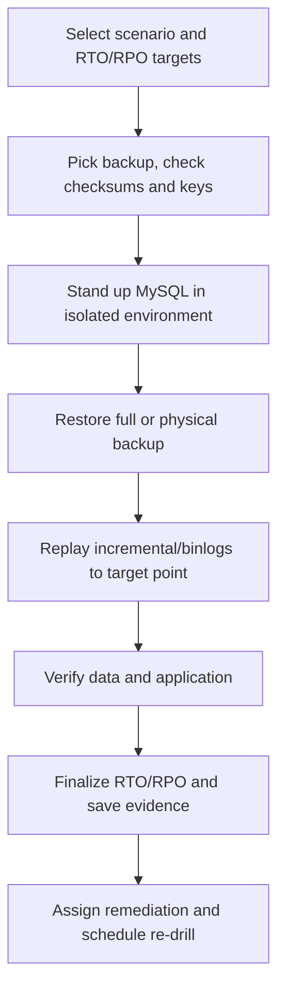

# Periodic Recovery Drills and Recording Recovery Time / Recovery Point

In the `DATABASE_MYSQL` module, learners master MySQL from table design, data types, keys, and SQL queries to indexes, transactions, concurrency control, execution plan reading, query tuning, privilege management, backups, and operational troubleshooting. This lesson focuses on proving that backups can actually restore the system, while measuring recovery time and potential data loss during an incident.

A backup job reporting success only proves data was written to a storage target according to the job's steps. It does not prove the backup is readable, has all decryption keys available, can load onto a compatible MySQL server, or can return the application to service within the required time. Only a full recovery drill tests that entire dependency chain.

## 1. Objectives of a Recovery Drill

A recovery drill (restore drill) is a periodic exercise using backups and related recovery artifacts to stand up a MySQL environment, bring data to a defined point in time, verify correctness, and record results. A drill must answer these questions:

- Which backup was chosen, when was it created, and can it be read/decrypted?
- Are sufficient binary logs available to recover to the required data point?
- How long does it take from incident response start until the application can operate again?
- What is the timestamp of the newest recoverable data relative to the incident time?
- Which steps were slow, lacked documentation, or depended on a single person or external system?
- Do the results meet the recovery objectives agreed upon with the system owner?

Drill scope should span multiple scenarios: server loss, storage zone failure, accidental data deletion, application logic bugs, recovering right before a corrupting transaction, or the most recent backup being unusable. You do not need to simulate every scenario in a single run; pick a clear scenario with pass criteria and repeatability.

## 2. Understanding and Measuring RTO and RPO

Two fundamental metrics used to set targets and evaluate recovery capability are RTO and RPO.

### RTO — Recovery Time Objective

RTO is the maximum outage duration an organization accepts for a service. During a drill, measure the actual time to bring the service back to a verified operational state.

Agree on the start milestone before the drill. For example, `T0` could be when the incident is detected, when the incident is declared, or when the operations team receives the recovery order. For a service with a recovery SLA, include detection, assessment, approval, fetching backups, provisioning servers, loading data, replaying binary logs, verifying the application, and shifting traffic. Starting the stopwatch only when the restore command runs does not reflect total downtime.

```text
Actual RTO = time service is confirmed operational - T0
```

For example: the incident is declared at 09:00 UTC; the host is provisioned by 09:12; loading the backup and replaying logs finishes at 09:42; application verification and traffic cutover complete at 09:50. Actual RTO is 50 minutes. If the RTO target is 60 minutes, this drill passes, leaving only a 10-minute buffer.

### RPO — Recovery Point Objective

RPO is the maximum time span of data an organization accepts losing in an incident. Actual RPO is determined from the incident time back to the latest committed transaction present and verified in the recovered data.

```text
Actual RPO = incident time - timestamp of newest recoverable commit
```

For example: an incident strikes at 10:40 UTC; after recovery, the latest verified transaction has a commit timestamp of 10:34 UTC. Actual RPO is 6 minutes. If the RPO target is 5 minutes, the result fails even if the server started up quickly.

RPO is not the age of the latest backup file. If a full backup exists from the night before while binary logs are archived continuously and intact, the system can replay logs to bring data close to the incident time. Conversely, a recent backup missing required binary logs can leave the actual recovery point much older than expected.

RTO and RPO are distinct targets. You can meet RPO yet miss RTO if data loading takes too long; you can also meet RTO yet miss RPO by quickly restoring from too old a backup. Record and evaluate each metric separately.

## 3. Preparing Data and Recovery Tools

Before running a drill, list every component the recovery workflow depends on.

### Choosing the Backup Type

MySQL is typically backed up using one or a combination of methods:

| Method | Recovery Characteristics | What to Check During Drills |
|---|---|---|
| Logical backup, e.g., `mysqldump` | Exports schemas and data as SQL statements; portable across compatible environments, though slow for large datasets. | Dump file is readable, includes required schemas, tables, triggers, routines, events; import completes without errors. |
| Physical backup, e.g., MySQL Enterprise Backup or Percona XtraBackup | Copies physical data files; generally fits large databases and may support incremental backups. | Compatible tool version, complete full/incremental chain, prepare/apply-log step executed per tool requirements. |
| Storage or VM snapshot | Can recover rapidly if snapshots are consistent and infrastructure supports it. | Snapshot is consistent with MySQL state, accompanying metadata exists, and snapshot attaches/opens in test environment. |
| Binary logs | Record changes after the backup checkpoint, enabling point-in-time recovery (PITR). | Binary logging enabled, continuous logs from backup checkpoint, no missing/corrupted files, sufficient retention. |

Do not assume different backup types share identical restore workflows. Follow the exact documentation for the tool that created the backup, the exact MySQL version, and the exact order of applying incrementals or logs.

### Checking Binary Logs and Backup Checkpoint Info

PITR typically requires a consistent backup paired with its corresponding binary log position or GTID information at backup time. Inspect configuration on the source server:

```sql
SHOW VARIABLES LIKE 'log_bin';
SHOW VARIABLES LIKE 'binlog_format';
SHOW BINARY LOGS;
```

`log_bin` must be enabled if the workflow relies on binary logs. The log list must span continuously from the backup checkpoint up to the target recovery time. Retaining logs solely on the source server is insufficient; copy them to independent storage so they remain usable if the source server or disk is lost.

Record backup metadata: start/end timestamps, MySQL version, backup type, included schemas, binary log position and GTID position if used, checksum, storage location, decryption key, and retention expiration. If using GTIDs, preserve the backup's GTID state and understand the target host's GTID state before replaying or joining a replication topology.

### Checking Readability and Decryption

Before restoring, verify the file transferred intact using the checksum generated by the backup job or recompute it. Example on Linux:

```bash
sha256sum shop-full.sql
```

Compare the value against the checksum recorded at backup time or after downloading. If the backup is encrypted, confirm keys and key-access permissions still work. An intact encrypted file without accessible decryption keys is still an unrecoverable backup.

Never put passwords, encryption keys, tokens, or sensitive data payloads into drill reports. Record only secret identifiers and which controlled vault manages access.

## 4. Building a Safe Recovery Environment

Drills should run on an isolated host or environment. This environment needs sufficient disk, CPU, RAM, and bandwidth to mirror reality; using drastically smaller hardware means measured timings will not represent production RTO.

Before loading data:

1. Select a MySQL version compatible with the backup and backup tool. Never assume a data directory from a newer version can be restored onto an older server version.
2. Prepare necessary configuration such as `datadir`, `innodb_log_file_size` or version-appropriate equivalents, charset, collation, time zone, plugins, and resource limits. Apply only parameters valid in the running version.
3. Isolate application connectivity and replication so the test host cannot accept writes from live systems, send real emails or jobs, or accidentally join a production topology.
4. Prepare a recovery account with minimum required privileges. Avoid embedding production credentials in scripts or command lines.
5. Define post-restore checks: business queries, row counts, foreign keys, routine/event states, accounts and privileges, plus an application connectivity test.

If the data contains PII or business secrets, enforce access controls and data masking/encryption procedures suitable for the drill environment. Afterward, delete or retain the test dataset according to approved policy.

## 5. Executing Logical Backup Restore and PITR

The example below illustrates a logical backup workflow for an InnoDB database. Exact syntax and options vary across `mysqldump` versions; check `mysqldump --help` on the exact host running backups. In versions supporting `--source-data`, `--source-data=2` writes the binary log position as a comment inside the dump so the replay starting point can be retrieved.

### Creating a Logical Backup with Binary Log Coordinates

```bash
mysqldump \
  --login-path=backup \
  --single-transaction \
  --routines \
  --events \
  --triggers \
  --source-data=2 \
  --databases shop \
  > shop-full.sql
```

`--single-transaction` establishes a consistent snapshot for InnoDB tables without holding read locks across the entire dump. This does not guarantee a consistent snapshot for tables using non-transactional engines like MyISAM; also avoid DDL changes such as `ALTER TABLE`, `DROP TABLE`, `RENAME TABLE`, or `TRUNCATE TABLE` during the dump. If the server or `mysqldump` version does not support `--source-data`, use the equivalent option supported by that version's documentation, such as `--master-data=2` in older releases.

MySQL accounts and privileges should not be assumed fully backed up merely because an application schema was dumped. Maintain a separate workflow to capture and restore accounts, roles, grants, server configuration, certificates, and required secrets. Never blindly restore the entire `mysql` system schema onto a different version.

### Loading the Backup onto the Test Server

```bash
mysql --login-path=restore < shop-full.sql
```

After loading, check command logs and exit code. Never pass force-continue flags that ignore import errors and then mark a restore successful. If the command fails mid-way, record the error, clean the test environment per the runbook, and rerun after fixing the root cause.

### Replaying Binary Logs to the Recovery Point

Suppose the dump recorded binary log file `binlog.000123` at position `4567`. All log files from that point up to before the incident were completely copied into `/backup/binlog/`. You can use `mysqlbinlog` to replay changes up to the target timestamp:

```bash
mysqlbinlog \
  --start-position=4567 \
  --stop-datetime="2026-11-19 10:30:00" \
  /backup/binlog/binlog.000123 \
  /backup/binlog/binlog.000124 \
  | mysql --login-path=restore
```

This is an illustrative example; substitute actual files, positions, and timestamps from metadata. `--start-position` must match the position recorded at the backup checkpoint in the first file. `--stop-datetime` depends on how the machine running `mysqlbinlog` interprets time zones; synchronize clocks, standardize on UTC, and document the time zone in the drill report. When stopping right at an event/transaction boundary is required, prefer a verified log position or GTID rather than relying solely on timestamps.

Before running, verify log files are continuous and ordered properly. A missing file mid-chain prevents replaying subsequent changes cleanly. If stopping right before a corrupting statement, locate the target transaction by inspecting logs on a copy, then pick the stop position right before that transaction. Never test this directly on a production server.

For physical backups, restore, prepare, incremental application, and server startup must follow the exact documentation of the tool that created the backup. After restoring a physical backup, PITR still requires exact binary log/GTID coordinates and complete logs.

## 6. Verifying Data and Confirming Service Health

A server booting cleanly does not mean the data recovered accurately. Verify across multiple layers.

### Checks at the MySQL Layer

```sql
SELECT VERSION();
SHOW DATABASES;
SHOW TABLES FROM shop;
SHOW VARIABLES LIKE 'read_only';
```

Verify key tables, column definitions, indexes, charsets/collations, triggers, routines, events, and relevant settings. If using InnoDB, test business queries and foreign key constraints in the test environment. `CHECK TABLE` can help inspect certain table types, though it does not replace verifying data logic and business workflows.

### Business-Level Data Verification

Choose indicators verifiable against the recovery point: total order count, balances, stock quantities, daily revenue totals, or known test transactions. For critical data, use checksums or primary-key-range comparisons over a defined window. If the intent was recovering prior to an erroneous transaction, prove that the bad transaction is absent while valid earlier transactions remain intact.

One way to measure RPO in a drill environment is inserting marker records in a test schema. Create the marker table before taking the full backup so it exists in the snapshot; then insert committed markers at logged timestamps. Set the session time zone to UTC:

```sql
SET time_zone = '+00:00';

CREATE TABLE IF NOT EXISTS shop.restore_drill_marker (
    id BIGINT UNSIGNED NOT NULL AUTO_INCREMENT PRIMARY KEY,
    marker_name VARCHAR(100) NOT NULL,
    recorded_at TIMESTAMP(6) NOT NULL DEFAULT CURRENT_TIMESTAMP(6)
) ENGINE=InnoDB;

START TRANSACTION;
INSERT INTO shop.restore_drill_marker (marker_name)
VALUES ('before-simulated-incident');
COMMIT;
```

After taking the backup, keep inserting markers at various times before and after the simulated incident timestamp; log each marker's commit timestamp in the drill record immediately after the transaction commits. After recovering to the selected point, query:

```sql
SELECT id, marker_name, recorded_at
FROM shop.restore_drill_marker
ORDER BY id;
```

The latest committed marker present provides clear evidence of the recovered data point. `recorded_at` records when the `INSERT` ran, not the exact commit timestamp; for tighter accuracy, record commit completion timestamps on the drill controller side and cross-reference GTID/transaction IDs or business records. Never inject test markers into production data without an approved procedure.

### Checks at the Application Layer

Run smoke tests through the exact driver and connection configuration the application uses: authenticate, read representative records, execute a test write inside a test schema and roll back or clean up afterward. Verify required privileges, roles, and application accounts. Confirm background jobs, schedulers, events, and external integrations stay in a safe state so booting the test host causes no real-world side effects.

Stop the RTO stopwatch only when the service meets its defined recovery criteria: MySQL is ready, data is valid, the application connects, and essential checks pass. If only the database server booted while the application remains unusable, service RTO has not ended.

## 7. Recording RTO, RPO, and Drill Evidence

Each drill needs a unique ID and an auditable report. Use a single time convention—preferably UTC in ISO 8601 format with explicit time-zone designator. Synchronize clocks across MySQL hosts, backup hosts, recovery hosts, and monitoring systems to avoid comparison drift.

| Record Field | Information to Capture |
|---|---|
| Drill ID | Unique ID, execution date, coordinator, and executor. |
| Scenario | Server loss, accidental delete, logic bug, corrupted backup, or other scenario. |
| Objectives | Approved RTO/RPO and criteria defining service recovery. |
| Recovery source | Backup ID, backup type, backup timestamp, MySQL version, checksum, and storage path. |
| Log checkpoint | Binary log file/position or GTID at backup; list of replayed logs and stop point. |
| Timings | `T0`, backup fetch start, host provisioning, restore, log replay, verification start/end, and service-ready time. |
| Data point | Latest verified commit time, final marker/transaction ID, and simulated incident time. |
| Results | Actual RTO, actual RPO, pass/fail per target, encountered errors, and evidence. |
| Follow-up actions | Issue, priority, owner, due date, and re-verification status. |

Example result record:

| Metric | Target | Drill Result | Assessment |
|---|---:|---:|---|
| RTO | 60 minutes | 50 minutes | Pass, 10-minute buffer remaining |
| RPO | 5 minutes | 6 minutes | Fail, exceeded by 1 minute |
| Recovery point | Before 10:40 UTC incident | Last marker at 10:34 UTC | Verified |
| Application check | Smoke test passes | Passed at 09:50 UTC | Pass |

Do not record only the total figure. Capture per-stage durations to see which step consumes the most time. For instance, if fetching the backup took 2 minutes, restoring took 25 minutes, replaying logs took 10 minutes, and verification/cutover took 13 minutes, operations can focus optimization on the exact step dominating RTO.

## 8. Repeatable Drill Workflow

A typical drill can be organized along the following flow:



Execute step by step:

1. **Lock scope.** Pick the system, schema, scenario, simulated incident time, and RTO/RPO targets. Clarify who decides the recovery point and who signs off on data validity.
2. **Select backup set.** Pick a full backup and required incremental/binlog chain. Verify checksums, access permissions, decryption keys, metadata, versions, and log continuity.
3. **Start timing.** Record `T0` per organizational convention. Log every milestone rather than just start and end times.
4. **Build target environment.** Provision an isolated host with compatible config, recovery accounts, and sufficient disk capacity.
5. **Restore data.** Load the logical dump or perform physical restore/prepare per tool instructions. Check exit codes and logs at every step.
6. **Advance data to target point.** Replay binary logs or apply the incremental chain to the exact chosen timestamp/transaction. Record files, positions, GTIDs, and commands used.
7. **Verify.** Check schema, data, markers, privileges, and application smoke tests. Confirm recovery only when all defined criteria pass.
8. **Finalize metrics.** Calculate RTO from `T0` to service-ready time; calculate RPO from incident time to newest verified commit. Compare each separately against targets.
9. **Document and improve.** Archive the report, secret-scrubbed logs, errors, remediation actions, and re-test schedule. Decommission the test environment per policy.

## 9. Drill Frequency and Depth

Frequency should reflect service criticality, contractual/regulatory requirements, rate of data change, binary log retention, data growth rate, and pace of infrastructure change. You can structure a tiered schedule:

- **Periodic sanity checks:** verify backup readability, checksums, decryption keys, and binary log presence. This is a quick check and does not replace a restore drill.
- **Full restore drills:** stand up a fresh environment, load the backup, and verify data/application on a cadence matching system criticality.
- **PITR drills:** recover to a moment before an erroneous transaction or to a specific transaction marker to validate the binary log chain.
- **Major outage drills:** test recovery when losing a host/storage zone, losing primary backup repository access, or rebuilding external dependencies.
- **Post-change drills:** re-run after upgrading MySQL, changing backup tools, altering encryption, migrating storage repositories, changing topology, or significant data scale shifts.

Never apply one rigid schedule across every system. A service with a minute-level RPO must verify its binary log pipeline far more often than a service with a day-level RPO. Whenever backups or logs go untested for long stretches, the risk of discovering defects too late grows.

## 10. Common Issues Found in Drills

| Symptom | Possible Cause | Resolution |
|---|---|---|
| Backup file exists yet restore fails | Missing/corrupted file, wrong format, lost decryption key, or wrong repository permissions. | Check checksums, permissions, keys, and backup tool logs; fix storage pipeline then create and re-test a fresh backup. |
| Full backup restores yet PITR fails | Missing binary logs, gaps in log chain, wrong start position, or wrong time zone/stop point. | Cross-check backup metadata, log list, file/position, or GTID; verify clock sync and retention. |
| Server boots yet application cannot run | Missing users/grants, routines, events, config, certificates, secrets, or dependencies. | Add missing dependencies to the runbook and include application smoke tests in completion criteria. |
| Actual RTO exceeds target | Large restore size, low bandwidth, lack of automation, insufficient host resources, or slow approvals. | Use per-stage timings to locate bottlenecks; optimize transfer path, resources, automation, and docs. |
| Actual RPO exceeds target | Backups too infrequent, delayed binary log shipping, short retention, or gaps in log chain. | Adjust backup schedule, monitor log shipping lag and retention; re-drill after fixing. |
| Results across drills are incomparable | Start/end milestones, host specs, data size, or verification criteria changed undocumented. | Standardize measurement conventions, archive configs and metadata, and note all differences across runs. |

When a drill misses its target, the result is still valuable if recorded honestly. Never ignore errors, adjust milestone definitions retroactively, or mark success merely because the final command returned exit code 0. A failed drill exposes gaps in the workflow before a real incident strikes.

## 11. Practice Exercise

An e-commerce service runs MySQL InnoDB with an RTO target of 60 minutes and an RPO target of 5 minutes. The system takes nightly full backups and ships binary logs continuously to an independent archive. Conduct a drill in an isolated environment:

1. Select a full backup, recording its timestamp, MySQL version, checksum, binary log/GTID position, and verify decryption key availability.
2. Create several committed transaction markers after the backup checkpoint; record the UTC timestamp of each marker.
3. Choose a simulated incident time after the final marker, then stand up a compatible MySQL server on an isolated network.
4. Restore the backup, replay binary logs to the selected recovery point, and record the exact final file/position or GTID.
5. Query the final marker, reconcile business metrics, and run application smoke tests.
6. Record `T0`, service-ready timestamp, and newest verified commit; calculate actual RTO/RPO and compare against targets.
7. If targets are missed, pinpoint the slow stage or log gap, propose an action with an owner and deadline, and schedule a re-drill.

After this exercise, learners should be able to explain why a "backup job succeeded" status does not prove recoverability, why PITR needs continuous binary logs from the backup checkpoint, why RTO must stop only once the application is verified, and why RPO must be anchored to the latest transaction actually present in recovered data. This is the foundation for turning MySQL backups into a measurable, continuously improvable recovery capability.
