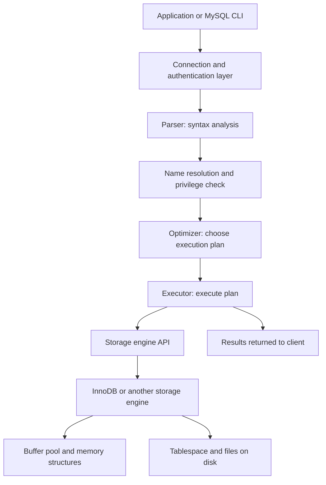

# Connection, Parsing, Optimization, and SQL Execution Layers

In the **DATABASE_MYSQL** module, learners master MySQL from table design, data types, keys, and SQL queries to indexes, transactions, concurrency control, reading execution plans, query optimization, privilege management, backup, and operations. To understand why a SQL statement can run fast or slow, it is necessary to view MySQL as a multi-layered cooperating system: the connection layer receives requests, the SQL layer parses and optimizes statements, the execution engine orchestrates operations, and the storage engine reads and writes the actual data.

Understanding this flow helps distinguish connection errors from SQL errors, understand the role of indexes and the optimizer, read `EXPLAIN` on a solid basis, and know how a SQL operation affects transactions, memory, and disk.

## 1. The MySQL Architecture Overview

MySQL Server typically runs as the `mysqld` process. Clients such as the MySQL CLI, a Java application using Connector/J, or a backend service send statements to the server over an appropriate protocol. Most relational applications use the classic SQL protocol over TCP/IP; local clients on Unix can also use a Unix socket.

The architecture can be viewed in four main layers:

1. **Connection and session management:** accepts connections, negotiates the protocol, authenticates accounts, and creates the session context.
2. **SQL layer:** performs syntax parsing, name resolution, privilege checking, optimization, and execution plan construction.
3. **Execution layer:** coordinates iterators or read/write operations, applying predicates, joins, sorting, and aggregation according to the plan.
4. **Storage engine layer:** provides storage, lookup, locking, transactions, and data page access. InnoDB is MySQL's widely used default storage engine.

The diagram below illustrates the high-level flow of a SQL statement:



This is a logical model. Certain tasks such as privilege checks, metadata access, expression evaluation, or predicate pushdown can occur at multiple points during processing. Not every statement passes through all steps in an identical straight line.

## 2. Connection and Session Management Layer

### 2.1. Accepting Connections

When a client connects to MySQL Server, the server accepts the request on a listening endpoint. For TCP/IP, the endpoint consists of a host address and port; for a Unix socket, the endpoint is a local socket path. On Windows, named pipes can be used if enabled.

The handshake process typically includes the following steps:

- The server sends an initial greeting packet, including protocol version information and the authentication mechanisms it supports.
- The client and server negotiate capabilities such as protocol, charset, and connection options; if TLS is used, both sides perform TLS negotiation before sending authentication credentials over the protected channel.
- The client sends the account name and authentication data according to the configured authentication plugin.
- The server authenticates the account, verifies the connection source, and creates a session if successful.

A successful connection only means the client has entered the server. When executing a SQL statement, MySQL still checks the required privileges on the corresponding database, table, column, or operation. Therefore, `Access denied` during the handshake and a missing-privilege error when running a SQL statement are two situations that must be diagnosed at two different stages.

### 2.2. Threads and Sessions

Under the common default model, MySQL uses one thread to serve each active connection. That thread processes requests for the session and maintains session state such as:

- Session variables, such as `sql_mode`, `time_zone`, and `autocommit`.
- The default database selected via `USE`.
- Connection charset and collation.
- Current transaction state and related attributes.
- Prepared statements and session-bound resources.

When the client closes the connection, session resources are released; the thread may be placed into the thread cache for reuse by a new connection. The thread cache reduces the overhead of creating threads, but it does not mean one cached thread corresponds to one open application connection.

Some distributions or commercial configurations may provide a thread pool to multiplex many connections across a limited number of worker threads. This is a difference in execution scheduling; it does not change the principle that clients still have separate sessions and MySQL still must authenticate and check privileges for requests.

### 2.3. Application-Side Connection Pools

Java applications commonly use a connection pool such as HikariCP to reuse connections, limit concurrent connections, and avoid continuously creating/destroying connections. An application-side connection pool differs from the thread cache or thread pool in MySQL Server:

| Component | Where it runs | Responsibility |
|---|---|---|
| Connection pool | Java/backend application | Manages reusable JDBC connections |
| Thread cache | MySQL Server | Reuses threads that served previous connections |
| Thread pool (if available) | MySQL Server | Schedules connection processing across worker threads |

An overly large pool can force MySQL to manage too many concurrent sessions, increasing memory usage and resource contention. Pool configuration should be based on the number of application instances, server connection limits, query duration, and actual workload. Do not increase `maximumPoolSize` merely to handle slow queries; identify the bottleneck first.

## 3. SQL Layer: Parsing and Preparing Statements

### 3.1. Parser (Syntax Analysis)

After receiving a statement, MySQL analyzes tokens such as keywords, table names, column names, operators, literals, and expressions. The parser verifies whether the structure conforms to the SQL grammar supported by the MySQL version and produces an internal representation (parse tree) for subsequent steps to process.

For example:

```sql
SELECT customer_id, COUNT(*) AS order_count
FROM orders
WHERE status = 'PAID'
GROUP BY customer_id
ORDER BY order_count DESC;
```

The parser recognizes `SELECT`, the expression list, `FROM`, `WHERE`, `GROUP BY`, and `ORDER BY`. If a keyword is missing or an expression is misplaced, the statement can be rejected with a syntax error before MySQL reads any data rows.

The parser does not decide which index is used and does not directly read data pages. That is the job of the optimizer, executor, and storage engine.

### 3.2. Name Resolution and Metadata

Once the statement structure is valid, MySQL must determine which objects the names in the SQL statement actually refer to:

- Which database contains the referenced table?
- Does the table exist and are any aliases declared?
- Does the column exist in the table or within the query scope?
- What are the column's data type and metadata?
- Can the functions, operators, and expressions be validly applied?

MySQL uses the data dictionary to manage metadata for databases, tables, columns, indexes, and other objects. Starting in MySQL 8.0, the metadata dictionary is stored in InnoDB's transactional data dictionary system, replacing the separate metadata files mechanism of older versions.

Metadata is also cached to reduce repeated lookup costs. When schemas change, the server must maintain metadata consistency and handle refreshing or invalidating the relevant cached information.

### 3.3. Privilege Checking

MySQL applies a multi-level privilege model. Accounts are identified by a user-and-host pair; privileges can apply at the global, database, table, column, or routine level depending on the grant type. When processing a statement, the server identifies the affected objects and checks the corresponding privileges.

For example, an account with only `SELECT` privilege on the `orders` table can read that table but cannot automatically `UPDATE` or `DELETE`. A query joining multiple tables requires read privileges on the involved objects. Use `SHOW GRANTS` to inspect actual privileges:

```sql
SHOW GRANTS FOR CURRENT_USER();
```

If a SQL statement is syntactically valid but reports a missing-privilege error, do not arbitrarily rewrite the query or change the connection protocol. Identify the exact logged-in account, host match, and required privileges.

## 4. Optimizer: Choosing an Execution Plan

### 4.1. Why Do We Need an Optimizer?

A SQL statement can be executed in multiple ways. For example, to find orders by `customer_id`, MySQL can scan the entire table or use an index on that column. For join queries, the optimizer must also choose the join order, how each table is accessed, and the method for combining rows.

The optimizer searches for a plan with a low estimated cost based on statistics and MySQL's optimization rules. The chosen plan is not necessarily the best under every real-world data state; its quality depends on statistics, selectivity, data distribution, index structure, and query expressions.

### 4.2. Key Decisions

The optimizer can perform many tasks, such as:

- Simplifying expressions and applying equivalent transformations.
- Pushing filter predicates closer to where data is read when possible.
- Choosing an appropriate join order and join method.
- Choosing an access path: full table scan, index lookup, range scan, or other access methods.
- Identifying indexes that can support filtering, joining, grouping, or ordering.
- Estimating intermediate row counts, I/O costs, and CPU costs.
- Deciding whether a temporary table or filesort is needed for certain operations.

For example, if the `orders` table has an index on `customer_id`, the following query can use the index to locate the range of rows to read:

```sql
SELECT order_id, order_date, total_amount
FROM orders
WHERE customer_id = 125;
```

However, if the condition returns most of the table, the optimizer may choose a table scan because the cost of sequential reads is estimated to be lower than repeated index lookups followed by fetching rows. Having an index does not mean every query must use it.

### 4.3. Statistics and Estimation

The optimizer relies on table and index statistics, such as estimated row counts, number of distinct values, data distribution, and histograms when created. Statistics that do not accurately reflect the data can cause the optimizer to misestimate row counts and choose a poor plan.

Index statistics can be updated with:

```sql
ANALYZE TABLE orders;
```

Histograms can help the optimizer understand a column's distribution when data is heavily skewed toward certain values:

```sql
ANALYZE TABLE orders
  UPDATE HISTOGRAM ON status
  WITH 32 BUCKETS;
```

Creating histograms should be purposeful and monitored for impact; there is no need to create them for every column. When data changes significantly or a query plan unexpectedly degrades, examine statistics before adding new indexes.

### 4.4. Observing the Optimizer

`EXPLAIN` shows the plan MySQL intends to use:

```sql
EXPLAIN
SELECT order_id, order_date, total_amount
FROM orders
WHERE customer_id = 125;
```

Some columns commonly read:

| Column | Meaning |
|---|---|
| `table` | Table or object read at that step |
| `type` | Access type, ranging from key-based lookups to table scans; must be interpreted in query context |
| `possible_keys` | Candidate indexes that could be considered |
| `key` | Index chosen for the access step |
| `key_len` | Length of the key prefix used |
| `rows` | Number of rows the optimizer estimates it will read |
| `filtered` | Estimated percentage of rows remaining after filtering at that step |
| `Extra` | Additional information such as `Using where`, `Using temporary`, or `Using filesort` |

Do not judge a plan solely by a single `type` value or by the presence/absence of `Using filesort`. Read the entire plan, estimated row counts, join order, and the query's goal. `Using filesort` is the technical name for an auxiliary sorting mechanism, and does not necessarily mean MySQL always writes the entire result to a physical file.

MySQL 8.0.18 and later support `EXPLAIN ANALYZE` for `SELECT` statements, which executes the query and adds actual timing and row counts across iterators:

```sql
EXPLAIN ANALYZE
SELECT order_id, order_date, total_amount
FROM orders
WHERE customer_id = 125;
```

This command actually runs the query. Use it on appropriate read queries, considering system load and returned data before running in a production environment. Compare estimated rows with actual rows to find where the optimizer misestimated.

## 5. Execution Layer: Executing the Plan

After the optimizer selects a plan, the execution layer coordinates the steps to produce the result. Depending on the query, the executor may:

- Open tables and initialize the selected access method.
- Request the storage engine to look up rows via an index or scan a range of data.
- Apply filter predicates and evaluate expressions.
- Combine rows from multiple tables according to the join plan.
- Group, compute aggregates, sort, or eliminate duplicate rows.
- Create and use temporary tables when needed.
- Stream results back to the client over the MySQL protocol.

Many modern query plans execute using an iterator model: each step supplies rows to the step above it on demand. For example, a filter step requests rows from an index access step; a join step requests rows from two branches; an aggregate step consumes input rows and produces grouped results. This model allows operations to work in a pipelined fashion rather than always materializing all intermediate results.

Some operations still need to store intermediate results, sort, or group before returning data. Therefore, `LIMIT` can reduce the number of rows returned or processed in certain plans, but it does not guarantee MySQL avoids all prior work. If sorting or aggregating over a large dataset is required, the server may still have to read and process many rows.

## 6. Storage Engine Layer and InnoDB

### 6.1. What Is a Storage Engine?

The SQL layer understands the statement and coordinates the plan, while the storage engine handles how data is stored and accessed. MySQL supports a pluggable storage engine architecture on a per-table basis. InnoDB is the default engine in modern MySQL versions and is typically used for transactional applications because it supports transactions, row-level locking, and MVCC.

You can check a table's engine with:

```sql
SHOW TABLE STATUS LIKE 'orders';
```

Or query the metadata:

```sql
SELECT TABLE_SCHEMA, TABLE_NAME, ENGINE
FROM information_schema.tables
WHERE TABLE_SCHEMA = DATABASE()
  AND TABLE_NAME = 'orders';
```

### 6.2. Storage Engine API

The execution layer does not need to understand the file format details of each engine. It invokes operations through the storage engine interface (handler API), such as opening a table, reading rows by index, scanning rows, writing rows, updating, or deleting rows. The engine performs the work according to its storage layout and returns results to the upper layer.

Thanks to this boundary, the same SQL statement can work with tables using different engines, within the capabilities supported by each engine. However, capabilities such as transactions, locking, foreign keys, and crash recovery depend on the engine; do not assume every engine behaves like InnoDB.

### 6.3. InnoDB Buffer Pool

InnoDB organizes data into pages. The buffer pool is the primary memory region used to cache InnoDB data and index pages. When a query needs a page:

1. InnoDB checks whether the page is already in the buffer pool.
2. If present, the engine can read from memory without fetching the page from disk.
3. If absent, the engine reads the page from the tablespace into the buffer pool.
4. When data is modified, the page in the buffer pool becomes a dirty page and is flushed to disk by the appropriate background mechanism.

A large, effectively utilized buffer pool can reduce physical I/O. However, allocating too much memory to InnoDB can starve the operating system of RAM for connections, sorts, temporary tables, and other processes. Tuning `innodb_buffer_pool_size` should be based on total memory and the server's role.

### 6.4. Indexes and Storage Layout

In InnoDB, tables are typically organized as a clustered index. If a table has a primary key, the primary key is the clustered index; records are organized in order of this key within a B-tree structure. Each secondary index stores the secondary key along with the primary key value to locate the corresponding record.

An important consequence: a long primary key increases the size of all secondary indexes because the primary key is carried in every secondary index entry. A short, stable, and appropriate primary key saves index space and reduces I/O. A secondary index can also satisfy queries as a covering index if it contains all required columns, avoiding a lookup back into the clustered index.

### 6.5. Transactions, Undo, and MVCC

InnoDB supports transactions with ACID properties. The undo log stores the information needed for rollback and supports consistent reads under MVCC. When a transaction updates a row, InnoDB creates appropriate older version information; reading transactions can see a version of the data according to their read view without necessarily blocking writing transactions.

MVCC does not eliminate all locks. Write operations still require locks to protect data; locking reads such as `SELECT ... FOR UPDATE` also have their own locking behavior. When transactions hold locks for a long time or update rows in different orders, lock waits or deadlocks can occur.

Transaction example:

```sql
START TRANSACTION;

UPDATE accounts
SET balance = balance - 100
WHERE account_id = 10;

UPDATE accounts
SET balance = balance + 100
WHERE account_id = 20;

COMMIT;
```

If a step fails and the application decides to cancel the entire operation, `ROLLBACK` can be used instead of `COMMIT`. Applications must handle transaction errors and retry appropriately on deadlocks; they should not retry indefinitely or keep transactions open while waiting for user interaction.

### 6.6. Redo Log, Binary Log, and Crash Recovery

InnoDB's redo log records the information needed to recover logged changes when the server crashes. It supports durability and restores page states after a crash. The undo log serves rollback and data versions for MVCC. The binary log is a server-layer log that records changes in configured formats such as row-based, statement-based, or mixed; it is commonly used for replication and point-in-time recovery.

These logs serve different purposes:

| Component | Scope | Primary purpose |
|---|---|---|
| Undo log | InnoDB | Rollback and old versions for MVCC |
| Redo log | InnoDB | Recovering logged changes after a crash |
| Binary log | MySQL Server | Recording changes for replication and point-in-time recovery |

When an InnoDB transaction commits and binary logging is enabled, MySQL coordinates transaction recording through an internal two-phase commit mechanism to maintain consistency between InnoDB's redo log and the server's binary log. Settings such as `innodb_flush_log_at_trx_commit` and `sync_binlog` affect durability guarantees on power loss or sudden OS crashes; values should be chosen based on durability and performance requirements.

InnoDB also uses a doublewrite buffer to protect pages from certain forms of partial page writes when flushing to disk. When restarting after a crash, InnoDB runs crash recovery based on the redo log and related structures, then continues handling incomplete transactions according to recovery rules. This mechanism does not replace backups; backups are still essential for recovery from hardware loss, accidental data deletion, or corruption beyond the scope of crash recovery.

## 7. How Does a SELECT Statement Travel Through the System?

Consider the query:

```sql
SELECT o.order_id, o.order_date, o.total_amount
FROM orders AS o
WHERE o.customer_id = 125
  AND o.status = 'PAID'
ORDER BY o.order_date DESC
LIMIT 20;
```

The processing flow can be described as follows:

1. The client sends the SQL statement over an authenticated connection.
2. The parser analyzes the `SELECT`, `FROM`, `WHERE`, `ORDER BY`, and `LIMIT` structure.
3. The server resolves `orders`, the alias `o`, and the columns, while verifying the required read privileges.
4. The optimizer inspects statistics and existing indexes, choosing an access path and how to handle sorting.
5. The executor requests the storage engine to read rows according to the plan.
6. InnoDB looks up pages in the buffer pool; if missing, it reads them from the tablespace. The engine uses indexes and consistent-read mechanics appropriate to the transaction.
7. Remaining conditions are evaluated; the executor handles result ordering and row limits according to the plan.
8. The server sends the result rows back to the client.

If an appropriate index exists, such as a composite index `(customer_id, status, order_date)`, MySQL can filter and retrieve rows via a more efficient access path. However, column order in the index and the ability to leverage the sorting portion still depend on query predicates, ASC/DESC ordering, data distribution, and the plan chosen by the optimizer. Always verify with `EXPLAIN` rather than concluding solely from the index name.

## 8. How Does an UPDATE Statement Travel Through the System?

Consider the statement:

```sql
UPDATE products
SET stock = stock - 1
WHERE product_id = 501;
```

The flow differs from `SELECT` in that the storage engine must modify data and manage the transaction:

1. The client sends the statement; the parser and resolution steps identify the table, columns, and expressions.
2. The server checks `UPDATE` privilege and required privileges on referenced columns/conditions.
3. The optimizer selects how to locate the row, typically using the primary key or an index on `product_id`.
4. The executor instructs InnoDB to find the row and acquire the locks needed to protect the update.
5. InnoDB records undo information, modifies the page in the buffer pool, and generates the corresponding redo log record.
6. If the binary log is enabled, the server records the change in the configured binlog format.
7. When the transaction commits, MySQL coordinates commit completion between InnoDB and the binary log; the data page may be flushed to the tablespace later by background mechanisms.
8. The server returns the affected row count and success or error status to the client.

The fact that a data page is not immediately written to the tablespace file does not mean the commit is lost. Durability is supported by the logging pipeline and appropriate flush settings. However, if configuration reduces flush frequency in exchange for performance, the protection level on power loss or crash may change.

## 9. Prepared Statements and Statement Reuse

Prepared statements allow a client to send a SQL template with placeholders and then pass parameter values separately. For example, in JDBC:

```java
String sql = "SELECT order_id, total_amount FROM orders WHERE customer_id = ?";

try (PreparedStatement statement = connection.prepareStatement(sql)) {
    statement.setLong(1, 125L);
    try (ResultSet result = statement.executeQuery()) {
        while (result.next()) {
            long orderId = result.getLong("order_id");
            BigDecimal amount = result.getBigDecimal("total_amount");
        }
    }
}
```

With server-side prepared statements, the server handles the prepare phase to parse and prepare the statement representation; on execute, the client sends parameter values over the protocol. This mechanism reduces SQL string concatenation and helps prevent SQL injection when parameters are properly bound. The server may need to re-prepare a statement in certain situations, such as metadata changes.

Prepared statements do not automatically guarantee fast queries. The plan still depends on the optimizer, statistics, indexes, and data values. It is also important to distinguish server-side prepared statements from client-side prepared statement emulation by the driver; specific behavior depends on Connector/J configuration.

## 10. Observing the Architecture from MySQL

The following commands help inspect status across different layers:

```sql
-- Current version and connection state
SELECT VERSION(), CONNECTION_ID();

-- Active connections and threads
SHOW GLOBAL STATUS LIKE 'Threads_connected';
SHOW GLOBAL STATUS LIKE 'Threads_running';
SHOW GLOBAL STATUS LIKE 'Threads_created';

-- Default storage engine and supported engines
SHOW ENGINES;

-- InnoDB memory
SHOW GLOBAL STATUS LIKE 'Innodb_buffer_pool%';

-- Transaction and log configuration
SHOW GLOBAL VARIABLES WHERE Variable_name IN
  ('autocommit', 'innodb_buffer_pool_size',
   'innodb_flush_log_at_trx_commit', 'sync_binlog', 'log_bin');
```

Metrics are snapshots at the time of the query. They should be tracked over time and placed in the context of actual workload. For example, high `Threads_connected` may reflect a large application pool or many idle clients; persistently high `Threads_running` may indicate heavy execution load or contention; a single isolated value is not enough to conclude an error.

To observe running queries:

```sql
SHOW FULL PROCESSLIST;
```

This command displays current sessions and states, but query text may contain sensitive data. Only share outputs after redacting confidential information.

## 11. Common Errors When Analyzing the SQL Flow

| Symptom | Layer to check first | Investigation direction |
|---|---|---|
| Cannot open connection | Connection and authentication | Host, port/socket, firewall, TLS, account, and authentication plugin |
| SQL syntax error | Parser | Tokens, parentheses, commas, keywords, and version-specific syntax |
| Table or column does not exist | Name resolution/metadata | Default database, schema, table/column names, aliases, and metadata |
| `Access denied` or missing privileges | Authentication/authorization | User-host match, `SHOW GRANTS`, and object privileges |
| Query runs slowly despite having an index | Optimizer/executor/engine | `EXPLAIN`, estimated rows, actual rows, statistics, index column order, and I/O |
| Many sessions waiting on locks | InnoDB/transaction | Long-running transactions, update ordering, lock waits, and deadlocks |
| Query performs heavy disk reads | InnoDB/buffer pool | Working set, buffer pool, access path, and caching effectiveness |
| Recovery or replication behaves unexpectedly | Redo/binlog/backup | Flush policies, binary log, checkpoints, backups, and restore procedures |

Layering helps choose the right tool. Do not use `EXPLAIN` to troubleshoot authentication failures; do not increase the buffer pool to fix a syntax error in SQL; do not add an index to bypass a firewall. Identify where the request stopped before modifying configurations or statements.

## 12. Hands-On Exercise: Tracing a Query

Perform this on a lab environment or development database you are authorized to access.

**Step 1 — Identify the session.** Connect via MySQL CLI or a Java application. Run `SELECT VERSION(), CONNECTION_ID();` and record the version and connection ID.

**Step 2 — Check privileges and metadata.** Run `SELECT DATABASE();`, `SHOW GRANTS FOR CURRENT_USER();`, and query `information_schema.tables` to identify the engine of the table used in the lab.

**Step 3 — Observe the plan.** Choose a `SELECT` query with a filter predicate and run `EXPLAIN`. Record `type`, `possible_keys`, `key`, `rows`, and `Extra`. If the environment supports MySQL 8.0.18 or later, run `EXPLAIN ANALYZE` on an appropriately sized read query to compare estimated rows with actual rows.

**Step 4 — Inspect the storage engine.** Check whether the table uses InnoDB or another engine. If using InnoDB, observe some `Innodb_buffer_pool%` status counters before and after running the query repeatedly. Do not conclude cache hits from a single run; inspect the relevant counters and understand what each metric means.

**Step 5 — Run a controlled transaction.** On a lab table, start a transaction, update a row, read it again within the same session, and then roll back. Afterward, inspect the data from another session. Observe the difference between uncommitted changes and committed data; do not experiment on production tables.

**Step 6 — Write out the processing flow.** For the chosen query, describe how the client sends the request, the parser analyzes it, the optimizer chooses an access path, the executor invokes the engine, and InnoDB retrieves pages from the buffer pool or disk. Clearly state which steps you directly observed and which ones were inferred from the architecture.

**Expected outcome:** Be able to explain the role of each layer, read an `EXPLAIN` plan, distinguish the SQL layer from the storage engine, and relate transactions and the buffer pool to data read/write operations.

## 13. Key Takeaways

- The connection layer authenticates clients and creates sessions; an application-side connection pool is separate from the server's thread cache or thread pool.
- The parser checks syntax; name resolution and metadata identify objects; privileges are checked against the account and accessed objects.
- The optimizer chooses plans based on statistics and estimated costs. Indexes are only helpful when they match the query predicates and plan.
- The executor coordinates steps; the storage engine performs concrete storage operations via the handler API.
- InnoDB uses the buffer pool to cache pages, undo logs for rollback/MVCC, redo logs for crash recovery, and coordinates with the binary log on transaction commit.
- `EXPLAIN` shows the estimated plan; `EXPLAIN ANALYZE` executes the `SELECT` to provide actual metrics.
- Layered diagnostics help pinpoint the root cause before modifying SQL, indexes, privileges, or server configuration.

Understanding the path of a SQL statement from the client to InnoDB and back gives you the foundation to read execution plans, design indexes, manage transactions, and systematically troubleshoot MySQL performance or operational issues.
