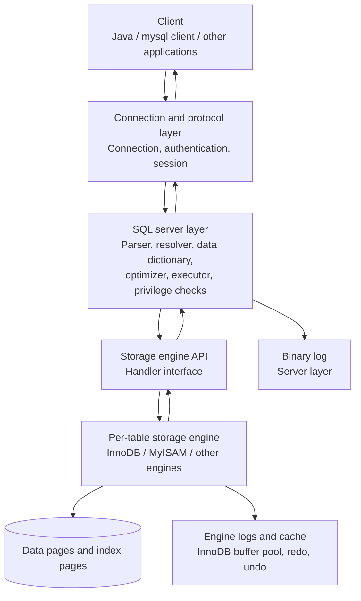

# Server Layer, Storage Engine API, and Responsibility Boundaries

MySQL Server is organized into two parts with distinct responsibilities: the **server layer** receives and processes SQL at the logical level; the **storage engine** performs data storage and retrieval at the physical level. The two parts coordinate through an internal interface called the **storage engine API**, often referred to via the handler interface.

Understanding this boundary explains why the same SQL statement can run on multiple storage engines, why some features belong to the server while others belong to InnoDB, and which layer to inspect when investigating query, locking, transaction, or data recovery issues.

In the **DATABASE_MYSQL** module, this architecture connects directly to table design, data types, keys, SQL queries, indexes, transactions, concurrency control, execution plans, privileges, backups, and operations. For example, the server layer checks the syntax and privileges of a SELECT statement, the optimizer chooses the access path, and InnoDB reads data pages and applies MVCC, row-level locking, and recovery logging.

## 1. The Big Picture

A MySQL connection passes through several stages. The main processing flow can be visualized as follows:



This is a conceptual diagram, not an exact internal function call sequence for every statement. A SQL statement may access multiple tables, invoke multiple engine operations, use temporary tables, or follow a different execution path. The key point is that the server layer coordinates SQL semantics, while the engine handles how a table's data is organized and manipulated.

A single MySQL instance can use multiple storage engines. The engine is typically chosen at the table level rather than choosing a single engine for the entire server. Thus, two tables in the same schema can use two different engines, although in standard transactional systems a consistent choice should be made for predictable transaction behavior.

## 2. What Is the Server Layer Responsible For?

The server layer is the part of MySQL that handles client protocols, SQL statements, and DBMS-level rules. Its responsibilities can be divided into the following groups.

### 2.1. Connection, Authentication, and Session

When a client opens a connection, the server accepts the MySQL protocol, authenticates the account, checks connection conditions, and creates a session context. The session holds state such as:

- The connected account and its corresponding privileges.
- The selected default database.
- Session variables, SQL mode, and time zone.
- Transaction state and certain execution settings.
- Settings related to character set, collation, and timeouts.

The server checks privileges on the database, table, column, or operation to be performed. The storage engine does not replace the server's SQL privilege mechanism. An application cannot automatically gain SELECT privilege simply because data files on disk are readable at the OS level.

For example, CREATE USER, GRANT, REVOKE, and account authentication are administrative responsibilities of the server layer. The engine does not decide which accounts an application is allowed to log in with.

### 2.2. Parser and Semantic Analysis

The parser analyzes the SQL string according to MySQL syntax and builds an internal structure for subsequent steps to process. The server then resolves database, table, column, and function names and checks the relevant semantic rules.

For example:

```sql
SELECT customer_id, COUNT(*) AS order_count
FROM orders
WHERE status = 'PAID'
GROUP BY customer_id;
```

The server must determine which table `orders` refers to, whether the columns exist, whether the expressions are valid, and whether the current session has privilege to read the table. If a column name is misspelled, the statement can fail before the engine has to read any data rows.

### 2.3. Data Dictionary and Metadata

The data dictionary stores the metadata the server needs to understand database structure: schemas, tables, columns, indexes, constraints, and related objects. Starting in MySQL 8.0, MySQL uses a transactional data dictionary instead of managing distributed metadata through `.frm` files as in older versions.

The server is responsible for interpreting and managing metadata. In MySQL 8.0, the data dictionary is stored by InnoDB in internal system tables; this does not mean applications should access internal tables directly to manage schemas. Use the SQL statements and metadata interfaces published by MySQL such as SHOW CREATE TABLE, INFORMATION_SCHEMA, and SHOW INDEX.

The server also manages metadata locking (MDL) to coordinate conflicts between operations using schema objects and operations altering metadata. For example, a running query using a table can cause an ALTER TABLE statement to wait for an appropriate metadata lock.

### 2.4. Optimizer and Executor

The optimizer analyzes the SQL statement, statistics, and available access paths, then chooses an execution plan. Decisions may include:

- Join order across tables.
- Using a table scan or index access.
- Which index and which key ranges to read.
- How to apply filter predicates and aggregations.
- How to perform sorting, grouping, or materialization when needed.

The executor executes the plan. When it needs to read or write table data, the executor uses the storage engine API to ask the engine to perform the corresponding operation.

The engine can supply the optimizer with information about indexes, cost estimates, and row counts. However, the optimizer still belongs to the server layer: the engine provides its capabilities and information, and the server uses them to build the SQL plan.

EXPLAIN shows the plan the server intends to use; EXPLAIN ANALYZE executes the query and provides actual metrics across iterators in supported versions. These two tools help analyze the server's choices, though they do not expose every physical detail of the engine.

### 2.5. Binary Log and Replication Coordination

The binary log (binlog) belongs to the server layer. It records data change events or statements according to the configured binlog format, supporting replication and certain point-in-time recovery procedures.

The binlog differs from InnoDB's redo log:

- The binlog records events at the MySQL server level so replicas or recovery tools can replay changes.
- The redo log records recovery information at the InnoDB level to bring data page changes back to a consistent state after a crash.
- InnoDB's undo log supports rollback and provides older data versions for MVCC.

When an InnoDB transaction is committed and the binlog is enabled, MySQL must coordinate the engine commit and binlog write to avoid situations where data is committed but the replication event is missing, or vice versa. This coordination mechanism is commonly called two-phase commit between InnoDB and the binlog. It is an example showing that the server layer and storage engine have separate boundaries yet still need to coordinate within a single logical operation.

## 3. What Is the Storage Engine Responsible For?

The storage engine determines how a table is stored and manipulated at the physical level. For InnoDB, key responsibilities include:

- Storing and reading data pages and index pages on storage devices.
- Managing the buffer pool to cache data and index pages in memory.
- Performing index lookups, row scans, inserts, updates, and deletes.
- Managing transactions, MVCC, undo logs, redo logs, and crash recovery.
- Performing row-level locking, appropriate range locking, and lock wait handling.
- Maintaining index structures, including the clustered index and secondary indexes.
- Enforcing relational constraints supported by the engine, such as foreign keys in InnoDB.

Another engine may have a different set of capabilities and implementation details. Therefore, one cannot infer that every MySQL table has row-level locking, MVCC, foreign keys, or transactions simply because they are accessed using the same SQL syntax.

### 3.1. InnoDB Is the Default Transactional Engine

InnoDB is MySQL's default storage engine in modern releases. It is designed for transactional workloads with transactions, recoverability, and concurrency control.

Some key components:

| InnoDB Component | Role |
|---|---|
| Buffer pool | Caches data and index pages to reduce physical I/O |
| Clustered index | Organizes table records by the primary key; row data is stored within this index structure |
| Secondary index | Provides additional access paths; in InnoDB, leaf entries also contain the primary key value to locate the row |
| Undo log | Stores information needed for rollback and older data versions for MVCC |
| Redo log | Records changes required to recover after a crash |
| Row locks | Controls write conflicts and row/range locking operations |
| Change buffer | Optimizes certain modifications to non-unique secondary indexes when the index page is not yet in the buffer pool |

When designing an InnoDB table, the choice of primary key affects how data is organized. An overly wide primary key forces secondary indexes to carry a wider primary key, increasing index size and I/O cost. This is an example of how a schema-level decision affects how the engine stores data physically.

### 3.2. Comparing Engines to Understand Limits

MyISAM is an engine that does not support transactions in the way InnoDB does, uses table-level locking, and does not support foreign keys. It remains useful for understanding the pluggable architecture, but should not be chosen for transactional workloads needing rollback, MVCC, or row-level locking.

| Capability | InnoDB | MyISAM |
|---|---|---|
| Transactions and rollback | Yes | No |
| MVCC | Yes | No |
| Lock granularity | Primarily row-level locks and required range locks | Table-level locks |
| Foreign keys | Supported | Not supported |
| Transactional crash recovery | Has InnoDB recovery mechanism | No equivalent transaction mechanism |
| Intended use | Transactional workloads, relational data | Legacy engine, specialized workloads not needing transactions |

This is a comparison of primary characteristics, not an absolute performance evaluation. Performance also depends on schema, indexes, queries, concurrency, storage hardware, and configuration.

## 4. The Storage Engine API as the Bridge Between Two Layers

The server layer does not need to know how each engine organizes individual data pages. Instead, the server calls an abstract interface to request operations on tables and indexes. In MySQL, this interface is commonly called the handler interface or storage engine API.

This API can be understood as a contract between the server and the engine:

| Server needs to perform | Engine provides corresponding operation |
|---|---|
| Open and prepare table access | Open handler and table structures |
| Read a row by index | Search via index and return matching row |
| Scan a table | Read rows sequentially according to engine capability |
| Insert, update, delete rows | Perform data and index modifications |
| Create or drop an index | Build or remove physical index structures |
| Start, commit, or roll back a transaction | Execute transaction semantics supported by the engine |
| Retrieve statistics and access capabilities | Provide metadata, estimates, and capabilities to the server |

The operation names in the table are conceptual descriptions, not API function signatures for applications to call directly. This is MySQL's internal interface for the server and storage engines; JDBC, SQL, and Connector/J are separate client-side interfaces.

### 4.1. Why Do We Need a Common API?

Suppose an application sends the same SQL statement:

```sql
SELECT order_id, total_amount
FROM orders
WHERE order_id = 1001;
```

The server parses the statement, checks privileges, finds a suitable index, and builds a plan. When rows need to be fetched, the server instructs the handler to read along the selected access path. If the `orders` table uses InnoDB, the InnoDB handler looks up the record in InnoDB's index structure. If the table uses another engine, that engine's handler performs the operation using its own storage layout.

The application still sends SQL over the MySQL protocol. It does not need to know whether rows reside in a B-tree, which files are read, or what buffers/caches the engine uses. That is the benefit of abstraction: the server maintains common SQL semantics, while the engine specializes in storage.

### 4.2. The API Does Not Give Every Engine the Same Capabilities

A common interface does not mean engines share the same feature set. An engine might not support transactions, foreign keys, or a particular index type. The server and optimizer must know the engine's capabilities to determine which operations are valid and choose an appropriate plan.

Therefore:

- A COMMIT command cannot turn a non-transactional engine into one with rollback.
- Foreign key syntax accepted by the parser does not guarantee the table's engine enforces that constraint.
- A query may use an index on one engine, yet have different access methods, statistics, and costs on another engine.
- Locking behavior and transaction isolation levels depend on the engine and related configuration.

When selecting an engine, check the engine's documented capabilities and test on the actual version rather than relying solely on SQL syntax.

## 5. Tracing the Boundary Across SQL Operations

### 5.1. Creating a Table

When running CREATE TABLE, the server parses the DDL, verifies privileges, checks names and data types, updates metadata, and instructs the engine to create the corresponding storage structures. The table definition is managed by the data dictionary; the engine creates the physical data and index structures according to its capabilities.

Example specifying an engine:

```sql
CREATE TABLE orders (
    order_id BIGINT NOT NULL,
    customer_id BIGINT NOT NULL,
    total_amount DECIMAL(12, 2) NOT NULL,
    status VARCHAR(20) NOT NULL,
    created_at TIMESTAMP NOT NULL DEFAULT CURRENT_TIMESTAMP,
    PRIMARY KEY (order_id),
    KEY idx_orders_customer_created (customer_id, created_at)
) ENGINE = InnoDB;
```

In the statement above:

- The SQL parser and server validate syntax, data types, column names, and CREATE privilege.
- The data dictionary manages the table and index definitions.
- InnoDB organizes the clustered index by `order_id` and creates the secondary index on `(customer_id, created_at)`.
- InnoDB manages the pages, caches, and logs needed when data is written.

### 5.2. Reading Data

For a SELECT statement, the server handles syntax, privilege verification, optimization, and plan execution. When data is needed, the engine reads pages from the buffer pool or storage device, applies access rules, and returns rows to the executor. The server continues evaluating expressions, joins, grouping, or result formatting before sending results back to the client.

Not every computation runs inside the storage engine. Part of the processing may be pushed down to the engine when appropriate, but SQL semantics and result coordination still belong to the server layer.

### 5.3. Writing Data

For INSERT, UPDATE, or DELETE, the server parses the statement, checks privileges, and coordinates execution steps. The engine modifies records and indexes, enforces engine-level constraints, manages locks, and writes necessary recovery information.

If the table uses InnoDB, changes occur within a transaction and can be rolled back before commit. If the table uses a non-transactional engine, you cannot assume executed operations will be undone when a transaction rolls back.

### 5.4. Transactions and Locks

START TRANSACTION, COMMIT, and ROLLBACK commands are recognized and coordinated by the server. For InnoDB tables, the engine handles transaction management, MVCC, undo/redo logging, and data locking.

It is important to distinguish:

- **Metadata lock (MDL):** the server protects schema object metadata, for example preventing DDL from altering a table while another session is using it in a conflicting way.
- **Row locks and range locks:** InnoDB protects data and index records during transactional operations; the actual lock types depend on the statement, indexes, isolation level, and execution plan.

For example, `SELECT ... FOR UPDATE` on an InnoDB table requests locks on matching records to protect subsequent updates in the transaction. A query lacking an appropriate index may have to scan many records and widen the locked range beyond what was expected. This directly connects index and execution plan knowledge with concurrency control.

### 5.5. Crash Recovery

When MySQL restarts after a crash, InnoDB uses the redo log and related recovery mechanisms to restore a consistent data state; uncommitted transactions are handled according to recovery rules. The undo log also supports rollback and MVCC during normal operation.

The binlog is used by the server for replication and point-in-time recovery. Backups together with the binlog can work together to recover to a point in time, but the redo log is not a replacement for backups. Successful recovery requires tested backup/restore procedures.

## 6. How to Identify the Engine and Check Capabilities

Do not infer an engine from a table name or from the fact that the MySQL server supports a given engine. Inspect the specific table being used.

### 6.1. Listing Available Engines in the Server

```sql
SHOW ENGINES;
```

Or query the metadata:

```sql
SELECT
    ENGINE,
    SUPPORT,
    TRANSACTIONS,
    XA,
    SAVEPOINTS
FROM INFORMATION_SCHEMA.ENGINES
ORDER BY ENGINE;
```

The SUPPORT column indicates the support status of the engine in the current instance. Values may indicate whether an engine is supported, default, disabled, or unsupported depending on the returned result. The transaction/XA/savepoint columns show the capabilities reported by the engine.

### 6.2. Identifying a Table's Engine

```sql
SELECT
    TABLE_SCHEMA,
    TABLE_NAME,
    ENGINE
FROM INFORMATION_SCHEMA.TABLES
WHERE TABLE_SCHEMA = DATABASE()
  AND TABLE_NAME = 'orders';
```

You can view the table definition:

```sql
SHOW CREATE TABLE orders;
```

Or use SHOW TABLE STATUS to view the Engine field along with other details:

```sql
SHOW TABLE STATUS LIKE 'orders';
```

If an important table is using an engine other than InnoDB, verify whether that was intentional. Changing engines via `ALTER TABLE ... ENGINE = InnoDB` may require rebuilding the table and indexes, so evaluate disk space, lock duration, replication lag, and backup plans before running it in production.

### 6.3. Inspecting InnoDB Status

To view general diagnostic information about InnoDB:

```sql
SHOW ENGINE INNODB STATUS;
```

In the mysql client, you can append `\G` for vertical display. Output can contain transaction info, recent deadlocks, semaphores, I/O, and buffer pool metrics. This is point-in-time diagnostic data, not a complete historical report.

With MySQL 8.0, existing locks can be inspected via Performance Schema, if the account has privileges:

```sql
SELECT
    ENGINE,
    ENGINE_TRANSACTION_ID,
    THREAD_ID,
    OBJECT_SCHEMA,
    OBJECT_NAME,
    INDEX_NAME,
    LOCK_TYPE,
    LOCK_MODE,
    LOCK_STATUS
FROM performance_schema.data_locks;
```

The `performance_schema.data_lock_waits` table helps view the relationship between waiting locks and blocking locks. When investigating a slow query or blocked transaction, combine lock information with the SQL statement, open transactions, and execution plan.

## 7. Responsibility Map When Troubleshooting Issues

An error often involves multiple layers. Identifying the responsible layer helps choose the right tools and resolution path.

| Symptom | Layer to check first | Useful data/tools |
|---|---|---|
| Cannot log in | Connection and authentication | Error log, account user@host, TLS, network |
| SELECT reports syntax error or missing column | Parser, resolver, data dictionary | SQL statement, SHOW CREATE TABLE, metadata |
| Query uses wrong index or runs slowly | Optimizer and executor; then check engine | EXPLAIN, EXPLAIN ANALYZE, statistics, Performance Schema |
| Table not found or incorrect definition | Data dictionary and metadata | SHOW TABLES, INFORMATION_SCHEMA, SHOW CREATE TABLE |
| Transaction waiting or deadlock | Storage engine and transaction context | SHOW ENGINE INNODB STATUS, data_locks, data_lock_waits |
| DDL waiting on metadata lock | Server metadata locking | performance_schema.metadata_locks, sessions holding locks |
| Data not recovered as expected after crash | InnoDB recovery and backup/binlog process | Error log, InnoDB status, backups, and binlog |
| Replica missing or lagging events | Server binlog/replication and replica engine load | Replica status, binlog position, replication worker status |

Some situations span both layers. For instance, blocked DDL may involve MDL on the server; once DDL runs, the engine must also rebuild indexes or migrate data. Do not conclude every lock is caused by InnoDB or every schema operation belongs solely to the engine.

## 8. Design Principles Derived from Architecture

1. **Choose the engine based on data requirements.** For typical relational transactional workloads, InnoDB is the sensible default because it supports transactions, MVCC, row-level locking, and foreign keys.
2. **Design primary keys intentionally.** In InnoDB, the primary key is the clustered index and is carried in secondary indexes; key type and size affect storage space and I/O.
3. **Create indexes based on queries.** The server optimizer selects the access path, while the engine performs physical index access. Indexes must support actual filter predicates, joins, and query ordering.
4. **Distinguish metadata locks from row locks.** When DDL or transactions are waiting, identify the exact lock type before terminating sessions or altering schemas.
5. **Use transactions on engines that support them.** Do not rely on ROLLBACK to undo changes on non-transactional tables.
6. **Understand the log types.** Binlogs serve replication and point-in-time recovery; redo/undo logs belong to InnoDB's transaction and recovery mechanisms. Separate backups and restore tests are still required.
7. **Observe both the plan and the engine.** EXPLAIN shows the optimizer's decisions; Performance Schema and InnoDB status add visibility into locks, I/O, and transactions.
8. **Never access data files directly.** Use SQL, backup tools, and supported administrative interfaces to avoid corrupting data structures or metadata.

## 9. Takeaways

- The server layer understands and coordinates SQL: connections, authentication, privileges, parser, data dictionary, optimizer, executor, MDL, and binlog.
- The storage engine manages how tables are physically stored and accessed; InnoDB provides the buffer pool, indexes, transactions, MVCC, undo/redo, locks, and crash recovery.
- The storage engine API is an internal interface for the server to instruct the engine on table, row, index, and transaction operations. It is not JDBC or an application SQL interface.
- Engines are selected per table; tables in the same instance can use different engines and have different capabilities.
- The optimizer belongs to the server layer but relies on metadata, statistics, and capabilities provided by the engine.
- The server's binlog differs from InnoDB's redo/undo logs. The three log types play related roles but do not replace one another.
- When troubleshooting errors, identify whether the issue lies in protocol, SQL, metadata, execution plan, metadata locks, engine locks, transactions, or recovery.

When you clearly understand the boundary between the server layer and the storage engine, you can explain how a SQL statement is parsed and executed, and choose the right tools to design schemas, optimize queries, and troubleshoot MySQL incidents.
