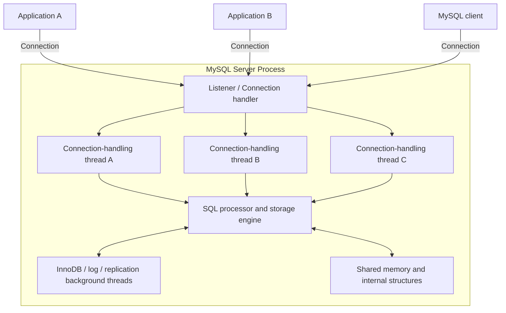
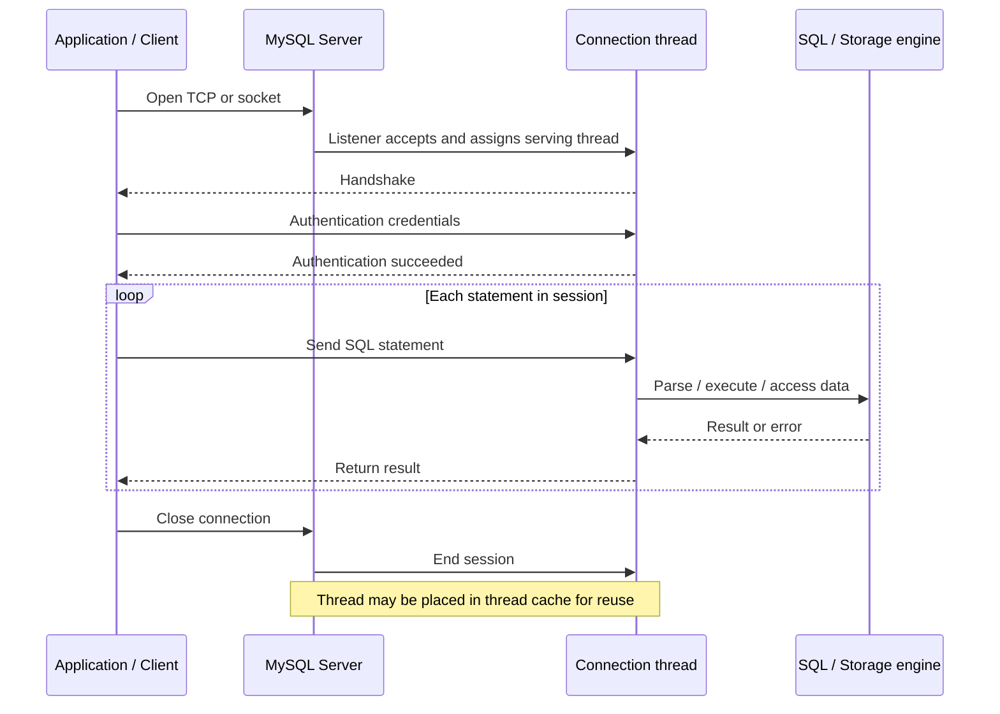

# Process Model, Connection-Handling Threads, and Background Threads

## Objectives

After this lesson, you will be able to:

- Describe MySQL Server's process and multithreaded model.
- Explain how a client connection is accepted, authenticated, served, and terminated.
- Distinguish connection-handling threads from background threads of InnoDB, replication, and other components.
- Distinguish server thread cache, application connection pool, and MySQL thread pool.
- Use `SHOW PROCESSLIST`, Performance Schema, and status counters to observe thread activity.
- Identify warning signs of excessive connections, high active thread counts, and concurrency pressure.

## 1. MySQL Server Is a Multithreaded Process

In typical deployments, MySQL Server runs as a single server process. On Linux, the process is usually named `mysqld`; on Windows, the server may run as a service with the `mysqld.exe` process. Inside that process, MySQL creates and manages multiple execution threads to handle client connections and internal tasks.

Therefore, you should not think of MySQL as spawning a separate OS process for each connection. In the default *one-thread-per-connection* model, each client connection is served by one server thread. Threads operate together within the MySQL process and share server resources, while each connection maintains its own session state such as account, currently selected database, session variables, and active transaction.

At a high level, the architecture consists of three groups:

1. **Server process:** manages configuration, listeners, shared memory, storage engines, plugins, and server lifecycle.
2. **Connection-handling threads:** receive commands from clients, execute SQL processing steps, and return results.
3. **Background threads:** perform internal work such as I/O, data flushing, purging, replication, and periodic tasks.



The diagram is a conceptual model. Internal threads can coordinate asynchronously; not every SQL operation is executed sequentially by a single thread from start to finish.

## 2. The One-Thread-Per-Connection Model

Under MySQL's traditional connection-handling configuration, the server typically creates or retrieves one thread to serve each connection. That thread receives commands from the client, processes them, and waits for the next command on the same connection. Multiple connections can be served concurrently by multiple threads.

A connection-handling thread typically participates in the following tasks:

- Receiving commands under the client/server protocol.
- Checking session state and account privileges.
- Parsing SQL statements, performing semantic checks, and building execution plans when needed.
- Invoking execution components and storage engines to read or modify data.
- Waiting on I/O, locks, or resources when an operation cannot proceed yet.
- Sending result sets, completion statuses, or error messages back to the client.

While the thread waits for the client to send the next command, the connection remains open and is typically shown in the `Sleep` state in the process list. A `Sleep` connection does not mean a query is currently running; however, it still occupies a connection slot and may hold session state or an unfinished transaction.

### 2.1. Lifecycle of a Connection



Actual steps may vary by protocol, authentication plugin, connection type, and version. The diagram focuses on the common connection-serving model.

### 2.2. MySQL Thread Cache

Creating an OS thread has overhead. When a client disconnects, MySQL can keep the thread that just served the connection in the **thread cache** for reuse by a new connection, instead of always creating a new thread.

The `thread_cache_size` variable controls the maximum number of idle threads retained in the cache in applicable models. The thread cache reduces the overhead of creating and destroying threads when applications frequently open and close connections. It is not a limit on concurrent connections and does not replace an application connection pool.

Check the configuration and counters:

```sql
SHOW GLOBAL VARIABLES LIKE 'thread_cache_size';
SHOW GLOBAL STATUS LIKE 'Threads_cached';
SHOW GLOBAL STATUS LIKE 'Threads_created';
SHOW GLOBAL STATUS LIKE 'Threads_connected';
```

- `Threads_cached`: number of threads currently in the cache.
- `Threads_created`: number of threads the server has created to handle connections since startup.
- `Threads_connected`: number of open client connections at the time of sampling.

If `Threads_created` grows rapidly while the workload continuously opens and closes connections, the thread cache may be undersized or the application may be opening connections too frequently. Observe the trend over time and the connection pattern before tuning.

## 3. Thread Pool and Connection Pool Are Different Mechanisms

The two terms are easily confused because both contain the word "pool", yet they live in different layers.

| Mechanism | Where does it live? | What does it manage? | Purpose |
|---|---|---|---|
| Connection pool | Inside the application or client library | Open database connections | Reuse connections, cap session counts, and reduce connect/disconnect overhead |
| Thread cache | Inside MySQL Server | Idle connection-handling threads | Reuse threads after an old connection closes |
| Thread pool | Inside MySQL Server when a suitable plugin is present | Worker threads processing work from multiple connections | Schedule a worker pool to control concurrency and reduce pressure under massive connection counts |

### 3.1. Application-Side Connection Pool

For example, a Java application using HikariCP can keep a pool of pre-opened JDBC connections. When a request needs to query, the application borrows a connection, performs the work, and returns the connection to the pool. The physical connection does not have to be closed after every request.

In the one-thread-per-connection model, each open physical connection typically corresponds to one serving thread on the server. Therefore, a connection pool helps avoid repeatedly creating and destroying connections, yet an oversized pool can still force the server to manage many connection threads and session states.

The connection pool should be sized according to total application instances, maximum connections per instance, connection borrow wait time, and idle timeout. Do not look only at a single instance's limit: if there are 10 instances with up to 30 connections each, total potential demand can reach 300 connections.

### 3.2. Server-Side Thread Pool

In the one-thread-per-connection model, the number of connection-handling threads tends to grow with open connections. In systems with very large connection counts, having too many active or waiting threads can increase memory consumption, context-switching overhead, and OS scheduling pressure.

A thread pool changes how the server schedules work: a group of worker threads processes work from many connections instead of dedicating a separate worker to each connection for its entire lifetime. Exact behavior and limitations depend on the plugin, version, and product.

MySQL Enterprise Edition provides the Thread Pool plugin. Do not assume this plugin is available in all MySQL Community builds or configured identically to MariaDB. If considering a thread pool, verify edition/plugin availability, read documentation for the exact version, and benchmark against realistic workloads. A thread pool does not automatically fix slow queries, lock contention, or a misconfigured connection pool.

## 4. Background Threads in MySQL and InnoDB

Connection-handling threads process incoming client commands. Meanwhile, many tasks must happen even when no client is executing queries. MySQL and InnoDB use background threads to carry out these tasks.

### 4.1. InnoDB I/O Threads

InnoDB performs many data read and write operations through its I/O subsystem. I/O threads assist with asynchronous read/write requests, decoupling certain I/O work from statement-execution threads.

Variables to inspect I/O thread counts by version:

```sql
SHOW GLOBAL VARIABLES LIKE 'innodb_read_io_threads';
SHOW GLOBAL VARIABLES LIKE 'innodb_write_io_threads';
```

Do not increase these values merely because the thread count looks low. Effectiveness depends on storage hardware, workload, OS I/O capabilities, and MySQL version. Measure read/write latency, I/O queues, and InnoDB metrics before tuning.

### 4.2. Page Cleaners and Data Page Flushing

When InnoDB modifies data, pages in the buffer pool can become *dirty pages* (pages that have been modified but not yet written to their corresponding tablespace). Page cleaner threads help flush dirty pages to storage to control dirty-page volume and support checkpointing.

Flushing must balance background writes against workload write demand. If the rate of dirty-page generation exceeds storage write capacity for a sustained period, I/O and checkpoint pressure can impact query latency.

### 4.3. Master Thread and Purge Threads

InnoDB has threads managing periodic background work. The master thread performs various housekeeping activities and coordinates internal work; exact responsibilities vary by version.

Purge threads clean up undo records that are no longer needed by active transactions. If a transaction remains open too long, InnoDB may be unable to remove old data versions that the transaction still needs to see. The history list can grow and make purging struggle to keep up.

You can check the configured number of purge threads on supported versions:

```sql
SHOW GLOBAL VARIABLES LIKE 'innodb_purge_threads';
```

When investigating purge lag, inspect long-running transactions, history list length, and InnoDB status; simply increasing purge threads will not address the root cause if the application holds transactions open too long.

### 4.4. Redo Log and Binary Log Threads

The redo log helps InnoDB recover committed changes after a crash. Modern MySQL versions have dedicated threads and mechanisms for writing, flushing, and syncing the redo log. The binary log records events for replication and point-in-time recovery; log-writing operations also have their own internal mechanisms.

You do not need to memorize the name of every internal thread to operate MySQL. What matters is understanding they are part of the data and durability path. Changes involving flushing, commits, log buffers, or the binary log can impact both performance and data durability.

### 4.5. Replication Threads

In traditional asynchronous replication:

- On the source, a binary log dump thread serves the replica reading events from the binary log.
- On the replica, the receiver/I/O thread fetches events from the source and writes them to the relay log.
- The applier/SQL thread or worker group reads the relay log and applies changes to the replica's data.

Versions supporting parallel replication can use a coordinator and multiple workers to apply transactions concurrently. Group Replication and other HA mechanisms introduce their own internal threads. Thus, the count and names of replication threads depend on topology and version.

### 4.6. Event Scheduler and Other Background Tasks

If the Event Scheduler is enabled, MySQL runs threads that coordinate and execute scheduled events. Plugins, components, or other features may also spawn their own threads. When reading thread lists, distinguish server core threads, storage engine threads, replication threads, and plugin threads.

## 5. Observing Active Threads and Connections

### 5.1. Using SHOW PROCESSLIST

Basic command:

```sql
SHOW PROCESSLIST;
```

To see full SQL statements instead of truncated text:

```sql
SHOW FULL PROCESSLIST;
```

Columns to pay attention to:

| Column | Meaning |
|---|---|
| `Id` | Client connection ID |
| `User` | Database account |
| `Host` | Client host and possibly source port |
| `db` | Currently selected database |
| `Command` | Command type or session state, e.g., `Query` or `Sleep` |
| `Time` | Seconds the thread has been in its current state |
| `State` | More detailed description of processing state, if available |
| `Info` | Current statement, if any and permitted to view |

`SHOW PROCESSLIST` is useful for finding long-running connections, large numbers of `Sleep` connections, or lock-wait states. The account needs appropriate privileges (such as `PROCESS`) to view all users' activity; otherwise, the output may only show threads belonging to the current account. Restrict sharing the output because the `Info` column can contain sensitive data or SQL literals.

### 5.2. Inspecting Threads via Performance Schema

Performance Schema provides the `performance_schema.threads` table, allowing observation of both foreground and background threads. For example:

```sql
SELECT
    THREAD_ID,
    NAME,
    TYPE,
    PROCESSLIST_ID,
    PROCESSLIST_USER,
    PROCESSLIST_HOST,
    PROCESSLIST_DB,
    PROCESSLIST_COMMAND,
    PROCESSLIST_TIME,
    PROCESSLIST_STATE
FROM performance_schema.threads
ORDER BY TYPE, NAME, PROCESSLIST_TIME DESC;
```

Meaning of key columns:

- `THREAD_ID`: internal thread identifier in Performance Schema; not the client connection ID.
- `NAME`: instrumentation name of the thread, typically identifying the component that created it.
- `TYPE`: `FOREGROUND` typically represents threads associated with client activity; `BACKGROUND` represents internal threads.
- `PROCESSLIST_ID`: corresponding connection ID if the thread serves a client; typically `NULL` for background threads.
- `PROCESSLIST_*` columns: process list information associated with foreground threads.

Thread names and instrumentation granularity may vary across versions, plugins, and Performance Schema configurations. Do not write operational scripts that hardcode an internal thread name without verifying stability on the target version.

Counting threads by group:

```sql
SELECT
    TYPE,
    NAME,
    COUNT(*) AS thread_count
FROM performance_schema.threads
GROUP BY TYPE, NAME
ORDER BY TYPE, thread_count DESC, NAME;
```

If Performance Schema is disabled or instrumentation is unavailable, the query may not return the desired information. Check `performance_schema` and metadata read privileges.

### 5.3. Tracking Status Counters

The following status counters are useful when monitoring connection patterns:

```sql
SHOW GLOBAL STATUS LIKE 'Threads%';
SHOW GLOBAL STATUS LIKE 'Connections';
SHOW GLOBAL STATUS LIKE 'Max_used_connections';
```

| Counter | Meaning |
|---|---|
| `Threads_connected` | Number of open client connections at sampling time |
| `Threads_running` | Number of threads not sleeping at sampling time |
| `Threads_cached` | Number of threads currently held in the thread cache |
| `Threads_created` | Total threads created to handle connections since server startup |
| `Connections` | Total connection attempts to the server since startup, per MySQL's counter definition |
| `Max_used_connections` | Highest number of concurrent connections used simultaneously since server startup |

Counters may reset across server restarts or appropriate administrative operations. When analyzing trends, store timestamps and sample periodically; a single number does not reflect the entire workload.

## 6. Reading InnoDB Status

The following command displays InnoDB's internal report:

```sql
SHOW ENGINE INNODB STATUS\G
```

In the MySQL client, `\G` formats the output vertically. The report has multiple sections, which may include:

- **BACKGROUND THREAD:** reported activity of InnoDB background threads.
- **SEMAPHORES:** information on mutexes, rw-locks, and synchronization waits.
- **TRANSACTIONS:** active transactions, lock-waiting transactions, and related details.
- **FILE I/O:** I/O operations and read/write counters.
- **LOG:** redo log and checkpoint information.
- **BUFFER POOL AND MEMORY:** buffer pool status, dirty pages, and memory usage.
- **ROW OPERATIONS:** engine-level row read/write operations.

Report format and details can vary by version. This is a point-in-time snapshot; when investigating transient issues, take multiple samples at reasonable intervals and compare counter deltas.

## 7. Analyzing Operational Scenarios

### 7.1. Many Connections but Few Running Threads

Suppose:

- `Threads_connected` is high.
- `Threads_running` is low.
- `SHOW FULL PROCESSLIST` shows many `Sleep` rows.

This usually indicates many open connections that are mostly idle at sampling time. Causes may include an oversized connection pool, long connection retention times, an application creating multiple pools, or connections not being closed properly.

Investigation steps:

1. Count connections by `User` and `Host`.
2. Compare the sum of all connection pool sizes against `max_connections`.
3. Check connection retention times and unfinished transactions.
4. Adjust pool size, idle timeout, and connection-closing logic after identifying the root cause.

Do not conclude that every `Sleep` connection is a leak. Connection pools intentionally keep idle connections open for reuse.

### 7.2. Many Running Threads

If `Threads_running` stays high for a sustained period, the server may be processing many concurrent queries or many threads may be waiting on resources without entering sleep state. Inspect the process list, lock states, CPU, I/O, and query duration.

Possible causes include:

- Slow queries or scans over large datasets.
- Lock contention from multiple transactions updating the same data.
- Slow storage I/O causing many queries to wait on reads/writes.
- Traffic spikes pushing concurrency beyond server capacity.
- Oversized connection pools leaving concurrency unchecked.

Remedies may include optimizing queries and indexes, shortening transactions, capping concurrency from the application, upgrading storage, or tuning resources. Increasing threads or `max_connections` does not make slow queries run faster on its own.

### 7.3. Rapidly Increasing Threads_created

If `Threads_created` rises rapidly relative to connection rate, the server may be creating many new threads instead of reusing cached threads. Inspect `thread_cache_size`, `Threads_cached`, connection open/close frequency, and how the application manages connections.

Solutions may include properly using a connection pool, avoiding opening a new connection for every small operation, and tuning the thread cache after measuring. The thread cache only reduces thread creation cost; it does not reduce the number of open connections.

### 7.4. Long Transactions Causing Purge to Fall Behind

A long-running read or write transaction can retain row versions that the transaction still needs to see. InnoDB cannot purge the corresponding undo records while a transaction still requires them. This can cause the history list to grow and generate additional background work.

Check open transactions in `SHOW ENGINE INNODB STATUS\G`, the process list, and relevant transaction metadata. Look for requests holding transactions across user wait times, network calls, or external tasks; redesign so transactions remain short with clear boundaries.

## 8. Principles for Tuning Thread and Connection Counts

### 8.1. Do Not Equate max_connections with Background Thread Count

`max_connections` caps concurrent client connections per server configuration. It is not the process's total thread count. MySQL also runs background threads for InnoDB, replication, event scheduler, and plugins; conversely, some thread pool models multiplex many connections across a group of workers.

Inspect current limits:

```sql
SHOW GLOBAL VARIABLES LIKE 'max_connections';
SHOW GLOBAL STATUS LIKE 'Max_used_connections';
SHOW GLOBAL STATUS LIKE 'Threads_connected';
```

If `Max_used_connections` frequently approaches the limit, investigate connection demand, pool sizes, long-held connections, and potential load growth. Do not raise the limit mechanically because each connection can consume memory and processing resources.

### 8.2. Sum Connections Across Multiple Application Instances

For example, a system has 6 application instances, each configured with a maximum pool of 20 connections. The total potential connections from that application is:

\[
6 \times 20 = 120\text{ connections}
\]

This number does not yet include background jobs, workers, admin tools, monitoring, backups, and other services. When planning limits, sum across the entire system and leave headroom for operational tasks or emergency connections.

### 8.3. Controlled Configuration Changes

Before changing `thread_cache_size`, `max_connections`, I/O thread counts, or thread pool settings:

- Record current values and server version.
- Collect a baseline of connections, running threads, CPU, memory, I/O, and latency.
- Adjust one parameter group at a time in a test environment or appropriate change window.
- Re-measure under an equivalent workload and monitor both performance and stability.
- Have a rollback plan if thread counts, memory, or latency degrade.

Avoid changing multiple thread parameters simultaneously, as it makes it difficult to determine which factor caused a difference.

## 9. Quick-Check Query Set

You can use the following set of queries to capture connection and thread state at inspection time:

```sql
-- Server version
SELECT VERSION() AS server_version,
       @@version_comment AS distribution;

-- Connection limits and handling mechanism
SHOW GLOBAL VARIABLES LIKE 'max_connections';
SHOW GLOBAL VARIABLES LIKE 'thread_cache_size';
SHOW GLOBAL VARIABLES LIKE 'thread_handling';

-- Connection/thread counters
SHOW GLOBAL STATUS LIKE 'Threads%';
SHOW GLOBAL STATUS LIKE 'Connections';
SHOW GLOBAL STATUS LIKE 'Max_used_connections';

-- Active connections and statements
SHOW FULL PROCESSLIST;

-- Thread breakdown in Performance Schema
SELECT TYPE, NAME, COUNT(*) AS thread_count
FROM performance_schema.threads
GROUP BY TYPE, NAME
ORDER BY TYPE, thread_count DESC, NAME;

-- Configuration of some InnoDB background threads
SHOW GLOBAL VARIABLES LIKE 'innodb_read_io_threads';
SHOW GLOBAL VARIABLES LIKE 'innodb_write_io_threads';
SHOW GLOBAL VARIABLES LIKE 'innodb_purge_threads';
```

Some variables or tables may not be available in a specific version, distribution, or configuration. If querying a non-existent variable, note that difference and consult documentation for the exact version; do not assume every MySQL build has the identical set of variables.

## 10. Conclusion

MySQL is a multithreaded server running inside a server process. In the default one-thread-per-connection model, client-serving threads receive and process session commands; the thread cache can reuse threads after connections close. Background threads for InnoDB, replication, logging, and the scheduler continue performing internal tasks to store, recover, and synchronize data.

In operations, distinguish application-side connection pools from server-side thread caches and thread pools. Combine the process list, Performance Schema, status counters, and InnoDB reports to determine whether the server is busy due to many connections, long-running queries, lock contention, or background work. Only adjust connection and thread counts after measuring the workload and identifying the root cause.
