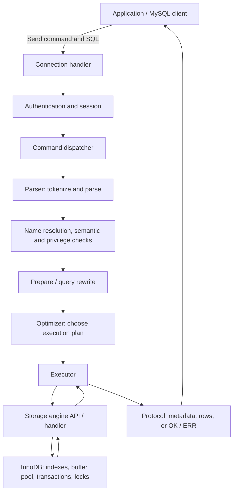
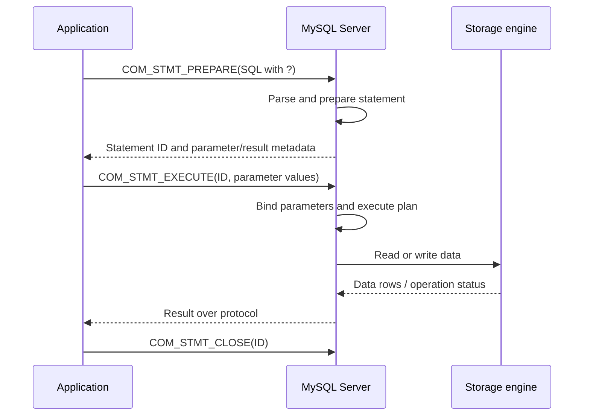
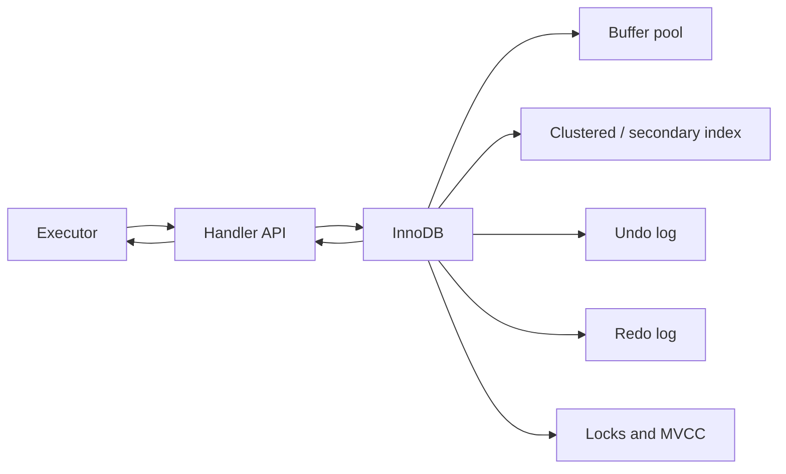

# Parse, Prepare, Execute, and Result Return Flow

When an application sends a SQL statement to MySQL, the statement passes through multiple components before results return to the client. MySQL accepts the connection, parses the syntax, validates referenced objects and access privileges, selects an execution strategy, calls the storage engine to read or modify data, and packages the result over the client/server protocol. Understanding this flow helps us pinpoint errors at the right layer, explain why a query is slow, and understand what a prepared statement actually does.

This lesson belongs to the **DATABASE_MYSQL** module. The module aims at mastering MySQL from table design, data types, keys, and SQL queries to indexes, transactions, and concurrency control, while practicing reading execution plans, query optimization, privilege management, backups, and relational database operations. Within the **Architecture** chapter, this lesson focuses on the path of a statement from the moment the client sends it until it receives the result.

## 1. The Big Picture

A SQL query is not translated directly into file read operations. MySQL Server coordinates multiple steps: receiving the command, parsing, resolving the meaning of table/column names, optimizing the access path, executing the plan, and interacting with the storage engine. A storage engine such as InnoDB manages data structures, indexes, transactions, locks, and recovery.



The diagram depicts logical responsibilities. In actual source code and execution, some steps may interleave or repeat; for instance, the executor calls the storage engine repeatedly to fetch rows one by one, and a statement may need to be re-prepared when an object's metadata changes.

Main components:

- **Client:** application, connector library, or CLI tool sending commands and receiving responses.
- **Connection handler:** manages the connection, authenticates the user, and establishes the session context.
- **Parser and resolver:** analyzes syntax, builds the internal statement representation, resolves tables/columns/functions, and checks validity.
- **Optimizer:** evaluates possible execution strategies and chooses a plan based on statistics, indexes, predicates, and estimated costs.
- **Executor:** carries out the chosen plan, coordinates read/write operations, and produces result rows.
- **Storage engine:** provides concrete storage operations. InnoDB handles indexes, transactions, MVCC, locks, and recovery logs.
- **Protocol layer:** sends metadata, row data, success statuses, or error details back to the client.

## 2. Connection and Command Intake

### 2.1. From Application to MySQL Server

Applications typically connect via TCP/IP to the MySQL port (default is usually `3306`), via a Unix socket on supported systems, or via another configured connection method. The client and server communicate over the MySQL client/server protocol.

Once the connection is established, the server performs a handshake and account authentication. Authentication may depend on the authentication plugin, password, TLS, and server configuration. After successful login, MySQL creates a session bound to that connection. The session holds context such as:

- Current account and active privileges.
- Default database selected with `USE` or upon opening the connection.
- Session variables such as `time_zone`, `sql_mode`, `autocommit`, and connection charset.
- Transaction state, prepared statements, and connection-specific settings.

Checking current session information:

```sql
SELECT
    CONNECTION_ID() AS connection_id,
    CURRENT_USER() AS authenticated_account,
    USER() AS client_identity,
    DATABASE() AS default_database,
    @@SESSION.autocommit AS autocommit,
    @@SESSION.time_zone AS session_time_zone,
    @@SESSION.sql_mode AS session_sql_mode;
```

`CURRENT_USER()` indicates the MySQL account used for privilege checking; `USER()` reflects the username and host presented by the client when connecting. The two values may differ due to `user`@`host` account-matching rules.

### 2.2. Command Dispatcher

Once the connection is ready, the client sends a command. Key command types include:

| Command | Purpose |
|---|---|
| `COM_QUERY` | Sends a text SQL statement, typically used for regular queries. |
| `COM_STMT_PREPARE` | Requests the server to prepare a prepared statement. |
| `COM_STMT_EXECUTE` | Executes an already prepared statement with parameter values. |
| `COM_STMT_CLOSE` | Closes a server-side prepared statement. |
| `COM_INIT_DB` | Selects the default database for the session; functionally equivalent to `USE`. |
| `COM_PING` | Checks whether the server is still responsive on the connection. |

Clients normally do not build these protocol packets manually. Libraries such as MySQL Connector/J, the MySQL client library, or language drivers handle protocol encoding and decoding.

One distinction to keep clear: the connection protocol is not SQL. SQL is the language describing data operations; the protocol is how the client and server transport statements, parameters, metadata, results, and errors.

## 3. Parse: Analyzing the SQL Statement

### 3.1. Tokenization and Syntax Checking

The parser is the component that analyzes the statement. First, the SQL string is split into tokens such as keywords, identifiers, literals, operators, parentheses, and delimiters. Next, the parser verifies whether the token combination conforms to the SQL grammar supported by MySQL and constructs an internal representation of the statement.

For example:

```sql
SELECT customer_id, email
FROM customers
WHERE customer_id = 101;
```

The parser recognizes this as a `SELECT` statement with a list of expressions to retrieve, a source table, and a filter condition. At this stage, MySQL checks the statement's syntax. If `FROM` is missing, a keyword is misspelled, or parentheses are mismatched, the server can return a syntax error before accessing any data.

Example of a syntactically invalid statement:

```sql
SELEC customer_id FROM customers;
```

This error is unrelated to indexes or data in the table. Neither the optimizer nor the storage engine can fix a SQL statement that fails parsing.

### 3.2. Name Resolution and Semantic Checking

A statement can be syntactically valid yet still semantically invalid. MySQL must resolve database, table, column, alias, and function names along with their corresponding data types.

For example:

```sql
SELECT unknown_column
FROM customers;
```

If the `customers` table has no `unknown_column` column, the parser can recognize the statement's shape, but the name-resolution step will catch the error. Other semantic checks include expression validity, data type compatibility, and statement-specific rules.

MySQL also checks the required privileges on accessed objects. A user may connect successfully yet still lack permission to read a table or update a column. Connection authentication and SQL execution authorization are two separate steps.

You can check the current account and granted privileges:

```sql
SELECT CURRENT_USER();
SHOW GRANTS FOR CURRENT_USER;
```

Parse errors, unknown column errors, and privilege errors usually occur before the query finishes reading data. When troubleshooting, read the error code and server message instead of starting by adding an index.

## 4. Prepare: Preparing the Statement Before Execution

The term **prepare** is used in MySQL in two related but non-identical contexts:

1. Even a regular SQL statement requires the server to parse, resolve names, validate, and prepare internal metadata so it can be optimized and executed.
2. A **prepared statement** is a feature allowing a client to ask the server to prepare a parameterized statement and then execute it repeatedly with different parameter values.

This section focuses on prepared statements because that is how applications commonly send parameterized SQL.

### 4.1. How Do Prepared Statements Work?

Basic server-side prepared statement flow:



During the prepare step, the server receives the SQL statement and creates a prepared statement object bound to the session. The server returns a statement ID for the client to reference in subsequent executions. During execution, the client sends the statement ID and parameter values; with the prepared statement protocol, parameters are transmitted in binary format instead of manually concatenating SQL strings.

The server still performs the necessary work on each run: receiving parameters, validating and converting types, selecting or updating an appropriate plan, accessing data, holding locks, and returning results. A prepared statement does not turn a query into a precomputed cached result.

When the metadata of referenced tables or objects changes, MySQL may need to automatically re-prepare the statement to reflect the new structure. Therefore, a prepared statement should not be viewed as an immutable execution plan cached forever.

### 4.2. Prepared Statements in SQL

MySQL allows direct manipulation of prepared statements using `PREPARE`, `EXECUTE`, and `DEALLOCATE PREPARE`:

```sql
SET @sql =
    'SELECT customer_id, email
     FROM customers
     WHERE customer_id = ?';

PREPARE find_customer FROM @sql;

SET @customer_id = 101;
EXECUTE find_customer USING @customer_id;

SET @customer_id = 102;
EXECUTE find_customer USING @customer_id;

DEALLOCATE PREPARE find_customer;
```

`?` is a parameter marker. On each `EXECUTE`, the variable's value is bound to the corresponding position. The SQL structure remains constant while the filter value changes.

Prepared statements live within the session and must be freed when no longer needed. In applications, drivers and connection pools typically manage statement lifecycles; in manual SQL, call `DEALLOCATE PREPARE` when finished.

### 4.3. Prepared Statements in Java JDBC

In Java, `PreparedStatement` is the standard API for running parameterized SQL:

```java
String sql = """
    SELECT customer_id, email
    FROM customers
    WHERE customer_id = ?
    """;

try (Connection connection = dataSource.getConnection();
     PreparedStatement statement = connection.prepareStatement(sql)) {

    statement.setLong(1, 101L);

    try (ResultSet resultSet = statement.executeQuery()) {
        while (resultSet.next()) {
            long customerId = resultSet.getLong("customer_id");
            String email = resultSet.getString("email");
            System.out.printf("%d - %s%n", customerId, email);
        }
    }
}
```

`setLong(1, 101L)` binds the first parameter. Parameter indices in JDBC are 1-based. Methods such as `setString`, `setBigDecimal`, `setTimestamp`, and their counterparts help the driver transmit values with the appropriate type.

The JDBC `PreparedStatement` API does not guarantee every driver always uses server-side prepared statements. MySQL Connector/J can be configured to use server-side prepared statements, for example via the `useServerPrepStmts` property; exact behavior also depends on driver version and configuration. If you need to confirm whether server-side prepare is in use, check Connector/J settings and observe actual behavior rather than relying solely on the API name.

### 4.4. Why Parameters Help Prevent SQL Injection

Directly concatenating user input into a SQL string is unsafe:

```java
String sql = "SELECT * FROM customers WHERE email = '" + email + "'";
```

If `email` contains characters interpreted as part of SQL syntax, the statement's structure can be altered. With a prepared statement, the SQL statement and values are transmitted separately:

```java
String sql = "SELECT * FROM customers WHERE email = ?";

try (PreparedStatement statement = connection.prepareStatement(sql)) {
    statement.setString(1, email);
    try (ResultSet resultSet = statement.executeQuery()) {
        // Process results
    }
}
```

The driver sends the value as a data parameter, so the input string is not interpreted as SQL operators or clauses. This provides an important layer of protection when used properly, while cleanly separating query structure from data.

A parameter marker represents a **value** only; it cannot substitute for table names, column names, keywords, or sort directions. For example, `ORDER BY ?` does not pass a column name for the server to sort by; it is typically treated as a constant value expression. If you need dynamic sort columns, map the input against an allowlist of permitted identifiers in the application before constructing the structural SQL portion. Never concatenate user-supplied column names directly into a statement.

## 5. Optimizer: Choosing the Execution Strategy

Once the statement has been parsed and object metadata resolved, the MySQL optimizer evaluates how to execute it. A single SQL statement can have multiple valid plans with different costs.

For the query:

```sql
SELECT order_id, created_at, total_amount
FROM orders
WHERE customer_id = 101
  AND created_at >= '2026-01-01'
ORDER BY created_at DESC
LIMIT 20;
```

The optimizer may consider:

- Scanning the entire table and filtering row by row.
- Using an index starting with `customer_id` to locate orders for one customer.
- Using a composite index `(customer_id, created_at)` to filter by customer and time range.
- Reading the index in a matching order to reduce or avoid an extra sorting step.
- Choosing join order and access methods if the query involves multiple tables.

The optimizer relies on query structure, indexes, data statistics, row estimates, and I/O/CPU costs. The plan with the lowest estimated cost under the optimizer's model is not guaranteed to always be the fastest under every load state; stale statistics or skewed data distributions can lead to inaccurate estimates.

### 5.1. Reading Plans with `EXPLAIN`

`EXPLAIN` reveals the plan MySQL expects to use:

```sql
EXPLAIN
SELECT order_id, created_at, total_amount
FROM orders
WHERE customer_id = 101
  AND created_at >= '2026-01-01'
ORDER BY created_at DESC
LIMIT 20;
```

In the traditional tabular format, common columns include:

| Column | General meaning |
|---|---|
| `type` | Access type, ranging from broad scans like `ALL` to indexed lookups like `range`, `ref`, or `const`. |
| `possible_keys` | Indexes the optimizer may consider. |
| `key` | Index selected in the plan. |
| `key_len` | Length of the key prefix used; helpful when analyzing composite indexes. |
| `rows` | Estimated number of rows to read at that step. |
| `filtered` | Estimated percentage of rows remaining after filtering at that step. |
| `Extra` | Additional information such as `Using where`, `Using index`, `Using temporary`, or `Using filesort`. |

`EXPLAIN FORMAT=TREE` presents the plan as a tree, useful for reading iterator order. `EXPLAIN ANALYZE` (MySQL 8.0.18 and later) actually executes the `SELECT` statement and reports actual timings and row counts at each iterator. Only run it on read queries whose impact you understand; `EXPLAIN ANALYZE` runs the query and can consume resources just like a real execution.

Example:

```sql
EXPLAIN FORMAT=TREE
SELECT order_id, created_at, total_amount
FROM orders
WHERE customer_id = 101
ORDER BY created_at DESC
LIMIT 20;

-- MySQL 8.0.18+: the SELECT statement will be executed to measure actual metrics.
EXPLAIN ANALYZE
SELECT order_id, created_at, total_amount
FROM orders
WHERE customer_id = 101
ORDER BY created_at DESC
LIMIT 20;
```

Do not look only at `type` and declare a query good or bad. Inspect actual row counts, loop counts, per-iterator execution time, chosen indexes, and business requirements. Scanning a small table is sometimes cheaper than traversing an index; `Using filesort` is likewise not inherently an error if the data volume is small and latency is acceptable.

### 5.2. How Indexes Affect the Query Path

If queries frequently filter by customer and sort by timestamp, a composite index may be appropriate:

```sql
CREATE INDEX idx_orders_customer_created
    ON orders (customer_id, created_at);
```

Column order in a composite index matters. An index on `(customer_id, created_at)` is typically useful for predicates starting with `customer_id`, and can support queries filtering on both columns. It is not equivalent to an index on `created_at` alone for all queries.

An index does not guarantee the optimizer will always pick it. If the table has few rows, the predicate is not selective, or statistics make a table scan appear cheaper, the optimizer may pick another path. After creating an index or experiencing substantial data changes, re-measure with `EXPLAIN` and actual execution metrics.

## 6. Execute: Cooperation Between Executor and Storage Engine

### 6.1. The Executor Runs the Plan

The executor coordinates the steps in the execution plan. For a `SELECT` query, it asks iterators or data access operators to supply rows, applies predicates, joins tables, evaluates expressions, groups, sorts, and limits row counts according to the plan.

For `INSERT`, `UPDATE`, or `DELETE`, the executor identifies target rows, checks relevant conditions, and calls the storage engine to write changes. A single statement may invoke the engine multiple times, such as locating rows via an index and then updating each matching row.

The executor does not manage InnoDB's data page format directly. It uses the storage engine interface (handler API) provided by MySQL to instruct the engine to read, write, lock, or supply necessary metadata.

### 6.2. The Storage Engine Performs Storage Operations

MySQL Server provides the SQL layer and query orchestration; the storage engine handles many storage details. InnoDB is popular for transactional applications because it supports transactions, foreign keys, MVCC, and crash recovery.

When the executor needs to read a row, InnoDB may:

1. Locate the position via the clustered index or a secondary index.
2. Read the data page from the buffer pool, or from storage if the page is not yet in memory.
3. Use MVCC and undo information to construct the data version visible to the transaction's consistent read.
4. Apply locking mechanisms if the operation is a locking read or write.
5. Return the row to the executor via the handler API.

When writing data, InnoDB updates page structures and creates necessary log records. The redo log supports recovering recorded changes; the undo log supports rollback and older row versions required by MVCC. Log writing, page flushing, and commit confirmation follow InnoDB's durability settings and recovery mechanisms.



The components in the diagram play distinct roles: the buffer pool caches data and index pages; indexes help locate rows; undo supports rollback and consistent reads; redo supports crash recovery; locks and MVCC coordinate concurrent access. Do not equate the redo log with the binary log: the redo log serves InnoDB's internal crash recovery, while the binary log records server-level changes for replication and certain point-in-time recovery scenarios.

### 6.3. How Transactions Wrap Execution

If `autocommit` is enabled, each standalone transactional statement is typically committed upon success. When an application opens an explicit transaction, multiple SQL statements can belong to a single commit or rollback unit.

```sql
START TRANSACTION;

UPDATE accounts
SET balance = balance - 200000
WHERE account_id = 101
  AND balance >= 200000;

-- Application verifies affected rows equals exactly one.

UPDATE accounts
SET balance = balance + 200000
WHERE account_id = 202;

-- Commit only when all business conditions succeed.
COMMIT;
```

This SQL snippet is an illustrative skeleton; the application must check affected row counts and call `ROLLBACK` if an account does not exist, lacks sufficient balance, or an update step fails. Without error-handling branches, an unconditional `COMMIT` defeats the atomic intent of the business operation.

The storage engine determines a table's transactional capability. InnoDB supports rollback; a non-transactional engine may not undo modifications in the same way. When designing business logic requiring ACID guarantees, verify the actual storage engine of the tables involved.

## 7. Returning Results to the Client

After the executor finishes, MySQL sends a response over the protocol. The response format depends on the command type and outcome:

- For a `SELECT` statement, the server sends result set metadata, followed by data rows and a completion status.
- For a successful `INSERT`, `UPDATE`, or `DELETE`, the server typically returns an OK packet containing details such as affected rows, insert ID (if applicable), warning count, and session state.
- When a statement fails, the server returns an ERR packet containing the error code, SQLSTATE, and descriptive message.
- With prepared statements, the client and server use prepared-statement protocol commands; parameter values and result rows may be encoded using the binary protocol.

For example:

```sql
UPDATE customers
SET full_name = 'Nguyễn An'
WHERE customer_id = 101;

-- Application reads the update count from the driver's API.
-- To check warnings, run SHOW WARNINGS immediately after the UPDATE statement.
```

`ROW_COUNT()` reflects the number of rows affected by the preceding statement in the session. How affected rows are interpreted may depend on client flags and operation type; for `UPDATE`, matched rows and actually modified rows can differ. Applications should use the driver's API to read the update count and understand the driver's semantics.

`SELECT` results may be streamed progressively to the client or require intermediate processing before full transmission. Some queries must materialize intermediate results, sort, or group data; these operations may require temporary tables or filesorts. As a result, time-to-first-row and time to fetch the entire result set can differ.

The client also influences completion time: if the application reads results slowly, the server or driver may have to hold resources while waiting for data consumption. Read result sets promptly, close cursors/statements/connections when finished, and avoid returning unnecessary rows.

## 8. Distinguishing Errors at Each Stage

Knowing which stage produced an error narrows down the root cause faster:

| Stage | Example errors | First troubleshooting step |
|---|---|---|
| Connection/authentication | Cannot connect, access denied on login | Check host, port, TLS, user@host, authentication plugin, and credentials. |
| Parse | Syntax error, missing parenthesis, unsupported syntax | Inspect the SQL statement and MySQL version. |
| Resolve/semantics | Unknown column, unknown table, incompatible expression types | Check schema, alias names, default database, and data types. |
| Privileges | SELECT/UPDATE command denied | Check `CURRENT_USER()` and `SHOW GRANTS`. |
| Prepare | Invalid parameter marker, invalid statement, or metadata mismatch | Check SQL template, parameter count, and schema changes. |
| Optimize | Plan scans too many rows, selects unsuitable index | Run `EXPLAIN`, check indexes, statistics, and data distribution. |
| Execute/storage engine | Deadlock, lock wait timeout, duplicate key, foreign key violation | Check transactions, constraints, lock acquisition order, and error logs. |
| Result return/client | Application reads wrong type, timeout streaming result set, or missed warnings | Check driver, type mapping, timeouts, and result set consumption logic. |

An error may only surface during execution even though prepare succeeded. For instance, a parameter value may have a valid type yet match no rows; a duplicate unique key is only detected during write; a `SELECT` may block on locks under certain access modes. Therefore, a successful prepare does not guarantee execution will succeed.

## 9. Timing and Observing the Execution Flow

When a query is slow, separate time spent in the client, network, server, and storage engine. A query may be slow because:

- New connections and authentication add overhead when the application opens connections too frequently.
- The parser and optimizer process very large or complex SQL statements.
- The query plan reads many rows due to missing suitable indexes or inaccurate statistics.
- The storage engine waits on I/O, locks, the buffer pool, or system resources.
- The server has to sort/group large datasets or create temporary tables.
- The result set is too large or the client consumes data slowly.

Commonly used tools and information sources:

1. **`EXPLAIN` / `EXPLAIN ANALYZE`:** inspect estimated plans and actual execution metrics for read queries.
2. **Performance Schema:** observe statements, waits, stages, transactions, and performance events collected by the server.
3. **Slow query log:** locate statements exceeding configured time thresholds or criteria.
4. **`SHOW PROCESSLIST`:** inspect active sessions and states at inspection time.
5. **InnoDB status:** use `SHOW ENGINE INNODB STATUS` to view transaction, deadlock, and engine status details.

Example checking active sessions:

```sql
SHOW FULL PROCESSLIST;

SHOW ENGINE INNODB STATUS;
```

Do not enable heavy monitoring configurations across all tools in production without evaluating overhead. Performance Schema, slow logs, and diagnostic queries can introduce additional load; choose consumers, thresholds, and durations appropriate to your investigation goal.

## 10. End-to-End Example: Fetching a Customer's Orders

Suppose an application needs to retrieve a customer's 20 most recent orders. The schema has a composite index `(customer_id, created_at)`.

### Step 1: Client Builds a Parameterized Statement

```java
String sql = """
    SELECT order_id, created_at, total_amount
    FROM orders
    WHERE customer_id = ?
    ORDER BY created_at DESC
    LIMIT ?
    """;

try (PreparedStatement statement = connection.prepareStatement(sql)) {
    statement.setLong(1, 101L);
    statement.setInt(2, 20);

    try (ResultSet rows = statement.executeQuery()) {
        while (rows.next()) {
            // Read each result row.
        }
    }
}
```

### Step 2: Server Parses and Prepares

The server parses the `SELECT` statement, resolves the table and columns, checks read privileges, and prepares the statement with two parameter slots. The client receives a statement ID if the driver is using server-side prepared statements.

### Step 3: Optimizer Chooses a Plan

The optimizer evaluates indexes, the `customer_id` predicate, `created_at` ordering, and the `LIMIT` cap. The composite index can locate the customer's rows and read them in matching chronological order without scanning the full table.

### Step 4: Executor Calls InnoDB

The executor asks InnoDB to retrieve matching rows. InnoDB traverses the index, fetches pages from the buffer pool or storage, applies transaction visibility rules, and returns rows to the executor.

### Step 5: Server Returns the Result Set

MySQL sends column metadata and result rows to the driver. The driver decodes data into Java types, and `ResultSet` exposes an API for the application to read row by row. Closing `ResultSet` and the statement frees the corresponding resources.

You can inspect the optimizer portion independently of the application:

```sql
EXPLAIN FORMAT=TREE
SELECT order_id, created_at, total_amount
FROM orders
WHERE customer_id = 101
ORDER BY created_at DESC
LIMIT 20;
```

If the plan does not use the index as expected, review the indexes, data types, statistics, row counts, and predicate selectivity. Do not assume that simply adding any index will make a query faster.

## 11. Common Misconceptions

**"Successful parsing means the SQL statement is guaranteed to run."** Incorrect. Column names might not exist, privileges might be missing, constraints might be violated, or the storage engine might encounter an error during execution.

**"Preparing fixes the optimizer plan for every future run."** Incorrect. A prepared statement retains the statement structure and prepared state; each execution still requires parameter handling and execution. Metadata changes can force the statement to be re-prepared.

**"Using `PreparedStatement` guarantees server-side prepare."** Not always true. It is a JDBC API; the driver may use server-side prepared statements or another mechanism depending on configuration and version.

**"Prepared statements allow binding column names."** Incorrect. Parameter markers represent values, not identifiers or SQL syntax fragments.

**"The optimizer always picks the fastest plan in all situations."** The optimizer chooses based on estimated costs and available statistics. Changing data, skewed distributions, or inaccurate statistics can produce a suboptimal plan.

**"MySQL Server reads all data files directly itself."** The SQL layer communicates with storage engines via the handler interface. InnoDB manages its own page formats, indexes, buffer pool, transactions, and logs.

**"Receiving the first row means the query is finished."** Some results are streamed progressively; the server may still need to keep executing or the client still needs to read many rows. Time-to-first-row and total fetch time are two distinct metrics.

## 12. Practice Exercises

### Exercise 1: Distinguish Parse Errors from Resolution Errors

Run the following two statements and record the error codes/messages:

```sql
SELEC customer_id FROM customers;

SELECT column_does_not_exist FROM customers;
```

**Requirement:** explain which statement has a syntax error and which is syntactically valid but fails column name resolution.

### Exercise 2: Execute a Prepared Statement

Create a prepared statement to look up a customer by ID. Execute it at least twice with two different values, then deallocate the statement.

**Requirement:** identify which statement was prepared, which values were bound, and why values do not need to be concatenated into the SQL string.

### Exercise 3: Compare Regular vs. Parameterized Queries

Write a `SELECT` query filtering by email. Demonstrate it using string concatenation in a mock example and using `PreparedStatement`.

**Requirement:** explain SQL injection risks and the limitation of parameter markers when trying to choose a dynamic sort column.

### Exercise 4: Observe an Execution Plan

Run `EXPLAIN` on a query fetching a customer's latest orders. Create a composite index `(customer_id, created_at)` if appropriate for the schema, then run `EXPLAIN` again.

**Requirement:** compare `key`, `type`, `rows`, `Extra`, or the execution plan tree before and after. Do not conclude solely from the presence of an index; explain how the plan changed.

### Exercise 5: Analyze an Execution-Time Error

Create a unique key on email. Attempt to insert an already existing email and capture the server response.

**Requirement:** explain why the statement can pass parse and prepare yet fail during execution due to a duplicate key.

### Exercise 6: Observe Result Sets and Update Counts

Execute a `SELECT` returning multiple rows and a conditional `UPDATE`. Read the results using JDBC `ResultSet` and update count.

**Requirement:** explain the difference between result set metadata/rows and an OK response with affected rows.

## 13. Takeaways

MySQL's statement processing flow starts with the connection and command protocol, proceeds through parsing, name resolution, privilege checking, preparation, and optimization. The executor runs the plan by invoking the storage engine through the handler API. InnoDB handles indexes, the buffer pool, transactions, MVCC, locks, and logs; then the server packages metadata, data rows, or error status to return to the client.

Prepared statements separate SQL structure from parameter values, support statement reuse, and reduce SQL injection risk when used properly. The optimizer decides the data access path; `EXPLAIN` and observability tools help verify that decision. When a query errors out or runs slowly, identify the stage where the issue arises before choosing an appropriate fix.
