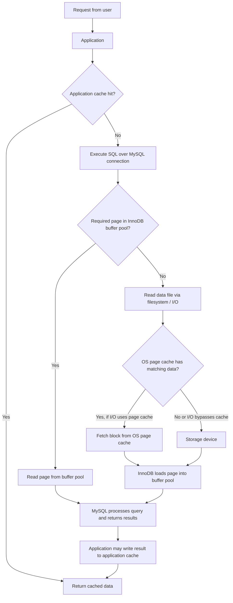
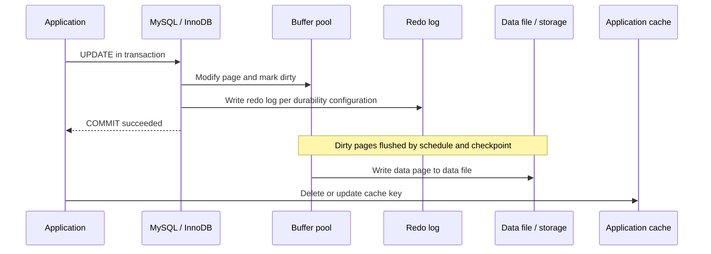

# Distinguishing the Buffer Pool, OS Page Cache, and Application Cache

A MySQL query can pass through multiple caching layers before data is returned to the user. InnoDB holds frequently used data and index pages in the buffer pool; the operating system may keep file blocks in the page cache; the application may store objects, query results, or aggregated data in local memory or Redis. These three layers all reduce read latency, yet they store different kinds of data and have different operating and refresh mechanisms.

This lesson belongs to the `DATABASE_MYSQL` module, Architecture chapter. Properly understanding caching layers helps design efficient tables, indexes, and SQL queries, interpret execution metrics, manage transactions, and control concurrency. When optimizing, identify which layer is spending the time before adding memory or introducing caches. Examples focus on MySQL 8.x with InnoDB.

## Objectives

After this lesson, you will be able to:

- Distinguish the data stored by the InnoDB buffer pool, OS page cache, and application cache.
- Describe the path of a read and a write operation across caching layers.
- Understand why a buffer pool miss does not automatically equate to a physical disk read.
- Read basic buffer pool metrics and cross-reference them with OS and application metrics.
- Choose appropriate caching strategies, control stale data, and avoid common consistency bugs.

## 1. Three Caching Layers Solving Three Different Problems

| Layer | Where it is managed | Typical stored data | Scope and lifetime | Who is responsible for refreshing? |
|---|---|---|---|---|
| InnoDB buffer pool | MySQL Server / InnoDB | InnoDB data and index pages; certain access-support structures | Shared within a MySQL instance, residing in server memory and managed over the instance lifecycle | InnoDB loads, evicts, and flushes pages on demand |
| OS page cache | Operating system kernel | Contents of file blocks accessed via cached filesystem I/O | Shared at the OS level; can serve multiple processes | Kernel manages it under memory pressure and I/O policies |
| Application cache | Application, library, or cache service such as Redis | Business objects, DTOs, query results, configuration, aggregated data | Per process, application cluster, or cache service; lifetime set by the application | Application logic, TTL, events, or invalidation operations |

None of these layers completely replaces the others. The buffer pool helps InnoDB avoid re-reading pages from the storage layer; the OS page cache can reduce device I/O when the I/O path uses the page cache; the application cache helps the application avoid sending repeated queries to MySQL and repeating service-layer computation.



The diagram shows a high-level read path. The optimizer, other engines, read-ahead, multi-page reads, and other processing steps can make the actual path more complex. In particular, InnoDB can use direct I/O mode to bypass the OS page cache for data files on supported platforms.

## 2. InnoDB Buffer Pool

### 2.1. What Does the Buffer Pool Store?

InnoDB organizes data into pages. The buffer pool is InnoDB's large memory region used to cache pages read from tablespaces, including data pages and index pages. When a query needs a page already in the buffer pool, InnoDB can read it from memory without requesting a file read again.

The buffer pool is not a memory area holding literal `SELECT` result sets. For example, if you query:

```sql
SELECT order_id, total_amount
FROM orders
WHERE customer_id = 42;
```

InnoDB may need to read secondary index pages on `customer_id`, then read data pages containing the matching records. Those pages can remain in the buffer pool after access. The resulting rows and columns sent to the client are still assembled and transmitted by MySQL's query execution engine; the buffer pool does not store a verbatim SQL query result copy.

The buffer pool also manages page states such as clean pages and dirty pages, along with lists for replacement and flushing. Certain access structures such as the adaptive hash index also reside in InnoDB memory, though they should not be conflated with data pages in the buffer pool.

### 2.2. Cache Hit and Cache Miss

- **Buffer pool hit:** the page needed by the query is already in the buffer pool. InnoDB retrieves the page from RAM.
- **Buffer pool miss:** the page is not yet in the buffer pool. InnoDB must request reading the page from the storage layer beneath; the data may be served from the OS page cache or require a device read, depending on I/O configuration and OS cache state.

Therefore, a buffer pool miss does not automatically mean a physical read from SSD/HDD. The `Innodb_buffer_pool_reads` counter reflects how many times InnoDB had to read a page because it could not find it in the buffer pool; it does not prove every read hit the storage hardware.

### 2.3. Clean Pages, Dirty Pages, and Flushing

When a transaction modifies a record, InnoDB updates the corresponding page in the buffer pool and marks the page dirty. The change is protected by the redo log under InnoDB's recovery mechanism. Dirty pages are written to data files later by background threads or when pages need to be freed, checkpointed, or to relieve write pressure.

This prevents data modification statements from waiting to flush entire data pages to files on every statement. However, commit durability still depends on redo log settings, binary log settings if enabled, filesystem, and storage hardware. You must not infer that committed data residing only in the buffer pool is already durable.

### 2.4. How InnoDB Keeps Useful Pages

InnoDB manages pages in the buffer pool using structures such as the LRU list and flush list. When space is needed for a new page, InnoDB picks an eligible page to evict; dirty pages may need flushing before reuse. The midpoint insertion mechanism helps prevent a single large scan from evicting the entire actively used working set from the cache.

Sequential reads, read-ahead, large table scans, and large working sets can all impact cache behavior. Consequently, increasing the buffer pool does not always fix slow queries: a query might read too many pages due to missing indexes, a poor execution plan, or lock waits.

## 3. OS Page Cache

The OS page cache is a kernel-level caching mechanism that generally retains blocks of file contents so subsequent filesystem accesses can be served from RAM. It is a shared OS-level cache that has no knowledge of SQL, tables, indexes, or transactions.

If MySQL reads data files using I/O that passes through the page cache, a page missing from the InnoDB buffer pool can still be returned quickly from kernel memory. Only when the block is also absent from the OS page cache must the OS issue a read to the storage device.

### 3.1. The OS Page Cache Can Duplicate Data with the Buffer Pool

When using buffered I/O, data file contents can appear simultaneously in both the InnoDB buffer pool and the OS page cache. This can create two cached copies of part of the data, consuming RAM in both MySQL and the OS. On the other hand, the OS page cache can be helpful for other workloads or I/O types.

InnoDB provides the `innodb_flush_method` option to control how files are read/written and flushed on supported platforms. Certain modes such as `O_DIRECT` can bypass the OS page cache for InnoDB data files, reducing double buffering. Exact behavior depends on the OS, filesystem, MySQL version, and supported modes; do not generalize that all MySQL I/O bypasses the page cache.

Inspect current configuration:

```sql
SHOW VARIABLES LIKE 'innodb_flush_method';
SHOW VARIABLES LIKE 'innodb_buffer_pool_size';
```

Do not change `innodb_flush_method` in production merely because RAM is being used by the page cache. Measure I/O, evaluate the workload, check documentation for the exact platform, and test in a staging environment first.

### 3.2. The Kernel Manages the Cache Under Memory Pressure

The OS page cache can expand and shrink as the OS needs RAM for other processes. Memory used for file caching is usually reclaimable, though reclaim behavior and latency impact depend on the workload. If MySQL allocates too much RAM to the buffer pool and other memory regions, the OS can run low on RAM, begin swapping, or suffer memory pressure. In that scenario, increasing the buffer pool can worsen performance.

The OS page cache is also not swap. The page cache holds copies of file contents to accelerate I/O; swap moves process memory pages out to disk when RAM is scarce. High swap activity on a database host is typically a signal to review memory pressure.

## 4. Application Cache

The application cache lives outside InnoDB and is managed by the application or a caching service. It can store application-mapped objects, query results, profile info, configuration, or aggregated data.

Common forms:

- **Local in-memory cache:** cache inside the heap or memory of a single application process. Fast access, but each instance may hold a different copy.
- **Distributed cache:** Redis or Memcached shared across multiple application instances. Requires accounting for network, availability, and the cache service's eviction policy.
- **HTTP/CDN cache:** caches responses or static content at the HTTP layer, typically suitable for public data or content with clear caching policies.

Application caches store entries under application-designed keys. For instance, `customer:42:profile:v3` might point to a customer profile DTO. On a cache hit, the application can return the result without issuing a query to MySQL. On a miss, the application queries the database, transforms the result into an object, and writes it to the cache.

### 4.1. Cache-Aside

Cache-aside is a widespread pattern: the application checks the cache itself; on a miss, it reads the database and writes the result into the cache.

```text
function getCustomer(customerId):
    key = "customer:" + customerId
    value = cache.get(key)

    if value exists:
        return value

    value = database.queryCustomer(customerId)
    if value exists:
        cache.set(key, value, ttl = 300 seconds)

    return value
```

This is illustrative pseudocode, not a Redis or MySQL API. The 300-second TTL is only an example; the actual TTL must be grounded in business freshness requirements. Clearly define how to represent cache misses and non-existent records to avoid repeatedly querying the database for a non-existent key (cache penetration).

### 4.2. Write and Invalidation Strategies

| Strategy | How it works | Characteristics and risks |
|---|---|---|
| Cache-aside | Application reads cache; on miss reads DB. On DB write, application deletes or updates cache | Flexible and common; can experience a window of stale data if invalidation fails or a race occurs |
| Write-through | Cache layer writes concurrently or synchronously to the DB by design | Easier to keep cache close to DB, but increases write latency and requires two-place error handling |
| Write-behind / write-back | Writes to cache first, writes to DB later via queue or background task | Can increase throughput, but complicates durability, ordering, retries, and risk of data loss |

With cache-aside, a common sequence is committing the MySQL transaction and then deleting the corresponding cache key. However, under concurrent writes or multiple instances, race conditions can still happen: one request reads stale data before commit, then writes that stale data into the cache after the writing request deleted the key. Risk can be mitigated with versioning, compare-and-set, event/outbox patterns, appropriately short TTLs, or versioned cache keys.

Cache keys must include all context affecting the result: tenant, locale, access permissions, filters, sort order, schema/DTO version, or data version. Missing a component in the key can cause users to receive another tenant's data or data filtered under different permissions.

### 4.3. Common Application Cache Failure Modes

- **Stale data:** the cache is not invalidated when underlying source data changes.
- **Cache stampede:** many requests simultaneously miss one key and query the database at once.
- **Cache penetration:** repeated queries for keys that do not exist.
- **Hot key:** a single key receives massive traffic, overloading one node or shard.
- **Eviction:** the cache service drops keys due to memory pressure or eviction policies.
- **Cache poisoning / key collision:** incorrect data or incomplete key context causes wrong results to be served to users.

You can use jittered TTLs, request coalescing/single-flight, bounded negative caching, value size limits, and eviction monitoring to mitigate these problems. For sensitive or permission-scoped data, correctness must come before hit rate.

## 5. Read and Write Paths

### 5.1. Reading Data

Suppose a user opens customer profile `42`:

1. The application checks the application cache using the corresponding key.
2. On a hit, the application returns the cached data. MySQL may receive no query at all.
3. On a miss, the application sends SQL to MySQL.
4. The optimizer selects an execution plan; InnoDB needs data/index pages to execute it.
5. If pages are in the buffer pool, InnoDB reads from MySQL's RAM.
6. If pages are missing, InnoDB reads from data files. Depending on I/O mode, the OS page cache may serve the block or the kernel instructs the storage device to read it.
7. InnoDB brings the needed pages into the buffer pool, processes the query, and sends the result set to the client.
8. The application may store the object/result in the application cache per its defined policy.

The read path shows that the three caching layers avoid different types of work: the application cache can skip the entire query; the buffer pool avoids re-reading pages through the file I/O layer; and the OS page cache can avoid device reads when the I/O path uses the page cache.

### 5.2. Writing Data

For an `UPDATE` statement, the application normally must commit a transaction to MySQL. InnoDB updates pages in the buffer pool, marks them dirty, and writes the redo log per transaction mechanics. After commit, dirty data pages can be flushed to data files at a later time. The application must synchronize or invalidate the application cache to avoid serving stale data.



The diagram depicts the general sequence. Flushing the redo log, binary log, and data pages follows distinct rules; `innodb_flush_log_at_trx_commit`, `sync_binlog`, filesystem, and storage hardware all affect durability guarantees. Do not treat cache deletion as an automatic part of the MySQL transaction: the application must design error handling and retries for that step.

## 6. MySQL Query Cache Is Not the Buffer Pool

MySQL previously had a Query Cache that stored `SELECT` results and reused them for identical queries, but the Query Cache was removed starting in MySQL 8.0. Therefore, on MySQL 8.x, do not look for `query_cache_size` or `query_cache_type` to optimize query results.

The buffer pool still operates, but it caches InnoDB data and index pages rather than storing whole result sets. If result caching at the application level is needed, design an application cache with explicit keys, TTLs, invalidation, and consistency rules.

## 7. Measuring the Effectiveness of Each Layer

Do not use a single hit ratio to declare the entire system fast or slow. Combine MySQL, OS, and application metrics with actual query latency.

### 7.1. Observing the InnoDB Buffer Pool

Check size and I/O method:

```sql
SELECT
  @@innodb_buffer_pool_size AS buffer_pool_bytes,
  @@innodb_flush_method AS flush_method;
```

Read key counters:

```sql
SHOW GLOBAL STATUS WHERE Variable_name IN (
  'Innodb_buffer_pool_read_requests',
  'Innodb_buffer_pool_reads',
  'Innodb_buffer_pool_pages_data',
  'Innodb_buffer_pool_pages_dirty',
  'Innodb_buffer_pool_pages_free',
  'Innodb_buffer_pool_wait_free',
  'Innodb_buffer_pool_read_ahead'
);
```

Meaning:

- `Innodb_buffer_pool_read_requests`: number of logical page read requests from the buffer pool.
- `Innodb_buffer_pool_reads`: number of times InnoDB had to read a page because it was not in the buffer pool; as explained earlier, not necessarily the number of physical disk reads.
- `Innodb_buffer_pool_pages_data`: number of pages currently containing data.
- `Innodb_buffer_pool_pages_dirty`: number of dirty pages awaiting flush.
- `Innodb_buffer_pool_pages_free`: number of free pages.
- `Innodb_buffer_pool_wait_free`: number of times InnoDB had to wait for a free page; rising values may suggest eviction/flush pressure.
- `Innodb_buffer_pool_read_ahead`: read-ahead activity; interpret alongside workload and related counters.

You can estimate the buffer pool hit ratio over a time interval using the delta of two counters:

\[
\text{Hit ratio} \approx
\left(1 - \frac{\Delta\text{Innodb\_buffer\_pool\_reads}}
{\Delta\text{Innodb\_buffer\_pool\_read\_requests}}\right)\times 100\%
\]

Take two samples at two timestamps, compute the differences, and only then compute the ratio. Counters typically accumulate from server startup and may reset on restart; do not use raw totals from a very long uptime to evaluate a specific load window. A high hit ratio also does not guarantee fast queries: a query may still scan too many pages, be CPU-bound, lock-bound, or return too many rows.

### 7.2. Observing File I/O in MySQL

Performance Schema can show how many read/write operations and bytes InnoDB files receive:

```sql
SELECT
  FILE_NAME,
  COUNT_READ,
  SUM_NUMBER_OF_BYTES_READ,
  COUNT_WRITE,
  SUM_NUMBER_OF_BYTES_WRITE
FROM performance_schema.file_summary_by_instance
WHERE EVENT_NAME LIKE 'wait/io/file/innodb/%'
ORDER BY SUM_NUMBER_OF_BYTES_READ DESC
LIMIT 10;
```

Metrics in Performance Schema are cumulative over the instrumentation/server lifecycle. Sample across intervals and check whether instrumentation is enabled. `SHOW ENGINE INNODB STATUS\G` also provides buffer pool, pending reads/writes, and InnoDB operational details useful for diagnostics.

### 7.3. Observing the Operating System

On Linux, commonly used tools include:

```bash
free -h
vmstat 1
iostat -x 1
```

- `free -h`: view overall total RAM, available memory, cache, and swap.
- `vmstat 1`: monitor memory pressure, swap activity, and selected CPU/I/O metrics periodically.
- `iostat -x 1`: inspect throughput, latency, and block device utilization.

On Windows, you can monitor `Memory\Cache Bytes`, `Available MBytes`, paging, and `PhysicalDisk` latency/queues in Performance Monitor. Counter names and interpretation depend on the Windows version.

Do not infer OS page cache hit rates solely from the `Cached` field in `free`. Cross-reference with InnoDB's configured I/O mode, page faults, storage devices, latency, and file I/O metrics. If InnoDB uses direct I/O for data files, the kernel page cache may not be on that read path.

### 7.4. Observing the Application Cache

The application or cache service should record at a minimum:

- Requests, hits, misses, and hit ratio by keyspace or data type.
- p50/p95/p99 latency for get/set operations and MySQL query duration.
- Evictions, connection errors, timeouts, memory usage, and TTL expirations.
- Invalidations, event publish/consume failures, and data synchronization lag.
- Percentage of requests falling back to MySQL when the cache service fails or is overloaded.

A high hit ratio accompanied by stale data, wrong-tenant keys, or rising p99 latency is still a poorly designed cache. Always track correctness and data freshness alongside speed.

## 8. Sizing the Buffer Pool and Application Cache

### 8.1. Buffer Pool

`innodb_buffer_pool_size` governs the RAM dedicated to the InnoDB buffer pool. The goal is to keep the frequently accessed working set in RAM at a reasonable level. No fixed percentage fits every machine.

When estimating, account for all of the following:

- The buffer pool and MySQL's other global memory regions.
- Per-connection/thread memory, sorts, joins, temporary tables, and concurrent operations.
- Performance Schema, table/open file caches, binary logs, and plugins.
- Memory for the OS, page cache if used, monitoring agents, backups, and other processes.
- Container or VM RAM limits, if MySQL runs in a virtualized environment.

Only increase the buffer pool when metrics show the working set is not sufficiently retained in RAM and safe memory headroom remains. Monitor swap, memory pressure, page reads, dirty pages, and latency after changes. Do not allocate nearly all RAM to the buffer pool if space is still needed for connections, the OS, and other processes.

### 8.2. Application Cache

Application cache capacity should be based on working set size, access frequency, value size, TTL, memory policy, and key count. Caching more data can reduce misses but increases memory, serialization, network, and invalidation costs.

Do not cache every query. Prioritize data that:

- Is read repeatedly and changes infrequently within an acceptable TTL window.
- Is expensive to compute/query yet identifiable by a stable key.
- Has clear access-control and invalidation rules.

Do not cache sensitive or permission-dependent results unless the key includes full tenant/identity/authorization context. For data requiring immediate consistency after writes, consider reading directly from the database or using versioning/strong invalidation rather than relying on long TTLs.

## 9. Misconceptions to Avoid

| Misconception | Reality |
|---|---|
| The buffer pool is where MySQL stores `SELECT` results | The buffer pool primarily caches InnoDB data and index pages; result sets are produced during query execution. |
| A buffer pool miss means an SSD/HDD read | InnoDB must request reading the page from the file layer; the OS page cache may serve it if the I/O path uses the page cache. |
| The OS page cache always caches all MySQL data files | Depends on I/O mode, filesystem, and platform; direct I/O can bypass the page cache for data files. |
| The application cache is part of the MySQL transaction | An external cache requires separate synchronization, invalidation, retry, and race-handling mechanisms. |
| A higher hit ratio is always better | Hit ratio must be evaluated alongside latency, correctness, freshness, memory cost, and workload. |
| MySQL 8.0 still has Query Cache for caching SELECT statements | Query Cache was removed in MySQL 8.0; the buffer pool does not replace Query Cache. |
| Raising the buffer pool always speeds up the database | An overly large buffer pool can trigger memory pressure; query plans, indexes, locks, and CPU can still be bottlenecks. |

## 10. Practice Exercise

Run this on a lab instance with test data; never intentionally chill caches or alter memory settings in production:

1. Record `@@innodb_buffer_pool_size`, `@@innodb_flush_method`, and the status counters from section 7.1.
2. Run an indexed query reading a set of records. Sample counters before and after the query; repeat the same query to observe changes between the first read and repeated reads.
3. Compare `Innodb_buffer_pool_reads` against `Innodb_buffer_pool_read_requests`. Explain why buffer pool misses do not prove physical storage device reads.
4. Collect `performance_schema.file_summary_by_instance` metrics and observe `iostat`/`vmstat` over the same load window. Record device latency, swap, and available memory.
5. Implement a small cache-aside layer for customer data in the lab environment. Measure hits/misses and read latency on cache hit versus querying MySQL.
6. Update a record and perform invalidation. Test a short TTL, simulate a failed invalidation, and describe how the application handles stale data.
7. Write a brief report indicating which cache layer reduces which cost, the measured evidence, and the limitations of your conclusions.

You have completed the exercise when you can explain the path of pages and result sets, distinguish the three cache types, read the core metrics, and articulate the consistency risks introduced by adding an application-side cache.

## 11. Optimization Principles

- Optimize queries, indexes, and working sets before simply enlarging caches.
- Read buffer pool misses together with OS I/O metrics to distinguish InnoDB misses from actual device reads.
- Reserve RAM for both MySQL as a whole and the OS; monitor memory pressure and swap after every change.
- Design application caches with complete keys, TTLs, invalidation, and explicit error handling.
- Never make hit ratio the sole target; track latency, freshness, correctness, and operational overhead.
- Do not confuse the InnoDB buffer pool with the MySQL Query Cache removed in MySQL 8.0.
