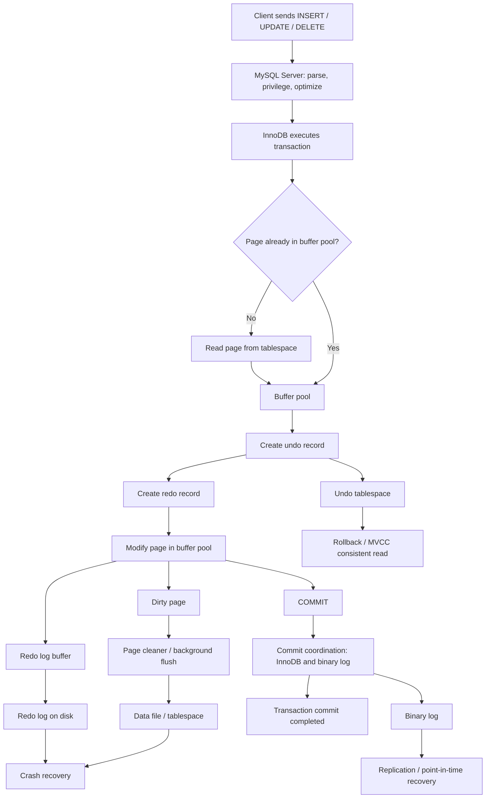

# Data Write Flow Through the Buffer Pool, Redo, Undo, and Binary Log

## Lesson Objectives

After this lesson, you will be able to:

- Describe how a write statement travels from MySQL's SQL layer to InnoDB and data pages.
- Distinguish the roles of the buffer pool, undo log, redo log, and binary log.
- Explain why InnoDB can acknowledge `COMMIT` before all data pages are written to data files.
- Present write-ahead logging (WAL), checkpointing, and crash recovery.
- Understand how MySQL coordinates the redo log with the binary log to maintain consistency at commit.
- Read key configuration variables and operational metrics related to data durability.

MySQL does not write entire data pages to disk at the exact moment of each `UPDATE` or `INSERT` statement. InnoDB modifies pages residing in memory, records recovery information in the redo log, preserves older versions using the undo log, and coordinates with the server-layer binary log. These components solve different problems yet all participate in a single write path.

This lesson focuses on MySQL Server using InnoDB, the default storage engine in modern MySQL releases. Other engines may have different storage and transaction mechanisms.

## 1. Four Components to Distinguish

Before tracing a write statement, clarify what role each component plays:

| Component | Where it operates | Primary role | Question it answers |
|---|---|---|---|
| Buffer pool | InnoDB memory | Caches data and index pages; where InnoDB operates on loaded pages | Which data pages are in RAM and have been modified? |
| Undo log | InnoDB transaction structures, managed via rollback segments and related tablespaces | Holds prior version information for rollback and consistent read/MVCC | Which prior state to roll back to, or which older version to read? |
| Redo log | Redo log buffer in RAM and redo logs on disk | Records changes needed for InnoDB to recover pages after a crash | How to replay logged changes? |
| Binary log (binlog) | MySQL Server layer, log files on disk | Records change events for replication and point-in-time recovery | Which changes were recorded in order for streaming or replay? |

A concise way to remember:

- The buffer pool holds pages currently in use.
- Undo holds information to roll back or reconstruct older versions.
- Redo holds information to roll forward to logged state after a crash.
- The binary log stores a server-level event stream so replicas and recovery tools can replay it.

Redo and undo are InnoDB mechanisms. The binary log belongs to the MySQL Server layer and can record changes from supported storage engines. The buffer pool is not a log; it is a cache of data and index pages.

## 2. Overview of the Write Flow

Suppose a sales application updates inventory stock. The client sends the statement to MySQL Server. The SQL layer parses the statement, checks privileges, and coordinates execution. InnoDB locates the page containing the inventory row in the buffer pool; if the page is not in memory, the engine reads it from the tablespace into the buffer pool.

When applying the modification, InnoDB creates an undo record to retain information required for rollback and consistent reads, and creates a redo record so page changes can be recovered. The page in the buffer pool is modified and becomes a dirty page. When the transaction commits, MySQL coordinates recording the transaction in the binary log and completing InnoDB's commit via an internal two-phase mechanism. Dirty pages can be written back to data files later by background flushing.

Conceptual diagram:



The diagram simplifies key relationships. Actual internal execution includes additional locking, latching, log writing, prepare, flush, and commit steps; the following sections explain each layer.

## 3. Buffer Pool: Where InnoDB Works with Data Pages

### 3.1. Data Pages and Caching

InnoDB organizes data and indexes into pages inside tablespaces. When a record needs to be read or modified, the engine operates on the page containing the record or related index pages. A page is loaded into the **buffer pool** if it is not yet in memory.

The buffer pool is InnoDB's most important RAM region. It caches data pages, index pages, and certain internal page types. When repeated queries access data still in the buffer pool, InnoDB avoids re-reading from storage. When updating a row, the engine modifies the corresponding page in the buffer pool instead of forcing the entire page to be written to the data file immediately.

A single statement can affect multiple pages: data pages, secondary index pages, clustered index pages, and related structures. Therefore, "writing one row" does not necessarily mean modifying only one page.

### 3.2. Dirty Pages

When a page's content in the buffer pool differs from the version on the tablespace, that page is called a **dirty page**. InnoDB marks the page modified and writes it back to storage according to background flushing schedules.

Example:

```sql
UPDATE sales.inventory
SET quantity = quantity - 1
WHERE product_id = 42;
```

If the page holding the row with `product_id = 42` is in the buffer pool, InnoDB modifies it in RAM. If absent, the engine reads the page into the buffer pool first. Once modified, the page becomes dirty. Related index pages may also be marked dirty.

A dirty page does not mean the transaction has committed. A page can contain changes from uncommitted or committed transactions; writing the page back to the data file is an engine flushing activity. InnoDB relies on the redo log to ensure pages can be recovered if a crash happens before data pages are written.

### 3.3. Page Cleaners and Checkpoints

InnoDB background threads write dirty pages back to tablespaces to:

- Free pages in the buffer pool when room is needed for new data.
- Reduce the backlog of dirty pages.
- Advance the checkpoint to bound how much redo must be replayed after a crash.
- Pace I/O to avoid concentrating too much write work into a single moment.

A **checkpoint** is a marker in the redo stream indicating that changes prior to a given position are guaranteed to have been written to data files under InnoDB's recovery rules. As the checkpoint advances, older redo space can be reused. If redo generation outpaces page flushing for a sustained period, InnoDB may have to intensify page writes; this adds I/O pressure and can reduce throughput.

Increasing the buffer pool allows caching more pages, but it does not solve all write bottlenecks. If storage is slow, write load is excessive, or transactions hold pages/locks for a long time, the system can still bottleneck. When tuning, monitor cache hit ratio, dirty pages, write rate, and checkpoint age instead of looking only at RAM size.

## 4. Undo Log: Storing Prior Versions for Rollback and MVCC

### 4.1. When Are Undo Records Used?

The **undo log** stores the information needed to reverse a transaction's changes and reconstruct older data versions for MVCC (Multi-Version Concurrency Control).

For an UPDATE operation, an undo record can store the old values of modified columns along with record-identifying information. If the transaction rolls back, InnoDB uses undo to restore prior values. If another transaction needs a consistent read at an older read view, InnoDB can follow the version chain to return the appropriate version.

For example, an inventory row starts with quantity 10:

```sql
START TRANSACTION;

UPDATE sales.inventory
SET quantity = 9
WHERE product_id = 42;

-- Not yet COMMITted.
```

While the transaction remains open, InnoDB has already created undo information for the change. If the transaction executes `ROLLBACK`, the engine uses undo to restore quantity to 10. If the transaction commits, the new version becomes the confirmed change; the old version may still need to persist so active consistent reads see the right snapshot.

### 4.2. Undo and MVCC

MVCC allows certain consistent reads to observe a matching data snapshot without exclusively locking every row being read. When a transaction performs a snapshot read, InnoDB determines which version is visible according to its read view. If the current page holds a version newer than that snapshot, the engine can use the undo chain to reconstruct the older version.

This explains why undo is not deleted immediately upon `COMMIT`. A long-running read transaction may still need old versions. InnoDB only purges undo versions that are no longer required for rollback or any active read view.

### 4.3. Rollback and Purge Are Two Different Tasks

- **Rollback** reverses changes made by an uncommitted or aborted transaction.
- **Purge** cleans up old versions no longer needed for consistent reads and other internal purposes.

A long-running transaction or long-lived read view can block purge from cleaning up older versions. When this happens, undo history grows, increasing purge work and potentially impacting performance. Therefore, avoid keeping transactions open while the application waits on users, calls external services, or runs long-running tasks.

You can inspect transaction and history information in:

```sql
SHOW ENGINE INNODB STATUS\G
```

In the TRANSACTIONS and HISTORY LIST LENGTH sections, operators can locate open transactions and undo history status. Always compare against actual workload before concluding a history value is abnormal.

## 5. Redo Log: Recording Changes for Crash Recovery

### 5.1. Redo Log Buffer and Redo Log Files

When InnoDB modifies a page, the engine generates **redo records** describing the changes needed to recover the page. Records enter the redo log buffer in RAM and are then written to redo logs on storage according to InnoDB's flush mechanism.

The redo log is designed for crash recovery. If the server terminates abnormally after a transaction's commit was acknowledged while its corresponding data pages were not yet written to the tablespace, InnoDB can read the redo log and replay the necessary changes on startup.

The redo log is not a full copy of a table and is not used to query business data. It is a storage-engine-level recovery log organized as a Log Sequence Number (LSN) stream.

### 5.2. Write-Ahead Logging (WAL)

The **write-ahead logging** principle requires that the necessary redo records be durably written before the page containing the corresponding change is allowed to be written back to the data file. Thus, if a crash occurs mid-page-write or before the page is written, InnoDB still has the information required to recover.

Simplified flow:

1. InnoDB modifies the page in the buffer pool and generates redo records.
2. Redo records are written to the redo log per transaction requirements and flush policy.
3. The page can remain in the buffer pool as a dirty page.
4. Page cleaners write the page back to the tablespace at an appropriate time.
5. The checkpoint advances once older changes have been safely written to data files.

This is why `COMMIT` does not need to wait for every data page of a transaction to be written to its final location in the tablespace. With appropriate durability settings, writing the redo log suffices for InnoDB to reconstruct committed changes after a crash.

### 5.3. LSN and Checkpoint Age

**LSN (Log Sequence Number)** is a position in the redo log stream. InnoDB uses LSNs to track generated redo, written redo, and checkpoint position. The distance between the current redo position and the checkpoint is commonly called the checkpoint age.

If checkpoint age grows rapidly and approaches redo capacity limits, InnoDB must flush dirty pages to make room for new redo. When write workloads spike or storage falls behind, checkpointing can become a performance-limiting factor.

Larger redo capacity can absorb write bursts longer and ease checkpoint pressure in the short term, but it does not substitute for sufficiently fast storage and does not eliminate flush work. More redo can also lengthen crash recovery time. Tune according to workload, disk space, and recovery time objectives.

## 6. Binary Log: Event Stream at the MySQL Server Layer

### 6.1. What Does the Binary Log Record?

The **binary log (binlog)** records change events generated by MySQL Server. It is primarily used for:

- **Replication:** replicas read events from the source and apply them to stay synchronized.
- **Point-in-time recovery:** combining a backup with a sequence of binary logs to replay changes up to a desired point in time.
- **Auditing and change investigation:** within the bounds of format, access privileges, and retention policies.

The binary log differs from the redo log in level of recording. Redo focuses on InnoDB page recovery; the binlog stores server-level change events for replication and replay. The binlog is not a copy of buffer pool pages and does not replace the redo log for InnoDB crash recovery.

### 6.2. Binary Log Formats

MySQL supports three primary formats:

| Format | What is recorded | Characteristics |
|---|---|---|
| STATEMENT | SQL statements | Compact in some cases, but can be difficult to guarantee identical results if statements are environment-dependent or non-deterministic |
| ROW | Row-level changes | Records affected rows; generally better suited for accurate replication, though it can produce larger logs |
| MIXED | Combination of statement and row | Server picks the format depending on the statement and safety conditions |

With ROW format, the binlog does not store entire InnoDB pages. It stores events describing row changes. A single transaction can produce multiple row events and transaction boundary events.

### 6.3. Binlog Cache and File Writing

During a transaction, MySQL can buffer binlog events in a transaction cache before writing them to the binary log file at commit. If a large transaction exceeds the memory cache limit, part of it may spill to a temporary file. This ensures the binlog records a transaction's events as a clearly bounded group.

Binary logs are split into sequential files. In operations, track disk usage, retention periods, where replicas are currently reading, and which files backups/PITR still require. Purging binlogs too early can prevent replicas from catching up or eliminate the ability to recover to a needed timestamp.

Basic inspection commands:

```sql
SHOW VARIABLES LIKE 'log_bin';
SHOW VARIABLES LIKE 'binlog_format';
SHOW BINARY LOGS;
```

Only enable and retain binary logs when there is a clear plan for usage, storage, and purging. Binary logs can contain sensitive business data; restrict read privileges, protect copies, and enforce retention according to system policy.

## 7. COMMIT: Coordinating Redo Log and Binary Log

### 7.1. Why Do Both Logs Need Coordination?

In an InnoDB transaction, the redo log enables the storage engine to recover changes. The binary log tells the server and replicas which transactions need to be replayed. If a transaction is written to the binlog without being committed by InnoDB, a replica could apply a change the source does not have. Conversely, if InnoDB commits without recording in the binlog, replication or PITR could miss a transaction.

MySQL coordinates the two subsystems via an **internal two-phase commit** between the server and the transactional storage engine. This is an internal mechanism to preserve commit consistency; it does not mean the application is running a distributed XA transaction.

### 7.2. Two Phases at a Conceptual Level

For an InnoDB transaction with the binary log enabled, the conceptual flow is:

1. **Prepare:** InnoDB prepares the transaction and writes the redo information needed to recover the prepared state.
2. **Write binary log:** MySQL writes the transaction's events to the binlog and syncs according to binlog configuration.
3. **Commit storage engine:** MySQL instructs InnoDB to complete the commit. The redo log records the commit state and the transaction is confirmed complete.

Implementation details include additional flush, sync, and commit steps. If the server crashes between steps, InnoDB and MySQL use redo and binary log information to decide whether a prepared transaction should be completed or rolled back. The goal is to prevent inconsistent transaction state between InnoDB and the binlog.

### 7.3. Group Commit

If multiple transactions commit nearly simultaneously, MySQL can batch binary log writes and syncs into a group (group commit). Consequently, a single flush/sync can serve multiple transactions, reducing synchronous I/O calls per transaction while preserving proper commit ordering.

Group commit is one reason commit throughput does not simply equal the number of `fsync` calls multiplied by `fsync` latency. Nonetheless, storage latency, transaction size, contention, and log settings still strongly impact performance.

## 8. Data Durability: Two Settings to Understand Clearly

Two variables commonly evaluated together are:

- `innodb_flush_log_at_trx_commit`: controls how InnoDB writes and flushes the redo log on commit.
- `sync_binlog`: controls how often the binary log is synced to storage.

### 8.1. innodb_flush_log_at_trx_commit

| Value | General behavior | Trade-off |
|---|---|---|
| 1 | Writes and flushes redo log to storage at every commit | Highest durability under standard configuration; may increase synchronous I/O cost |
| 2 | Writes redo log to file at every commit; flushes to storage periodically, roughly once per second | Recent commits can be lost if the OS or host crashes before the flush |
| 0 | Writes and flushes redo log periodically, roughly once per second | Recent changes can be lost even if only the MySQL process crashes |

The "roughly once per second" interval is periodic behavior, not a hard real-time guarantee. OS behavior, load, and storage can affect flush timing. Value 1 is typically chosen when high commit durability is required. This option alone cannot guarantee durability if storage hardware or virtualization layers do not honor flush commands properly.

### 8.2. sync_binlog

| Value | General behavior |
|---|---|
| 0 | MySQL does not actively request syncing the binary log after each commit group; the OS decides when to persist |
| 1 | Requests syncing the binary log after every commit group |
| N greater than 1 | Syncs after every N commit groups |

If the binary log is critical for replication and PITR, `sync_binlog = 1` is typically paired with `innodb_flush_log_at_trx_commit = 1` to maximize durability for both log streams. This is the standard configuration for durability-first systems; evaluate performance and storage characteristics as well.

The two variables govern two separate log streams. Setting only one variable for high durability does not automatically give the other stream the same guarantee. Final durability also depends on whether the OS, filesystem, controller, device cache, and storage platform honor flush calls.

Inspect current configuration:

```sql
SHOW VARIABLES
WHERE Variable_name IN (
    'innodb_flush_log_at_trx_commit',
    'sync_binlog',
    'log_bin',
    'binlog_format'
);
```

Do not alter durability variables in production just to experiment. Evaluate RPO requirements, storage capabilities, performance impact, and test plans before making changes.

## 9. What Happens When MySQL Crashes?

A crash can occur at many moments: while a transaction is modifying a page, after redo is written but before commit, after the binlog is written, or after commit is acknowledged while data pages are still dirty in the buffer pool.

When InnoDB restarts, the engine performs crash recovery. Conceptually:

1. InnoDB identifies the checkpoint and reads the necessary redo logs.
2. The engine replays redo to bring pages to a consistent state according to the log.
3. Incomplete transactions are identified; uncommitted transactions are rolled back using undo.
4. After recovery, committed transactions are preserved and uncommitted changes do not become confirmed data.

This is why redo and undo complement each other: redo restores logged page-level changes, while undo removes the effects of uncommitted transactions and supports older versions.

The binary log has its own role in commit coordination and in replication/PITR. It does not replace InnoDB's use of redo and undo to recover data pages after a crash. For transactions in the prepared state when a crash occurred, MySQL uses commit coordination metadata to consistently complete or roll back between the engine and the binlog.

### A Few Typical Scenarios

| Crash timing | What InnoDB/MySQL must handle |
|---|---|
| Page modified in RAM, redo not yet durably written | Changes may be lost; transaction was not durably confirmed per configuration |
| Redo durable, data page not yet flushed | Replay redo to recover the page |
| Uncommitted transaction | Use undo to roll back incomplete changes |
| Binlog written, engine in prepared stage | Coordinate recovery to consistently complete or roll back the transaction |
| Commit confirmed, page still dirty | Preserve committed changes via redo; flush page after recovery or during normal operation |

This table describes logical states, not an exact I/O command schedule across every MySQL version.

## 10. Hands-On Example: Tracing a Write Transaction

Assume database `sales` already exists. Create an InnoDB inventory table:

```sql
CREATE TABLE sales.inventory (
    product_id BIGINT UNSIGNED NOT NULL,
    quantity INT NOT NULL,
    updated_at TIMESTAMP NOT NULL
        DEFAULT CURRENT_TIMESTAMP
        ON UPDATE CURRENT_TIMESTAMP,
    PRIMARY KEY (product_id),
    CONSTRAINT chk_inventory_quantity CHECK (quantity >= 0)
) ENGINE = InnoDB;

INSERT INTO sales.inventory (product_id, quantity)
VALUES (42, 10);
```

Execute a transaction:

```sql
START TRANSACTION;

SELECT quantity
FROM sales.inventory
WHERE product_id = 42
FOR UPDATE;

UPDATE sales.inventory
SET quantity = quantity - 1
WHERE product_id = 42
  AND quantity >= 1;

-- Application checks affected rows: if not equal to 1, ROLLBACK.
COMMIT;
```

As it runs, you can trace the concepts:

1. InnoDB looks up the inventory row's page in the buffer pool; if absent, it reads it from the tablespace.
2. `SELECT ... FOR UPDATE` acquires a row lock so the transaction can check and update the same record without another transaction modifying it in between.
3. InnoDB creates an undo record to enable rollback and support consistent reads.
4. InnoDB generates a redo record and modifies the page in the buffer pool; the page becomes dirty.
5. On commit, MySQL coordinates writing the transaction to the binary log (if enabled) and completing InnoDB's commit.
6. The application checks that `UPDATE` affected exactly one row; if not, it rolls back and handles out-of-stock. When valid, the dirty page is flushed to the tablespace on InnoDB's schedule; this may happen after `COMMIT` returns.

If `COMMIT` is replaced with `ROLLBACK` before the transaction finishes, InnoDB uses undo to restore the quantity. Redo may still have logged the changes needed for pages and undo; during recovery, redo is replayed before uncommitted transactions are rolled back.

To observe configuration and state:

```sql
SHOW VARIABLES
WHERE Variable_name IN (
    'innodb_flush_log_at_trx_commit',
    'sync_binlog',
    'log_bin',
    'binlog_format'
);

SHOW ENGINE INNODB STATUS\G

SHOW BINARY LOGS;
```

Commands displaying status require appropriate privileges. In production systems, only authorized operators should read logs and information that may contain sensitive data.

## 11. Common Misconceptions

| Misconception | Correct understanding |
|---|---|
| The buffer pool is the final durable storage location | The buffer pool is a RAM cache; data pages are managed in tablespaces |
| COMMIT means all pages have been written to data files | Commit durability relies on logs per configuration; dirty pages can be flushed later |
| Both undo and redo are data copies | Undo holds prior version/rollback info; redo holds change replay info |
| Redo log is used for replication | Redo primarily serves InnoDB crash recovery; replication uses the binary log |
| Binary log is a copy of data files | Binlog is a server-layer event stream, not a copy of pages |
| When a transaction commits, undo is deleted immediately | Undo versions may be needed for consistent reads; purge cleans up once no longer needed |
| Enabling the binary log is enough to guarantee durability | Redo and binlog settings must be coordinated along with actual storage flush support |
| Page cleaners only write committed pages | Page flushing is page management; WAL ensures required redo is written before data pages |

## 12. Self-Check Questions

1. An UPDATE modifies a row in the buffer pool. Why does InnoDB need to create both an undo record and a redo record?
2. A transaction has committed, yet the data page has not been written to the tablespace. Why can the data still be recovered after a crash?
3. One transaction reads an older snapshot while another updates the same row. Which component enables InnoDB to reconstruct the old version?
4. How do the binary log and redo log differ in purpose and operating layer?
5. Why do production systems typically evaluate both `innodb_flush_log_at_trx_commit` and `sync_binlog`?
6. How can a long-open transaction put pressure on undo purge?
7. If checkpoint age climbs continuously during a heavy write workload, which components should you inspect?

**Suggested answers:**

1. Undo supports rollback/MVCC; redo supports page recovery after a crash.
2. Durably written redo logs allow InnoDB to replay the changes; data pages can be flushed later.
3. The undo log and MVCC read view.
4. Redo is an InnoDB-level recovery log; binlog is a MySQL Server-level event log serving replication and PITR.
5. The two variables govern durability of two different log streams; both should be aligned with RPO targets.
6. Old read views may still require prior versions, preventing purge from reclaiming them and causing undo history to grow.
7. Dirty pages, redo generation rate, redo capacity, flush rate, I/O latency, and long-running transactions.
