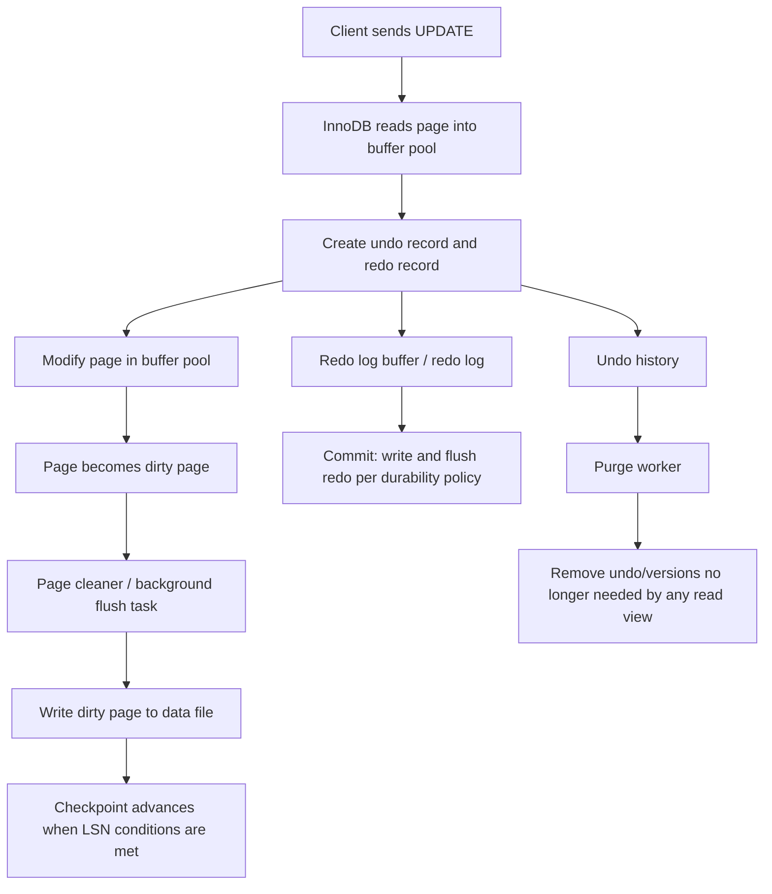

# Checkpoint, Flush, Purge, and Background Task Coordination

InnoDB does not write every change directly to data pages on disk the instant a SQL statement finishes. To achieve high performance while preserving recoverability, InnoDB combines an in-memory buffer pool, redo logs, undo logs, and multiple background tasks. These tasks write logs, flush modified data pages to tablespaces, advance checkpoints, and remove old row versions no longer needed for consistent reads.

Three concepts to distinguish are **redo log**, **flush/checkpoint**, and **purge**. The redo log records how to reconstruct changes after a crash; flushing writes dirty data pages from the buffer pool to storage; checkpoints mark progress beyond which InnoDB can reuse older redo log space; and purge cleans up undo records and row versions that are no longer needed. These activities are closely related yet do not replace one another.

In the `DATABASE_MYSQL` module, understanding these mechanisms helps you read InnoDB status, explain why write load can increase latency, detect transactions holding undo too long, and tune storage settings based on metrics. This content focuses on MySQL's InnoDB; exact variable names and display formats may vary across versions.

## 1. Foundational Structures Behind Background Tasks

Before examining each worker, understand the roles of the storage areas:

- **Buffer pool:** memory area caching data and index pages. When a query reads a page, InnoDB can fetch it from the buffer pool instead of reading from disk. When `INSERT`, `UPDATE`, or `DELETE` modifies a page, the in-memory page becomes a *dirty page*.
- **Redo log:** log recording the information needed to replay InnoDB changes during crash recovery. Redo is written sequentially by Log Sequence Number (LSN), avoiding random writes of every data page at commit time.
- **Undo log:** stores information needed for rollback and reconstructing older row versions for consistent reads. Undo records are tied to transactions and retained until no active transaction/read view needs that version.
- **Tablespaces and data files:** hold data pages, index pages, and various InnoDB storage structures. Pages in the buffer pool must eventually be written back to their corresponding files.
- **Doublewrite buffer:** a layer protecting certain page write paths against torn pages if a crash occurs mid-write. It is part of the page-writing path, not the redo log and not a checkpoint.

An update operation typically generates both redo and undo. Redo allows replaying logged changes; undo allows rolling back or serving older data to consistent reads. A data page in the buffer pool may remain unwritten to the data file even after a transaction has committed successfully, provided the required redo has been persisted per durability policy.

## 2. The Big Picture: Foreground and Background

The foreground flow is work directly triggered by clients: sending SQL, reading or modifying rows, committing/rolling back, and receiving results. Background threads handle storage maintenance: writing logs, flushing dirty pages, advancing checkpoints, purging old undo, merging buffered changes, and handling I/O.



The diagram shows that commit and writing data pages happen at two different times. A transaction can already be committed while its corresponding page is still a dirty page. Purge likewise does not run immediately at commit: an old version is only removed once it is certain no consistent read still needs it.

## 3. Redo Log, LSN, and Checkpoint

### Redo Log and Log Sequence Number

InnoDB writes redo to the log buffer before transferring it to redo log files. Each piece of redo is assigned a monotonically increasing LSN. The LSN represents a progress position in the redo stream, not a transaction sequence number and not a count of updated rows.

You can think of three distinct milestones:

- **Current LSN:** latest redo position generated.
- **Flushed LSN:** redo position flushed to storage as reported by InnoDB status.
- **Checkpoint LSN:** oldest redo milestone InnoDB still needs to retain to recover data pages whose corresponding changes have not yet been written to data files.

Exact displayed field names vary by version, but the principle is constant: persisted redo allows transactions to commit; redo space can only be safely reused once the necessary changes have been written to data pages and the checkpoint has moved past that portion of the log.

### What Is a Checkpoint?

A checkpoint is a progress marker in the redo log. As InnoDB flushes dirty pages to data files, it can advance the checkpoint based on the LSNs of changes safely written to disk. Redo records preceding the checkpoint are no longer needed for crash recovery of those synchronized pages, so the corresponding redo space can be reused as the log wraps around.

InnoDB uses **fuzzy checkpointing**: it does not need to halt all activity to flush every dirty page at once. Pages are written gradually in the background; the checkpoint advances according to the pages holding the oldest LSNs still needing processing. This avoids long stalls, but requires balancing redo generation rate against flush rate.

A useful quantity is *checkpoint age*:

\[
\text{checkpoint age} = \text{current LSN} - \text{checkpoint LSN}
\]

The larger the checkpoint age, the more redo sits behind the checkpoint and cannot yet be reused. If redo generation continuously outpaces page flushing, checkpoint age grows. When the redo log nears its capacity limit, InnoDB must flush more aggressively to free space; this pressure can increase I/O and write latency.

### Redo Log Capacity and Checkpoint Pressure

Redo log capacity lets InnoDB absorb write spikes for a period of time. Larger capacity reduces the frequency of urgent flushing to free log space, though it does not increase the storage device's sustained write throughput. If storage cannot keep up with write load over a long period, a larger log only delays when pressure surfaces.

On MySQL 8.0.30 and later, `innodb_redo_log_capacity` is the configuration variable managing total redo log capacity and can be changed dynamically. Older releases typically configure this via `innodb_log_file_size` together with `innodb_log_files_in_group`. When upgrading, verify the exact variable effective for the running version; do not blindly apply old and new configuration instructions together.

When sizing redo capacity, consider:

- Redo generation rate during peak hours and batch jobs.
- Sustained write capability of the storage device.
- Acceptable system recovery time after a crash.
- Memory capacity, buffer pool size, and workload characteristics.
- Variance between average load and burst load.

A larger redo log can increase the volume of redo that must be processed during crash recovery if the checkpoint lags far behind. Thus, the goal is sufficient headroom for real workloads alongside a steady flush rate, not maximizing capacity unconditionally.

## 4. Flush: Writing Dirty Pages from Buffer Pool to Storage

When InnoDB modifies a page in the buffer pool, that page is marked dirty. Dirty pages can still be read and updated further in memory. Flushing writes the current page version to the data file to reduce the remaining recovery work from redo and enable the checkpoint to advance.

### Flushing Pages Differs from Flushing Redo

Two operations are frequently confused:

| Operation | Data written | Purpose |
|---|---|---|
| Flush redo log | Log buffer to redo log file and, depending on policy, sync request to storage | Guarantees redo needed for durability and recovery. |
| Flush dirty page | Data/index pages in buffer pool to tablespace/data file | Synchronizes pages with logged changes, frees buffer pool slots, and advances checkpoints. |

Commits typically do not need to wait for all dirty pages of a transaction to be written to data files. In InnoDB, write-ahead logging requires the relevant redo to be persisted before the corresponding data page is written to its final on-disk location. This lets transactions commit faster while still allowing un-flushed pages to be recovered after a crash.

### When Does InnoDB Flush?

Flushing occurs for several cooperating reasons:

1. **Checkpoint pressure:** the redo log needs reusable space, so InnoDB must flush relevant pages to advance the checkpoint.
2. **Buffer pool needs space:** a query needs to load a new page but the buffer pool lacks reusable clean pages; InnoDB flushes suitable dirty pages.
3. **Dirty page ratio:** when the dirty page percentage reaches thresholds or the dirtying rate accelerates, InnoDB increases flush activity.
4. **Shutdown requests or administrative operations:** certain shutdown modes and maintenance operations may require flushing more data.

InnoDB can pick pages from the flush list by oldest LSN and from the LRU list to keep clean pages available in the buffer pool. Page cleaner threads perform most background flushing. Exact mechanisms and worker counts depend on version and configuration.

### Controlling Flush Rate

Key variables:

| Variable | General role | How to think about tuning |
|---|---|---|
| `innodb_io_capacity` | Estimated background I/O capacity InnoDB may use for tasks such as flushing and merging | Set according to real storage capability; do not treat as a hard cap on total server IOPS. |
| `innodb_io_capacity_max` | Higher background I/O level InnoDB may use when it needs to accelerate | Can help clear backlogs, but setting it too high may compete for I/O with foreground queries. |
| `innodb_adaptive_flushing` | Allows InnoDB to adjust flushing based on redo generation rate and checkpoint pressure | Usually evaluate adaptive behavior before disabling this mechanism. |
| `innodb_max_dirty_pages_pct` | Dirty page percentage threshold in the buffer pool for throttling flushes | Not an exact target to maintain; interpret alongside checkpoint age and I/O capacity. |
| `innodb_max_dirty_pages_pct_lwm` | Lower threshold to start considering early flushing | Can help avoid waiting until dirty pages climb too high before flushing. |
| `innodb_lru_scan_depth` | LRU scan depth for preparing clean pages | Affects per-buffer-pool-instance work and workload; avoid raising arbitrarily. |

These variables are throttling controls, not substitutes for measuring storage performance. Raising `innodb_io_capacity` when storage is already saturated does not create extra IOPS; it may simply make flushing compete harder against queries. If capacity is set too low, dirty pages and checkpoint age can grow persistently. Adjust one variable at a time in a controlled manner and compare before/after metrics.

### Doublewrite and Page Write Safety

An InnoDB page can be larger than the atomic write unit guaranteed by storage hardware. If power is lost mid-page-write, a data file could contain a partially written page (torn page). The doublewrite buffer provides an intermediate copy that can be used to recover the page in supported scenarios. Once the doublewrite write completes per InnoDB's mechanism, the page is written to its final data file location.

Doublewrite protects the page-writing path; the redo log protects InnoDB's ability to replay logical changes. The two mechanisms complement each other. Do not disable doublewrite simply because redo is enabled or because storage is considered fast, unless you have thoroughly evaluated the platform's atomic-write guarantees, durability requirements, and data risks.

## 5. Purge: Cleaning Undo History When No Read View Needs It

### Why Is Undo History Needed?

InnoDB uses MVCC to allow transactions to read a consistent snapshot of data while other transactions continue writing. When a row is updated or deleted, InnoDB retains older version info in the undo log so transactions with appropriate read views can see data as of their snapshot time.

Example:

1. Transaction A starts a consistent read and creates a read view.
2. Transaction B updates a row from `status='NEW'` to `status='PAID'`, then commits.
3. Transaction A may still need the old `status='NEW'` version to maintain its snapshot.
4. InnoDB cannot yet purge the old version if A's read view can still see it.
5. Once no transaction/read view needs that version, purge can remove the corresponding undo record and old version.

Undo thus plays two primary roles: rolling back uncommitted transactions and providing older versions for consistent reads. Purge cleans up history no longer needed after transactions finish; it is not the immediate row-deletion step when a user runs `DELETE`.

### How Does Purge Work?

Purge is a background task that reads committed undo records and determines which ones are no longer needed by any active read view. Once eligible, InnoDB removes old row versions and reclaims the corresponding undo records. Purge work can be split across a coordinator and workers depending on version, with worker count controlled by configuration.

A commonly monitored metric is **History list length (HLL)**, shown in the TRANSACTIONS section of `SHOW ENGINE INNODB STATUS`. HLL reflects the amount of undo history awaiting purge in InnoDB's internal units; it is not simply the count of deleted rows or undo bytes. Track its trend and rate of change rather than treating an isolated number as an absolute error threshold.

If a transaction or read view stays open too long, purge cannot move past older versions still needed by that snapshot. HLL can grow even while purge workers are active. When the backlog becomes large, the system consumes extra undo space and may incur higher I/O and cost when traversing old row versions.

### Finding Transactions Holding Read Views Too Long

You can inspect open transactions via `INFORMATION_SCHEMA.INNODB_TRX`:

```sql
SELECT
    trx_id,
    trx_state,
    trx_started,
    TIMESTAMPDIFF(SECOND, trx_started, NOW()) AS age_seconds,
    trx_rows_locked,
    trx_rows_modified,
    trx_mysql_thread_id
FROM information_schema.innodb_trx
ORDER BY trx_started;
```

This is a starting point for locating long-running transactions. Not every long transaction holds a read view in the same way; inspect transaction state, isolation level, statements, and the application holding the connection. Pay particular attention to transactions left open while an application stopped processing, overly long batch jobs, or `Sleep` sessions still holding unfinished transactions.

### Controlling Purge

Related variables:

| Variable | Role |
|---|---|
| `innodb_purge_threads` | Number of purge workers configured to process undo history. |
| `innodb_purge_batch_size` | Purge batch size in internal work units. |
| `innodb_max_purge_lag` | Purge backlog threshold that can cause InnoDB to delay certain DML operations to slow history growth. |
| `innodb_max_purge_lag_delay` | Maximum delay cap applied by the purge lag throttling mechanism. |

Increasing purge threads can help drain a backlog if storage and CPU headroom exist, yet it cannot bypass a constraint imposed by an old read view. If an old transaction still holds a required version, adding workers will not make that version eligible for purge. Before changing thread counts, find transactions holding long snapshots, identify undo-generating workloads, and measure I/O capacity.

For large data deletions, consider splitting work into small batches with explicit commits. One giant `DELETE` can generate massive undo, hold locks for a long time, and force purge to clean up a huge backlog after commit. Small batches bound transaction size and make progress observable, though you must ensure row-selection criteria remain stable and re-runnable.

## 6. Other Background Tasks and How They Coordinate

Checkpoint, flush, and purge are not all of InnoDB's background activities. Other components participate in maintaining performance and consistency:

- **Log writer / log flusher:** moves redo from the log buffer to redo log files and performs flushes per durability policy, write schedule, and group commit.
- **Page cleaner:** flushes dirty pages from the buffer pool, maintaining clean page supply and advancing checkpoints.
- **Purge coordinator / workers:** clean up undo history no longer required by any read view.
- **I/O threads:** handle asynchronous read/write operations to storage according to architecture and platform.
- **Change buffer merge:** merges buffered changes for eligible secondary indexes when corresponding index pages are loaded or during background tasks.
- **Master/background scheduling:** coordinates periodic and miscellaneous background work; internal organization varies by MySQL version.

These threads share CPU, memory, and I/O resources. A batch update burst can simultaneously drive up redo generation, dirty page counts, and undo history. The log flusher must maintain commit durability; page cleaners must flush pages to reduce checkpoint age; and purge must reclaim old versions once snapshots allow. If storage lacks capacity, both foreground queries and background tasks can slow down.

### Group Commit and Durability

When the binary log is enabled, MySQL must coordinate InnoDB commits with binary log writes to avoid inconsistencies between the transaction engine and the binary log. The internal commit pipeline uses multi-phase coordination and group commit to batch sync work across multiple transactions, reducing physical flushes.

Two settings commonly reviewed together are:

- `innodb_flush_log_at_trx_commit`: controls when redo logs are written and flushed on commit.
- `sync_binlog`: controls how often the binary log is synced to storage.

With `innodb_flush_log_at_trx_commit=1`, InnoDB writes the redo log and requests a flush to storage on every commit per server mechanics. Value `2` writes the log on every commit but flushes periodically; value `0` writes and flushes periodically. `sync_binlog=1` requests syncing the binary log after every group commit. Less synchronous options can improve throughput but risk losing recent transactions around a crash or power outage, depending on OS and hardware settings. If high durability is needed with binary logging enabled, evaluate both settings together with storage hardware.

Do not confuse `innodb_flush_log_at_trx_commit` with dirty page flushing. The former governs the redo log at commit boundaries; page cleaners write data pages from the buffer pool based on schedules and checkpoint pressure.

## 7. Observing Status with MySQL Tools

### Reading `SHOW ENGINE INNODB STATUS`

The following command provides a broad diagnostic snapshot:

```sql
SHOW ENGINE INNODB STATUS\G
```

Sections to read:

| Section | Useful information |
|---|---|
| TRANSACTIONS | Active transactions, locks, deadlocks, and History list length. |
| LOG | Current LSN, flushed redo, checkpoint, and log pressure. |
| BUFFER POOL AND MEMORY | Dirty pages, pages read/created/flushed, and buffer pool status. |
| FILE I/O | Pending I/O and thread read/write activity. |
| INSERT BUFFER AND ADAPTIVE HASH INDEX | Change buffer and adaptive hash index status when available. |

The output is a point-in-time snapshot. To evaluate trends, collect samples periodically and compare multiple snapshots under similar load conditions. A transient high value may be normal after a batch job; a continuously growing backlog that does not drain is a signal to investigate.

### Tracking Status and Variables

```sql
SHOW GLOBAL STATUS LIKE 'Innodb_buffer_pool_pages_dirty';
SHOW GLOBAL STATUS LIKE 'Innodb_buffer_pool_pages_total';
SHOW GLOBAL STATUS LIKE 'Innodb_buffer_pool_pages_flushed';
SHOW GLOBAL STATUS LIKE 'Innodb_log_waits';
SHOW GLOBAL STATUS LIKE 'Innodb_os_log_written';
SHOW GLOBAL STATUS LIKE 'Innodb_data_pending_fsyncs';

SHOW GLOBAL VARIABLES LIKE 'innodb_redo_log_capacity';
SHOW GLOBAL VARIABLES LIKE 'innodb_io_capacity';
SHOW GLOBAL VARIABLES LIKE 'innodb_io_capacity_max';
SHOW GLOBAL VARIABLES LIKE 'innodb_adaptive_flushing';
SHOW GLOBAL VARIABLES LIKE 'innodb_purge_threads';
```

Some variables do not exist in older versions or have different names/display formats. If a query returns empty, check your version and its documentation rather than inferring the mechanism does not exist.

Metrics should be combined:

- **Dirty page ratio:** `Innodb_buffer_pool_pages_dirty / Innodb_buffer_pool_pages_total`. This indicates what share of the buffer pool holds dirty pages, though by itself it does not prove checkpointing is bottlenecked.
- **Redo generation rate:** growth rate of `Innodb_os_log_written` over time, used to understand redo write volume. This is a cumulative counter; take the delta between two samples over a known interval.
- **Checkpoint age:** inspect LSNs in the LOG section of InnoDB status if displayed in your version; compare current LSN against checkpoint LSN.
- **Log waits:** if `Innodb_log_waits` increases, the log buffer or log write path may be unable to keep up at times; inspect workload and log I/O further.
- **Purge backlog:** track History list length across multiple samples while looking for transactions holding long snapshots.
- **Pending I/O:** inspect pending I/O counts and cross-reference storage latency in OS or infrastructure monitoring.

No single metric is sufficient to diagnose root cause. For example, high dirty pages can be normal during a write workload; if checkpoint age is stable and latency is healthy, raising I/O capacity may not be needed. Conversely, moderate dirty pages with redo generation exceeding flush capacity over a long stretch can still produce checkpoint pressure.

## 8. Diagnosing Common Scenarios

| Symptom | Possible causes | Investigation direction |
|---|---|---|
| Periodic spikes in commit or write latency | Checkpoint pressure, redo log nearing full, slow storage flush | Compare current/checkpoint LSN, redo generation rate, log waits, dirty pages, and I/O latency. |
| Dirty pages growing continuously | Page modification rate exceeds flush rate or I/O capacity is too low | Inspect write batches, page cleaners, I/O capacity, and storage limits. |
| High background write I/O; reads and writes both slow | Flushing competing with foreground or saturated storage | Compare IOPS/throughput/latency, batch schedules, and pages flushed. |
| History list length growing over a long period | Old transaction/read view pinning undo history or purge unable to keep up | Locate long transactions, long-open snapshots, large batch DML, and purge trends. |
| Undo tablespace growing in size | Unpurged undo history or heavy undo-generating workload | Check long transactions, purge lag, undo tablespace policies, and workload history. |
| System stays busy after deleting a large dataset | Purge processing old versions; I/O and undo cleanup backlog | Monitor HLL, open transactions, and split future deletes into smaller batches. |
| Prolonged crash recovery | Large volume of redo to replay or slow storage | Check pre-crash checkpoint age if available, redo capacity, and storage performance. |

### Workflow for Investigating Checkpoint Pressure

1. Collect `SHOW ENGINE INNODB STATUS` and status counters at multiple timestamps.
2. Compute redo generation rate from per-second deltas of `Innodb_os_log_written`.
3. Compare current LSN, checkpoint LSN, and checkpoint age if displayed in the output.
4. Check dirty page ratio, pages flushed, and storage I/O latency.
5. Identify the workload generating redo: batch updates, imports, index builds, or normal write traffic.
6. Adjust one well-founded factor, such as batch size, redo capacity, or I/O capacity; re-measure under identical conditions.

If redo generation consistently exceeds flush capacity, address the load source or storage capability. Simply increasing redo capacity lets the system absorb longer bursts, but does not cure chronic throughput insufficiency.

### Workflow for Investigating Purge Lag

1. Record History list length and whether it is trending up or down.
2. List open transactions from `INFORMATION_SCHEMA.INNODB_TRX`.
3. Identify which transactions hold long consistent reads or run massive DML.
4. Correlate when HLL began climbing with batch jobs, long reports, or application connection holding.
5. End transactions through safe application workflows; do not kill sessions arbitrarily without assessing rollback cost and business impact.
6. Verify whether HLL drops and undo size stabilizes once purge catches up.

If the backlog is caused by a long-lived read view, raising `innodb_purge_threads` typically will not clear the primary bottleneck. Release the snapshot pinning old versions, then let purge drain the backlog.

## 9. Safe Tuning and Operational Principles

- Measure write load, redo generation, checkpoint age, dirty pages, and storage latency before changing configuration.
- Treat redo capacity as a buffer to absorb bursts, not a replacement for storage throughput.
- Do not force overly aggressive flushing if I/O is already saturated; doing so can slow foreground queries further.
- Keep transactions short and avoid leaving consistent reads open longer than necessary.
- Break large batch updates/deletes into units of manageable size and duration.
- Do not increase purge threads before determining whether the backlog stems from insufficient purge capacity or a pinned read view.
- Keep durability policies aligned with RPO; evaluate `innodb_flush_log_at_trx_commit` together with `sync_binlog` when binary logging is enabled.
- Do not disable doublewrite or weaken durability just to boost benchmarks without assessing crash and power-loss risks.
- Change one parameter at a time, record before/after configuration, and measure under equivalent load.
- Consider crash recovery duration as well, not only steady-state throughput.

## 10. Hands-On Exercises

### Exercise A — Observing Checkpointing and Flushing

1. Capture `SHOW ENGINE INNODB STATUS` output while the database is lightly loaded.
2. Run a workload updating many rows in a test schema.
3. Re-collect the LOG and BUFFER POOL AND MEMORY sections at fixed intervals.
4. Compare LSN, checkpoint, dirty pages, and pages flushed.
5. Explain why a transaction can commit before its dirty pages are written to data files.

### Exercise B — Creating and Resolving a Purge Backlog in a Test Environment

1. Create a test table with many rows and open a consistent-read transaction.
2. In a second connection, update many rows and commit in batches.
3. Observe History list length in InnoDB status.
4. Inspect open transactions using `INFORMATION_SCHEMA.INNODB_TRX`.
5. Close the reading transaction in a controlled manner, then observe purge catching up and HLL changing.
6. Compare against a run with no long-lived reading transaction.

Do not perform this exercise in production or on real business tables because it intentionally creates undo history and can increase I/O.

### Exercise C — Reading and Explaining Scenarios

A server exhibits these symptoms: dirty page count is climbing, checkpoint age approaches redo capacity, `Innodb_log_waits` begins increasing, and write latency spikes periodically. Propose an inspection order and list the data to collect before increasing `innodb_redo_log_capacity` or `innodb_io_capacity`.

Another scenario shows History list length rising steadily even though CPU and I/O are not saturated. Locate transactions holding long read views, identify the corresponding application or report, and propose how to shorten the snapshot lifecycle.

You complete the exercise when you can explain the differences between redo flush, dirty page flush, and purge; read LSN/checkpoint/HLL in InnoDB status; identify transactions pinning undo history; and propose metric-driven adjustments rather than guessing parameter changes.

## 11. Takeaways

The redo log supports recovery and durability; dirty page flushing syncs modified pages in the buffer pool to storage; checkpoints mark redo space eligible for reuse; and purge cleans up undo history once no read view needs old versions. Page cleaners, log flushers, purge workers, and I/O tasks must coordinate on shared system resources.

When investigating InnoDB performance, ask the right questions: how fast is redo being generated, is the checkpoint keeping up, is storage flushing fast enough, and which transactions are pinning old versions? Combining those answers with application latency, CPU load, and storage metrics helps distinguish checkpoint pressure, purge backlogs, and I/O limits so you can choose evidence-based remedies.
