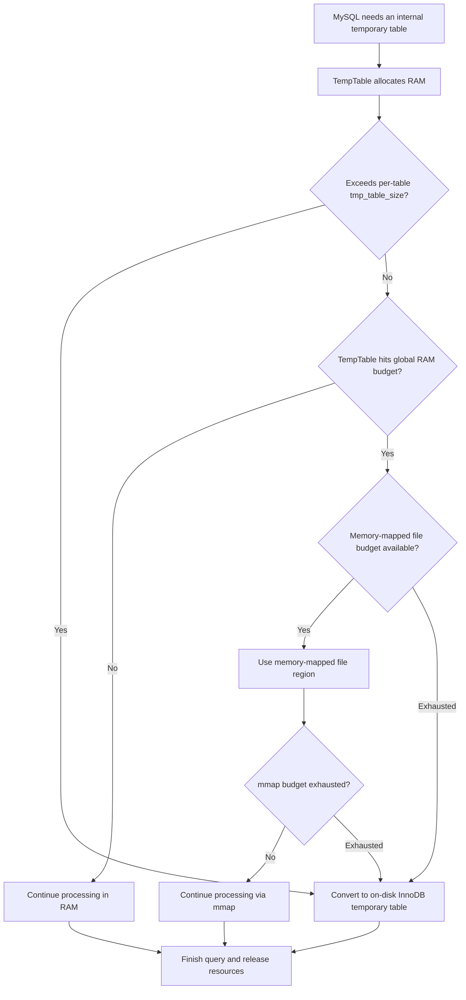

# Internal Temporary Tables and Operations That Can Spill to Disk

When processing a query, MySQL sometimes needs to create an internal temporary table to hold intermediate data before returning results. This temporary table may be kept in memory or converted to disk-based storage when resource limits are exceeded or when conditions are incompatible with the in-memory engine. Moving to disk can increase query latency due to extra read/write operations, especially when intermediate data is large.

Within the **DATABASE_MYSQL** architecture, understanding internal temporary tables explains why a `SELECT` statement can consume RAM, generate disk I/O, and run slower than expected without writing to any business table. This lesson focuses on MySQL 8.0; behavior and configuration variables can vary across versions, so check the server version before applying changes.

## 1. Distinguishing Internal Temporary Tables from User-Created `TEMPORARY` Tables

Two concepts share similar names yet serve different purposes:

| Criterion | Internal temporary table | User-created `TEMPORARY` table |
|---|---|---|
| Who creates it? | Created automatically by MySQL while processing a SQL statement | Created by a user or application via `CREATE TEMPORARY TABLE` |
| Purpose | Holds intermediate results to satisfy a query | Holds temporary data explicitly prepared and used by a program |
| Appears as a normal table in the schema? | No; managed internally during execution | Accessible by table name within the creating session, but not a permanent schema table |
| Lifetime | Scoped to the processing needs of the statement or execution plan | Scoped to the creating session; disappears when the session ends or can be dropped with `DROP TEMPORARY TABLE` |
| Privilege required | Managed internally by MySQL; regular read queries do not require `CREATE TEMPORARY TABLES` | Requires appropriate `CREATE TEMPORARY TABLES` privilege |
| Engine | Chosen by MySQL based on configuration and internal needs | Engine can be specified in the `CREATE TEMPORARY TABLE` statement |

Example of an application-created temporary table:

```sql
CREATE TEMPORARY TABLE selected_customer_ids (
    customer_id BIGINT PRIMARY KEY
) ENGINE=InnoDB;

INSERT INTO selected_customer_ids (customer_id)
VALUES (101), (205), (309);

SELECT c.id, c.full_name
FROM customers AS c
JOIN selected_customer_ids AS s
  ON s.customer_id = c.id;

DROP TEMPORARY TABLE selected_customer_ids;
```

This table is created explicitly by user SQL. It is not the internal temporary table the optimizer creates automatically when processing `GROUP BY`, `UNION`, or a derived table.

A `TEMPORARY` table is visible only within the session that created it. If a session creates a temporary table with the same name as a permanent table, the temporary table shadows the permanent table name in the current session until dropped or the session ends. Therefore, name them clearly and do not assume other sessions can access them.

## 2. Why Does MySQL Need Internal Temporary Tables?

SQL describes the desired result, yet to produce that result MySQL may have to sort, group, deduplicate, join, or materialize intermediate data. If it can process directly using an index or another strategy, the optimizer may avoid creating a temporary table. When it cannot, or when building an intermediate structure is estimated to be appropriate, MySQL may use an internal temporary table.

Cases commonly likely to require a temporary table include:

- **`GROUP BY`**: aggregating multiple records into groups to compute `COUNT`, `SUM`, `AVG`, or other aggregate functions.
- **`DISTINCT`**: eliminating duplicate rows from results.
- **`UNION`**: combining results from multiple queries and deduplicating when using default `UNION` (equivalent to `UNION DISTINCT`).
- **`ORDER BY` combined with other operations**: when the required order cannot be obtained directly from an index or does not match the grouping/intermediate result order.
- **Derived tables and CTEs**: a subquery in `FROM` or a CTE may be materialized as an intermediate result if the optimizer cannot or chooses not to merge it into the outer query.
- **Window functions and certain other execution strategies**: MySQL may need to buffer intermediate data to compute or sort across windows.

These are situations that *can* trigger a temporary table, not a guarantee that every `GROUP BY`, `DISTINCT`, `ORDER BY`, or CTE creates one. The optimizer may use an index, merge a derived table, or choose another strategy depending on query structure, data, statistics, and MySQL version.

### Example: Grouping and Sorting Results

Suppose the `orders` table contains many orders. We want to count orders per customer within a date range and sort customers with the most orders first:

```sql
SELECT customer_id, COUNT(*) AS order_count
FROM orders
WHERE created_at >= '2025-01-01'
GROUP BY customer_id
ORDER BY order_count DESC;
```

MySQL must filter orders, group by `customer_id`, count rows, and sort by the aggregated `order_count` value. Depending on available indexes and the chosen plan, this process may require a temporary table and/or a filesort operation.

## 3. Where Can Temporary Tables Live?

In MySQL 8.0, distinguish two storage tiers for internal temporary tables:

1. **In-memory**: the internal `TempTable` engine is the default choice for internal in-memory temporary tables in MySQL 8.0. `internal_tmp_mem_storage_engine` can be configured to `MEMORY` in appropriate environments.
2. **On-disk**: when an internal temporary table must move to on-disk form, modern MySQL 8.0 uses InnoDB to store internal temporary tables on disk. This is intermediate server-managed data, not a permanent business table created by the application.

`TempTable` supports variable-length data types as well as `BLOB`/`TEXT`. The `MEMORY` engine has different data type restrictions, such as not supporting `BLOB` and `TEXT`. Switching the internal engine to `MEMORY` can force queries with incompatible columns to use on-disk storage. Do not change the engine merely to test speeding things up without understanding data type impacts and memory limits.

### Steps Moving from RAM to Disk-Based Storage

At a high level, a temporary table using the `TempTable` engine can pass through the following steps:



The diagram depicts the general `TempTable` mechanism in MySQL 8.0. Starting in MySQL 8.0.28, exceeding `tmp_table_size` acts as a per-table limit that can convert that table to InnoDB; hitting the global `temptable_max_ram` budget leads to the memory-mapped file branch before checking `temptable_max_mmap`. Exact branch selection also depends on version and runtime resource state. A memory-mapped file still uses a file backing the memory region; it does not mean an InnoDB temporary table was created in a way recorded by all on-disk counters.

## 4. Limits Affecting Disk Spills

The following variables are commonly inspected when investigating internal temporary tables in MySQL 8.0:

| Variable | Meaning | Scope to note |
|---|---|---|
| `internal_tmp_mem_storage_engine` | Selects the engine for internal in-memory temporary tables, typically `TempTable` or `MEMORY` | Affects supported data types and memory allocation strategy |
| `tmp_table_size` | Size limit for certain internal in-memory temporary tables; starting in MySQL 8.0.28, applies per internal in-memory temporary table | Exceeding the limit can convert the temporary table to on-disk InnoDB |
| `temptable_max_ram` | Overall RAM budget the `TempTable` engine may use before switching to memory-mapped files | Shared global limit, not a per-query budget |
| `temptable_max_mmap` | Limit on memory-mapped file space `TempTable` may use | Once exhausted, internal temporary tables may spill to on-disk InnoDB |
| `max_heap_table_size` | Size limit for `MEMORY` engine tables | Relevant when using `MEMORY`; do not confuse it with `TempTable`'s overall allocation model |

Check server version and configuration values:

```sql
SELECT VERSION();

SHOW VARIABLES WHERE Variable_name IN (
    'internal_tmp_mem_storage_engine',
    'tmp_table_size',
    'temptable_max_ram',
    'temptable_max_mmap',
    'max_heap_table_size'
);
```

Not every variable exists in every MySQL version. If a variable does not appear, consult documentation for the exact server version rather than assuming the setting exists.

### Version-Specific Notes

- In MySQL 8.0, `TempTable` is the default engine for internal in-memory temporary tables. Older releases have different behaviors and limits.
- Starting in MySQL 8.0.28, `tmp_table_size` caps the size of each internal in-memory temporary table; when exceeded, the table can be converted to on-disk InnoDB.
- When using the `MEMORY` engine, `max_heap_table_size` must also be considered. Do not take a `MEMORY` limit formula and apply it verbatim to `TempTable`.
- MySQL 5.7 and MySQL 8.0 differ in their internal temporary table engines and mechanics. Always verify the version before altering configuration variables.

## 5. Distinguishing Temporary Tables, Filesorts, and Other I/O

When reading `EXPLAIN`, the following three concepts are often confused:

| Concept | Meaning | Does it mean a temporary table spilled to disk? |
|---|---|---|
| `Using temporary` | The query plan uses an internal temporary table | No. It does not specify whether the table resides entirely in RAM, uses mmap, or converted to on-disk InnoDB |
| `Using filesort` | MySQL uses a sorting algorithm instead of reading order directly from an index | No. Filesort can execute in memory or require temporary files depending on data volume and limits |
| `Created_tmp_disk_tables` increases | Additional internal temporary tables were recorded as on-disk | A useful signal, though it does not reflect every case using memory-mapped files |

Therefore, you cannot conclude a query is writing temporary tables to disk solely from `Using temporary` or `Using filesort`. Combine the execution plan, status counters, configuration, and system load observations.

## 6. Observing Whether a Query Creates Temporary Tables

### Using `EXPLAIN`

Run `EXPLAIN` before executing the query:

```sql
EXPLAIN
SELECT customer_id, COUNT(*) AS order_count
FROM orders
WHERE created_at >= '2025-01-01'
GROUP BY customer_id
ORDER BY order_count DESC;
```

In traditional tabular output, examine the `Extra` column. `Using temporary` indicates the plan uses an internal temporary table; `Using filesort` indicates a sorting step using the filesort algorithm. This is plan metadata and does not directly specify where the temporary table is stored. `EXPLAIN` is also not an exhaustive list of every temporary structure that might arise during full execution.

You can inspect the tree plan on supported versions:

```sql
EXPLAIN FORMAT=TREE
SELECT customer_id, COUNT(*) AS order_count
FROM orders
WHERE created_at >= '2025-01-01'
GROUP BY customer_id
ORDER BY order_count DESC;
```

### Using `EXPLAIN ANALYZE`

On MySQL 8.0.18 and later, `EXPLAIN ANALYZE` executes the query and displays actual runtime details such as timing, row counts, and loop counts across iterators:

```sql
EXPLAIN ANALYZE
SELECT customer_id, COUNT(*) AS order_count
FROM orders
WHERE created_at >= '2025-01-01'
GROUP BY customer_id
ORDER BY order_count DESC;
```

Unlike regular `EXPLAIN`, this command actually runs the query. Only use it with safe read statements on appropriate environments and data volumes; do not arbitrarily run a heavy query on a loaded production system.

### Using Session Counters

Status variables help observe how many internal temporary tables are created within a session. Run before and after the query on the same connection:

```sql
SHOW SESSION STATUS LIKE 'Created_tmp%';

-- Run the query under investigation here.

SHOW SESSION STATUS LIKE 'Created_tmp%';
```

The two counters commonly inspected are:

- `Created_tmp_tables`: number of internal temporary tables created by the server.
- `Created_tmp_disk_tables`: number of internal temporary tables recorded as on-disk.

Compare the delta before and after the query to see whether the query incremented the counters. Counters are cumulative within the session; running multiple statements between the two reads will include all of those statements.

**Important limitation:** `Created_tmp_disk_tables` does not count temporary tables backed by memory-mapped files. Thus, an unchanged value does not prove the query avoided file-backed memory regions. Combine with `temptable_max_ram`, `temptable_max_mmap`, the execution plan, and system metrics.

In environments with Performance Schema, you can inspect aggregated digest statistics in `performance_schema.events_statements_summary_by_digest`, including `SUM_CREATED_TMP_TABLES` and `SUM_CREATED_TMP_DISK_TABLES` if available in your version. The summary table helps locate SQL groups that frequently create temporary tables, though you must check access privileges and statistics reset times.

## 7. Example Investigation of a Query Creating Temporary Tables

Suppose an application has a report counting orders per customer. Current query:

```sql
SELECT customer_id, COUNT(*) AS order_count
FROM orders
WHERE created_at >= '2025-01-01'
GROUP BY customer_id
ORDER BY order_count DESC;
```

Proceed in sequence:

1. Run `EXPLAIN` to see whether MySQL reports `Using temporary` or `Using filesort`.
2. Check whether the `created_at` filter predicate is selective and whether a suitable index exists.
3. Run the query in a test session, recording `Created_tmp_tables` and `Created_tmp_disk_tables` before and after.
4. Check the `tmp_table_size`, `temptable_max_ram`, `temptable_max_mmap`, and internal engine settings.
5. Run `EXPLAIN ANALYZE` in an appropriate environment to compare actual rows and timing at each step.

For instance, consider an index on the filter and grouping columns:

```sql
CREATE INDEX idx_orders_created_customer
    ON orders (created_at, customer_id);
```

This index can help MySQL filter the date range and read relevant values more efficiently, though it does not guarantee eliminating temporary tables or filesorts. A differently ordered index might fit better depending on selectivity, query pattern, and workload. Measure with `EXPLAIN` and real data before deciding to keep an index.

Another scenario is combining two customer sets:

```sql
SELECT customer_id FROM online_orders
UNION
SELECT customer_id FROM store_orders;
```

`UNION` deduplicates records and therefore may require an intermediate structure to eliminate duplicates. If business logic permits retaining duplicate rows, you can use:

```sql
SELECT customer_id FROM online_orders
UNION ALL
SELECT customer_id FROM store_orders;
```

`UNION ALL` avoids `UNION`'s deduplication step, though it does not guarantee the overall query avoids temporary tables if other operations like `ORDER BY`, grouping, or materialization remain.

## 8. How to Reduce the Need for Large Temporary Tables

When a query creates large temporary tables or frequently spills to disk, review the SQL and data model before raising memory limits.

### Reduce Rows Entering Intermediate Processing

Add appropriate filter predicates to shrink the data requiring grouping, sorting, or deduplication. Check indexes on filter columns and join predicates. A suitable index can reduce rows read even if the optimizer still uses a temporary table for subsequent steps.

### Select Only Needed Columns

Avoid `SELECT *` in queries generating intermediate result sets. Selecting only the columns needed for the final output narrows each row, reducing the data that must reside in RAM or be written to disk. This is especially significant with wide columns such as `TEXT`, `BLOB`, or long strings.

### Review `DISTINCT` and `UNION`

If `DISTINCT` is only hiding a join that produces unexpected duplicate rows, inspect the join conditions and data relationships. When business requirements do not require deduplication, use `UNION ALL` instead of `UNION` to avoid deduplication overhead. Only make this change when duplicate rows are genuinely acceptable.

### Design `GROUP BY` and `ORDER BY` Intentionally

Check whether an index can support filter predicates, grouping order, or sort order. Column order in a composite index matters greatly. Do not create indexes indiscriminately: indexes add storage overhead and increase insert, update, and delete costs; moreover, the optimizer does not always choose an index simply because it exists.

### Control Materialization of Derived Tables and CTEs

A derived table or CTE may be merged into the outer query or materialized into an intermediate result. Avoid producing a massive intermediate dataset when only a small subset is needed; push filter predicates down appropriately and project only needed columns. Read the execution plan to verify whether the optimizer merged or materialized rather than guessing from syntax.

### Paginate and Aggregate According to Need

For large reports, consider bounding time ranges, paginating by stable keys, or pre-aggregating periodically. Avoid forcing the server to sort and hold an entire massive dataset if the UI only needs a slice of the output.

## 9. Adjusting Memory Limits Carefully

If the query is well-formed yet intermediate data regularly exceeds thresholds, temporary table variables can be re-evaluated. However, raising `tmp_table_size` is not a default cure-all. A larger limit lets each temporary table keep more data in RAM; when many sessions run queries concurrently, total memory consumption can surge sharply.

Before changing configuration:

1. Identify the MySQL version and current internal temporary table engine.
2. Gather query metrics, concurrent session counts, host RAM capacity, and actual memory utilization.
3. Determine which limit is being hit: the per-table cap, `TempTable`'s global RAM budget, or the mmap budget.
4. Change one variable at a time in a test environment, re-measuring latency, throughput, RAM, and I/O.
5. Verify impact under concurrent load before rolling out to production.

Do not set `tmp_table_size` or `temptable_max_ram` excessively high just because a single query is slow. `temptable_max_ram` is `TempTable`'s shared budget, while per-table and mmap limits play distinct roles. Raising one variable may merely shift the bottleneck to another or heighten RAM pressure on the host.

On-disk internal temporary tables are temporary resources managed by MySQL. Never hunt down and manually delete MySQL temporary files or tablespaces to deal with a slow query. Let the server manage their lifecycle and investigate via SQL, status counters, Performance Schema, and OS monitoring tools.

## 10. Practice Exercise

Run this in a test MySQL environment with an `orders` table containing sufficient data:

1. Run the `GROUP BY` and `ORDER BY` query from the example; record the `EXPLAIN` output, especially `Extra`.
2. Read `Created_tmp_tables` and `Created_tmp_disk_tables` before and after running the query in the same session.
3. Check the values of `internal_tmp_mem_storage_engine`, `tmp_table_size`, `temptable_max_ram`, and `temptable_max_mmap`.
4. Add an index matching the filter and grouping predicates; re-run `EXPLAIN` and compare estimated rows and the chosen plan.
5. Try replacing `UNION` with `UNION ALL` in a scenario where duplicate rows are allowed; verify business output before comparing performance.
6. Run `EXPLAIN ANALYZE` on a read query in the test environment to observe actual rows and timing.
7. Explain why `Using temporary` does not prove a temporary table spilled to disk and why `Created_tmp_disk_tables` does not reflect all memory-mapped files.

You have completed the lesson when you can distinguish user-created `TEMPORARY` tables from internal temporary tables, read plan indicators, track the relevant counters, and explain RAM/mmap/disk limits. From there, you can optimize queries and configurations using evidence rather than guessing memory increases.
