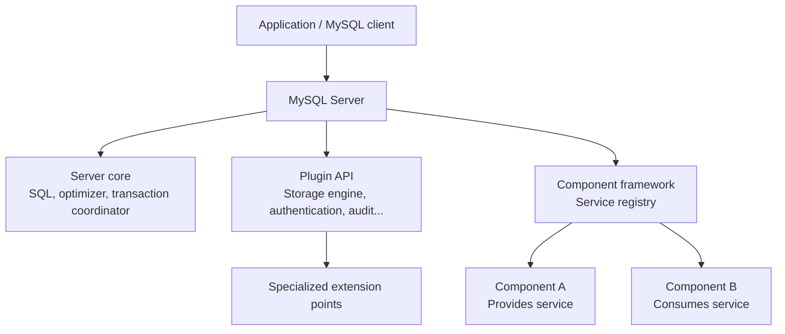
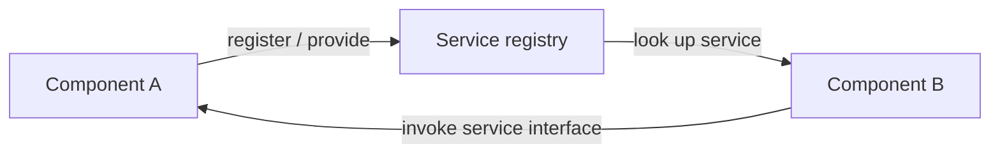

# Plugins, Components, and Server Extension Mechanisms

MySQL Server is designed to allow extending selected functionality through plugins and components. Through these mechanisms, the server can add storage engines, authentication methods, auditing capabilities, full-text parsers, or supporting services without modifying the entire server codebase.

In modern MySQL architecture, **plugins** are a long-standing extension mechanism with many specialized extension points; **components** are a newer extension model built around services that can be provided and consumed among independent components. Both mechanisms coexist and serve different purposes. They are not direct interchangeable names for the same thing.

This lesson explains the roles of plugins and components, how MySQL loads and manages them, how to inspect their status, and the security and operational principles for installing extensions into the server.

## 1. Why Does MySQL Need an Extension Mechanism?

A database management system must serve diverse needs. Transactional applications need a storage engine with transactions and locking; enterprise systems may require authentication through a central directory; operational organizations need activity logging for auditing; some workloads require custom text parsers or additional functions.

If every capability had to be hardcoded into a single monolithic program, development, deployment, and upgrades would lack flexibility. Extension mechanisms allow MySQL to load specialized modules on demand. The server maintains extension interfaces and manages the lifecycle of that code.



An extension runs inside the `mysqld` process or is loaded into that process by the server. Consequently, it participates directly in database operations and can impact server performance, stability, availability, and security.

## 2. What Is a Plugin in MySQL?

A plugin is a code module loaded by MySQL Server through a defined plugin interface. A plugin implements a specific category of functionality supported by the server. Common plugin types include:

| Plugin type | Role | Example use case |
| --- | --- | --- |
| Storage engine | Provides table storage, reading, writing, and management | Choosing an engine tailored to workload characteristics |
| Authentication | Adds connection account authentication methods | Integrating an organization's authentication method |
| Audit | Records monitored activity | Tracking login events or queries per policy |
| Full-text parser | Customizes tokenization for full-text search | Handling specialized languages or tokenization rules |
| Daemon | Runs a background capability supported by the server | Adding background tasks via the plugin interface |
| Replication | Extends certain replication-related behaviors | Integrating or customizing replication behavior at supported extension points |

InnoDB is a vital storage engine built into modern MySQL releases. Other plugins may be shipped with the MySQL distribution, by a vendor, or by third parties. Whether a plugin is available also depends on version, platform, edition, and packaging.

Plugins are typically delivered as dynamic shared libraries with an OS-dependent extension, such as `.so` on Linux or `.dll` on Windows. The library contains code implementing the plugin interface understood by MySQL Server. One library can provide one or multiple plugins, depending on design.

### 2.1. Plugin API and Lifecycle

Plugins are developed against MySQL's plugin API. The library describes the plugin, its plugin type, and initialization or teardown functions. Upon loading, the server validates plugin metadata, invokes initialization, and registers the corresponding functionality. When unloading, the server calls teardown if the plugin supports that lifecycle.

High-level lifecycle:

1. The vendor compiles the plugin compatible with the target platform and MySQL version.
2. The administrator places the library in the plugin directory configured for the server.
3. MySQL loads the plugin via dynamic installation or at startup per configuration.
4. The plugin initializes and registers the capability type it provides.
5. The server invokes the plugin when handling matching operations.
6. The administrator can uninstall the plugin dynamically using the supported command if it is no longer in use and no dependencies prevent removal.

Plugins are native code running inside the same server process, so memory bugs, deadlocks, crashes, or compatibility defects in a plugin can affect all of `mysqld`.

## 3. Loading and Managing Plugins

MySQL supports built-in plugins, statically linked plugins, and dynamically loaded plugins. Whether a plugin can be installed or uninstalled at runtime depends on how it was built and its plugin type.

### 3.1. Installing Plugins Dynamically with SQL

For plugins supporting dynamic installation, the general syntax is:

```sql
INSTALL PLUGIN plugin_name SONAME 'plugin_library';
```

Where:

- `plugin_name` is the plugin name declared inside the library.
- `plugin_library` is the library filename containing the plugin, not an arbitrary path.
- The library must reside in the plugin directory permitted by MySQL and be compatible with the running server.

This is template syntax to understand the mechanism, not a command to execute verbatim: substitute real plugin and library names from a trusted installation package. Never download an arbitrary library file and install it on a production server.

Upon successful installation, the plugin is loaded into the running server and dynamic installation metadata is stored in MySQL's metadata so the plugin can be reloaded on future restarts.

### 3.2. Uninstalling Plugins Dynamically

General syntax:

```sql
UNINSTALL PLUGIN plugin_name;
```

Before uninstalling, verify whether the plugin is still in use by any storage engine, account, authentication configuration, or other feature. Some plugins cannot be uninstalled while the server is using them or when loaded in a way that does not support dynamic removal. Read the plugin's documentation and test in staging before modifying production.

If the plugin is also declared in startup configuration, uninstalling via SQL may not persist across the next restart. In that case, review startup settings such as `plugin-load` or `plugin-load-add`, and remove the declaration only after verifying the server can start normally without that plugin.

### 3.3. Loading Plugins at Startup

Administrators can configure plugins to load when MySQL starts. Illustrative configuration under `[mysqld]`:

```ini
[mysqld]
plugin-load-add=plugin_name=plugin_library.so
```

Exact library filenames and syntax must follow plugin documentation and the operating system. `plugin-load-add` appends a plugin to the load list; understand the difference between list-replacing options and list-appending options to avoid accidentally dropping other plugins. Do not copy placeholder library names into real configurations.

### 3.4. Plugin Directory

You can check the plugin directory used by the server:

```sql
SHOW VARIABLES LIKE 'plugin_dir';
```

MySQL only loads libraries from the configured location permitted by server security rules. Do not change permissions on this directory so that arbitrary users can write files. Anyone able to write native code into the plugin directory can potentially execute code inside the database process.

## 4. Inspecting Installed Plugins

The following command lists plugins recognized by the server:

```sql
SHOW PLUGINS;
```

You can query metadata via `INFORMATION_SCHEMA.PLUGINS`:

```sql
SELECT
    PLUGIN_NAME,
    PLUGIN_VERSION,
    PLUGIN_STATUS,
    PLUGIN_TYPE,
    PLUGIN_LIBRARY
FROM INFORMATION_SCHEMA.PLUGINS
ORDER BY PLUGIN_TYPE, PLUGIN_NAME;
```

These columns identify the name, version, status, plugin type, and corresponding library. Built-in plugins may not have a dynamic library filename. Specific status values and details depend on the plugin and server version.

Dynamic plugin installation metadata can also be inspected in the `mysql.plugin` system table:

```sql
SELECT name, dl
FROM mysql.plugin
ORDER BY name;
```

Do not modify the `mysql.plugin` table directly to install or remove plugins. Use `INSTALL PLUGIN` and `UNINSTALL PLUGIN` so MySQL manages lifecycle and metadata properly.

## 5. What Is the Component Framework?

Components are an extension model introduced by MySQL in the MySQL 8.0 series. Instead of binding a module exclusively to a specialized plugin API type, the component framework provides a **service registry** mechanism where components register services and other components can consume them.

A service is a published functional interface that other components can call. A component can provide services, consume services, or do both. The component framework manages service registration and lookup, keeping components more loosely coupled.

Conceptual relationship example:



Component A can provide a service; Component B only needs to know the published service interface to use that capability. B does not need to depend directly on A's internal implementation details. This organization helps MySQL evolve modular capabilities and manage inter-component dependencies more cleanly.

The component framework does not mean every extension is automatically safe or can replace plugins. Components still execute within the server context, still require ABI/API compatibility, and can affect `mysqld` stability.

## 6. Installing and Uninstalling Components

Components are managed with dedicated SQL statements distinct from plugin syntax. A component can be installed using a URI identifying the component source. For components supplied as libraries in the plugin directory, the common scheme is `file://`:

```sql
INSTALL COMPONENT 'file://component_name';
```

This is template syntax. `component_name` must be replaced with a real component packaged for the exact version and platform. The library must be placed in a location allowed by MySQL; a component may also have specific configuration requirements or dependencies that must be satisfied before installation.

Uninstall a component with:

```sql
UNINSTALL COMPONENT 'file://component_name';
```

Do not uninstall a component while another component still depends on a service it provides. Before making changes, inspect component documentation, startup configuration, and server logs. Certain core components may need to load very early during startup or have strict initialization order requirements; do not install or remove them casually while the server is serving live traffic.

### 6.1. Inspecting Registered Components

Metadata about installed components is stored in the `mysql.component` system table. You can inspect the URIs of registered components:

```sql
SELECT component_id, component_group_id, component_urn
FROM mysql.component
ORDER BY component_id;
```

This table describes components registered for the server to load. It is not an exhaustive list of every service existing in the process, nor does it replace checking logs and component documentation. Do not edit `mysql.component` directly; use `INSTALL COMPONENT` and `UNINSTALL COMPONENT` to manage them.

## 7. How Do Plugins and Components Differ?

Both mechanisms share the goal of extending the server with MySQL-managed modules, yet their organization and design goals differ:

| Criterion | Plugin | Component |
| --- | --- | --- |
| Architecture | Plugin API with specialized plugin types | Component framework and service registry |
| Integration model | Implements the interface of a server-supported plugin type | Provides or consumes published services |
| SQL management | `INSTALL PLUGIN`, `UNINSTALL PLUGIN` | `INSTALL COMPONENT`, `UNINSTALL COMPONENT` |
| Dynamic install metadata | `mysql.plugin` table | `mysql.component` table |
| Extension points | Storage engine, authentication, audit, parser, and other plugin types | Modular features interacting through services |
| Version relationship | Depends on plugin API, ABI, and server version | Depends on component framework, service API, and server version |

Not every plugin has an equivalent component version, nor can every component be replaced with a plugin. When choosing, identify the functionality you need to extend, check official documentation for your exact MySQL version, and use the installation mechanism prescribed by the vendor.

## 8. Loadable Functions and Related Extension Mechanisms

Beyond plugins and components, MySQL provides narrower extension mechanisms. One example is a **User-Defined Function (UDF)**, which allows adding functions callable inside SQL expressions. UDFs are a distinct extension mechanism and are not identical to plugins or components.

UDFs are registered via `CREATE FUNCTION ... SONAME` under the loadable function interface supported by MySQL. When designing UDFs, pay attention to native libraries, input/output data types, `NULL` handling, runtime errors, and compatibility. UDFs also execute inside the server process and therefore carry the same native-code and stability risk profile.

Do not choose UDFs merely to push business logic into the database. First check whether the requirement can be expressed with standard SQL, stored functions, views, or handled in the application tier. Only adopt native extension code when there is a clear technical justification along with testing, deployment, and rollback procedures.

## 9. Security When Installing Extensions

Plugins, components, and UDFs are code that executes inside the MySQL Server process. This is a critical security boundary: anyone privileged to install extensions can run code with the database process's privileges on the host.

Apply the following principles:

1. Install extensions only from trusted vendors and verified distribution channels.
2. Verify signatures, checksums, or package verification mechanisms published by the vendor.
3. Confirm the MySQL version, operating system, CPU architecture, and ABI supported by the library.
4. Never grant ordinary application accounts privileges to install or uninstall plugins/components.
5. Restrict write permissions on `plugin_dir` to controlled deployment accounts.
6. Assess OS-level permissions accessible to the `mysqld` process while the extension runs.
7. Test installation, restarts, removal, and recovery in a staging environment.
8. Back up relevant configurations and data before altering critical extensions.
9. Monitor logs, initialization errors, crashes, and performance shifts after deployment.

Do not treat plugins or components as sandboxed. A bug in native code can crash the server, leak memory, access unintended resources, or corrupt data if the extension behaves erroneously.

## 10. Controlled Extension Deployment Workflow

A deployment process should include these steps:

1. **Define the need:** document the required capability and why built-in MySQL functionality does not suffice.
2. **Choose extension type:** plugin, component, or UDF based on the extension points supported by the server.
3. **Check compatibility:** verify version, edition, platform, library dependencies, and startup requirements.
4. **Assess security:** verify package provenance, installation privileges, filesystem permissions, and data the extension can access.
5. **Test on staging:** measure performance, test restarts, inspect errors, and verify existing functionality still works.
6. **Prepare rollback:** define how to uninstall the extension, restore configuration, and handle data created by the extension.
7. **Deploy to production:** execute within an appropriate change window while monitoring logs and server metrics.
8. **Record operational state:** document name, version, package source, configuration, deployment date, and owner.

When upgrading MySQL, re-verify compatibility for every extension. Never assume a library that ran on an older release remains compatible with a newer server version.

## 11. Verification and Troubleshooting

When a plugin or component fails to work, check in order:

- Confirm the correct library and build for the OS/architecture.
- Check `plugin_dir` and read permissions for the account running `mysqld`.
- Check plugin status via `SHOW PLUGINS` or `INFORMATION_SCHEMA.PLUGINS`.
- For components, inspect `mysql.component` and startup logs for load errors or missing service dependencies.
- Check `plugin-load`/`plugin-load-add` configuration and related startup declarations.
- Inspect MySQL logs for symbol, ABI, shared library dependency, or initialization errors.
- Cross-check server version against the compatibility matrix published by the vendor.

Do not delete library files currently in use by the server or manually edit metadata in system tables to force a fix. Use official management commands, stop or restart per documentation, and maintain a rollback plan.

## 12. Example Plugin and Component Inventory Workflow

The following commands help administrators take inventory before and after a change. They only read metadata:

```sql
-- Check plugin library directory location
SHOW VARIABLES LIKE 'plugin_dir';

-- Inventory plugins and statuses
SHOW PLUGINS;

-- Inspect plugin details
SELECT PLUGIN_NAME, PLUGIN_STATUS, PLUGIN_TYPE, PLUGIN_LIBRARY
FROM INFORMATION_SCHEMA.PLUGINS
ORDER BY PLUGIN_NAME;

-- Inventory dynamically installed plugins
SELECT name, dl
FROM mysql.plugin
ORDER BY name;

-- Inventory registered components
SELECT component_id, component_group_id, component_urn
FROM mysql.component
ORDER BY component_id;
```

Save the inventory output alongside the MySQL version and deployment configuration. When comparing after an upgrade or change, distinguish dynamically installed plugins/components from features built into the server.

## 13. Takeaways

Plugins and components are two essential extension mechanisms in MySQL Server. Plugins implement specialized interfaces such as storage engines, authentication, auditing, or full-text parsers. Components use the component framework and service registry so components can provide, look up, and consume services. They have separate management commands and metadata: plugins use `INSTALL PLUGIN`/`UNINSTALL PLUGIN` and `mysql.plugin`; components use `INSTALL COMPONENT`/`UNINSTALL COMPONENT` and `mysql.component`.

Extensions are code running inside the same server process, so verify package provenance, compatibility, filesystem permissions, installation privileges, and post-restart behavior. Only install extensions when clearly needed, test on staging, prepare rollback steps, and monitor the server after deployment. Understanding these mechanisms enables controlled MySQL extensibility while protecting database stability, security, and operability.
