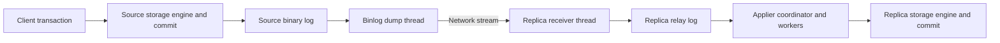
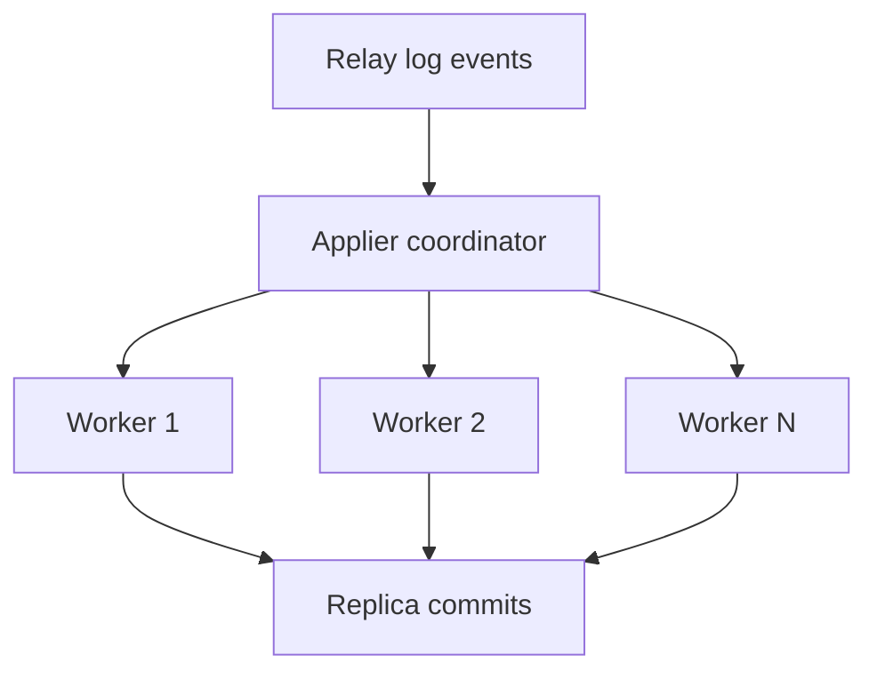

# Binlog dump, receiver, relay log, and applier flow

## Objectives

MySQL replication transfers changes written to the binary log of a source server to one or more replica servers. This pipeline consists of several sequential stages: the source reads the binlog and sends events, the receiver receives data over the network connection, the relay log stores the events on the replica, and the applier reads the relay log and executes transactions. Understanding each stage helps you determine whether data is delayed at the network, relay log write, or execution phase.

This lesson belongs to the **DATABASE_MYSQL** module, where you work with table design, data types, keys, SQL, indexes, transactions, concurrency control, execution plans, query tuning, and relational database operations. In replication, the binlog stream is the change transport mechanism; GTID identifies transactions and enables a replica to request the exact missing portion of history.

After this lesson, you will be able to:

- Describe the roles of the binlog dump thread, receiver thread, relay log, and applier.
- Distinguish the position read from the source from the position applied on the replica.
- Explain how GTID flows through the replication pipeline and how auto-position selects transactions to fetch.
- Observe replication status using `SHOW REPLICA STATUS` and Performance Schema.
- Isolate connection errors, relay log write errors, transaction apply errors, and replication lag.

## 1. Overview of the replication flow

In a standard setup, the application writes transactions to the source. When a transaction commits, eligible changes are recorded in the binary log. The replica connects to the source, receives binlog events, stores them in its own relay log, and then the applier executes those transactions against the replica's data.



Each component has its own responsibility:

| Component | Where it runs | Responsibility |
|---|---|---|
| Binary log | Source | Stores data-change events and certain transaction-related changes |
| Binlog dump thread | Source | Reads the binlog from the position requested by the replica and sends events over the replication connection |
| Receiver thread | Replica | Connects to the source, receives events, and writes them to the relay log |
| Relay log | Replica | Durable queue holding received events awaiting processing by the applier |
| Applier | Replica | Reads the relay log, executes transactions, and updates the applied state |

The receiver and applier threads can progress independently. The receiver often reads ahead by some amount of data while the applier processes incrementally. Therefore, a replica may have received a transaction without having applied it yet. This is why you must distinguish between *retrieved* and *executed* state when tracking GTIDs.

## 2. Source binary log and binlog dump thread

The binary log (binlog) is the event log MySQL uses for replication and point-in-time recovery. The binlog can be written in `ROW`, `STATEMENT`, or `MIXED` format; with `ROW`, events describe row-level data changes, whereas `STATEMENT` logs SQL statements. The format and event contents affect how the replica reproduces changes.

To emit replication events, the source must have binary logging enabled and have a unique `server_id` in the topology. Common configuration example:

```ini
[mysqld]
server_id = 101
log_bin = mysql-bin
binlog_format = ROW
```

This is an illustrative configuration; file names, paths, and format choices must match your version, storage capacity, and operational policy. In modern MySQL, `ROW` is generally the standard choice for replication because events describe specific row changes.

When a replica connects, the source creates a binlog dump thread for that connection. This thread reads events from the binlog starting at the requested file/position or from the set of GTIDs the replica lacks, then sends events over the replication protocol. A source can serve multiple replicas using multiple connections and corresponding threads.

Observation commands on the source:

```sql
SHOW BINARY LOGS;
SHOW MASTER STATUS;

SHOW PROCESSLIST;
```

`SHOW MASTER STATUS` is the familiar syntax in MySQL 8.0; in newer versions, the command name may have been replaced by `SHOW BINARY LOG STATUS`. `SHOW PROCESSLIST` helps identify replication connections/threads, though the displayed state names may vary by version.

The source must retain the binlogs required by the replica. If the source purges files before the replica receives all needed transactions, the replica may be unable to continue by file/position. With GTID, the source must also retain transactions the replica does not yet have; auto-position cannot fetch a transaction that has already been purged from all available binlogs.

## 3. Receiver thread on the replica

The receiver thread (often called the I/O thread in older versions) opens a connection to the source using a replication account granted the appropriate privileges. It sends the known position or GTID information, reads the event stream from the source, and writes the events into the replica's relay log.

A replication account on the source can be created as follows:

```sql
CREATE USER 'repl'@'10.20.30.22'
  IDENTIFIED BY '<replication-secret>'
  REQUIRE SSL;

GRANT REPLICATION SLAVE
  ON *.*
  TO 'repl'@'10.20.30.22';
```

`REPLICATION SLAVE` is the privilege name used in many MySQL versions for fetching binlogs; some command names and administrative terms have been renamed to `REPLICA` in newer releases. Verify the syntax and privileges for your exact server version. The replication account should only be allowed to connect from replica hosts, use TLS when appropriate, and have a dedicated secret.

On the replica, configure the connection to the source. Example of the newer syntax in MySQL 8.0.23 and later:

```sql
CHANGE REPLICATION SOURCE TO
  SOURCE_HOST = 'mysql-source.example.net',
  SOURCE_PORT = 3306,
  SOURCE_USER = 'repl',
  SOURCE_PASSWORD = '<replication-secret>',
  SOURCE_AUTO_POSITION = 1;

START REPLICA;
```

This example assumes GTID auto-position is configured on both servers and the replica was initialized from a compatible data copy. Never put real passwords in scripts, command history, or logs; use a controlled secret deployment mechanism. For MySQL prior to 8.0.23, the older `CHANGE MASTER TO` syntax and `MASTER_*` options may still be required.

The receiver writes received events to the relay log and updates metadata about the source, file/position, or received GTID set. If the connection drops, the receiver can reconnect and resume from the saved state, provided the source still retains the required binlogs.

The receiver can be slowed down by DNS, firewall, TLS, network, connection limits, source load, or relay log disk write speed. When the receiver is not running, the applier can still process previously received relay logs, but the queue will not be replenished with new events.

## 4. Relay log: durable queue on the replica

The relay log is a set of log files managed by the replica. It contains events the receiver has fetched from the source that the applier will read and execute. You can think of the relay log as a durable buffer between receiving data over the network and applying transactions.

The relay log has a file rotation mechanism similar to the binlog. The replica stores metadata about the current relay log file, the received position, and the position processed by the applier. File names typically follow the `relay_log` setting; never manually delete or modify relay log files while replication is running.

Variables to check include:

```sql
SELECT VARIABLE_NAME, VARIABLE_VALUE
FROM performance_schema.global_variables
WHERE VARIABLE_NAME IN (
  'relay_log', 'relay_log_index', 'relay_log_recovery',
  'relay_log_purge', 'sync_relay_log',
  'sync_relay_log_info', 'relay_log_space_limit'
);
```

Variable names and support may vary by version. Replication metadata is stored in repositories; modern MySQL versions default to system tables for critical metadata. `relay_log_recovery=ON` helps the replica recover relay logs after a crash based on replication metadata, but it must be configured and tested according to the version, repository, and deployment model.

If the receiver is faster than the applier, the relay log will grow in size. Monitor disk space and relay log growth rate to avoid filling the filesystem. Once the applier finishes processing them, old relay logs can be purged by MySQL's management mechanism. Do not manually delete files to free space, as that can corrupt replication state.

## 5. Applier: executing transactions on the replica

The applier reads events from the relay log and executes transactions against the replica's storage engine. In a single-threaded setup, one SQL/applier thread processes sequentially. With parallel replication, a coordinator distributes transactions across multiple workers according to dependency relationships and required commit ordering.



Running multiple workers does not mean every transaction is applied arbitrarily. MySQL uses dependency information and commit mechanisms to preserve required ordering constraints. Effective parallelism depends on the workload: transactions touching multiple tables or the same rows may be hard to parallelize; independent transactions can be applied concurrently.

A replica is considered caught up only when the applier has applied up to the required position or GTID. A healthy receiver does not guarantee a healthy applier. For example, a transaction with a duplicate key error or missing table can stop the applier while the receiver keeps receiving data.

Common variables to tune the parallel applier include `replica_parallel_workers` and `replica_parallel_type` depending on the version. Some versions use the legacy name `slave_parallel_workers`. Increasing workers is not a fix for every type of lag: you must determine whether transactions are waiting on locks, data contention, slow I/O, saturated CPU, or sequential dependencies.

On a replica used for reads, you can enable `read_only` and `super_read_only` to restrict direct writes from clients. Internal replication threads can still apply transactions. This is an additional safeguard, not a substitute for account privilege separation and monitoring out-of-band changes outside the replication stream.

## 6. How does GTID flow through the stages?

A Global Transaction Identifier (GTID) is a unique identifier for a committed transaction within a GTID topology. A GTID typically has the form `source_uuid:transaction_number`, for example `3E11FA47-71CA-11E1-9E33-C80AA9429562:42`. GTID lets MySQL track which transactions have executed without relying solely on binlog file names and byte positions.

When a transaction is written to the binlog on the source, a GTID event attaches the identifier to the transaction. The binlog dump thread sends that event to the replica; the receiver writes the event to the relay log. When the applier executes the transaction successfully, the corresponding GTID is recorded in the replica's executed state.

With GTID auto-position, the replica informs the source of the GTID set it has executed. The source compares this set against the GTIDs present in its binlogs and sends the missing transactions that the source still retains. As a result, when a replica reconnects or switches sources in a compatible topology, MySQL can locate the transactions it needs to receive without the operator manually calculating file/position.

GTID variables and statuses to understand:

| Name | Meaning |
|---|---|
| `gtid_executed` | Set of GTIDs executed on the instance |
| `gtid_purged` | Set of GTIDs purged from the instance's binary logs |
| `Retrieved_Gtid_Set` | GTIDs the replica has received from the source, which may still be awaiting the applier |
| `Executed_Gtid_Set` | GTIDs the replica has executed |

For example, if `Retrieved_Gtid_Set` is ahead of `Executed_Gtid_Set`, the receiver has fetched data ahead of the applier. The gap can represent backlog sitting in the relay log. If both sets are stationary, check the receiver, source binlogs, and applier to find the stalled stage.

To use GTID auto-position, the topology must be configured consistently. Foundational settings typically include:

```ini
[mysqld]
server_id = 102
log_bin = mysql-bin
gtid_mode = ON
enforce_gtid_consistency = ON
log_replica_updates = ON
```

`server_id` must be unique in the topology. `log_replica_updates=ON` is generally required when a replica also emits binlogs to downstream replicas or when received transactions must be kept in the local binlog. On older versions, the variable name may be `log_slave_updates`.

GTID mode must be rolled out using a transition procedure suited to the current state of the system. Enabling `gtid_mode=ON` does not automatically synchronize initial data between the source and replica. When initializing a replica from a backup, ensure the GTID state in the backup is compatible and does not omit required transactions.

## 7. Initializing and operating the GTID replication pipeline

A general deployment workflow can include:

1. Configure unique `server_id` values, enable binlog, and prepare `gtid_mode` and `enforce_gtid_consistency` on the servers according to your version's procedure.
2. Create a replication account on the source, restrict the host, and grant the binlog-reading privilege.
3. Create a consistent initial data copy from the source using an appropriate backup tool.
4. Restore the copy onto the replica and verify that data and GTID state are preserved correctly.
5. Configure `CHANGE REPLICATION SOURCE TO ... SOURCE_AUTO_POSITION=1` on the replica.
6. Run `START REPLICA` and check the receiver, applier, and retrieved/executed GTIDs.
7. Write a controlled test transaction on the source and verify that it appears on the replica.

Do not skip the initial data seeding step. GTID identifies which transactions need to be received next; it does not recreate data rows that already existed before replication started. If a backup was taken at time T, the replica must start from a data and GTID state matching T.

When switching sources or rebuilding a replica, check executed GTIDs, purged GTIDs on the source, potentially missing transactions, and split-brain risks. Never arbitrarily run `RESET MASTER`, `RESET BINARY LOGS AND GTIDS`, or modify `gtid_purged` on an instance holding live data; these operations can alter GTID history and affect the ability to resume replication.

## 8. Observing status at each stage

On the replica, start with:

```sql
SHOW REPLICA STATUS\G
```

In older versions, the command may be `SHOW SLAVE STATUS`. Useful fields include:

| Field | How to read it |
|---|---|
| `Replica_IO_Running` | Whether the receiver thread is currently running |
| `Replica_SQL_Running` | Whether the applier is currently running |
| `Source_Host` | Source server the replica is connected to |
| `Source_Log_File` | Source binlog the receiver is currently reading |
| `Read_Source_Log_Pos` | Position the receiver has read from the source binlog |
| `Relay_Log_File`, `Relay_Log_Pos` | Relay log file/position associated with the applier |
| `Relay_Source_Log_File`, `Exec_Source_Log_Pos` | Source file/position corresponding to apply progress |
| `Retrieved_Gtid_Set` | Received GTIDs |
| `Executed_Gtid_Set` | Executed GTIDs |
| `Last_IO_Error`, `Last_SQL_Error` | Most recent error in the receiver or applier |
| `Seconds_Behind_Source` | Estimated lag based on replication status; not a complete measure of every form of lag |

`SHOW REPLICA STATUS` is a snapshot of state at the moment of the query. On a multi-channel replica, inspect the right channel. Column names may vary across MySQL versions.

Performance Schema provides more detailed information about connections and appliers:

```sql
SELECT CHANNEL_NAME, SERVICE_STATE, RECEIVED_TRANSACTION_SET,
       LAST_ERROR_NUMBER, LAST_ERROR_MESSAGE
FROM performance_schema.replication_connection_status;

SELECT CHANNEL_NAME, WORKER_ID, SERVICE_STATE,
       LAST_ERROR_NUMBER, LAST_ERROR_MESSAGE
FROM performance_schema.replication_applier_status_by_worker;
```

Available Performance Schema tables and columns depend on the version. If a query reports a missing table or column, check the schema of your running version and use `SHOW REPLICA STATUS` as your starting point.

## 9. Diagnosing lag and errors by stage

**Receiver not running:** check `Last_IO_Error`, hostname/IP, port, firewall, DNS, TLS, replication account, `REPLICATION SLAVE` privilege, `server_id`, and whether the source still retains the required binlogs. Also check connection status on the source.

**Receiver running but applier stopped:** inspect `Last_SQL_Error`, error logs, worker status, and the transaction being applied. Duplicate key errors, missing tables, schema differences, or invalid operations can stop the applier. Fix the data or schema root cause following your runbook; do not skip events arbitrarily as that can create data divergence.

**Relay log growing continuously:** compare receive rate and apply rate. If the receiver is fast but the applier is slow, check CPU, I/O, lock waits, large transactions, lock contention, and worker count. If the relay log grows because the applier stopped, resolve the applier error first.

**`Seconds_Behind_Source` is 0 yet problems persist:** this value can be `NULL` when the replica cannot determine lag, and it may not accurately reflect end-to-end lag in all situations. Combine commit timestamps, retrieved/executed GTIDs, worker status, application-level latency, and replication heartbeats.

**Retrieved and executed GTIDs are not advancing:** identify the stalled stage using receiver/applier status. If the replica lacks transactions already purged from the source, you may need to reinitialize from an appropriate backup or pull transactions from another source that still retains the binlogs; auto-position alone cannot recover transactions if no copy remains anywhere.

Do not arbitrarily run `SQL_SLAVE_SKIP_COUNTER` or skip GTID transactions just to keep replication moving without evaluating the data impact. With GTID, skipping a transaction requires a dedicated procedure with documentation and post-operation consistency verification.

## 10. Hands-on exercise

On two test MySQL servers, build a GTID-based source/replica topology:

- Configure distinct `server_id` values, enable binlog, `gtid_mode=ON`, and `enforce_gtid_consistency=ON` following your version's procedure.
- Create a host-restricted replication account and use TLS if the environment supports it.
- Seed the replica with a consistent backup, then configure `SOURCE_AUTO_POSITION=1` and start the replica.
- Write a test transaction on the source, and check `Retrieved_Gtid_Set` and `Executed_Gtid_Set` on the replica.
- Pause the applier in the test environment, write additional transactions on the source, and observe the receiver continuing to write to the relay log.
- Restart the applier, verify that GTIDs are executed and the replica's data catches up.
- Induce a controlled connection failure to observe receiver reconnection; restore the connection and verify that the stream resumes.

**Completion criteria:** you can point out the binlog dump thread, receiver, relay log, and applier; explain the difference between retrieved and executed GTIDs; read replication status; and identify the stage causing lag or errors.

## Conclusion

The MySQL replication pipeline consists of the source binlog and dump thread, the receiver on the replica, the relay log as a queue, and the applier executing transactions. GTIDs identify transactions across all stages and allow auto-position to request missing history. In operations, monitor receive and apply states separately, ensure the source retains the necessary binlogs, and resolve errors at the exact stage where they occur before returning a replica to service.
