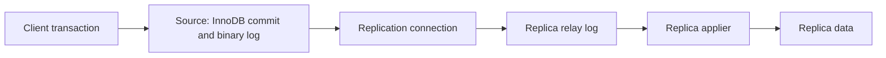

# Asynchronous/semi-synchronous replication and commit confirmation conditions

In the `DATABASE_MYSQL` module, learners master MySQL from table design, data types, locks, and SQL queries to indexes, transactions, concurrency control, reading execution plans, query tuning, privilege management, backups, and handling relational database operations issues. This lesson explains how MySQL transfers transactions from source to replica, the difference between asynchronous and semi-synchronous replication, and the exact meaning of a `COMMIT` confirmation.

A crucial point when operating replication is distinguishing three events: a transaction has committed on the source, a transaction has been received by the replica and written to its relay log, and a transaction has been executed by the replica applier. These three events can occur at different times. Understanding that boundary helps design RPO, choose a replica for failover, and accurately interpret the safety guarantee provided by a `COMMIT` response.

## 1. Replication flow in MySQL

In the source/replica model, the source receives write statements from clients and records changes in the binary log. The replica maintains a connection to the source, receives binary log events, writes them to its local relay log, and applies the events to update its data.

The basic flow includes the following components:

1. **Transaction on the source:** the application performs data modifications and sends `COMMIT`.
2. **Binary log:** MySQL records the events to be sent to the replica in the configured binlog format.
3. **Replication connection/receiver:** the receiver thread on the replica reads the binary log from the source and transfers events into the relay log.
4. **Relay log:** temporarily stores events waiting to be applied on the replica.
5. **Applier:** the SQL thread or parallel workers read the relay log and execute changes against the replica's storage engine.



The source and replica each have a unique `server_id` in the topology. When GTID is used, each transaction is identified by a global transaction identifier, making it easier to track received and executed transaction sets and simplifying transaction positioning when changing sources. GTID helps manage replication progress, but by itself it does not make replication synchronous.

## 2. Asynchronous replication: the source does not wait for the replica

With asynchronous replication, the source processes a transaction and returns the commit result to the client using local commit semantics. Sending events to the replica happens independently afterward. The source does not wait for the replica to acknowledge receipt or application of the transaction before replying to the client.

For example, an application updates an order status to `PAID` and receives a successful `COMMIT` response. At that exact moment, the replica might not have received the transaction yet, or may have written the transaction to its relay log without applying it to the table yet. An immediate read query on the replica may still see the old state.

Typical sequence:

```text
Client             Source                 Replica
  |                   |                       |
  |--- UPDATE ------->|                       |
  |--- COMMIT ------->|                       |
  |<-- OK ------------|                       |
  |                   |--- binlog events ---->|
  |                   |                       |-- relay log
  |                   |                       |-- apply transaction
```

The advantage of asynchronous replication is low commit latency and the fact that the source is not blocked when a replica is slow or disconnected. This is a suitable choice when the system tolerates replica lag and has mechanisms to handle data loss during failover.

The main risk arises when the source crashes after replying to the client but before the transaction is transmitted to the replica. If you promote a replica that has not received that transaction, data already confirmed to the client may not exist on the new server. The amount of data that could be lost depends on log transmission delay, log gaps, and how the replica is selected during failover.

## 3. Semi-synchronous replication: waiting for the replica to acknowledge receipt

Semi-synchronous replication adds a step of waiting for acknowledgment from a replica. When the source processes a transaction, it sends binlog events to replicas and waits for the configured number of ACKs before completing the commit response to the client. In MySQL, an ACK is sent once the replica has received the transaction's events and written them to its relay log according to the semi-sync plugin mechanism.

This ACK confirms that the transaction was received by the replica and written to its relay log. It **does not mean** the replica applier has executed the transaction or that the data is already visible in the replica's tables. Thus, semi-sync reduces the risk of losing committed transactions in certain source failure scenarios, but it does not turn every read query on a replica into a read of the latest data.

General sequence:

```text
Client             Source                 Replica
  |                   |                       |
  |--- UPDATE ------->|                       |
  |--- COMMIT ------->|                       |
  |                   |--- binlog events ---->|
  |                   |                       |-- write relay log
  |                   |<------ ACK ------------|
  |<-- OK ------------|                       |
  |                   |                       |-- apply transaction
```

Key points to remember:

- The source waits for ACKs from the configured minimum number of replicas, typically one replica.
- The replica sends an ACK after receiving and writing the transaction to the relay log; the applier may still be processing earlier transactions.
- If enough ACKs are not received within the timeout, the source can fall back to asynchronous mode to continue serving writes.
- When an eligible replica reconnects, semi-sync can be re-enabled; monitor the actual runtime status rather than looking only at the `enabled` setting.

Semi-sync can increase commit latency due to network latency and relay log write time. Configuring it to wait for ACKs from two replicas can make commits slower than requiring only one ACK. Configuring the ACK count requires balancing fault tolerance, replica geographic location, and the latency the application can tolerate.

## 4. Commit confirmation conditions and wait point

In MySQL semi-sync, the `rpl_semi_sync_source_wait_point` variable determines at which stage of the commit process the source waits for an ACK. The two key values are `AFTER_SYNC` and `AFTER_COMMIT`.

### AFTER_SYNC

With `AFTER_SYNC`, the source writes the transaction to the binary log and syncs the binary log per configuration, then waits for an ACK from the replica. Only after receiving enough ACKs does the source commit the transaction to the storage engine and return the result to the client.

Sequence:

1. The transaction is prepared and written to the binary log on the source.
2. The binary log is synced according to the source's durability settings.
3. The source sends events to replicas and waits for sufficient ACKs.
4. The source commits the transaction to the storage engine.
5. The source returns success to the client.

With this wait point, the transaction is not committed in the storage engine—and thus not visible to other transactions on the source—before the ACK arrives. This is usually the preferred choice when prioritizing failover consistency over letting other sessions observe the transaction while the source is waiting for the ACK.

### AFTER_COMMIT

With `AFTER_COMMIT`, the source commits the transaction to the storage engine after writing and syncing the binary log, and then waits for an ACK from the replica before returning the result to the client.

This means the transaction is already committed on the source and can be seen by other sessions while the originating session is still waiting for the ACK. If the source crashes during that window, another application session may have observed the data on the source even though the transaction was never acknowledged by a replica. When selecting a replica for failover, be especially cautious of this scenario.

### Comparing the two wait points

| Criterion | `AFTER_SYNC` | `AFTER_COMMIT` |
|---|---|---|
| When the ACK is awaited | After writing and syncing the binlog, before committing to the storage engine | After committing to the storage engine, before returning the result to the client |
| Visibility to other sessions on the source | After the ACK arrives and commit completes | Can be visible before the ACK arrives |
| Relationship between commit response and ACK | Client receives response only after ACK and storage engine commit | Client receives response after ACK, even though the transaction committed earlier |
| Characteristics | Limits the window where a transaction is visible on the source without replica confirmation | Allows the transaction to be seen on the source while waiting for the replica |

Do not change the wait point arbitrarily in production. Define consistency requirements, check the documentation for your exact MySQL version, and rehearse failover with the planned configuration before applying it.

## 5. Configuring semi-sync in MySQL 8.0.26 and later

Semi-sync replication uses plugins on both the source and the replica. The examples below use plugin and variable names following the source/replica terminology in modern MySQL versions. In older MySQL releases, plugin and variable names may still use `master`/`slave` terminology; check your version's documentation before running them.

### Baseline prerequisites

A GTID-enabled replication setup typically needs the following baseline settings. `server_id` must be different on each server:

```ini
# Source
[mysqld]
server_id=101
log_bin=mysql-bin
gtid_mode=ON
enforce_gtid_consistency=ON
binlog_format=ROW
sync_binlog=1
innodb_flush_log_at_trx_commit=1
```

```ini
# Replica
[mysqld]
server_id=102
log_bin=mysql-bin
relay_log=relay-bin
gtid_mode=ON
enforce_gtid_consistency=ON
binlog_format=ROW
log_replica_updates=ON
read_only=ON
super_read_only=ON
```

`sync_binlog=1` requires syncing the binary log on every commit; `innodb_flush_log_at_trx_commit=1` requires InnoDB to flush the redo log on every commit. These are critical settings for the source's local durability. They carry I/O cost and still depend on whether the OS, controller, and storage hardware honor flush requests properly.

### Installing plugins and enabling semi-sync

On the source:

```sql
INSTALL PLUGIN rpl_semi_sync_source SONAME 'semisync_source.so';

SET PERSIST rpl_semi_sync_source_enabled = ON;
SET PERSIST rpl_semi_sync_source_wait_for_replica_count = 1;
SET PERSIST rpl_semi_sync_source_timeout = 10000;
SET PERSIST rpl_semi_sync_source_wait_point = 'AFTER_SYNC';
```

On the replica:

```sql
INSTALL PLUGIN rpl_semi_sync_replica SONAME 'semisync_replica.so';
SET PERSIST rpl_semi_sync_replica_enabled = ON;
```

`rpl_semi_sync_source_wait_for_replica_count` is the minimum number of ACKs the source must receive for a transaction. For instance, setting `2` means the source waits for two replicas to acknowledge. `rpl_semi_sync_source_timeout` is in milliseconds; for example, `10000` equals 10 seconds. When the timeout expires without enough ACKs, the source can fall back to asynchronous mode.

`SET PERSIST` saves configuration so it persists across restarts on MySQL versions that support this statement. The plugin must install cleanly and match the MySQL build. If the plugin is already installed, do not re-run `INSTALL PLUGIN`; check its status in `INFORMATION_SCHEMA.PLUGINS` or `SHOW PLUGINS`.

Set up the replication connection and GTID auto-position for your topology, then start the replica. Example syntax on versions using `CHANGE REPLICATION SOURCE TO`:

```sql
CHANGE REPLICATION SOURCE TO
    SOURCE_HOST = 'mysql-source.example.net',
    SOURCE_USER = 'replication_user',
    SOURCE_PASSWORD = 'FETCH_FROM_SECRET_STORE',
    SOURCE_AUTO_POSITION = 1;

START REPLICA;
```

The password value here is only a placeholder. Manage credentials through a secret manager and restrict the replication account's privileges. On older MySQL versions, the syntax may be `CHANGE MASTER TO` and `START SLAVE`.

## 6. Checking status and confirmation progress

You cannot conclude that semi-sync is protecting transactions solely because `rpl_semi_sync_source_enabled` is `ON`. You must check plugin status, replica connections, and runtime counters.

On the source:

```sql
SHOW VARIABLES LIKE 'rpl_semi_sync%';
SHOW STATUS LIKE 'Rpl_semi_sync%';
SHOW PLUGINS;
```

Status variables prefixed with `Rpl_semi_sync` report operational status and ACK waiting statistics. Specifically, check the source's actual semi-sync state, number of connected semi-sync replicas, count of acknowledged transactions, and count of transactions that had to proceed in async mode. Exact status variable names may differ across versions; rely on the `SHOW STATUS` output of your running server.

On the replica:

```sql
SHOW REPLICA STATUS\G
```

Fields commonly inspected include:

- `Replica_IO_Running` and `Replica_SQL_Running`: whether the receiver thread and applier thread are currently running.
- `Retrieved_Gtid_Set`: the set of GTIDs the replica has received from the source.
- `Executed_Gtid_Set`: the set of GTIDs executed on the replica.
- `Last_IO_Error` and `Last_SQL_Error`: errors in the receiver or applier threads.
- `Seconds_Behind_Source`: an estimated lag metric; do not rely on it alone to prove a replica is caught up or that semi-sync is active.

`Retrieved_Gtid_Set` and `Executed_Gtid_Set` help distinguish transactions received into the relay stream from transactions executed by the applier. A GTID may have been received without yet appearing in the executed GTID set. This is why a semi-sync ACK does not equate to the transaction being readable from the replica.

### Waiting for a replica to execute a specific GTID

When you need to verify that a transaction has been applied on a replica, you can use `WAIT_FOR_EXECUTED_GTID_SET()`:

```sql
SELECT WAIT_FOR_EXECUTED_GTID_SET('source_uuid:1-12345', 10);
```

Replace `source_uuid:1-12345` with the actual GTID to wait for. The function returns `0` when the GTID set has been executed within the timeout; `1` if the timeout expires; `NULL` if an error occurs. This function is useful for read-after-write checks on a replica or as a validation step before promoting a replica.

A GTID set can be obtained from replication status, the binary log, or the system's transaction observability tooling. In a concurrent environment, do not take the entire `@@GLOBAL.gtid_executed` and assume every new GTID belongs to a single test transaction; identify the exact target GTID.

## 7. What happens when a replica is slow or disconnected?

Semi-sync has a timeout to prevent the source from waiting indefinitely when replicas do not respond. When sufficient ACKs are not received within the configured timeout, the source switches to asynchronous mode and continues processing transactions asynchronously. This preserves system write availability but reduces data protection while semi-sync is inactive.

Common scenarios:

| Scenario | Possible behavior | What to check |
|---|---|---|
| Replica is healthy and responds quickly | Source receives sufficient ACKs before timeout and returns commit to client after the wait point. | Semi-sync status is active; ACK count matches configuration. |
| Replica receives logs but applier is slow | Source can still receive ACKs because transactions are written to the relay log; data on the replica may not yet be applied. | Compare `Retrieved_Gtid_Set` with `Executed_Gtid_Set`, monitor relay logs and applier lag. |
| Replica loses connection | Source waits until timeout; afterward it may continue in asynchronous mode. | Semi-sync status, async transaction counters, connection errors, and outage duration. |
| Configured for two ACKs but only one replica is available | Source lacks sufficient ACKs before timeout and may fall back to async. | Number of connected replicas, wait count setting, timeout, and replica placement. |
| Replica sends ACK then crashes | Transaction may remain in the relay log of another replica that acknowledged; you must verify which replica holds the transaction and whether it is recoverable. | Relay log continuity, storage state, GTIDs, and apply order before promotion. |

When semi-sync falls back to async, never report that all transactions still carry semi-sync guarantees. Alert operations, investigate the cause, and verify that semi-sync has resumed active operation. If the application requires writes to halt when ACKs are unavailable, design a write-stop or fail-closed policy at the operational/application layer; semi-sync's default timeout does not provide that behavior on its own.

## 8. Selecting a replica for failover and the role of GTID

When the source fails, do not promote a replica simply because it reports `Replica_IO_Running=Yes` or `Seconds_Behind_Source=0`. Compare transaction progress and identify the last transaction confirmed to the application.

GTID helps compare transaction sets. For instance, `GTID_SUBTRACT()` can identify GTIDs present on the source that are not yet in the replica's executed set:

```sql
SELECT GTID_SUBTRACT(
    'SOURCE_EXECUTED_GTID_SET',
    'REPLICA_EXECUTED_GTID_SET'
) AS transactions_missing_on_replica;
```

This is a conceptual example; replace the two strings with actual GTID sets. A non-empty result indicates the replica is missing some transactions from the comparison set. During an incident, the source may be unreachable, so use saved GTID records, relay logs, and evidence from the replicas to select a candidate.

Before promoting:

1. Identify the last transaction confirmed to the client on the source if possible.
2. Compare `Retrieved_Gtid_Set` and `Executed_Gtid_Set` across replicas; check for transactions received but not yet applied.
3. Let the selected replica finish applying all transactions to be retained. Promote only after verifying data and GTID state.
4. Prevent the old source from continuing to accept writes (fencing) to avoid split-brain.
5. Update topology, application routing, and new source configuration per the runbook; verify the remaining replicas follow the new source.

Semi-sync does not automatically choose the safest replica, does not fence the old source, and does not replace a failover management system. GTID auto-position helps replicas reconnect based on their existing transaction set, but it does not automatically resolve missing transactions, errant transactions, or data conflicts.

## 9. Data durability and the limits of semi-sync

To understand actual protection, look at the source, replicas, operating system, and storage hardware together.

- **Durability on the source:** `sync_binlog=1` and `innodb_flush_log_at_trx_commit=1` are typically used when prioritizing commit durability. Verify that the storage device honors flush guarantees.
- **ACK on the replica:** a semi-sync ACK confirms events were received and written to the relay log per plugin mechanics. Relay log recovery after a power loss also depends on log sync settings and storage reliability.
- **Number of acknowledging replicas:** waiting for multiple ACKs can reduce risk if one replica fails, but increases latency and can cause frequent timeouts on the source if replicas are distant.
- **Applier lag:** a transaction can be acknowledged yet not applied; reads on a replica may return stale data until the applier finishes.
- **Failover:** if the only replica that sent an ACK is lost simultaneously with the source, or the failover process picks a replica that has not received the transaction, confirmed data can still be lost.
- **Timeout fallback:** while semi-sync is inactive and the source continues in async mode, new transactions do not have the same confirmation guarantee from replicas.

Semi-sync is a log-receipt acknowledgment mechanism with one or more replicas. It is not a distributed consensus protocol, does not guarantee every replica has applied the transaction, and does not replace backups. Logic bugs, accidental `DELETE`s, or malicious queries can still be replicated to all replicas; independent backups and recovery drills remain essential.

## 10. Choosing a model based on application requirements

| Requirement | Asynchronous | Semi-synchronous |
|---|---|---|
| Commit latency | Usually lower because source does not wait for ACK | Increases with network latency and replica relay log write time |
| When replica disconnects | Source continues writes as long as source is healthy | After timeout, can fall back to async |
| Replica transaction confirmation | No confirmation before commit response | Receives ACK from minimum number of replicas, confirming relay log receipt/write |
| Guarantee replica has applied | No | No; must wait for GTID execution |
| Risk of losing transactions on source crash | Higher if replicas have not received logs | Lower for acknowledged transactions, provided the ACK replica remains available and failover is executed properly |
| Best suited for | Systems prioritizing throughput and tolerating replica lag | Systems needing lower risk of losing confirmed transactions and accepting added commit latency |

No single configuration fits every workload. Base your choice on RPO, RTO, geographic placement, network latency, replica count, storage fault tolerance, and freshness requirements for reads. For operations requiring read-after-write, read from the source or wait for the target GTID to execute on the replica before reading.

## 11. Hands-on exercise

Set up one source and two replicas in a test environment, enable GTID, and test both asynchronous and semi-synchronous replication.

1. Configure distinct `server_id`s, binary logging, `gtid_mode=ON`, and `enforce_gtid_consistency=ON` on the servers. Set up replication using GTID auto-position.
2. Run a transaction that writes a marker on the source and record the transaction's GTID. Observe when the source returns commit success, when the GTID appears in `Retrieved_Gtid_Set`, and when it appears in `Executed_Gtid_Set` on the replica.
3. Enable semi-sync requiring one ACK. Check plugin status and repeat the marker transaction. Explain why the ACK can arrive before the marker appears in the replica's table.
4. Set `rpl_semi_sync_source_wait_point` to `AFTER_SYNC` and `AFTER_COMMIT` in turn in the test environment. Observe when the transaction becomes readable by another session on the source and document the difference.
5. Disconnect one replica in the test environment, monitor the timeout and fallback state. Record how long the source continues running async and what alerts the monitoring system should raise.
6. Use `WAIT_FOR_EXECUTED_GTID_SET()` on the replica to wait for the marker transaction to be applied; compare with the semi-sync ACK evidence.
7. Write a report covering commit latency, ACK count, semi-sync status, retrieved/executed GTIDs, any errors encountered, and an assessment of RPO compliance.

Never simulate network disconnects, kill processes, or promote replicas on production systems. The exercise is complete only when the learner can explain what the source is confirming to the client, what the replica ACK confirms, why the relay log can contain unapplied transactions, and why GTID and a failover runbook remain necessary even when semi-sync is enabled.
