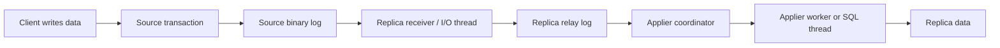

# Replication lag, relay logs, and measuring actual lag

A MySQL replica can be connected normally yet still lag behind the source by seconds, minutes, or longer. To pinpoint the cause, split lag into two stages: **receiving events from the source** and **applying events on the replica**. The relay log sits between these two stages. Measuring each part accurately reveals whether the replica is delayed due to network/receiver issues, the applier falling behind, or a measurement artifact during a period with no new transactions.

`Seconds_Behind_Source` is a convenient metric for a quick glance, but it does not fully describe the freshness of data read by the application. Combine it with replication status, relay log backlog, retrieved vs. unapplied GTIDs, transaction timestamps, and an application-written heartbeat on the source.

## 1. Receive and apply transaction flow

In standard asynchronous replication, the data flow can be described as follows:



The steps proceed as follows:

1. A transaction commits on the source and is written to the binary log.
2. The receiver thread on the replica connects to the source, reads the binary log, and writes received events into the local relay log.
3. The applier reads events from the relay log and executes the changes on the replica's tables.
4. Once a transaction is applied successfully, replication metadata is updated and processed relay logs can be purged by the server's management mechanism.

With a single applier thread, one SQL thread reads and applies the relay log. When the multi-threaded applier is enabled, a coordinator distributes transactions across multiple workers according to dependency relationships and commit-order rules. One large transaction or one blocked worker can slow down overall progress even while other workers remain idle or active.

| Component | Role | Signs of trouble |
|---|---|---|
| Source binary log | Stores committed transactions on the source | Logs are not retained long enough or required logs are missing for the replica to continue. |
| Receiver / I/O thread | Reads binlogs from the source and writes relay logs | Connection failure, slow network, wrong replication privileges, or receiver stopped. |
| Relay log | Event queue on the replica waiting for the applier | Size grows continuously; old transactions sit unapplied for a long time. |
| Applier coordinator | Schedules and monitors workers | Coordinator stopped or waiting on dependencies/workers. |
| Applier worker | Executes transactions on the replica | Lock contention, duplicate key errors, missing rows, slow DDL, or resource exhaustion. |

In MySQL 8.0.22 and later, the terms `SOURCE` and `REPLICA` progressively replace `MASTER` and `SLAVE` in many statements, variables, and status columns. This lesson uses the newer syntax such as `SHOW REPLICA STATUS` and `START REPLICA`; on older versions, the corresponding names may be `SHOW SLAVE STATUS` and `START SLAVE`.

## 2. What is the relay log and how do you read it?

The relay log is a set of files on the replica storing events received from the source's binary log that have not necessarily been applied yet. It uses an event format similar to the binary log, containing transactions, row events, statement events, and metadata needed by the applier. The relay log typically has an index file to track file ordering.

Several fields in `SHOW REPLICA STATUS` help locate the receiver and applier:

| Field | Meaning |
|---|---|
| `Relay_Log_File`, `Relay_Log_Pos` | Current file and position in the relay log being processed by the applier. |
| `Relay_Source_Log_File` | Source binary log file containing the event currently being processed or just processed by the applier. |
| `Exec_Source_Log_Pos` | Position in the source binary log corresponding to apply progress. |
| `Source_Log_File`, `Read_Source_Log_Pos` | File and position the receiver has read from the source. |
| `Relay_Log_Space` | Total size of relay logs currently on the replica, in bytes. |

Positions can be compared directly only within the same file. Do not compute `Read_Source_Log_Pos - Exec_Source_Log_Pos` if the two fields refer to different files. Once files have rotated, compare file names, GTID sets, and transaction status together; subtracting raw positions across different files yields meaningless results.

You can inspect events in a relay log with:

```sql
SHOW RELAYLOG EVENTS
IN 'replica-relay.000015'
FROM 4
LIMIT 30;
```

Get the actual file name from `Relay_Log_File` or the relay log index. This statement helps inspect event order, positions, and event types. When you need to inspect row changes, decode the corresponding binary log using `mysqlbinlog` with `--verbose --base64-output=DECODE-ROWS`; the `###` lines are for analysis only, not SQL statements to replay directly.

Never manually delete or edit relay logs. The server manages read positions, index files, and applier metadata; external file edits can corrupt replication state. If a relay log is corrupted after a crash, follow a verified recovery procedure. Depending on topology and configuration, `relay_log_recovery=ON` can instruct the replica to discard unapplied relay logs and re-fetch them from the source at startup; this is viable only if the source still retains the required binary logs and replication/GTID metadata remains trustworthy.

## 3. Quick replica status check

On MySQL 8.0.22 and later, run:

```sql
SHOW REPLICA STATUS\G
```

Fields to inspect together:

- `Replica_IO_Running`: whether the receiver thread is running.
- `Replica_SQL_Running`: whether the applier is running.
- `Seconds_Behind_Source`: estimated lag based on event timestamps.
- `Last_IO_Error`, `Last_SQL_Error`: most recent errors for receiver and applier.
- `Source_Log_File`, `Read_Source_Log_Pos`: fetch progress from the source.
- `Relay_Source_Log_File`, `Exec_Source_Log_Pos`: apply progress.
- `Relay_Log_Space`: relay log disk usage.
- `Retrieved_Gtid_Set`, `Executed_Gtid_Set`: received GTIDs and executed GTIDs on the replica.
- `Replica_SQL_Running_State`: current state of the applier, helpful for seeing whether it is waiting on events, dependencies, or locks.

Do not conclude a replica is healthy just because both `Replica_IO_Running` and `Replica_SQL_Running` are `Yes`. Both threads can be running while the applier lags behind, or the replica can have data/logic divergence that connection status does not show. Conversely, if either thread is `No`, read the error message before restarting the thread; blind restarts will not resolve root causes like duplicate keys, missing rows, or missing binary logs.

With multiple replication channels, inspect each channel individually:

```sql
SHOW REPLICA STATUS FOR CHANNEL 'orders_channel'\G
```

Performance Schema tables also include `CHANNEL_NAME`, so group and monitor by channel rather than collapsing all streams into a single aggregate number.

## 4. Distinguishing receive lag and apply lag

### Receive lag: replica has not fetched from source fast enough

Receive lag occurs when the receiver has not yet read the latest events from the source. Common causes include:

- High latency, packet loss, or insufficient bandwidth on the network between source and replica.
- Receiver thread stopped due to connection errors, privilege errors, or source configuration issues.
- Overloaded source struggling to serve binary logs, or replica resource limits slowing relay log writes.
- Source already purged the file the replica needs to read, preventing continuation from the current coordinates.

Typical signs: `Read_Source_Log_Pos`/`Source_Log_File` stops advancing while the source continues generating transactions; `Retrieved_Gtid_Set` does not grow; `Replica_IO_Running` is `No` or `Connecting`; `Last_IO_Error` is populated. If the receiver has already fetched all available events and the source is idle, there is no receive backlog even though the replica sees no new transactions arriving.

### Apply lag: relay logs received but not applied fast enough

Apply lag occurs when the receiver keeps fetching events, but the applier cannot process them quickly enough. Common signs:

- `Retrieved_Gtid_Set` grows faster than `Executed_Gtid_Set`.
- `Relay_Log_Space` grows steadily instead of returning to baseline.
- `Source_Log_File`/`Read_Source_Log_Pos` advances well ahead of `Relay_Source_Log_File`/`Exec_Source_Log_Pos`.
- `Replica_SQL_Running_State` shows workers running long transactions, waiting on locks, or waiting on dependent transactions.
- A worker or coordinator hits an SQL error, halting apply progress.

A large relay log at a single instant does not necessarily indicate an incident: the source may have just committed a large transaction or the replica may be clearing a brief burst. Watch the trend over time to see whether the backlog keeps growing or drains.

## 5. Reading metrics in Performance Schema

`performance_schema.replication_connection_status` provides receiver status, including the received GTID set and timestamps of the latest transaction queued into the relay log:

```sql
SELECT
    CHANNEL_NAME,
    SERVICE_STATE,
    RECEIVED_TRANSACTION_SET,
    LAST_QUEUED_TRANSACTION,
    LAST_QUEUED_TRANSACTION_ORIGINAL_COMMIT_TIMESTAMP,
    LAST_QUEUED_TRANSACTION_IMMEDIATE_COMMIT_TIMESTAMP,
    LAST_QUEUED_TRANSACTION_END_QUEUE_TIMESTAMP,
    LAST_ERROR_NUMBER,
    LAST_ERROR_MESSAGE
FROM performance_schema.replication_connection_status;
```

The `ORIGINAL_COMMIT_TIMESTAMP` and `IMMEDIATE_COMMIT_TIMESTAMP` columns help distinguish when a transaction committed on the originating source versus the immediate source sending to the replica. This is valuable in multi-tier topologies where a transaction passes through intermediate replicas before reaching the current replica.

To inspect which transactions workers are currently applying and the most recent completed transaction:

```sql
SELECT
    CHANNEL_NAME,
    WORKER_ID,
    SERVICE_STATE,
    LAST_APPLIED_TRANSACTION,
    LAST_APPLIED_TRANSACTION_ORIGINAL_COMMIT_TIMESTAMP,
    LAST_APPLIED_TRANSACTION_IMMEDIATE_COMMIT_TIMESTAMP,
    LAST_APPLIED_TRANSACTION_END_APPLY_TIMESTAMP,
    APPLYING_TRANSACTION,
    LAST_ERROR_NUMBER,
    LAST_ERROR_MESSAGE
FROM performance_schema.replication_applier_status_by_worker
ORDER BY CHANNEL_NAME, WORKER_ID;
```

The coordinator can be inspected separately:

```sql
SELECT
    CHANNEL_NAME,
    SERVICE_STATE,
    LAST_ERROR_NUMBER,
    LAST_ERROR_MESSAGE
FROM performance_schema.replication_applier_status_by_coordinator;
```

When reading timestamps, distinguish three intervals:

1. **Commit to queue**: from when the transaction committed on the source to when the receiver wrote it to the relay log. This relates to network/log transmission.
2. **Queue to apply**: from when the transaction entered the relay log to when a worker finished applying it. This relates to replica apply processing.
3. **Origin commit to now**: the age of the most recently applied transaction. This signals data freshness, though it must be cross-checked with a heartbeat or the latest transaction on the source to avoid misinterpretation when the source has no new writes.

For example, a recent `LAST_QUEUED_TRANSACTION_ORIGINAL_COMMIT_TIMESTAMP` alongside older `LAST_APPLIED_TRANSACTION_ORIGINAL_COMMIT_TIMESTAMP` values across workers shows that the receiver has fetched newer transactions while the applier lags behind. If both timestamps advance together and relay log size stays steady, the replica is likely keeping up. With a multi-threaded applier, inspect all workers; a single slow worker can create a lag gap even while other workers complete newer transactions.

Column names and granularity in Performance Schema depend on the MySQL version. If a column does not exist on your running version, inspect the table schema with `DESCRIBE performance_schema.replication_connection_status` or `DESCRIBE performance_schema.replication_applier_status_by_worker` and use the columns supported by your release.

## 6. Using GTID sets to inspect backlog

With GTID replication, `Retrieved_Gtid_Set` represents GTIDs received from the source; `Executed_Gtid_Set` represents GTIDs executed on the server. The difference between the two sets identifies transactions received but not yet executed:

```sql
SELECT GTID_SUBTRACT(
    (SELECT RECEIVED_TRANSACTION_SET
     FROM performance_schema.replication_connection_status
     WHERE CHANNEL_NAME = ''),
    @@GLOBAL.gtid_executed
) AS received_but_not_executed;
```

The result is a GTID set, which may contain multiple transaction ranges. It is **not a lag duration in seconds**, nor is it a simple transaction count to eyeball across ranges. Use it to confirm whether a GTID backlog exists and correlate it with worker status.

In multi-source environments, `@@GLOBAL.gtid_executed` is the GTID set executed across the entire server, not just one channel. Interpret the subtraction according to your topology rather than treating a single channel's output as the entire server's backlog. When GTID is not enabled, use coordinates, relay logs, and Performance Schema timestamps to assess progress.

A GTID set also does not reveal which transaction is currently stalled mid-flight or slowed by locks. It is evidence of received/executed transaction sets; combine it with worker status to locate the cause.

## 7. Why `Seconds_Behind_Source` is not enough

`Seconds_Behind_Source` is an easy-to-read metric in `SHOW REPLICA STATUS`, but you must understand its limits:

- It relies on event timestamps and the replica's local clock; clock skew between source and replica skews the measurement.
- A `NULL` value usually indicates lag cannot be determined, such as when the receiver or applier is not running. Read the thread states and accompanying errors.
- A value of `0` does not prove all workers have zero backlog in every situation; verify relay logs, GTIDs, and workers.
- A sudden spike can happen when a large transaction finishes committing or while the applier is processing a long-running transaction.
- In multi-tier replication, verify whether the timestamp reflects the originating source or the immediate upstream source.

Therefore, use this metric for quick detection, then confirm with heartbeats and receiver/applier states. Never use a single reading of `Seconds_Behind_Source = 0` as sole proof for failover or declaring replica data completely fresh.

## 8. Measuring true freshness with a heartbeat

A heartbeat is a small transaction written periodically on the source and replicated to the replica. On the replica, subtract the timestamp recorded in the heartbeat from the current time to estimate how old the data is compared to the source. This measures end-to-end freshness close to what reading applications actually experience.

Create the table on the source:

```sql
CREATE DATABASE IF NOT EXISTS replication_monitor;

CREATE TABLE replication_monitor.replication_heartbeat (
    id TINYINT UNSIGNED NOT NULL PRIMARY KEY,
    sequence_no BIGINT UNSIGNED NOT NULL,
    source_utc DATETIME(6) NOT NULL
) ENGINE = InnoDB;

INSERT INTO replication_monitor.replication_heartbeat
    (id, sequence_no, source_utc)
VALUES
    (1, 1, UTC_TIMESTAMP(6));
```

A reliable application job or scheduler updates this row regularly, for example every second:

```sql
INSERT INTO replication_monitor.replication_heartbeat
    (id, sequence_no, source_utc)
VALUES
    (1, 1, UTC_TIMESTAMP(6))
ON DUPLICATE KEY UPDATE
    sequence_no = sequence_no + 1,
    source_utc = UTC_TIMESTAMP(6);
```

The job writes only on the source. Never create an independent heartbeat write on the replica, as that would not measure replication. After the table and updates replicate, query on the replica:

```sql
SELECT
    sequence_no,
    source_utc,
    UTC_TIMESTAMP(6) AS replica_utc,
    TIMESTAMPDIFF(
        MICROSECOND,
        source_utc,
        UTC_TIMESTAMP(6)
    ) / 1000000.0 AS heartbeat_lag_seconds
FROM replication_monitor.replication_heartbeat
WHERE id = 1;
```

If `heartbeat_lag_seconds` is 2.4, the replica currently sees a heartbeat roughly 2.4 seconds older than the current time. This metric reflects the actual time the heartbeat took to become visible on the replica, covering both receive and apply. Source and replica clocks must be synchronized; if results are negative or jump unexpectedly, check NTP/chrony and time zones before blaming replication.

Heartbeats also have limits: if the heartbeat writer job stops, the timestamp grows stale even when replication is caught up; if the write interval is 5 seconds, measurement resolution is bounded by that interval. Monitor the health of the source writer job, `sequence_no`, last write time, and replica lag together. In multi-source/multi-channel systems, create a separate heartbeat per stream so you know which stream is stale.

## 9. Reading trends to diagnose root causes

Sample metrics periodically, such as every 5 or 10 seconds, and compare trends:

| Observation | Likely interpretation | Where to investigate |
|---|---|---|
| Receiver stopped, retrieved GTIDs stalled, `Last_IO_Error` populated | Unable to fetch new events from source | Check network, DNS, replication privileges, source availability, TLS, and binary log retention. |
| Receiver running, retrieved GTIDs growing, executed GTIDs growing slowly | Applier falling behind | Check relay log space, worker state, lock waits, large transactions, and I/O/CPU load. |
| Relay log growing continuously across multiple intervals | Receive rate exceeds apply rate over a sustained period | Identify blocking transactions/DDL, increase apply capacity, or throttle writes. |
| Relay log spikes then returns to baseline | A temporary burst of load has been processed | Check catch-up time and verify no errors remain. |
| A worker shows `APPLYING_TRANSACTION` for a long time | Transaction is running slowly or blocked | Check metadata locks, InnoDB lock waits, queries, and hot tables. |
| SQL/applier thread stopped with duplicate key or missing row | Source and replica data diverged or out-of-band writes occurred | Reconcile data, identify root cause; never skip transactions arbitrarily. |
| Stale heartbeat while relay log is empty | Heartbeat job stopped, clock skew, or heartbeat stream on wrong channel | Check source job, sequence number, clocks, and replication path of the heartbeat table. |

Common causes of apply lag include transactions updating huge numbers of rows, blocking DDL, lock contention on the replica, missing indexes forcing the applier to scan many rows, slow storage, CPU saturation, expensive triggers/foreign keys, or heavily dependent transactions preventing parallel workers from executing concurrently.

To diagnose locks and load, combine `SHOW PROCESSLIST`, `performance_schema.data_lock_waits`, `performance_schema.events_statements_current`, `SHOW ENGINE INNODB STATUS`, and CPU, disk latency, IOPS, and buffer pool metrics. Inspect worker status first to see which transaction is stuck, then correlate with lock waits and statements.

## 10. Reducing lag and designing monitoring

Simply increasing worker count does not guarantee faster replication. Address root causes first:

1. **Resolve receiver lag.** Ensure a stable network, adequate bandwidth, error-free receiver, retained source binary logs, and sufficient replica resources to write relay logs.
2. **Break up oversized transactions.** Split huge batch writes into smaller transactions with clear business boundaries; this gives the applier breathing room and makes tracking easier.
3. **Reduce contention.** Avoid many transactions updating the same hot row; resolve lock waits, metadata locks, and long-running DDL.
4. **Maintain appropriate indexes.** Replicas need indexes to locate rows quickly when applying row events; deploy schema and index changes uniformly and under control.
5. **Use parallel applier with measurement.** Tune `replica_parallel_workers` when workloads have independent transactions; monitor worker utilization and commit ordering. With `replica_preserve_commit_order` enabled, account for workers waiting on earlier transactions to preserve commit order.
6. **Ensure adequate resources.** Monitor CPU, disk latency, IOPS, memory, buffer pool, and relay log space; prevent backups or analytical queries from starving the applier of I/O.
7. **Retain source logs long enough.** Retention must cover potential replica outage duration plus incident handling and rebuild time.

A useful replication dashboard should track per channel:

- `Seconds_Behind_Source` alongside receiver/applier states and latest errors.
- Heartbeat lag and age of the most recent heartbeat.
- `Relay_Log_Space` and its growth/drain rate over time.
- `Retrieved_Gtid_Set`, `Executed_Gtid_Set`, or GTIDs received but unapplied.
- Commit timestamps of the latest queued and worker-applied transactions.
- Status of each worker, currently applying transactions, and coordinator errors.
- Source/replica system resources: CPU, I/O latency, disk space, and network throughput.

Set alert thresholds according to RPO requirements and acceptable application staleness. Alert when heartbeat lag exceeds thresholds across multiple consecutive intervals, relay logs grow without draining, threads stop, or replication errors occur. A brief spike may just be one large transaction; a sustained trend shows the replica cannot keep up with the load.

## 11. Checklist to confirm a replica has caught up

- [ ] Receiver and applier are running with no new `Last_IO_Error` or `Last_SQL_Error`.
- [ ] `Retrieved_Gtid_Set` and `Executed_Gtid_Set` reconciled; GTID backlog is down to expected levels.
- [ ] `Relay_Log_Space` is stable or back to baseline after draining bursts.
- [ ] No worker holds abnormally long-running or blocked transactions.
- [ ] Heartbeat updates steadily on the source and read lag on the replica is within threshold.
- [ ] Source and replica clocks are synchronized and timestamps are interpreted in the same time zone.
- [ ] Critical business data is reconciled if any divergence incident occurred.
- [ ] Every channel in a multi-source topology is checked individually.

Replication lag is the sum of multiple stages. Relay logs show events have reached the replica and await apply; GTID sets show which transactions were received and executed; Performance Schema shows what the receiver and each worker are doing; heartbeats show how much older the application-visible data is compared to the source. Combining these measurements distinguishes transport failures, apply bottlenecks, and monitoring faults, enabling operational decisions grounded in true data freshness.
