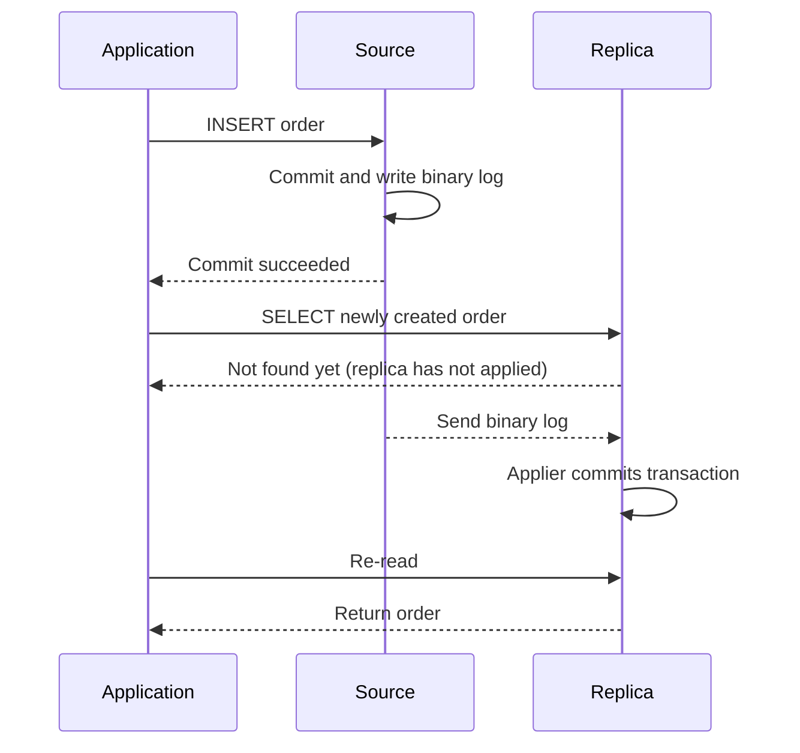

# Read-after-write when applications read from a replica

In asynchronous MySQL replication, a transaction may have already committed on the source without yet being applied by the replica. If an application writes an order to the source and immediately reads that order from a replica, the query may return stale data or fail to find the order. This phenomenon is called *read-after-write inconsistency*.

Read-after-write is a session-level consistency requirement: after a write operation has been confirmed successful, subsequent reads in the same business flow must observe at least that change. Applications can satisfy this requirement by continuing to read from the source, or by waiting for the replica to apply the required transaction before reading. Which approach to pick depends on latency, system load, and the level of consistency required by the business logic.

Within the `DATABASE_MYSQL` module, this lesson connects replication and GTID with how applications route queries, manage connection pools, and verify data. After this lesson, you will be able to:

- Explain why a replica can return stale data right after a source commit.
- Select an appropriate read-after-write strategy for each business flow.
- Use GTID as a watermark to wait for a replica to apply a transaction.
- Handle timeouts and fall back queries to the source safely.
- Recognize the limitations of `Seconds_Behind_Source`, semi-synchronous replication, and load balancers.
- Test read-after-write with business data and measure its latency impact.

## 1. Why can reading from a replica show stale data?

In a standard source-replica architecture, the application sends write statements to the source. The source executes the transaction and writes change events to the binary log. The replica receives events, writes them to the relay log, and the applier thread or workers apply the changes to the replica's data.

Both receiving and applying occur asynchronously. Therefore, there is a window during which the source already holds the new data while the replica still holds the previous state.



For example, a user places an order successfully and immediately opens the order details page. If the details query is routed to a lagging replica, the page may display "order not found" even though the write transaction succeeded. Another example is a user updating a shipping address, yet the subsequent read still returns the old address.

This is an inherent property of asynchronous replication, not necessarily a data-loss bug. Provided the replica keeps running without replication errors, data will typically converge once the applier finishes processing queued transactions.

## 2. Determining the consistency level needed per operation

Not every query needs to read the freshest data from the source. A statistics page or product catalog can tolerate data delayed by a few seconds. Flows right after a write that typically need read-after-write guarantees include:

- A user just placed an order and needs to view that order immediately.
- A user updates their profile and reopens the profile screen.
- The system just recorded a payment and needs to display the new transaction status.
- A user adds an item to their cart and needs to see the updated quantity.
- An administrative action just changed permissions or settings and needs to confirm the result.

Classify queries according to business requirements:

| Query type | Typically suitable strategy | Reason |
|---|---|---|
| Immediate read after write in the same flow | Read from source or wait on replica via GTID | Must observe the just-committed transaction |
| Reports, aggregate dashboards | Can read replica within acceptable lag | Minor data delay typically does not affect immediate decisions |
| Infrequently changing content pages | Read replica or cache | Immediate consistency is unnecessary |
| Reconciliation, balance checks, or payment status | Source or verified causal-consistency wait mechanism | Stale data can lead to incorrect business decisions |
| Post-write reads spanning multiple distinct requests | Use session token/GTID watermark or pin user affinity | Subsequent requests may be handled by a different worker or replica |

Consistency levels should be determined by business needs; do not route every read query to the source, as doing so increases load on the source and diminishes the benefits of read scaling.

## 3. Ways to guarantee read-after-write

### 3.1. Reading from the source after a write

This is the simplest approach. After a successful write, the application keeps sending queries that depend on that change to the source. Once the business flow finishes or the consistency window expires, the application can resume reading from replicas.

Example:

```text
POST /orders
  -> write orders and order_items on source
  -> COMMIT succeeds
  -> return order_id

GET /orders/{order_id}
  -> route to source within the just-created order flow
  -> return fresh data
```

This can be implemented by attaching a "read primary" flag to the session or request context. This flag must propagate across related service calls; if the next request runs on a different worker, the application must pass the consistency hint in a controlled manner.

The advantage is simplicity and avoiding replication wait times. The downside is additional read load on the source and needing a policy to decide when to return to replicas. This is often a strong choice for sensitive operations or when GTIDs cannot be retrieved from the driver.

### 3.2. Waiting for a replica to apply the transaction using GTID

If the topology has GTID enabled, the application can capture a GTID set after the transaction commits on the source and ask the replica to wait until that set has executed. MySQL provides the function:

```sql
WAIT_FOR_EXECUTED_GTID_SET(gtid_set, timeout)
```

This function waits on the current server until all GTIDs in `gtid_set` appear in the executed GTID set. Return values:

- `0`: the replica has executed all requested GTIDs.
- `1`: timeout expired before execution completed.
- `NULL`: an error occurred while waiting; inspect error details and connection status.

The `timeout` parameter is in seconds. Set a limit aligned with the request SLA; never wait indefinitely inside an HTTP flow or application transaction.

### 3.3. Prerequisites

Before using the GTID wait approach, verify:

- `gtid_mode=ON` and `enforce_gtid_consistency=ON` are configured per topology policy.
- Source and replica have compatible GTID configurations.
- The replica follows the right source and is configured with GTID auto-positioning when the architecture relies on it.
- The replica has no replication filter excluding schemas or tables needed for reading.
- The application can capture the post-commit watermark and send it to the exact replica that will serve the query.
- Drivers and connection pools do not drop or mix watermarks across requests.

Example replication configuration using modern MySQL terminology:

```sql
CHANGE REPLICATION SOURCE TO
    SOURCE_HOST = 'source-db.example',
    SOURCE_USER = 'repl_user',
    SOURCE_PASSWORD = 'secret-from-secret-manager',
    SOURCE_AUTO_POSITION = 1;

START REPLICA;
```

This is an illustrative configuration example; the replication account and credentials must be created, granted privileges, and stored securely. Never place real passwords directly in scripts or repositories. Syntax may differ on older MySQL releases.

## 4. Capturing the GTID watermark after commit

The application needs to know which transaction must be visible on the replica. There are multiple ways to obtain the GTID. The exact method depends on the MySQL version and the connector's session-state tracking support.

### 4.1. Using the global GTID set as a watermark

A straightforward method in a simple source-replica topology is reading `@@GLOBAL.gtid_executed` on the source after commit:

```sql
START TRANSACTION;

INSERT INTO shop.orders (customer_id, order_status, total_amount)
VALUES (42, 'CREATED', 125000.00);

SET @new_order_id = LAST_INSERT_ID();

INSERT INTO shop.order_items (order_id, product_id, quantity, unit_price)
VALUES (@new_order_id, 9001, 1, 125000.00);

COMMIT;

SELECT @new_order_id AS order_id,
       @@GLOBAL.gtid_executed AS required_gtid_set;
```

After `COMMIT`, querying `@@GLOBAL.gtid_executed` returns a GTID set executed on the source at the moment of the read. This set includes the transaction just committed. The application stores the GTID set string and passes it along with the request or session context to the replica read step.

This is a conservative watermark: it may also include other transactions committed concurrently or before the query. The replica must execute the entire set, so it may wait longer than strictly necessary for the user's own transaction. In complex topologies or heavy write traffic, consider retrieving the exact transaction GTID via session tracking if your server version and connector support it.

### 4.2. Retrieving the session's exact GTID

MySQL supports session tracking for the GTID of a transaction executed by the current session via `session_track_gtids` and protocol-level session-state change notifications. With `OWN_GTID` mode, the server can return the session's transaction GTID inside the commit response packet.

To use this mechanism, verify that your MySQL version, server configuration, and connector negotiate session-state tracking capability and expose the GTID to the application. APIs for accessing session-state data vary across connectors. Do not assume every driver automatically returns the GTID in the `COMMIT` result.

If the connector does not support session tracking, reading `@@GLOBAL.gtid_executed` after commit is a simple alternative in compatible topologies; or the application can keep dependent reads on the source. Never attempt to extract a GTID by diffing two reads of the global set in a concurrent write environment and assuming the difference belongs solely to your transaction.

## 5. Waiting for GTID on the replica before reading

After selecting a replica, the application sends the required GTID set to that exact replica connection:

```sql
SELECT WAIT_FOR_EXECUTED_GTID_SET(?, 2) AS wait_result;
```

The first parameter must be passed via a prepared statement or connector binding. The example below illustrates application-side logic, not a specific driver API:

```text
1. Write transaction on source.
2. COMMIT succeeds.
3. Obtain required_gtid_set from source.
4. Select a replica and open/acquire connection to that replica.
5. Call WAIT_FOR_EXECUTED_GTID_SET(required_gtid_set, timeout).
6. If result = 0: run SELECT on that same replica connection.
7. If result = 1 or NULL: fall back to source or return a controlled error.
```

Example direct verification query:

```sql
SELECT WAIT_FOR_EXECUTED_GTID_SET(
    'aaaaaaaa-bbbb-cccc-dddd-eeeeeeeeeeee:1-105',
    2
) AS wait_result;
```

The GTID string in the example is hypothetical. A real GTID set can contain multiple UUIDs and multiple sequence ranges; pass the exact string returned by MySQL rather than manually stitching or slicing GTID ranges.

When the function returns `0`, run the read query on the same replica:

```sql
SELECT order_id, order_status, total_amount
FROM shop.orders
WHERE order_id = ?;
```

It is critical to read from the exact replica that finished waiting. If the application waits on replica A and then a load balancer sends the `SELECT` statement to replica B, replica B may still not have applied the transaction. Keep the connection or pin the query to the same replica throughout the operation.

You can check whether state has already converged using `GTID_SUBSET()`:

```sql
SELECT GTID_SUBSET(
    'aaaaaaaa-bbbb-cccc-dddd-eeeeeeeeeeee:1-105',
    @@GLOBAL.gtid_executed
) AS required_set_is_executed;
```

A result of `1` means the required GTID set is a subset of `@@GLOBAL.gtid_executed` on the replica; `0` means some GTIDs remain unexecuted. This function suits instantaneous checks. When waiting is needed, use `WAIT_FOR_EXECUTED_GTID_SET()` with a timeout.

## 6. Handling timeouts and replica errors

Not every wait succeeds. A replica can fall behind due to heavy write load, long-running queries, stalled applier workers, replication errors, lost source connectivity, or full disks.

The application should explicitly handle three outcomes:

| Wait result | Meaning | Recommended action |
|---|---|---|
| `0` | Replica has executed the required GTID set | Read from the exact replica that succeeded |
| `1` | Timeout expired; replica has not caught up | Route query to source or try another replica within an overall time budget |
| `NULL` or connection error | Wait function failed or replica is unavailable | Log error, mark replica unhealthy per policy, and fall back to source |

Fallback must preserve business semantics. If the read query falls back to the source, ensure it uses the same identifying parameters and access permissions as the replica query. Never automatically retry a write operation without verifying idempotency; this lesson covers only post-write read queries.

Pseudocode example:

```text
function readOrderAfterWrite(orderId, requiredGtidSet):
    replica = replicaPool.acquire()
    result = replica.waitForExecutedGtidSet(requiredGtidSet, 2 seconds)

    if result == APPLIED:
        return replica.queryOrder(orderId)

    logReplicaWaitFailure(replica, result, requiredGtidSet)
    replicaPool.releaseOrMarkUnhealthy(replica)
    return sourcePool.queryOrder(orderId)
```

In practice, total timeout must cover connection acquisition, GTID wait time, and query execution time. Avoid sequentially retrying many replicas with a full timeout on each, as cumulative latency can breach the SLA. Enforce retry caps and an overall request deadline.

## 7. Why is `Seconds_Behind_Source` not enough?

`SHOW REPLICA STATUS` provides useful operational information:

```sql
SHOW REPLICA STATUS\G
```

Commonly inspected fields include:

- `Seconds_Behind_Source`: time-based lag estimate for replication.
- `Replica_IO_Running` and `Replica_SQL_Running`: status of the receiver and applier threads.
- `Retrieved_Gtid_Set`: GTIDs received by the replica.
- `Executed_Gtid_Set`: GTIDs executed on the replica.
- `Last_IO_Error` and `Last_SQL_Error`: error details in the receiver or applier thread.

`Seconds_Behind_Source` is a monitoring signal, not confirmation that a specific transaction has been applied. Its value can be `0` while no new events are arriving, can be `NULL` when the replica cannot determine lag or replication threads hit issues, and cannot accurately express whether a particular GTID has completed.

Nor does `Retrieved_Gtid_Set` equal `Executed_Gtid_Set`: receiving events into the relay log does not mean the applier has committed the data. To guarantee read-after-write, wait for the GTID to appear in the executed set, or read from the source.

Command names and status fields depend on the version. MySQL 8.0.22 and later use `SHOW REPLICA STATUS`; older versions may use `SHOW SLAVE STATUS`. Check documentation for your running version.

## 8. Does semi-synchronous replication guarantee read-after-write?

Semi-synchronous replication requires at least one replica to acknowledge that it has received and written events to its relay log before the source confirms commit under semi-sync mode. This reduces the risk of losing replica-received transactions if the source crashes, but acknowledgment does not mean the replica has applied the transaction to its tables.

Therefore, semi-sync by itself does not guarantee that a `SELECT` query run immediately after commit on a replica will see the change. If the application requires read-after-write on a replica, you still need a mechanism to wait until the transaction executes, such as waiting for the GTID on that exact replica.

## 9. Application scenarios to watch out for

### 9.1. Connection pools and separate requests

Applications typically write using one connection from a pool and return it to the pool. The next read request may run on a different worker and acquire a different replica connection. Therefore, information about the just-committed transaction must be propagated via request/session context or a consistency token, not stored merely in a session variable on the pooled connection.

Do not store the GTID watermark in a MySQL session variable and expect a different connection to read it. Session variables exist only on the current connection. Pass the GTID set string through the application layer and bind it into the wait statement on the replica.

### 9.2. Multiple replicas and load balancing

Each replica can experience different lag. If a load balancer picks a random replica per query, one successful wait does not guarantee the next query hits the same node. There are two options:

- Pin the request or session to the replica that succeeded in waiting.
- Run the GTID wait function on whichever replica is chosen before reading from that node.

If one replica times out, you can try another replica, provided you bound retry attempts and total wait time. If no node catches up in time, fall back to the source.

### 9.3. Replication filters and multi-source topologies

A GTID identifies a transaction, not proof that every table in that transaction was applied on every replica. If a replica uses replication filters to ignore a schema or table, marking a GTID as processed does not mean the filtered-out data exists there. Do not use a replica whose filters exclude required business data.

In multi-source topologies, GTID sets can include transactions from multiple channels. If an application grabs the entire `@@GLOBAL.gtid_executed` from one server and asks a replica following only a subset of sources to wait for the full set, the replica will time out because it will never receive some of those GTIDs. Use a watermark matching the replica's lineage or the exact GTID of the transaction being read.

### 9.4. Failover and source changes

During failover, the new source may have a different GTID set than the old source. Before continuing to use old watermarks, the application or routing layer must confirm the new topology contains the required transactions. If that cannot be proven, read from the current primary according to the validated failover procedure rather than forcing a replica from a different lineage to satisfy an incompatible watermark.

### 9.5. Rolled-back transactions

Only emit a watermark after `COMMIT` succeeds. If a transaction rolls back or commit returns an uncertain error due to a connection drop, the application must not assume the transaction either committed or aborted. Resolve transaction state using business keys/idempotency keys or by querying the source before proceeding with subsequent reads.

## 10. Testing read-after-write

Test in an environment with real replication rather than simulating with a fixed `sleep()`. A test suite should generate many transactions, read immediately after commit, and record the rate at which reads observe the new data.

Example test table:

```sql
CREATE TABLE shop.read_after_write_probe (
    probe_id BIGINT UNSIGNED NOT NULL AUTO_INCREMENT,
    request_token CHAR(36) NOT NULL,
    payload VARCHAR(100) NOT NULL,
    created_at TIMESTAMP(6) NOT NULL DEFAULT CURRENT_TIMESTAMP(6),
    PRIMARY KEY (probe_id),
    UNIQUE KEY uq_probe_request_token (request_token)
) ENGINE=InnoDB;
```

Test flow:

1. Generate a unique `request_token`.
2. Insert a row on the source and commit.
3. Capture the post-commit GTID watermark.
4. Read from the replica in two modes: immediate read without waiting and GTID wait before reading.
5. Record whether the row appeared, wait duration, and which replica was selected.
6. Repeat across varying write loads and multiple replicas.

Verification read query:

```sql
SELECT probe_id, payload, created_at
FROM shop.read_after_write_probe
WHERE request_token = ?;
```

Measure these metrics:

- Rate of immediate replica reads that fail to see just-committed data.
- Median, p95, and p99 GTID wait latency.
- Timeout rate and source fallback rate.
- Number of replicas marked unhealthy and why.
- CPU, I/O load, and connection counts on source/replicas.

After testing, clean up test data within the lab scope and verify no job relies on the probe table. Never run load tests directly on production without a plan and resource limits.

## 11. Choosing a strategy based on requirements

| Strategy | Post-write consistency | Costs and limitations |
|---|---|---|
| Read source after write | Guarantees seeing transactions committed on source | Increases read load on source; requires proper routing |
| Wait for GTID on replica | Guarantees replica executed required GTID if topology and filters match | Adds wait latency; requires GTID, connector support, and timeout handling |
| Sleep a fixed duration then read replica | No guarantee; replica may lag longer than the sleep | Simple to implement but causes load-dependent intermittent bugs |
| Watch `Seconds_Behind_Source` only | Does not guarantee a specific transaction has applied | Suitable only for monitoring lag trends |
| Semi-sync without waiting for apply | Does not guarantee replica has applied to tables | Improves log receipt durability, does not replace causal wait |

For sensitive flows like balances, payments, or recently changed order statuses, prefer the source or a verified GTID wait mechanism. For dashboards and queries independent of recent writes, reading replicas according to an acceptable lag policy works well.

## 12. Common discrepancies and how to investigate

| Symptom | Possible cause | What to check |
|---|---|---|
| Write succeeds yet record is not found | Read query hit a replica that has not applied yet | Inspect watermark, `Executed_Gtid_Set`, and try reading source |
| GTID wait always times out | Replica error, missing channel, filter, or watermark contains GTID outside lineage | Check `SHOW REPLICA STATUS`, GTID sets, and replication filters |
| Wait succeeds yet row is still missing | Read hit a different replica, filter excluded table, wrong schema/tenant, or write transaction did not create expected row | Pin to same replica, check filters, primary, and query predicates |
| `Seconds_Behind_Source=0` yet stale read | Lag metric does not confirm a specific GTID | Compare required GTID against `@@GLOBAL.gtid_executed` on the reading node |
| One request sees data, the next does not | Subsequent request routed to another replica or lacked watermark | Propagate consistency token and inspect routing/connection pool |
| Sudden load spike on source | Excessive fallbacks or holding primary reads too long | Measure timeouts/fallbacks, classify read flows, and address replica lag |
| GTID wait fails after failover | New replica lacks watermark or topology lineage changed | Verify GTID sets on the new primary and failover state |

When investigating, log the request token, GTID watermark, replica host, wait function result, wait duration, and read query. Do not log sensitive data or credentials. These details help distinguish routing bugs, replication lag, and application logic errors.

## 13. Application rollout workflow

An implementation can start with the following steps:

1. **Classify queries:** identify which operations require read-after-write and which tolerate eventual consistency.
2. **Select the mechanism:** session-pinned source reads or GTID waits on replicas.
3. **Verify topology:** check GTID, replication channels, filters, failover behavior, and MySQL version.
4. **Integrate connector:** determine how to obtain post-commit GTIDs; if using session tracking, verify driver support for reading session state.
5. **Design timeouts:** define wait limits, fallbacks, retries, and overall request budgets.
6. **Preserve affinity:** ensure the read query executes on the exact replica that completed the wait.
7. **Observe:** measure wait latency, timeouts, fallbacks, lag, and source load.
8. **Test failures:** simulate slow replicas, stopped replication, failovers, and multi-worker requests.
9. **Roll out gradually:** enable for a subset of flows or users, monitor results, and expand.

Never use `sleep(1)` or a fixed delay as a consistency mechanism. Replication time varies with load, transaction size, network, and applier speed. Waiting on GTID or routing to the source provides explicit, deterministic guarantees.

## 14. Hands-on scenario

An e-commerce application writes orders to the source and reads order details across a pool of three replicas. Users report that occasionally the order confirmation page shows order-not-found even though the order-creation API returned success.

Execute in a lab environment:

1. Create a source and at least one replica with GTID replication; confirm replication is running.
2. Create `orders` and `order_items` tables using InnoDB.
3. Write an order inside a transaction on the source, commit, and capture `@@GLOBAL.gtid_executed` as the watermark.
4. Immediately read from the replica without waiting and record the outcome.
5. Call `WAIT_FOR_EXECUTED_GTID_SET()` on a selected replica, then read the order on the same connection.
6. Intentionally slow down the replica in the lab and test timeout/fallback back to the source.
7. Configure load balancing across multiple replicas; demonstrate why you must wait on the exact node used for reading.
8. Compare `Retrieved_Gtid_Set`, `Executed_Gtid_Set`, and `Seconds_Behind_Source` when the replica receives logs without applying them yet.
9. Measure p95/p99 wait latency and fallback rates across different load levels.
10. Draft a routing policy for three tiers: immediate post-write reads, lag-tolerant reports, and sensitive queries.

**Self-assessment questions:**

- Why can a transaction already committed on the source still be unreadable from a replica?
- How does `WAIT_FOR_EXECUTED_GTID_SET()` differ from checking `Seconds_Behind_Source`?
- Why must you wait on the exact replica that will serve the read query?
- Which two stages do `Retrieved_Gtid_Set` and `Executed_Gtid_Set` represent?
- Why does semi-synchronous replication not guarantee read-after-write on its own?
- When using `@@GLOBAL.gtid_executed` as a watermark, why might an application end up waiting on other unrelated transactions?
- On timeout, how should fallback work to preserve business semantics without overloading the source?

## Conclusion

Read-after-write requires a mechanism guaranteeing that read queries see committed transactions. Reading from the source is simple and reliable for flows immediately dependent on a write; waiting with `WAIT_FOR_EXECUTED_GTID_SET()` allows using replicas when GTID topology aligns and the application pins to the waited replica. Lag metrics and semi-sync aid operations but do not replace verifying that the GTID has been applied. Choose based on business requirements, set explicit timeouts and fallbacks, and test using real application transactions.
