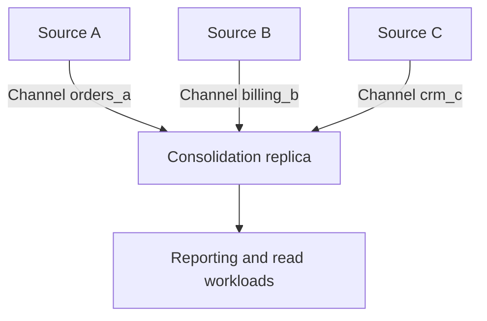

# Replication channels, multi-source, and limitations when combining data

## Objectives

MySQL supports a single replica receiving changes from multiple sources through multiple replication channels. Each channel represents a separate replication connection with its own source configuration, receiver, relay log metadata, and applier status. This model is commonly called **multi-source replication** or fan-in replication.

Multi-source is useful when consolidating data from multiple systems onto one server for reporting, search, or analytics. However, multiple channels do not automatically merge data streams into a unified database capable of conflict resolution. Architects must define data ownership, identifying keys, table relationships, DDL rules, and how to handle cases where multiple sources modify the same object.

This lesson belongs to the `DATABASE_MYSQL` module, focusing on table design, data types, keys, SQL queries, indexes, transactions, concurrency control, query tuning, and relational database operations. After this lesson, you will be able to:

- Explain channels and how a replica receives data from multiple sources.
- Configure, start, stop, and observe each channel independently.
- Use GTID auto-position in a multi-source topology and recognize server identity requirements.
- Design namespaces, keys, and data ownership to avoid conflicts when consolidating.
- Evaluate limitations around transaction ordering, DDL, replication filters, performance, and failover.

## 1. What is a channel?

In single-source replication, a replica has one stream receiving data from a source. In multi-source replication, a replica can have multiple channels; each channel connects to one source and transports transactions from that source into the same replica.



Each channel has its own name and connection configuration. For example, `orders_a` receives data from Source A, while `billing_b` receives data from Source B. The default channel has an empty name; when managing multiple streams, use explicit names to simplify operations and avoid confusion.

Channels have stream-independent components:

| Component | Channel scope | Role |
|---|---|---|
| Connection configuration | Per channel | Host, port, account, TLS, retry, and auto-position settings |
| Receiver thread | Per channel | Connects to the source and receives binlog events |
| Relay log metadata | Per channel | Tracks received events and the queue awaiting apply |
| Applier/coordinator | Per channel | Executes transactions received from that source |
| Applier workers | Per channel configuration and version | Applies transactions in parallel when enabled |

All channels share the replica's CPU, RAM, network, and storage. They also update the same target dataset, so you must design them so streams do not overwrite or corrupt each other's data.

## 2. Common multi-source patterns

**Consolidating independent schemas:** each source owns its own schema on the replica. For instance, Source A writes `orders_a`, Source B writes `orders_b`. This is typically the easiest pattern to govern because data namespaces are cleanly separated.

**Consolidating independent tables:** multiple sources feed different sets of tables into the same target schema. For instance, source A owns `customer_profile`, source B owns `product_catalog`. Table ownership and schema change procedures must be strictly managed.

**Consolidating by tenant or region:** each source manages a distinct set of tenants, regions, or data shards. They can share a table structure, provided primary keys and partitioning rules guarantee records from different sources do not collide.

**Multiple sources writing to the same table:** this is a high-risk pattern. Two sources can generate colliding primary keys, update the same row, or issue incompatible DDL. Replication channels provide no automatic conflict resolution; use this only when the application already enforces clear write partitioning and key-allocation rules.

## 3. Configuring individual channels

The example below uses MySQL 8.0.23 and later with `CHANGE REPLICATION SOURCE TO` syntax. On source A, create a dedicated account for the replica and restrict the connecting host:

```sql
CREATE USER 'repl_a'@'10.20.30.50'
  IDENTIFIED BY '<source-a-replication-secret>'
  REQUIRE SSL;

GRANT REPLICATION SLAVE
  ON *.*
  TO 'repl_a'@'10.20.30.50';
```

Do the same on source B with an appropriate account and secret. `REPLICATION SLAVE` is the replication privilege name used in many MySQL versions; verify exact syntax and privileges for your version. Do not use an administrative account for the receiver.

On the replica, configure channel `orders_a`:

```sql
CHANGE REPLICATION SOURCE TO
  SOURCE_HOST = 'source-a.example.net',
  SOURCE_PORT = 3306,
  SOURCE_USER = 'repl_a',
  SOURCE_PASSWORD = '<source-a-replication-secret>',
  SOURCE_AUTO_POSITION = 1
FOR CHANNEL 'orders_a';

START REPLICA FOR CHANNEL 'orders_a';
```

Next, configure channel `billing_b` with connection details for source B:

```sql
CHANGE REPLICATION SOURCE TO
  SOURCE_HOST = 'source-b.example.net',
  SOURCE_PORT = 3306,
  SOURCE_USER = 'repl_b',
  SOURCE_PASSWORD = '<source-b-replication-secret>',
  SOURCE_AUTO_POSITION = 1
FOR CHANNEL 'billing_b';

START REPLICA FOR CHANNEL 'billing_b';
```

In real environments, never store passwords directly in scripts, shell history, or source control. Use secure secret delivery and restrict read permissions. The example assumes both sources and the replica have GTID enabled, compatible initial data, and satisfy auto-position prerequisites.

For MySQL before 8.0.23, you may need `CHANGE MASTER TO` with `MASTER_*` options; corresponding control statements also use legacy names such as `START SLAVE`. Check the documentation for your running version before applying.

## 4. Controlling and observing individual channels

You can stop or restart one channel without stopping the remaining channels:

```sql
STOP REPLICA FOR CHANNEL 'orders_a';
START REPLICA FOR CHANNEL 'orders_a';

SHOW REPLICA STATUS FOR CHANNEL 'orders_a'\G
SHOW REPLICA STATUS FOR CHANNEL 'billing_b'\G
```

`STOP REPLICA` on one channel stops that channel's receiver and applier. Other channels keep running. If you need to stop all streams, use the statement without a channel specifier per operational procedure.

To view connection configurations:

```sql
SELECT CHANNEL_NAME, HOST, PORT, USER, AUTO_POSITION
FROM performance_schema.replication_connection_configuration;
```

To observe receiver and applier state:

```sql
SELECT CHANNEL_NAME, SERVICE_STATE, RECEIVED_TRANSACTION_SET,
       LAST_ERROR_NUMBER, LAST_ERROR_MESSAGE
FROM performance_schema.replication_connection_status;

SELECT CHANNEL_NAME, SERVICE_STATE, LAST_ERROR_NUMBER, LAST_ERROR_MESSAGE
FROM performance_schema.replication_applier_status_by_coordinator;

SELECT CHANNEL_NAME, WORKER_ID, SERVICE_STATE,
       LAST_ERROR_NUMBER, LAST_ERROR_MESSAGE
FROM performance_schema.replication_applier_status_by_worker;
```

Performance Schema may differ across MySQL versions; if a table or column does not exist, inspect the schema of your running version. In `SHOW REPLICA STATUS`, inspect `Channel_Name`, receiver/applier status, latest errors, and retrieved and executed GTIDs.

Name channels after their data source or purpose, such as `orders_eu`, `orders_apac`, or `billing_legacy`. Avoid ambiguous names like `channel1` that make identifying the source difficult during incidents.

## 5. GTID in multi-source topologies

GTID helps the replica identify which transactions have executed and ask each source for the missing portion. In multi-source replication, every source must have a distinct GTID identifier. A GTID typically has the form `source_uuid:transaction_number`, where `source_uuid` derives from the `server_uuid` of the server that originated the transaction.

Therefore, sources must have distinct `server_uuid` values and unique `server_id` values across the topology. If two sources were cloned from the same data directory and kept the same `server_uuid`, GTIDs can collide or be misattributed to the same transaction history. Generate unique server identities via a supported MySQL procedure before connecting sources to the same replica.

On each source and replica, GTID settings typically include:

```ini
[mysqld]
server_id = 201
log_bin = mysql-bin
gtid_mode = ON
enforce_gtid_consistency = ON
```

The `server_id` in the example must be replaced with a unique value on each instance. If the replica also acts as a source for a downstream tier, evaluate enabling `log_replica_updates=ON` per architecture.

When each channel uses `SOURCE_AUTO_POSITION=1`, the receiver sends the replica's executed GTID set so the source determines which transactions to send. On a multi-source replica, the executed GTID set is instance-wide; thus source identities must be unique and GTID state must be verified across the entire topology.

Useful inspection queries:

```sql
SELECT @@GLOBAL.gtid_mode,
       @@GLOBAL.server_id,
       @@GLOBAL.server_uuid,
       @@GLOBAL.gtid_executed,
       @@GLOBAL.gtid_purged;
```

GTID auto-position does not replace initial data seeding. Each channel must connect to a replica that already holds the corresponding baseline data and matching GTID state. If a source has purged transactions the replica lacks, auto-position cannot materialize them out of thin air; you need a data copy or binlog source that still retains the transactions.

## 6. Data ownership and namespaces

Before consolidating multiple sources, build an ownership matrix. A given dataset should have only one authoritative write source at a time, unless the application implements dedicated synchronization and conflict resolution.

| Source | Channel | Owned data | Target rule |
|---|---|---|---|
| Source A | `orders_a` | Region A orders | Schema `orders_a`, written only by Source A |
| Source B | `orders_b` | Region B orders | Schema `orders_b`, written only by Source B |
| Source C | `crm_c` | Customer profiles | Schema `crm_c`, written only by Source C |

Namespaces can be separated by schema, table name, tenant key, or origin-prefixed keys. For example, if multiple sources write into an `orders` table, consider a composite key `(source_id, order_id)` rather than assuming `order_id` is globally unique. `source_id` must be managed stably and never reused for another source.

If multiple sources insert into the same table with an `AUTO_INCREMENT` column, you can configure different `auto_increment_increment` and `auto_increment_offset` values on each source to partition ID sequences. Example with two sources:

```ini
# Source A
auto_increment_increment = 2
auto_increment_offset = 1

# Source B
auto_increment_increment = 2
auto_increment_offset = 2
```

This setting only avoids collisions for auto-generated values while writers coordinate properly. It does not resolve conflicts when applications supply explicit IDs, when a third source is added, when config changes asynchronously, or when two sources update the same row. UUIDs or namespaced keys usually scale more cleanly, though they still require uniqueness rules and application-layer checks.

## 7. Limitations when multiple sources modify data

Independent replication channels do not establish a global commit order across sources. Transaction ordering is preserved within each stream per MySQL replication rules, but transactions from two different channels can apply in arbitrary relative order on the replica.

This introduces several important limitations:

- **No atomic cross-channel transactions:** a transaction on Source A and a related transaction on Source B do not commit as a single distributed atomic unit on the replica.
- **No automatic conflict resolution:** two sources inserting the same primary key can cause a duplicate key error in the applier; two sources updating the same row yield apply-order-dependent outcomes.
- **Foreign key constraints may cross source boundaries:** if one channel creates a parent row and another channel creates a child row referencing it, independent apply ordering can cause the child transaction to fail.
- **DDL can collide:** two sources creating or altering the same target table can raise errors or leave the schema incompatible with data events.
- **Filters can break relational completeness:** replicating only a subset of tables or databases can drop parent records, lookup tables, or required transactions.
- **Cumulative load:** multiple receivers can fetch events faster than the replica's CPU, I/O, or appliers can process them; relay logs will grow and the replica will lag.

Therefore, prefer designing each source to own a non-overlapping data domain. If business rules force multiple writers to modify the same entity, introduce a dedicated arbitration, synchronization, or data-modeling layer before sending data through replication.

## 8. Replication filters and data-filtering risks

Replication filters allow a channel to apply only specific databases or tables, or map a source database to a target database. Filters can help aggregate multiple schemas into a reporting replica, but filters are not a relationship-aware merge engine.

Example filtering tables to accept on a single channel:

```sql
CHANGE REPLICATION FILTER
  REPLICATE_WILD_DO_TABLE = ('orders_a.%')
FOR CHANNEL 'orders_a';
```

Supported filter syntax and types depend on version. Use `FOR CHANNEL` to scope configuration to the intended channel where supported. Before enabling filters, verify interactions with `binlog_format`, database/table mapping, DDL, triggers, and foreign keys. A misconfigured filter can leave a replica missing data without always throwing an immediate error.

Never rely on `replicate_do_db` or `replicate_ignore_db` without understanding database evaluation rules in statement-based and row-based replication. Test statements that switch default databases, multi-table writes, and cross-schema transactions in a test environment.

Maintain a mapping document listing source, channel, included databases/tables, excluded databases/tables, and business rationale. Whenever changing filters, re-verify target data because altering filter rules does not automatically backfill rows previously skipped.

## 9. Operations, errors, and failover

Inspect each channel individually when an incident occurs:

1. Identify the affected channel via `SHOW REPLICA STATUS` or `performance_schema.replication_connection_status`.
2. If the receiver stopped, check host, port, DNS, firewall, TLS, account, privileges, and whether the source still retains required binlogs.
3. If the applier stopped, read coordinator/worker errors, identify the failing transaction, and inspect target schema and data.
4. If the relay log grows, compare receive rate against apply rate, disk space, CPU, I/O, and lock waits.
5. After fixing the root cause, restart the exact affected channel and verify GTIDs and data catch up.

Never reset the entire replica just to fix one channel. Commands like `RESET REPLICA ALL FOR CHANNEL 'orders_a'` can delete that channel's connection metadata; run them only after saving configuration and understanding the state to rebuild. Never manually delete relay logs or skip failing transactions just to turn status green.

When one source fails, only that source's channel loses the ability to receive new transactions; other channels can continue. However, consolidated reports may miss data from the failed source. If repointing a channel to a replacement source, verify the new source shares the required GTID history, compatible data, and matching schema. Auto-position works only when GTID history satisfies the replica's requirements.

For multi-source reporting replicas, surface freshness status per source. A single aggregate lag metric can hide that one channel has stopped while the remaining channels stay caught up.

## 10. Hands-on exercise

On three test MySQL instances, build one replica receiving data from two sources:

1. Configure unique `server_id` and `server_uuid` values, enable binlog and GTID per your version's procedure.
2. Create two dedicated replication accounts, host-restricted and requiring TLS if supported by the environment.
3. Seed initial data onto the replica from consistent backups of each source.
4. Create two channels `orders_a` and `billing_b` using `CHANGE REPLICATION SOURCE TO ... FOR CHANNEL`, then start each channel.
5. Write transactions on each source and verify data arrives in the right target schema.
6. Stop only channel `orders_a`, continue writing data on Source A and Source B; observe that Source B continues applying.
7. Restart `orders_a`, inspect receiver, applier, GTIDs, and catch-up status.
8. Induce a key collision scenario in an isolated environment to observe the applier error; restore data through a controlled procedure.
9. Build a data ownership matrix and document the design limitations if two sources write to the same table.

**Completion criteria:** you can configure and manage each channel independently, read per-channel receiver/applier status, explain GTID/server identity requirements, and explain why multi-source does not automatically resolve data conflicts.

## Conclusion

Replication channels allow a single replica to receive multiple independent data streams from multiple sources. Each channel has its own configuration and state, while all channels share the replica's resources and target dataset. GTID auto-position supports continuing transaction history when source identities are unique. To keep multi-source safe, partition data ownership, avoid overlapping writes, control schemas/filters, and monitor lag and errors separately per channel.
