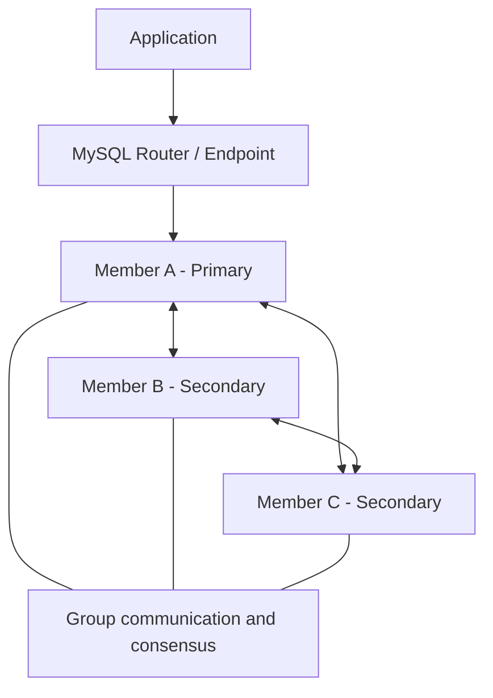
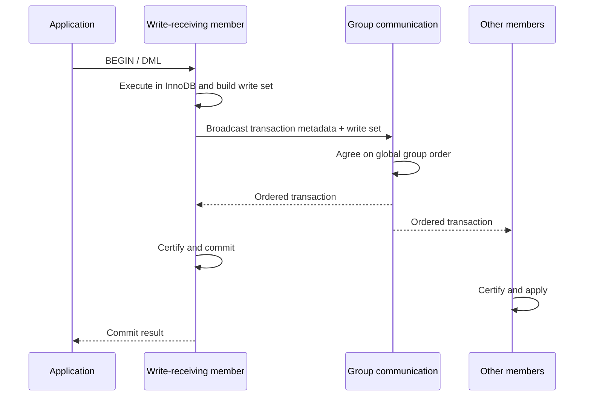

# Group Replication, Group Membership, and Consensus

## Objectives

After this lesson, you will be able to:

- Explain the architecture and transaction processing flow of MySQL Group Replication.
- Describe how group members establish a membership view, order transactions, and use quorum to maintain consistency.
- Distinguish single-primary from multi-primary mode, and understand primary election and certification conflicts.
- Monitor member states, detect loss of quorum, and handle nodes rejoining the group.
- Identify deployment prerequisites such as GTIDs, unique identifiers, row-based logging, InnoDB, and internal networking.
- Design fault-tolerant topologies, test failover, and evaluate operational limitations.

## 1. What problem does Group Replication solve?

MySQL Group Replication (GR) is a mechanism that forms a group of MySQL servers coordinating to maintain the same history of accepted transactions. The group can continue operating when some members fail, as long as the remaining reachable members still form a quorum (majority).

GR combines two core mechanisms:

- **Group communication:** members exchange messages, manage membership, and agree on the order of events within the group.
- **Transaction certification:** checks whether transactions have write conflicts before accepting commits in the agreed global order.

A member can receive a transaction from an application, broadcast its write set to the group, participate in certification, and apply transactions from other members. Through this, the group maintains a shared transaction history and prevents two servers from accepting conflicting changes without knowing about each other.

Group Replication typically serves as the foundation of MySQL InnoDB Cluster. InnoDB Cluster adds administration and configuration tooling, while MySQL Router handles routing application connections to the primary or read endpoints. Group Replication itself does not replace connection routing, application retry logic, or backup strategies.

## 2. Group components

A basic three-member topology looks like this:



Each member runs an independent MySQL instance and joins the same group. Key components include:

| Component | Role |
|---|---|
| Group member | A MySQL instance participating in the group and storing a copy of the group's data |
| Group name | A UUID identifying the group; all members of the same group must use the same value |
| `server_id` | Unique replication identifier for each server |
| `server_uuid` | Unique and persistent GTID source identifier for each server |
| Group communication system (GCS) | Exchanges messages, manages membership views, and orders events |
| XCom | The default communication stack of Group Replication, using a Paxos-based consensus protocol to order messages and membership changes |
| Certification | Checks a transaction's write set against already-ordered transactions in the group |
| Distributed recovery | Synchronizes data and transaction history for new or returning members |

Servers must be able to reach one another via the configured internal communication addresses and ports. The application SQL port and the group communication port can differ; firewalls must allow the appropriate traffic between members.

## 3. Group communication and consensus

### 3.1. Membership view

A membership view is the list of members the group currently considers part of the same configuration. When a node joins, leaves, or is deemed unreachable, GCS coordinates the membership change and creates a new view.

All active members must agree on the same sequence of view changes. If a member cannot keep up with the group, it may be expelled from the current view or transition to an inactive state. When connectivity returns, the node must synchronize with the new membership view before being treated as an active member.

Changing a view is not merely updating an address list. It affects quorum, primary role, transaction ordering, and the group's ability to continue committing. This is why Group Replication requires a consensus protocol in group communication.

### 3.2. Quorum and majority

Quorum is the minimum number of members required for the group to reach agreement and make progress. For a group of \(N\) members, majority is calculated as:

\[
Q = \left\lfloor \frac{N}{2} \right\rfloor + 1
\]

Examples:

| Members | Quorum | Number of node losses tolerated while keeping majority |
|---:|---:|---:|
| 1 | 1 | 0 |
| 2 | 2 | 0 |
| 3 | 2 | 1 |
| 4 | 3 | 1 |
| 5 | 3 | 2 |
| 6 | 4 | 2 |

This is why topologies typically choose an odd number of members such as 3 or 5. Adding a fourth member to a three-node group does not increase the number of tolerated node failures while retaining majority; it only increases resource usage and synchronization traffic.

If a three-node group is split by a network partition into two sides, the side with two members retains quorum and can continue operating; the isolated single node cannot consider itself a valid group to keep committing. This prevents both sides from accepting independent transactions and causing split-brain.

Quorum does not guarantee continuous availability. The group can still stall during unstable networking, member overload, simultaneous multi-node failures, or loss of majority. Therefore, design networks, power, racks, and deployment zones to minimize the chance of multiple members losing contact simultaneously.

### 3.3. Role of XCom and Paxos

XCom is the default communication stack of Group Replication. It uses a Paxos-based consensus protocol to agree on message order and membership changes. With a shared order, members process transactions according to the same logical history.

Paxos here should not be misunderstood as synchronously flushing every byte in InnoDB to disk on all nodes before responding to the application. Group Replication coordinates transaction ordering and certification; applying transactions on each member and consistency wait behavior depend on configuration, member state, and the consistency level.

When the group loses majority, members cannot unilaterally continue accepting writes as independent primaries. You must restore quorum or follow the appropriate group recovery procedure based on actual cluster state.

## 4. Transaction flow and certification

A transaction sent by an application to a member generally goes through the following high-level steps:

1. **Local execution:** the transaction runs on the receiving member, reading and modifying InnoDB data.
2. **Write set generation:** MySQL extracts information about modified rows/keys for certification.
3. **Group broadcast:** the write set and transaction metadata are sent via group communication.
4. **Global ordering:** GCS agrees on the event order so all members process the same history.
5. **Certification:** members check the transaction's write set against transactions already accepted in the global order. If a write conflict exists, the transaction can be rejected.
6. **Commit and apply:** the transaction commits on the originating member once it passes certification; the remaining members receive and apply the transaction in group order.

High-level sequence:



This is a conceptual diagram illustrating the stages. Internal details, acknowledgment timing, and apply waits depend on the MySQL version, consistency level, and member status.

### 4.1. Write sets and conflicts

A write set represents the keys/rows modified by a transaction. Certification uses this information to detect two potentially conflicting write transactions. If two transactions from different members modify the same key close together in the global order, one transaction can fail certification.

For example, two members receive statements updating the quantity of the same product simultaneously:

```sql
-- Transaction running on Member A
UPDATE inventory
SET quantity = quantity - 1
WHERE product_id = 9001;

-- At the same time, another transaction runs on Member B
UPDATE inventory
SET quantity = quantity - 2
WHERE product_id = 9001;
```

In multi-primary mode, both transactions can execute locally, but their write sets both touch the key for product `9001`. Once ordered, certification detects the conflict and rejects one transaction according to group rules. The application must handle the error and may need to retry the entire transaction from the beginning.

### 4.2. Certification does not replace business validation

Certification focuses on write conflicts based on write sets and does not prove all business invariants hold. For instance, two transactions modifying different rows that together violate an aggregate rule may not produce a write-set conflict. Applications still need constraints, appropriate transaction isolation, and business-level validation.

## 5. Single-primary mode

Single-primary is the common default mode. At any given time, one member is elected as the primary accepting writes; the remaining members are secondaries and typically serve reads.

Characteristics:

- Writes are centralized on one primary, reducing the likelihood of multiple nodes modifying the same row.
- Secondaries apply transactions broadcast by the primary in group order.
- When the primary fails or leaves the group, the remaining members agree on a new membership view and elect a new primary if quorum remains.
- The new primary must catch up on accepted transactions before serving writes according to the consistency level and recovery state.

The advantage of single-primary is an easy-to-reason-about write model suited to most OLTP applications, minimizing multi-writer conflicts. The drawback is that write load is concentrated on one node; write performance depends on the primary, and transactions still require group broadcast, certification, and apply.

Applications should connect for writes through an endpoint routed to the primary rather than hardcoding a server address. During failover, Router or the connection management layer must update the target, and connection pools must evict stale connections and reconnect.

## 6. Multi-primary mode

In multi-primary mode, multiple members can accept write transactions. Group Replication still orders transactions and certifies write sets across the entire group.

Advantages:

- Write connections can be distributed across multiple members.
- One member can continue accepting writes if another member leaves, provided quorum remains and routing updates.
- Useful for well-partitioned workloads with minimal overlapping key writes.

Costs and risks:

- Multiple writers can update the same data, causing certification conflicts and aborted transactions.
- Applications must handle transaction errors and retry properly.
- Concurrent DDL operations across multiple primaries must be coordinated; do not run independent schema migrations simultaneously on multiple nodes.
- Shared transaction ordering and write-set transmission still add latency, so multi-primary does not mean nodes write completely independently.

### 6.1. Reducing conflicts in multi-primary

- Partition data by tenant, region, or key range so a given dataset is typically written on only one member.
- Keep transactions short, update fewer rows, and avoid long-running open transactions.
- Use explicit, stable, unique primary keys for every row.
- Coordinate migrations, batch jobs, and schema changes through a single workflow.
- Monitor the count of transactions rolled back due to certification conflicts and adjust the write distribution strategy.

For example, if each tenant is assigned a primary write member, transactions for the same tenant rarely contend on the same keys. This only works when routing is consistent and there is a plan for migrating tenants between members.

## 7. Primary election and membership changes

In single-primary mode, the primary is chosen based on group state and configured priority/election rules. When the primary leaves the group, remaining members form a new view and elect a new primary. Applications must tolerate dropped connections to the old primary during transitions.

Operational considerations:

- Do not assume the new primary will always be the node with the strongest hardware unless member weights/priorities are configured accordingly.
- Ensure secondary nodes have up-to-date GTID histories and no unexpected local transactions.
- Wait for the elected member to finish recovery and become ready before shifting write traffic.
- Avoid two administrative processes concurrently bootstrapping or promoting independent groups.
- Maintain a runbook for when the old primary returns after failover; it must rejoin and synchronize with the current group before serving traffic.

In multi-primary mode, there is no single write primary. Membership views still change as members join or leave, and all transactions must be processed in the shared order.

## 8. Managing member states

Group Replication exposes member status through Performance Schema. Basic query:

```sql
SELECT
  MEMBER_ID,
  MEMBER_HOST,
  MEMBER_PORT,
  MEMBER_STATE,
  MEMBER_ROLE,
  MEMBER_VERSION
FROM performance_schema.replication_group_members;
```

Common states:

| State | Operational meaning |
|---|---|
| `ONLINE` | Member is active and participating in the group |
| `RECOVERING` | Member is synchronizing missing data or transactions |
| `OFFLINE` | Plugin or member has not joined the group |
| `ERROR` | Member encountered an error and cannot continue normal operation |
| `UNREACHABLE` | Member cannot be reached from the perspective of remaining members in the view |

`UNREACHABLE` does not automatically prove the server is powered off. The node may still be running while affected by a network partition, firewall rule, or severe overload. Check MySQL logs, OS logs, and network paths between members.

To check the primary role in single-primary mode, query:

```sql
SELECT
  MEMBER_HOST,
  MEMBER_ROLE,
  MEMBER_STATE
FROM performance_schema.replication_group_members
ORDER BY MEMBER_ROLE, MEMBER_HOST;
```

To inspect certification and transaction statistics:

```sql
SELECT *
FROM performance_schema.replication_group_member_stats;
```

Statistic columns can vary by version. When building dashboards, pick the required metrics from the documentation for your deployed version, such as transactions received, transactions applied, transactions rejected during certification, and applier queue depth.

## 9. New members and distributed recovery

When a new member joins, it cannot immediately serve traffic like an already-synchronized member. Group Replication performs distributed recovery to bring the member's data and GTID history in line with the group.

High-level process:

1. The new member connects to a seed/member in the group and is accepted into the membership view.
2. The member enters the `RECOVERING` state while synchronizing.
3. MySQL selects an eligible donor to supply missing transactions.
4. Incremental recovery transfers transactions over the replication recovery channel if the donor still retains the needed binlogs.
5. If a large volume of data must be synced or logs are missing, cloning can be used when configured and supported.
6. Once recovery completes and join conditions are met, the member transitions to `ONLINE`.

Check the recovery channel status:

```sql
SELECT
  CHANNEL_NAME,
  SERVICE_STATE,
  LAST_ERROR_NUMBER,
  LAST_ERROR_MESSAGE
FROM performance_schema.replication_connection_status
WHERE CHANNEL_NAME = 'group_replication_recovery';
```

For incremental recovery, the donor must retain enough binary logs to serve the GTIDs the joiner is missing. If logs have been purged, joining can fail or require full state transfer/cloning. Therefore, binlog retention must account for how long a node might be down and the time needed to rebuild it.

Do not place a `RECOVERING` member into a read/write serving endpoint as though it were fully synchronized. Monitor progress, recovery errors, relay log growth, and final state before opening traffic.

## 10. Key technical prerequisites

Group Replication has configuration and data requirements that must be met across all members:

- **GTID:** enable `gtid_mode=ON` and `enforce_gtid_consistency=ON` to manage consistent transaction history.
- **Binary log:** enable `log_bin=ON`; members must write and replicate logs per the replication architecture.
- **Record transactions from other members:** enable `log_replica_updates=ON` so transactions applied from the group are also written to the local binary log, supporting recovery streams and donor roles.
- **Row-based logging:** Group Replication requires row-based binary logging. In modern MySQL versions, `ROW` is the default; `binlog_format` was deprecated in MySQL 8.0.34, so check version-specific documentation rather than relying on legacy settings.
- **Unique identifiers:** each member must have a distinct `server_id` and `server_uuid` that remain stable across restarts.
- **Storage engine:** replicated application data must use InnoDB; do not design group transactions around changes to non-transactional tables.
- **Primary key:** tables must have a primary key or appropriate non-null unique key so rows can be identified and conflicts accurately detected.
- **Internal network:** members must communicate over the configured Group Replication addresses/ports; configure TLS if internal traffic protection is required.
- **Versions:** run supported versions across the topology and follow MySQL's upgrade/rolling-upgrade procedures.

Check key variables:

```sql
SELECT
  @@hostname AS hostname,
  @@server_id AS server_id,
  @@server_uuid AS server_uuid,
  @@gtid_mode AS gtid_mode,
  @@enforce_gtid_consistency AS enforce_gtid_consistency,
  @@log_bin AS log_bin,
  @@binlog_format AS binlog_format;
```

Not all variables can be changed dynamically. Some must be set before starting the plugin or require a restart. Cross-check the documentation for your exact version and verify on every member.

## 11. Group configuration and bootstrap

Baseline configuration example on a member in the MySQL configuration file:

```ini
[mysqld]
server_id=101
log_bin=mysql-bin
log_replica_updates=ON
gtid_mode=ON
enforce_gtid_consistency=ON
binlog_format=ROW

plugin_load_add=group_replication.so
group_replication_group_name="aaaaaaaa-bbbb-4ccc-8ddd-eeeeeeeeeeee"
group_replication_start_on_boot=OFF
group_replication_local_address="mysql-a.internal:33061"
group_replication_group_seeds="mysql-a.internal:33061,mysql-b.internal:33061,mysql-c.internal:33061"
group_replication_single_primary_mode=ON
```

This is an illustrative template, not a complete production configuration. Plugin names, paths, ports, TLS, recovery credentials, parallel applier settings, and firewall policies must be configured for your OS, MySQL version, and environment. Each member needs its own `server_id`, `server_uuid`, and `group_replication_local_address`—never clone another node's identity verbatim.

### 11.1. Bootstrapping the group for the first time

When creating a brand-new group, exactly one member must bootstrap the group. Example:

```sql
SET GLOBAL group_replication_bootstrap_group = ON;
START GROUP_REPLICATION;
SET GLOBAL group_replication_bootstrap_group = OFF;
```

Once the first member is active, other members join using `START GROUP_REPLICATION` with their prepared configuration and recovery credentials.

**Never enable bootstrap simultaneously on multiple members.** If multiple machines bootstrap together, they can form independent groups sharing the same group name, causing diverged histories and split-brain risk. Only bootstrap when you are certain you are creating a new group or executing a MySQL-supported group recovery procedure; never use it arbitrarily to fix a group that has lost quorum.

## 12. Single-primary or multi-primary?

| Criterion | Single-primary | Multi-primary |
|---|---|---|
| Write target | One primary at a time | Multiple members can accept writes |
| Write conflicts | Typically lower because writes are centralized | Can be high if multiple nodes modify the same keys |
| Application routing | Write endpoint must point to the primary | Can route to multiple writers per policy |
| Operations | Easier to reason about and troubleshoot | Requires strict data partitioning and retry management |
| Suitable workload | OLTP with frequent transactions on shared data | Well-partitioned workloads with minimal overlapping writes |

For most MySQL applications, single-primary is the right starting point. Choose multi-primary only when you have a clear write-distribution model, measured conflict rates, and an application capable of retrying transactions that fail certification.

## 13. Consistency levels and read lag

Group Replication provides `group_replication_consistency` to tune transaction consistency wait behavior. Common values:

| Level | General meaning |
|---|---|
| `EVENTUAL` | Does not wait to ensure prior transactions are applied on the current member; stale reads can occur on secondaries |
| `BEFORE_ON_PRIMARY_FAILOVER` | After a new primary is elected, waits for the necessary transaction backlog to apply before allowing new transactions under this mode's rules |
| `BEFORE` | Waits for prior transactions to apply before executing the new transaction |
| `AFTER` | Waits for the current transaction to apply on relevant members before returning commit success |
| `BEFORE_AND_AFTER` | Combines waiting both before and after the transaction |

Higher consistency levels reduce the risk of reading stale data or observing unexpected ordering, but increase latency and make transactions depend on the state of other members. Choose according to business requirements, test when a member is slow or disconnected, and review exact semantics for your running version.

Example configuration check:

```sql
SHOW GLOBAL VARIABLES LIKE 'group_replication_consistency';
```

Do not set the highest consistency level globally for all workloads by default. Identify which operations require read-after-write or stronger synchronization, then evaluate the impact on latency and fault tolerance.

## 14. Monitoring and handling failure scenarios

Metrics to monitor:

- Count of members in `ONLINE`, `RECOVERING`, `ERROR`, and `UNREACHABLE`.
- Current primary and timestamps of membership view changes.
- Number of transactions rejected due to certification conflicts.
- Queue of received-but-unapplied transactions, along with applier lag.
- Group communication errors, timeouts, packet loss, and inter-member network latency.
- Binlog/relay log growth, disk capacity, and donor recoverability.
- Application disconnect counts, transaction retries, and commit errors during failover.

### 14.1. A member transitions to `UNREACHABLE`

1. Verify whether `mysqld` is still running or has stopped on that member.
2. Check group communication ports, DNS, firewalls, TLS, and bidirectional packet loss.
3. Check CPU load, I/O, long pauses, or overload that could prevent the member from responding in time.
4. Confirm the remaining members hold quorum and share the same membership view.
5. Once networking stabilizes, observe the member rejoining and running distributed recovery; do not force it `ONLINE` manually.

### 14.2. The group loses quorum

Without majority, the group cannot agree on new transactions. Identify the network partition, which node holds the most complete data, and each node's GTID state. Restore connectivity between members or follow MySQL's group recovery procedure.

Never arbitrarily use `group_replication_force_members` to force a subset of nodes into a new group. Doing so can create two active groups if isolated members are still running, causing split-brain and data divergence. Only use it in an emergency procedure once you have verified all excluded members are completely isolated and made a deliberate decision about data history.

### 14.3. Transaction fails certification

- Identify the MySQL error returned and which transaction was rolled back.
- Inspect which keys or rows multiple members are writing concurrently.
- Retry the entire transaction from the beginning if the error is retryable; do not re-run only the final statement of a rolled-back transaction.
- If conflicts are frequent, switch to single-primary or partition data to reduce contention.
- Track conflict rates afterward to confirm improvement.

## 15. Testing failover and recoverability

A topology can only be considered highly available after testing node failures, network partitions, recovery, and application reconnection.

Test scenarios should include:

1. **Controlled primary stop:** verify another member is elected primary, the application reroutes, and transactions retry properly.
2. **Loss of a secondary:** verify a three-node group retains quorum and continues processing writes.
3. **Network partition:** split the group into majority and minority sides in a test environment; verify only the quorum side continues making progress.
4. **Member return:** restart the disconnected node, observe `RECOVERING`, donor selection, catch-up time, and transition to `ONLINE`.
5. **Certification conflict:** send concurrent updates to the same key on two members in multi-primary mode and verify application rollback handling.
6. **Quorum loss:** test alerting, recovery decision workflows, and runbook access; never run `force_members` on production purely as a test.
7. **Restore from backup:** verify Group Replication does not replace independent backups and that a member or full group can be rebuilt from a valid backup.

Acceptance criteria to measure:

- Failure detection time and new primary election time.
- Application reconnection time and transaction success rate after retries.
- Actual RPO based on committed GTIDs and recoverable data.
- Time for a new/returning member to reach `ONLINE`.
- Data consistency after failover and after recovery.
- No two independent primaries accepting writes in single-primary mode.
- The group does not continue committing when quorum is lost.

## 16. Practical scenario

An online store deploys a three-node Group Replication cluster within one network region. The group runs in single-primary mode. The primary stores orders and inventory; two secondaries serve reads. A network incident isolates the primary from the two secondaries for several seconds. Afterward, the secondaries form a new view and elect a new primary.

Analyze and practice in a lab environment:

1. Before injecting the fault, record `server_id`, `server_uuid`, `MEMBER_STATE`, `MEMBER_ROLE`, the GTID set, and the current primary.
2. Generate write traffic containing transaction IDs so you can reconcile data after failover.
3. Disconnect the primary's internal network in the test environment, and observe the membership view and new primary.
4. Verify whether the application detects connection errors, drops old connections, and reroutes properly.
5. Restore networking, observe the old node rejoining, its `RECOVERING` state, and synchronization outcome.
6. Compare GTID sets, order counts, and total inventory before and after the incident.
7. Repeat the test by stopping a secondary to verify the group retains quorum.

Discussion: what happens if the group only has two nodes and loses contact with one? Why is a three-node configuration generally more fault-tolerant? If all three nodes are partitioned into three isolated single-node segments, why must none of them be allowed to continue accepting writes?

**Self-check questions:**

1. What two responsibilities do group communication and transaction certification handle?
2. Why does a three-member group require a quorum of two?
3. What does a membership view signify when a member leaves the group?
4. How do write sets help detect transaction conflicts?
5. How does single-primary differ from multi-primary in write flow and conflict handling?
6. Why should a `RECOVERING` member not be treated as ready to serve traffic?
7. When a group loses majority, why must you not independently bootstrap each node into a new group?
8. Does Group Replication replace backups and application routing? Explain.

## Conclusion

Group Replication combines group communication, membership views, quorum, and transaction certification so members maintain a shared transaction order. Single-primary centralizes writes on one node and fits most workloads; multi-primary allows multiple writers but requires strict conflict control and application retries. Safe operation requires unique identifiers, GTIDs, InnoDB, row-based logging, stable internal networking, member state monitoring, and regular failover and distributed recovery drills.

## References

- [MySQL 8.4 Reference Manual — Group Replication](https://dev.mysql.com/doc/refman/8.4/en/group-replication.html)
- [MySQL 8.4 Reference Manual — Group Replication Group Membership](https://dev.mysql.com/doc/refman/8.4/en/group-replication-group-membership.html)
- [MySQL 8.4 Reference Manual — Group Replication Fault Tolerance](https://dev.mysql.com/doc/refman/8.4/en/group-replication-fault-tolerance.html)
- [MySQL 8.4 Reference Manual — Group Replication Transaction Processing](https://dev.mysql.com/doc/refman/8.4/en/group-replication-transaction-processing.html)
- [MySQL 8.4 Reference Manual — Group Replication Consistency Guarantees](https://dev.mysql.com/doc/refman/8.4/en/group-replication-consistency-guarantees.html)
- [MySQL 8.4 Reference Manual — Distributed Recovery](https://dev.mysql.com/doc/refman/8.4/en/group-replication-distributed-recovery.html)
