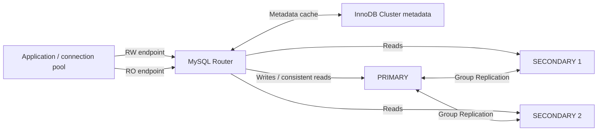

# MySQL Router, Service Ports, and Role-Based Routing

In a highly available MySQL cluster, applications must know where to connect when the primary changes after an incident. If an application is configured to point directly to a specific server, every failover can force operations to change configuration or restart services. **MySQL Router** provides a stable connection entry point in front of the cluster: applications connect to Router, Router tracks cluster metadata, and it directs new connections to the server matching the requested role.

Router is typically deployed alongside InnoDB Cluster and Group Replication. In a single-primary configuration, one node holds the `PRIMARY` role to accept writes; the remaining nodes are `SECONDARY`, usually serving reads. Router can expose separate ports for writes and reads, allowing applications to select the appropriate port based on access intent. Port selection is part of application design and data consistency policy.

## 1. Where does MySQL Router sit in the architecture?

Typical connection flow:



MySQL Router is a TCP/protocol connection routing layer between clients and MySQL Server. With InnoDB Cluster, Router's metadata cache plugin reads cluster metadata, tracks current members and roles, and updates the pool of eligible targets. Router does not store business data, replace Group Replication, or elect primaries on its own. Primary election and member state synchronization belong to Group Replication; Router consumes that state for routing.

Keep these responsibilities distinct:

| Component | Responsibility |
|---|---|
| Group Replication | Maintains group membership, consensus on membership views, and transaction replication per cluster config. |
| InnoDB Cluster / AdminAPI | Manages topology, metadata, configuration, and cluster operations. |
| MySQL Router | Monitors metadata, exposes client endpoints, and routes connections to nodes by role. |
| Application | Picks the right endpoint, manages connection pools, handles retries, and preserves transaction correctness. |

Router shields applications from knowing which node is currently primary. However, it does not transparently migrate an already-open connection to a different backend node mid-session. When a backend drops during failover, active sessions can break; applications must open fresh connections and handle interrupted operations safely.

## 2. Service ports and common endpoints

When bootstrapping Router for InnoDB Cluster, the default configuration typically creates classic and X Protocol ports as follows:

| Endpoint | Common default port | Target role | Purpose |
|---|---:|---|---|
| Classic read/write | `6446` | `PRIMARY` | Applications send reads/writes and transactions requiring the primary. |
| Classic read-only | `6447` | `SECONDARY` | Applications send read queries tolerant of replication lag. |
| X Protocol read/write | `6448` | `PRIMARY` | Clients using X Protocol connect to the primary. |
| X Protocol read-only | `6449` | `SECONDARY` | Clients using X Protocol connect to secondaries. |

These are common bootstrap defaults; actual ports may differ if edited or if another service occupies a port. Always inspect `bind_port` in `mysqlrouter.conf` and your environment's bootstrap output.

Do not confuse Router ports with MySQL Server ports:

- Clients connect to `router-host:6446` or `router-host:6447` per the provisioned endpoint.
- Router opens backend connections to MySQL Server, typically classic protocol on `3306` or X Protocol on `33060` if enabled.
- Router can run on a dedicated host or co-located on application hosts; firewalls must permit clients to reach Router ports and Router to reach MySQL nodes.

An endpoint can sit behind DNS or an internal load balancer, though deploying multiple Router instances requires health checks to evict failed instances and consistent configuration across instances. Do not allow clients to connect directly to MySQL nodes if your operational model routes traffic through Router, except for tightly controlled administrative paths.

## 3. Bootstrapping Router with InnoDB Cluster

Before bootstrapping, an InnoDB Cluster must already be created and healthy. Verify cluster status with MySQL Shell AdminAPI, for example:

```javascript
var cluster = dba.getCluster();
cluster.status();
```

Run this in MySQL Shell in JavaScript mode while connected to a cluster instance. Verify the cluster has a valid primary, required nodes are online, and metadata is properly initialized.

On the MySQL Router host, bootstrap using a cluster admin account with the necessary privileges:

```bash
mysqlrouter --bootstrap clusteradmin@db1.example.net:3306 \
  --directory=/opt/mysqlrouter
```

Router prompts for credentials if needed, reads cluster metadata, and generates the initial configuration inside the target directory. The bootstrap account must have privileges to read metadata and create/manage the Router user per your version's workflow. In production, use a dedicated Router account and store credentials via a proper secret mechanism; never record plain-text passwords in scripts, shell history, or runbooks.

After bootstrapping, verify:

1. `mysqlrouter.conf` contains the expected metadata cache and routing sections.
2. `bind_address` and `bind_port` values do not conflict with other services.
3. Router can connect to MySQL nodes and read metadata.
4. The Router account has required privileges, and passwords are secured per installation mechanism.
5. The Router service starts cleanly and logs show no auth, TLS, or metadata errors.

Example manual launch for testing in a non-production environment:

```bash
mysqlrouter --config=/opt/mysqlrouter/mysqlrouter.conf
```

In production, install Router as an OS-managed service with a restart policy, restricted filesystem permissions, and process monitoring. Config paths and service setup vary by OS/package; follow documentation matching your installed Router release.

## 4. Reading role-based routing configuration

Router uses configuration sections to define listeners, backend pools, and target selection strategies. Illustrative configuration for classic protocol:

```ini
[metadata_cache:mycluster]
cluster_type=gr
router_id=7
user=mysql_router_user
metadata_cluster=mycluster
ttl=0.5

[routing:mycluster_rw]
bind_address=0.0.0.0
bind_port=6446
destinations=metadata-cache://mycluster/default?role=PRIMARY
routing_strategy=first-available
protocol=classic

[routing:mycluster_ro]
bind_address=0.0.0.0
bind_port=6447
destinations=metadata-cache://mycluster/default?role=SECONDARY
routing_strategy=round-robin-with-fallback
protocol=classic
```

This is an illustrative snippet to explain sections, not a complete file for every version. Router bootstrap generates version-appropriate sections and values; when editing, retain required attributes generated by your release and validate with the exact Router binary.

Key fields:

- `bind_address`: network address Router listens on. Use `127.0.0.1` for local-only clients; use an appropriate private address if remote clients connect. Avoid listening on every interface unnecessarily.
- `bind_port`: port clients connect to on Router.
- `destinations`: target list. With metadata cache, `role=PRIMARY` selects the primary node; `role=SECONDARY` selects secondary nodes from cluster metadata.
- `routing_strategy`: rule for picking one backend among eligible targets, such as `first-available` or `round-robin-with-fallback`.
- `protocol`: client protocol type, typically `classic` or `x`.
- `ttl`: how long cached metadata can be used before refreshing, per your Router version's units and rules.

In a read/write setup, the write endpoint targets only the primary. The read endpoint targets secondaries; a fallback strategy can allow Router to fall back to the primary when no eligible secondary remains. Fallback behavior should be decided deliberately based on load, availability targets, and application read policy. If you do not want read traffic hitting the primary during secondary outages, choose a non-fallback strategy and handle read-endpoint errors in the application.

## 5. Choosing an appropriate routing strategy

The routing strategy controls how Router selects a node when multiple targets share the same role:

| Strategy | General behavior | When appropriate |
|---|---|---|
| `first-available` | Picks the first available target in the list. | Write endpoint with a single valid primary or when strict priority ordering is needed. |
| `round-robin` | Distributes new connections sequentially across available targets. | Balancing read connections across multiple secondaries of comparable capacity. |
| `round-robin-with-fallback` | Distributes across matching targets and can fall back to primary when no secondaries remain per config. | Read service must remain available during secondary outages and primary has spare capacity. |
| `next-available` | Tries targets in order when earlier targets are unavailable. | Preferring certain backends first and failing over sequentially to the next. |

The strategy affects backend selection for *new* connections; it does not load-balance individual SQL statements across an already-open connection. Connection pools often keep long-lived connections pinned to one node, so actual traffic distribution depends on connection count, session lifetimes, and pool reuse patterns.

Do not pick round-robin based solely on node count. Secondaries may differ in hardware, query load, or replication lag. Monitor CPU, I/O, connection count, query latency, and heartbeat lag per node to confirm distribution actually helps.

## 6. Separating read and write endpoints in applications

An application can declare two connection pools:

```text
MYSQL_WRITE_HOST=router.internal
MYSQL_WRITE_PORT=6446

MYSQL_READ_HOST=router.internal
MYSQL_READ_PORT=6447
```

These values illustrate common default ports. Replace them with your environment's DNS, ports, and credentials. Applications should use an account with write privileges on the write pool and a read-only account on the read pool. Database-level privilege separation limits blast radius if code accidentally sends a write query through the read endpoint.

A simple rule of thumb for choosing a pool:

| Operation type | Recommended endpoint | Reason |
|---|---|---|
| `INSERT`, `UPDATE`, `DELETE`, DDL | Write | Data or schema mutations must go to the primary. |
| Transactions mixing reads and writes | Write from start to finish | Avoids switching backends mid-transaction and preserves session consistency. |
| Reading immediately after writing in the same flow | Write or a verified read-after-write mechanism | Secondaries may not have applied the new transaction yet. |
| Reports/features tolerant of slight lag | Read | Queries can safely offload to secondaries. |
| Reading metadata or state requiring strong consistency | Write or an explicitly designed endpoint | Prevents decisions based on lagging replica data. |

Never split individual statements of a single transaction across both pools. Sessions hold transaction state, temporary tables, user variables, prepared statements, and session variables tied to a specific backend connection. Keep the entire transaction on the same connection and endpoint.

MySQL Router supports read/write splitting in supported versions with appropriate configuration. Still, do not assume every `SELECT` is automatically safe to run on a secondary: a read may depend on a just-committed write, session state, or immediate consistency. For predictable behavior, separating read/write pools in the application is straightforward; if using Router's automatic read/write splitting, check version docs, transaction/session rules, and test real query patterns.

## 7. Reading from secondaries and stale data

Secondaries typically apply transactions slightly after the primary. Consequently, queries sent through the read endpoint can return older data than the primary. Example:

1. A user updates an order status via the write endpoint.
2. The transaction commits on the primary.
3. The application immediately re-reads the order via the read endpoint.
4. The secondary has not yet applied the transaction, so the query returns the old status.

This is replication lag, not necessarily a routing bug. Common mitigations:

- Route reads through the write endpoint for a brief window after a write.
- Pin read-after-write sessions to the primary pool/connection for the duration of the workflow.
- When using GTIDs, wait for the secondary to apply at least the required GTID before reading, with explicit timeouts and fallback.
- Route to secondaries only for reports or queries accepting eventual consistency.

Never assume Router guarantees read-after-write consistency simply because endpoints are split. Consistency must be engineered at the application layer and validated with real workloads.

## 8. How does Router handle failover?

In single-primary InnoDB Cluster, when the current primary fails, Group Replication elects a new primary according to group state and failover policy. Cluster metadata updates; Router learns the new topology via its metadata cache and routes **new connections** to the new primary.

The real-world sequence typically involves:

1. The primary node fails or is expelled from the group.
2. Group Replication evaluates remaining members and transfers the primary role per cluster mechanics.
3. Metadata reflects the new primary.
4. Router updates its target list and stops selecting the ineligible node.
5. Clients open new connections to the same Router endpoint and land on the node currently holding the required role.

There is a brief window for failure detection, membership/metadata updates, and cache refresh. During this window, some new connection attempts may fail. Existing open connections to the old node may close or break; in-flight transactions may roll back or have unknown commit outcomes if disconnected right at `COMMIT`. Router cannot seamlessly migrate an active session to the new node and resume the transaction for the client.

Applications must implement:

- Connection retries with backoff and time bounds.
- Error handling in connection pools to evict broken connections.
- Operation retries only when it is safe to verify the transaction did not commit or the operation is idempotent.
- Idempotency keys or reconciliation for order creation/payments to prevent double execution when commit outcome is uncertain.
- Timeouts aligned with cluster failover and recovery durations.

Test `router` by actively running failovers in staging, measuring how fast the write endpoint recovers, and verifying application connection pools recover cleanly. Checking only that the Router process is running is never enough.

## 9. Securing listeners and backend connections

Router exposes an access path to the database, so both client-to-router and router-to-server legs must be secured:

1. **Restrict listeners.** Set `bind_address` to an appropriate private or loopback interface; restrict firewall access to authorized application subnets only.
2. **Enable TLS.** Configure TLS for both client-to-Router and Router-to-backend connections per security policy. Verify certificates, CA, and hostnames—never enable encryption while skipping server identity checks.
3. **Least-privilege accounts.** Router's metadata-reader account and application schema accounts should have separate purposes, privileges, and lifecycles.
4. **Privilege separation by endpoint.** Read pools should use read-only accounts; write pools should hold only required business privileges. Role-based routing in Router does not replace MySQL privileges.
5. **Protect config and secrets.** Restrict filesystem permissions on config files, keyrings, and logs; never commit passwords to repositories or leave them in shell history.
6. **Port discipline.** Open only required client ports; backend MySQL ports need not be exposed broadly if Router is the application entry point.

Router can bind `0.0.0.0` to accept connections across interfaces, but use that only when firewalls and network policies strictly control source traffic. In production, prefer private networks, TLS, and explicit allowlists over exposing Router ports publicly.

## 10. Observing Router and diagnosing routing issues

When clients cannot connect or hit the wrong node, troubleshoot from the outside in:

| Layer | What to check | Symptoms |
|---|---|---|
| Client | DNS, host/port, TLS, timeouts, connection pool | Client cannot open TCP socket or TLS handshake fails. |
| Router listener | Service process, `bind_address`, `bind_port`, firewall | Port not listening or bound only to loopback. |
| Routing section | `destinations`, `role`, `routing_strategy`, `protocol` | No eligible backend or listener targets the wrong role. |
| Metadata cache | Metadata connectivity, cluster membership, TTL, Router logs | Router has not picked up new primary or metadata is unreachable. |
| MySQL backend | Port, TLS, user, grants, server availability | Router cannot connect to node or backend rejects auth. |
| Application | Read/write pools, retries, idempotency, query consistency | Application reads stale data or retries duplicate actions. |

Basic operational checks:

```bash
mysqlrouter --version
mysqlrouter --help
```

Check Router logs per your service manager and configuration path. Look for messages regarding metadata refresh, backend unavailability, TLS, authentication, and routing. If enabling the REST API/status plugin, restrict access to management interfaces with proper authentication; never expose monitoring endpoints on public networks. Exact REST endpoints, ports, and output structure depend on Router version and plugin configuration.

On the backend, verify cluster roles via MySQL Shell `cluster.status()` and replication/Group Replication state. If Router has not routed to a new primary, compare cluster metadata, Router logs, and cache status; do not manually hardcode node lists inside a bootstrapped config file if metadata cache dynamically manages targets.

## 11. Common deployment mistakes

| Mistake | Consequence | Fix |
|---|---|---|
| Applications still connect directly to old nodes | After failover, apps keep hitting the old primary or dead address. | Point app config to Router endpoints and restrict direct node access. |
| Confusing Router ports with backend ports | Clients speak the wrong protocol or fail to connect. | Keep Router listener ports distinct from MySQL Server classic/X Protocol ports. |
| Using read endpoint for read-after-write flows | Returns stale data from secondaries. | Route through primary or wait for GTID/heartbeat per consistency policy. |
| Missing fallback when secondaries fail but apps expect reads to stay up | Read endpoint refuses connections when no secondaries remain. | Configure fallback deliberately or handle degraded mode in the app. |
| Falling back reads to primary without capacity headroom | Primary overloads when secondaries fail together. | Size primary headroom and define load-shedding/degraded limits. |
| Monitoring only the Router process | Process stays up while metadata cache or backends fail. | Health-check listeners, metadata, backends, and synthetic queries through endpoints. |
| Not evicting broken connections during failover | Connection pool holds dead sockets; requests keep failing. | Evict failed connections and reconnect with bounded backoff and timeouts. |
| Retrying non-idempotent transactions | Duplicate records or charges when commit state is uncertain. | Use idempotency keys, state checks, and conditional retries. |
| Public listener exposure or missing TLS | Larger attack surface and credential exposure risk. | Bind private interfaces, enforce firewalls, TLS, and least privilege. |
| Drift across multiple Router instances | Identical endpoint names behave inconsistently. | Manage Router configs consistently, version-control them, and test every instance. |

## 12. Pre-production verification workflow

Router testing should validate both normal routing and cluster transitions:

1. Bootstrap Router against the staging cluster and save the generated config.
2. Connect through the RW endpoint; verify sessions land on the primary by inspecting backend `read_only`/role state.
3. Connect through the RO endpoint; verify sessions land on secondaries per configuration and app credentials lack unexpected write privileges.
4. Write a record through the RW endpoint; verify replication and measure read lag through the RO endpoint.
5. Trigger a controlled failover; measure detection time, metadata update time, and client reconnection recovery time.
6. Confirm connection pools evict stale sockets, retry safely, and do not create duplicate transactions.
7. Shut down or isolate a secondary; verify round-robin, fallback, and primary load behavior per policy.
8. Verify TLS, firewalls, secret rotation, logs, and monitoring for every Router instance.

Do not stop at testing `SELECT 1`. Exercise representative application queries and transactions—writes, read-after-write, prepared statements, long transactions, and pooled connections. An endpoint is ready only once routing, security, consistency, and connection recovery are all proven.

## 13. Operations checklist

- [ ] Applications use approved Router DNS/hosts and ports.
- [ ] RW endpoint routes to `PRIMARY`; RO endpoint routes to `SECONDARY` as designed.
- [ ] Listener ports verified from `mysqlrouter.conf`, not assumed to be defaults.
- [ ] Router reads metadata and refreshes topology cleanly after cluster changes.
- [ ] `routing_strategy` and fallback policy match primary/secondary capacity.
- [ ] Applications keep each transaction on one connection and handle read-after-write explicitly.
- [ ] Connection pools implement retry/backoff and evict closed sockets during failover.
- [ ] Database accounts follow least privilege; read endpoints use read-only accounts where appropriate.
- [ ] TLS, firewalls, secrets, and config permissions are verified.
- [ ] Failover, secondary unavailability, and Router instance recovery drills are complete.

MySQL Router provides stable endpoints and routes connections based on cluster member roles. The write endpoint directs connections to the primary; the read endpoint distributes reads to secondaries subject to replication lag. Router helps applications keep pace with topology shifts, while applications still own session management, transaction handling, retries, and consistency guarantees. When service ports, routing strategies, security, and failover drills are designed together, Router becomes a dependable access layer for MySQL InnoDB Cluster.
