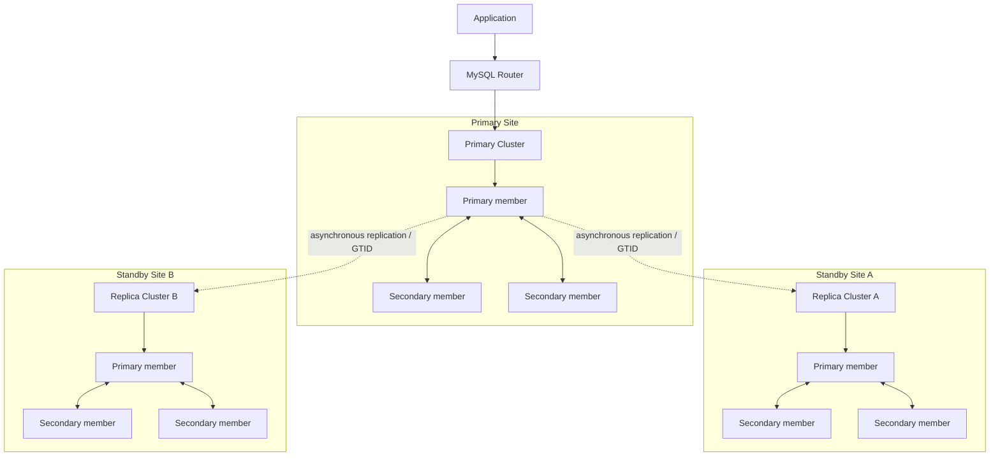

# InnoDB ClusterSet, Standby Clusters, and Supported Version Requirements

InnoDB ClusterSet extends MySQL InnoDB Cluster from a single data center to multiple sites. A ClusterSet has one **primary cluster** accepting writes and one or more **replica clusters** placed at standby sites. Each internal cluster still uses Group Replication to maintain node availability at that site; data from the primary cluster replicates to replica clusters via asynchronous replication.

This architecture helps prepare for site-level disasters such as wide-area power outages, network failures, or loss of access to the primary data center. It also offers controlled role switching during maintenance. However, because cross-cluster replication is asynchronous, a forced failover can lose transactions already committed on the primary that have not yet shipped to the standby site.

In the `DATABASE_MYSQL` module, this lesson ties together InnoDB Cluster, Group Replication, GTIDs, MySQL Router, and disaster recovery procedures. After this lesson, you will be able to:

- Describe the primary cluster and replica cluster architecture of InnoDB ClusterSet.
- Verify version and configuration prerequisites before deployment.
- Create a ClusterSet using MySQL Shell AdminAPI at a foundational level.
- Distinguish planned switchover from forced failover.
- Assess cross-site replication lag, RPO, and data-loss risk.
- Inspect cluster status, Router routing, and DR drill readiness.

## 1. Distinguishing single-site HA from multi-site DR

High availability (HA) keeps a service running when one or a few components within a site fail. Disaster recovery (DR) prepares recovery capabilities when an entire site or infrastructure region becomes unusable.

InnoDB Cluster provides HA within a cluster using Group Replication. Members exchange transaction data and maintain group state; in single-primary mode, only one member acts as primary accepting writes at a time. If the primary member fails, the group can elect a new primary member through Group Replication.

InnoDB ClusterSet links multiple InnoDB Clusters. One cluster is designated the primary cluster; the others are replica clusters. Replication across clusters uses a GTID-based asynchronous channel. Therefore:

- Group Replication handles availability and consensus within each individual cluster.
- Asynchronous replication transfers changes from the primary cluster to replica clusters.
- ClusterSet manages primary/replica roles, metadata, and role-switching operations.
- MySQL Router can read ClusterSet metadata to route connections to whichever cluster currently holds the target role.



This diagram illustrates the conceptual flow. Each site may vary in node count and network layout, but must have enough members and failure domains to satisfy Group Replication quorum, maintenance, and fault-tolerance goals.

## 2. Roles and how data moves

### 2.1. Primary cluster

The primary cluster is the only cluster permitted to accept writes under the standard ClusterSet model. Transactions commit inside this cluster and are distributed to its Group Replication members. Changes are then asynchronously shipped to replica clusters.

### 2.2. Replica cluster

A replica cluster is a separate InnoDB Cluster, usually located in another site or region. It receives changes from the primary cluster via the cross-cluster replication channel, and Group Replication distributes those changes internally across its members. A replica cluster is kept read-only for applications while serving as standby.

Never write directly to a replica cluster to mutate application data. Independent writes on a replica can create diverged data or errant GTIDs absent from the primary cluster, complicating role switches and topology rejoining.

### 2.3. Two replication layers with distinct properties

| Scope | Mechanism | Purpose |
|---|---|---|
| Within an InnoDB Cluster | Group Replication | Maintains membership and intra-site availability |
| Between clusters in a ClusterSet | GTID-based asynchronous replication | Maintains a data copy at the DR site |

Do not interpret ClusterSet as synchronous cross-site replication. Replica clusters can lag behind the primary cluster due to network latency, heavy write loads, large transactions, or applier workers falling behind.

## 3. Version and compatibility prerequisites

InnoDB ClusterSet was introduced in the MySQL 8.0.27 release line. Baseline version requirements:

| Component | Baseline requirement |
|---|---|
| MySQL Server | MySQL 8.0.27 or newer for InnoDB ClusterSet support |
| MySQL Shell | MySQL Shell 8.0.27 or newer to use ClusterSet AdminAPI |
| MySQL Router | MySQL Router 8.0.27 or newer to recognize and route via ClusterSet metadata |

These are minimum version baselines for the ClusterSet feature, not a recommendation to keep production on old releases. Choose supported patch releases and verify release notes plus compatibility matrices across Server, Shell, and Router. In production, run compatible versions within the same release series and upgrade using supported rolling-upgrade procedures.

Never arbitrarily mix Server, Shell, and Router across distant generations assuming AdminAPI or metadata routing will behave identically. An outdated Router may not fully understand ClusterSet metadata or route to the new role after switchover.

### 3.1. MySQL configuration prerequisites

Before creating clusters, verify Group Replication and InnoDB Cluster prerequisites, including:

- `gtid_mode=ON`.
- `enforce_gtid_consistency=ON`.
- `binlog_format=ROW`.
- `log_replica_updates=ON` per topology requirements.
- `group_replication_single_primary_mode=ON`; InnoDB ClusterSet uses single-primary mode for its clusters and does not deploy multi-primary clusters in this topology.
- Unique `server_id` on each instance.
- Unique `server_uuid`; never clone a data directory in a way that duplicates server identities.
- Application tables use InnoDB and have primary keys meeting Group Replication requirements.
- Instances within the same cluster share compatible settings, especially those affecting metadata and replication.
- Networking between members permits bidirectional connections on required MySQL and Group Replication ports.

AdminAPI can check and configure many settings automatically. Even so, run pre-deployment checks and resolve every warning or incompatible setting rather than ignoring check output.

### 3.2. Network and infrastructure prerequisites

- Each site needs enough nodes to keep quorum during failures or maintenance. Three members across independent failure domains are common for a small cluster; actual counts depend on fault-tolerance goals.
- Inter-site latency, bandwidth, and stability must match expected change volume.
- DNS, IP addresses, and TLS certificates must be stable; all nodes must resolve and authenticate endpoints properly.
- Admin and replication accounts must hold least privilege and be stored in a secret manager.
- Backups, monitoring, time synchronization, and operational access must be ready at both primary and DR sites.

Do not place all nodes of a cluster inside the same physical failure domain if your HA goal is surviving rack, switch, or power failures. Likewise, never assume geographic distance alone guarantees DR: the standby site must be independently tested and provisioned with enough capacity for production traffic.

## 4. Preparation before creating a ClusterSet

Build a pre-deployment inventory:

| Item | Details to record |
|---|---|
| Versions | Server, Shell, Router, and OS on each node |
| Members | Hostname, port, `server_id`, `server_uuid`, site, and intended role |
| GTIDs | `gtid_mode`, `enforce_gtid_consistency`, current GTID sets, and data origin |
| Group Replication | Group name, communication stack, ports, quorum status |
| Networking | Cross-site latency, firewalls, DNS, TLS, and bidirectional reachability |
| Data | Storage engine, primary keys, dataset size, write rate, and critical tables |
| DR | RTO, RPO, failover decision-maker, fencing process, and runbook |
| Router | Version, deployment placement, metadata account, and application endpoints |

Instances intended for a replica cluster must be prepared following ClusterSet procedures. Never drop a server holding independent data or unknown GTIDs into the topology expecting AdminAPI to merge it safely. Identify the seed instance, initial synchronization method, and GTID state before adding nodes.

## 5. Creating an InnoDB ClusterSet with MySQL Shell

The examples below use MySQL Shell JavaScript mode and a prepared admin account. Hostnames, passwords, and cluster names are illustrative. Before running, confirm nodes do not belong to another topology and have passed configuration checks.

### 5.1. Configuring instances

Connect to each instance with MySQL Shell and run configuration checks/updates:

```javascript
dba.configureInstance('ic_admin@primary-1.example:3306');
dba.configureInstance('ic_admin@primary-2.example:3306');
dba.configureInstance('ic_admin@primary-3.example:3306');
```

Repeat for nodes slated for the replica cluster. The command may prompt for confirmation and propose configuration changes requiring a restart. Review outputs before applying on active servers.

### 5.2. Creating the primary InnoDB Cluster

Connect to the primary site's seed node, then create the cluster and add members:

```javascript
var primaryCluster = dba.createCluster('primaryCluster');

primaryCluster.addInstance('ic_admin@primary-2.example:3306');
primaryCluster.addInstance('ic_admin@primary-3.example:3306');

primaryCluster.status({extended: 1});
```

Confirm members are `ONLINE`, the cluster has a primary member, and no Group Replication errors exist before continuing. Do not create a ClusterSet while the primary cluster is unstable.

### 5.3. Creating the ClusterSet and adding a replica cluster

From the primary cluster object, create the ClusterSet:

```javascript
var clusterSet = primaryCluster.createClusterSet('productionClusterSet');
```

Add a replica cluster using a seed instance at the standby site:

```javascript
var drCluster = clusterSet.createReplicaCluster(
  'ic_admin@dr-1.example:3306',
  'drCluster'
);

drCluster.addInstance('ic_admin@dr-2.example:3306');
drCluster.addInstance('ic_admin@dr-3.example:3306');

clusterSet.status({extended: 1});
```

AdminAPI sets up the replica cluster and cross-cluster replication according to topology state. Depending on dataset size and provisioning method, adding a replica can take time and consume network/disk I/O. Monitor progress and never allow application writes to the replica cluster.

If adding a second DR site, run a separate replica cluster creation flow once the current site is stable. Each cluster needs a unique name and clear member details.

## 6. Inspecting status and replication

MySQL Shell AdminAPI provides status at both the ClusterSet and individual cluster levels:

```javascript
clusterSet.status({extended: 1});
primaryCluster.status({extended: 1});
drCluster.status({extended: 1});
```

When reviewing output, confirm:

- The ClusterSet identifies the expected primary cluster.
- Replica clusters are in a valid state and recognized in metadata.
- Members inside each cluster are `ONLINE` with quorum.
- Cross-cluster replication is active with no I/O or SQL errors.
- Replica cluster GTIDs are advancing toward primary state within expected lag.
- No independent writes or errant transactions exist on replica clusters.

At the MySQL layer, you can also inspect:

```sql
SHOW REPLICA STATUS\G

SELECT
    @@GLOBAL.gtid_executed AS executed_gtid_set,
    @@GLOBAL.gtid_purged AS purged_gtid_set,
    @@GLOBAL.read_only AS read_only,
    @@GLOBAL.super_read_only AS super_read_only;
```

`SHOW REPLICA STATUS` applies to modern MySQL releases; older versions use `SHOW SLAVE STATUS`. ClusterSet manages channels and state via AdminAPI, so do not manually modify replication channels with `CHANGE REPLICATION SOURCE TO` without understanding the impact on ClusterSet metadata.

Do not rely on a single lag number. Combine channel status, GTID sets, applier errors, cross-site latency, and application telemetry. A replica may have received logs without finishing applying them.

## 7. MySQL Router and application routing

MySQL Router reads topology metadata to see which cluster is currently primary and routes connections by endpoint type. When using ClusterSet, deploy a Router version supporting ClusterSet and bootstrap it against an instance in the configured topology.

Illustrative bootstrap command:

```bash
mysqlrouter \
  --bootstrap router_admin@primary-1.example:3306 \
  --directory /opt/mysqlrouter-clusterset
```

Depending on version and installation method, additional options, Router accounts, and directory permissions may be required. Inspect the generated config file and frontend ports before letting applications connect.

Points to verify:

- The read-write endpoint routes to the current primary cluster.
- After switchover/failover, Router refreshes metadata and directs new connections to the new primary cluster.
- Active open connections may drop during topology role changes; applications need bounded retries and handling for unknown transaction outcomes.
- Never assume the read-only endpoint automatically reads from any replica cluster you wish. Routing scope depends on Router config, metadata, and deployment policy.
- Applications should connect via Router or a verified routing layer rather than pinning a physical primary member hostname.

After role changes, test with fresh connections and query the server/cluster target. Also test scenarios where Router loses metadata access or a node is removed from a cluster.

## 8. Planned switchover: switching primary in a controlled manner

Switchover fits when the primary site is still healthy and operations proactively shifts roles—such as for data center maintenance or DR drills. The goal is transferring the primary cluster without losing acknowledged transactions.

Before switching:

1. Confirm both the primary cluster and target replica cluster are healthy.
2. Verify cross-cluster replication has no errors and the replica cluster has caught up with the primary.
3. Identify the required GTID set and confirm the replica has executed all transactions to preserve.
4. Control or pause write streams per runbook to avoid new mutations during the role-switch window.
5. Confirm Router and applications handle dropped connections, reconnects, and retries.

AdminAPI provides a planned primary cluster switch operation:

```javascript
clusterSet.setPrimaryCluster('drCluster');
clusterSet.status({extended: 1});
```

Once complete, verify metadata shows `drCluster` as the primary cluster, other clusters hold replica roles, and Router directs new connections properly. Run read/write smoke tests with test data before opening full traffic.

During a planned switchover, never skip verifying the replica has caught up. Switching primary while the replica still lacks transactions can introduce a data gap relative to the prior source state.

## 9. Forced failover: switching primary when the primary site fails

Forced failover is used when the primary cluster becomes unreachable or cannot recover within the allowed window. Because cross-cluster replication is asynchronous, a replica cluster may not yet have received every transaction committed on the primary before the outage. This is a DR decision that can impact RPO.

High-level procedure:

1. Confirm the primary cluster is truly unavailable and assess incident scope.
2. **Fence** the old site: ensure the old primary cannot keep accepting writes or resume operating independently once the standby site is promoted.
3. Evaluate surviving replica clusters and choose the one with the furthest-advanced GTID set aligned with data policy.
4. Record the candidate's GTID set and estimate transactions potentially left untransferred.
5. Obtain DR owner sign-off on RPO and acceptable data loss.
6. Execute forced failover via AdminAPI:

```javascript
clusterSet.forcePrimaryCluster('drCluster');
clusterSet.status({extended: 1});
```

7. Confirm the new cluster is primary, Router routes to the right cluster, and the application operates properly.
8. When the old site recovers, do not immediately reopen it for writes. Evaluate GTIDs, handle errant transactions, and follow ClusterSet-supported rejoin/rebuild workflows.

`forcePrimaryCluster()` is an emergency operation. It cannot recreate transactions the replica never received. If the old primary can still accept writes while the new cluster is active, the system risks split-brain and two independent data branches. Fencing must be confirmed before opening writes at the new site.

## 10. RPO, RTO, and data-loss risk

RPO is the maximum acceptable data loss an organization can tolerate, usually expressed in time. RTO is the maximum duration allowed to restore service. ClusterSet structures DR but does not automatically guarantee fixed RPO/RTO numbers.

Because cross-cluster replication is asynchronous:

- The primary can commit transactions before a replica cluster receives or applies them.
- If the primary site fails suddenly, the newest transactions may be absent on the replica.
- Picking the replica with the newest GTID set minimizes missing data, though it cannot prove every application transaction survived if the source is inaccessible.
- Lag depends on networking, transaction volume, apply speed, and DR site load.

Measure actual RPO by recording GTID/transaction markers at the source and checking when markers appear on the replica. Measure RTO from incident confirmation until the application successfully serves again through Router, including fencing, role switching, reconnection, and smoke tests.

Never use ClusterSet as a replacement for backups. Independent backups remain essential for recovering from accidental deletions, logic bugs, ransomware, or errors replicated across all replica clusters.

## 11. Rejoining and rebuilding the old site

After failover, the old site may hold transactions absent from the new primary or miss transactions committed on the new primary. Never flip `read_only=OFF` and let applications write to the old site.

Recovery requires:

- Keeping the old site fenced until its data state is fully determined.
- Checking ClusterSet metadata, `gtid_executed`/`gtid_purged`, and errant transactions.
- Determining whether the old node/cluster can rejoin via supported AdminAPI mechanisms or needs re-provisioning from the new primary.
- Allowing ClusterSet to manage the cluster again only once GTIDs and data satisfy requirements.
- Confirming the old cluster transitions to a replica cluster tracking the new primary.
- Verifying Router, monitoring, backups, and runbooks reflect the updated topology.

If GTIDs cannot be reconciled automatically or data has diverged, rebuild the replica cluster via supported workflows rather than trying to merge two diverged histories.

## 12. Monitoring and alerting

A ClusterSet deployment needs monitoring for each individual cluster as well as cross-site replication.

| Metric group | What to track | Purpose |
|---|---|---|
| Cluster members | `ONLINE`/`OFFLINE`, quorum, primary member | Detect node outages or quorum loss |
| Cross-cluster replication | Channel status, I/O/SQL errors, received/executed GTIDs | Detect a replica falling behind or stopping |
| Lag | Time and unapplied GTID gap | Estimate current RPO exposure |
| Network | Latency, packet loss, bandwidth, and connectivity | Identify causes of replication lag |
| Router | Metadata refresh, frontend/backend connections, routing errors | Confirm apps follow the active primary |
| Application | Error rate, reconnects, transaction retries, response latency | Measure user-facing impact |
| Backups | Latest backup age, restore test results, storage health | Ensure independent recovery capability |

Set alert thresholds tied to agreed RPO/RTO targets. A "10-second replica lag" alert is meaningful only once the organization defines whether 10 seconds violates its RPO budget. Also alert on stopped replication channels, applier errors, quorum loss, Router failing to refresh metadata, and failed backup checks.

## 13. Common issues

| Symptom | Possible cause | Troubleshooting direction |
|---|---|---|
| Cannot create ClusterSet | Unsupported version, unhealthy cluster, or GTID config not met | Check Server/Shell versions, `cluster.status()`, and precheck output |
| Cannot add replica cluster | Seed instance has incompatible data/GTIDs, network, or insufficient privileges | Verify data origin, GTIDs, accounts, TLS, and cross-site connectivity |
| Replica cluster lag rising | Slow network, huge transactions, heavy apply load, or channel error | Inspect channel status, applier workers, host resources, and bandwidth |
| Router still sends traffic to old primary | Outdated Router, unrefreshed metadata, or stale connections | Check Router version, metadata cache, and open fresh connections |
| Switchover fails to finish | Replica not caught up or topology errors exist | Resolve lag/errors, verify GTIDs, and retry planned switchover workflow |
| Forced failover risks losing transactions | Replica has not received all transactions from primary | Compare GTID sets, evaluate RPO, and record DR approval |
| Cannot rejoin old site | Errant GTIDs or diverged data | Fence old site, inspect state, and rebuild/reprovision via AdminAPI |
| Both sites accepting writes | Failed fencing or manual edits breaking ClusterSet roles | Cut writes at old site, isolate topology, and resolve split-brain before resuming service |

When investigating, capture `clusterSet.status({extended: 1})`, individual cluster statuses, GTID sets, replication status, Router logs, and incident timestamps. Never delete metadata or reset replication channels as a quick guess without a clear recovery plan.

## 14. DR drill runbook

Drills must verify both data integrity and application connectivity:

1. Verify versions, configurations, backups, and ClusterSet status before the drill.
2. Write a test batch of transactions with unique identifiers on the primary cluster.
3. Measure how long transactions take to appear on the replica cluster and record GTID markers.
4. Execute a planned switchover, verify Router shifts endpoints, and verify the application reads/writes cleanly.
5. Switch roles back via planned switchover after verifying topology health.
6. In a separate drill, simulate primary-site outage under an approved scenario with real fencing.
7. Select the replica cluster, record GTID sets, and document RPO sign-off before forced failover.
8. Verify Router, applications, accounts, and background jobs operate at the new site.
9. Restore the old site and execute rejoin or rebuild per supported procedure.
10. Measure RTO/RPO, log manual steps, errors, data discrepancies, and update the runbook.

Never test forced failover by cutting networking or killing production nodes outside an approved drill window. Use a lab environment mirroring production topology to practice fencing, replica selection, and old-site recovery.

## 15. Practical scenario

An e-commerce platform runs a primary site in region A and a DR site in region B. Each site has a three-node InnoDB Cluster. Applications connect via MySQL Router. The goal is maintaining HA inside each site and failing over across sites if region A suffers a disaster.

Practice in a lab environment:

1. Verify MySQL Server, Shell, and Router are all on ClusterSet-supported versions.
2. Verify GTIDs, `enforce_gtid_consistency`, `binlog_format`, `server_id`, `server_uuid`, networking, and TLS.
3. Create an InnoDB Cluster at site A, add the remaining nodes, and verify quorum.
4. Create a ClusterSet and add the InnoDB Cluster at site B as a replica cluster.
5. Run `clusterSet.status({extended: 1})` to inspect roles and replication.
6. Bootstrap Router and verify the read-write endpoint routes to the primary cluster.
7. Write marker transactions, measure replication delay to site B, and record GTID sets.
8. Perform a planned switchover to site B; verify Router and applications continue operating.
9. In an isolated lab topology, simulate site A becoming unreachable, apply fencing, and execute forced failover.
10. Bring site A back, inspect GTIDs, and run rejoin or rebuild; record actual RTO/RPO.

**Self-check questions:**

- What two distinct availability scopes do InnoDB Cluster and InnoDB ClusterSet address?
- Why is replication between clusters asynchronous, and how does that affect RPO?
- What are the minimum MySQL Server, Shell, and Router versions required for ClusterSet?
- Why should you never write directly to a replica cluster?
- How does planned switchover differ from forced failover in prerequisites and data-loss risk?
- Why must the old primary be fenced before opening writes on the standby cluster?
- What do `Retrieved_Gtid_Set` and `Executed_Gtid_Set` help evaluate?
- Why does ClusterSet not replace independent backups?

## Conclusion

InnoDB ClusterSet pairs intra-cluster HA via InnoDB Cluster with cross-site DR via asynchronous replication. Reliable deployment requires compatible Server, Shell, and Router versions, proper GTID and Group Replication configuration, stable cross-site networking, and rehearsed role-transition runbooks. Planned switchover preserves transactions when the replica is caught up; forced failover demands fencing and explicit RPO sign-off because untransferred transactions can be lost. Always verify data, Router, and application behavior in every DR drill.
