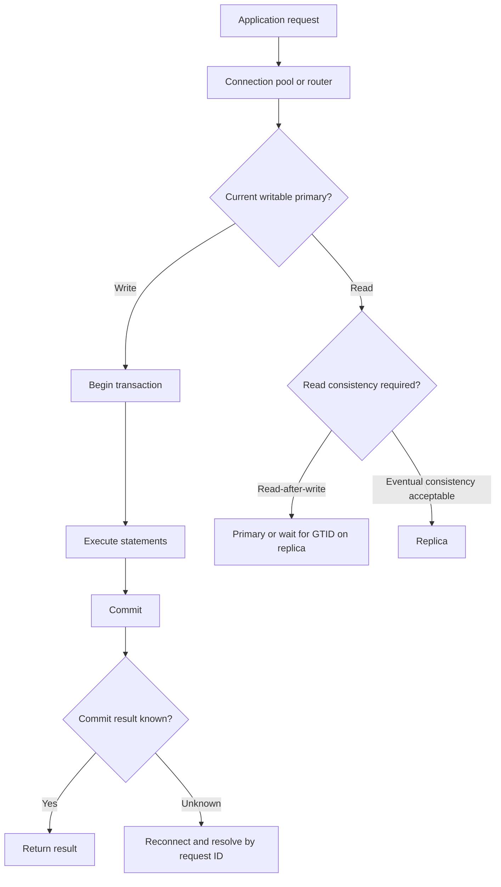

# Testing Connection Drops, Stale Reads, and Application Transaction Retries

## Objectives

A MySQL system with replication or failover can still expose applications to errors at unpredictable moments: connections drop mid-transaction, the primary moves to another host, a replica has not applied the newest transaction, or the client does not know whether `COMMIT` succeeded. High availability is meaningful only when the application handles these scenarios without losing or duplicating business actions.

This lesson belongs to the **DATABASE_MYSQL** module, covering table design, data types, keys, SQL queries, indexes, transactions, concurrency control, query tuning, and relational database operations. It helps you design failure tests from the application's perspective, classify transaction outcomes, handle stale reads, and build bounded retry policies.

After this lesson, you will be able to:

- Describe the connection interruptions and transaction states an application can observe.
- Distinguish immediately retryable errors from unknown `COMMIT` outcomes.
- Design idempotent operations so retries do not duplicate side effects.
- Choose the primary or a replica appropriately for read-after-write requirements.
- Test failover, stale reads, timeouts, retries, and connection recovery in a controlled environment.

## 1. Why test from the application?

Replication and failover protect availability at the database tier, yet applications still face timeouts, connection resets, DNS caches, stale connection pools, replica lag, and transactions with uncertain outcomes. A new host may already be primary while a connection pool still holds open sockets to the old primary. A read query may succeed on a replica while returning data from before a just-completed write.

Therefore, HA testing must observe the entire path of a request:



Tests should verify both database state and application responses. An endpoint returning HTTP 200 alone does not prove a transaction executed exactly once; conversely, a client timeout does not prove the server rolled back.

## 2. Common connection failure modes

| Scenario | What the application observes | Required handling |
|---|---|---|
| Network loss before sending statements | Connect timeout or connection refused | No statement was sent; reconnect and retry per retry policy |
| Disconnect while executing statements | Read timeout or connection lost | Unknown how far the server progressed; determine transaction state before retrying |
| Disconnect while `COMMIT` is in flight | Client timeout or connection lost error | Commit outcome is uncertain to the client |
| Primary restart or failover | Connection reset, server gone away | Connection pool must evict broken sockets and locate the current primary |
| DNS or endpoint change | Connects to old address or fails resolution | Resolver, proxy, and pool must refresh endpoints per architecture |
| Lagging replica | Query succeeds but returns stale data | Pick a read path satisfying business consistency needs |
| Replica applier stopped | Receiver may keep fetching events while data stops advancing | Monitor applier status and route sensitive reads to the primary if needed |

Common MySQL error codes:

- `2006` (`MySQL server has gone away`) and `2013` (`Lost connection to MySQL server during query`): the connection dropped; inspect the running statement and transaction boundary.
- `1205` (`Lock wait timeout exceeded`): lock wait timed out; applications should roll back the transaction per policy before considering a full transaction retry.
- `1213` (`Deadlock found`): InnoDB chose the transaction as deadlock victim and rolled it back; the whole transaction can be retried within bounds.
- `1062` (`Duplicate entry`): unique constraint violation; typically a data conflict or sign that a request already ran—not a transient error to retry blindly.

Do not classify errors solely by message text. Use error codes, SQLSTATE, transaction phase, and driver metadata to decide the right action.

## 3. Distinguishing errors before, during, and after COMMIT

The most important boundary when retrying is *when* the connection dropped relative to `COMMIT`.

**Before starting a transaction:** if connecting fails before any statement is sent, the request made zero changes in MySQL. The application can obtain a new connection and retry within the request deadline.

**Inside a transaction, before COMMIT:** if the connection closes, an uncommitted transaction will normally roll back once the server detects session termination. Still, the client must never reuse a broken connection or assume every error rolled back instantaneously. Discard the connection, reconnect, and retry only under an idempotent design.

**While COMMIT is in progress:** the client may send `COMMIT` and the server may commit successfully, yet the response drops on the wire. The client sees only a timeout or lost connection. This is an *ambiguous commit*: the server may or may not have committed. Re-submitting the whole business operation as a new request can double the effect.

**After receiving COMMIT confirmation:** the application can return success. If the response to the end user drops afterward, the user or gateway may resend the request. This also underscores why idempotency is required at the business layer.

You cannot deduce commit outcome merely from a client exception. Whenever the outcome is uncertain, query business state using a stable request identifier or use an idempotent operation to retry safely.

## 4. Retrying at the proper transaction boundary

On deadlock `1213`, InnoDB rolls back the victim transaction. Applications must re-run the entire transaction from the beginning, including any reads on which business decisions depend. Never re-run only the last statement, because previously read values may already have changed.

On lock wait timeout `1205`, rollback behavior depends on `innodb_rollback_on_timeout`; by default it typically rolls back only the timed-out statement. To avoid leaving a transaction in an unexpected partial state, the safest common pattern is explicitly issuing `ROLLBACK` for the whole transaction before retrying from scratch if the error is deemed transient.

Example transaction structure:

```sql
START TRANSACTION;

SELECT balance
FROM accounts
WHERE account_id = 1001
FOR UPDATE;

UPDATE accounts
SET balance = balance - 50000
WHERE account_id = 1001;

UPDATE accounts
SET balance = balance + 50000
WHERE account_id = 2002;

COMMIT;
```

If this transaction hits a deadlock, the application must re-run the entire transfer logic after classifying the error as retryable. During the retry, re-read the balance and re-check business rules inside the fresh transaction. This example only illustrates transaction boundaries; production code must validate sufficient balance, positive amounts, valid accounts, and record transaction IDs.

Practical guidelines:

1. Cap retry counts and total retry duration by the request deadline.
2. Use exponential backoff with jitter so clients do not retry in synchronized waves.
3. Retry the entire transaction after a deadlock; on lock timeout, roll back the transaction before starting over.
4. Never retry syntax errors, privilege errors, invalid data, or duplicate keys as though they were network blips.
5. When commit outcome is uncertain, use the same idempotency key to resolve or guarantee the result.
6. Log error codes, retry counts, wait durations, and request IDs; avoid logging secrets or sensitive data.

## 5. Idempotency: the foundation of safe retries

An idempotent operation can be submitted multiple times with the same identifier while producing the same business outcome as executing once. This is critical whenever the client does not know whether the previous attempt committed.

For example, a payment request should carry a unique `request_id` generated by the application and preserved across every retry. The database uses a unique key to guarantee the same request never applies two balance changes.

```sql
CREATE TABLE processed_requests (
  request_id BINARY(16) NOT NULL PRIMARY KEY,
  result_code VARCHAR(32) NOT NULL,
  created_at TIMESTAMP NOT NULL DEFAULT CURRENT_TIMESTAMP
) ENGINE = InnoDB;
```

Within the same transaction, the application records the request and performs the business update:

```sql
START TRANSACTION;

INSERT INTO processed_requests (request_id, result_code)
VALUES (UUID_TO_BIN(?), 'PROCESSING');

UPDATE accounts
SET balance = balance - ?
WHERE account_id = ?;

UPDATE processed_requests
SET result_code = 'SUCCESS'
WHERE request_id = UUID_TO_BIN(?);

COMMIT;
```

This is an illustrative pattern. Applications must check affected row counts and business conditions before marking success. If `INSERT` fails with a duplicate key error because `request_id` already exists, roll back the retry transaction and read the stored outcome on the primary in a new transaction. If the first request is still running, the duplicate insert waits for the unique lock to release; afterward it succeeds if the first transaction rolled back or raises duplicate key if the first transaction committed. The application returns the saved result instead of re-executing side effects. If the prior transaction rolled back, the idempotency row rolled back with it, allowing the retry to process the request cleanly.

When `COMMIT` loses its response, reconnect to the authoritative primary once failover stabilizes and look up `request_id`. If the request already committed, return the stored outcome. If no record exists, retry safely with the same request ID. In fault-tolerant designs, writing the idempotency record and applying the business mutation must live inside the same InnoDB transaction.

Never generate a new request ID on each retry. Using a fresh ID per attempt strips the unique constraint of its ability to prevent duplicate execution.

## 6. Stale reads and read-after-write

Asynchronous replication lets the source commit before replicas apply the corresponding transaction. Consequently, immediately after an application writes to the primary, a read query routed to a replica can return older data.

Example:

1. The application updates an order status on the primary and receives commit confirmation.
2. Router sends the next `SELECT` query to a replica.
3. The replica's applier has not yet executed the order-update transaction.
4. The application sees the previous status even though the write succeeded on the primary.

This is not necessarily data loss; it can simply be replication lag. Choose a read strategy matching business requirements:

| Requirement | Appropriate strategy |
|---|---|
| Must immediately see just-written data | Continue reading from the primary within that workflow |
| Can wait briefly for replica catch-up | Wait for the transaction's GTID to apply, then read the replica |
| Reports or lists tolerant of lag | Read from replica and display last-updated/freshness timestamp |
| Strong consistency across multiple related operations | Stay on the primary or use synchronization suited to topology |

### Waiting for a replica to apply a GTID

MySQL provides `WAIT_FOR_EXECUTED_GTID_SET(gtid_set, timeout)` to wait until an instance executes every GTID in the specified set. It returns `0` when executed within the timeout, `1` on timeout, and `NULL` on error.

```sql
SELECT WAIT_FOR_EXECUTED_GTID_SET('<transaction-gtid>', 5);
```

The application must capture the GTID of the transaction just committed on the primary. You can use session tracking with `session_track_gtids=OWN_GTID` if your MySQL client library supports reading session state returned after commit, then pass that GTID to the wait query on the replica. Avoid taking an arbitrary snapshot of `@@GLOBAL.gtid_executed` and treating the whole set as the request's own GTID, since it may include other sessions' transactions.

If the function returns `1` due to timeout, the replica missed the read-after-write deadline. The application can fall back to reading from the primary or report a pending state per business policy. If it returns `NULL`, log the error and investigate. Only read from the replica after the GTID wait condition succeeds.

A GTID wait only proves the transactions in that GTID set executed on that specific instance; it does not replace topology health checks, fix broken replicas, or guarantee a replica is an eligible read target post-failover.

## 7. Connection pools and post-failover routing

Connection pools reuse connections, yet open sockets to an old primary become invalid after a restart or failover. Applications need mechanisms to:

- Discard connections after network or server errors; never return broken sockets to the pool.
- Reconnect via an endpoint/proxy/router capable of locating the current primary.
- Verify the target node allows writes according to its current role; never infer role solely from a historical hostname.
- Enforce appropriate connect timeouts, read timeouts, and business deadlines.
- Bound reconnection concurrency to avoid a connection storm against a recovering database.
- Monitor DNS cache TTLs, health checks, and proxy topology refresh intervals.

On the MySQL side, `read_only` and `super_read_only` help block unintended writes on replicas. Still, failover requires orchestration and fencing so the old primary cannot keep accepting writes after a new primary is chosen. If two nodes accept writes concurrently, data diverges; application retries cannot fix split-brain.

During primary transitions, understand your system's RPO. With asynchronous replication, a transaction committed on the old primary might not have reached the promoted replica. Semi-synchronous replication narrows the data-loss window without guaranteeing zero loss across every failure mode. Applications must reconcile transaction outcomes against real RPO policies.

## 8. Application-level HA testing matrix

Run these tests in a staging environment with synthetic test data and clear recovery procedures:

| Scenario | Controlled fault injection | What to verify |
|---|---|---|
| Disconnect before transaction | Temporarily block connection or stop endpoint before sending SQL | Client reconnects; zero data changes occur |
| Disconnect mid-transaction | Drop session after several statements before commit | Transaction is not treated as succeeded; retry starts from scratch |
| Lost `COMMIT` response | Use a test proxy to drop response after forwarding `COMMIT` | App looks up the same request ID and avoids duplicating side effects |
| Deadlock | Create two transactions locking rows in opposite order in test env | One transaction gets deadlock error; full-transaction retry succeeds or fails cleanly |
| Lock wait timeout | Hold a row lock in another session while running a waiting statement | App rolls back, applies bounded retry, and leaves no half-done transaction |
| Replica lag | Pause applier or introduce controlled apply load | Replica reads return older data; read-after-write uses primary or GTID wait |
| Primary failover | Stop test primary and trigger promotion | Pool drops stale sockets, router switches to new primary, writes never hit wrong role |
| Duplicate request retry | Send concurrent requests with the same idempotency key | Only one side effect commits; other requests receive the saved outcome |

Log timestamps, request IDs, connection endpoints, node/role, GTIDs where available, error codes, retry counts, and data outcomes. Compare results against RTO/RPO targets and application consistency guarantees.

## 9. Designing bounded retries

Excessive retries worsen overload. A solid policy includes:

1. **Allowlist of retryable errors:** e.g., deadlocks, certain lock timeouts, and transient connection errors; classify ambiguous commits separately.
2. **Attempt caps and deadlines:** total retry time must never exceed what the request or caller can wait for.
3. **Exponential backoff and jitter:** progressively increase wait intervals and add randomness to prevent retry storms.
4. **Circuit breakers or admission control:** throttle new requests while the database is unhealthy to protect both the application and MySQL.
5. **Stable idempotency keys:** keep the exact same ID across all retries and persist outcomes inside the business transaction.
6. **Observability:** measure error rates, retries, ambiguous commits, replica lag, pool exhaustion, and failover duration.

Never retry infinitely or retry every exception automatically. Permission errors, bad SQL, constraint violations from invalid input, or business validation errors must be handled differently.

## 10. Practice exercise

In a MySQL staging environment with one primary and at least one replica:

- Create a business table with a primary key and a `processed_requests` table with a unique `request_id`.
- Build a test API or program using multi-statement transactions and a connection pool.
- Send a request, drop the connection before commit, and verify zero partial changes remain.
- Send another request and drop the `COMMIT` response; reconnect and use the same `request_id` to resolve the outcome.
- Pause the applier, write data on the primary, and read from the replica to observe stale data.
- Test `WAIT_FOR_EXECUTED_GTID_SET()` with the committed transaction's GTID if your client supports session tracking; confirm you read the replica only when the function returns `0`.
- Trigger controlled deadlocks and lock wait timeouts, verifying the app rolls back and retries the full transaction cleanly.
- Execute a staging failover, verifying the pool evicts stale connections and writes go only to the new primary after the old node is fenced.

**Completion criteria:** zero duplicated side effects when retrying the same request ID; the application recognizes ambiguous commit outcomes; read-after-write queries do not violate policy with stale data; and after failover, the application connects to the right primary within the target time budget.

## Conclusion

HA testing must start from application behavior when connections and transactions are interrupted. Distinguish pre-commit errors from ambiguous commit outcomes, use idempotency keys for safe retries, read from the primary or wait for GTIDs when read-after-write is required, and force connection pools to refresh endpoints after failover. Regularly testing connection drops, stale reads, deadlocks, and primary switches provides concrete evidence of your system's true availability.
