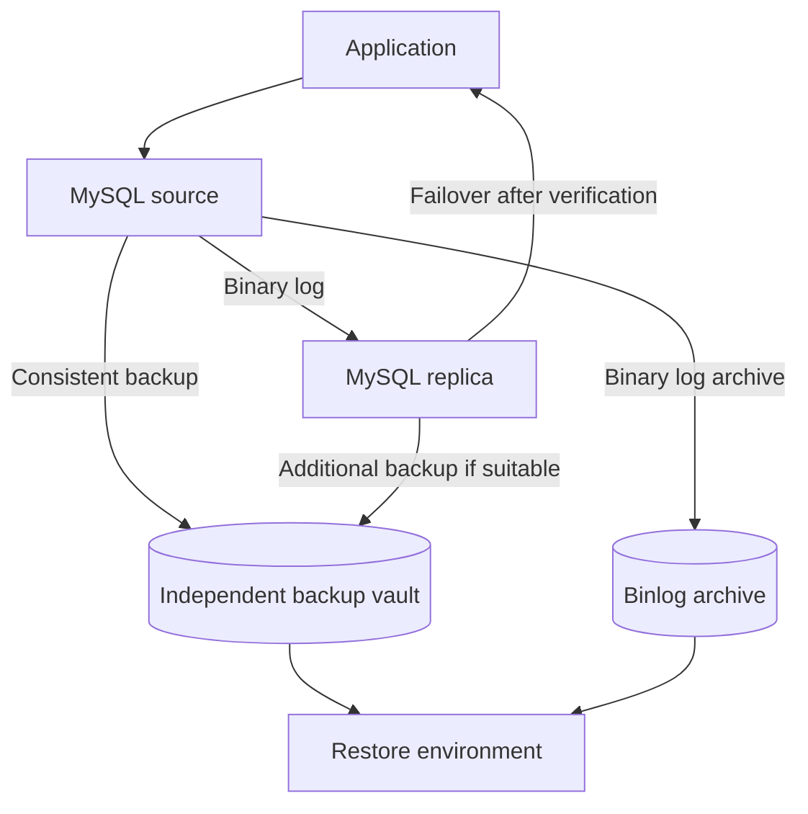

# Reconciling Backups, Replication, and Recovery Drills in a Unified Plan

In the `DATABASE_MYSQL` module, learners master MySQL from table design, data types, keys, and SQL queries through indexes, transactions, concurrency control, execution plan reading, query optimization, privileges, backups, and relational database troubleshooting. This lesson connects three capabilities that are often implemented in isolation: backups, replication, and recovery drills. The goal is building a high-availability and disaster-recovery plan verifiable through real data, timings, and procedures.

Backups, replication, and failover solve different classes of failure. Replication maintains a copy of data on another server so service can switch over when the source fails. Backups preserve independent point-in-time snapshots to recover from accidental deletions, logic bugs, data corruption, or complete environment loss. Recovery drills prove that backups, binary logs, configurations, credentials, and runbooks truly suffice to restore application operation. A sound plan coordinates all three.

## 1. Roles of backups, replication, and failover

| Capability | Primary purpose | Suitable scenarios | Limitations to understand |
|---|---|---|---|
| Backup | Preserves independently recoverable point-in-time data snapshots. | Accidental deletes, bad updates, logic bugs, data corruption, loss of server or storage. | Restore takes time; untested backups may be unusable. |
| Replication | Maintains a data copy on one or more separate servers. | Current source fails; need to shift read/write load to another server. | Bad mutations replicate too; replicas can lag or miss transactions. |
| Failover | Transfers serving role to another server when the current one stops responding. | Server, OS, or network zone failure, or planned maintenance. | Requires picking the right candidate, fencing old source, rerouting apps, and verifying data. |
| Restore drill | Executes controlled recovery and measures results. | Verifying recoverability, actual timings, and procedural completeness. | Consumes time and resources; requires a test environment sufficiently close to production. |

Replication is not a backup. If an application runs an accidental `DELETE` on the source, that transaction can apply on replicas almost instantaneously. If a logic bug writes corrupt data, replicas faithfully copy that bug. Conversely, an independent backup captured before the incident lets you restore to a point before data was destroyed.

Nor do backups replace replication. When a production server dies, restoring a huge database from backup can take hours. A healthy, caught-up replica dramatically shortens service cutover time. Even then, a replica becomes a safe recovery candidate only after verifying transaction completeness and ruling out split-brain.

## 2. Setting unified recovery objectives for the whole system

Before choosing tools, define targets at both the service and data layers.

### RTO and RPO

- **RTO (Recovery Time Objective):** the maximum downtime an organization tolerates. During drills, measure from the agreed incident timestamp until the application operates and essential checks pass.
- **RPO (Recovery Point Objective):** the maximum data window an organization tolerates losing. During drills, identify and verify the latest committed transaction present in the recovered environment.

For example, an e-commerce system has an RTO of 30 minutes and an RPO of 5 minutes. An in-region replica enables quick failover, yet if that replica lags by 8 minutes it fails RPO. A nightly full backup enables recovery from logic bugs, yet without continuous binary logs the recovery point could sit hours behind the incident. Targets must be validated across both the replication stream and the backup/binlog chain.

Do not force one blanket RTO/RPO across every schema or service if criticality differs. Order and payment tables need tighter RPOs than regenerable reporting tables. Classify data by business impact, dependencies, and reconstructability.

### Defining recovery scope

The plan must explicitly document:

1. Which applications use the database, and which schemas and tables are critical.
2. Which objects must be restored alongside data: views, triggers, routines, events, users, roles, grants, and related configuration.
3. Dependent services: DNS, proxies, secret managers, certificates, queues, object storage, and job schedulers.
4. Failure domains covered: process crashes, server failures, racks, cloud zones, cloud accounts, network outages, or logical corruption.
5. Who holds authority to declare an incident, choose the recovery point, approve failover, and sign off on business data.

Defining scope prevents ending up with a running database while the application remains broken due to missing accounts, certificates, configurations, or dependent services.

## 3. Designing a combined backup and replication architecture

A baseline architecture can pair a source, an out-of-region replica, and an independent backup vault:



Design each component as follows:

- **Source:** accepts application writes, enables binary logging, and uses durability settings matching data guarantees.
- **Replica:** placed on independent infrastructure capable of surviving source outages; monitors receiver, applier, GTIDs, and lag. Read-only replicas enforce `read_only` and `super_read_only` as appropriate.
- **Backup vault:** separated from source administrative permissions and failure domains. Enforces encryption, checksum validation, access control, and immutability/delete protection.
- **Binary log archive:** ships logs off the source server so PITR remains possible if the source is lost. Ensures contiguous log files from the backup snapshot to any target recovery point.
- **Restore environment:** independently provisionable, running compatible MySQL versions, and sized to run data and application checks.

If taking backups from a replica, verify how your backup tool handles replication state, consistency, and binlog/GTID positions. Backing up from a replica is not automatically safe just because the replica is running. You must capture a consistent snapshot, account for applier progress, and save metadata needed for recovery.

## 4. Aligning backup snapshots with replication state

A backup useful for PITR needs a consistent boundary and coordinates to replay subsequent transactions. Depending on the tool, metadata should record:

- Backup start and completion timestamps.
- MySQL version, backup tool version, and storage engine configuration.
- Included schemas/tables and any excluded objects.
- Binary log file/position or GTID set at snapshot time.
- Backup file manifest, incremental chain if applicable, checksums, and encryption state.
- Retention period and off-domain replica copy locations.

For InnoDB logical backups, `mysqldump --single-transaction` produces a consistent snapshot without holding read locks throughout the dump. However, it does not snapshot non-transactional tables consistently and does not guard against concurrent DDL changes. For physical backups, follow your tool's prepare/apply-log workflow and preserve matching metadata.

When using binary logs for PITR, check:

```sql
SHOW VARIABLES LIKE 'log_bin';
SHOW VARIABLES LIKE 'binlog_format';
SHOW BINARY LOGS;
SELECT @@GLOBAL.gtid_executed, @@GLOBAL.gtid_purged;
```

Check a GTID-based replica using:

```sql
SHOW REPLICA STATUS\G
```

Compare `Retrieved_Gtid_Set` and `Executed_Gtid_Set` to distinguish received transactions from applied transactions. A replica that has fetched all logs while its applier is still catching up can still return stale reads. `Seconds_Behind_Source` is an estimate and should never be the sole proof that a replica has caught up.

## 5. Selecting strategies per incident scenario

A mature plan never applies the same action to every outage. Distinguish server failures, logical data corruption, and full storage/region outages.

| Scenario | Primary response | Role of backups and replication |
|---|---|---|
| MySQL process or source server fails | Restore service on repaired host or fail over to an eligible replica. | Replication cuts service cutover time; backups recover when replicas lack data or source cannot recover. |
| Accidental table drop or bad update | Restore backup to an isolated host, replay binlogs up to just before the bad transaction, verify, and merge needed data. | Backups provide a pre-error point; replication does not undo bad writes. |
| Logical data corruption on source | Halt or isolate writes per runbook; pinpoint error timestamp; recover via backup/PITR. | Never auto-promote a replica if corruption already replicated there. |
| Loss of entire infrastructure region | Stand up environment in another region from surviving replica or independently replicated backups/binlogs. | Requires data copies, backups, logs, keys, and configs in an independent failure domain. |
| Replica falls past binlog retention | Rebuild replica from a consistent backup/clone and reattach replication. | Backups and GTID state rebuild the replica when source no longer holds needed binlogs. |
| Backup vault damaged or lost | Fall back to another independent backup copy; assess recovery from replicas while restoring the vault. | Requires multiple copies across failure domains and separated access controls. |

### Server outage: failover to a replica

When the source fails and a replica is the candidate, follow this workflow:

1. Confirm the source can truly no longer accept writes or can be safely fenced.
2. Check receiver/applier status, replication errors, and GTIDs on each candidate.
3. Identify the last transaction acknowledged to the application and compare against retrieved/executed GTIDs.
4. Let the candidate apply all retained transactions; verify business data.
5. Fence the old source to prevent two servers from accepting writes.
6. Promote the candidate per runbook, update routing/proxy/DNS, and reconnect applications.
7. Verify new write transactions, privileges, monitoring, and remaining replicas' status.

Semi-synchronous replication reduces the risk of losing ACKed transactions, yet an ACK only confirms a replica received and wrote the event to its relay log per plugin rules. It does not prove the applier has executed the transaction. GTIDs, relay log state, and failover checks remain mandatory.

### Data incident: restore and point-in-time recovery

When data is deleted or corrupted, do not immediately promote a replica because the mistake may already have replicated. Preserve evidence for investigation, restore a backup to a separate environment, and replay binary logs up to the point immediately preceding the erroneous transaction. After verifying data, decide how to bring valid state back to production: full database restore, controlled schema/table restore, or extracting specific records.

Never overwrite production simply because a test restore succeeded. Account for valid transactions committed after the recovery point, foreign key relationships, related tables, and merge side effects. On continuously writing systems, data reconciliation requires business-owner sign-off.

## 6. Building a recovery chain from backups and binary logs

A standard PITR sequence includes:

1. Select a consistent backup taken prior to the target recovery timestamp.
2. Verify checksums, decryption keys, MySQL version, and metadata.
3. Restore the backup onto an isolated host.
4. Assemble a contiguous binary log chain from the backup's position/GTID through the target timestamp.
5. Analyze logs to pinpoint the transaction to stop before or the approved recovery boundary.
6. Replay logs up to the target point using `mysqlbinlog` or an appropriate tool.
7. Verify data, schema objects, accounts/privileges, and business invariants.
8. Run application smoke tests and record the latest verified commit point.

Illustrative example replaying binlogs to a timestamp:

```bash
mysqlbinlog \
  --start-position=4567 \
  --stop-datetime="2026-11-19 10:30:00" \
  /backup/binlog/mysql-bin.000123 \
  /backup/binlog/mysql-bin.000124 \
  | mysql --login-path=restore
```

File names, positions, and timestamps are illustrative. The start position must match backup metadata; log files must be contiguous and in exact sequence. Stop timestamps must use an agreed timezone, typically UTC. When stopping immediately before a specific transaction, inspect event/transaction boundaries and verify on a copy before executing.

Backups and binlogs must be stored independently of the source. Storing binlogs solely on the source means disk or region loss destroys both source data and the log chain needed for PITR. Retention policies must cover offline replicas, rebuild times, delayed replicas, CDC consumers, and PITR windows.

## 7. Reconciling data consistency after recovery

Never treat "MySQL started" as the sole success criterion. Verify across three layers.

### Replication and GTID layer

- Receiver and applier run stably with zero unresolved I/O or SQL errors.
- Executed GTIDs match the recovery point or new source.
- Zero unexpected errant transactions exist.
- Needed binary logs remain available and downstream replicas can keep catching up.
- Replicas remain read-only where appropriate via `read_only` and `super_read_only`.

### Data layer

Choose business-meaningful checks: order counts, payment totals, balances, inventory counts, daily row counts, or primary-key checksums. Reconcile against reference records at the exact target timestamp. If recovering prior to a bad transaction, confirm the erroneous transaction is absent while preceding valid transactions remain intact.

### Application layer

Verify the application connects using real credentials, reads representative data, and runs test writes in the verification environment. Check users, roles, grants, TLS, secrets, scheduled jobs, events, and external integrations. If jobs could send emails, charge cards, or call live external systems, keep them isolated until approved.

## 8. Recording RTO, RPO, and reconciliation outcomes

An integrated drill must record timings and data points across both failover and restore paths.

| Information | Evidence to record |
|---|---|
| Scenario and scope | Drill ID, system, simulated failure domain, schemas, and owner. |
| Targets | Approved RTO/RPO and criteria defining the application as operational. |
| Backup | Backup ID, type, timestamp, version, checksum, storage location, and decryption status. |
| Replication | Source/candidate, receiver/applier status, retrieved/executed GTIDs, errors, and lag. |
| Binary logs | File/position or GTID at backup, replayed file sequence, stop point, and retention. |
| Timestamps | `T0`, host provisioning, restore, replay, data validation, smoke test, and service ready. |
| Data point | Latest verified transaction/marker, incident time, and potential data loss window. |
| Outcome | Actual RTO/RPO, pass/fail, encountered errors, and supporting evidence. |
| Remediation actions | Issue, priority, assignee, due date, and re-test date. |

Example drill with a 30-minute RTO target and 5-minute RPO target:

| Scenario | Approach | Actual RTO | Actual RPO | Result |
|---|---|---:|---:|---|
| Source loss, replica caught up | Fail over to replica after GTID check and fencing | 12 minutes | 0 minutes within verified transactions | Pass |
| Accidental data deletion | Backup restore and PITR before faulty transaction | 48 minutes | 2 minutes relative to incident time | Missed RTO |
| Primary region outage | Rebuild from backups and binlogs in standby region | 95 minutes | 4 minutes | Missed RTO |

These numbers are illustrative, not MySQL defaults. When reporting, distinguish RPO relative to incident timestamp from replica lag; explicitly document the last recoverable data point and verification evidence. RTO ends when the application is operational, not when the restore command exits.

## 9. Combined scenario drills

Never drill only backup commands or only promotion commands in isolation. Exercise the handoffs between components.

### Scenario A: Sudden source crash

1. Simulate source outage in a test environment.
2. Record `T0`, inspect replicas, and select the candidate with the most complete GTIDs.
3. Fence the old source, let the candidate apply retained transactions, and promote per runbook.
4. Update application connections, run smoke tests, and measure RTO/RPO.
5. Rebuild the remaining replica from the new source and verify GTIDs and replication.

### Scenario B: Accidental deletion or bad data write

1. Execute a controlled faulty transaction in a test environment and record its GTID/timestamp.
2. Confirm the change replicates to replicas to demonstrate replication does not protect against logic errors.
3. Pick a backup preceding the bad transaction, restore onto an isolated host, and replay binlogs up to just before that transaction.
4. Verify data and plan how to reconcile valid transactions committed after the recovery point.
5. Record RTO/RPO, analysis duration, and data evidence.

### Scenario C: Replica offline beyond retention window

1. Stop the receiver in a test environment while continuing writes on the source.
2. Simulate required binlogs being purged by retention policy.
3. Verify the replica cannot catch up simply by reconnecting.
4. Restore/clone the replica from a fresh backup, verify GTID state, and reconnect with auto-positioning.
5. Record rebuild duration, data transfer volume, and gaps in retention/alerting.

### Scenario D: Total loss of primary region

1. Verify backups, binary log archives, decryption keys, and configs exist in the standby region.
2. Provision MySQL in the standby region with compatible version and configuration.
3. Restore backups, replay binlogs, or promote a standby-region replica after GTID verification.
4. Restore users/grants, certificates, secrets, DNS/proxy, and dependent services.
5. Run application checks, measure RTO/RPO, and document steps needing automation.

All destructive drills, network cuts, log purges, or replica promotions must run in an isolated test environment. Never run disruptive simulations in production without an approved change plan.

## 10. Runbooks and operational responsibilities

Runbooks must be concise enough for an on-call responder under pressure while explicitly capturing decisions and evidence. At minimum include:

- Topology diagrams, endpoints, deployment zones, and contact lists.
- Locations of backups, binlog archives, metadata, checksums, and secret-manager key retrieval steps.
- Commands to inspect replication, GTIDs, read-only status, and backup health.
- Candidate selection rules, fencing procedures, and promotion order.
- Tool- and version-specific restore/PITR commands.
- Data validation queries and application smoke tests.
- Steps to update proxy/DNS, secrets, and application configurations.
- Abort criteria, rollback steps, approval gates, and service-restored declaration rules.
- RTO/RPO report templates and post-drill action tracking.

Clearly assign roles for incident commander, DBA, application owner, infrastructure, security, and business approver. The DBA confirms MySQL health and valid GTIDs; the application owner validates business workflows; the data owner approves the acceptable recovery point.

## 11. Practice exercise

A MySQL e-commerce service has one source, one out-of-region replica, nightly full backups, and binary logs shipped to independent storage. The targets are an RTO of 30 minutes and an RPO of 5 minutes. Design a plan and drill in an isolated environment:

1. Diagram the topology and list all application components and dependencies needing recovery.
2. Calculate binlog retention based on how long a replica may stay offline, rebuild times, and PITR needs; estimate required storage.
3. Insert a marker transaction after a backup, recording its commit timestamp and GTID as data-point evidence.
4. Drill source loss: inspect the replica, retrieved/executed GTIDs, fencing, promotion, and application reconnection.
5. Drill accidental deletion: restore a backup to an isolated environment, replay binlogs up to before the bad transaction, and verify data.
6. Drill a replica offline past retention: rebuild the replica from backup/clone and verify catch-up using GTID auto-positioning.
7. Drill full primary region loss: verify backups, binlogs, keys, and configs in the standby region, then measure rebuild duration.
8. Complete a report for each scenario, compare RTO/RPO against targets, and assign owned remediation tasks.

After the exercise, learners should be able to explain when to fail over to a replica, when to restore backups and run PITR, why replication does not replace backups, why binary logs must be stored independently, and how to combine GTIDs with business checks to verify a recovery point. A plan is trustworthy only once backups, replication, dependent infrastructure, and people have all been tested together in a single measured exercise.
