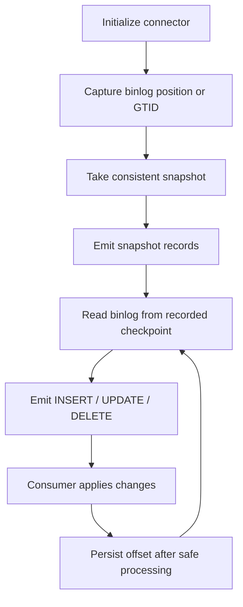
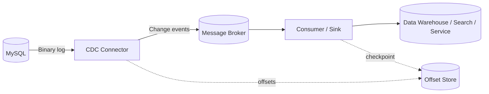

# Incremental Data Synchronization with Replication or CDC

Incremental data synchronization (*incremental data synchronization*) is the process of transferring newly occurring changes from a MySQL system to a target system without recopying the entire dataset on every run. Changes can be row inserts, updates, or deletes. Two common approaches are MySQL native replication and Change Data Capture (CDC) reading the binary log.

Native replication maintains one or more MySQL replicas by transmitting and applying events from a source. CDC reads change events to feed them into a message broker, data warehouse, search index, or another service. Both can use the binary log as the source of changes, but their goals and processing mechanisms differ.

Within the `DATABASE_MYSQL` module, this lesson connects binary logs, GTIDs, replication, transactions, and data pipeline design. After this lesson, you will be able to:

- Distinguish native replication from CDC and pick the right approach for a sync target.
- Prepare MySQL to record changes via the binary log.
- Understand initial snapshots, resume positions, and how to prevent data gaps.
- Design consumers that tolerate duplicate events and recover cleanly after failures.
- Manage deletes, schema changes, event ordering, and binlog retention.
- Monitor lag, detect synchronization drift, and build a reconciliation workflow.

## 1. Full Load vs. Incremental Synchronization

A full load (*full load*) reads an entire table or dataset at a point in time and loads it into the target. It is simple for initialization but resource-intensive for large datasets and unsuited for frequent repetition.

Incremental synchronization transfers only changes since the last processed checkpoint. It can be implemented by:

- Reading rows whose `updated_at` is newer than the previous checkpoint.
- Reading an application-maintained change log table.
- Using native replication to maintain a MySQL replica.
- Reading the binary log with CDC to stream change events to other systems.

Syncing based on `updated_at` is easy to build, yet it can miss changes if timestamps are not updated consistently, clock precision is insufficient, clocks skew, or rows are physically deleted. Binlog-based CDC captures `INSERT`, `UPDATE`, and `DELETE` without requiring applications to add timestamp columns to every table.

## 2. How Native Replication Differs from CDC

| Criterion | MySQL Native Replication | Binary-Log CDC |
|---|---|---|
| Typical targets | A MySQL replica or MySQL topology | Kafka, message brokers, lakehouses, warehouses, search indexes, or other services |
| Unit of transfer | Replication events applied to MySQL by the replica | Change events converted by a connector into records/events |
| Scope | Usually reproduces data and partial state needed by a replica per config | Can filter databases/tables, reshape payloads, and fan out to multiple consumers |
| Position management | Replica tracks relay logs, source log position, and/or GTIDs | Connector persists offsets/GTIDs to resume reading after restarts |
| Target apply | MySQL replication applier | Consumer or sink connector responsible for writing data |
| Data transformation | Limited, tied to replication mechanisms | Can filter, normalize, transform, or enrich events |
| Primary goal | HA, read scaling, MySQL standby copy | Data integration and streaming changes to heterogeneous systems |

Do not use CDC as a backup. CDC reflects changes over time, but does not by itself guarantee a complete, independent copy capable of restoring all historical data. Combine snapshots, backups, and restore testing per data protection requirements.

## 3. Binary Log as the Source of Change Data

The MySQL binary log records changes needed for replication and downstream tools to reconstruct data state. With row-based logging, the binary log contains row-level change events. This is the recommended format for CDC because it describes the actual row changes that occurred rather than forcing connectors to re-parse raw SQL statements.

Common event types:

- `WRITE_ROWS`: row insertion.
- `UPDATE_ROWS`: row modification.
- `DELETE_ROWS`: row deletion.
- `TABLE_MAP`: maps events to tables and related metadata.
- GTID events and transaction commit markers such as `Xid`.

With row-based logging, change events are encoded inside the binlog. You can use `mysqlbinlog` to inspect decoded contents:

```bash
mysqlbinlog \
  --base64-output=DECODE-ROWS \
  -vv \
  /var/lib/mysql/binlog.000123
```

The path and filename are illustrative. On live systems, identify files via `SHOW BINARY LOGS` or `SHOW MASTER STATUS` on older versions; newer versions may provide updated command/metadata names following terminology changes.

### 3.1. Configuring MySQL for Replication and CDC

A sample configuration for the source:

```ini
[mysqld]
server_id=101
log_bin=mysql-bin
binlog_format=ROW
binlog_row_image=FULL
gtid_mode=ON
enforce_gtid_consistency=ON
binlog_expire_logs_seconds=604800
```

Meaning:

- `server_id` must be unique within the replication topology.
- `log_bin` enables binary logging and sets the log filename/prefix.
- `binlog_format=ROW` logs row-level changes.
- `binlog_row_image=FULL` records full before/after row images in the supported format; this helps when CDC needs pre- and post-update values or when targets reconstruct rows independently.
- `gtid_mode=ON` and `enforce_gtid_consistency=ON` support transaction identification and GTID-based position recovery.
- `binlog_expire_logs_seconds` configures automatic binlog retention in seconds; the actual value must exceed the maximum expected outage plus recovery time.

Variables, defaults, and configuration change requirements depend on the MySQL version. Some changes require restarts or dedicated transition procedures. Check version-specific documentation before applying in production.

### 3.2. Access Privileges

A replication or CDC account needs privileges to read metadata and binary logs appropriate to the connector and version. A connector may also need `SELECT` to take a snapshot, table locking privileges, or metadata read privileges depending on snapshot mode. Follow the least-privilege list in the documentation for your deployed connector version.

Never use `root` for connectors. Separate the CDC account from application accounts, restrict allowed client hosts, enforce TLS, and store passwords in a secret manager. Snapshot privileges and binlog reading privileges differ; grant snapshot privileges only when initial data capture is genuinely required.

## 4. Initial Data Load and Resuming from the Binlog

CDC typically solves two problems:

1. Taking an *initial snapshot* so the target starts with complete baseline data.
2. Resuming binlog reading from the matching position so the target neither misses changes nor processes them out of order.

Starting binlog reads only from the moment the connector turns on leaves pre-existing rows missing on the target. Taking a snapshot first and starting binlog reads afterward without coordinating checkpoints can miss changes committed during the snapshot.

A proper CDC workflow establishes a consistent boundary between snapshot and stream. The connector typically records a binlog position or GTID at the moment of a consistent snapshot, reads snapshot data, and then streams from that checkpoint. Changes occurring after the snapshot checkpoint are replayed from the binlog; events may overlap with snapshot row states depending on connector and snapshot mode, so consumers must adhere to the connector's event contract.



Snapshot mode names and offset recording vary by connector. Never assume a snapshot always locks all tables or never locks tables. Read connector docs to learn which transaction isolation level is used, whether metadata locks are acquired, and how DDL during the snapshot is handled.

## 5. Native Replication: Configuring a MySQL Replica

Native replication fits when the target is a MySQL server maintaining a copy of source data. Before configuring it, ensure the replica holds baseline data compatible with the source and that GTID or file/position is accurately initialized.

Example using GTID auto-position on modern MySQL versions:

```sql
CHANGE REPLICATION SOURCE TO
    SOURCE_HOST = 'mysql-source.example',
    SOURCE_PORT = 3306,
    SOURCE_USER = 'repl_user',
    SOURCE_PASSWORD = 'secret-from-secret-manager',
    SOURCE_AUTO_POSITION = 1;

START REPLICA;
```

This example only illustrates syntax. Create a dedicated replication account, configure TLS per policy, and never store real passwords in scripts or repositories. On older MySQL versions, syntax may be `CHANGE MASTER TO` and `START SLAVE`.

Check status:

```sql
SHOW REPLICA STATUS\G
```

Monitor fields such as `Replica_IO_Running`, `Replica_SQL_Running`, `Retrieved_Gtid_Set`, `Executed_Gtid_Set`, `Last_IO_Error`, and `Last_SQL_Error`. Field names can vary by version. The replica must continuously receive and apply events; seeing the I/O thread running alone does not prove data is being applied.

Native replication can filter databases or tables by configuration, but filters complicate consistency and failover. Use filters only after thoroughly evaluating dependencies, statements, and topology. If you need to sync a subset of data with substantial transformations, CDC is usually more flexible.

## 6. CDC Pipeline: From Binlog to Target Systems

A typical CDC pipeline includes these components:

1. **MySQL source:** writes binary logs and retains them long enough.
2. **CDC connector:** reads binlogs, decodes row events, and attaches metadata such as database, table, transaction, GTID, or log position.
3. **Message broker:** stores and distributes events, such as Kafka or an equivalent system.
4. **Consumer/sink:** reads events, transforms them, and applies them to the target.
5. **Offset/checkpoint store:** records how far the connector has read and/or what consumers have processed.
6. **Monitoring and reconciliation:** tracks lag, errors, and reconciles source against target.



A popular connector is the Debezium MySQL Connector. It can take an initial snapshot and then stream binlog change events into Kafka. Topic names, configuration properties, and event schemas depend on Debezium and Kafka Connect versions. Consult version-specific documentation rather than copying configuration verbatim from another release.

### 6.1. Illustrative Connector Configuration

A CDC configuration generally requires these property groups:

```json
{
  "name": "shop-mysql-cdc",
  "config": {
    "connector.class": "io.debezium.connector.mysql.MySqlConnector",
    "database.hostname": "mysql-source.example",
    "database.port": "3306",
    "database.user": "cdc_user",
    "database.password": "${secrets:cdc/mysql-password}",
    "topic.prefix": "shop-prod",
    "database.include.list": "shop",
    "table.include.list": "shop.orders,shop.order_items,shop.payments",
    "snapshot.mode": "initial"
  }
}
```

This is an illustrative configuration showing property groups, not a ready-to-deploy file for every version. Secret provider syntax, snapshot property names, schema history, and Kafka Connect requirements vary by version. Before deploying, verify connector class, security config, topic replication factor, schema history, and offset storage against deployment docs.

Never commit real passwords or tokens into JSON. Use a secret provider or platform-supported secrets management. Separate dev/test configurations from production so lab connectors never accidentally read live data.

## 7. Anatomy of a CDC Event

A CDC event typically carries change payload data and metadata describing the event's origin. Illustrative example of an order update:

```json
{
  "before": {
    "order_id": 501,
    "status": "CREATED",
    "total_amount": "250000.00"
  },
  "after": {
    "order_id": 501,
    "status": "PAID",
    "total_amount": "250000.00"
  },
  "source": {
    "db": "shop",
    "table": "orders",
    "gtid": "aaaaaaaa-bbbb-cccc-dddd-eeeeeeeeeeee:105",
    "file": "mysql-bin.000123",
    "pos": 456789
  },
  "op": "u"
}
```

Exact fields depend on the connector and converter. In this example:

- `before` describes the row image before the change, when available from the connector and supported by config.
- `after` describes the row image after the change.
- `source` records origin, binlog position, or GTID.
- `op` indicates operation type; exact codes depend on the connector.

Consumers should retain source metadata in logs or audit tables so any target record can be traced back to the MySQL event that produced it.

## 8. Handling INSERT, UPDATE, and DELETE in Consumers

Consumers must apply changes by the exact identifying key and understand the semantics of each event type.

### 8.1. INSERT

For `INSERT`, create the target row using the source primary key. If the record is redelivered, a plain insert may hit a duplicate-key error. Consumers should use an upsert or idempotency mechanism suited to the target database.

### 8.2. UPDATE

For `UPDATE`, update the row by primary key. If the event contains the full `after` image, the consumer can replace the row state from that image. If it contains only changed columns, the consumer must apply a partial patch without accidentally wiping columns absent from the event.

### 8.3. DELETE

For `DELETE`, delete the target row by primary key or write a tombstone if the target system retains history. Never ignore deletes simply because the target is a search index or warehouse; ignoring deletes leaves stale records around indefinitely.

### 8.4. Conditional Upsert

When MySQL is the target, a consumer might use:

```sql
INSERT INTO reporting.orders (
    order_id, status, total_amount, source_version
)
VALUES (?, ?, ?, ?) AS incoming
ON DUPLICATE KEY UPDATE
    status = IF(incoming.source_version >= source_version,
                incoming.status, status),
    total_amount = IF(incoming.source_version >= source_version,
                      incoming.total_amount, total_amount),
    source_version = GREATEST(source_version, incoming.source_version);
```

This is a conceptual example: `source_version` must be a reliable monotonic version defined by the pipeline—never use the consumer host's wall-clock timestamp for ordering. Row-alias syntax in `INSERT ... VALUES (...) AS incoming` is supported in modern MySQL versions; verify syntax against the target version. If the target is not MySQL, use its equivalent upsert mechanism.

## 9. Idempotency, Retries, and At-Least-Once Delivery

CDC pipelines must tolerate events being redelivered or reprocessed. For example, a consumer writes to the target and crashes before committing its checkpoint; upon restart, the broker redelivers the event. If the consumer is not idempotent, rows can be duplicated or balances double-counted.

An idempotent operation can execute multiple times while producing the exact same final state as executing once. Common strategies include:

- Using the source primary key as a unique key on the target.
- Upserting row state instead of blindly incrementing counters.
- Recording processed event IDs or GTID/binlog coordinates to deduplicate events.
- Updating target data and checkpoint in the same target transaction where supported.
- Using versions or sequence numbers to discard stale out-of-order events.
- For additive operations, writing an event-ID-keyed ledger and summing over unique events.

Never assume a pipeline provides end-to-end exactly-once semantics just because the broker supports transactions or the connector tracks offsets. Guarantees depend on the connector, broker, sink, and offset-commit design. Design consumers for at-least-once delivery unless true end-to-end exactly-once has been proven.

## 10. Event Ordering and Multi-Table Transactions

A single MySQL transaction can modify multiple tables. If consumers process topics or partitions independently, cross-table ordering may no longer hold on the target. For example, an `order_items` event arriving before `orders` can trigger a foreign key error if applied immediately.

Principles to establish:

- What ordering guarantees do the connector and broker provide: within a partition, within a table, or within a transaction?
- Is the message key set to the primary key so changes to the same row land in the same partition?
- Does the target need source transaction boundaries preserved, or only eventual row-level state?
- Must events be buffered until parent/child records arrive, or handled with controlled retries?
- Is transaction metadata or a transaction ID available for consumers to group events from the same transaction?

If business logic requires cross-table atomicity, consumers must not commit events one by one and assume source transaction semantics are intact. Use transaction metadata to commit related changes in a single target transaction, or design the target model for eventual row-by-row convergence with consistency checks.

## 11. Schema Evolution and DDL Changes

MySQL schemas can evolve while CDC is running—for example, adding columns, changing data types, renaming columns, creating tables, or dropping columns. The connector needs the schema as of the event's point in time to decode row events accurately.

Before deploying DDL:

1. Verify whether the connector supports tracking schema history and the planned DDL type.
2. Check whether the change is compatible with consumers and target schemas.
3. Roll out backward-compatible changes when possible: add nullable or defaulted columns, update consumers, and only then drop legacy columns.
4. Monitor the schema history topic/store and alert if the connector fails to decode events.
5. Test snapshot and streaming across the DDL change in a compatible staging environment.

Never arbitrarily delete or edit the schema history or offset store to work around a connector error. Doing so can break decoding of existing binlogs or trigger unintended re-snapshots.

## 12. Binlog Retention and Connector Recoverability

MySQL retains binary logs according to its retention policy. If a connector stays down longer than the retention window, required files or GTIDs may be purged. At that point, the connector can no longer resume from its old position.

Size retention based on:

- Expected maximum connector outage duration.
- Time to detect and remediate incidents.
- Time needed to catch up and drain accumulated binlogs.
- Binlog volume generated per hour/day.
- Storage policies and disk capacity limits.

Monitor binlog disk usage and the timestamp of the oldest retained log file. Too short a retention prevents recovery after outages; too long a retention risks filling disks. Never manually delete binlog files while replicas or CDC connectors still depend on them.

If a connector loses its offset or needed binlogs are purged, recovery normally requires taking a fresh snapshot and streaming from the new checkpoint. This may require rebuilding or merging target data; follow a clear procedure so fresh snapshots are never mixed with stale, inconsistent target data.

## 13. Pipeline Monitoring and Drift Detection

A CDC pipeline needs monitoring across MySQL, connector, broker, and sink.

| Component | Metrics to Monitor | Anomaly Signs |
|---|---|---|
| MySQL | Binlog generation rate, disk usage, retention, connections, errors | Binlogs growing abnormally or disk nearing full |
| Connector | Source binlog lag, latest event timestamp, offsets, snapshot progress, decode errors | Connector stalled or falling behind source |
| Broker | Message count, partition lag, throughput, publish errors, retention | Consumer lag rising or messages failing persistence |
| Consumer | Processing latency, retries, dead-letter queue, checkpoints, sink errors | Events retrying endlessly or failing commits |
| Target | Row counts, watermarks, duplicates, business discrepancies | Target missing rows, holding extras, or showing stale state |

Measure lag in both wall-clock time and source position. A consumer may still be chewing through old messages even while the broker ingests fresh ones. Persist GTID/binlog coordinate watermarks so you always know exactly where the pipeline stands.

### 13.1. Periodic Reconciliation

Reconciliation catches drift that lag metrics alone miss. Approaches include:

- Comparing row counts per table or key range.
- Comparing checksums across primary-key chunks.
- Comparing business aggregates such as order counts, payment totals, or inventory quantities.
- Sampling rows by primary key and comparing column values.
- Checking whether rows deleted on the source still linger on the target.

When reconciling, capture or align on the same logical data checkpoint on source and target. If the pipeline is actively running, transient differences may reflect lag. Use processed watermarks to wait until both sides reach the same point before declaring data mismatch.

## 14. Security and Operations

- Allow binlog access only from authorized connector or replica hosts.
- Enforce TLS on MySQL connections and encrypt traffic to the broker.
- Scope schema/table read privileges to the exact dataset requiring synchronization.
- Protect the offset store, schema history, and message broker since they hold critical operational metadata.
- Never publish personal data or secrets to topics lacking proper authorization and retention controls.
- Restrict log access because CDC payloads may contain pre- and post-update sensitive data.
- Isolate accounts, secrets, and configurations across dev, staging, and production.
- Audit changes to DDL, retention settings, filters, and connector versions.

CDC can replicate sensitive data across more systems than MySQL itself. Before adding a new consumer or opening a new topic, establish purpose, access controls, retention periods, and deletion workflows.

## 15. Common Incidents and Troubleshooting

| Symptom | Possible Cause | Investigation Approach |
|---|---|---|
| Connector fails to start | Binlog disabled, wrong format, missing privileges, or misconfiguration | Check MySQL variables, connector logs, privileges, and versions |
| Connector reports binlogs purged | Connector stopped too long or retention too short | Find last position, check backups/snapshots, and plan a re-snapshot |
| Target missing historical rows | Initial snapshot never ran or table filter excluded them | Check snapshot mode, `table.include.list`, and watermark |
| Duplicate rows | Non-idempotent consumer or misordered offset commits | Check event IDs, primary keys, target transactions, and checkpoints |
| Deleted rows remain on target | Consumer ignores deletes or mishandles tombstones | Inspect event types and sink delete policy |
| Corrupt data after DDL | Out-of-sync schema history or incompatible consumer | Correlate DDL timestamp, schema events, and connector version |
| Child rows arrive before parent rows | Ordering not preserved across partitions/topics | Add retries, buffering, transaction metadata, or adjust sink design |
| Connector lag steadily grows | Read/publish throughput lower than binlog generation rate | Inspect CPU, network, broker throughput, batching, and consumer lag |
| MySQL disk full | Binlogs retained too long or purging blocked | Check retention, disk space, and replicas/connectors still holding logs |

Never reset offsets, delete topics, or purge binlogs as a quick fix. Before making changes, preserve connector state, offsets, schema history, binlog files/GTIDs, and reconciliation metrics. One wrong move can destroy the ability to resume cleanly from the right checkpoint.

## 16. Incremental Synchronization Rollout Workflow

A deployment workflow can follow these steps:

1. **Define objective:** choose native replication if the target is a MySQL replica; choose CDC to stream and transform changes for other systems.
2. **Design target data model:** define primary keys, data types, delete semantics, schema evolution, and transaction requirements.
3. **Prepare source:** enable binlogs, row-based logging, GTID where appropriate, retention, and least-privilege access.
4. **Initialize baseline:** create a replica from backup/clone or run a consistent CDC snapshot.
5. **Establish resume position:** confirm GTID/binlog coordinates are recorded with zero gap between snapshot and stream.
6. **Deploy consumer:** implement idempotent inserts/updates/deletes and properly ordered checkpointing.
7. **Test failures:** stop the connector, stop the broker, throttle the sink, restart consumers, and confirm replay produces zero duplicates.
8. **Reconcile:** compare row counts, checksums, and business metrics at a matching watermark.
9. **Monitor:** set alerts on lag, errors, retention, disk space, and dead-letter queues.
10. **Operate:** document runbooks for re-snapshotting, rebuilding, handling schema changes, rotating secrets, and upgrading connectors.

## 17. Practical Scenario

An e-commerce system stores data in MySQL schema `shop`. The analytics team needs continuous synchronization of `orders`, `order_items`, and `payments` to a reporting system. The reporting target must apply updated rows, delete cancelled orders per policy, and recover cleanly after a multi-hour connector outage.

Execute in a lab environment:

1. Enable binary logging, `binlog_format=ROW`, select an appropriate `binlog_row_image`, and enable GTID if the topology supports it.
2. Create a least-privilege CDC account with secured connectivity.
3. Configure the connector to take an initial snapshot of the three tables.
4. Record the snapshot watermark and verify the connector resumes streaming from that exact position.
5. Run `INSERT`, `UPDATE`, and `DELETE` on the source; inspect events on the broker and rows in the target.
6. Stop the consumer after it processes a message but before committing its checkpoint; restart it and verify redelivery creates no duplicates.
7. Stop the connector briefly, restart it, and verify offsets resume cleanly.
8. Test retaining binlogs long enough for the planned outage window; verify alerting when retention approaches exhaustion.
9. Add a nullable column in the lab, update the consumer, and verify schema history handles the DDL.
10. Reconcile row counts, chunked checksums, and payment totals between source and target at a shared watermark.

**Self-Evaluation Questions:**

- How do native replication and CDC differ in purpose and how changes are applied?
- Why must the initial snapshot align with a consistent binlog position or GTID?
- How do `binlog_format=ROW` and `binlog_row_image=FULL` benefit CDC?
- Why must consumers be idempotent even when the broker durably stores messages?
- Why can message ordering across multiple partitions break parent-child table relationships?
- What happens if a connector stays stopped longer than MySQL retains binary logs?
- Why should reconciliation happen at a shared watermark rather than comparing source and target at arbitrary times?
- Can CDC replace backups and restore procedures? Explain.

## Conclusion

Binary-log-based incremental synchronization continuously streams MySQL changes while avoiding repeated full reloads. Native replication fits maintaining MySQL replicas; CDC fits distributing and transforming changes for diverse downstream systems. A reliable pipeline requires a consistent snapshot, resumable watermarks, idempotent consumers, proper handling of deletes and schema changes, adequate retention, plus ongoing monitoring and periodic reconciliation.
