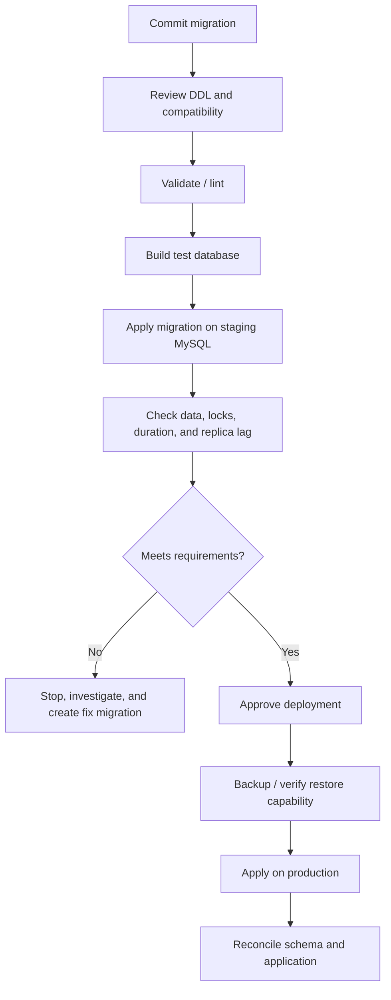

# Flyway/Liquibase with MySQL and Migration History

As an application evolves, the MySQL schema must also change: adding columns, creating indexes, altering data types, splitting tables, or adding constraints. If each environment is modified manually, source code and database easily drift apart: staging has a new column while production does not, or a DBA runs an out-of-band script that causes the next deployment to fail.

Flyway and Liquibase solve this problem by managing schema changes as a versioned part of the application. On each deployment, the tool reads the declared migrations, compares them against the history stored in the database, and applies only the missing changes. This history tells the team which migrations have run, which script ran them, at what time, and whether they remain valid against the current artifact.

However, a migration framework does not turn every MySQL DDL statement into a rollbackable transaction. Many DDL statements cause an implicit commit. A migration that fails partway through can leave the schema partially altered even though the tool reports failure. Therefore, migrations must be designed small, immutable, with a clear recovery path, and tested on the corresponding MySQL version before release.

## 1. What is a migration and why is history needed?

A migration is a schema change packaged as an identifiable, ordered unit. For example:

- The first migration creates the `customers` table.
- The next migration adds the `status` column.
- A subsequent migration creates an index to serve queries filtering by `status` and `created_at`.

Once a migration has run on a shared environment, its contents must be treated as immutable. To make further schema changes, create a new migration. Editing an old migration changes its checksum and causes environments that already ran it to differ from environments built from scratch.

A solid migration system answers these questions:

1. Which migrations have already been applied to this database?
2. Which migrations are pending and in what order?
3. Do the executed scripts still match the files in the repository?
4. Who or which account ran them, when, how long did they take, and did they succeed?
5. If a migration fails partway through, what is the actual schema state and how should it be recovered?

Migration history is progress-tracking metadata. It is not a schema or data backup, and it does not by itself prove that the database was not manually altered after migrations ran.

## 2. Flyway: versioned migrations and schema history

Flyway typically organizes SQL migrations by version. The default filename format is:

```text
V<version>__<description>.sql
```

For example:

```text
db/migration/
  V1__create_customers.sql
  V2__add_customer_status.sql
  V3__add_customer_status_index.sql
  R__refresh_customer_summary.sql
```

`V` denotes a versioned migration; two underscores separate version and description. Versions can have multiple parts like `V1_1__...` or `V2.3__...`; Flyway's version comparison rules determine ordering. Do not rely on alphabetical file order in Explorer or commit timestamps.

Example `V1__create_customers.sql`:

```sql
CREATE TABLE customers (
    customer_id BIGINT UNSIGNED NOT NULL AUTO_INCREMENT,
    email VARCHAR(254) NOT NULL,
    full_name VARCHAR(200) NOT NULL,
    created_at TIMESTAMP NOT NULL DEFAULT CURRENT_TIMESTAMP,
    PRIMARY KEY (customer_id),
    UNIQUE KEY uq_customers_email (email)
) ENGINE = InnoDB
  DEFAULT CHARACTER SET = utf8mb4
  COLLATE = utf8mb4_0900_ai_ci;
```

Example `V2__add_customer_status.sql`:

```sql
ALTER TABLE customers
    ADD COLUMN status VARCHAR(20) NOT NULL DEFAULT 'ACTIVE';
```

Example `V3__add_customer_status_index.sql`:

```sql
CREATE INDEX ix_customers_status_created
    ON customers (status, created_at);
```

After execution, Flyway records details in the history table, defaulting to `flyway_schema_history`. This table includes fields such as version, description, type, script, checksum, installed_on, installed_by, execution_time, and success status. The table name is configurable.

Common commands:

```bash
flyway info
flyway validate
flyway migrate
```

- `info` displays applied migrations, pending migrations, and status.
- `validate` checks consistency between migrations recorded in history and available migrations, including checksums and related metadata.
- `migrate` applies pending migrations in valid order.

Flyway can use config files, environment variables, or CLI flags. Illustrative configuration example:

```toml
[flyway]
url = "jdbc:mysql://mysql.internal:3306/appdb"
user = "migration_user"
locations = ["filesystem:db/migration"]
defaultSchema = "appdb"
table = "flyway_schema_history"
validateMigrationNaming = true
```

Do not store production passwords in configuration files committed to the repository. Supply credentials at runtime from a secret manager or pipeline environment variables. Property names and configuration file formats depend on the Flyway version; check `flyway help` and the documentation for your installed version.

### Repeatable migrations

Repeatable migrations use the `R__` prefix without a version. Flyway re-runs them whenever their checksum changes, after pending versioned migrations. They are typically suited for objects recreated from their current definition, such as views, procedures, or functions:

```sql
-- R__create_active_customer_view.sql
CREATE OR REPLACE VIEW active_customers AS
SELECT customer_id, email, full_name
FROM customers
WHERE status = 'ACTIVE';
```

Do not use repeatable migrations for cumulative data operations like `UPDATE balance = balance + 10`, because re-running would repeat the effect. Repeatable contents must also be designed for safe re-execution and compatibility with the target MySQL version.

### Baseline and out-of-order

If a database already existed before bringing it under Flyway management, `baseline` can record a baseline version so newer migrations can be applied. Baseline does not automatically inspect or recreate the entire legacy schema; reconcile the existing schema against the state the baseline represents before proceeding.

Out-of-order allows applying an older version after a newer version has already run. This feature can be useful in certain development workflows, but it makes history harder to reason about and can cause differences across environments. Enable it only when your release process explicitly handles dependencies and the older migration is genuinely safe against the current schema.

## 3. Liquibase: changelog, changeset, and history tables

Liquibase describes changes in a changelog. A changelog can be written in YAML, XML, JSON, or SQL formatted changelog. Each changeset has a composite identifier from `id`, `author`, and changelog location (`filepath`); this serves as the key identifying a unit of change in history.

Example `db.changelog-master.yaml`:

```yaml
databaseChangeLog:
  - changeSet:
      id: 001-create-customers
      author: database-team
      changes:
        - createTable:
            tableName: customers
            columns:
              - column:
                  name: customer_id
                  type: BIGINT UNSIGNED
                  autoIncrement: true
                  constraints:
                    primaryKey: true
                    nullable: false
              - column:
                  name: email
                  type: VARCHAR(254)
                  constraints:
                    nullable: false
                    unique: true
              - column:
                  name: full_name
                  type: VARCHAR(200)
                  constraints:
                    nullable: false
              - column:
                  name: created_at
                  type: TIMESTAMP
                  defaultValueComputed: CURRENT_TIMESTAMP
                  constraints:
                    nullable: false
  - changeSet:
      id: 002-add-customer-status
      author: database-team
      changes:
        - addColumn:
            tableName: customers
            columns:
              - column:
                  name: status
                  type: VARCHAR(20)
                  defaultValue: ACTIVE
                  constraints:
                    nullable: false
```

The example above illustrates changelog structure; data types and how Liquibase generates DDL may depend on the extension/database version. If you need to specify exact MySQL `ENGINE`, character set, or collation, configure database defaults or use a dedicated SQL changeset with `dbms: mysql`. Run `updateSQL` against the exact Liquibase and MySQL versions to review the generated SQL before execution.

Liquibase typically creates two management tables:

- `DATABASECHANGELOG`: records executed changesets, including id, author, filepath, checksum, timestamp, execution type, tag, and related metadata.
- `DATABASECHANGELOGLOCK`: uses a lock row to prevent multiple Liquibase processes from executing updates on the same database simultaneously.

Common commands:

```bash
liquibase validate
liquibase status --verbose
liquibase update-sql
liquibase update
```

- `validate` checks changelog structure and related validation rules.
- `status` lists unapplied changesets.
- `update-sql` generates the planned SQL for review without applying changes.
- `update` applies pending changesets and records history.

Liquibase also supports contexts, labels, and preconditions to select changesets by environment or execute only when conditions are satisfied. Do not use contexts in a way that causes production to accidentally skip mandatory changes; review the list of changesets scheduled to run in each pipeline.

## 4. Comparing Flyway and Liquibase

| Aspect | Flyway | Liquibase |
|---|---|---|
| How changes are described | Primarily versioned SQL migrations; supports repeatable migrations. | Changelog declaring changesets in YAML/XML/JSON/SQL. |
| Identifier | Version and migration name; repeatables use name/checksum. | Combination of `id`, `author`, `filepath`. |
| Default history table | `flyway_schema_history`. | `DATABASECHANGELOG`. |
| Locking mechanism | Prevents concurrent migrations; exact behavior depends on database and version. | `DATABASECHANGELOGLOCK` records a lock during updates. |
| Change validation | `validate` compares checksums and migration history. | `validate` checks changelog/checksums and changeset metadata. |
| Custom SQL | SQL is the natural, direct approach. | Supports abstract change types or custom SQL. |
| Rollback | Requires forward-fix migration plan; undo support depends on version/edition and migration type. | Some change types have auto-generated rollbacks; SQL/custom changes usually require explicit rollback blocks. |
| Best suited when | The team wants direct DDL control in SQL and a streamlined workflow. | The team needs structured changelogs, preconditions, contexts/labels, and rollback metadata. |

No tool guarantees production schema safety on its own. Migration quality depends on DDL design, reviews, database privileges, testing on realistic data, and failure recovery plans.

## 5. What do migration history and checksums mean?

Checksums detect when a migration file has been modified after execution. In Flyway, the checksum of a versioned migration is recorded in schema history. In Liquibase, the changeset checksum is stored in `DATABASECHANGELOG`.

Example scenario:

1. Version `V4__add_phone.sql` is deployed to staging and production.
2. Later, a developer edits the old file to add `NOT NULL`.
3. Databases that already ran it hold the checksum of the old content; the current repository has a different checksum.
4. `validate` fails because the migration has changed.

The right fix is to leave `V4` untouched and create `V5__make_phone_not_null.sql` after handling existing data. Never update checksums or alter history just to turn a pipeline green again.

In Liquibase, `runOnChange: true` allows a changeset to re-run when its checksum changes; commonly used for views or procedures whose definitions must stay synchronized. `runAlways: true` forces a changeset to run on every update. Both attributes must be used intentionally. A cumulative data changeset marked `runAlways` will repeatedly modify data on every deployment.

### `repair`, `clearCheckSums`, and history sync commands

Certain commands modify history metadata without altering the actual schema:

- `flyway repair` adjusts schema history records against available migrations according to version behavior, such as resolving failed records or syncing checksums. It does not drop partially created columns/tables and does not restore data to pre-migration state.
- `liquibase clear-checksums` clears stored checksums so Liquibase recalculates them on the next run. It does not make editing an old changeset safe.
- `liquibase changelog-sync` marks selected changesets as executed without running their contents. Use this only after verifying that the actual schema already matches the exact outcome, such as adopting an existing database created outside the pipeline.

Before running these commands, back up the database and history table, inspect the actual schema state, document the reason, and review the impact. Never run repair/sync out of habit after a pipeline failure.

## 6. MySQL DDL and transaction rollback limitations

MySQL has many DDL statements that cause an implicit commit. Common examples include `CREATE TABLE`, `ALTER TABLE`, `DROP TABLE`, `CREATE INDEX`, and many other schema-altering statements. Some InnoDB DDL operations support server-level atomic DDL, meaning the operation is better protected against crashes; this does not mean DDL becomes part of a user transaction that can be `ROLLBACK`ed after the statement succeeds.

For example:

```sql
START TRANSACTION;

UPDATE customers
SET status = 'INACTIVE'
WHERE customer_id = 42;

ALTER TABLE customers
    ADD COLUMN archived_at DATETIME NULL;

ROLLBACK;
```

Do not expect `ROLLBACK` to undo `ALTER TABLE` or restore the entire pre-transaction state. DDL may commit the open transaction before executing and complete according to its own rules. Verify exact behavior by statement, storage engine, and MySQL version.

Therefore:

1. Split multi-step migrations into small units so you know exactly which step completed.
2. Do not pack unrelated DDL statements into a single long changeset/script without a step-by-step recovery plan.
3. If a migration mixes DDL and DML, identify commit boundaries and the state that may remain if a step fails.
4. Do not rely on Liquibase's `runInTransaction` or Flyway's transaction wrapper to guarantee DDL rollback on MySQL.
5. Prepare forward-fix migrations or backup/PITR restores when changes cannot be safely reversed.

`ALTER TABLE` can rebuild tables, hold metadata locks, or generate substantial I/O load. Some operations support `ALGORITHM=INSTANT`, `INPLACE`, or `COPY` depending on change type and version. Check the actual algorithm, lock duration, temporary space requirements, and replica impact before running in production.

## 7. Designing migrations compatible with a running application

In systems with multiple application instances, new schema and new code are not deployed instantaneously at the exact same moment. A migration may execute while old code versions are still serving requests. Therefore, use the **expand–migrate–contract** strategy:

### Expand: add backward-compatible structures

Suppose you need to rename `customers.full_name` to `display_name`. Do not drop the old column immediately. First, add the new column so both can coexist:

```sql
ALTER TABLE customers
    ADD COLUMN display_name VARCHAR(200) NULL;
```

Old application code continues using `full_name`; the new version can start writing both columns or writing the new column according to plan.

### Migrate: transition data and application

Backfill in bounded batches to avoid oversized transactions:

```sql
UPDATE customers
SET display_name = full_name
WHERE customer_id > 0
  AND display_name IS NULL
ORDER BY customer_id
LIMIT 1000;
```

Repeat in a controlled loop until no rows remain to backfill. For large tables, store primary-key checkpoints, measure replica load, and tune batch size. Check for nulls, lengths, character encoding, and uniqueness before adding constraints.

Next, deploy code that reads `display_name`, verify no old instances are still writing exclusively to `full_name`, and then gradually switch write traffic to the new column. If both columns must remain synchronized during transition, designate one source of truth and avoid bidirectional updates without conflict-resolution rules.

### Contract: remove legacy structures

Only after confirming no old code, jobs, reports, or external queries use `full_name`, schedule a migration to drop the legacy column:

```sql
ALTER TABLE customers
    DROP COLUMN full_name;
```

This step carries higher risk because recovering old data may require backups or data copies. It is usually best separated into a dedicated release after an observation period.

## 8. Preconditions, idempotency, and pre-flight checks

Migrations should validate assumptions about the schema before making changes. For example, an index-creation migration should only run when the table exists and the index does not. However, how existing objects are checked and handled must align with migration history; do not turn every migration into an ad-hoc self-healing script that hides schema drift.

Liquibase provides preconditions to verify conditions before running a changeset. Example:

```yaml
- changeSet:
    id: 003-add-status-index
    author: database-team
    preConditions:
      - onFail: HALT
      - tableExists:
          tableName: customers
    changes:
      - createIndex:
          tableName: customers
          indexName: ix_customers_status_created
          columns:
            - column:
                name: status
            - column:
                name: created_at
```

This precondition only confirms the table exists; it does not prove that data or other indexes are correct. Add checks suited to the scenario, but avoid `MARK_RAN` without evidence that the schema is already in the intended state.

For SQL migrations, you can query metadata before running:

```sql
SELECT
    INDEX_NAME,
    COLUMN_NAME,
    SEQ_IN_INDEX
FROM INFORMATION_SCHEMA.STATISTICS
WHERE TABLE_SCHEMA = DATABASE()
  AND TABLE_NAME = 'customers'
ORDER BY INDEX_NAME, SEQ_IN_INDEX;
```

Metadata inspection is only part of preflight checks. Review full DDL, data types, collations, existing indexes, data violating constraints, and migration user privileges.

## 9. Database privileges for migrations

Do not use the runtime application account to execute migrations. Separate the two accounts:

- **Migration user**: holds required DDL privileges such as `CREATE`, `ALTER`, `DROP`, `INDEX`, and minimal DML privileges needed for backfills. Used only by deployment pipelines or authorized personnel.
- **Runtime user**: holds only the data read/write privileges the application needs; has no schema-modification privileges.

Illustrative example:

```sql
CREATE USER 'app_migrator'@'10.%' IDENTIFIED BY 'managed-secret';
GRANT SELECT, INSERT, UPDATE, DELETE,
      CREATE, ALTER, DROP, INDEX, REFERENCES
ON appdb.* TO 'app_migrator'@'10.%';

CREATE USER 'app_runtime'@'10.%' IDENTIFIED BY 'managed-secret';
GRANT SELECT, INSERT, UPDATE, DELETE
ON appdb.* TO 'app_runtime'@'10.%';
```

This is a starting privilege example and should be narrowed to match actual migration needs. If migrations create views, triggers, procedures, or events, additional corresponding privileges may be needed along with careful review of `DEFINER`/`SQL SECURITY`. Never grant `ALL PRIVILEGES` or global privileges merely to avoid permission errors. Secrets must be provisioned via a secret management system, replaced with real values at deployment, and rotated per policy.

Migration history tables also contain critical operational metadata. Restrict modify/delete permissions on history tables to the appropriate tool account; do not allow the runtime application to write arbitrarily to these tables.

## 10. Migration deployment pipeline

A pipeline can be structured into these steps:



Flyway pipeline example:

```bash
flyway validate
flyway info
flyway migrate
flyway info
```

Liquibase pipeline example:

```bash
liquibase validate
liquibase status --verbose
liquibase update-sql
liquibase update
liquibase status --verbose
```

Commands must run with the exact same configuration, changelog/locations, and pinned tool version defined in the pipeline. `update-sql` or `info` are review steps; they do not replace testing on a database close to production. For major changes, separate approval and production execution into two distinct gates.

Allow only one migration pipeline to run against a given database/schema at a time. Even when the tool has a locking mechanism, the pipeline still needs environment-level serialization to prevent two releases from racing, running concurrent DDL, or deploying code in an incompatible order.

## 11. Handling failed migrations in MySQL

When a migration fails, halt further deployments immediately. Do not rush to re-run `migrate` or `update`, and do not delete the history table to start over. Follow this sequence:

1. Capture full tool logs, executed SQL, and the exact timestamp of failure.
2. Check the history table to see whether the migration was recorded as success, failed, or not recorded at all.
3. Inspect the actual schema using `SHOW CREATE TABLE`, `INFORMATION_SCHEMA`, and related objects.
4. Check whether data was partially backfilled or modified.
5. Evaluate transaction/implicit-commit behavior of the failing statement and determine which parts may have completed.
6. Choose a recovery strategy: a forward-fix migration toward the desired state, restore from backup/PITR, or a controlled manual procedure followed by verified history reconciliation.

For example: a script contains three `ALTER TABLE` statements; the first and second succeed, while the third fails due to a duplicate key. On MySQL, do not assume the first two DDL statements rolled back with the script. Inspect both newly added columns/indexes, resolve the conflicting data, and write a forward-fix migration tailored to the actual state.

Do not edit an already-deployed migration to make it re-run as desired. Create a new migration with a new version/id, explicitly stating the preconditions and how to handle the existing schema. If manual history marking or repair/sync commands are needed, obtain evidence that the actual schema matches the recorded state exactly.

## 12. Rollback and forward fix

Schema rollback is not like code rollback. Code can be reverted to an earlier build, whereas a modified database may contain new data or structures that older code cannot understand. Some operations are straightforward to reverse—for example, adding an index can be reversed by dropping the index—whereas dropping a column or overwriting data can cause unrecoverable data loss.

Prefer **forward fix** once a schema has changed on a shared environment: create a new migration to bring the database to the correct state. Roll back only after verifying that the reverse operation is safe and will not destroy post-migration data.

For example, a migration adding an index may have a reverse statement:

```sql
DROP INDEX ix_customers_status_created ON customers;
```

However, rolling back a migration that added a column may be unsafe if the application has already written data to that column. Before dropping it, verify whether the data has been migrated elsewhere or can be restored from backup.

In Liquibase, explicit rollbacks can be declared on changesets when the reverse operation is well-defined. In Flyway, undo support depends on version/edition and project policy; always keep forward-fix migrations or backup/PITR as recovery options. Never treat a generic rollback command as a substitute for a data recovery plan.

## 13. Drift: actual schema differs from migration history

Schema drift occurs when a database is modified outside the migration pipeline or when migration history no longer reflects the actual schema. Examples include a DBA manually adding an index, a hotfix altering a column type, or someone deleting the history table.

History only records what the tool logged; it is not a complete snapshot of current state. To detect drift:

- Compare `SHOW CREATE TABLE`/`SHOW CREATE VIEW` across environments.
- Inventory columns, indexes, constraints, and routines using `INFORMATION_SCHEMA`.
- Use schema diff or a suitable comparison tool, and review results manually.
- Cross-reference every out-of-band change against tickets, DBA logs, and corresponding migrations.
- After an emergency hotfix, create a migration describing the desired state and verify environments that received the hotfix.

Do not automatically synchronize history by marking all migrations as executed. First prove that the current schema is equivalent to the outcome of the marked migrations.

## 14. Review checklist for a MySQL migration

- [ ] Migration has a unique version/id, clear description, and resides in the correct location/changelog.
- [ ] Already-deployed migrations are unmodified; new changes use a new migration.
- [ ] DDL is compatible with the target MySQL version, storage engine, charset, and collation.
- [ ] Implicit commit, atomic DDL, algorithm, metadata locks, and execution duration have been evaluated.
- [ ] Existing data has been checked before adding `NOT NULL`, unique keys, foreign keys, or changing types.
- [ ] Backfills use bounded batches, checkpoints, and replica lag monitoring.
- [ ] Changes are compatible with old/new application versions during rollout.
- [ ] Rollback or forward fix is documented; non-reconstructible data has a backup/PITR plan.
- [ ] Migration user has minimum required privileges; runtime user has no DDL privileges.
- [ ] Pipeline locks concurrent execution and pins tool version/configuration.
- [ ] `validate`, SQL preview, and staging tests succeeded.
- [ ] Post-deploy history matches actual schema and outcomes are reconciled.

Flyway and Liquibase provide an auditable, reproducible, and ordered history of schema changes. Flyway fits workflows built around explicit versioned SQL; Liquibase provides structured changelogs and flexible deployment conditions. With MySQL, the decisive factors remain understanding DDL implicit commits, keeping released migrations immutable, designing with expand–migrate–contract, verifying history against the actual schema, and preparing forward fixes and backups before changing production.
