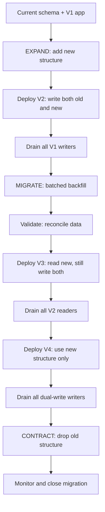

# Expand/Contract for Multi-Version Application Schema Compatibility

## Objectives

After this lesson, you will be able to:

- Explain why schema changes must remain compatible with multiple application versions running concurrently.
- Break a breaking schema change into expand, migrate, switch, and contract phases.
- Design migrations for adding columns, renaming columns, changing data types, or migrating to new table structures.
- Backfill data in batches that are safely repeatable and do not lose concurrent updates.
- Verify compatibility across old/new applications, replicas, background jobs, and downstream consumers.
- Manage metadata locks, online DDL, rollouts, rollbacks, and migration completion criteria.

## 1. Why is expand/contract needed?

In a live application, MySQL schema changes and application releases do not happen at the exact same instant. Instances may roll out sequentially; some workers, cron jobs, or consumers still run the old version while other instances already run the new version. If you alter the schema directly in a way the old version cannot understand, deployment can break the application even when `ALTER TABLE` succeeds.

**Expand/contract** splits a schema change into small steps so the schema works with both old and new application versions during the transition window.

- **Expand:** extend the schema additively, keeping legacy columns and objects intact so current applications continue running.
- **Migrate:** deploy compatible application code and sync or backfill data into the new structure.
- **Switch:** gradually shift reads to the new structure once data has been verified.
- **Contract:** drop legacy columns, tables, or constraints only after no application versions or consumers depend on them.

For example, an application uses `orders.status` and needs to move to `orders.order_status`. If you rename the column immediately via `RENAME COLUMN`, old instances querying `status` fail with `Unknown column`. With expand/contract, the new column is added first, the application rolls out in stages, data is migrated and verified, and only then is the old column removed.

This approach is especially valuable for MySQL systems using rolling deployments, multiple instances, background workers, replication, CDC, or continuous availability requirements. It shrinks the blast radius of each deployment and provides an observation window before making hard-to-reverse changes.

## 2. Application and schema compatibility principles

A safe migration must consider both directions:

- Old application code must continue working on the expanded schema.
- New application code must work on both the transitional schema and the final contracted schema.

Do not inspect only the web application binary. Account for workers, cron jobs, migration scripts, BI reports, integration services, stored routines, triggers, views, ETL/CDC tools, and SQL queries saved inside dashboards.

### 2.1. Compatibility matrix

Example when transitioning from `status` to `order_status`:

| Application version | Old schema | Expanded schema | Contracted schema |
|---|---|---|---|
| V1: reads/writes `status` only | Yes | Yes, because old column still exists | No |
| V2: reads `status`, writes both columns | No | Yes | No |
| V3: reads `order_status`, still writes both | No | Yes | No, because it still writes old column |
| V4: reads/writes `order_status` only | No | Yes | Yes |

This matrix represents the design goal for this example. In practice, verify every SQL query, prepared statement, ORM mapping, and background job in each version. An application may not touch the old column in its main flow yet still reference it in exports, reports, or periodic jobs.

### 2.2. Design rules

1. Prefer additive changes first: add nullable columns, new tables, indexes, or new objects.
2. Keep old columns and behavior intact for the entire time older versions remain active.
3. Make backfills safely repeatable without producing corrupt or duplicate data.
4. Separate schema migrations from switching application read/write paths.
5. Verify data before switching reads to the new structure.
6. Drop old structures only after verifying every consumer has migrated.
7. Document points where rollback is straightforward versus points requiring data recovery or a forward fix.

Expand/contract does not automatically make DDL lock-free. It manages cross-version compatibility; you must still evaluate `ALTER` algorithms, metadata locks, disk space, and MySQL load.

## 3. Phases of a migration



Phases must be deployed sequentially following dependencies. Each phase can be its own release or migration job. Do not combine all phases into a single deploy, as doing so eliminates observability and the ability to halt upon error.

## 4. Example: renaming column `status` to `order_status`

Suppose the initial table is:

```sql
CREATE TABLE orders (
  id BIGINT UNSIGNED NOT NULL PRIMARY KEY,
  customer_id BIGINT UNSIGNED NOT NULL,
  status VARCHAR(24) NOT NULL,
  created_at DATETIME NOT NULL
) ENGINE=InnoDB;
```

Application V1 reads and writes `status`. A new requirement renames the column to `order_status` for clarity.

### 4.1. Expand: add the new column

Add the new column while keeping the old column:

```sql
ALTER TABLE orders
  ADD COLUMN order_status VARCHAR(24) NULL,
  ALGORITHM=INSTANT;
```

`ALGORITHM=INSTANT` instructs MySQL to apply the metadata change instantly if supported by the operation, engine, and version. If unsupported, the command fails rather than falling back to another algorithm. On versions or structures that do not support instant execution, select a tested DDL plan—possibly `INPLACE`, `COPY`, or an online schema change tool.

Do not assume adding a column is always instant across every MySQL version. Instant support depends on version, storage engine, column position, row format, and internal limits. Even instant DDL still requires metadata locks at specific points.

After this step:

- `status` still exists, so V1 keeps running.
- `order_status` is `NULL` for existing rows.
- The schema is ready for an application version that knows how to write the new column.

### 4.2. Deploy V2: dual-write

V2 keeps reading `status` to preserve V1 behavior, but every write updates both columns inside the same transaction.

Example:

```sql
UPDATE orders
SET status = 'SHIPPED',
    order_status = 'SHIPPED'
WHERE id = 90001;
```

When inserting a new order:

```sql
INSERT INTO orders (
  id, customer_id, status, order_status, created_at
)
VALUES (
  90002, 501, 'PENDING', 'PENDING', NOW()
);
```

Both values must be updated atomically in the same statement or transaction. Avoid two separate non-transactional writes, since the application could crash between writes and leave the columns out of sync.

During rolling deployment, V1 may still write exclusively to `status`. Therefore, do not backfill and switch reads to the new column until all V1 writers have drained, unless a tested database-level sync mechanism such as a trigger handles V1 writes.

Audit every write source: APIs, workers, cron jobs, admin scripts, integration services, and batch imports. Confirm V1 is retired only when no legacy processes can write data.

### 4.3. Drain legacy writers before backfill

Once all V1 instances have been replaced by V2:

- No writers update `status` alone anymore.
- All new updates write both `status` and `order_status` together.
- Existing rows not yet backfilled still have `order_status IS NULL`.

Now the backfill can begin. If old writers cannot be drained due to an external consumer, design an explicit synchronization mechanism (such as a temporary compatibility trigger or updating the consumer) before proceeding.

### 4.4. Batched backfill

Do not update a multi-million-row table in a single massive transaction when it can be chunked. Small batches bound row lock hold times, undo/redo volume, replication pressure, and rollback impact.

Suppose the table has an ascending primary key `id`. Process one ID range at a time:

```sql
UPDATE orders
SET order_status = status
WHERE id > 0
  AND id <= 10000
  AND order_status IS NULL;
```

Next, process `10000` to `20000`, continuing until all rows are covered. In a real job, persist a checkpoint of `last_id` processed and commit each batch.

A batch loop should have these traits:

- Use keyset/range pagination by primary key instead of `LIMIT ... OFFSET` on large tables.
- Persist checkpoints so the job can resume after stopping.
- Update only missing rows so re-runs do not overwrite newly synced data.
- Cap rows per batch and pause briefly between batches if replication lag or load rises.
- Log processed row counts, timestamps, errors, and checkpoint position.
- Support clean job stoppage without leaving giant open transactions.

The condition `order_status IS NULL` is especially important here: once V2 dual-writes, new updates already populate the new column. The backfill fills only older rows lacking a value without overwriting fresh writes.

If the new column requires complex data transformations, define clear conversion rules and test `NULL`s, invalid values, time zones, rounding, and collations before running in bulk.

### 4.5. Monitoring the backfill

Track missing rows and mismatches:

```sql
SELECT COUNT(*) AS rows_missing_new_status
FROM orders
WHERE order_status IS NULL;

SELECT COUNT(*) AS rows_with_mismatch
FROM orders
WHERE NOT (order_status <=> status);
```

`<=>` is MySQL's null-safe equality operator. The second query fits when both columns must match identically under the active SQL comparison rules. If byte-exact string equality is required, use an appropriate binary comparison and verify charset/collation.

On large tables, full-table `COUNT(*)` or comparisons can generate heavy load. Run them by primary-key ranges, use appropriate indexes, and inspect execution plans. Save verification results per batch so you do not repeatedly scan the entire table.

### 4.6. Validate before switching reads

Switch reads to `order_status` only when:

- Zero rows have `order_status IS NULL` if business rules require non-null values.
- Zero mismatches exist under the defined transformation rules.
- New rows and rows updated during backfill are fully synchronized.
- Business aggregates, reports, and order states match the source.
- The backfill job is complete and its checkpoint is recorded.

If mismatches appear, halt the switch and classify the root cause: mapping bug, stray V1 writer, missing code path in V2 dual-write, invalid legacy data, or buggy backfill job. Fix the root cause and re-run repeatable batches.

### 4.7. Deploy V3: read new column, keep writing both

Once validation passes, release V3:

- Reads `order_status`.
- Continues writing both `status` and `order_status`.
- Emits metrics or logs to detect `NULL`s or mismatches.
- Retains the ability to revert reads to the old column during the observation period if needed.

V2 and V3 can coexist during rolling deployment because both write both columns. V2 reads the old column; V3 reads the new column. Since historical data is backfilled and both columns stay synchronized, both versions operate safely side by side.

Wait until all V2 instances, workers, and consumers reading `status` are replaced. Check query logs, metrics, deployment inventories, or tracing to confirm zero legacy reads remain.

### 4.8. Deploy V4: use new column exclusively

Once every reader has moved to `order_status`, release V4 reading and writing only the new column. While V3 and V4 overlap, V3 still dual-writes and V4 writes the new column. Because both read the new column, stopping updates to `status` does not affect active application flows.

Wait for all V3 instances and dual-write writers to drain. Then confirm:

- No queries in applications or jobs read/write `status`.
- No views, triggers, routines, events, reports, CDC consumers, or integrations depend on the old column.
- Recent backups are verified restorable and rollback plans are assessed.
- Application metrics on the new column remain stable over an adequate observation window.

### 4.9. Contract: drop the old column

Only once all dependencies are gone, execute:

```sql
ALTER TABLE orders
  DROP COLUMN status;
```

Dropping a column can use instant DDL in certain InnoDB versions/conditions, but never assume it. Verify support, metadata lock duration, disk space impact, and execution method on your exact version. If it cannot execute online within limits, consider an online schema change tool or maintenance window.

After contraction, remove dual-write code, temporary metrics, and obsolete backfill jobs; update schema docs and runbooks.

## 5. Designing safe, repeatable backfills

Backfilling is often the longest phase and interacts most heavily with production traffic. Treat it as an operational job with checkpoints, throttling, and observability.

### 5.1. Choosing batch size

There is no single batch size suitable for every database. Start small, measure runtime, row locks, undo/redo, CPU, I/O, and replication lag. Scale up or down based on observed metrics.

| Symptom | Adjustment to apply |
|---|---|
| Batches take too long or hold locks long | Reduce rows per batch |
| Replica lag increases | Shrink batch, increase sleep interval, or pause job |
| Spare CPU/I/O and very short batches | Gradually step up batch size |
| Deadlocks or lock wait timeouts rise | Shrink batch, shorten transactions, review update order |
| Undo tablespace grows rapidly | Shrink transaction size and check purge/long transactions |

Do not run multiple backfill workers updating overlapping key ranges without explicit work partitioning. If parallelizing, split into non-overlapping key ranges and monitor aggregate load.

### 5.2. Idempotency and checkpoints

An idempotent job can re-run without corrupting data. For example, `WHERE order_status IS NULL` ensures batches fill only remaining gaps. If a transformation deterministically produces the same output from source data, design the `UPDATE` and filter condition for safe re-execution.

A checkpoint should store:

- Migration name and transformation logic version.
- `last_id` or last processed key.
- Timestamp of most recent batch.
- Rows read, rows updated, and error counts.
- State (`RUNNING`, `PAUSED`, `COMPLETED`, or `FAILED`).

Do not keep state solely in an in-memory variable; if the job restarts, it must read the last committed checkpoint. Update the checkpoint only after the batch transaction commits to avoid marking an uncommitted batch as done.

### 5.3. Avoiding overwriting newer updates

Suppose the backfill is processing `id=90001` at the exact moment the application updates status. If the job uses an unconditional `SET order_status = status`, it might overwrite newer values or trigger hard-to-debug race conditions.

In the column-rename example, V2 writers always update both columns in one transaction, while the backfill updates only where `order_status IS NULL`. This condition prevents overwriting dual-written rows. If triggers or complex conversions are involved, analyze lock ordering and update semantics carefully.

## 6. Common schema changes suited for expand/contract

### 6.1. Adding a required column

Do not add a `NOT NULL` column with a large backfill or rigid default immediately while old code still runs. A common strategy:

1. Add a nullable column.
2. Deploy code writing the new value.
3. Backfill historical rows.
4. Verify zero `NULL`s remain.
5. Enforce `NOT NULL` in a separate migration after verifying DDL algorithm and locks.

Example:

```sql
ALTER TABLE customers
  ADD COLUMN preferred_language VARCHAR(10) NULL;

-- After application writes and backfill complete:
SELECT COUNT(*)
FROM customers
WHERE preferred_language IS NULL;
```

If `NULL` has valid business meaning, do not force `NOT NULL` merely for aesthetic reasons. Choose defaults or constraints based on actual data semantics.

### 6.2. Changing data types

For example, widening `amount` from `INT` to `BIGINT` to support larger numbers. Direct alteration may rebuild the table or lock depending on version and conditions. For multi-version rollouts, add `amount_v2 BIGINT`, dual-write, backfill, validate ranges, and switch reads before dropping the old column.

When converting from string to number, inspect invalid data first:

```sql
SELECT id, amount_text
FROM invoices
WHERE amount_text IS NOT NULL
  AND amount_text NOT REGEXP '^-?[0-9]+$'
LIMIT 100;
```

Never run bulk conversions before defining how to handle empty strings, separators, overflows, negative values, and `NULL`s.

### 6.3. Adding indexes

Adding an index is usually additive, yet still consumes I/O, CPU, disk space, and metadata locks. In InnoDB, secondary index creation typically supports online DDL on modern versions:

```sql
ALTER TABLE orders
  ADD INDEX idx_orders_customer_created (customer_id, created_at),
  ALGORITHM=INPLACE,
  LOCK=NONE;
```

If the algorithm/lock combination is unsupported, the command fails. Check version, table size, and workload, and monitor metadata locks and replication impact. Application code should rely on the new index only after it exists and its execution plan is verified.

### 6.4. Migrating to a new table

When major structural changes are required, build a new table instead of modifying the old one in place:

1. Create the new table with the target schema.
2. Release code writing to both old and new tables, or use a tested internal CDC/replication mechanism.
3. Backfill legacy data into the new table by primary key.
4. Reconcile data and relationships.
5. Switch reads to the new table.
6. Stop writes to the old table after all consumers have migrated.
7. Retain the old table for an observation period, then drop it.

Synchronizing two tables is trickier than dual-writing two columns because primary keys, transaction ordering, deletes, updates, and uniqueness must all align. Designate one source of truth in each phase and define explicit conflict resolution.

## 7. Online DDL and metadata locks in MySQL

Expand/contract mitigates application compatibility risk, but `ALTER TABLE` can still impact database workload.

### 7.1. DDL algorithms

MySQL InnoDB provides these main algorithms:

| Algorithm | Characteristics |
|---|---|
| `INSTANT` | Modifies metadata without rebuilding the entire table for supported operations |
| `INPLACE` | Executes changes via storage engine mechanisms; may still rebuild or scan depending on operation |
| `COPY` | Builds a table copy, transfers data, and swaps tables; typically slower, I/O-heavy, and restricts writes |

`INPLACE` does not mean zero data copying in all cases. Eligibility for `INSTANT`, `INPLACE`, or `COPY` depends on operation, version, engine, and table structure.

To prevent unexpected fallback, specify the algorithm explicitly. For instance, `ALGORITHM=INSTANT` causes the statement to fail if the operation cannot run instantly on that server, catching early that the DDL needs a different plan.

### 7.2. `LOCK=NONE` does not mean completely lock-free

Online DDL allows DML during most of its run, yet still requires metadata locks (MDL) at the start and end of the operation. A long-running transaction touching the table can hold an MDL and force `ALTER` to wait. While DDL waits for MDL, new queries can queue behind it, creating connection stalls.

Inspect metadata locks:

```sql
SELECT
  OBJECT_SCHEMA,
  OBJECT_NAME,
  LOCK_TYPE,
  LOCK_DURATION,
  LOCK_STATUS,
  OWNER_THREAD_ID
FROM performance_schema.metadata_locks
WHERE OBJECT_SCHEMA = 'sales_app'
  AND OBJECT_NAME = 'orders';
```

Inspect long transactions and active sessions via `SHOW PROCESSLIST` or relevant Performance Schema tables. Before running production DDL, define how to handle long lock-holding sessions and cap the migration session's wait time.

You can set `lock_wait_timeout` on the migration session so DDL exits early if it cannot acquire a metadata lock:

```sql
SET SESSION lock_wait_timeout = 10;
```

`lock_wait_timeout` governs metadata locks; it differs from `innodb_lock_wait_timeout`, which governs InnoDB row locks. A short timeout avoids stalling queries indefinitely, though it means the migration can fail and must be retried in a suitable window.

### 7.3. Pre-ALTER checklist

- Identify table size and growth rate.
- Check MySQL version, engine, row format, and supported DDL algorithms.
- Test on a data clone close to production scale.
- Measure duration, I/O, CPU, temporary space, and replication lag.
- Check for long transactions, metadata locks, and peak traffic hours.
- Define timeout, abort thresholds, and accountable owner.
- Ensure backups and recovery procedures are ready before hard-to-reverse changes.

For large tables or near-zero-lock requirements, evaluate online schema change tools such as `gh-ost` or `pt-online-schema-change`. These tools use custom copy/trigger/binlog mechanisms, require specific privileges, and carry their own risks; test thoroughly against foreign keys, triggers, replication topology, and your exact workload before use.

## 8. Migrations in multi-instance and multi-consumer environments

A schema is safe only when every component accessing the database is compatible. Your checklist should cover:

- Web/API instances and running versions.
- Workers, queue consumers, cron jobs, and scheduled tasks.
- Admin scripts, migration tools, and ETL jobs.
- Views, triggers, stored procedures, functions, and events.
- BI dashboards, reports, data warehouses, and CDC connectors.
- Replicas, read pools, delayed replicas, and backup/restore systems.
- Prepared statements, ORM mappings, schema caches, and connection pools.

A replica can apply DDL from the source while an application reading that replica still runs old code. Likewise, a CDC consumer may depend on legacy column names or schema versions even after the main application has switched. Therefore, the contract phase must wait for external consumers as well.

### 8.1. Rolling deployments

During rolling deployments, V1 and V2 coexist for a period. Before expanding, confirm V1 tolerates new columns, indexes, or tables. After expanding, release V2 and wait for all V1 instances to drain before steps requiring V2 or higher.

Never treat a green deployment pipeline status as proof that all old processes stopped. Verify instance inventories, version heartbeats, worker registries, job schedulers, and active connections/sessions.

### 8.2. Feature flags and switching reads

Feature flags can toggle reading from the old versus new column/table. A safe strategy:

1. Deploy code supporting both structures while still reading the old one.
2. Backfill and validate.
3. Enable reading the new structure for a small traffic percentage or tenant subset.
4. Monitor errors, mismatches, latency, and business outcomes.
5. Ramp traffic gradually to the new structure.
6. Retain ability to switch reads back during the observation window while dual-write keeps old data fresh.
7. Once committed to contract, clean up the flag and legacy code after all consumers have switched.

Never keep feature flags forever. Every migration flag needs an owner, review date, and removal criteria.

## 9. Rollback and points of no simple return

Not every expand/contract step has the same rollback characteristics.

| Phase | Reversibility |
|---|---|
| After expand, before new data | Usually easy: old app continues using old column; new column can be dropped if unused |
| During dual-write and backfill | Can stop job or revert reads to old column if old column is kept accurately updated |
| After switching reads to new column while still dual-writing | Can switch reads back to old column if old data remains synchronized and code supports it |
| After writing only to new column | Old column may be stale; rolling back to old app requires reverse-syncing data first |
| After contract/dropping old column | Cannot roll back application alone; must restore schema and data from backup or deploy an appropriate forward change |

Crucially, decide in advance when to stop dual-writes. Before stopping updates to the legacy structure, allow an adequate observation period with clear criteria. Once the old column becomes stale, never revert to old application code simply by redeploying an old container image.

With MySQL DDL, many `ALTER TABLE` statements cause implicit commits. You cannot rely on SQL transaction `ROLLBACK` to undo an executed schema migration. Use versioned migrations, keep logs, and prepare separate recovery plans.

### 9.1. Forward fix

In some cases, deploying a new migration to repair schema or data is safer than rolling back. For example, if the new column had a mapping bug, you can fix the conversion logic and re-run the backfill by checkpoint, provided the original source data remains intact and no updates were lost.

Before choosing a forward fix, check:

- Which source data remains intact.
- Which structures received recent transactions.
- Whether the transformation can run a second time without overwriting valid updates.
- Whether writes must pause or a snapshot is needed before repairing.

## 10. Migration tooling and version management

Schema migrations should be managed as code:

- Have a unique version or ID.
- Document purpose and dependencies.
- Be reviewed and tested on a production-like environment.
- Log execution time, status, runner, and outcome.
- Separate schema changes, data backfills, and traffic shifts into distinct steps.
- Include pre/post checks and completion criteria.

Tools like Flyway or Liquibase manage migration ordering and applied state. They do not automatically guarantee online DDL or compatibility between old and new application versions; expand/contract design remains the engineering and operations team's responsibility.

A large migration should be split into:

1. **Schema migration:** add backward-compatible columns, tables, or indexes.
2. **Data migration:** batched backfill with checkpoints and safe re-execution.
3. **Application rollout:** phased read/write transitions by version.
4. **Contract migration:** remove old structures once zero dependencies remain.

Never run a multi-million-row backfill as a synchronous application startup migration. A separate job makes throttling, pausing/resuming, and observability far easier.

## 11. Expand/contract operational checklist

### Before starting

- [ ] Identified the schema change and all dependent consumers.
- [ ] Built a compatibility matrix across application versions and schemas.
- [ ] Checked MySQL version, storage engine, DDL algorithm, and metadata locks.
- [ ] Tested migrations on data close to production size.
- [ ] Defined dual-write, backfill, validation, and error-handling approaches.
- [ ] Defined rollback boundaries and conditions requiring a forward fix.

### During expand/migrate

- [ ] Added only new structures while keeping old structures intact.
- [ ] Deployed compatible code before migrating data.
- [ ] Drained all old writers before backfill, or verified a tested sync fallback.
- [ ] Executed backfills with batches, checkpoints, and load throttling.
- [ ] Monitored locks, CPU, I/O, undo/redo, disk space, and replication lag.
- [ ] Reconciled data before switching reads.

### Before contract

- [ ] All readers/writers switched to the new structure.
- [ ] Zero workers, cron jobs, reports, CDC pipelines, or stored objects reference old structures.
- [ ] Zero legacy connections or processes can execute old SQL.
- [ ] Dual-writes stopped in proper order and new data remains valid.
- [ ] Backups/restores and recovery procedures verified.
- [ ] Drop DDL tested with appropriate window and lock timeouts.

### After contract

- [ ] Application and jobs run stably on the new schema.
- [ ] Zero `Unknown column` errors, constraint errors, or query timeouts.
- [ ] Temporary metrics, feature flags, and legacy compatibility code cleaned up per plan.
- [ ] Schema docs, data diagrams, and runbooks updated.
- [ ] Migration marked complete with reconciliation evidence.

## 12. Practice scenario

An e-commerce platform has 20 API instances, 8 workers, and 3 cron jobs. The `orders` table has 80 million rows. The team wants to replace `status VARCHAR(24)` with `order_status VARCHAR(32)` and transition to a new status convention. App V1 only knows the old column; V2 writes both columns; V3 reads the new column while still dual-writing; V4 uses only the new column.

Design the rollout plan:

1. Inventory every API, worker, cron job, report, and CDC consumer reading/writing `orders.status`.
2. Add nullable `order_status` and inspect DDL algorithm, metadata locks, and replica impact.
3. Deploy V2 via rolling deployment. Confirm all V1 writers drained before backfilling.
4. Backfill by primary-key ranges using checkpoints and throttling based on replication lag.
5. Reconcile `NULL`s, mismatches, unmapped statuses, and daily order aggregates.
6. Deploy V3 reading the new column while dual-writing; ramp traffic gradually via feature flag.
7. Drain all V2 readers, then deploy V4 using only the new column.
8. Wait for all V3 dual-writers to drain, confirm zero legacy consumers remain, and verify backups.
9. Drop `status` in a dedicated contract migration; monitor metadata locks and application errors.
10. Remove dual-write code, feature flags, backfill jobs, and update documentation.

Further discussion: if a V1 cron job keeps writing `status` after backfill completes, how can `order_status` data become wrong? Once dual-writing stops and the old column is no longer updated, why can you not roll back simply by reverting to V1?

**Self-check questions:**

1. Why can renaming a column directly break a rolling deployment?
2. How does expand differ from contract in purpose and risk level?
3. Why must legacy writers drain before backfill in the dual-write example?
4. How does `WHERE order_status IS NULL` make the backfill job safe to re-run?
5. Why switch reads to the new column while still dual-writing both columns?
6. When is it safe to stop dual-writing and drop the old column?
7. Does `LOCK=NONE` guarantee `ALTER TABLE` will never wait on locks?
8. Why cannot `ROLLBACK` undo every `ALTER TABLE` statement?
9. Besides the API application, which consumers must be checked before contraction?
10. When should you use an online schema change tool instead of direct `ALTER TABLE`?

## Conclusion

Expand/contract enables MySQL schema evolution while maintaining compatibility across application versions during rollouts. Add new structures, deploy dual-write code, drain legacy writers, backfill in batches, validate data, switch reads, retire old dependencies, and only then contract. Online DDL and migration tools support this workflow, yet you must still manage metadata locks, replication, data integrity, and rollback boundaries. A migration is complete only once all applications and consumers have moved to the new schema, data is verified, and legacy structures are removed cleanly.

## References

- [MySQL 8.4 Reference Manual — ALTER TABLE](https://dev.mysql.com/doc/refman/8.4/en/alter-table.html)
- [MySQL 8.4 Reference Manual — InnoDB Online DDL](https://dev.mysql.com/doc/refman/8.4/en/innodb-online-ddl.html)
- [MySQL 8.4 Reference Manual — InnoDB Online DDL Operations](https://dev.mysql.com/doc/refman/8.4/en/innodb-online-ddl-operations.html)
- [MySQL 8.4 Reference Manual — Metadata Locking](https://dev.mysql.com/doc/refman/8.4/en/metadata-locking.html)
- [MySQL 8.4 Reference Manual — Atomic Data Definition Statement Support](https://dev.mysql.com/doc/refman/8.4/en/atomic-ddl.html)
