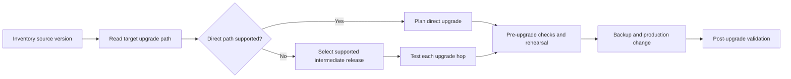

# Supported Upgrade Paths and Release Branch Transition Conditions

## Objectives

Upgrading MySQL changes the server software, data dictionary, metadata formats, configuration, and sometimes SQL behavior. Choosing the wrong upgrade path can prevent the server from starting, halt replication, cause application authentication failures, or make data incompatible with the new version. Therefore, before upgrading, you must accurately determine the source version, target version, release branch, and vendor-supported transition path.

This lesson belongs to the **DATABASE_MYSQL** module, covering table design, data types, keys, SQL, indexes, transactions, concurrency control, reading execution plans, query tuning, and relational database operations. This lesson focuses on selecting an upgrade path, checking compatibility conditions, transitioning between release branches, and planning a verifiable and recoverable deployment.

After completing this lesson, you will be able to:

- Distinguish between patch upgrades, minor/maintenance upgrades, major upgrades, and release branch transitions.
- Determine direct upgrade paths or paths requiring intermediate versions.
- Check requirements for operating system, architecture, plugins, configuration, data, and replication.
- Compare in-place upgrades with logical migrations and cluster-wide upgrades.
- Plan testing, cutover, post-upgrade validation, and rollback procedures.

## 1. Distinguishing Versions and Upgrade Types

Every MySQL version must be recorded in full, for example `8.0.x` or `8.4.x`, along with edition, operating system, architecture, and installation method. Writing only "MySQL 8" is insufficient to determine upgrade eligibility.

Common change types:

| Type | Scope of Change | Approach |
|---|---|---|
| Patch release | Bug, security, and stability fixes within the same series | Usually replacing binaries within the same branch after checking release notes and compatibility |
| Maintenance/minor release | Updates within a release series | Check behavioral changes, configuration updates, and restart requirements |
| Major/series upgrade | Moving to a new series, potentially changing the data dictionary or features | Verify official upgrade paths, run Upgrade Checker, and perform a full rehearsal |
| Branch transition | Moving between LTS and Innovation or choosing another release branch | Evaluate support lifecycle, update cadence, and supported transition paths |

Do not assume that two numerically close versions can always be upgraded directly. Support depends on the exact source version, target version, operating system, edition, and certain configuration states.

## 2. Understanding LTS and Innovation Branches

MySQL adopted a release model with **LTS (Long Term Support)** and **Innovation** branches starting after MySQL 8.0. LTS targets environments needing stability and a predictable change cycle. Innovation delivers new features earlier with a faster release cadence, requiring organizations to be prepared for frequent testing and upgrades.

MySQL 8.4 is an LTS branch. When selecting a branch for production, consider:

- **LTS:** suitable when prioritizing stability, long-term compatibility, and fewer major changes.
- **Innovation:** suitable when needing to test or use new features early while maintaining regression testing capacity and tracking release schedules.
- **Applications and connectors:** verify that drivers, ORMs, proxies, backup tools, monitoring agents, and plugins support the target branch.
- **Support policy:** check support duration, end-of-life dates, and security policies for the exact version.

Do not pick a branch merely because the version number is higher. Choose the target based on support requirements, features, application compatibility, and operational capacity. For production systems prioritizing stability, a currently supported LTS branch is usually the sensible default.

## 3. Identifying Supported Upgrade Paths

Before replacing binaries, consult the upgrade documentation and release notes for the **target version**. The target documentation defines which source versions are accepted, mandatory intermediate steps, supported platforms, and specific limitations.

Decision process:

1. Record the full source version via `SELECT VERSION();` and confirm the edition/build.
2. Specify the exact target version, not just the branch name.
3. Look up the list of source versions supported by the target release.
4. Verify that the platform, architecture, package format, plugins, and installation method are in the support matrix.
5. If a direct path is not supported, identify every mandatory intermediate version.
6. Plan backups, testing, and transitions for each step; do not skip intermediate versions to save time.

A common illustrative example is upgrading a MySQL 5.7 system to MySQL 8.4 by upgrading to MySQL 8.0 first, and then to 8.4. This is an example of a multi-hop path; exact patch versions for source and target must still be cross-checked against the official documentation for the release being deployed. Do not use this example to infer that every older version follows the same route.

Upgrade paths should be viewed as a directed graph: each edge is a supported source-target pair. If there is no direct edge between two versions, traverse the intermediate node specified in the documentation or choose a supported logical migration method.



## 4. Checking Pre-Upgrade Compatibility Conditions

A supported upgrade path is only a necessary condition. The actual instance must also pass data, configuration, and ecosystem checks.

| Area | Items to Check | Risk if Skipped |
|---|---|---|
| Operating system | OS version, CPU architecture, system libraries, package repositories | Binaries will not run or platform is end-of-support |
| Data directory | Version that created the data directory, file permissions, filesystem, and free space | Server cannot read data or runs out of space during upgrade |
| Configuration | Removed/renamed variables or options, new default values, included option files | Server fails to start or behavior changes |
| SQL and schema | New keywords, data types, check constraints, partitions, generated columns | Legacy DDL or queries fail |
| Data | Invalid date values, out-of-range data, inconsistent metadata | Upgrade Checker reports errors or upgrade fails |
| Plugins/components | Authentication plugins, keyring, audit, storage engines, and third-party components | Missing functionality or inability to open encrypted data |
| Applications | Connectors, drivers, ORMs, proxies, client libraries, and authentication | Clients cannot connect or queries behave differently |
| Replication/HA | Source/replica version pairs, GTID, binlogs, backups, and failover tools | Replicas stop or role switching fails |

Test the real workload as well: critical SQL statements, stored routines, event scheduler jobs, triggers, batch jobs, and administrative tools. A server may start cleanly yet still break applications due to changes in SQL mode, authentication plugins, collations, or optimizer behavior.

## 5. Using Upgrade Checker and Verification Tools

MySQL Shell provides the Upgrade Checker utility to detect issues that may block an upgrade or alter behavior. It can be invoked via the `util.checkForServerUpgrade()` API or the `check-for-server-upgrade` command-line utility, depending on the MySQL Shell version.

Example call from the MySQL Shell JavaScript API:

```javascript
util.checkForServerUpgrade(
  'dba@127.0.0.1:3306',
  { targetVersion: '8.4.0' }
);
```

Replace the account, endpoint, and target version with environment-specific values. Run the checker with an account that has sufficient privileges to read the required metadata; protect credentials and output because the report can expose system structure.

Upgrade Checker can warn about:

- Removed system variables or configuration options.
- New keywords that may collide with database, table, or column names.
- Data types, date/time values, and structures that are no longer supported.
- Changed usage of partitions, plugins, or features.
- Compatibility issues recognized by that version's checker.

The checker does not prove full application compatibility. It does not replace query testing, performance testing, third-party plugin verification, or backup/restore rehearsals. Address all errors and evaluate every warning before upgrading production.

In modern MySQL versions, system upgrade tasks are performed automatically by the server when starting the new version according to documentation. `mysql_upgrade` is no longer a manual step to run as in older versions; this utility was removed in MySQL 8.4. Always follow the documentation for the exact version rather than keeping legacy commands in runbooks.

## 6. Choosing an Upgrade Method

### In-Place Upgrade

An in-place upgrade replaces the MySQL binaries on the existing host and lets the new version execute supported data directory conversions. This method typically reduces data movement effort and can shorten the procedure for eligible instances.

Use it only when the source-target pair is supported, the operating system is compatible, and the data directory passes pre-checks. A backup that can restore cleanly to the exact source version is required. Do not start old binaries against a data directory upgraded by a newer version unless a downgrade path is supported.

### Logical Dump and Restore

Logical migration exports schemas and data into statements or an intermediate format and loads them into a new instance. This approach is useful when changing platforms, changing architectures, cleaning up schemas, or when an in-place upgrade is unsuitable.

Drawbacks include export/import duration, CPU and I/O load, the need to handle routines/triggers/events/definers, and potential data transformations. Verify charsets, collations, SQL modes, keys, and privileges after loading.

### Replica or Parallel Migration

For systems requiring minimal downtime, you can provision the target instance, load an initial snapshot, and synchronize changes via replication or CDC if the version pair and tools support it. Once lag reaches zero and checkpoints are verified, switch writers to the new system.

This approach requires managing GTIDs/binlogs, source-replica compatibility, write ownership, fencing, and a rollback plan. Do not treat replication as a zero-data-loss guarantee without defining RPO and synchronization mechanisms.

| Criterion | In-Place | Logical Migration | Parallel Replica/CDC |
|---|---|---|---|
| Downtime | Usually requires stopping the instance | Depends on data size and load window | Can be shorter with good delta sync |
| Schema changes | Fewer changes if compatible | Flexible for redesign | Flexible but requires mapping and CDC |
| Rollback | Requires pre-upgrade backup | Retains source system and reverse sync process | Must handle writes occurring after cutover |
| Complexity | Focused on version compatibility | Focused on data and semantics | Higher due to running two systems simultaneously |

## 7. Preparing Before a Production Upgrade

Before the change window, complete the following steps:

1. Record MySQL versions, configurations, plugins/components, topology, and critical workloads.
2. Confirm the supported upgrade path and save release notes and guides for the target release.
3. Run Upgrade Checker and resolve evaluated errors/warnings.
4. Build a test environment from a production-like backup; rehearse the entire procedure.
5. Run regression tests for applications, connectors, authentication, queries, transactions, and stored routines.
6. Measure shutdown time, startup time, metadata conversion time, and post-upgrade performance.
7. Create a consistent full backup, verify it can be restored, and retain binlogs/checkpoints needed for PITR.
8. Check disk space, inodes, file permissions, resources, and the ability to return to the source version.
9. Finalize the runbook, operators, approvers, go/no-go criteria, and communication plan.

Backups must reside outside the data directory being upgraded and be isolated from the same failure domain. For encrypted systems, ensure keyrings/KMS/HSM and key access credentials are recoverable before starting.

## 8. Performing an In-Place Upgrade

General sequence; always prioritize the specific procedure in the target release documentation:

1. Put the application into maintenance or stop writers per plan; confirm no active business transactions remain.
2. Stop MySQL cleanly using the appropriate service mechanism and confirm the process has exited.
3. Save copies of configuration files, logs, replication status, and source version metadata.
4. Create or verify a full backup and recovery checkpoints.
5. Install target version binaries/packages per operating system procedures.
6. Re-check option files, plugins/components, data/log paths, and file permissions.
7. Start the new version; monitor the error log throughout the entire upgrade process.
8. Confirm the data dictionary and components initialized successfully; address warnings per guidance.
9. Run checks on SQL, accounts, replication, backups, and applications before opening traffic.

Do not copy a running data directory as a substitute for a consistent backup. Do not mix binaries from multiple distributions or skip a clean shutdown when required by documentation.

## 9. Upgrading Replication and HA Topologies

In a source/replica topology, the upgrade must preserve binlog transmission during the transition phase. Compatibility between source and replica versions is a dedicated matrix; do not assume every version pair works bidirectionally.

A rolling upgrade sequence is typically structured as follows, if the version pair is supported:

1. Verify replicas have complete data, GTIDs, and healthy status; verify the source retains required binlogs.
2. Upgrade one replica first, monitor receiver/applier threads, and verify data.
3. Test read traffic against the replica, backup tools, and monitoring on the new version.
4. Upgrade the remaining replicas sequentially while maintaining at least one healthy serving path.
5. Plan the primary switchover or primary upgrade in the order supported by documentation.
6. After switching, verify GTIDs, binlogs, write privileges, fencing, and failover capability.

Do not upgrade the source first if doing so renders older replicas incompatible. Do not promote a replica solely because it already runs the new version; verify received and applied transactions, GTID state, data, and load capacity.

For Group Replication or InnoDB Cluster, check the specific version matrix for Group Replication, AdminAPI, Router, and cluster members. Rolling upgrade procedures may impose strict conditions on member order, quorum, compatibility mode, and minimum versions. Do not apply asynchronous replication runbooks to InnoDB Cluster.

## 10. Transitioning Between LTS and Innovation Branches

Switching release branches requires a clear operational decision. Before leaving a branch, verify:

- Whether the target branch has a direct upgrade path from the current version or requires an intermediate step.
- Whether the target branch supports active plugins, connectors, backups, and the operating system.
- Whether features or variables used on the source branch have changed, been removed, or behave differently.
- Whether the support policy and update cadence fit operational capacity.
- Whether representative workloads and backup restores can be tested before production cutover.

For example, an organization on an older branch may choose to move to MySQL 8.4 LTS to prioritize a stable lifecycle. If newer features from an Innovation branch are needed, weigh the benefits against upgrade cadence and frequent testing demands. This decision should be codified as a platform standard rather than chosen ad hoc per server.

Do not treat "changing the package repository" as a complete branch transition plan. Changing the package source only provides binaries; it does not automatically validate the data directory, configuration, plugins, or upgrade path compatibility.

## 11. Post-Upgrade Verification

After the server starts, verify multiple layers:

```sql
SELECT VERSION() AS server_version,
       @@version_comment AS distribution;

SHOW GLOBAL STATUS LIKE 'Uptime';
SHOW PLUGINS;
SHOW VARIABLES LIKE 'sql_mode';
SHOW VARIABLES LIKE 'character_set_server';
SHOW VARIABLES LIKE 'collation_server';
```

On MySQL 8.0, you can inspect registered components via `mysql.component` if that table exists in the version in use:

```sql
SELECT component_urn FROM mysql.component;
```

Continue verifying:

- Error log contains no upgrade, data dictionary, InnoDB, or plugin/component errors.
- All databases, tables, partitions, indexes, triggers, views, routines, and events are intact.
- Accounts, authentication plugins, roles, grants, and TLS work properly.
- Replication receiver/applier or Group Replication is healthy.
- Fresh backups are created and can be verified/restored per procedure.
- Business queries return expected results; execution plans and latency show no abnormal regression.
- Applications, drivers, ORMs, proxies, monitoring, and batch jobs work with the new version.

Run performance tests using representative workloads. The optimizer may choose different execution plans after an upgrade due to changes in statistics, optimizer rules, collations, or configuration. Compare p95/p99 latency, throughput, CPU, I/O, lock waits, and slow query counts against the pre-upgrade baseline.

## 12. Downgrade and Rollback

Rollback does not mean reinstalling the old binaries. Once the new version has converted the data dictionary or data formats, the old version may no longer be able to read the data directory.

Before upgrading, determine whether the target release supports downgrading to the source release and what limitations apply to that procedure. When no supported downgrade exists, rollback typically involves restoring the full pre-upgrade backup into an environment running the old version, then replaying binlogs up to a checkpoint if needed.

Do not start an older MySQL version against a data directory already upgraded by a newer version unless documentation explicitly confirms that downgrade path. Do not delete pre-upgrade backups until the verification window has elapsed and retention policies allow it.

If the application wrote new data after cutover, the pre-upgrade backup will not contain those transactions. Rolling back without data loss requires reverse replication/CDC, delta exports, or a rehearsed reconciliation workflow. Without a reverse sync path, decide how new data will be preserved before switching back to the old system.

## 13. Common Upgrade Mistakes

- **Skipping intermediate versions:** upgrade path is unsupported. Build the route according to target release documentation.
- **Checking only the major version number:** missing patch level, OS, architecture, or edition details. Record the full build and platform.
- **Skipping Upgrade Checker:** incompatible configs or schemas surface only at startup. Run the checker and rehearse on a copy.
- **Missing compatible plugins:** server fails to load plugins or loses authentication/encryption capabilities. Verify vendors and versions beforehand.
- **Changes in SQL mode or collation:** queries return different results or get rejected. Run regression tests on real workloads.
- **Using outdated runbooks:** invoking `mysql_upgrade` or removed operations. Update procedures per target version documentation.
- **Failing to retain binlogs/checkpoints:** unable to recover to a desired point in time. Record checkpoints and test PITR.
- **Upgrading topology in the wrong order:** replicas become incompatible with the source or failover fails. Verify the source/replica matrix before rolling upgrades.
- **Assuming downgrade only requires swapping binaries:** the data directory may be incompatible. Use restore or a documented downgrade path.
- **Skipping performance testing:** queries slow down even though the server starts. Compare execution plans and metrics against the baseline.

## 14. Practical Exercise

In a test environment, plan an upgrade of a MySQL instance from its current version to a target LTS version:

1. Record `SELECT VERSION()`, operating system, architecture, plugins/components, configuration, and topology.
2. Consult the target release documentation to confirm supported source versions and direct/intermediate upgrade paths.
3. Run MySQL Shell Upgrade Checker with the exact target version; classify errors and warnings.
4. Take a backup and restore it into staging; verify the backup before replacing binaries.
5. Rehearse the upgrade in the exact planned order, monitor the error log, and time each step.
6. Verify accounts, TLS, plugins, schema, routines, replication, backups, and business queries.
7. Compare latency, throughput, CPU, I/O, and execution plans before and after.
8. Rehearse the rollback plan via backup restore; define how to preserve data if writes occurred after cutover.
9. Write a production runbook with go/no-go criteria, RTO, RPO, and accountable owners.

**Completion criteria:** a documented, supported upgrade path exists; compatibility errors are resolved; backups restore cleanly; applications and topology operate after the upgrade; and the operations team can clearly explain the rollback plan.

## Conclusion

MySQL upgrade paths must be determined from exact source and target releases. Choose the LTS or Innovation branch based on operational needs, verify every intermediate hop, run Upgrade Checker, rehearse on a copy, and validate both applications and topology. Conclude the upgrade only when data, replication, backups, performance, and recovery plans all meet established criteria.
