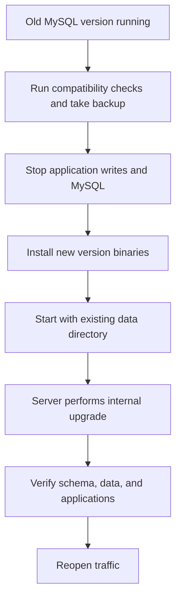
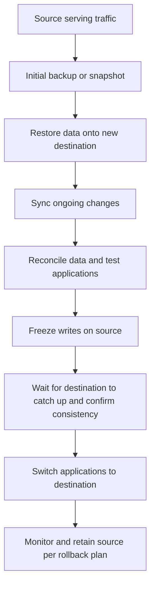

# In-Place Upgrade vs. Provisioning New Infrastructure and Migrating Data

When moving MySQL to a new version, operations teams typically have to choose between two approaches: an **in-place upgrade** on the existing data directory, or **provisioning a new server and migrating data (side-by-side migration)**. Both can move applications to the new version, but they differ in service downtime, risk isolation, resource requirements, rollback capability, and traffic cutover complexity.

In-place upgrades are typically simpler in terms of topology because the server and data directory stay in place, but during the upgrade the database cannot serve normal traffic and reverting to the old version usually requires restoring a backup. Side-by-side migrations require additional infrastructure and a sync/cutover process, in exchange for the ability to test the destination independently, shift load in a controlled manner, and retain the source as a fallback option for a period of time. Neither choice is universally best for every system; the decision must rest on supported source/target version paths, data size, RPO/RTO, downtime requirements, and verification capability.

## 1. How Do the Two Approaches Differ?

### In-Place Upgrade

An in-place upgrade replaces the existing MySQL binaries with binaries of the new version and starts the server against the existing data directory along a supported upgrade path. The server performs the necessary internal conversions, such as upgrading the data dictionary or system tables for the target version.

General flow:



The primary advantage is fewer data movement steps, without needing to keep two servers synchronized throughout the process. The drawbacks are longer downtime compared to replication-based cutovers, the need to test against a copy of the data directory, and the fact that once the data directory is upgraded, you cannot simply start the old binaries to revert.

### Provisioning New Infrastructure and Migrating Data

A side-by-side migration creates a new MySQL instance on separate infrastructure, installs the target version, and configures and tests it beforehand. Data is transferred using logical dump/load, backup/restore tools that support that version path, or replication from source to destination if the version pair and configuration are supported.

General flow:



The advantage is that source and destination coexist, allowing pre-cutover verification and application switching via endpoint/DNS/Router. The drawbacks are extra resource needs and the need to handle data synchronization, users/grants, configuration, secrets, jobs, and auxiliary components. If using replication to minimize downtime, version compatibility must be verified and a clear cutover runbook is required.

## 2. Comparison by Operational Criteria

| Criterion | In-Place Upgrade | Side-by-Side Migration |
|---|---|---|
| Infrastructure | Usually reuses the existing host and storage. | Requires a destination and typically capacity to run in parallel. |
| Downtime | Typically includes stopping the server, internal upgrade, verification, and reopening. | Can minimize downtime by pre-seeding data and syncing continuously; still requires a cutover window. |
| Complexity | Fewer components, but tightly bound to supported upgrade paths. | More steps: seeding, replication or delta load, reconciliation, cutover, and source cleanup. |
| Risk isolation | Primarily tested on a copy of the data directory before touching production. | Independent destination makes testing and canary workloads easy before cutover. |
| Rollback | Usually requires restoring a pre-upgrade backup/snapshot; do not directly downgrade the data directory. | Can switch applications back to source while source remains synced and has not taken independent writes. |
| Hardware/OS changes | Can be combined, but expands risk scope. | Convenient for changing hosts, storage, OS, or topology at the same time. |
| Performance testing | Primarily after upgrading on the same host or on a clone. | Can run benchmarks and compare destination prior to cutover. |
| Data dependency | Requires direct compatibility between the old data directory and new binaries. | Can migrate logically via dump/load or supported replication without necessarily reusing the data directory. |
| Best suited when | System is simple, downtime is acceptable, upgrade path is clear, and restore is tested. | System requires low downtime, infrastructure refresh, independent validation, or a flexible cutover window. |

One point to remember: side-by-side does not automatically give you an easy rollback. Once the destination begins accepting writes, the source falls behind. Reverting to the source requires a supported reverse-synchronization strategy or accepting the loss of new transactions; you cannot simply point DNS back to the source and assume the data matches.

## 3. Confirming the Supported Upgrade Path

Before choosing an approach, record the exact versions of source and destination:

```sql
SELECT
    VERSION() AS mysql_version,
    @@version_comment AS distribution,
    @@version_compile_os AS compile_os,
    @@version_compile_machine AS compile_machine;

SHOW VARIABLES LIKE 'datadir';
SHOW VARIABLES LIKE 'server_id';
SHOW VARIABLES LIKE 'server_uuid';
SHOW VARIABLES LIKE 'gtid_mode';
SHOW VARIABLES LIKE 'log_bin';
```

Cross-check the supported upgrade path in the documentation for the exact target MySQL version. Do not infer that every 5.7, 8.0, or 8.4 release can upgrade directly to any other. Requirements can depend on minimum minor versions, edition, platform, plugins, configuration, and database state. If the upgrade path requires passing through an intermediate version, plan each hop and test the entire chain.

Do not combine multiple major changes at once unnecessarily. For instance, simultaneously upgrading the major version, changing the operating system, moving storage, altering charsets, and changing topology makes root-cause analysis far harder. Whenever possible, separate changes into phases with distinct verification checkpoints.

## 4. Pre-Upgrade Compatibility Checks

### Using MySQL Shell Upgrade Checker

MySQL Shell provides the `util.checkForServerUpgrade()` utility to check numerous compatibility issues against a target version. Example in MySQL Shell JavaScript mode, after connecting to the source:

```javascript
util.checkForServerUpgrade("upgrade_check@source.internal:3306", {
  targetVersion: "8.4.0",
  outputFormat: "TEXT"
});
```

This example passes `connectionData` explicitly; MySQL Shell uses those connection details to inspect the source. Provide credentials via prompt or secret mechanisms, never hardcoding passwords into connection strings in scripts. Replace `targetVersion` with the actual target version. Read the full report and address errors and warnings by impact; do not treat utility completion as proof that all applications and workloads are compatible.

### Inventorying Configuration and Objects

Collect at minimum:

- MySQL version, operating system, architecture, and startup configuration.
- Storage engines, schemas, tables, partitions, indexes, constraints, and data sizes.
- Character sets/collations at server, schema, table, and column levels.
- `sql_mode`, timezone, isolation level, and critical configuration variables.
- Users, host patterns, grants, roles, authentication plugins, and replication accounts.
- Views, procedures, functions, triggers, events, plugins, components, and UDFs.
- Binary logs, GTID, replication topology, backups, keyrings, and TLS certificates.

Sample inventory queries:

```sql
SELECT
    TABLE_SCHEMA,
    ENGINE,
    COUNT(*) AS table_count,
    SUM(DATA_LENGTH + INDEX_LENGTH) AS total_bytes
FROM INFORMATION_SCHEMA.TABLES
WHERE TABLE_TYPE = 'BASE TABLE'
  AND TABLE_SCHEMA NOT IN ('mysql', 'sys', 'performance_schema', 'information_schema')
GROUP BY TABLE_SCHEMA, ENGINE
ORDER BY TABLE_SCHEMA, ENGINE;

SELECT
    TABLE_SCHEMA,
    TABLE_NAME,
    TABLE_COLLATION
FROM INFORMATION_SCHEMA.TABLES
WHERE TABLE_TYPE = 'BASE TABLE'
  AND TABLE_SCHEMA NOT IN ('mysql', 'sys', 'performance_schema', 'information_schema')
ORDER BY TABLE_SCHEMA, TABLE_NAME;

SELECT
    @@GLOBAL.sql_mode AS global_sql_mode,
    @@GLOBAL.time_zone AS global_time_zone,
    @@GLOBAL.gtid_mode AS gtid_mode,
    @@GLOBAL.enforce_gtid_consistency AS enforce_gtid_consistency;

SHOW VARIABLES LIKE 'transaction_isolation';
SHOW VARIABLES LIKE 'tx_isolation';
```

Check plugins and authentication as well. New versions may change the default plugin or remove legacy plugins; for example, `mysql_native_password` was deprecated in later MySQL 8.0 releases and disabled by default in MySQL 8.4. Verify that clients/connectors support the destination's authentication plugin prior to cutover.

### Testing Applications

Read changelogs and documentation for the target MySQL version to identify deprecated/removed syntax, new reserved keywords, default SQL mode changes, collations, authentication, TLS, and optimizer changes. Run integration tests with the exact connector/driver version. Specifically test:

- Queries using `GROUP BY`, implicit conversions, zero dates, JSON, spatial types, or generated columns.
- Stored routines and events that depend on the SQL mode captured at creation time.
- Clients using older authentication plugins, TLS ciphers, or protocols.
- Applications relying on `ORDER BY` ordering or string comparisons under default collations.
- Critical queries whose execution plans change after the upgrade.

## 5. Planning Backups and Rollback Capability

Before either an in-place upgrade or a side-by-side migration, you must have a valid backup and prove it can be restored. Backups should cover data, required GTID/binlog metadata, configurations, accounts, and external dependencies such as keyrings, encryption keys, certificates, plugin binaries, and config files.

For InnoDB, an illustrative logical backup:

```bash
mysqldump \
  --single-transaction \
  --routines \
  --events \
  --triggers \
  --hex-blob \
  --databases appdb \
  > appdb-before-upgrade.sql
```

`--single-transaction` creates a consistent snapshot for InnoDB; avoid structural DDL during the dump. Non-transactional tables require separate strategies. For large databases, consider physical backup tools or MySQL Shell dump utilities as needed and supported. Never assume you can take a raw data directory from one version and open it with binaries from another version as a portable backup.

Before upgrading production:

1. Create a backup and store it separately from the host being upgraded.
2. Verify checksums and readability of the backup.
3. Restore it onto an isolated environment using a compatible version.
4. Validate data, objects, applications, and restore duration.
5. Record the backup timestamp, GTID/binlog position, and actual RPO and RTO.

For in-place upgrades, rollback usually means restoring the pre-upgrade snapshot/data directory or rebuilding the server from backup. Do not run old binaries against a data directory converted by a newer version unless that downgrade path is explicitly supported. For side-by-side migrations, keeping the source provides rollback capability only as long as the source has not received independent writes and any new destination changes can be handled per plan.

## 6. In-Place Upgrade Procedure

### Before the Maintenance Window

1. Confirm the upgrade path and supported platform.
2. Run Upgrade Checker, fix critical errors/warnings, and re-run.
3. Test on a copy of the data directory using the target binaries.
4. Confirm backup restore succeeds, disk space is sufficient, and config snapshots/backups exist.
5. Announce downtime, stop write jobs, and define abort criteria.
6. Prepare binaries/packages, configurations, compatible plugins, and restart procedures.

### Execution

General flow on Linux (exact commands depend on package/service manager):

```bash
sudo systemctl stop mysqld

# Install the target-version MySQL package following the OS procedure.

sudo systemctl start mysqld
```

Do not use this snippet verbatim as a complete runbook for every system. Before installing packages, confirm the service is stopped, backups are complete, the package repository points to the exact target version, and configs/data directory are properly preserved. On Windows or in container environments, stop/install/start procedures differ.

When the new server starts, monitor the error log to confirm internal upgrades finish. Several versions perform system table/data dictionary upgrades automatically on startup. `mysql_upgrade` was deprecated in MySQL 8.0.16 and removed in MySQL 8.4; on newer versions, do not follow outdated instructions calling that utility if it no longer exists. Always follow the target version's documentation.

### After Startup

- Confirm `SELECT VERSION()` returns the exact target version.
- Read the error log for upgrade, plugin, redo/undo, tablespace, and system table errors.
- Verify schemas, tables, views, routines, triggers, events, and users/grants.
- Confirm binary logs, GTID, and replication operate as designed.
- Run smoke tests, integration tests, and critical queries.
- Measure CPU, memory, disk I/O, connection count, query latency, and execution plans.
- Reopen production writes only after acceptance criteria are met.

If the server fails to start or internal upgrade fails, stop ad-hoc retries. Collect error logs, preserve the failed data directory for investigation, and execute the rehearsed restore plan. Do not copy system tables from another host or delete data files to force the server to start.

## 7. Side-by-Side Procedure via Logical Dump/Load

Logical migration fits well when moving to new hosts or wanting an isolated destination. Data is exported as SQL statements or dump formats and loaded into a fresh schema; thus it can span differing versions if DDL, data types, collations, and syntax are compatible.

### Initial Data Seeding

Example dumping an InnoDB schema:

```bash
mysqldump \
  --single-transaction \
  --routines \
  --events \
  --triggers \
  --hex-blob \
  --databases appdb \
  > appdb.sql
```

Import into the destination:

```bash
mysql \
  --default-character-set=utf8mb4 \
  --host=mysql-new.internal \
  --user=restore_user \
  -p < appdb.sql
```

The example assumes dump and destination have been verified for charset, collation, timezone, SQL mode, and DDL. For large datasets, dump/load can take a long time and generate substantial load; use MySQL Shell dump/load utilities or specialized tools where appropriate. If the dump contains GTID metadata, handle `GTID_PURGED` according to the destination's GTID state; never blindly import onto a server that already has a different transaction history.

### Forwarding Ongoing Changes

If the application continues writing to the source during the dump, post-snapshot transactions must be forwarded. Binary log/GTID replication can be used if the source and destination version pair is supported, replication settings are compatible, and all schema/feature changes fall within supported bounds.

With GTID, replica configuration can use:

```sql
CHANGE REPLICATION SOURCE TO
    SOURCE_HOST = 'mysql-old.internal',
    SOURCE_PORT = 3306,
    SOURCE_USER = 'replication_user',
    SOURCE_PASSWORD = 'managed-secret',
    SOURCE_AUTO_POSITION = 1;

START REPLICA;
```

This is an example for a supported GTID topology; on older versions the command name may be `CHANGE MASTER TO`. Never put real passwords into scripts or shell history. If replication cannot be used, use a delta-load mechanism or a maintenance window that halts writes while creating and loading the final dump.

Monitor progress:

```sql
SHOW REPLICA STATUS\G

SELECT
    @@GLOBAL.gtid_executed AS executed_gtid_set,
    @@GLOBAL.gtid_purged AS purged_gtid_set;
```

Compare `Retrieved_Gtid_Set`, `Executed_Gtid_Set`, I/O/SQL errors, and replication lag. GTID sets show transaction progress, but do not prove two databases hold identical contents; checksums/data reconciliation are still required.

### Cutover

Once the destination has nearly caught up:

1. Announce the cutover window and stop or lock all write paths to the source, including workers, cron jobs, ETL pipelines, and admin tasks.
2. Wait until the source has no open write transactions; record the final GTID/binlog watermark.
3. Wait for the destination to apply up to that watermark; confirm receiver/applier have no errors and backlog is within acceptable bounds.
4. Run row count checks, checksums, or business reconciliation on critical tables.
5. Block writes on the source to prevent split-brain, then switch application endpoints/DNS/Router/secrets to the destination.
6. Start applications and verify connections, transactions, background jobs, and monitoring.
7. Keep the source read-only or isolated per plan during the observation window; define clear criteria for closing the rollback window.

Never allow both source and destination to accept independent writes during cutover. Doing so creates divergent data histories and makes reconciliation complex. If rollback is needed after the destination has accepted writes, you must have a supported reverse-sync strategy or a workflow to reconcile/recover newly created data; do not simply flip DNS back.

## 8. Replication-Based Migration: Conditions to Verify

Replication can reduce downtime because the destination receives new transactions while the source continues serving. However, not every version pair supports bidirectional replication or full feature compatibility.

Before choosing this method, verify:

- The source/replica versions are supported by the target version's replication documentation.
- The source is older than the replica along a supported upgrade path; do not arbitrarily reverse direction after cutover.
- GTID mode, `server_id`, `server_uuid`, binary log format, and retention are compatible.
- Required binary logs remain available so the replica can start from the snapshot.
- DDL executed during replication can be applied on the new version.
- Authentication plugins, TLS, and replication privileges work on both sides.
- No filters or local writes on the replica cause data drift.

If the destination has upgraded its major version and accepted writes, do not assume it can be configured as a source for the older version to revert. Reverse replication may be unsupported due to differences in formats, features, or metadata. Treat rollback as an architectural decision verified prior to cutover, not an ad-hoc command run after an incident.

## 9. Data and Performance Reconciliation

Checking row counts is necessary but insufficient. Two databases can have identical row counts yet differ in values, miss tables or routines, or differ in collations/indexes. Reconcile across multiple layers:

| Layer | Verification Scope |
|---|---|
| Schema | Tables, columns, types, nullability, defaults, indexes, constraints, partitions, and table options. |
| Data | Row counts, min/max keys, checksums/chunk checksums, monetary totals, and counts by business status. |
| Objects | Views, procedures, functions, triggers, events, and execution privileges. |
| Security | Users, hosts, roles, grants, authentication plugins, TLS, and secrets. |
| Replication | GTID watermarks, errors, backlog, binary log retention, and channel status. |
| Application | Smoke tests, transactions, read-after-write, batch jobs, and critical queries. |

Example schema row-count check:

```sql
SELECT
    TABLE_SCHEMA,
    TABLE_NAME,
    TABLE_ROWS
FROM INFORMATION_SCHEMA.TABLES
WHERE TABLE_SCHEMA = 'appdb'
  AND TABLE_TYPE = 'BASE TABLE'
ORDER BY TABLE_NAME;
```

For InnoDB, `TABLE_ROWS` in `INFORMATION_SCHEMA.TABLES` is typically an estimate, not an exact count. Use `COUNT(*)` or chunked checksum tools for critical tables, accounting for production load. When comparing checksums, normalize representations of NULLs, charsets, collations, decimals, timestamps, and row ordering so results are meaningful.

After an upgrade, the optimizer may pick different execution plans due to changes in versions, statistics, histograms, or defaults. Capture baselines for critical queries, run `EXPLAIN`/`EXPLAIN ANALYZE` in a test environment, and compare latency, rows examined, lock waits, temp tables, and I/O. `EXPLAIN ANALYZE` actually executes the analyzed query; run it only on representative queries in test environments or after assessing its production load impact.

## 10. Components Often Forgotten During Host Migration

A database is more than data tables. Before cutover, check the following components:

- **Accounts and privileges**: users/hosts, roles, grants, default roles, authentication plugins, and password policies.
- **Stored objects**: views, routines, triggers, events, SQL modes saved at creation time, and `DEFINER`.
- **Plugins/components/UDFs**: binary versions compatible with the new server, OS libraries, and plugin loading configs.
- **Encryption**: keyrings, master keys, tablespace encryption, and key recovery procedures.
- **TLS**: certificates, private keys, CA chains, hostname verification, and client trust stores.
- **Replication**: server IDs/UUIDs, GTIDs, channels, filters, accounts, and binary log retention.
- **Backups**: job schedules, destinations, retention, encryption, alerts, and restore tests.
- **Observability**: exporters, Performance Schema consumers, log rotation, alerts, dashboards, and tracing.
- **Operations**: cron jobs, ETL, CDC, BI readers, batch jobs, connection pools, DNS, firewalls, and secrets.

If using InnoDB Cluster/MySQL Router, check cluster metadata, membership, Router bootstrap/config, endpoints, and post-migration failover procedures. If using external CDC or backup tools, confirm connectors/agents support the new version.

## 11. Choosing an Approach by Scenario

| Scenario | Typically Suitable Approach | Deciding Conditions |
|---|---|---|
| Small database, acceptable downtime, clear supported upgrade path | In-place | Backup restores cleanly, tested on a clone, and maintenance window available. |
| Large database, low downtime required | Side-by-side with replication | Version pair and features compatible, able to catch up GTID/binlog before cutover. |
| Need to change host, storage, or operating system | Side-by-side | Sufficient resources to run in parallel and endpoint switching plan ready. |
| Source has many plugins/UDFs or custom configuration | Evaluate both carefully; often test side-by-side first | Compatible plugin binaries exist and configs/secrets can be migrated. |
| In-place path is unsupported | Side-by-side or upgrade via intermediate version | Supported data transfer method exists and is fully tested. |
| Cannot run source and destination simultaneously | In-place with verified backup/snapshot | Restore RTO is acceptable and downtime is permitted. |

If the choice is still unclear, estimate dump/restore duration, new write rate, replica apply rate, backup size, test duration, and rollback duration. Side-by-side achieves low downtime only when the destination can keep up with real write throughput; if the apply rate is lower than transaction generation rate, backlog grows and cutover cannot finish on schedule.

## 12. Post-Cutover Acceptance Runbook

Once applications connect to the destination, execute checks in sequence:

1. Confirm all applications, workers, ETL pipelines, and jobs use the new endpoint.
2. Confirm the source receives no writes and no client bypasses the new endpoint.
3. Check version, error log, uptime, configuration, timezone, SQL mode, and charset.
4. Test privileges and logins using actual application accounts.
5. Run smoke tests for reads/writes, transaction rollbacks, deadlock handling, and read-after-write.
6. Reconcile critical business data and confirm zero replication errors/backlog if replication remains active.
7. Compare latency and execution plans of critical queries against the pre-upgrade baseline.
8. Verify fresh backups on the destination and confirm backup jobs continue running.
9. Monitor error rates, connection counts, CPU, memory, disk latency, lock waits, and replication lag during observation.
10. Close the rollback window only when service owners confirm stability criteria are satisfied.

## 13. Decision and Deployment Checklist

- [ ] Confirmed vendor-supported source-to-target upgrade path.
- [ ] Recorded current version, platform, data size, plugins, charset, SQL mode, and topology.
- [ ] Ran Upgrade Checker and resolved critical errors/warnings.
- [ ] Tested upgrade/migration in staging with representative data.
- [ ] Completed backups, checksums, and restore tests; documented actual RPO/RTO.
- [ ] Decided between in-place or side-by-side based on downtime, resources, and rollback.
- [ ] If side-by-side, verified seeding method, replication compatibility, and GTID/binlog retention.
- [ ] Prepared cutover runbook, write freeze, final watermark, and catch-up criteria.
- [ ] Inventoried users/grants, routines, triggers, events, plugins, keyrings, TLS, and backup jobs.
- [ ] Prepared endpoints, DNS/Router, firewalls, secrets, and connection pools.
- [ ] Established rollback/forward-recovery plan accounting for post-cutover transactions.
- [ ] Verified schema, data, applications, performance, and monitoring post-upgrade.

An in-place upgrade usually minimizes the number of moving parts, but concentrates risk into a single maintenance window and the active data directory. A side-by-side migration requires more preparation, but creates an independent destination for testing and controlled traffic shifting. Decide based on supported version paths, restore capability, RPO/RTO, write load, and cutover/rollback plans; then verify real data and workloads before considering the upgrade complete.
