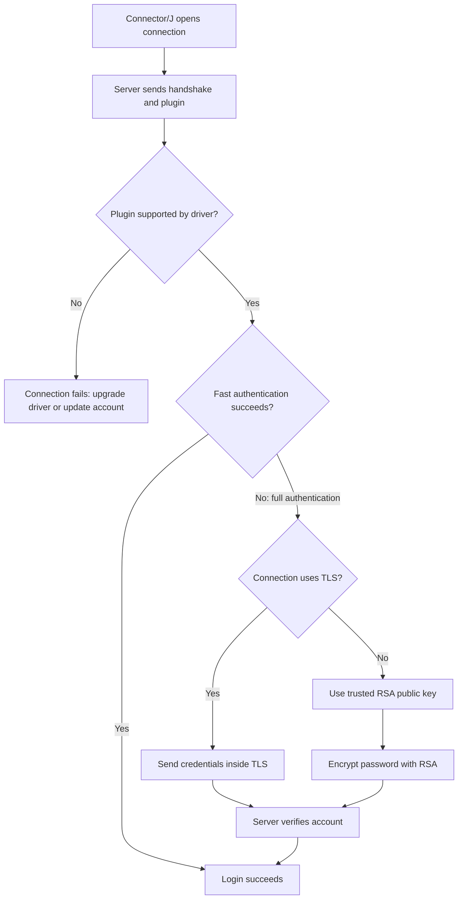

# Authentication Plugins, RSA Keys, and Credential Management

When a Java application connects to MySQL using Connector/J, login depends on the MySQL account's authentication plugin, support in the JDBC driver version, how passwords are transmitted, and connection security configuration. If the server uses a newer plugin while the application still uses an older driver, connections can fail even with the right username and password. If RSA authentication is used without verifying the authenticity of the public key, credentials may be exposed to spoofing during exchange.

This lesson explains how Connector/J works with authentication plugins, when an RSA public key is needed, how to configure TLS, and how to store, provision, and rotate credentials safely. Within the `DATABASE_MYSQL` module, this topic connects secure connectivity with authorization, MySQL operations, and Java application management.

After this lesson, you will be able to:

- Identify common authentication plugins and select the appropriate one.
- Verify compatibility between MySQL Server and Connector/J.
- Distinguish TLS from RSA key exchange in authentication.
- Configure Connector/J to verify server certificates.
- Use a reliably managed RSA public key when TLS is not used.
- Grant least-privilege permissions to application accounts.
- Manage secrets, connection pools, and password rotation workflows.
- Investigate common authentication, RSA, and TLS errors.

## 1. Where Do Authentication Plugins Fit?

MySQL authenticates accounts using the plugin attached to each account, such as `'shop_app'@'10.20.%'`. The plugin determines how the server validates credentials and how the client participates in the login process. Connector/J must support the plugin the account uses.

An authentication plugin is distinct from SQL privileges. A successful login only proves the account's identity; the account still needs appropriate privileges to read or modify a schema. Likewise, TLS connection encryption protects data in transit but does not grant query privileges on its own.

Related components:

| Component | Role |
|---|---|
| MySQL account | Combines username and host pattern to define login identity |
| Authentication plugin | Implements the authentication protocol for the account |
| MySQL Server | Sends the handshake, validates the response, and enforces account policy |
| Connector/J | Negotiates the plugin, sends credentials, and establishes the JDBC connection |
| TLS | Encrypts the transport channel and optionally verifies server identity via certificates |
| RSA public key | Enables password encryption in certain non-TLS authentication flows |
| Secret manager | Stores and distributes passwords or credentials to the application |

A secure connection requires proper authentication, least-privilege SQL permissions, and transport protection. None of these layers should be treated as a substitute for the others.

## 2. Common Authentication Plugins

### 2.1. `caching_sha2_password`

`caching_sha2_password` is the default plugin MySQL uses for new accounts in MySQL 8.0. It uses SHA-256 and a caching mechanism to optimize repeated authentications. When credentials are already cached, login can complete via fast authentication. If full authentication is required, client and server must use a secure channel or an appropriate RSA mechanism to protect the password exchange.

This is the preferred choice for modern MySQL deployments. Connector/J must be recent enough to support it; Connector/J 8.0.9 and later support `caching_sha2_password`. For new systems, use a supported Connector/J version compatible with both your Java runtime and your deployed MySQL version.

### 2.2. `sha256_password`

`sha256_password` is also based on SHA-256 and can use TLS or RSA to protect password transmission. It is older than `caching_sha2_password`; retain it only for specific compatibility requirements after evaluating a migration plan.

### 2.3. `mysql_native_password`

`mysql_native_password` is a legacy plugin once widely used for compatibility with older clients. This plugin was deprecated in MySQL 8.0.34, disabled by default in MySQL 8.4, and removed in MySQL 9.0. Do not choose this plugin for new applications just to avoid upgrading the JDBC driver.

If an application fails to connect because of a legacy plugin or because the driver lacks support for a newer plugin, upgrade Connector/J and test first. Weakening account security in production can create a larger problem than the initial connection error.

### 2.4. Inspecting Account Plugins

Administrators can view accounts and plugins via administrative metadata. Never copy authentication hashes or sensitive output from `SHOW CREATE USER` into logs or tickets. Example query to inspect plugins via `mysql.user` on versions supporting that metadata:

```sql
SELECT user, host, plugin, account_locked
FROM mysql.user
WHERE user = 'shop_app';
```

System schemas and read access to `mysql.user` depend on version, so run this query only with an appropriately privileged administrative account. For routine tasks, inspect accounts using supported administrative commands and restrict who can view authentication metadata.

## 3. Authentication Flow and When RSA Is Needed

During connection establishment, the server announces the required plugin in its handshake. Connector/J selects the corresponding mechanism and can switch plugins as requested by the server.

With `caching_sha2_password`, there are two general cases:

1. **Fast authentication:** if the server has cached credentials, the client can complete authentication quickly without sending the password via the full authentication flow.
2. **Full authentication:** the server must verify the password in full. If the connection is already protected by TLS, the password is exchanged inside the TLS channel. Without TLS, the client must use RSA to encrypt the password with the server's public key before sending it.

Here, RSA protects only the password exchange step. It does not encrypt SQL statements, query results, or application data on the connection. To protect all traffic, use TLS.



Whenever possible, use TLS with server certificate verification. An RSA public key is a fallback to protect passwords during non-TLS authentication; it should not be viewed as an equivalent replacement for TLS.

## 4. MySQL RSA Keys

### 4.1. Public Key and Private Key

RSA uses a key pair:

- **Private key:** kept secret on the MySQL server; used to decrypt/process authentication data.
- **Public key:** can be distributed to clients so clients can encrypt passwords sent to the server.

Clients only need the public key. Never copy MySQL's private key to application hosts, repositories, container images, or shared secrets.

MySQL can automatically generate an RSA key pair for supported plugins when automatic key generation is enabled. Administrators can also specify custom key paths in server configuration. Illustrative example:

```ini
[mysqld]
caching_sha2_password_auto_generate_rsa_keys=ON
# Custom paths can be specified if required by administrative policy:
# caching_sha2_password_private_key_path=/etc/mysql/private/caching_sha2_private.pem
# caching_sha2_password_public_key_path=/etc/mysql/public/caching_sha2_public.pem
```

These paths are Linux examples. Variable names and behavior depend on the MySQL version. If using custom files, restrict read permissions on the private key to the MySQL service account and authorized administrators; the public key can be distributed to clients through an integrity-controlled process.

### 4.2. Configuring Connector/J with a Public Key File

When TLS is not used, Connector/J can read the public key from a file specified by the `serverRSAPublicKeyFile` property. The file must contain the exact RSA public key used by the MySQL server for that plugin.

JDBC URL example:

```text
jdbc:mysql://mysql.example.internal:3306/shop?sslMode=DISABLED&serverRSAPublicKeyFile=/etc/shop-app/mysql/server-rsa-public.pem
```

This example only demonstrates how to specify the file in a lab environment or a network protected by policy. `sslMode=DISABLED` turns off TLS, so it should not be used for production connections over untrusted networks. Protect the public key file from unauthorized tampering; if an attacker swaps the public key, the client could encrypt the password for an impostor.

`serverRSAPublicKeyFile` is not a TLS certificate file. A TLS certificate authenticates the server during the TLS handshake; the RSA public key here serves MySQL's password authentication mechanism. Both key types have different purposes and deployment formats.

### 4.3. `allowPublicKeyRetrieval`

Connector/J provides the `allowPublicKeyRetrieval` property. When enabled, the client can request the public key from the server if no public key file is configured. While useful in labs or tightly controlled environments, receiving a key over an unauthenticated connection introduces a man-in-the-middle risk.

In production:

- Prefer TLS with `sslMode=VERIFY_IDENTITY`.
- If non-TLS RSA is strictly required, distribute the public key over a trusted channel and specify `serverRSAPublicKeyFile`.
- Keep `allowPublicKeyRetrieval=false` unless backed by a security review and explicit justification.
- Do not enable this property as a quick fix for `Public Key Retrieval is not allowed` without understanding how TLS or RSA keys are currently configured.

## 5. Preferring TLS and Server Identity Verification

TLS protects all data transmitted between Connector/J and MySQL: passwords, SQL statements, and query results. To avoid connecting to a spoofed server, the client must verify both the certificate and the hostname.

Modern Connector/J uses the `sslMode` property:

| Value | Behavior |
|---|---|
| `DISABLED` | Do not use TLS |
| `PREFERRED` | Prefer TLS, but fall back to a non-TLS connection |
| `REQUIRED` | Require TLS, without full server identity verification |
| `VERIFY_CA` | Require TLS and verify the certificate chain against a trusted CA |
| `VERIFY_IDENTITY` | Require TLS, verify the CA, and verify the server hostname |

For production, generally use `VERIFY_IDENTITY` and supply an appropriate truststore/CA. `REQUIRED` only guarantees transport encryption; it is not equivalent to verifying the server's exact hostname.

JDBC URL example:

```text
jdbc:mysql://mysql.example.internal:3306/shop?sslMode=VERIFY_IDENTITY
```

If using a custom truststore:

```text
jdbc:mysql://mysql.example.internal:3306/shop?sslMode=VERIFY_IDENTITY&trustCertificateKeyStoreUrl=file:/etc/shop-app/mysql/truststore.p12&trustCertificateKeyStoreType=PKCS12
```

Truststore passwords should be passed via a secret manager or protected configuration rather than appended directly to a URL stored in a repository. The server certificate must have a SAN matching the hostname used by the application. If the application connects by IP while the certificate only contains DNS names, `VERIFY_IDENTITY` can reject the connection; use a hostname matching the certificate or issue a certificate with the appropriate SAN.

## 6. Configuring Connector/J in Java Applications

### 6.1. Using a Compatible Driver

For modern Connector/J versions, the Maven dependency looks like:

```xml
<dependency>
    <groupId>com.mysql</groupId>
    <artifactId>mysql-connector-j</artifactId>
    <version>${mysql.connector.version}</version>
</dependency>
```

Choose a specific supported version compatible with both the Java runtime and MySQL Server. Do not leave the `${mysql.connector.version}` placeholder as a literal version in a project unless the corresponding property is defined.

The modern driver class is `com.mysql.cj.jdbc.Driver`. The JDBC driver is normally auto-discovered via the Service Provider Interface, though it can be declared explicitly if a framework requires it.

### 6.2. Configuring TLS and Credentials via Properties

Example using `DriverManager`:

```java
String url = "jdbc:mysql://mysql.example.internal:3306/shop?sslMode=VERIFY_IDENTITY";

Properties properties = new Properties();
properties.setProperty("user", secretProvider.get("shop-db-username"));
properties.setProperty("password", secretProvider.get("shop-db-password"));
properties.setProperty("allowPublicKeyRetrieval", "false");

try (Connection connection = DriverManager.getConnection(url, properties)) {
    // Execute queries using PreparedStatement.
}
```

`secretProvider` is an illustrative component representing the application's secret manager; replace it with your platform's actual API. Never store passwords in source code, committed configuration files, or JDBC URLs that appear in logs. When using a custom truststore, supply its path and credentials through Connector/J's protected configuration properties.

When using TLS with identity verification, you generally do not need to configure an RSA public key for password exchange. Keeping `allowPublicKeyRetrieval=false` prevents accidentally accepting an unverified public key if a connection ever falls back to a non-TLS flow.

### 6.3. Configuring via DataSource or Connection Pool

Production applications typically use a `DataSource` or connection pool such as HikariCP. Authentication and TLS properties remain Connector/J properties passed through the datasource configuration.

Conceptual example with HikariCP:

```java
HikariConfig config = new HikariConfig();
config.setJdbcUrl(
    "jdbc:mysql://mysql.example.internal:3306/shop?sslMode=VERIFY_IDENTITY"
);
config.setUsername(secretProvider.get("shop-db-username"));
config.setPassword(secretProvider.get("shop-db-password"));
config.addDataSourceProperty("allowPublicKeyRetrieval", "false");
config.setMaximumPoolSize(20);

HikariDataSource dataSource = new HikariDataSource(config);
```

This snippet is illustrative; import and initialize `HikariConfig`, `HikariDataSource`, and the appropriate secret provider in your project. Connection counts must be sized according to total application instances, MySQL connection limits, and real workload.

Do not create a new pool for every request. Pools should be managed across the application lifecycle and have a refresh process when secrets or certificates change.

## 7. Creating Least-Privilege MySQL Accounts

Application accounts should be isolated per service and environment. Example creating an account restricted to the application's network range:

```sql
CREATE USER 'shop_app'@'10.20.%'
    IDENTIFIED WITH caching_sha2_password BY '<secret-from-secure-provisioning>'
    REQUIRE SSL;

GRANT SELECT, INSERT, UPDATE, DELETE
ON shop.* TO 'shop_app'@'10.20.%';
```

The string `<secret-from-secure-provisioning>` is a placeholder, not a literal password. In real environments, provision passwords through a secure provisioning tool rather than putting secrets into committed SQL files or command history.

Grant only the privileges the application needs. A reporting service may need only `SELECT`; an order-writing service may need `INSERT`, `UPDATE`, and other specific privileges. Do not grant `ALL PRIVILEGES`, `GRANT OPTION`, `FILE`, server administration privileges, or user-management privileges to application accounts without an evaluated requirement.

Check privileges:

```sql
SHOW GRANTS FOR 'shop_app'@'10.20.%';
```

`REQUIRE SSL` requires the account to use an encrypted connection. Combine it with `sslMode=VERIFY_IDENTITY` on the client to verify server identity. If client certificate verification is needed at the account level, consider `REQUIRE X509` or issuer/subject conditions per your organization's PKI policy.

Account host patterns should be restricted based on the actual network and MySQL name resolution rules. Avoid `'%'` whenever a narrower host range or connection identity can be specified.

## 8. Managing Passwords and Secrets

Credentials are often handled across multiple layers: deployment systems, secret managers, applications, connection pools, and operational runbooks. Manage them end-to-end to avoid leaks or connection outages during updates.

### 8.1. Where to Store Secrets

Prefer a secret manager or your platform's identity management system. If unavailable, use protected runtime secret injection with restricted read permissions. Avoid:

- Hardcoding passwords in Java source code or committed test fixtures.
- Placing passwords directly in the JDBC URL.
- Writing passwords, access tokens, or truststore passwords to logs.
- Baking secrets into Docker images, Git, shared config files, or build artifacts.
- Passing secrets as CLI arguments that may appear in process lists or shell history.
- Sharing one account/password across dev, staging, and production.

Environment variables can be useful on some platforms, but read permissions, process dumps, and visibility in admin dashboards still need control. Secret managers with short-lived credentials or automatic rotation help minimize the lifetime of static credentials.

### 8.2. Password Rotation

A single password change can prevent new pool connections from logging in if the pool still holds the old credential. Already-authenticated open connections may keep working until closed, while new connections will use the credentials configured on the pool.

A rotation procedure should include:

1. Generate or prepare the new credential per policy.
2. Update the secret in the secret manager.
3. Update/reload datasource configuration and open new connections with the new credential.
4. Verify health-check queries and critical business flows.
5. Gracefully close old connections or recycle the pool using your framework's mechanism.
6. Revoke the old credential once confirmed no clients still use it.
7. Check authentication and audit logs to catch any client still using the old secret.

MySQL supports dual passwords on certain versions and plugins, allowing the old password to remain valid during a transition window. Example syntax on supported versions:

```sql
ALTER USER 'shop_app'@'10.20.%'
    IDENTIFIED BY '<new-secret>' RETAIN CURRENT PASSWORD;
```

After the application has switched to the new password and old pools have been replaced, discard the old password:

```sql
ALTER USER 'shop_app'@'10.20.%'
    DISCARD OLD PASSWORD;
```

Dual password support and syntax depend on the MySQL version and plugin. Check the documentation for your running version before using it. Never treat dual passwords as an excuse to keep old credentials indefinitely.

### 8.3. Account Rotation Without Dual Passwords

Another option is creating a new account with equivalent privileges, switching the application to the new account, and locking or dropping the old account after verification. This is useful when separating credentials by deployment version or performing zero-downtime rotation.

When creating a new account, compare `SHOW GRANTS` between both accounts and verify host patterns, plugins, TLS requirements, and roles all match. Do not grant broader privileges merely to avoid missing permissions during the cutover.

## 9. Managing RSA Public Keys and Key Lifecycles

RSA keys require lifecycle management similar to other security artifacts:

- Store private keys on the server with restricted OS permissions.
- Distribute public keys over an authenticated channel, verifying fingerprints or checksums per procedure.
- Record which server/instance and key version each client trusts.
- Maintain a rotation schedule and a workflow to update public keys on clients.
- During key rotation, coordinate server and applications so clients do not use an old public key while the server has already switched to a new private key.
- Remove old public key files after confirming no clients still depend on them.

Never send private keys over email, chat, tickets, or source repositories. Although a public key is not secret, its integrity is critical: a forged public key can trick clients into encrypting passwords for an attacker.

When using TLS `VERIFY_IDENTITY`, server authentication protection relies primarily on the CA infrastructure and TLS certificates. Authentication plugin RSA keys can still be configured for non-TLS flows, but avoid complicating the system with multiple mechanisms without a clear requirement.

## 10. Verifying Connections and Confirming Security Status

After configuration, test using the exact application Connector/J version and application account.

Query to verify identity and server:

```sql
SELECT
    VERSION() AS server_version,
    USER() AS presented_identity,
    CURRENT_USER() AS authenticated_account,
    @@hostname AS server_host;
```

`USER()` shows the username and host presented by the client; `CURRENT_USER()` shows the actual MySQL account used for privilege checks. This helps catch cases where host pattern matching causes the server to select a different account than intended.

Check TLS status in the session:

```sql
SHOW SESSION STATUS LIKE 'Ssl_cipher';
SHOW SESSION STATUS LIKE 'Ssl_version';
```

If the connection uses TLS, `Ssl_cipher` is normally non-empty. However, checking the cipher does not prove the client verified the hostname; that must be configured through `sslMode=VERIFY_IDENTITY` and the proper truststore/CA.

Practical verification steps:

1. Connect with the exact application driver version.
2. Use a hostname matching the SAN in the server certificate.
3. Confirm TLS is established and certificate validation succeeds.
4. Confirm `CURRENT_USER()` matches the expected account.
5. Test one permitted query and one forbidden operation to verify least privilege.
6. Test opening a new connection after password rotation.
7. Verify application logs contain no passwords, sensitive JDBC URLs, or secrets.

## 11. Common Errors and Troubleshooting

| Error/symptom | Possible cause | Resolution |
|---|---|---|
| `Public Key Retrieval is not allowed` | Full authentication requires RSA, but the client has no key file and is not allowed to retrieve the key automatically | Prefer enabling TLS; otherwise distribute a trusted public key and configure `serverRSAPublicKeyFile` |
| `Authentication plugin 'caching_sha2_password' cannot be loaded` | Connector/J or client library is too old/lacks support for the plugin | Upgrade to a compatible Connector/J; verify which driver is actually loaded at runtime |
| `Access denied for user` | Wrong password, host account mismatch, locked account, incompatible plugin, or unmet TLS requirement | Check account/host/plugin, secret, `SHOW GRANTS`, and TLS status |
| `SSLHandshakeException` or PKIX error | Client does not trust the CA, certificate expired, or certificate chain incomplete | Update truststore/CA and check validity dates and certificate chain |
| Hostname verification failed | Hostname in JDBC URL does not match the certificate's SAN | Use the correct DNS name or issue a certificate with an appropriate SAN |
| RSA public key error | Malformed file, mismatch with server key, or key was rotated | Redistribute the public key from a trusted source and verify its fingerprint |
| New connections fail after password change | Connection pool still uses old credentials | Reload secrets, recycle the pool, and verify new connections |
| Some pods connect while others fail | Secrets/configuration or truststores differ across instances | Compare secret versions, truststore files, hostnames, and driver versions per pod |
| Too many connections after deployment | Multiple pools recreated simultaneously or pool size exceeds budget | Bound total connections, use rolling deployments, and manage pool lifecycles |

When investigating, record the Connector/J version, MySQL version, account plugin, `sslMode`, connection type, and error code. Never log passwords, RSA private keys, truststore passwords, or tokens. For authentication failures, distinguish handshake errors, certificate errors, plugin errors, account errors, and SQL privilege errors.

## 12. Secure Deployment Workflow

An authentication and secret configuration workflow can follow these steps:

1. **Inventory:** record MySQL Server version, Connector/J version, Java runtime, authentication plugins, and application accounts.
2. **Choose plugin:** prefer `caching_sha2_password` on modern MySQL versions; plan removal of legacy plugins.
3. **Upgrade driver:** select a supported Connector/J version and test it on the actual Java runtime.
4. **Select transport protection:** prefer TLS `VERIFY_IDENTITY`; use RSA key exchange only with clear justification and a trusted key distribution process.
5. **Configure server:** manage TLS certificates, RSA key pairs if needed, file permissions, and account plugins.
6. **Configure client:** set `sslMode`, truststore, `allowPublicKeyRetrieval`, and `serverRSAPublicKeyFile` where appropriate.
7. **Grant privileges:** create dedicated accounts per service/environment with restricted hosts and least-privilege SQL permissions.
8. **Manage secrets:** fetch credentials from a secret manager, avoiding hardcoding and logging.
9. **Test:** verify TLS, actual authenticated account, query permissions, and connection pool behavior.
10. **Rotate:** test secret updates, new connection creation, pool recycling, and revocation of old credentials.
11. **Monitor:** track authentication errors, certificate expiration, connection counts, and unused accounts.

## 13. Hands-On Scenario

A Java application uses Connector/J to connect to MySQL 8.x. After a server upgrade, the application account uses `caching_sha2_password`, and some older Java instances fail to log in. The operations team needs to standardize drivers, TLS, and password rotation.

Perform the following in a lab environment:

1. Record the current MySQL Server version and Connector/J version.
2. Check the test account's plugin and confirm the driver supports `caching_sha2_password`.
3. Configure TLS on MySQL, issue a certificate with a SAN matching the hostname, and install the CA in the client truststore.
4. Configure the JDBC URL with `sslMode=VERIFY_IDENTITY`; keep `allowPublicKeyRetrieval=false`.
5. Connect and verify `CURRENT_USER()`, `Ssl_cipher`, and SQL privileges.
6. Create a test account using `caching_sha2_password` with least privileges.
7. In a separate lab setup, disable TLS and test RSA configuration using a public key file; confirm `allowPublicKeyRetrieval` does not need to be enabled when the key file is correct.
8. Replace the test public key with a mismatched file and observe the error; restore the valid file from a trusted source.
9. Rotate the password using dual passwords if supported or by creating a new account; update the secret and recycle the connection pool.
10. Confirm the old credential is revoked and no new connections use it.

**Self-assessment questions:**

- How does an authentication plugin differ from SQL privileges?
- Why does `caching_sha2_password` need TLS or RSA during full authentication?
- What part of the connection does an RSA public key protect, and what does it not protect?
- Why can `allowPublicKeyRetrieval=true` introduce risk without TLS?
- How does `sslMode=REQUIRED` differ from `sslMode=VERIFY_IDENTITY`?
- Why is an authentication plugin's public key not a TLS certificate?
- Why is changing the password on the server insufficient to complete rotation in an application using a connection pool?
- Why should you upgrade Connector/J instead of reverting to `mysql_native_password`?

## Conclusion

Secure Connector/J connectivity requires compatible plugins, supported drivers, least-privilege accounts, and a protected transport channel. Prefer `caching_sha2_password` with TLS `VERIFY_IDENTITY`; use RSA public keys for non-TLS full authentication only with a trusted key distribution and verification workflow. Store credentials in a secret manager, manage connection pools carefully, and rehearse password rotation so security updates never disrupt the application.
